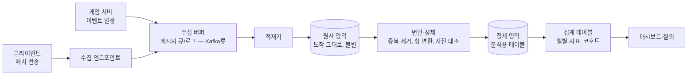
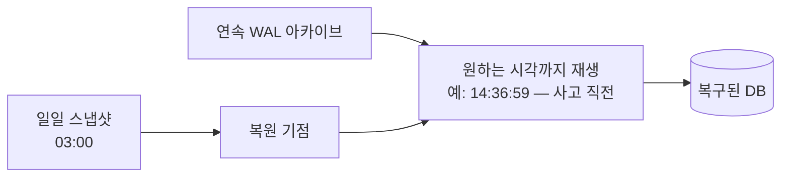

## 들어가며

운영 데이터베이스는 플레이어 요청을 빠르고 정확하게 처리해야 하고, 분석 시스템은 긴 시간의 대량 사건을 읽어 의사결정을 지원해야 한다. 두 워크로드를 섞으면 어느 쪽도 안정적으로 동작하지 않는다.

이 글은 이벤트 수집과 OLAP 모델, 배치·스트림 처리에서 출발해 백업·복구, 스키마 마이그레이션, 커넥션 풀, 용량 계획과 관측까지 데이터 시스템의 운영 수명주기를 다룬다.

읽는 기준은 운영 코드다. 백업은 파일이 아니라 복원 스크립트와 검증 질의로, SLO는 문장이 아니라 경보 조건과 error budget으로, 마이그레이션은 순서도가 아니라 상태 기계와 롤백 조건으로 표현되어야 한다. 데이터 운영은 사람이 기억하는 절차를 줄이고 프로그램이 확인하는 절차를 늘리는 일이다.

---

## 목차

1. OLTP와 OLAP: 반대 방향의 두 워크로드
2. 열 지향 저장: 분석이 빠른 이유
3. 게임 이벤트 설계
4. 수집 경로: 클라이언트에서 저장소까지
5. 파이프라인의 표준 형태
6. 배치와 스트림: 신선도의 가격
7. 분석 데이터의 품질 문제
8. 백업: 스냅샷과 로그의 이중주
9. 복구: 연습하지 않은 백업은 없는 것이다
10. 무중단 스키마 마이그레이션
11. 커넥션 풀의 산수
12. 모니터링: 데이터 계층의 계기판
13. 용량 계획과 부하 시험
14. 점검 창의 데이터 절차
15. 전달 의미와 Exactly-Once의 경계
16. 데이터 운영 계약: SLO, RPO, RTO
17. 운영 절차를 코드로 만들기

---


## 1. OLTP와 OLAP: 반대 방향의 두 워크로드

| 축 | OLTP (운영) | OLAP (분석) |
|---|---|---|
| 단위 작업 | 소수 행 읽기·갱신 | 수억 행 스캔·집계 |
| 접근 패턴 | 키 직격, 랜덤 | 일부 열의 전 구간 순차 |
| 지연 요구 | ms — 사용자가 기다린다 | 초~분 — 분석가가 기다린다 |
| 쓰기 | 갱신·삽입 혼합, 트랜잭션 | 추가 전용 대량 적재 |
| 진실 | 현재 상태 | 사건의 역사 |
| 대표 질의 | "계정 42의 인벤토리" | "지난 30일 일자별 신규 유저의 7일 잔존율" |

두 워크로드의 충돌 지점은 자원이다. 분석 스캔은 I/O와 캐시를 점유해 운영 질의의 P99를 밀어 올린다. 복제 팔로워는 초기 격리 수단이지만 긴 스캔이 replication lag와 vacuum을 방해할 수 있다. 규모가 커지면 columnar layout, 압축과 대규모 scan에 맞춘 전용 분석 저장소로 분리하고, ETL 지연을 데이터 신선도 계약에 포함한다.

## 2. 열 지향 저장: 분석이 빠른 이유

운영 DB는 행 지향(row-oriented)이다 — 한 행의 모든 컬럼이 붙어 저장되어, "계정 42의 전부"를 한 번에 읽는 데 최적이다. 분석 질의는 반대다 — "전 행의 컬럼 셋"을 읽는다.

```text
질의: SELECT AVG(damage) FROM combat_events WHERE day BETWEEN ...
      (컬럼 30개짜리 이벤트에서 2개만 필요)

행 지향:  [행1: 30컬럼][행2: 30컬럼]...  → 전부 읽고 28컬럼 버림
열 지향:  [day 열 전체][damage 열 전체]... → 필요한 2열만 읽음
```

열 지향(column-oriented) 저장은 필요한 컬럼의 chunk만 읽을 수 있어 wide row 전체를 materialize하는 비용을 줄인다. 30컬럼의 물리 크기가 모두 같고 다른 overhead가 없다는 장난감 모델에서는 2컬럼 scan이 payload의 2/30만 읽지만, 실제 I/O 비율은 컬럼별 폭·압축률, predicate column, row-group metadata와 최소 read 단위에 달려 있다. 같은 컬럼의 값은 타입과 분포가 비슷해 dictionary, RLE, delta와 bit packing이 잘 맞을 수 있지만 압축률은 데이터에 따라 달라진다. 정렬·파티션과 min/max 통계까지 맞으면 "지난 7일" 조건이 불필요한 file·row group을 건너뛸 수 있다.

columnar 구조는 point update와 짧은 row transaction보다 scan·집계에 유리해 분석 저장소에서 많이 쓰인다. 그렇다고 모든 columnar engine이 OLTP를 “못 하는” 것은 아니며, delta store·merge·delete bitmap 같은 보조 구조로 update를 지원하는 구현도 있다. 반대로 row store도 covering index와 column extension을 가질 수 있다. 선택 기준은 제품 이름이 아니라 point lookup·update rate, scan selectivity, 압축과 freshness 요구다.

## 3. 게임 이벤트 설계

분석의 원자는 이벤트(event)다 — "누가, 언제, 무엇을, 어떤 맥락에서"의 불변 기록. 설계 품질이 이후 모든 분석의 상한이 된다.

```json
{
  "event":       "item_acquired",
  "event_id":    "f3a9-...",          // 멱등성·중복 제거 키
  "ts":          "2026-06-13T07:21:04.310Z",
  "account_id":  42,
  "session_id":  "s-8821",
  "platform":    "pc", "build": "1.42.0",
  "params": { "template_id": 301, "source": "boss_drop", "stage": "w3-s2" }
}
```

설계 규칙들:

- **공통 봉투 + 이벤트별 파라미터**: 모든 이벤트가 공유하는 필드(시각, 계정, 세션, 빌드, 플랫폼)를 봉투로 고정하고, 이벤트 고유 정보는 파라미터로 — 파이프라인은 봉투만 알면 흐르고, 분석은 파라미터로 들어간다.
- **사건이지 상태가 아니다**: "레벨이 10이다"가 아니라 "레벨 10이 되었다(원인: 퀘스트 X)"를 적는다 — 상태는 사건들로부터 재구성 가능하지만 역은 불가능하다.
- **분모를 함께 설계한다**: "던전 클리어" 이벤트만 있으면 클리어율을 못 구한다 — "던전 입장"이 분모다. 지표를 먼저 정의하고 필요한 이벤트 쌍을 역산하는 순서가 옳다.
- **이벤트 사전의 단일 출처**: 이름·파라미터·의미를 코드와 별도의 사전(스키마 저장소)으로 관리하고 리뷰를 거친다 — 같은 의미의 이벤트가 팀마다 다른 이름으로 쌓이는 표류가 분석 조직의 고전적 부채다.
- **개인정보의 경계**: 식별자는 가명화 키로, 민감 정보(결제 수단, 정확한 위치)는 애초에 수집하지 않거나 분리 보관 — 보존 기간과 삭제 요청 대응까지가 이벤트 설계의 일부다.

## 4. 수집 경로: 클라이언트에서 저장소까지

이벤트의 출처는 둘이고 신뢰도가 다르다 — *서버 이벤트* (권위 시뮬레이션·경제 처리에서 발생: 신뢰 가능)와 *클라이언트 이벤트* (UI 조작·설정·성능 지표: 조작 가능, 유실 가능). 돈·밸런스 분석은 서버 이벤트가 원본이어야 하고, 클라이언트 이벤트는 UX 분석의 보조로 자리매김한다.

클라이언트 수집의 실무 형태는 게임 특유의 제약을 반영한다.

```cpp
// 클라이언트 텔레메트리 — 배치 + 압축 + 전송 실패 보존
class Telemetry {
public:
    void Emit(Event e) { buffer_.push_back(std::move(e)); }
    void Tick(double now) {
        bool full   = buffer_.size() >= kBatchCount;     // 예: 50건
        bool timely = now - lastFlush_ >= kBatchSecs;    // 예: 30초
        if ((full || timely) && !buffer_.empty()) Flush(now);
    }
private:
    void Flush(double now);  // 압축 → HTTPS POST, 실패 시 디스크 적체 후 재시도
};
```

- **배치 전송**: 건건이 보내면 PPS·배터리·대역폭 낭비 — 수십 건 또는 수십 초 단위로 묶는다. 게임플레이 트래픽과 경합하지 않도록 낮은 우선순위로.
- **유실 허용 + 중복 허용**: 전송 실패분은 로컬에 적체했다 재시도한다 — 따라서 중복 도착이 정상이고, `event_id`가 하류의 중복 제거 근거가 된다(7절).
- **종료 직전 이벤트의 한계**: 크래시·강제 종료 순간의 이벤트는 본질적으로 일부 유실된다 — "세션 종료" 이벤트에 의존하는 지표(플레이 시간)는 다음 세션 시작 시의 보고나 서버 측 관측으로 보완한다.

## 5. 파이프라인의 표준 형태

수집된 이벤트가 질의 가능한 테이블이 되기까지의 표준 경로다.



각 단계의 존재 이유:

- **수집 버퍼(메시지 큐)**: 생산 속도(폭주)와 소비 속도(적재)의 분리 — 하류가 느려져도 이벤트가 버려지지 않고 큐에 쌓인다. 추가 전용 로그 구조라 초당 수십만 건을 받는 데 적합하다.
- **원시 영역의 불변 보존**: 도착한 그대로를 먼저 저장한다 — 변환 로직의 버그가 발견되면 원시에서 *재처리* 할 수 있다는 것이 이 층의 가치다. 변환 후 원본을 버리는 파이프라인은 버그가 곧 영구 손실이다.
- **변환의 멱등성**: 재처리가 전제이므로 변환은 같은 입력에 같은 출력 — 실행 시각이나 외부 상태에 의존하지 않게 짠다.
- **집계 테이블**: 대시보드가 매번 수억 행을 스캔하지 않도록, 자주 쓰는 지표(DAU, 매출, 잔존)는 주기적으로 미리 집계해 둔다. 파생값을 물질화하되 원본 이벤트에서 재계산해 교정할 수 있어야 한다.

## 6. 배치와 스트림: 신선도의 가격

변환·집계를 *언제* 돌리는가의 선택이다.

| | 배치 (시간/일 단위) | 스트림 (초/분 단위) |
|---|---|---|
| 신선도 | 시간~하루 지연 | 초~분 |
| 구현·운영 복잡도 | 낮음 — 재실행 단순 | 높음 — 상태 관리, 순서, 재처리 |
| 정확성 | 마감 후 계산 — 안정 | 지연 도착 처리 필요 — 근사 후 보정 |
| 적합 용도 | 일일 지표, 코호트, 정산 | 실시간 운영 감시, 이상 탐지 |

판단 기준은 *그 지표의 소비자가 신선도에 돈을 낼 것인가* 다. 일일 잔존율은 내일 봐도 같은 결정을 내린다 — 배치면 충분하다. 반면 "이벤트 보상 발행량 급증"이나 "신규 빌드의 크래시율"은 분 단위 발견이 피해 규모를 가른다 — 스트림(또는 짧은 마이크로배치)의 영역이다. 표준 구성은 *배치를 기본으로, 소수의 운영 감시 지표만 스트림으로* — 전면 실시간화는 복잡도 대비 소득이 드물다.

시간의 두 축도 스트림 정확성의 핵심 어휘다 — 사건 시각(event time, 클라이언트에서 발생한 때)과 처리 시각(processing time, 파이프라인 도착 때)은 다르고, 오프라인 적체분은 몇 시간 뒤에 도착한다. "어제의 집계"는 사건 시각 기준이어야 하며, 따라서 지연 도착분을 받으면 *이미 닫은 구간을 보정* 하는 절차(재집계 창)가 필요하다.

## 7. 분석 데이터의 품질 문제

분석 파이프라인의 신뢰는 세 가지 고질을 다루는 데서 갈린다.

- **중복**: 수집 재시도(4절)와 큐의 최소 한 번 전달이 중복을 만든다 — `event_id` 기준 중복 제거를 변환 단계의 표준 절차로 둔다. 집계가 멱등 키 없이 "도착 건수"를 세면 재시도 폭주가 지표를 왜곡한다.
- **지연·역순 도착**: 사건 시각 기준 집계 + 재집계 창(6절)으로 흡수하되, "어느 시점 이후 도착분은 버린다"는 마감(워터마크)도 선언한다 — 영원히 열린 구간은 지표를 영원히 흔들리게 한다.
- **스키마 표류**: 빌드마다 파라미터가 추가·변경된다 — 이벤트 사전(3절)과 수집 단계의 검증(미등록 이벤트·형 불일치의 격리 영역행)이 방어선이고, "빌드 버전별 이벤트 볼륨" 대시보드가 새 빌드의 계측 누락을 출시 당일 드러낸다.

마지막으로 *지표 자체의 정합성 검증* — 분석 저장소의 매출 합계와 운영 DB(원장)의 정산이 주기적으로 대조되어야 한다. 분석은 근사를 허용하는 세계지만, 그 근사의 크기를 *알고* 있어야 의사결정의 입력이 될 수 있다. "대시보드와 회계가 3% 다른데 이유를 모른다"가 분석 조직의 적신호다.


## 8. 백업: 스냅샷과 로그의 이중주

백업의 표준 구성은 두 재료의 조합이다 — 주기적 전체 스냅샷(예: 일 1회)과, 그 사이의 모든 변경을 담은 연속 로그(WAL 아카이브). 이 조합이 시점 복구(PITR, Point-In-Time Recovery)를 가능하게 한다: 어제 새벽 스냅샷을 복원하고, 로그를 원하는 시각까지 재생한다.



PITR이 게임에서 특히 중요한 이유 — 복구 대상의 다수가 *하드웨어 장애가 아니라 논리적 사고* 이기 때문이다. 복제 버그로 아이템이 무한 증식한 14:37, 운영 실수로 테이블을 비운 21:02 — 복제본(replica)은 이런 사고를 *충실히 따라 하므로* 방어가 못 된다. 복제는 가용성의 도구이고, 백업은 시간을 되감는 도구다 — 서로 대체하지 않는다.

운용 규칙들: 백업은 *다른 장애 도메인* 에 둔다(같은 디스크·같은 데이터센터의 백업은 화재와 함께 사라진다). 보존 정책을 계층으로(일 단위 N일 + 주 단위 N주 + 월 단위 보관 — 법적·정산 요구 반영). 그리고 백업 자체의 무결성 검증(체크섬, 주기적 복원 시험)까지가 "백업이 있다"의 정의다.

## 9. 복구: 연습하지 않은 백업은 없는 것이다

복구의 두 지표가 설계 목표다 — RPO(Recovery Point Objective, 잃어도 되는 데이터의 시간 폭)와 RTO(Recovery Time Objective, 복구까지의 시간). PITR 구성에서 RPO는 로그 아카이브 주기(분 단위 가능)로, RTO는 "스냅샷 복원 + 로그 재생" 소요로 정해진다 — 그리고 RTO는 *측정해 봐야 아는 값* 이다. 수 TB의 복원과 수 시간치 로그 재생은 시간이 걸리고, 그 시간 동안 서비스가 멈춘다.

그래서 복구는 절차가 아니라 *근육* 이다.

- **주기적 복구 훈련**: 분기마다 실제 백업에서 격리 환경으로 전체 복구를 수행하고 소요 시간을 기록한다 — RTO의 실측이자 백업 무결성의 검증이다.
- **부분 복구의 준비**: 전체 되감기는 사고 이후의 *정상 데이터도 함께* 되감는다 — 실전에서 더 흔한 요구는 "복구본을 옆에 세우고, 영향 범위만 추출해 본 DB에 선별 반영"이다. 이 절차(복구본 기동 → 대조 질의 → 교정 스크립트)를 문서화해 둔다.
- **사고 시각의 특정**: PITR의 "어느 시각으로"는 원장·로그(경제 이력)에서 나온다 — 사고 탐지(이상 지표 경보)가 빠를수록 되감기 폭이 줄어든다는 점에서, 모니터링은 복구 체계의 일부다.

## 10. 무중단 스키마 마이그레이션

"컬럼 추가는 점검에서"는 옛 규칙이다 — 라이브 게임의 스키마 변경은 서비스가 도는 채로 이뤄져야 하고, 그 표준 절차가 확장-수축(expand-contract)이다. 핵심 원리는 *어느 순간에도 옛 코드와 새 코드가 같은 스키마 위에서 동작 가능해야 한다* 는 것 — 배포는 점진적이므로 두 버전의 서버가 공존하는 구간이 반드시 있다.

컬럼 이름 변경을 예로 든 전체 사이클:

```text
[확장]   1. 새 컬럼 추가 (기본값/NULL 허용 — 옛 코드는 모른 채 동작)
         2. 새 코드 배포: 양쪽 쓰기 (옛 컬럼 + 새 컬럼), 읽기는 옛 컬럼
         3. 백필: 기존 행의 새 컬럼을 배치로 채움 (속도 제한 — 부하 관리)
[전환]   4. 읽기를 새 컬럼으로 전환 (검증: 양쪽 값 대조 기간)
[수축]   5. 옛 컬럼 쓰기 중단
         6. 충분한 안정 기간 후 옛 컬럼 제거
```

각 단계가 독립 배포이고 *각 단계에서 롤백 가능* 하다는 것이 이 절차의 가치다 — 빅뱅 전환(점검 중 일괄 변경)은 실패 시 점검 연장과 롤백 불능으로 직행한다.

운영상 주의 둘. 첫째, *DDL 자체의 잠금 비용* — 데이터베이스·버전에 따라 컬럼 추가가 테이블 잠금이나 전체 재작성을 유발할 수 있다(기본값의 즉시 반영 여부 등). 대형 테이블의 모든 DDL은 실행 계획과 잠금 영향부터 확인하고, 온라인 스키마 변경 도구(섀도 테이블 + 점진 복사 방식)가 필요한 규모인지 판단한다. 둘째, *백필의 속도 제한* — 수억 행 갱신을 전속력으로 돌리면 복제 지연과 I/O 포화가 라이브를 때린다. 배치 크기 + 휴지 간격 + 복제 지연 감시 연동이 백필의 정석이다.

## 11. 커넥션 풀의 산수

데이터베이스 연결은 비싸다 — 연결마다 인증 핸드셰이크와 서버 측 메모리·프로세스 자원이 들고, 동시 연결 수에는 상한이 있다. 그래서 응용은 연결을 요청마다 만들지 않고 풀(pool)에서 빌려 쓴다. 풀 크기의 산수가 운영 품질을 가른다.

기준 산수는 리틀의 법칙이다 — 필요한 동시 연결 수 $\approx$ 초당 질의 수 $\times$ 평균 질의 시간. 초당 2,000 질의 × 평균 5ms면 동시 10연결이 이론값이고, 여유를 둬도 수십이면 충분하다 — "동접 1만이니 연결 1만"이 아니라는 것이 요점이다. 연결을 늘린다고 처리량이 늘지 않는다 — DB 코어가 동시에 실행할 수 있는 질의 수를 넘는 연결은 대기열을 DB 안으로 옮길 뿐이며, 과도한 연결 수 자체가 컨텍스트 스위칭·메모리로 성능을 깎는다.

운영 함정들:

- **풀 고갈의 전파**: 슬로우 쿼리 하나가 평균 질의 시간을 키우면, 같은 처리량에 필요한 연결 수가 비례해 늘고 풀이 마른다 — "DB는 멀쩡한데 응용이 타임아웃"의 전형. 풀 대기 시간을 1급 지표로 노출해야 원인이 보인다.
- **서버 수 × 풀 크기**: 게임 서버를 수평 확장하면 풀 합계가 DB 연결 상한을 향해 자란다 — 중앙 풀러(프록시형 풀)를 두거나 서버당 풀을 작게 유지하는 설계가 규모에서 필수가 된다.
- **트랜잭션 보유 중 외부 대기 금지**: 연결을 쥔 채 다른 서비스 응답을 기다리는 코드는 풀 고갈의 단골 — 연결 점유 시간은 질의 시간이어야지 작업 시간이어서는 안 된다.

## 12. 모니터링: 데이터 계층의 계기판

데이터 계층의 지표는 네 층으로 정리된다.

| 층 | 핵심 지표 | 이상 신호의 해석 |
|---|---|---|
| 질의 | 질의 지연 P50/P99, 슬로우 쿼리 발생률 | P99 상승 — 계획 변경·잠금 경합·캐시 미스 |
| 자원 | 버퍼 캐시 히트율, 디스크 I/O, 연결 수, 잠금 대기 | 히트율 하락 — 작업 집합이 메모리를 넘었다 |
| 복제·내구 | 복제 지연, WAL 생성률, 체크포인트 빈도 | 지연 급증 — 팔로워 부하·대량 쓰기·백필 |
| 응용 관점 | 풀 대기 시간, 트랜잭션 재시도율, 타임아웃률 | DB 지표 정상인데 응용 악화 — 풀·네트워크 |

습관 둘이 지표를 가치로 바꾼다. 첫째, *기준선 대비 변화의 경보* — 절대 임계("P99 50ms 초과")보다 "패치 후 P99 2배"가 회귀를 잡는다. 콘텐츠 패치마다 새 질의가 들어오는 게임에서 특히 그렇다. 둘째, *슬로우 쿼리 로그의 정기 리뷰* — 주간 단위로 상위 N개 질의의 실행 계획을 확인하는 루틴이, 데이터 성장으로 인덱스 경계를 넘는 질의("어제까지 빨랐는데")를 사고 전에 잡는다.

## 13. 용량 계획과 부하 시험

게임 DB의 부하는 평균이 아니라 사건이 결정한다 — 출시일, 대형 패치 직후, 이벤트 시작 정각, 방송 노출. 용량 계획은 "평시 여유율"이 아니라 *최악 사건의 모양* 에서 출발한다.

- **부하 모델의 작성**: 핵심 시나리오별 질의 프로파일을 적는다 — 로그인 1회당 질의 N개, 매치 종료당 트랜잭션 M개, 이벤트 보상 정각의 동시 수령 규모. "동접 X 만 명, 로그인 폭주 분당 Y"가 곧 "초당 질의 Z"로 환산되는 표가 용량 계획의 입력이다.
- **부하 시험의 충실도**: 합성 봇이 실제 질의 패턴(읽기/쓰기 비율, 핫스팟 분포)을 재현해야 의미가 있다 — 균등 랜덤 키의 시험은 캐시 히트율을 비현실적으로 만들어 낙관 결과를 준다. 운영 질의 로그 기반의 재생이 충실도의 기준이다.
- **데이터 부피의 시간축**: 성능은 데이터 크기의 함수다 — 출시 6개월 후 부피(원장·전적·이벤트 테이블의 성장률 × 기간)를 미리 채운 환경에서 시험해야 "그날 가서 느려지는" 질의가 보인다. 성장 빠른 테이블의 파티셔닝·아카이브 정책은 이 시험의 산출물이다.

## 14. 점검 창의 데이터 절차

점검(maintenance window)은 데이터 계층에는 작업 창이다 — 짧고 안전하게 쓰는 표준 절차를 둔다.

```text
[점검 진입]
 1. 신규 진입 차단 → 진행 중 트랜잭션 배수(드레인) 대기
 2. 쓰기 중단 확인 후 일관 시점 백업 (롤백의 기점)
[작업]
 3. 무중단으로 못 가는 잔여 작업만 수행 — 대형 DDL, 엔진 업그레이드, 대량 교정
 4. 각 작업 후 검증 질의 (행 수, 불변식, 표본 대조)
[재개]
 5. 내부 트래픽으로 스모크 테스트 (로그인·구매·매치 1사이클)
 6. 점진 개방 (지역·비율 단계) — 캐시 워밍업과 로그인 폭주를 함께 흡수
```

원칙은 셋이다. *점검 전 백업은 협상 불가* — 점검 중 사고의 롤백 기점이다. *점검에서만 가능한 작업을 최소화* — 10절의 무중단 절차가 일상화될수록 점검은 짧아지고, 그것이 곧 서비스 품질이다. *재개가 제2의 출시* — 점검 직후의 동시 로그인은 평시 최대를 넘는 폭주이고, 식어 있는 캐시(버퍼 풀, Redis)와 겹친다 — 점진 개방과 캐시 예열(핵심 기획 데이터 선적재)이 재개 절차의 일부여야 한다.

## 15. 전달 의미와 Exactly-Once의 경계

데이터 파이프라인에서 "정확히 한 번(exactly once)"이라는 표현은 위험하다. 네트워크, 큐, 프로세스는 중간에 죽을 수 있고, 보낸 쪽은 받는 쪽이 처리했는지 응답만 잃었는지 구분하지 못한다. 시스템 전체가 마법처럼 한 번만 실행되는 것이 아니라, 보통 다음 조합으로 *결과가 한 번 적용된 것처럼* 보이게 만든다.

```text
최소 한 번 전달
  + 멱등 처리
  + 결정적 재처리
  + 중복 제거 키
  + 커밋된 offset/상태의 원자적 갱신
```

큐의 전달 의미와 비즈니스 결과의 의미를 분리해야 한다.

| 계층 | 흔한 보장 | 남는 문제 |
|---|---|---|
| 네트워크 전송 | 요청이 성공하거나 실패로 보임 | 실패가 미처리인지 응답 손실인지 모름 |
| 메시지 큐 | 최소 한 번 전달 | consumer 재시작 시 중복 |
| 변환 작업 | 같은 입력에 같은 출력 | 외부 상태 참조 시 비결정성 |
| 집계 테이블 | 키 기준 upsert | 키 설계가 틀리면 중복 또는 덮어쓰기 |
| 운영 원장 | 트랜잭션 commit | 외부 이벤트 발행과 원자성 경계 |

분석 이벤트에서는 `event_id`가 중복 제거의 핵심이다. 그러나 dedup table도 영원히 보관할 수 없으므로 보존 기간이 필요하다. 보존 기간보다 늦게 도착한 중복은 다시 집계될 수 있다. 따라서 중복 제거는 절대 보장이 아니라 시간 창을 가진 정책이다.

스트림 처리에서 offset commit과 결과 저장의 순서도 중요하다.

```text
1. 메시지 읽기
2. 결과 저장
3. offset commit
```

2번 뒤 3번 전에 죽으면 같은 메시지를 다시 읽는다. 결과 저장이 멱등하면 안전하다. 반대로 offset을 먼저 commit하고 결과 저장 전에 죽으면 메시지가 유실된다. 그래서 결과 테이블과 처리 offset을 같은 트랜잭션으로 저장하거나, 결과를 idempotent upsert로 만들고 offset은 "재처리 가능" 쪽으로 둔다.

집계는 더 까다롭다. `count += 1`은 중복에 취약하다. 이벤트 ID별 처리 여부를 저장하거나, 원시 이벤트에서 집계를 재계산할 수 있어야 한다. 중요한 지표는 "증분 누적"만 믿지 않고 주기적으로 원시 데이터에서 재계산한 값과 대조한다.

재처리는 기능이다. 파이프라인은 다음 질문에 답해야 한다.

- 원시 데이터가 어느 기간 동안 보존되는가
- 변환 코드 버전을 바꿔 과거 데이터를 다시 처리할 수 있는가
- 재처리 중 기존 결과와 새 결과가 동시에 보일 때 질의는 어느 쪽을 읽는가
- 재처리 실패 시 부분 결과를 어떻게 폐기하는가
- 지표 정의가 바뀌면 대시보드의 과거 값이 어떤 의미를 갖는가

정확한 데이터 시스템은 중복이 없는 시스템이 아니라, 중복과 재처리를 전제로 결과 의미를 보존하는 시스템이다.

## 16. 데이터 운영 계약: SLO, RPO, RTO

데이터 계층의 운영 목표는 "안정적으로"가 아니라 숫자와 절차로 표현되어야 한다. 세 가지 계약이 기본이다.

- **SLO(Service Level Objective)**: 정상 운영 중 어떤 품질을 제공할 것인가
- **RPO(Recovery Point Objective)**: 장애 시 얼마나 많은 데이터를 잃어도 되는가
- **RTO(Recovery Time Objective)**: 장애 후 얼마 안에 복구해야 하는가

예를 들어 계정·경제 원장은 다음처럼 강한 계약을 요구한다.

```text
경제 원장:
  RPO = 0에 가깝게, commit된 거래 손실 금지
  RTO = 30분
  SLO = P99 쓰기 50ms 이하, 월간 가용성 99.9%
```

반면 분석 이벤트는 다른 계약을 가질 수 있다.

```text
클라이언트 UX 이벤트:
  RPO = 최대 10분 유실 허용
  RTO = 24시간
  SLO = 일일 집계가 다음날 10:00 전 완성
```

같은 "데이터"라도 계약이 다르면 저장소, 복제, 백업, 경보가 달라진다. 모든 데이터를 원장처럼 다루면 비용이 폭발하고, 원장을 텔레메트리처럼 다루면 게임 경제가 깨진다.

운영 계약은 경보로 이어져야 한다. RPO가 5분이면 WAL 아카이브 지연이 5분에 가까워질 때 이미 장애 전조다. RTO가 30분이면 복원 훈련의 실제 시간이 30분을 넘는 순간 계약은 거짓이다. SLO가 P99 50ms라면 평균 지연이 아니라 P99와 error budget 소진 속도를 본다.

```text
error budget = 허용 실패 시간 또는 실패 요청 수
burn rate    = 현재 속도로 예산을 소진하는 배율
```

빠른 burn rate는 즉시 대응하고, 느린 burn rate는 계획된 개선으로 처리한다. 모든 경보를 같은 긴급도로 울리면 운영자는 경보를 무시하게 된다.

마지막으로 운영 계약은 runbook으로 닫혀야 한다. 경보가 울렸을 때 누가, 어떤 순서로, 어떤 권한으로, 어떤 롤백 지점까지 조작할 수 있는지 문서화되어 있어야 한다. 데이터 사고는 늦게 발견될수록 되돌릴 정상 상태와 오염된 상태가 섞인다. 그래서 탐지, 격리, 복구, 검증 질의, 플레이어 보상 기준까지가 데이터 운영의 일부다.


## 17. 운영 절차를 코드로 만들기

운영 문서는 사람이 읽는 글로 끝나면 사고 당일에 흔들린다. 데이터 운영의 핵심 절차는 쿼리, 스크립트, 대시보드, 경보 조건으로 내려와야 한다. "백업이 정상이다"는 말은 복구 리허설 결과와 검증 쿼리로만 증명된다.

예를 들어 경제 원장의 일일 정산은 다음 질의처럼 자동화되어야 한다.

```sql
WITH ledger_sum AS (
    SELECT player_id, currency, SUM(delta) AS ledger_amount
      FROM wallet_ledger
     GROUP BY player_id, currency
)
SELECT b.player_id, b.currency, b.amount, l.ledger_amount
  FROM wallet_balance b
  JOIN ledger_sum l
    ON l.player_id = b.player_id
   AND l.currency = b.currency
 WHERE b.amount <> l.ledger_amount
 LIMIT 100;
```

이 쿼리는 수동 조사 도구가 아니라 경보 조건이다. 결과가 0행이어야 하는 쿼리는 배치 잡으로 실행하고, 1행이라도 나오면 쓰기 경로 배포 중지나 지급 경로 차단 같은 runbook으로 이어져야 한다.

무중단 마이그레이션도 체크리스트가 아니라 상태 기계로 관리한다.

```text
state add_column:
  nullable 컬럼 추가
  old code writes old column only

state dual_write:
  new code writes old + new column
  background backfill starts

state verify:
  assert old and new values match
  block deploy if mismatch > 0

state read_new:
  code reads new column

state drop_old:
  old column removed after rollback window
```

각 상태에는 전진 조건과 롤백 조건이 있어야 한다.

```sql
SELECT COUNT(*) AS missing_backfill
  FROM player_profile
 WHERE new_region IS NULL;

SELECT COUNT(*) AS mismatch
  FROM player_profile
 WHERE legacy_region IS DISTINCT FROM new_region;
```

커넥션 풀도 코드 계약이다. "풀 크기를 적당히 둔다"는 말은 장애를 만든다. 인스턴스 수와 DB 한도를 이용해 상한을 계산하고 설정 파일에 박는다.

```text
db_max_connections = 800
reserved_for_admin = 50
app_instances      = 30
pool_per_instance  = floor((800 - 50) / 30) = 25
```

설정은 배포 시 검증해야 한다.

```cpp
void ValidateDbPoolConfig(const Config& c) {
    int total = c.appInstances * c.poolSize + c.adminReserve;
    if (total > c.dbMaxConnections) {
        throw ConfigError("DB connection budget exceeded");
    }
}
```

백업도 파일 존재 여부가 아니라 복원 가능한 상태를 검증해야 한다.

```text
daily restore drill:
  1. latest snapshot restore to isolated cluster
  2. WAL replay to target timestamp
  3. run consistency queries
  4. measure restore duration
  5. compare duration <= RTO
  6. compare replay gap <= RPO
```

운영은 결국 코드다. 경보 조건은 SQL이고, 마이그레이션은 상태 기계이며, 풀 크기는 산술 검증이고, 백업은 복원 테스트다. 사람이 기억해야 하는 절차를 줄일수록 데이터 사고의 반경이 줄어든다.


---

## 결론

분석과 운영은 데이터 모델 이후에 붙는 부가 기능이 아니다. 어떤 사건을 남기고 어떻게 복구하며, 변화 중에도 서비스를 유지할지를 결정하는 데이터 시스템의 완성 단계다. 중복과 지연, 재처리를 정상 조건으로 받아들이고, 각 데이터 종류에 맞는 SLO·RPO·RTO를 숫자로 선언해야 운영 판단이 가능해진다.

## 더 읽을거리

- Martin Kleppmann, *Designing Data-Intensive Applications*, Ch.3 후반(컬럼 저장)·Ch.10·11 (Batch/Stream Processing) — 파이프라인 설계의 이론적 바탕.
- Mike Stonebraker 외, "C-Store: A Column-oriented DBMS" (VLDB 2005) — 열 지향 저장의 학술 원전.
- Jay Kreps, ["The Log: What every software engineer should know about real-time data's unifying abstraction"](https://www.linkedin.com/blog/engineering/distributed-systems/log-what-every-software-engineer-should-know-about-real-time-datas-unifying) (LinkedIn Engineering, 2013) — 큐/로그 중심 파이프라인 사고의 고전.
- Tyler Akidau 외, "The Dataflow Model" (VLDB 2015) — 사건 시각·워터마크·지연 도착 처리의 정식화.
- [ClickHouse 문서: Why is ClickHouse so fast?](https://clickhouse.com/docs/concepts/why-clickhouse-is-so-fast) — 열 지향 엔진 설계의 실물 해설.
- [PostgreSQL 문서: Backup and Restore](https://www.postgresql.org/docs/current/backup.html) — 스냅샷·WAL 아카이브·PITR 구성의 1차 출처.
- [GitLab의 2017년 데이터베이스 사고 포스트모템](https://about.gitlab.com/blog/postmortem-of-database-outage-of-january-31/) — "백업이 다섯 겹인데 복구 가능한 것이 없었다"는 산업 표준 반면교사.
- [GitHub Engineering: gh-ost](https://github.com/github/gh-ost) — 온라인 스키마 변경 도구의 설계 문서(트리거 없는 점진 복사).
- [HikariCP Wiki: About Pool Sizing](https://github.com/brettwooldridge/HikariCP/wiki/About-Pool-Sizing) — "연결은 적을수록 빠르다"의 산수와 실측.
- Betsy Beyer 외 편, *Site Reliability Engineering* (O'Reilly, 2016) — 복구 훈련·점진 개방·기준선 경보 등 운영 원칙의 본진(무료 공개).
- Martin Kleppmann, *Designing Data-Intensive Applications*, Ch.10~12 — 파생 데이터와 무중단 진화의 큰 그림.
