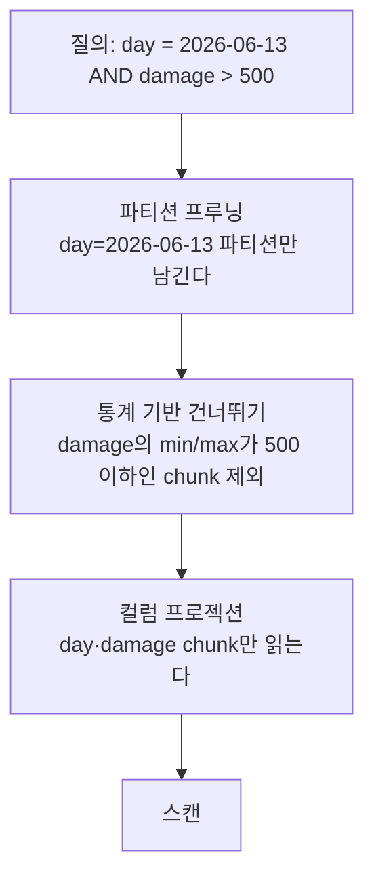
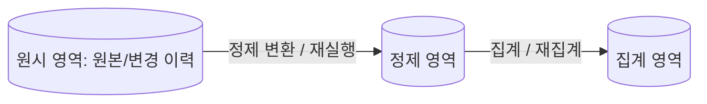

## 들어가며

운영 데이터베이스는 "계정 42의 인벤토리"에 답하도록 만들어져 있다. 키로 몇 행을 찾아 밀리초 안에 돌려주고, 그 사이 다른 요청이 같은 행을 건드리지 못하게 막는다. 분석 질의는 정반대를 요구한다 — 수억 행을 훑어 두세 개 컬럼만 집계하고, 몇 초를 기다려도 되지만 그동안 디스크와 캐시를 전부 가져간다. 같은 저장소에서 두 요구를 동시에 만족시키려 하면 운영 질의의 P99가 먼저 무너진다.

그래서 분석은 별도의 저장소를 갖는다. 그 저장소는 레이아웃도, 압축도, 갱신 모델도, 정확성의 기준도 운영 DB와 다르다. 열 지향 배치가 왜 스캔을 싸게 만드는지, 정렬 순서 하나가 왜 압축률과 건너뛰기 효율을 동시에 정하는지, 운영 DB의 상태를 어떤 경로로 데려와야 신선도와 부하를 함께 계약할 수 있는지가 이 저장소의 설계 문제다.

이 글은 분석 저장소를 저장 엔진의 문제로 다룬다. 워크로드가 갈라지는 이유, 열 지향 배치와 부호화, 파티션과 통계 기반 건너뛰기, 운영 저장소에서 데이터를 옮기는 세 경로, 원시·정제·집계 영역의 계약, 사건 시각과 파티션의 충돌, 중복과 재처리 아래에서 파생 데이터의 의미를 보존하는 법, 그리고 보존 기간이 "언제까지 과거를 고칠 수 있는가"를 결정한다는 사실까지다.

---

## 목차
1. [반대 방향의 두 워크로드](#1-반대-방향의-두-워크로드)
2. [열 지향 저장: 무엇이 줄어드는가](#2-열-지향-저장-무엇이-줄어드는가)
3. [부호화와 정렬 순서](#3-부호화와-정렬-순서)
4. [파티션과 건너뛰기](#4-파티션과-건너뛰기)
5. [운영 저장소에서 분석 저장소로](#5-운영-저장소에서-분석-저장소로)
6. [저장 영역의 계층과 재계산 가능성](#6-저장-영역의-계층과-재계산-가능성)
7. [배치와 스트림: 신선도의 가격](#7-배치와-스트림-신선도의-가격)
8. [사건 시각과 파티션의 충돌](#8-사건-시각과-파티션의-충돌)
9. [중복·재처리와 파생 데이터의 정합성](#9-중복재처리와-파생-데이터의-정합성)
10. [보존과 아카이브](#10-보존과-아카이브)
11. [불변식을 질의로](#11-불변식을-질의로)

---

## 1. 반대 방향의 두 워크로드

| 축 | OLTP (운영) | OLAP (분석) |
|---|---|---|
| 단위 작업 | 소수 행 읽기·갱신 | 수억 행 스캔·집계 |
| 접근 패턴 | 키 직격, 랜덤 | 일부 열의 전 구간 순차 |
| 지연 요구 | ms — 사용자가 기다린다 | 초~분 — 분석가가 기다린다 |
| 쓰기 | 갱신·삽입 혼합, 트랜잭션 | 추가 전용 대량 적재 |
| 진실 | 현재 상태 | 사건의 역사 |
| 대표 질의 | "계정 42의 인벤토리" | "지난 30일 일자별 신규 유저의 7일 잔존율" |

두 워크로드의 충돌 지점은 자원이다. 분석 스캔은 I/O와 버퍼 캐시를 점유해 운영 질의의 P99를 밀어 올린다. 버퍼 캐시는 특히 취약하다 — 운영 워크로드의 작업 집합은 자주 쓰는 소수의 페이지에 몰려 있는데, 한 번 훑고 버릴 수억 행의 스캔이 그 페이지들을 밀어내면 스캔이 끝난 뒤에도 한동안 히트율이 회복되지 않는다.

복제 팔로워로 옮기는 것이 첫 번째 격리 수단이지만 완전하지 않다. 긴 스캔은 팔로워에서도 오래 열려 있는 읽기 트랜잭션이고, 그 트랜잭션이 보고 있는 옛 버전은 회수될 수 없다. 결과는 두 가지로 나타난다 — 팔로워의 옛 버전 정리가 밀리거나, 정리를 강행하면 스캔이 취소된다. 어느 쪽이든 "읽기 전용이니 안전하다"는 직관은 틀렸다.

그래서 규모가 커지면 분석은 별도 저장소로 나간다. 그 순간 생기는 새 계약이 *신선도* 다. 운영 DB의 답은 정의상 최신이지만 분석 저장소의 답은 "몇 분 전 또는 몇 시간 전의 세계"이고, 그 지연이 지표 해석의 전제가 된다.

## 2. 열 지향 저장: 무엇이 줄어드는가

운영 DB는 행 지향(row-oriented)이다 — 한 행의 모든 컬럼이 붙어 저장되어, "계정 42의 전부"를 한 번에 읽는 데 최적이다. 분석 질의는 반대다 — "전 행의 컬럼 셋"을 읽는다.

```text
질의: SELECT AVG(damage) FROM combat_events WHERE day BETWEEN ...
      (컬럼 30개짜리 이벤트에서 2개만 필요)

행 지향:  [행1: 30컬럼][행2: 30컬럼]...  → 전부 읽고 28컬럼 버림
열 지향:  [day 열 전체][damage 열 전체]... → 필요한 2열만 읽음
```

열 지향(column-oriented) 저장은 필요한 컬럼의 chunk만 읽을 수 있어 wide row 전체를 materialize하는 비용을 줄인다. 30컬럼의 물리 크기가 모두 같고 다른 overhead가 없다는 장난감 모델에서는 2컬럼 scan이 payload의 2/30만 읽지만, 실제 I/O 비율은 컬럼별 폭·압축률, predicate column, row-group metadata와 최소 read 단위에 달려 있다.

줄어드는 것은 세 가지이고 서로 독립이다.

| 줄어드는 것 | 원인 | 무엇에 좌우되는가 |
|---|---|---|
| 읽는 바이트 | 필요한 컬럼만 접근 | 질의가 쓰는 컬럼 수 / 전체 컬럼 폭 |
| 저장 바이트 | 같은 타입·분포가 모여 부호화가 잘 맞음 | 카디널리티, 정렬 순서, 값의 국소성 |
| CPU 사이클 | 한 타입의 연속 배열에 같은 연산 반복 | 부호화된 표현 위에서 직접 처리하는지 |

세 번째가 자주 간과된다. 압축을 풀지 않은 채로 조건을 평가할 수 있으면 — 사전 부호화된 컬럼에서 문자열 비교 대신 코드 비교를 하면 — 절약되는 것은 I/O가 아니라 CPU다. 반대로 매 값을 원래 표현으로 복원해야 하는 부호화는 I/O를 줄이면서 CPU를 늘린다.

columnar 구조는 point update와 짧은 row transaction보다 scan·집계에 유리해 분석 저장소에서 많이 쓰인다. 그렇다고 모든 columnar engine이 OLTP를 “못 하는” 것은 아니며, delta store·merge·delete bitmap 같은 보조 구조로 update를 지원하는 구현도 있다. 반대로 row store도 covering index와 column extension을 가질 수 있다. 선택 기준은 제품 이름이 아니라 point lookup·update rate, scan selectivity, 압축과 freshness 요구다.

## 3. 부호화와 정렬 순서

열 안의 값들은 타입이 같고 분포가 비슷하다. 그 성질을 쓰는 부호화가 몇 가지 있고, 각각 전제가 다르다.

| 부호화 | 전제 | 얻는 것 | 잃는 것 |
|---|---|---|---|
| 사전(dictionary) | 카디널리티가 chunk 크기보다 훨씬 작다 | 문자열이 작은 정수 코드로, 코드 위 조건 평가 | 사전 자체의 메모리, 카디널리티 폭발 시 역효과 |
| 런 길이(RLE) | 같은 값이 연속으로 반복된다 | 반복 구간이 (값, 길이) 한 쌍으로 | 정렬되지 않은 컬럼에서는 거의 무의미 |
| 델타 | 값이 단조에 가깝다 | 큰 절댓값이 작은 차분으로 | 임의 접근 시 구간 시작부터 누적 필요 |
| 비트 패킹 | 값 범위가 타입 폭보다 훨씬 좁다 | 필요한 비트 수만 사용 | 언패킹 CPU |

이 넷은 대개 함께 쓰인다. 타임스탬프 컬럼은 델타를 취해 값 범위를 좁힌 뒤 비트 패킹하고, 플랫폼 컬럼은 사전으로 코드화한 뒤 RLE로 묶는 식이다.

여기서 중요한 사실은 **부호화 효율의 상당 부분이 물리 정렬 순서에서 온다**는 것이다. 사전 부호화는 순서와 무관하지만 RLE는 순서가 전부다. 이벤트 테이블을 `(day, platform, event_name)` 순으로 정렬해 두면 `platform` 컬럼은 하루치 안에서 몇 개의 긴 런으로 접히지만, 도착 순서 그대로 두면 같은 컬럼이 값 사이를 계속 오간다. 같은 데이터, 같은 부호화, 다른 정렬 순서가 저장 크기를 몇 배 갈라놓는다.

그리고 물리 정렬 순서는 사본당 하나뿐이다. `day` 우선으로 정렬하면 기간 질의가 빨라지고 `account_id` 우선으로 정렬하면 특정 플레이어 추적이 빨라지지만, 둘 다는 안 된다. 선택지는 셋이다.

```text
1. 지배적인 질의 패턴 하나를 골라 그 순서로 정렬한다.
2. 정렬 순서가 다른 사본을 하나 더 만든다 — 저장·적재 비용이 늘어난다(대략 두 배 수준일 수 있으나 부호화·projection 구성에 따라 다르다).
3. 두 번째 축은 정렬 대신 파티션이나 보조 색인으로 처리한다.
```

운영 DB에서 인덱스를 늘려 여러 질의를 함께 만족시키던 습관이 여기서는 통하지 않는다. 분석 저장소에서 인덱스에 해당하는 것은 대개 정렬 순서와 파티션이고, 둘 다 데이터를 다시 쓰지 않으면 바꿀 수 없다.

## 4. 파티션과 건너뛰기

스캔을 싸게 만드는 두 번째 축은 *읽지 않는 것* 이다. 계층이 셋이다.



**파티션 프루닝.** 테이블을 파티션 키(대개 날짜)로 물리 분할해 두면 조건에 맞지 않는 파티션은 파일을 열지도 않는다. 효과가 가장 크고 가장 확실하다. 대신 파티션 키는 질의 조건에 거의 항상 등장하는 컬럼이어야 하고, 너무 잘게 쪼개면 작은 파일이 수만 개 생겨 메타데이터 처리가 스캔보다 비싸진다.

**통계 기반 건너뛰기.** 열 chunk마다 min/max와 null 개수 같은 요약을 함께 저장해 두면, 조건 구간과 겹치지 않는 chunk를 읽지 않고 건너뛴다. 이 최적화의 효율은 다시 정렬 순서에 달려 있다 — 정렬된 컬럼의 chunk들은 min/max 구간이 서로 겹치지 않아 대부분을 걸러내지만, 무작위 순서에서는 모든 chunk의 구간이 전 범위를 덮어 하나도 못 건너뛴다.

**컬럼 프로젝션.** 질의에 등장하지 않는 컬럼은 애초에 읽지 않는다(2절).

세 계층이 곱으로 작동한다는 점이 중요하다. 90일 중 하루만 보는 질의가 파티션 프루닝으로 1/90을 남기고, 그 안에서 통계로 절반을 건너뛰고, 30컬럼 중 2컬럼만 읽으면 실제 I/O는 전체의 수천분의 일이다. 반대로 파티션 키가 질의 조건에 없으면 전체 날짜 범위를 대상으로 하게 되지만, 통계 건너뛰기와 컬럼 프로젝션은 독립적으로 동작하므로 읽는 바이트·CPU를 여전히 줄일 수 있다. 다만 첫 계층의 효과를 잃은 만큼 비용 상한이 커진다.

질의 성능을 볼 때 실행 시간보다 먼저 봐야 하는 값이 있다.

```text
읽은 파티션 수 / 전체 파티션 수
읽은 chunk 수 / 파티션 안의 chunk 수
읽은 바이트 / 테이블 전체 바이트
```

셋 중 어느 것도 줄지 않았는데 빨라졌다면 캐시·압축·벡터화 실행·병렬성 같은 요인을 함께 계측해야 원인이 보인다. 캐시 효과는 데이터가 자라면 되돌아오지만, CPU 실행 방식·알고리즘 개선은 남는다.

## 5. 운영 저장소에서 분석 저장소로

이벤트는 애초에 추가 전용이라 옮기기 쉽다. 어려운 것은 *상태 테이블* 이다 — 계정, 인벤토리, 지갑은 갱신되는 행이고, 분석은 그 행의 현재 값뿐 아니라 "그때의 값"을 묻는다. 경로 선택은 신선도·부하·복잡도의 교환이다.

| 경로 | 신선도 | 운영 DB 부하 | 남는 문제 |
|---|---|---|---|
| 팔로워를 직접 질의 | 복제 지연만큼 | 스캔이 팔로워 자원을 점유 | 행 지향이라 스캔 비용이 그대로. 긴 트랜잭션이 옛 버전 회수를 막는다(1절) |
| 주기적 추출(배치 export) | 추출 주기만큼 | 추출 창에 집중 부하 | 삭제·갱신의 반영, 추출 시점의 일관된 스냅샷 확보 |
| 복제 로그 추출(CDC) | 초~분 | 질의 부하 없음 — 로그만 읽는다 | 초기 스냅샷과 로그의 이음매, 스키마 변경 대응, 중복과 순서 |

**배치 추출의 함정은 커서와 삭제다.** `updated_at > 마지막 추출 시각` 같은 타임스탬프 워터마크는 commit 순서 커서가 아니다 — 추출기가 워터마크를 확정한 뒤 늦게 커밋한 트랜잭션의 갱신은 다음 질의에서 빠질 수 있고, 같은 타임스탬프 동률도 별도 문제다. 가능하면 커밋 로그 위치 같은 로그 기반 커서를 우선하고, 타임스탬프 방식은 충분한 overlap 재조회·복합 커서·dedup을 함께 계약해야 하며, 그것만으로 모든 장기 트랜잭션이 해결되지는 않는다. 삭제는 별개의 위험이다 — `updated_at` 기반 증분은 삭제된 행을 영원히 잡지 못해 분석 저장소에 이미 지워진 아이템이 남고, 그 차이는 전체 재추출을 하기 전까지 드러나지 않는다. 삭제를 물리 삭제 대신 상태 플래그(tombstone)로 표현하는 설계가 여기서 값을 한다.

**로그 추출의 함정은 이음매다.** 복제 로그는 어느 시점부터의 변경만 담고 있으므로, 시작하려면 그 시점의 일관된 스냅샷이 필요하다. 스냅샷을 뜬 로그 위치를 정확히 기록하고 그 위치부터 로그를 적용해야 한다. 위치를 한 칸이라도 잘못 잡으면 변경 하나가 사라지거나 두 번 적용되고, 후자는 멱등하게 만들어 두면 무해하지만 전자는 조용히 틀린다. 로그 적용은 키 기준 upsert로 짜서 재적용이 안전하게 만든다. 다만 UPSERT는 같은 버전의 반복에만 멱등하므로, source generation·version의 비교 가능한 순서로 조건부 갱신해 더 오래된 replay가 최신 상태를 덮지 않게 하고, 같은 version의 payload 불일치와 삭제 tombstone의 version 처리 규칙을 함께 정의한다.

**과거 시점 질의.** 어느 경로로 옮기든 상태 테이블의 복제본은 "현재 값"만 갖는다. "6월 13일 시점에 다이아 1만 이상이던 계정"에 답하려면 그때의 값이 어딘가 남아 있어야 한다. 방법은 둘이다 — 변경을 사건으로 남겨 상태를 재구성하거나, 상태 테이블의 일 단위 스냅샷을 파티션으로 쌓는다. 전자는 저장이 싸고 재구성이 비싸며, 후자는 반대다. 계정 수가 수천만이고 매일 전량 스냅샷을 뜨면 상태 테이블 하나가 이벤트보다 빨리 자란다.

## 6. 저장 영역의 계층과 재계산 가능성

분석 저장소는 하나의 테이블 집합이 아니라 계약이 다른 세 영역으로 나뉜다.



| 영역 | 쓰기 방식 | 스키마 | 이 영역이 사라지면 |
|---|---|---|---|
| 원시 | 추가 전용, 변형 없음 | 약하게 강제(봉투만) | 원시에서만 얻는 입력이 필요한 변환은 다시 만들 수 없다 |
| 정제 | 멱등 변환의 결과 | 강하게 강제 | 원시에서 다시 만든다 |
| 집계 | 키 기준 upsert | 지표 정의에 종속 | 정제에서 다시 만든다 |

핵심 규칙 하나로 요약된다. **재계산 가능성은 위에서 아래로만 흐른다.** 어떤 영역이든 자기보다 위 영역이 없어지면, 그 영역은 위 영역에서만 얻을 수 있는 정보에 대해 더 이상 교정할 수 없는 최종 진실이 된다. 정제가 필요한 필드를 보존하고 있으면 집계는 정제에서 다시 계산할 수 있지만, 원시→정제 변환에서 잃은 필드가 필요하면 고칠 방법이 없고, 변환 코드 버전·참조 데이터가 남아 있지 않으면 과거를 새 정의로 다시 계산할 수 없다.

그래서 원시 영역의 보존 기간을 정하는 일은 저장 비용의 문제가 아니라 **"언제까지 과거를 고칠 수 있는가"를 정하는 일** 이다. 재처리 가능 범위는 원시 보존 기간만이 아니라 필요한 입력 필드·변환 코드 버전·참조 데이터가 함께 남아 있는지로 정해진다. 90일 보존은 "91일 전에 원시에서만 얻는 필드가 필요한 변환 버그는 영구적이다"와 같은 말이다. 이 등가를 보존 정책 문서에 그대로 적어 두면 비용 논의의 성격이 바뀐다.

변환에 붙는 요구도 여기서 나온다. 재처리가 전제이므로 변환은 같은 입력에 같은 출력이어야 한다 — 실행 시각, 외부 API 응답, 처리 순서에 의존하는 변환은 재처리할 때마다 다른 결과를 낳아 위 규칙을 깨뜨린다. `NOW()`를 쓰는 변환은 재계산 불가능한 변환이다.

집계 영역은 성능을 위한 물질화다. 대시보드가 매번 수억 행을 훑지 않도록 자주 쓰는 지표를 미리 접어 두지만, 그 값은 정제 영역에서 언제든 다시 만들어질 수 있어야 하고 실제로 주기적으로 다시 만들어 대조해야 한다(9절).

## 7. 배치와 스트림: 신선도의 가격

변환·집계를 *언제* 돌리는가의 선택이다.

| | 배치 (시간/일 단위) | 스트림 (초/분 단위) |
|---|---|---|
| 신선도 | 시간~하루 지연 | 초~분 |
| 구현·운영 복잡도 | 낮음 — 재실행 단순 | 높음 — 상태 관리, 순서, 재처리 |
| 정확성 | 마감 후 계산 — 안정 | 지연 도착 처리 필요 — 근사 후 보정 |
| 적합 용도 | 일일 지표, 코호트, 정산 | 실시간 운영 감시, 이상 탐지 |

판단 기준은 *그 지표의 소비자가 신선도에 돈을 낼 것인가* 다. 일일 잔존율은 내일 봐도 같은 결정을 내린다 — 배치면 충분하다. 반면 "이벤트 보상 발행량 급증"이나 "신규 빌드의 크래시율"은 분 단위 발견이 피해 규모를 가른다 — 스트림(또는 짧은 마이크로배치)의 영역이다. 표준 구성은 *배치를 기본으로, 소수의 운영 감시 지표만 스트림으로* — 전면 실시간화는 복잡도 대비 소득이 드물다.

신선도는 감이 아니라 합으로 적어야 계약이 된다. 먼저 원점을 분명히 한다 — 소스에서 서버로 도착하는 지연(event→ingest)과 도착 후 질의 가능해지기까지의 지연(ingest→query)은 별개다. 전자는 기기 오프라인·재전송 큐·시계 오차에 좌우되고, 후자를 아래 항들의 합으로 본다.

$$
\text{지연}_{ingest \to query} = \text{추출 간격} + \text{변환 시간} + \text{적재 시간} + \text{집계 주기} + \text{재시도·복구 여유}
$$

이 합은 정상 운전에서의 SLO 예산이지 장애를 포함한 절대 상한이 아니다. 추출 실패, queue backlog, 집계 재실행이 겹치면 hard bound는 더 커진다. 대시보드에는 이 SLO 값과 함께 지연 분포·최종 watermark 시각(이 값이 몇 시 기준인가)을 표시한다. 기준 시각 없는 숫자는 두 사람이 다른 시점을 보면서 같은 지표를 논의하게 만든다.

## 8. 사건 시각과 파티션의 충돌

시간에는 두 축이 있다. *사건 시각(event time)* 은 클라이언트나 서버에서 그 일이 실제로 벌어진 때이고, *처리 시각(processing time)* 은 파이프라인에 도착한 때다. 오프라인이었던 기기의 적체분은 몇 시간 뒤에 도착하고, 재처리분은 며칠 뒤에 도착한다.

"어제의 집계"는 정의상 사건 시각 기준이어야 한다. 문제는 그 선택이 저장 레이아웃에 그대로 내려온다는 점이다.

| 파티션 기준 | 쓰기 | "어제" 질의 | 늦은 도착 |
|---|---|---|---|
| 사건 시각 | 과거 파티션을 다시 건드린다 | 파티션 하나만 읽는다 | 닫힌 파티션의 재작성 |
| 처리 시각 | 항상 최신 파티션에 추가 전용 | 여러 파티션을 훑고 걸러낸다 | 자연스럽게 흡수 |

불변 파일 기반 저장소에서 "과거 파티션을 다시 건드린다"는 행 하나를 고치는 일이 아니다. 해당 파티션의 파일을 새로 쓰고 메타데이터를 교체하는 작업이며, 늦은 이벤트 하나 때문에 수 GB를 다시 쓸 수도 있다.

그래서 워터마크가 필요하다. 워터마크는 "이 시각 이전의 사건은 더 이상 오지 않는다고 간주한다"는 선언이고, 그 뒤에 도착한 데이터는 별도 처리(격리 영역행 또는 다음 재집계 창에 흡수) 대상이 된다. 워터마크 지연을 $W$, 파티션 폭을 $P$라 하면 언제든 다시 쓰일 수 있는 파티션은 대략 $\lceil W/P \rceil$개다. $W$를 늘리면 늦은 도착을 더 많이 건지지만 열려 있는 파티션이 늘고 지표 확정이 늦어진다. $W$를 줄이면 반대가 된다. 이 교환에는 정답이 없고, 없는 대신 **선언이 있어야 한다** — 영원히 열린 구간은 지표를 영원히 흔들리게 하고, "어제 봤을 때와 숫자가 다르다"는 신뢰의 문제로 돌아온다.

실무 구성은 대개 절충이다. 처리 시각으로 파티션해 쓰기를 추가 전용으로 유지하고, 사건 시각 컬럼을 정렬 키에 넣어 통계 기반 건너뛰기가 동작하게 한 뒤, 확정 집계만 사건 시각 파티션으로 물질화한다.

## 9. 중복·재처리와 파생 데이터의 정합성

수집 경로는 최소 한 번 전달이다. 전송이 실패했는지 응답만 잃었는지 구분할 수 없으므로 재시도가 존재하고, 재시도가 존재하면 중복이 정상 조건이다. 이 전제 위에서 파생 데이터가 의미를 유지하려면 세 지점을 각각 다뤄야 한다.

**중복 제거는 시간 창을 가진 정책이다.** `event_id` 기준 dedup은 처리 기록을 어딘가 보관해야 하고, 그 기록은 영원히 보관할 수 없다. 보존 기간을 넘겨 도착한 중복은 다시 집계된다. 따라서 dedup 보존 기간은 "재시도가 실제로 얼마나 늦게까지 오는가"의 관측값으로 정해야 하고, 그 값을 넘는 늦은 중복이 몇 건인지도 함께 세어야 한다. 세지 않으면 정책이 지켜지는지 알 수 없다. 다만 실제 중복 차단에 쓰는 live 상태와 first-seen 장기 감사 이력은 분리해야 한다 — live 기록이 7일 만료되면 그 이후 도착한 중복은 감사 이력에만 남고, 감사 이력의 보존 기간이 더 길지 않으면 (3) 질의로는 관측되지 않는다. 중복 비율의 분모(전체 이벤트 수 또는 first_seen 수)도 정책 문서에 정의한다.

**offset commit의 순서가 유실과 중복을 가른다.**

```text
1. 메시지 읽기
2. 결과 저장
3. offset commit
```

2번 뒤 3번 전에 죽으면 같은 메시지를 다시 읽는다 — 결과 저장이 멱등하면 무해하다. 반대로 offset을 먼저 commit하고 결과 저장 전에 죽으면 메시지가 조용히 사라진다. 그래서 결과 테이블과 처리 offset을 같은 트랜잭션에 넣거나, 결과를 키 기준 upsert로 만들고 offset은 "재처리 가능" 쪽으로 둔다. 이때 upsert는 source version 비교로 더 오래된 재적용을 무효화하고, offset도 같은 처리 범위·분할 기준으로 보존해야 순서 역전이 안전해진다. 두 선택지 중 하나를 고르지 않은 파이프라인은 사실상 유실 쪽을 고른 것이다.

**증분 집계는 중복에 취약하다.** `count += 1` 형태의 누적은 같은 이벤트를 두 번 보면 그냥 틀린다. 방어는 둘이다 — 이벤트 ID별 처리 여부를 남기거나, 원시 영역에서 전체를 다시 계산한다. 원시 재계산은 도착 그대로의 중복을 event_id 기준으로 접은 canonical 사건 집합 위에서 해야 증분과 같은 버그를 복제하지 않는다. 같은 event_id에 payload가 다르면 임의로 하나를 고르지 말고 검증 실패로 처리하고, 가능하면 업무 원장처럼 독립적인 원천과도 대조한다. 중요한 지표는 증분 누적만 믿지 않고 주기적으로 재계산해 대조한다.

```sql
-- 원시 재계산은 event_id별로 payload가 일치하는 중복만 하나로 접은 canonical 사건 집합 위에서 한다.
-- 동일 event_id·다른 payload는 임의로 하나를 고르지 않고 검증 실패로 노출한다.
WITH canonical_purchase AS (
    SELECT event_id, min(day) AS day, min(price) AS price
      FROM raw_purchase_events
     WHERE day >= CURRENT_DATE - 7
     GROUP BY event_id
    HAVING count(DISTINCT (day, price)) = 1
), recomputed_revenue AS (
    SELECT day, sum(price)::numeric AS revenue
      FROM canonical_purchase
     GROUP BY day
), pairs AS (
    SELECT COALESCE(d.day, r.day) AS day,
           d.day IS NULL AS missing_incremental,
           r.day IS NULL AS missing_recomputed,
           d.revenue::numeric AS incremental,
           r.revenue::numeric AS recomputed
      FROM daily_revenue d
      FULL OUTER JOIN recomputed_revenue r USING (day)
), compared AS (
    SELECT *, abs(incremental - recomputed) AS abs_diff
      FROM pairs
)
SELECT day, incremental, recomputed, abs_diff,
       abs_diff / NULLIF(abs(recomputed), 0) AS rel_diff,
       missing_incremental, missing_recomputed
  FROM compared
 WHERE missing_incremental
    OR missing_recomputed
    OR abs_diff > GREATEST(
           :absolute_tolerance::numeric,
           :relative_tolerance::numeric * abs(recomputed)
       );
```

양쪽 값을 numeric으로 맞춰 정수 나눗셈을 피하고, 분모에는 `abs(recomputed)`를 쓴다. 두 tolerance는 금액 단위·무차원이며 0 이상이어야 하고, 기준 매출이 0이면 절대 tolerance로 판정한다. 분모만 NULL로 만들고 WHERE가 UNKNOWN이 되는 것을 정상으로 해석하지 않는다 — 한쪽 날짜에만 행이 있는 경우(`missing_*`)도 불일치로 잡는다.

**재처리는 사고 대응이 아니라 기능이다.** 그렇게 취급하려면 다섯 질문에 미리 답해야 한다.

```text
원시 데이터가 어느 기간 동안 보존되는가
변환 코드 버전을 바꿔 과거 데이터를 다시 처리할 수 있는가
재처리 중 기존 결과와 새 결과가 동시에 보일 때 질의는 어느 쪽을 읽는가
재처리 실패 시 부분 결과를 어떻게 폐기하는가
지표 정의가 바뀌면 대시보드의 과거 값이 어떤 의미를 갖는가
```

세 번째가 실무에서 가장 자주 무너진다. 재처리 결과를 같은 테이블에 덮어쓰면 진행 중인 시간대의 지표가 절반만 갱신된 상태로 보인다. 새 결과를 별도 위치에 만든 뒤 원자적으로 교체하는 구조 — 저장 계층에서는 파티션 교체나 뷰 전환 — 가 필요하다.

마지막으로 *지표 자체의 정합성 검증* 이 있다. 분석 저장소의 매출 합계와 운영 원장의 정산은 주기적으로 대조되어야 한다. 분석은 근사를 허용하는 세계지만, 그 근사의 크기를 *알고* 있어야 의사결정의 입력이 될 수 있다. "대시보드와 회계가 3% 다른데 이유를 모른다"가 분석 조직의 적신호다.

## 10. 보존과 아카이브

분석 데이터는 다른 어떤 테이블보다 빠르게 자란다. 성장률을 먼저 계산해야 정책이 숫자가 된다.

```text
일 이벤트 20억 건 × 평균 200 B = 약 400 GB/일
90일 보존                        = 약 36 TB
압축 후(부호화 효율 4배 가정)     = 약 9 TB
```

이 계산에서 보존 기간이 저장 비용을 선형으로 정한다. 그러나 6절의 규칙 때문에 보존 기간은 비용 축 하나로 결정할 수 없다 — 원시 보존 기간은 원시에서만 얻는 정보가 필요한 재처리의 가능 기간이고, 정제·집계 영역의 보존 기간은 그보다 길어야 의미가 있다.

계층별 정책의 표준 형태는 다음과 같다.

| 영역 | 보존 | 근거 |
|---|---|---|
| 원시 | 재처리 창(예: 90일) | 변환 버그 발견부터 수정까지의 현실적 시간 |
| 정제 | 원시보다 길게(예: 13개월) | 전년 동기 비교 |
| 집계 | 사실상 영구 | 부피가 작고 장기 추세의 유일한 근거 |

삭제 방식도 저장 계층의 선택이다. 파티션을 통째로 떼어내는 삭제는 메타데이터 연산에 가깝지만, `DELETE ... WHERE ts < ...` 는 행을 찾아 지우거나 표시하고 뒤이어 공간을 회수해야 한다. 보존 정책을 파티션 경계에 맞춰 설계하면 만료가 상수 시간 작업이 되고, 맞추지 않으면 매일 밤 대량 삭제가 라이브 부하와 겹친다.

법적 요구는 여기에 다른 방향의 힘을 건다. 개인 식별자를 포함한 데이터의 삭제 요청은 "그 계정의 행만" 지워야 하므로 파티션 단위 만료로는 처리되지 않는다. 실무적 접근은 저장 시점에 분리하는 것이다 — 식별자를 가명화 키로 바꿔 별도 매핑 테이블에 두면, 삭제 요청은 이벤트 수십억 행이 아니라 매핑 한 행을 지우는 일이 되어 비용이 줄어든다. 다만 이것은 재식별 가능성을 완전히 제거하는 익명화가 아니라 식별자 분리로 삭제 비용을 줄이는 접근이다. 시간·위치·행동 패턴 같은 준식별자와 다른 사본·백업·파생본까지 검토해 데이터 흐름·사본별 삭제/익명화 정책을 세우고, 별도의 준수 검토를 거쳐야 한다. 어떤 컬럼이 어느 영역에 남는지를 처음부터 설계해야 나중에 전 구간 재작성을 피한다.

## 11. 불변식을 질의로

분석 저장소의 품질은 "대시보드가 예쁜가"가 아니라 다음 질의들이 0행을 돌려주는가로 판정된다. 각 질의는 앞 절들이 세운 계약 하나씩에 대응한다.

```sql
-- (1) 파티션 프루닝이 살아 있는가: 파티션 키가 없는 상위 질의 적발
SELECT query_id, scanned_bytes
  FROM query_log
 WHERE table_name = 'combat_events'
   AND NOT has_partition_filter
   AND scanned_bytes > 100::bigint * 1024 * 1024 * 1024;  -- 100 GiB(GB와 구분)

-- (2) 신선도 계약: 집계 테이블의 최신 기준 시각이 계약을 넘겼는가
SELECT metric_table, max_event_day, staleness_hours
  FROM metric_freshness
 WHERE staleness_hours > contract_hours;

-- (3) dedup 정책: 보존 창을 넘겨 도착한 중복이 몇 건인가
--     전제: dedup_log는 live 중복 차단 저장소보다 오래 보존되는 first-seen 감사 이력이다.
SELECT COUNT(*) AS late_duplicates
  FROM raw_events e
  JOIN dedup_log d USING (event_id)
 WHERE e.ingest_time > d.first_seen + INTERVAL '7' DAY
HAVING COUNT(*) > 0;

-- (4) 재계산 가능성: 선언된 재처리 창(예: 90일) 안의 정제 파티션에 원시 근거가 없는가
--     raw/curated가 같은 날짜 기준·1:1 계보라는 전제에서만 성립하는 형태다.
SELECT c.partition_day
  FROM curated_partitions c
 WHERE c.partition_day >= CURRENT_DATE - INTERVAL '90' DAY
   AND NOT EXISTS (
       SELECT 1 FROM raw_partitions r
        WHERE r.partition_day = c.partition_day
   );
```

네 번째 질의가 특히 조용한 사고를 잡는다. 재처리 창은 선언해 두고 원시 수명주기를 따로 만지다가 원시가 선언된 창보다 일찍 만료되면, 재처리를 약속한 구간 안에 원시로 되돌릴 수 없는 정제 파티션이 생긴다. 그날 그 파티션은 파생 데이터에서 원본으로 승격된다 — 아무 경보 없이, 아무도 그런 결정을 내린 적 없이. 이 질의는 raw와 curated의 partition time 기준이 같고 1:1 계보라는 전제에서만 성립한다 — raw는 ingest day, curated는 event day처럼 기준이 다르면 단순 날짜 등가로는 부족하고 실제 lineage를 써야 한다. 원시 영역이 아예 비어 있는 경우도 NOT EXISTS가 위반 행을 돌려주므로 0행 규약과 함께 별도로 확인한다.

운영 원장과의 대조(9절)도 같은 형태로 배치 잡에 넣는다. 결과가 0행이어야 하는 질의를 정기 실행하고, 1행이라도 나오면 지표 공표를 멈추는 것이 분석 저장소의 runbook이다.

---

## 결론

분석 저장소는 운영 DB의 사본이 아니라 다른 접근 패턴을 위해 다시 배치한 저장 엔진이다. 열 지향 배치는 읽는 바이트·저장 바이트·CPU를 각각 다른 이유로 줄이고, 그 효율의 상당 부분은 물리 정렬 순서라는 단 하나의 선택에서 나온다. 파티션 프루닝·통계 건너뛰기·컬럼 프로젝션은 서로 독립·중첩되어 작동하므로 첫 계층이 약해져도 나머지가 읽는 바이트와 CPU를 줄인다. 다만 파티션 프루닝을 잃으면 전체 날짜 범위를 대상으로 하게 되어 비용 상한이 커진다.

이 저장소의 정확성은 트랜잭션이 아니라 재계산 가능성에서 나온다. 원시·정제·집계는 계약이 다른 세 영역이고, 재계산은 위에서 아래로만 흐른다. 그래서 보존 기간은 비용 결정이 아니라 "언제까지 과거를 고칠 수 있는가"의 결정이며, 중복과 늦은 도착과 재처리는 예외가 아니라 설계 전제다. 워터마크를 선언하지 않은 파이프라인은 지표를 영원히 흔들고, 원시에서 다시 계산해 대조하지 않는 집계는 언젠가 조용히 틀린 채로 신뢰를 잃는다.

## 더 읽을거리

- Martin Kleppmann, *Designing Data-Intensive Applications*, Ch.3 후반(컬럼 저장)·Ch.10·11 — 분석 저장 레이아웃과 배치·스트림 처리의 이론적 바탕.
- Daniel Abadi 외, "The Design and Implementation of Modern Column-Oriented Database Systems", *Foundations and Trends in Databases* 5(3), 2013 — 부호화, 늦은 물질화, 벡터화 실행의 정리된 서베이.
- Mike Stonebraker 외, "C-Store: A Column-oriented DBMS" (VLDB 2005) — 열 지향 저장의 학술 원전.
- Tyler Akidau 외, "The Dataflow Model" (VLDB 2015) — 사건 시각·워터마크·지연 도착 처리의 정식화.
- Jay Kreps, ["The Log: What every software engineer should know about real-time data's unifying abstraction"](https://www.linkedin.com/blog/engineering/distributed-systems/log-what-every-software-engineer-should-know-about-real-time-datas-unifying) (LinkedIn Engineering, 2013) — 로그 기반 변경 추출과 재처리 사고의 고전.
- [ClickHouse 문서: Why is ClickHouse so fast?](https://clickhouse.com/docs/concepts/why-clickhouse-is-so-fast) — 열 지향 엔진 설계의 실물 해설.
