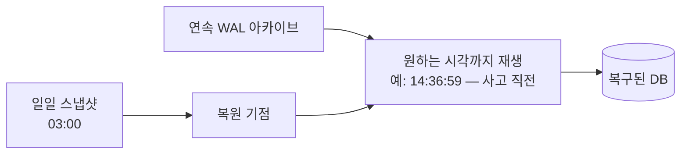

## 들어가며

데이터베이스를 만드는 일과 운영하는 일은 다른 기술이다. 스키마와 트랜잭션 경계를 옳게 설계해도, 그 위에서 하드웨어는 고장 나고 사람은 실수하고 서비스는 멈추지 않은 채로 스키마를 바꿔야 한다. 라이브 게임에서 데이터 계층의 사고는 대부분 새 코드의 버그가 아니라 *운영 절차의 공백* 에서 나온다 — 백업은 있었지만 복원해 본 적이 없고, 마이그레이션은 문서에 있었지만 롤백 조건이 없었고, 커넥션 풀 크기는 누군가 감으로 정해 둔 숫자였다.

이 글은 그 공백을 메우는 절차를 다룬다. 백업과 시점 복구, 서비스가 도는 채로 진행하는 스키마 변경, 커넥션 풀의 산수, 데이터 계층의 계기판, 사건 기반 용량 계획, 점검 창의 절차, 그리고 RPO와 RTO라는 숫자 계약이다.

읽는 기준은 운영 코드다. 백업은 파일이 아니라 복원 스크립트와 검증 질의로, 계약은 문장이 아니라 경보 조건으로, 마이그레이션은 순서도가 아니라 상태 기계와 롤백 조건으로 표현되어야 한다. 데이터 운영은 사람이 기억하는 절차를 줄이고 프로그램이 확인하는 절차를 늘리는 일이다.

---

## 목차
1. [백업: 스냅샷과 로그의 이중주](#1-백업-스냅샷과-로그의-이중주)
2. [복구: 연습하지 않은 백업은 없는 것이다](#2-복구-연습하지-않은-백업은-없는-것이다)
3. [무중단 스키마 마이그레이션](#3-무중단-스키마-마이그레이션)
4. [커넥션 풀의 산수](#4-커넥션-풀의-산수)
5. [모니터링: 데이터 계층의 계기판](#5-모니터링-데이터-계층의-계기판)
6. [용량 계획과 부하 시험](#6-용량-계획과-부하-시험)
7. [점검 창의 데이터 절차](#7-점검-창의-데이터-절차)
8. [RPO와 RTO: 데이터 종류별 운영 계약](#8-rpo와-rto-데이터-종류별-운영-계약)
9. [운영 절차를 코드로 만들기](#9-운영-절차를-코드로-만들기)

---

## 1. 백업: 스냅샷과 로그의 이중주

백업의 표준 구성은 두 재료의 조합이다 — 주기적 전체 스냅샷(예: 일 1회)과, 그 사이의 모든 변경을 담은 연속 로그(WAL 아카이브). 이 조합이 시점 복구(PITR, Point-In-Time Recovery)를 가능하게 한다: 어제 새벽 스냅샷을 복원하고, 로그를 원하는 시각까지 재생한다.



PITR이 게임에서 특히 중요한 이유 — 복구 대상의 다수가 *하드웨어 장애가 아니라 논리적 사고* 이기 때문이다. 복제 버그로 아이템이 무한 증식한 14:37, 운영 실수로 테이블을 비운 21:02 — 복제본(replica)은 이런 사고를 *충실히 따라 하므로* 방어가 못 된다. 복제는 가용성의 도구이고, 백업은 시간을 되감는 도구다 — 서로 대체하지 않는다.

운용 규칙들: 백업은 *다른 장애 도메인* 에 둔다(같은 디스크·같은 데이터센터의 백업은 화재와 함께 사라진다). 보존 정책을 계층으로(일 단위 N일 + 주 단위 N주 + 월 단위 보관 — 법적·정산 요구 반영). 그리고 백업 자체의 무결성 검증(체크섬, 주기적 복원 시험)까지가 "백업이 있다"의 정의다.

## 2. 복구: 연습하지 않은 백업은 없는 것이다

복구의 두 지표가 설계 목표다 — RPO(Recovery Point Objective, 잃어도 되는 데이터의 시간 폭)와 RTO(Recovery Time Objective, 복구까지의 시간). PITR 구성에서 RPO 목표는 로그 아카이브 주기(분 단위 가능)로, RTO 목표는 "스냅샷 복원 + 로그 재생" 소요로 잡는다. 하지만 이는 정상 운전에서의 단계 예산일 뿐이다 — 실제 recovery point와 recovery time은 아카이브 실패·장애 도메인·탐지·결정·검증·트래픽 전환까지 포함하고, 측정 시작(사고 발생)과 종료(서비스 복구) 시점을 정해 놓고 재야 한다. 그래서 RTO는 *측정해 봐야 아는 값* 이다. 수 TB의 복원과 수 시간치 로그 재생은 시간이 걸리고, 그 시간 동안 서비스가 멈춘다.

그래서 복구는 절차가 아니라 *근육* 이다.

- **주기적 복구 훈련**: 분기마다 실제 백업에서 격리 환경으로 전체 복구를 수행하고 소요 시간을 기록한다 — RTO의 실측이자 백업 무결성의 검증이다.
- **부분 복구의 준비**: 전체 되감기는 사고 이후의 *정상 데이터도 함께* 되감는다 — 실전에서 더 흔한 요구는 "복구본을 옆에 세우고, 영향 범위만 추출해 본 DB에 선별 반영"이다. 이 절차(복구본 기동 → 대조 질의 → 교정 스크립트)를 문서화해 둔다.
- **사고 시각의 특정**: PITR의 "어느 시각으로"는 원장·로그(경제 이력)에서 나온다 — 사고 탐지(이상 지표 경보)가 빠를수록 되감기 폭이 줄어든다는 점에서, 모니터링은 복구 체계의 일부다.

## 3. 무중단 스키마 마이그레이션

"컬럼 추가는 점검에서"는 옛 규칙이다 — 라이브 게임의 스키마 변경은 서비스가 도는 채로 이뤄져야 하고, 그 표준 절차가 확장-수축(expand-contract)이다. 핵심 원리는 *어느 순간에도 옛 코드와 새 코드가 같은 스키마 위에서 동작 가능해야 한다* 는 것 — 배포는 점진적이므로 두 버전의 서버가 공존하는 구간이 반드시 있다.

컬럼 이름 변경을 예로 든 전체 사이클:

```text
[확장]   1. 새 컬럼 추가 (기본값/NULL 허용 — 옛 코드는 모른 채 동작)
         2. 새 코드 배포: 양쪽 쓰기 (옛 컬럼 + 새 컬럼), 읽기는 옛 컬럼
         3. 백필: 기존 행의 새 컬럼을 배치로 채움 (속도 제한 — 부하 관리)
[전환]   4. 읽기를 새 컬럼으로 전환
            (게이트: old-only writer가 남아 있지 않고, dual-write가 백필을
             따라잡았으며, 읽기 직전 양쪽 값·스냅샷 버전이 일치함을 확인)
[수축]   5. 옛 컬럼 쓰기 중단
         6. 충분한 안정 기간 후 옛 컬럼 제거 (이후 되돌림은 별도 복구/전방 수정)
```

각 단계가 독립 배포이고 전환 게이트를 통과해야 다음으로 간다는 것이 이 절차의 가치다 — 옛 컬럼 제거(drop) 이전까지는 데이터 복원 수단과 함께 되돌릴 수 있지만, 제거 후에는 이전 버전 재배포가 정상 rollback이 아니라 별도 복구/전방 수정(forward fix)이다. 빅뱅 전환(점검 중 일괄 변경)은 실패 시 점검 연장과 롤백 불능으로 직행한다.

운영상 주의 둘. 첫째, *DDL 자체의 잠금 비용* — 데이터베이스·버전에 따라 컬럼 추가가 테이블 잠금이나 전체 재작성을 유발할 수 있다(기본값의 즉시 반영 여부 등). 대형 테이블의 모든 DDL은 실행 계획과 잠금 영향부터 확인하고, 온라인 스키마 변경 도구(섀도 테이블 + 점진 복사 방식)가 필요한 규모인지 판단한다. 둘째, *백필의 속도 제한* — 수억 행 갱신을 전속력으로 돌리면 복제 지연과 I/O 포화가 라이브를 때린다. 배치 크기 + 휴지 간격 + 복제 지연 감시 연동이 백필의 정석이다.

## 4. 커넥션 풀의 산수

데이터베이스 연결은 비싸다 — 연결마다 인증 핸드셰이크와 서버 측 메모리·프로세스 자원이 들고, 동시 연결 수에는 상한이 있다. 그래서 응용은 연결을 요청마다 만들지 않고 풀(pool)에서 빌려 쓴다. 풀 크기의 산수가 운영 품질을 가른다.

기준 산수는 리틀의 법칙이다 — 필요한 동시 연결 수 $\approx$ 초당 질의 수 $\times$ 평균 질의 시간. 초당 2,000 질의 × 평균 5ms면 동시 10연결이 이론값이고, 여유를 둬도 수십이면 충분하다 — "동접 1만이니 연결 1만"이 아니라는 것이 요점이다. 다만 이 값은 안정 상태의 평균 동시 점유이지 타임아웃 목표를 만족하는 풀 크기가 아니다. W는 질의 실행 시간이 아니라 연결 점유 시간이어야 하고, 연결이 여러 질의·트랜잭션에 걸쳐 유지되면 다시 측정해야 한다. 평균은 피크를 감추므로 분위수·최대 부하에서의 여유는 별도 부하 시험으로 정한다. 연결을 늘린다고 처리량이 늘지 않는다 — DB 코어가 동시에 실행할 수 있는 질의 수를 넘는 연결은 대기열을 DB 안으로 옮길 뿐이며, 과도한 연결 수 자체가 컨텍스트 스위칭·메모리로 성능을 깎는다.

운영 함정들:

- **풀 고갈의 전파**: 슬로우 쿼리 하나가 평균 질의 시간을 키우면, 같은 처리량에 필요한 연결 수가 비례해 늘고 풀이 마른다 — "DB는 멀쩡한데 응용이 타임아웃"의 전형. 풀 대기 시간을 1급 지표로 노출해야 원인이 보인다.
- **서버 수 × 풀 크기**: 게임 서버를 수평 확장하면 풀 합계가 DB 연결 상한을 향해 자란다 — 중앙 풀러(프록시형 풀)를 두거나 서버당 풀을 작게 유지하는 설계가 규모에서 필수가 된다.
- **트랜잭션 보유 중 외부 대기 금지**: 연결을 쥔 채 다른 서비스 응답을 기다리는 코드는 풀 고갈의 단골 — 연결 점유 시간은 질의 시간이어야지 작업 시간이어서는 안 된다.

## 5. 모니터링: 데이터 계층의 계기판

데이터 계층의 지표는 네 층으로 정리된다.

| 층 | 핵심 지표 | 이상 신호의 해석 |
|---|---|---|
| 질의 | 질의 지연 P50/P99, 슬로우 쿼리 발생률 | P99 상승 — 계획 변경·잠금 경합·캐시 미스 |
| 자원 | 버퍼 캐시 히트율, 디스크 I/O, 연결 수, 잠금 대기 | 히트율 하락 — 작업 집합이 메모리를 넘었다 |
| 복제·내구 | 복제 지연, WAL 생성률, 체크포인트 빈도 | 지연 급증 — 팔로워 부하·대량 쓰기·백필 |
| 응용 관점 | 풀 대기 시간, 트랜잭션 재시도율, 타임아웃률 | DB 지표 정상인데 응용 악화 — 풀·네트워크 |

습관 둘이 지표를 가치로 바꾼다. 첫째, *기준선 대비 변화의 경보* — 절대 임계("P99 50ms 초과")보다 "패치 후 P99 2배"가 회귀를 잡는다. 콘텐츠 패치마다 새 질의가 들어오는 게임에서 특히 그렇다. 둘째, *슬로우 쿼리 로그의 정기 리뷰* — 주간 단위로 상위 N개 질의의 실행 계획을 확인하는 루틴이, 데이터 성장으로 인덱스 경계를 넘는 질의("어제까지 빨랐는데")를 사고 전에 잡는다.

## 6. 용량 계획과 부하 시험

게임 DB의 부하는 평균이 아니라 사건이 결정한다 — 출시일, 대형 패치 직후, 이벤트 시작 정각, 방송 노출. 용량 계획은 "평시 여유율"이 아니라 *최악 사건의 모양* 에서 출발한다.

- **부하 모델의 작성**: 핵심 시나리오별 질의 프로파일을 적는다 — 로그인 1회당 질의 N개, 매치 종료당 트랜잭션 M개, 이벤트 보상 정각의 동시 수령 규모. "동접 X 만 명, 로그인 폭주 분당 Y"가 곧 "초당 질의 Z"로 환산되는 표가 용량 계획의 입력이다.
- **부하 시험의 충실도**: 합성 봇이 실제 질의 패턴(읽기/쓰기 비율, 핫스팟 분포)을 재현해야 의미가 있다 — 균등 랜덤 키의 시험은 핫스팟 경합을 숨기고 캐시 지역성도 비현실적으로 만들어 한쪽으로 치우친 결과를 준다. 낙관적이라는 방향을 고정할 수는 없으므로 실제 분포와 여러 부하 형태로 시험한다. 운영 질의 로그 기반의 재생이 충실도의 기준이다.
- **데이터 부피의 시간축**: 성능은 데이터 크기의 함수다 — 출시 6개월 후 부피(원장·전적·이벤트 테이블의 성장률 × 기간)를 미리 채운 환경에서 시험해야 "그날 가서 느려지는" 질의가 보인다. 성장 빠른 테이블의 파티셔닝·아카이브 정책은 이 시험의 산출물이다.

## 7. 점검 창의 데이터 절차

점검(maintenance window)은 데이터 계층에는 작업 창이다 — 짧고 안전하게 쓰는 표준 절차를 둔다.

```text
[점검 진입]
 1. 신규 진입 차단 → 진행 중 트랜잭션 배수(드레인) 대기
 2. 쓰기 중단 확인 후 일관 시점 백업 (롤백의 기점)
[작업]
 3. 무중단으로 못 가는 잔여 작업만 수행 — 대형 DDL, 엔진 업그레이드, 대량 교정
 4. 각 작업 후 검증 질의 (행 수, 불변식, 표본 대조)
[재개]
 5. 내부 트래픽으로 스모크 테스트 (로그인·구매·매치 1사이클)
 6. 점진 개방 (지역·비율 단계) — 캐시 워밍업과 로그인 폭주를 함께 흡수
```

원칙은 셋이다. *점검 전 백업은 협상 불가* — 점검 중 사고의 롤백 기점이다. *점검에서만 가능한 작업을 최소화* — 3절의 무중단 절차가 일상화될수록 점검은 짧아지고, 그것이 곧 서비스 품질이다. *재개가 제2의 출시* — 점검 직후의 동시 로그인은 평시 최대를 넘는 폭주이고, 식어 있는 캐시(버퍼 풀, Redis)와 겹친다 — 점진 개방과 캐시 예열(핵심 기획 데이터 선적재)이 재개 절차의 일부여야 한다.

## 8. RPO와 RTO: 데이터 종류별 운영 계약

데이터 계층의 운영 목표는 "안정적으로"가 아니라 숫자와 절차로 표현되어야 한다. 세 가지 계약이 기본이다.

- **SLO(Service Level Objective)**: 정상 운영 중 어떤 품질을 제공할 것인가
- **RPO(Recovery Point Objective)**: 장애 시 얼마나 많은 데이터를 잃어도 되는가
- **RTO(Recovery Time Objective)**: 장애 후 얼마 안에 복구해야 하는가

예를 들어 계정·경제 원장은 다음처럼 강한 계약을 요구한다.

```text
경제 원장:
  RPO = commit된 거래 손실 금지(해당 장애 모델에서 RPO=0 목표)
  RTO 목표 = 30분, 실제 recovery time은 훈련 실측으로 기록
  SLO = P99 쓰기 50ms 이하, 월간 가용성 99.9%
```

반면 분석 이벤트는 다른 계약을 가질 수 있다.

```text
클라이언트 UX 이벤트:
  RPO = 최대 10분 유실 허용
  RTO = 24시간
  SLO = 일일 집계가 다음날 10:00 전 완성
```

같은 "데이터"라도 계약이 다르면 저장소, 복제, 백업, 경보가 달라진다. 모든 데이터를 원장처럼 다루면 비용이 폭발하고, 원장을 텔레메트리처럼 다루면 게임 경제가 깨진다.

세 계약은 저장 계층에서 각각 다른 관측값으로 내려온다.

| 계약 | 저장 계층의 관측값 | 계약이 거짓이 되는 순간 |
|---|---|---|
| SLO | 질의 지연 분포, 가용 시간 | P99가 목표를 넘는 구간이 예산을 넘길 때 |
| RPO | 동기 복제 여부, WAL 아카이브 지연 | 아카이브 지연이 RPO에 근접할 때 — 이미 전조다 |
| RTO | 복원 훈련의 실측 소요 | 훈련 소요가 RTO를 넘는 순간 |

경보의 긴급도는 이 표에서 나온다. RPO가 5분인데 아카이브 지연이 4분이면 아직 사고가 아니지만 즉시 개입 대상이고, RTO가 30분인데 지난 훈련이 50분이면 사고가 나지 않아도 계약은 이미 거짓이다. 모든 경보를 같은 소리로 울리면 운영자는 경보를 무시하게 되고, 그 순간 계기판은 장식이 된다.

마지막으로 운영 계약은 runbook으로 닫혀야 한다. 경보가 울렸을 때 누가, 어떤 순서로, 어떤 권한으로, 어떤 롤백 지점까지 조작할 수 있는지 문서화되어 있어야 한다. 데이터 사고는 늦게 발견될수록 되돌릴 정상 상태와 오염된 상태가 섞인다. 그래서 탐지, 격리, 복구, 검증 질의, 플레이어 보상 기준까지가 데이터 운영의 일부다.

## 9. 운영 절차를 코드로 만들기

운영 문서는 사람이 읽는 글로 끝나면 사고 당일에 흔들린다. 데이터 운영의 핵심 절차는 쿼리, 스크립트, 대시보드, 경보 조건으로 내려와야 한다. "백업이 정상이다"는 말은 복구 리허설 결과와 검증 쿼리로만 증명된다.

예를 들어 경제 원장의 일일 정산은 다음 질의처럼 자동화되어야 한다.

```sql
WITH ledger_sum AS (
    SELECT player_id, currency, SUM(delta) AS ledger_amount
      FROM wallet_ledger
     GROUP BY player_id, currency
)
SELECT b.player_id, b.currency, b.amount, l.ledger_amount
  FROM wallet_balance b
  JOIN ledger_sum l
    ON l.player_id = b.player_id
   AND l.currency = b.currency
 WHERE b.amount <> l.ledger_amount
 LIMIT 100;
```

이 쿼리는 수동 조사 도구가 아니라 경보 조건이다. 결과가 0행이어야 하는 쿼리는 배치 잡으로 실행하고, 1행이라도 나오면 쓰기 경로 배포 중지나 지급 경로 차단 같은 runbook으로 이어져야 한다.

무중단 마이그레이션도 체크리스트가 아니라 상태 기계로 관리한다.

```text
state add_column:
  nullable 컬럼 추가
  old code writes old column only

state dual_write:
  new code writes old + new column
  background backfill starts

state verify:
  assert old and new values match
  assert no old-only writers remain
  assert dual-write is caught up and backfill is complete
  block deploy if mismatch > 0

state read_new:
  code reads new column
  enter only after the verify gates pass

state drop_old:
  old column removed after rollback window
  after this, backward deploy is recovery/forward fix, not rollback
```

각 상태에는 전진 조건과 롤백 조건이 있어야 한다.

```sql
SELECT COUNT(*) AS missing_backfill
  FROM player_profile
 WHERE new_region IS NULL;

SELECT COUNT(*) AS mismatch
  FROM player_profile
 WHERE legacy_region IS DISTINCT FROM new_region;
```

이 두 질의가 0을 돌려주는 것이 read 전환의 필수 조건이다. 다만 이 검사는 이미 기록된 행의 값 대조일 뿐, 백필 이후에도 옛 컬럼만 갱신하는 구버전 writer가 남아 있는지는 잡지 못하므로 그 여부는 위 전환 게이트에서 snapshot·버전 대조로 별도 확인한다.

커넥션 풀도 코드 계약이다. "풀 크기를 적당히 둔다"는 말은 장애를 만든다. 인스턴스 수와 DB 한도를 이용해 상한을 계산하고 설정 파일에 박는다.

```text
db_max_connections = 800
reserved_for_admin = 50
app_instances      = 30
pool_per_instance  = floor((800 - 50) / 30) = 25
```

설정은 배포 시 검증해야 한다.

```cpp
void ValidateDbPoolConfig(const Config& c) {
    if (c.appInstances <= 0 || c.poolSize <= 0 || c.adminReserve < 0 ||
        c.dbMaxConnections <= 0) {
        throw ConfigError("invalid domain");
    }
    std::int64_t total = std::int64_t(c.appInstances) * c.poolSize
                       + c.adminReserve;
    if (total > c.dbMaxConnections) {
        throw ConfigError("DB connection budget exceeded");
    }
}
```

필드는 32-bit signed 범위라는 가정이고, 곱하기 전에 `std::int64_t`로 넓혀 overflow를 막는다. 입력이 이미 64-bit라면 더 넓은 산술이나 나눗셈 기반 사전 overflow 검사를 쓴다. 그리고 이 검사는 총량 상한이지 부하·지연 SLA를 만족하는 pool sizing의 증명이 아니다.

백업도 파일 존재 여부가 아니라 복원 가능한 상태를 검증해야 한다.

```text
daily restore drill:
  1. latest snapshot restore to isolated cluster
  2. WAL replay to target timestamp
  3. run consistency queries
  4. measure restore duration
  5. compare duration <= RTO
  6. compare replay gap <= RPO
```

운영은 결국 코드다. 경보 조건은 SQL이고, 마이그레이션은 상태 기계이며, 풀 크기는 산술 검증이고, 백업은 복원 테스트다. 사람이 기억해야 하는 절차를 줄일수록 데이터 사고의 반경이 줄어든다.

---

## 결론

운영은 데이터 모델 이후에 붙는 부가 기능이 아니다. 커밋된 바이트를 어떤 사고까지 되감을 수 있는지, 스키마를 바꾸는 동안 두 버전의 코드가 어떻게 공존하는지, 부하가 사건으로 몰릴 때 어디가 먼저 마르는지를 결정하는 데이터 시스템의 완성 단계다. 복제는 가용성을, 백업은 시간 되감기를 담당하며 서로를 대체하지 않는다.

숫자로 적히지 않은 목표는 검증되지 않는다. RPO는 아카이브 지연으로, RTO는 복원 훈련의 실측 시간으로, 풀 크기는 배포 시 산술 검증으로 내려와야 계약이 된다. 운영 품질의 척도는 문서의 두께가 아니라, 사고 당일에 사람이 기억해 내야 하는 절차의 개수다.

## 더 읽을거리

- [PostgreSQL 문서: Backup and Restore](https://www.postgresql.org/docs/current/backup.html) — 스냅샷·WAL 아카이브·PITR 구성의 1차 출처.
- [GitLab의 2017년 데이터베이스 사고 포스트모템](https://about.gitlab.com/blog/postmortem-of-database-outage-of-january-31/) — 정규 복구 절차들이 실패해 이전 LVM snapshot으로 복원했고, 데이터 손실과 긴 복구가 발생한 사례.
- [GitHub Engineering: gh-ost](https://github.com/github/gh-ost) — 온라인 스키마 변경 도구의 설계 문서(트리거 없는 점진 복사).
- [HikariCP Wiki: About Pool Sizing](https://github.com/brettwooldridge/HikariCP/wiki/About-Pool-Sizing) — 과도한 연결 수의 비용과 부하 시험을 통한 pool sizing.
- Betsy Beyer 외 편, *Site Reliability Engineering* (O'Reilly, 2016) — 복구 훈련·점진 개방·기준선 경보 등 운영 원칙의 본진(무료 공개).
- Martin Kleppmann, *Designing Data-Intensive Applications*, Ch.12 — 파생 상태를 유지하며 시스템을 무중단으로 진화시키는 큰 그림.
