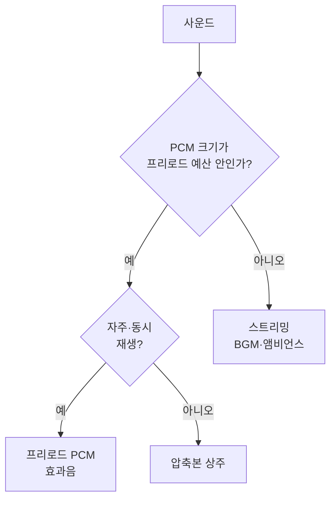
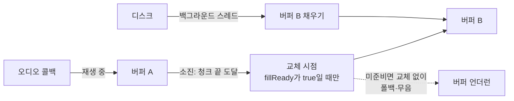
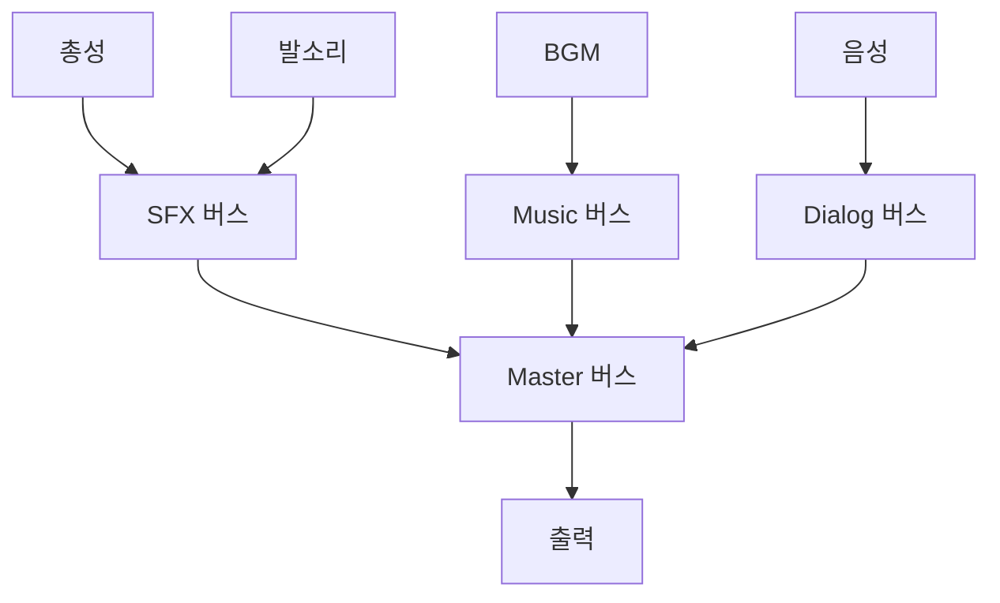

## 들어가며

게임 오디오 시스템은 *몰입감 있는 사운드* 와 *제한된 자원* 사이의 끝없는 줄다리기다. 비압축 고품질 오디오는 메모리와 디스크를 게걸스럽게 먹고, 실시간 디코딩과 DSP는 CPU를 갉아먹으며, 수백 개의 동시 사운드는 믹싱 예산을 순식간에 넘긴다. 그래서 오디오 엔진의 거의 모든 결정은 *품질 ↔ 메모리 ↔ CPU* 의 삼각 트레이드오프 위에 놓인다.

이 글은 그 트레이드오프를 따라 오디오 엔진의 구성요소를 한 흐름으로 정리한다. 오디오 데이터가 어떤 포맷으로 저장되고 얼마나 메모리를 먹는지, 무엇을 미리 로드하고 무엇을 스트리밍할지, 스트리밍이 디스크 지연을 어떻게 숨기는지, 수백 사운드를 한정된 보이스로 어떻게 추리는지, 3D 공간에서 소리를 어떻게 배치하는지, 믹서 그래프가 어떻게 동적으로 균형을 잡는지, 미들웨어와 프로시저럴 오디오가 어디에 쓰이는지, 그리고 이 모두를 어떻게 측정하고 프로파일링하는지를 다룬다.


이 글의 목표.

1. **오디오 데이터와 포맷** — PCM·압축·비트레이트·디코딩 비용의 정량.
2. **메모리와 사운드 뱅크** — 프리로드 대 스트리밍 판단, 풀링.
3. **스트리밍 아키텍처** — 더블 버퍼, 멀티스레드 I/O, 시크·루프.
4. **보이스 관리와 우선순위** — 채널 제한, virtualization, voice stealing.
5. **3D 오디오와 공간화** — 거리 감쇠, 패닝, HRTF, 오클루전·도플러.
6. **믹싱과 DSP** — 버스 그래프, 덕킹, RTPC, 스냅샷, 이펙트 체인.
7. **미들웨어와 프로시저럴** — Wwise/FMOD 대 자체, 런타임 사운드 생성.
8. **성능·프로파일링·플랫폼** — CPU/메모리/I-O 측정, 콘솔·모바일.


---

## 목차
1. [오디오 데이터와 포맷](#1-오디오-데이터와-포맷)
2. [메모리와 사운드 뱅크](#2-메모리와-사운드-뱅크)
3. [스트리밍 아키텍처](#3-스트리밍-아키텍처)
4. [보이스 관리와 우선순위](#4-보이스-관리와-우선순위)
5. [3D 오디오와 공간화](#5-3d-오디오와-공간화)
6. [믹싱과 DSP](#6-믹싱과-dsp)
7. [미들웨어와 프로시저럴](#7-미들웨어와-프로시저럴)
8. [성능·프로파일링·플랫폼](#8-성능프로파일링플랫폼)


---

## 1. 오디오 데이터와 포맷

### PCM — 원본의 크기

런타임 오디오의 기본 표현은 PCM(Pulse Code Modulation)이다. 연속 파형을 일정 간격으로 표본화한 값의 배열이며, 저장 파일은 정수 PCM을 흔히 쓰고 믹서 내부는 부동소수 PCM을 자주 쓴다. 인터리브 여부와 메타데이터를 제외한 본문 크기는 단순한 곱이다.

$$\text{bytes/s} = \text{샘플레이트} \times \text{채널} \times \frac{\text{비트}}{8}$$

CD 품질(44.1kHz, 스테레오, 16-bit)은 초당 $44100 \times 2 \times 2 = 176{,}400$ 바이트 ≈ *172KB/s*. 3분 BGM 하나가 *비압축으로 약 31MB* 다. 효과음 수백 개 + BGM 수십 개를 전부 PCM으로 들고 있으면 메모리가 수백 MB로 폭발한다. 이것이 압축의 동기다.

| 포맷 | 종류 | 크기 특성 | 디코딩 비용 | 용도 |
|---|---|---|---|---|
| PCM | 무압축 | 1× | 없음 | 짧은 효과음, 즉시 재생 |
| ADPCM | 경량 손실 | 고정 또는 예측 가능한 비율인 형식이 많음 | 낮음 | 다수 효과음, 일부 플랫폼 디코더 |
| Vorbis | 손실 | 목표 비트레이트·품질에 따라 가변 | 중간 | BGM, 긴 사운드 |
| Opus | 손실 | 목표 비트레이트·프레임 설정에 따라 가변 | 중간 | 음성·저지연 스트림·음악 |
| FLAC | 무손실 | 원본 신호의 예측 가능성에 따라 가변 | 낮음~중간 | 원본 보관, 무손실 런타임 요구 |

### 손실 압축의 트레이드오프

MP3·Vorbis 같은 변환 기반 지각 코덱은 신호를 시간·주파수 영역으로 변환하고, 청각 마스킹 모델과 비트 할당으로 덜 지각되는 성분을 더 거칠게 양자화한다. 단순히 가청 주파수 위를 잘라내는 방식이 아니다. 비트레이트를 낮출수록 크기는 줄지만 pre-echo, warbling, 금속성 음색과 고역 손실 같은 아티팩트가 커질 수 있다. Opus처럼 선형 예측(SILK)과 변환(CELT)을 결합하는 하이브리드 코덱은 이 구조만으로 설명되지 않는다.

- *BGM*: 길어서 압축 이득이 크다. 허용 비트레이트는 장르, 채널 수, 마스터 품질과 목표 장치에서 블라인드 청취 테스트로 정한다.
- *효과음*: 짧고 자주 반복되며 *피치 변조* 가 흔하다. 손실 압축의 아티팩트가 변조로 증폭될 수 있어, 짧은 효과음은 *무압축 PCM 또는 ADPCM* 으로 두는 편이 안전하다.
- *음성/내레이션*: Opus가 저비트레이트에서 명료도가 좋다.

### 디코딩 비용과 "메모리 vs CPU"

압축은 저장 공간과 I/O를 디코딩 CPU·지연으로 거래한다. 디코더는 보통 오디오 블록이 필요할 때마다 압축 프레임을 PCM으로 풀며, 동시 디코딩 스트림 수와 코덱 설정에 따라 비용이 누적된다.

```cpp
// 재생 시점에 결정: 디코딩 비용 vs 메모리
enum class LoadMode {
    DecompressedPCM,   // 로드 시 1회 디코딩 → 메모리 ↑, 재생 중 코덱 비용 없음
    CompressedInRAM,   // 압축본 상주 → 메모리 ↓, 매 재생 디코딩
    Streamed,          // 디스크에서 스트리밍 → 메모리 최소, I/O + 디코딩
};
```

짧고 자주·동시에 재생되는 효과음은 PCM 프리로드 후보이고, 긴 BGM·앰비언스는 압축 스트리밍 후보다. PCM이어도 믹싱, 리샘플링, 공간화와 DSP 비용은 남으므로 재생 CPU가 0이 되는 것은 아니다. 에셋별 동시성, 첫 재생 지연, 메모리와 디코드 예산을 함께 측정한다.

### 플랫폼 네이티브 포맷

일부 플랫폼은 특정 오디오 형식의 전용 또는 가속 디코딩 경로를 제공한다. 지원 형식, 동시 스트림 수, 메모리 위치와 실제 CPU 절감은 플랫폼 SDK 계약에 따른다. 빌드 파이프라인은 같은 원본을 플랫폼의 디코더·저장 장치·메모리 예산에 맞는 런타임 형식으로 쿠킹한다.

## 2. 메모리와 사운드 뱅크

### 사운드 뱅크

개별 사운드 파일 수천 개를 따로 로드/관리하는 것은 비효율적이다(파일 핸들, 단편화, I/O 횟수). *사운드 뱅크(sound bank)* 는 관련 사운드를 *하나의 패키지로 묶어* 함께 로드/언로드한다.

```cpp
struct SoundBank {
    std::string name;                    // "level1_combat"
    std::vector<SoundEntry> entries;     // 이 뱅크의 사운드들
    LoadMode mode;
    size_t   memoryFootprint;            // 로드 시 점유 메모리
};
```

뱅크의 단위가 *로딩 전략* 을 정한다. "전투 사운드 뱅크"를 전투 진입 시 로드하고 전투 종료 시 언로드하면, 평상시 그 메모리를 비운다. 뱅크 경계 설계 — 무엇을 같이 묶을지 — 가 메모리 피크를 좌우한다. 너무 잘게 쪼개면 로딩 횟수가 늘고, 너무 크게 묶으면 안 쓰는 사운드까지 상주한다.

### 프리로드 대 스트리밍 판단

각 사운드를 *미리 메모리에 올릴지(preload)* *디스크에서 스트리밍할지* 는 길이·빈도·동시성으로 정한다.



| 사운드 종류 | 전략 | 이유 |
|---|---|---|
| 짧은 효과음 (발소리·UI) | 프리로드 PCM | 즉시·동시 재생, 지연 불가 |
| 중간 (음성 한 줄) | 압축본 상주 또는 프리로드 | 빈도에 따라 |
| BGM (수 분) | 스트리밍 | 메모리 절약, 하나씩 재생 |
| 앰비언스 루프 | 스트리밍 또는 짧은 루프 프리로드 | 길이에 따라 |

### 메모리 풀과 재사용

오디오 버퍼·보이스 객체를 매번 할당/해제하면 단편화와 할당 지연이 생긴다. *풀(pool)* 에서 미리 확보한 객체를 재사용한다.

```cpp
class VoicePool {
    std::vector<Voice> voices_;          // 고정 크기 (예: 64)
    std::vector<int>   freeList_;
public:
    Voice* Acquire() {                   // 할당 없이 풀에서 꺼냄
        if (freeList_.empty()) return nullptr;   // 풀 소진 → 4절 voice stealing
        int idx = freeList_.back(); freeList_.pop_back();
        return &voices_[idx];
    }
    void Release(Voice* v) { freeList_.push_back(v->index); v->Reset(); }
};
```

풀 크기는 실제로 믹싱·공간화하는 동시 보이스 상한을 정의한다. 이 값은 플랫폼 이름만으로 정하지 않고 오디오 콜백 마감, 코덱·HRTF·DSP 비용과 메모리를 측정해 결정한다. 논리 사운드 수는 가상 보이스로 실제 보이스 수보다 크게 유지할 수 있다.

## 3. 스트리밍 아키텍처

### 디스크 지연을 숨기는 더블 버퍼

스트리밍의 본질은 저장 장치에서 압축 블록을 미리 읽고 디코드한 PCM을 재생 소비 속도보다 앞서 준비하는 것이다. 오디오 장치는 일정한 장기 평균 속도로 샘플을 소비하지만 콜백 호출 시각에는 스케줄링 지터가 있다. 준비된 PCM 프레임이 부족하면 버퍼 언더런이 발생한다.

해법은 *더블(또는 링) 버퍼링* 이다. 한 버퍼를 재생하는 동안 *다음 버퍼를 미리 채운다*.



```cpp
struct StreamingVoice {
    File*    file;
    alignas(64) float pcm[2][kFramesPerBuffer * kChannels];
    int      playBuffer = 0;             // 오디오 콜백이 읽는 쪽
    std::atomic<bool> fillReady[2];      // 채움 완료 플래그

    // 실시간 콜백: 이미 디코드된 PCM만 읽는다.
    // 요청 frames가 현재 청크의 남은 프레임보다 길면 청크 경계를 여러 번 넘으며 소비한다.
    // 계약: 청크 전환은 fillReady가 true일 때만 일어나고, producer는 콜백이 비운 버퍼만 채운다.
    //       EOF·초기 프리필 부족·underflow에서는 커서를 임의로 진행시키지 않고 남은 출력만 폴백으로 채운다.
    void Mix(float* out, int frames) {
        int written = 0;
        while (written < frames) {
            if (PlayBufferExhausted()) {
                int next = playBuffer ^ 1;
                if (!fillReady[next].load(std::memory_order_acquire)) {
                    MixFallbackOrSilence(out + written, frames - written);
                    return;                  // underflow: 남은 출력만 폴백으로 채운다
                }
                playBuffer ^= 1;             // 채워진 버퍼로 교체
                fillReady[playBuffer].store(false, std::memory_order_release);
                RequestFillNonBlocking(playBuffer ^ 1); // SPSC 요청 큐
            }
            int take = std::min(frames - written, FramesLeftInChunk(playBuffer));
            MixPreparedPCM(pcm[playBuffer], written, out, take);
            AdvanceCursor(playBuffer, take);
            written += take;
        }
    }
};
```

### 실시간 스레드의 철칙

오디오 콜백은 실시간 우선순위 스레드에서 장치가 요구한 프레임을 마감 전에 채워야 한다. 일반 힙 할당, 파일 I/O, 조건변수 대기, 우선순위 역전을 일으킬 수 있는 mutex처럼 실행 시간이 상한 없이 늘어날 수 있는 연산은 콜백에서 피한다. 디스크 읽기와 코덱 디코딩은 워커가 수행하고, 콜백은 준비된 PCM을 믹스한다. 스레드 사이에는 용량이 정해진 SPSC 큐나 미리 할당한 버퍼와 올바른 acquire/release 동기화를 사용한다.

### 버퍼 크기와 지연의 절충

버퍼가 크면 I/O·디코드 지터를 흡수하지만 메모리와 시크·중단 반응 시간이 늘고, 작으면 워커와 장치 마감에 민감하다. 필요한 크기는 대상 장치에서 I/O와 디코드 완료 시간의 상위 분위수, 동시에 스트리밍하는 보이스 수와 허용 지연으로 정한다. 출력 장치 버퍼와 스트리밍 선행 버퍼는 목적이 다르므로 하나의 "오디오 버퍼 크기"로 합치지 않는다.

### 시크·루프·크로스페이드

- *시크(seek)*: 압축 스트림에서 임의 위치로 점프하려면 컨테이너 인덱스나 코덱의 seek point가 필요하다. 없으면 가장 가까운 앞쪽 동기 지점 또는 스트림 시작에서 목표까지 디코딩해야 할 수 있다.
- *루프*: 앰비언스/BGM 루프는 *경계에서 끊김 없이* 이어져야 한다. 루프 끝 버퍼와 시작 버퍼를 미리 잇거나, *루프 지점을 샘플 단위로 정확히* 맞춘다.
- *크로스페이드*: 곡 전환 시 두 스트림을 *동시에 디코딩* 하며 한쪽은 페이드아웃, 한쪽은 페이드인. 전환 동안 *스트리밍 보이스 2개* 가 필요하다.
- *폴백*: 스트리밍 실패(디스크 오류, 너무 느림)에 대비해 *무음 또는 저품질 대체* 로 우아하게 실패한다 — 게임이 멈추면 안 된다.

## 4. 보이스 관리와 우선순위

### 동시 재생의 한계

2절의 풀 크기가 *동시 재생 가능한 실제 보이스 수* 를 제한한다. 그런데 게임은 *그보다 훨씬 많은 사운드* 를 재생하려 한다 — 대규모 전투에서 수백 발의 총성. 한정된 보이스로 이걸 처리하는 것이 *보이스 관리* 다.

### 우선순위와 voice stealing

각 사운드에 *우선순위* 를 부여한다. 풀이 가득 찼을 때 새 사운드를 재생하려면, *더 낮은 우선순위의 재생 중 보이스를 빼앗는다(voice stealing)*.

```cpp
Voice* AcquireVoiceOrSteal(const SoundRequest& request) {
    Voice* v = pool_.Acquire();
    if (v) return v;                              // 여유 있음

    // 풀 소진: 보호 규칙을 통과한 후보 중 중요도가 가장 낮은 보이스를 고른다.
    Voice* victim = nullptr;
    float lowestImportance = FLT_MAX;
    for (Voice& cand : pool_.Active()) {
        if (cand.unstealable) continue;
        float importance = Importance(cand);      // 정규화된 정책 점수
        if (importance < lowestImportance) {
            lowestImportance = importance;
            victim = &cand;
        }
    }
    if (victim && lowestImportance < Importance(request)) {
        victim->StopNow();                         // 채택한 정책: 즉시 정지(오디오 스레드를 기다리지 않음)
        return pool_.Recycle(victim);              // 슬롯 회수는 음향적 종료와 분리
    }
    return nullptr;
}
```

채택한 정책은 *즉시 정지* 다. `FadeOutOrStop`처럼 비동기 페이드와 슬롯 재사용을 한 함수에 겹치면, 페이드가 끝나기 전에 `Recycle`이 파라미터를 덮어 이전 소리의 꼬리를 잃거나, 반대로 오디오 스레드를 페이드 종료까지 기다리게 만든다. 부드러운 꼬리가 필요하면 *별도 tail voice*나 *짧은 크로스페이드용 여분 슬롯*으로 분리하고, pool 회수(자원)와 음향적 종료(신호)를 구분한다.

중요도 함수는 들리는 결과를 좌우한다. 거리 자체보다 감쇠·가림·버스 게인까지 반영한 예상 loudness, 게임플레이 중요도, 재생 진행도와 반복 여부를 정규화해 비교한다. 대사·경고음처럼 중단 불가 범주는 가중합보다 먼저 hard constraint로 보호한다. 서로 단위가 다른 거리·초·게인을 임의 상수로 더하면 월드 스케일이나 에셋 길이가 바뀔 때 정책이 무너진다.

### Virtualization — 들리지 않아도 추적

빼앗긴 사운드를 *완전히 죽이지 않고* *가상 보이스(virtual voice)* 로 강등하는 기법이 있다. 가상 보이스는 *DSP·디코딩은 안 하지만 재생 위치·상태는 계속 추적* 한다. 복귀 지점은 채택한 *경과 시간(elapsed-time)* 정책으로 정한다 — 재생 시각만 진행시키고 이후 정확한 위치에서 실제 보이스로 되돌리되, pitch·loop 상태, 압축 스트림의 decoder seek, DSP 체인의 상태 복구 범위는 구현에 따라 다르다. "처음부터 재생"과 "멈춘 위치에서 재개"는 다른 정책이며, 미들웨어가 이 전부를 항상 자동 보장한다고 단정하지 않는다.

```cpp
// 긴 루프 앰비언스가 멀어져 빼앗겼다가 다시 가까워질 때
// virtual로 위치를 추적했으면, 처음부터가 아니라 "지금 있어야 할 위치"에서 복귀
struct VirtualVoice {
    SoundId  sound;
    float    playbackPos;        // 시간만 진행, 디코딩 안 함
    bool     looping;
};
```

virtualization 없이 빼앗으면, 복귀 시 *루프가 처음부터 다시 시작* 해 어색하다. 이 기법이 "수백 사운드 중 들리는 32개만 실제로 처리하되, 안 들리는 것도 일관되게 유지"를 가능하게 한다.

## 5. 3D 오디오와 공간화

### 거리 감쇠

3D 사운드의 기본은 *거리에 따른 음량 감쇠* 다. 모델이 여럿이다.

| 모델 | 식 | 특성 |
|---|---|---|
| 선형 | $1 - d/d_{max}$ | 단순, 비물리적 |
| 역거리 게인 | $d_{ref}/d$ | 자유 음장에서의 음압 진폭과 같은 차수 |
| 역제곱 세기 | $1/d^2$ | 음향 에너지 세기의 거리 법칙, 게인 식과 구분 |
| 커스텀 커브 | 디자이너 그래프 | 게임플레이 튜닝 |

```cpp
// 전제: 유한 입력, 0 < refDist <= fadeStart < maxDist, rolloff >= 0.
// 이 순서를 어기면(fadeStart < refDist) 경계 직후 게인이 급락한다.
// 설정 검증은 오디오 콜백이 아니라 게임/툴 스레드에서 수행한다.
float DistanceAttenuation(float dist, float refDist,
                          float fadeStart, float maxDist, float rolloff) {
    if (dist <= refDist) return 1.0f;
    if (dist >= maxDist) return 0.0f;

    float inverse = refDist / (refDist + rolloff * (dist - refDist));
    float fade = 1.0f - SmoothStep(fadeStart, maxDist, dist);
    return inverse * fade;                     // hard cut 전에 연속적으로 0으로
}
```

예제는 inverse-distance 게인에 별도 fade-out을 곱한 게임 정책이다. OpenAL의 inverse-distance 모델과 동일한 식이라고 보면 안 된다. OpenAL의 clamped 모델에서 `maxDistance`는 거리 입력을 clamp할 뿐 자동으로 게인을 0으로 만들지 않는다. 명시적 컬링을 한다면 hard cut의 클릭·팝을 피하도록 fade 구간을 두고, 가상 보이스의 재진입에도 히스테리시스를 적용한다.

표의 역제곱과 역거리는 같은 물리의 다른 양이다. 반사와 흡수가 없는 자유 음장에서 점음원이 등방으로 방사한다고 가정하면, 음향 파워 $P$가 반지름 $r$ 구면 전체 $4\pi r^2$에 퍼지므로 단위 면적당 파워인 음의 세기(intensity)는

$$I(r) = \frac{P}{4\pi r^2} \propto \frac{1}{r^2}$$

로 *역제곱* 이다. 그런데 믹서가 보이스에 곱하는 게인은 세기가 아니라 *진폭(음압)* 이고, 세기는 음압의 제곱에 비례한다($I \propto p^2$). 따라서 적용할 게인은

$$p(r) = \sqrt{I(r)} \propto \frac{1}{r}$$

로 *역거리* 다. dB로 보면 거리가 2배가 될 때 음압은 $20\log_{10}\tfrac{1}{2} = -6.02\,\text{dB}$, 세기로 환산해도 $10\log_{10}\tfrac{1}{4} = -6.02\,\text{dB}$ 로 일치한다 — 표현하는 양이 달라도 같은 −6dB/거리 2배 법칙이다.

순수 $1/r$ 식은 $r\to0$에서 발산하므로 기준 거리 안에서 게인을 고정하거나 유한한 음원 크기 모델을 사용한다. 중요한 점은 믹서의 진폭 게인에 세기 식 $1/r^2$를 다시 곱하면 물리 감쇠를 이중 적용한다는 것이다. 실제 게임 공간에는 반사, 흡수, 실내 잔향과 가독성 요구가 있으므로 기준 거리, rolloff와 최대 거리는 물리 모델 위에 얹는 연출·컬링 정책으로 검증한다.

### 패닝과 HRTF

방향감은 두 방식으로 만든다.

- *패닝(panning)*: 좌우 스피커 음량 차로 방향을 흉내. 값싸고 스피커 환경에 적합. 위아래·앞뒤 구분은 약하다.
- *HRTF(Head-Related Transfer Function)*: 머리·귓바퀴의 방향별 필터를 모델링해 헤드폰에서 위아래·앞뒤 단서를 제공한다. 사용자별 HRTF 차이와 계산 비용이 있으며, VR에서 특히 가치가 크지만 모든 VR 콘텐츠의 기능적 필수조건은 아니다.

```cpp
// 패닝: 정면 반공간의 방위각을 좌우 게인으로 매핑한다 (등파워 패닝).
// 계약: azimuth는 정면 기준 [-π/2, π/2]로 제한한다. 뒤쪽 ±π 부근은 이 함수로
//       매핑하지 않는다 — 같은 방향인데 좌우가 반대로 튀기 때문이다(HRTF와 별개).
void StereoPan(float azimuth, float& gainL, float& gainR) {
    float pan = std::clamp<float>(azimuth / (M_PI * 0.5f), -1.0f, 1.0f);  // -1=왼, +1=오른
    float angle = (pan + 1.0f) * 0.25f * M_PI;                      // 0~π/2
    gainL = std::cos(angle); gainR = std::sin(angle);              // L²+R²=1 등파워
}
```

코드가 선형 보간이 아니라 $\cos/\sin$을 쓰는 이유는 두 채널을 독립 전력으로 볼 때 제곱합을 일정하게 유지하기 위해서다.

$$g_L^2 + g_R^2 = 1$$

한 각도 $\theta\in[0,\pi/2]$로 매개화하면 $g_L=\cos\theta,\ g_R=\sin\theta$가 이 제약을 자동 만족한다. 정중앙에서 각 채널 게인은 $1/\sqrt2\approx0.707$, 즉 약 −3.01dB이므로 흔히 −3dB pan law라 부른다.

선형 패닝 $g_L=1-t,\ g_R=t$는 모노 합 $g_L+g_R$를 보존하지만, 채널 전력의 합은 중앙에서 절반이 된다. 반대로 등파워 패닝의 중앙 신호를 모노로 단순 합치면 약 +3dB가 된다. 실제 청감은 스피커 간 누설, 방, 헤드폰, 신호 상관성과 HRTF에 좌우되므로 이 수학만으로 일정 음량을 보장하지 않는다. 믹서는 −3dB, −4.5dB, −6dB 같은 pan law 중 목표 재생 환경에 맞는 것을 선택하고 청취 테스트로 검증한다.

HRTF는 *방향별 임펄스 응답(HRIR)* 을 컨볼루션하거나, 하드웨어 가속(콘솔의 공간 오디오 엔진)에 위임한다. 보이스마다 HRTF 컨볼루션은 비싸므로, *가까운/중요한 소수만 HRTF*, 나머지는 패닝으로 처리하는 LOD가 흔하다.

### 오클루전·리버브·도플러

- *오클루전(occlusion)*: 벽 뒤 소리는 *저역만 통과* 하고 음량이 준다. 청취자-음원 사이 *레이캐스트* 로 차폐를 검사해 *저역 통과 필터 + 감쇠* 를 적용. 매 보이스 레이캐스트는 비싸므로 시간 분할·근사한다.
- *리버브(reverb)*: 공간의 잔향. *리버브 존(zone)* 을 두어 "동굴 = 긴 잔향, 작은 방 = 짧은 잔향"을 전환. DSP 이펙트로 처리(6절).
- *도플러(Doppler)*: 빠르게 다가오/멀어지는 음원의 *피치 변화*. 음원·청취자 상대 속도로 피치 배율을 계산. 과하면 어지러우므로 *도플러 계수* 로 약화한다.

도플러 피치 배율을 유도해 두면 경계 조건이 분명해진다. 음속을 $c$, 청취자와 음원을 잇는 직선 위에서 청취자가 음원 쪽으로 향하는 속도 성분을 $v_L$, 음원이 청취자 쪽으로 향하는 속도 성분을 $v_S$ 라 하면(가까워지는 방향이 양수), 재생 피치 배율은 수신/방출 주파수 비와 같다.

$$\text{pitch} = \frac{f'}{f} = \frac{c + v_L}{c - v_S}$$

가까워지면 분자는 커지고 분모는 작아져 피치가 올라가고, 멀어지면 반대다. 수치 예제로 $c = 343\,\text{m/s}$, 정지한 청취자($v_L = 0$)에게 음원이 $v_S = +34.3\,\text{m/s}$(약 $0.1c$)로 접근하면 $f'/f = 343 / (343 - 34.3) = 1.111$ 로 약 $+1.82$ 반음 높아진다($1200\log_2 1.111 \approx 182$ cents). 음원이 청취자를 지나쳐 같은 속도로 멀어지면 $343 / (343 + 34.3) = 0.909$ 로 약 $-1.65$ 반음 낮아진다 — 통과 전후의 피치 변화가 비대칭임에 유의한다.

경계 조건이 위험하다. $v_S\to c$면 분모가 0으로 가고, 이 고전적 정상파 공식은 초음속 충격파를 모델링하지 못한다. 런타임은 API 명세가 정의한 유효 범위를 지키고, 엔진 측에서도 도플러 계수·상대 속도·최종 pitch ratio를 제한해 0에 가까운 분모와 비정상 리샘플링 비율을 막는다. 정확한 클램프와 오류 동작은 사용하는 오디오 API의 계약을 따른다.

## 6. 믹싱과 DSP

### 샘플링이 보장하는 것과 보장하지 않는 것

오디오 엔진이 다루는 PCM은 연속 파형 자체가 아니라 일정한 간격으로 측정한 표본이다. 샘플레이트를 $f_s$라 하면 한 표본 사이의 시간은 $T_s = 1/f_s$이고, 이상적인 조건에서 표현 가능한 최고 주파수는 Nyquist 주파수 $f_s/2$다.

여기서 중요한 조건은 원 신호가 $f_s/2$보다 높은 성분을 포함하지 않아야 한다는 것이다. 한계를 넘은 성분은 단순히 사라지지 않고 낮은 주파수로 접혀 *aliasing*을 만든다. 예를 들어 48kHz로 샘플링하면서 30kHz 성분을 그대로 넣으면, 출력 대역 안의 18kHz 성분처럼 관찰된다.

따라서 샘플레이트를 낮추는 과정은 샘플을 건너뛰는 것으로 끝나지 않는다.

```text
원 신호
  → 새 Nyquist 주파수 위 성분을 저역 통과 필터로 제거
  → 필요한 위치의 표본 계산
  → 새 샘플레이트의 PCM
```

재생 속도와 피치 변경, Doppler 효과, 서로 다른 장치 샘플레이트 대응도 모두 리샘플링 문제다. 선형 보간은 저렴하지만 고주파 감쇠와 aliasing이 크다. polyphase FIR이나 windowed-sinc 계열은 더 많은 연산과 상태를 사용해 품질을 높인다. 엔진은 모든 보이스에 같은 품질을 강제하기보다 중요도와 플랫폼 예산에 따라 리샘플러 품질을 선택할 수 있어야 한다.

### 진폭, dB, headroom

디지털 출력의 최대 진폭은 보통 0 dBFS로 표현한다. dB는 절대 단위가 아니라 비율의 로그 표현이다.

$$
\text{amplitude dB} = 20 \log_{10}\left(\frac{A}{A_{ref}}\right)
$$

진폭을 두 배로 만들면 약 +6.02 dB다. 그러나 두 보이스를 합쳤다고 항상 +6 dB가 되는 것은 아니다. 두 파형의 위상과 상관관계에 따라 순간 합이 달라진다. 서로 독립적인 여러 소리를 믹싱하더라도 피크가 우연히 겹칠 수 있으므로, 개별 에셋이 0 dBFS에 닿지 않더라도 최종 버스에는 headroom이 필요하다.

부동소수점 믹서는 중간 합이 정규 출력 범위를 넘어도 즉시 잘리지 않는 장점이 있다. 하지만 장치 출력으로 정수 PCM을 만들거나 후단 효과가 범위를 가정한다면 결국 피크를 관리해야 한다. 리미터는 마지막 안전망이지, 잘못된 게인 구조를 숨기는 도구가 아니다. 지속적으로 리미터가 작동하면 다이내믹이 무너지고 펌핑과 왜곡이 생긴다.

정수 비트 깊이를 줄일 때의 양자화 오차는 작은 신호와 상관된 왜곡으로 들릴 수 있다. *dither*는 매우 작은 잡음을 의도적으로 더해 이 오차를 신호와 덜 상관된 잡음으로 바꾼다. 잡음의 총량을 없애는 것이 아니라, 귀에 더 거슬리는 규칙적 왜곡을 완만한 잡음으로 교환하는 처리다.

### 선형 시스템, 컨볼루션, 필터

선형 시불변 시스템은 임펄스 응답 $h[n]$과 입력 $x[n]$의 컨볼루션으로 표현할 수 있다.

$$
y[n] = \sum_{k=-\infty}^{\infty} x[k]h[n-k]
$$

이 식은 EQ, 반사, 리버브를 한 모델로 묶는다. FIR 필터는 유한한 임펄스 응답을 직접 적용한다. 안정성과 선형 위상 설계가 비교적 단순하지만, 급격한 주파수 특성이나 긴 리버브를 표현하려면 탭 수가 커진다. $L$개 탭을 보이스 $V$개에 직접 적용하면 샘플당 비용은 대략 $O(VL)$이다.

IIR 필터는 이전 출력 값을 피드백해 적은 계수로 강한 특성을 만든다.

```cpp
// 2차 biquad의 Direct Form I 예시.
// 차분방정식: y[n] = (b0*x[n] + b1*x[n-1] + b2*x[n-2] - a1*y[n-1] - a2*y[n-2]) / a0.
// 아래 계수는 a0로 정규화되어 있다고 가정한다(a0는 코드에 나타나지 않는다).
// x1,x2,y1,y2는 지연 상태이며, 스테레오 등 채널마다 독립 인스턴스로 0에서 초기화한다.
// 이 형태는 고정 계수(LTI)의 안정 조건을 전제한다. 재생 중 계수를 바꾸면 상태와
// 새 계수가 불연속을 만들 수 있으므로 보간·유효 범위 제한이 별도로 필요하다.
float Process(float x) {
    const float y = b0*x + b1*x1 + b2*x2 - a1*y1 - a2*y2;
    x2 = x1; x1 = x;
    y2 = y1; y1 = y;
    return y;
}
```

피드백이 있으므로 계수와 수치 오차에 따라 불안정해질 수 있다. 필터 계수를 실시간으로 갑자기 바꾸면 내부 상태와 새 계수가 불연속을 만들어 클릭이나 폭주를 일으킬 수도 있다. 파라미터를 일정 시간에 걸쳐 보간하고, 유효 계수 범위를 제한하며, 출력에 NaN과 무한대가 생기는지 감시해야 한다.

긴 임펄스 응답을 직접 컨볼루션하면 비용이 너무 크다. 주파수 영역에서는 시간 영역 컨볼루션이 스펙트럼 곱셈이 되므로 FFT를 이용할 수 있다. 다만 큰 FFT 블록은 지연을 늘린다. 실시간 convolution reverb는 응답을 여러 크기의 파티션으로 나눠 앞부분은 작은 블록으로 빠르게, 뒷부분은 큰 블록으로 효율적으로 처리하는 절충을 사용한다.

### 비선형 처리와 aliasing

고정 게인과 시불변(LTI) 선형 필터는 정상상태에서 입력에 없던 주파수를 만들지 않는다. 다만 시간에 따라 변하는 게인은 입력에 대해 선형이어도 변조로 sideband를 만든다 — 선형성과 시불변성을 혼동하면 안 된다(아래 gain ramp가 그 예다). clipping, saturation, distortion, 일부 compressor 동작은 비선형이므로 새 고조파를 만든다. 새 고조파가 Nyquist 주파수를 넘으면 가청 대역으로 aliasing된다.

비선형 효과를 내부적으로 더 높은 샘플레이트에서 처리한 뒤 저역 통과 필터와 다운샘플링을 적용하면 aliasing을 줄일 수 있다. oversampling은 품질을 높이지만 효과 처리 비용과 버퍼 지연을 늘린다. 모든 보이스에 무조건 적용하지 않고, 왜곡이 강한 효과나 노출이 큰 버스에 제한하는 것이 일반적이다.

### 파라미터 변화와 sample-accurate 처리

게임 스레드가 한 프레임에 한 번 음량을 갱신하고 오디오 스레드가 그 값을 블록 전체에 즉시 적용하면, 블록 경계마다 계단형 불연속이 생긴다. 음량, 피치, 필터 cutoff처럼 파형에 직접 영향을 주는 값은 이전 값에서 새 값까지 ramp를 적용해야 한다.

```cpp
for (uint32_t i = 0; i < frameCount; ++i) {
    const float t = static_cast<float>(i + 1) / frameCount;
    const float gain = std::lerp(previousGain, targetGain, t);
    output[i] += input[i] * gain;
}
previousGain = targetGain;
```

정확한 음악 동기나 리듬 이벤트에는 “다음 오디오 블록에서 실행”보다 sample-accurate 명령 시각이 필요하다. 반대로 모든 게임 이벤트를 샘플 단위로 예약하면 큐와 스케줄링 비용이 커진다. 청감상 필요한 이벤트와 블록 단위로 충분한 이벤트를 구분해야 한다.

### 믹서 그래프

수십~수백 보이스가 최종 출력으로 합쳐지는 경로가 *믹서 그래프* 다. 보이스는 *버스(bus)* 로 라우팅되고, 버스는 다시 상위 버스로 합쳐진다.



버스 구조의 가치는 *그룹 단위 제어* 다. "SFX 버스 음량 -3dB"로 모든 효과음을 한 번에 줄이고, "Master에 리미터"로 전체 클리핑을 막는다. 옵션 메뉴의 "음악/효과음/음성 볼륨 슬라이더"가 곧 버스 음량이다.

### 덕킹과 RTPC

- *덕킹(ducking)*: 한 사운드가 날 때 다른 그룹을 *자동으로 낮춤*. 음성이 나오면 BGM·SFX를 줄여 *대사가 또렷이* 들리게. 사이드체인 컴프레서 또는 명시적 음량 자동화로 구현.
- *RTPC(Real-Time Parameter Control)*: 게임 상태를 오디오 파라미터에 *연속 매핑*. "플레이어 HP → BGM 긴장도", "속도 → 엔진음 피치". 게임 변수가 믹스를 실시간으로 움직인다.

```cpp
// RTPC: 게임 파라미터 → 오디오 파라미터 곡선
struct RTPC {
    std::function<float(const GameState&)> source;   // 예: HP 비율
    Curve curve;                                      // 곡선 매핑
    AudioParam target;                                // 예: 긴장 레이어 음량
    void Update(const GameState& s) {
        target.Set(curve.Eval(source(s)));
    }
};
```

### 스냅샷과 DSP 체인

- *믹스 스냅샷(snapshot)*: 게임 상태별 믹스 프리셋. "전투 = SFX 강조, 메뉴 = BGM 강조, 일시정지 = 전체 저역 통과". 상태 전환 시 스냅샷 사이를 *보간* 해 부드럽게 바꾼다.
- *DSP 이펙트 체인*: 버스마다 이펙트(EQ, 컴프레서, 리버브, 리미터)를 *순서대로* 건다. 이펙트는 CPU를 쓰므로 *체인 길이와 보이스 수의 곱* 이 예산이다 — 모든 보이스에 리버브를 걸지 말고, *리버브 전용 보조 버스(send)* 로 모아 한 번만 처리한다.

```cpp
// send 버스: 여러 보이스가 리버브 하나를 공유 (보이스마다 리버브 X)
voice.dryOut  = SFXBus;          // 직접 출력
voice.sendOut = ReverbBus;       // 리버브로 보내는 양 (send level)
// ReverbBus: N개의 send를 합친 뒤 리버브 인스턴스 하나를 처리한다.
```

## 7. 미들웨어와 프로시저럴

### Wwise / FMOD 대 자체 엔진

상용 오디오 미들웨어 — *Wwise(Audiokinetic), FMOD* — 는 위의 모든 것(뱅크, 스트리밍, 보이스 관리, 3D, 믹서, RTPC, 프로파일러)을 *사운드 디자이너용 GUI 도구* 와 함께 제공한다.

| 축 | 미들웨어(Wwise/FMOD) | 자체 엔진 |
|---|---|---|
| 개발 시간 | 짧음 (검증된 기능) | 김 (전부 구현) |
| 디자이너 도구 | 강력한 GUI 워크플로 | 직접 제작 필요 |
| 통제·통합 | SDK 경계 | 완전 |
| 메모리 오버헤드 | 미들웨어 런타임 | 최소화 가능 |
| 라이선스 | 비용 (규모별) | 없음 |

미들웨어의 핵심 이점은 사운드 디자이너가 믹스·RTPC·스냅샷을 데이터로 조립하고 프로파일링하는 검증된 워크플로다. 자체 엔진은 라이선스, 플랫폼, 통합 제약이나 매우 특수한 신호처리 요구가 있을 때 선택할 수 있다. 어느 쪽이 일반적인지는 프로젝트 규모와 조직에 따라 달라진다.

### 프로시저럴 오디오

샘플을 저장하는 대신 *런타임에 소리를 합성* 하는 접근이다. 발소리·충돌음·바람을 *물리 파라미터(재질·속도·크기)에서 생성* 한다.

- *장점*: 메모리 절감(샘플 불필요), *무한한 변주*(같은 발소리가 매번 미세하게 다름), 게임 상태와 *연속적 연동*.
- *단점*: *CPU 비용*(매 프레임 합성), 품질 통제 어려움(샘플만큼 "좋은 소리" 보장이 어렵다), 디자이너 워크플로 부재.

프로시저럴 오디오는 샘플을 완전히 대체하기보다 변주와 연속 제어가 필요한 계층에 섞어 쓰기 좋다. 저장 샘플과 메모리를 줄이는 대신 런타임 합성 CPU, 모델 튜닝과 디자이너 도구 비용을 지불한다.

## 8. 성능·프로파일링·플랫폼

### 무엇을 측정하는가

오디오는 *실시간 마감(deadline)* 이 엄격해, 측정 항목이 분명하다.

| 지표 | 의미 | 위험 신호 |
|---|---|---|
| 오디오 스레드 CPU% | 믹싱·디코딩·DSP 비용 | 콜백 마감 초과 → 끊김 |
| 활성 보이스 수 | 동시 재생 | 풀 상한 근접 → voice stealing 폭증 |
| 디코딩 보이스 수 | 압축 재생 부하 | CPU 병목 |
| 스트리밍 버퍼 언더런 | 디스크 못 따라옴 | 끊김 |
| 오디오 메모리 | 뱅크·버퍼 점유 | 예산 초과 |
| 입력→출력 지연 | 인터랙티브 반응성 | 제품·장치의 목표 상위 분위수 초과 |

```cpp
struct AudioProfile {
    float  audioThreadMs;        // 콜백 1회 처리 시간 (마감 대비)
    int    activeVoices, virtualVoices, decodingVoices;
    int    underrunsThisSecond;
    size_t audioMemoryBytes;
    float  outputLatencyMs;
};
```

핵심은 *오디오 스레드 처리 시간이 콜백 주기 안에 드는가* 다. 콜백이 5ms마다 도는데 처리가 6ms 걸리면 *매번 늦어* 끊긴다. 보이스 상한·디코딩 수·DSP 체인 길이가 모두 이 마감을 향해 합산된다.

### 플랫폼별 제약

- *콘솔*: 하드웨어 오디오 디코더·공간 오디오 엔진 활용 → CPU 비움(1·5절). 메모리 예산이 고정이라 뱅크 설계가 엄격.
- *모바일*: 배터리, thermal throttling, 오디오 focus와 백그라운드 실행 정책이 추가 축이다. 하드웨어 디코더의 지원 형식과 동시 인스턴스 수는 기기별로 조회하거나 소프트웨어 폴백을 둔다.
- *PC*: 다양한 출력 장치(2.0~7.1, 헤드폰)·샘플레이트·드라이버 대응. 장치 변경(헤드폰 분리) 런타임 처리.
- *VR*: 머리 추적과 낮은 지연의 공간 오디오가 방향 일치와 몰입에 중요하다. HRTF 사용 여부와 품질은 출력 장치·플랫폼 공간 오디오 경로에 맞춘다.

### 디버그 시각화

오디오는 *눈에 안 보여* 디버깅이 어렵다. 그래서 *시각화* 가 필수다 — 활성 보이스 목록(우선순위·거리·음량), 3D 음원 위치 오버레이(공간에 점으로), 믹서 버스 레벨 미터, 보이스 stealing 이벤트 로그. "왜 이 소리가 안 들리지?"의 답은 보통 *보이스가 빼앗겼거나, 거리 컬링됐거나, 버스가 음소거됐거나* 인데, 이 시각화가 그 이유를 즉시 보여준다.


---

## 결론

오디오 엔진의 모든 결정은 *품질 ↔ 메모리 ↔ CPU* 의 삼각 트레이드오프 위에 놓인다. 포맷 선택(압축은 메모리를 CPU로 거래), 로드 전략(프리로드 대 스트리밍), 보이스 관리(한정된 보이스를 우선순위로 분배), 공간화 LOD(소수만 HRTF), DSP 라우팅(send 버스로 이펙트 공유) — 모두 이 삼각형 위에서 어디에 무게를 둘지의 선택이다.

이 트레이드오프를 다루는 기반 구조는 일관된다. 사운드 뱅크가 메모리를 묶음 단위로 관리하고, 더블 버퍼 스트리밍이 디스크 지연을 숨기며, 보이스 풀과 voice stealing이 동시성을 제한하고, virtualization이 안 들리는 사운드의 일관성을 유지하며, 믹서 그래프와 RTPC가 게임 상태를 소리로 옮긴다. 실시간 오디오 스레드의 철칙 — 블로킹·할당 금지 — 이 이 모든 것의 바닥에 깔린다.

많은 프로젝트가 이 복잡성의 일부 또는 전부를 미들웨어에 위임해 사운드 디자이너가 데이터로 믹스를 조립한다. 자체 엔진과 미들웨어의 선택은 조직, 플랫폼, 라이선스와 필요한 신호처리 통제 범위로 결정한다. 어느 쪽이든, 오디오의 성패는 측정 가능성에 달렸다 — 오디오 스레드 마감, 보이스 압박, 스트리밍 언더런을 보이게 만드는 프로파일링·시각화가 품질을 예산 안에서 지키는 도구다.

## 더 읽을거리

- Audiokinetic Wwise 공식 문서 — 뱅크·이벤트·RTPC·믹서·프로파일러의 산업 표준 워크플로.
- FMOD Engine 문서 — 채널·DSP 그래프·스트리밍 API.
- "Game Audio Programming: Principles and Practices" (Guy Somberg, ed.) — 보이스 관리·DSP·플랫폼의 실무 모음.
- Steven W. Smith, "The Scientist and Engineer's Guide to Digital Signal Processing" (무료 공개) — DSP 이펙트(필터·리버브·컴프레서)의 원리.
- IASIG / GDC 오디오 트랙 발표들 — HRTF·오클루전·프로시저럴 오디오 사례.
- OpenAL 1.1 Specification — 거리 감쇠 모델(§3.4 Attenuation By Distance: inverse/linear/exponential)과 도플러 시프트(§3.5.2 Velocity Dependent Doppler Effect)의 표준 공식·기본 파라미터.
- Curtis Roads, "The Computer Music Tutorial" — 등파워(constant-power) 패닝과 공간화의 신호처리 근거.
- OpenAL / Steam Audio 문서 — 거리 감쇠·HRTF·오클루전의 오픈 구현 참고.
