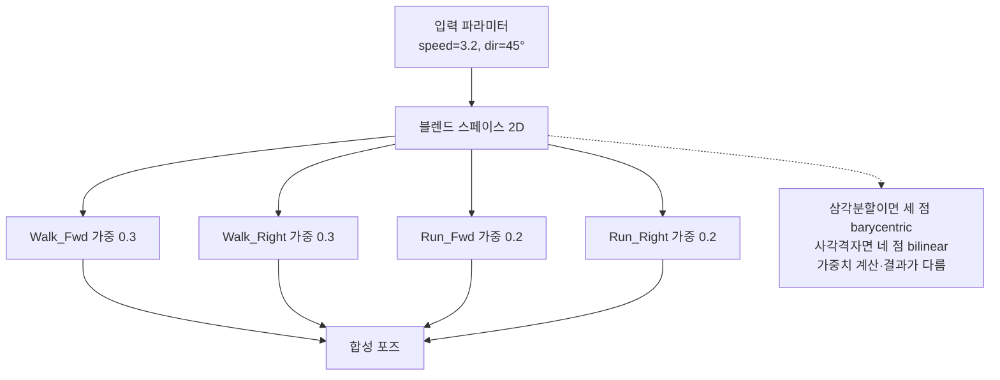
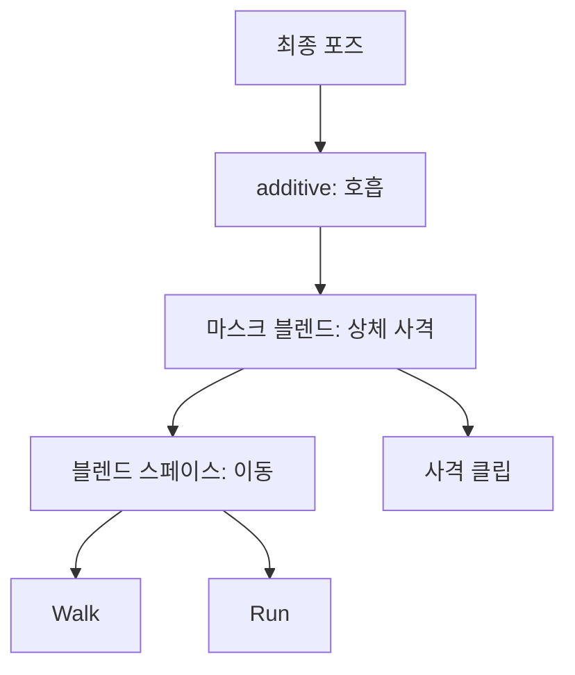
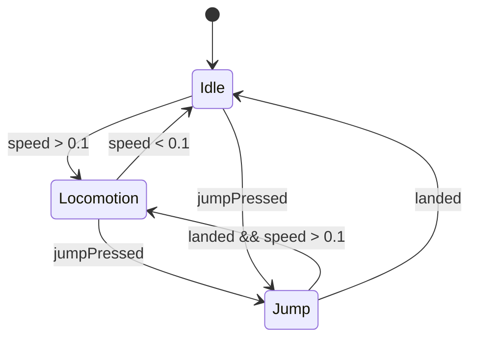
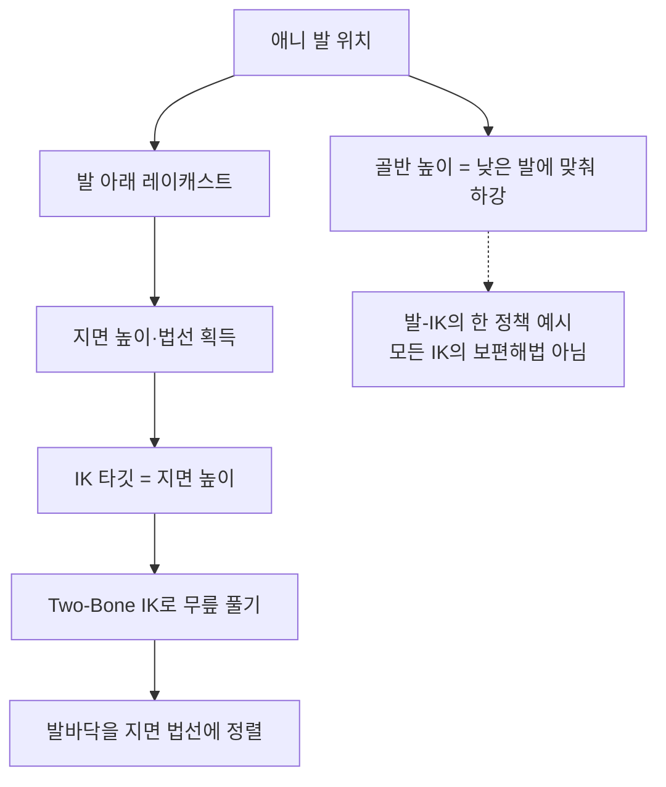
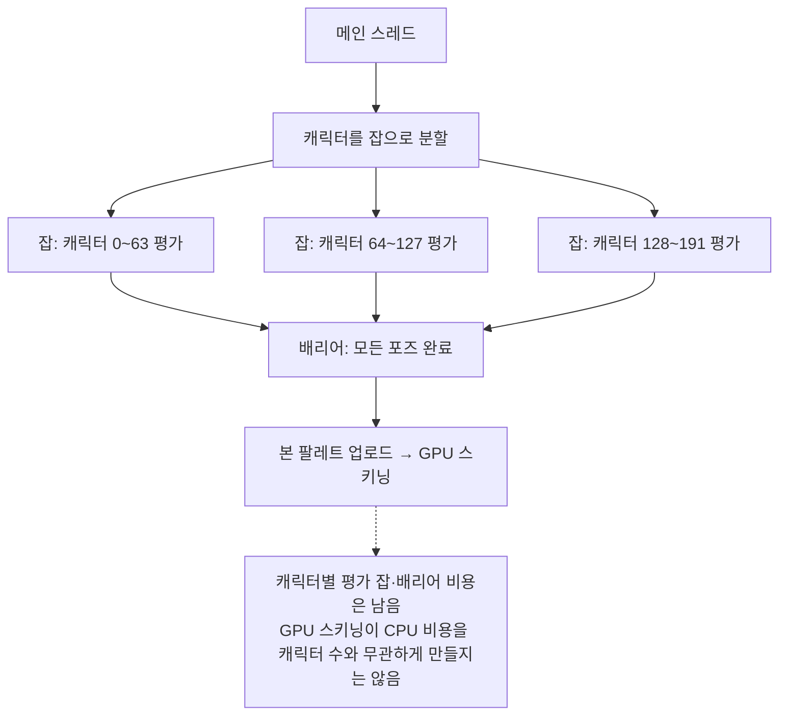

## 들어가며

게임 애니메이션 시스템은 *자연스러운 움직임* 과 *촘촘한 프레임 예산* 사이의 줄다리기다. 블렌딩·레이어·IK·물리 혼합 같은 기능을 쌓을수록 캐릭터는 살아 움직이지만, 그만큼 매 프레임 *수십~수백 캐릭터 × 수백 본* 의 트랜스폼을 평가하고 합성하고 스키닝해야 한다. 그래서 애니메이션 엔진의 거의 모든 결정은 *표현력 ↔ 메모리 ↔ CPU* 의 삼각 트레이드오프 위에 놓인다.

이 글은 그 트레이드오프를 따라 애니메이션 파이프라인을 한 흐름으로 정리한다. 애니메이션 데이터가 어떤 자료구조로 저장되고 본 계층을 따라 어떻게 합성되는지, 그 데이터를 어떻게 압축해 메모리를 줄이는지, 클립들을 어떻게 블렌딩하고 레이어로 쌓는지, 상태 머신과 블렌드 트리가 어떻게 재생을 조립하는지, IK가 애니메이션을 환경에 어떻게 맞추는지, 루트 모션이 이동을 어떻게 주도하는지, 그리고 이 모두를 LOD·병렬화·프로파일링으로 어떻게 예산 안에 가두는지를 다룬다.


이 글의 목표.

1. **애니메이션 데이터와 스키닝** — 포즈 표현, 본 계층, SoA 레이아웃, CPU vs GPU 스키닝.
2. **애니메이션 압축** — 키 리덕션, 쿼터니언·트랜스폼 양자화, 곡선 피팅, 오차 측정.
3. **블렌딩과 레이어** — SLERP, 블렌드 스페이스, additive, 마스크, 블렌드 트리.
4. **상태 머신** — FSM 대 블렌드 트리, 전환·블렌드 타임, 계층 상태, 디버깅.
5. **IK와 환경 보정** — Two-Bone IK, 발 접지, 시선 추적, 애니/IK 블렌드.
6. **루트 모션과 이동** — 추출·적용, 회전 분리, 내비·네트워크 동기화.
7. **LOD와 병렬화** — 거리 LOD, 업데이트 주파수, 오프스크린, 잡 시스템.
8. **프로파일링과 트레이드오프** — 측정 지표, 핫스팟, 메모리 대 CPU 사례.


---

## 목차
1. [애니메이션 데이터와 스키닝](#1-애니메이션-데이터와-스키닝)
2. [애니메이션 압축](#2-애니메이션-압축)
3. [블렌딩과 레이어](#3-블렌딩과-레이어)
4. [애니메이션 상태 머신](#4-애니메이션-상태-머신)
5. [IK와 환경 보정](#5-ik와-환경-보정)
6. [루트 모션과 이동](#6-루트-모션과-이동)
7. [LOD와 병렬화](#7-lod와-병렬화)
8. [프로파일링과 트레이드오프](#8-프로파일링과-트레이드오프)


---

## 1. 애니메이션 데이터와 스키닝

### 포즈는 트랜스폼의 배열이다

스켈레탈 애니메이션의 기본 단위는 *포즈(pose)* 다 — 스켈레톤의 모든 본에 대한 *로컬 트랜스폼* 의 배열. 각 본의 트랜스폼은 행렬이 아니라 *분해된 형태(TRS)* 로 들고 다니는 것이 표준이다. 위치(translation)는 벡터, 회전(rotation)은 쿼터니언, 스케일(scale)은 벡터다.

```cpp
struct BoneTransform {
    Vec3       translation;   // 12 bytes
    Quaternion rotation;      // 16 bytes (xyzw)
    Vec3       scale;         // 12 bytes
};                            // packed Vec3/Quaternion이면 40 bytes / 본; SIMD 정렬 시 sizeof로 확인

struct Pose {
    std::vector<BoneTransform> bones;   // 본 수만큼. 스켈레톤 순서와 동일
};
```

왜 행렬(64바이트)이 아니라 TRS(40바이트)인가. 두 가지 이유다. 첫째, *블렌딩이 TRS 위에서 의미가 있다* — 두 회전 사이를 보간하려면 쿼터니언 SLERP가 필요하고, 행렬을 직접 선형 보간하면 비직교 행렬이 나와 메시가 뒤틀린다. 둘째, 애니메이션 데이터는 *회전이 압도적으로 많은 채널* 이라 쿼터니언 단위로 압축·보간하는 편이 자연스럽다. 최종적으로 스키닝 직전에만 한 번 4×4 행렬로 변환한다.

### 본 계층과 글로벌 포즈 합성

스켈레톤은 *트리* 다. 각 본은 부모 본의 좌표계에서 정의되고, 부모는 그 부모를 기준으로 한다. 애니메이션이 주는 *로컬 포즈* 를 화면에 쓰려면, 루트부터 자식으로 내려가며 부모 트랜스폼을 누적해 *글로벌 포즈(global/model space)* 를 만들어야 한다.

```cpp
// 스켈레톤은 부모가 항상 자식보다 앞에 오도록 정렬해 둔다(topological order).
// 그러면 단일 선형 패스로 합성된다 — 재귀 없이.
void ComputeGlobalPose(const Skeleton& skel, const Pose& local, Pose& global) {
    for (int i = 0; i < skel.boneCount; ++i) {
        int parent = skel.parentIndex[i];          // -1 이면 루트
        if (parent < 0) global.bones[i] = local.bones[i];
        else global.bones[i] = Combine(global.bones[parent], local.bones[i]);
    }
}
```

로컬 포즈를 TRS로 저장하는 것과 *합성된 글로벌 포즈*를 TRS로 저장하는 것은 다른 문제다. 부모의 비균일 스케일과 자식 회전을 합성하면 결과에 shear가 생겨 더 이상 하나의 TRS로 표현되지 않는다. 따라서 로컬은 TRS로 두더라도 글로벌은 Mat4/3×4(affine)로 합성하거나, 계층 비균일 스케일을 금지하고 import 검증에서 거부해야 한다. `Combine`이 단순 TRS 곱셈이면 후자의 제약을 코드 계약으로 명시한다.

부모가 자식보다 항상 앞에 오도록 본 인덱스를 위상 정렬해 두는 것이 관건이다. 그러면 글로벌 포즈 합성이 재귀 없는 단일 선형 패스가 되고 `parentIndex[i] < i`가 성립한다. 다만 한 스켈레톤 내부에는 부모→자식 의존성이 있으므로 단순한 본별 병렬 루프는 불가능하다. 보통 캐릭터 간 병렬성을 먼저 쓰고, 매우 큰 스켈레톤에서만 깊이 레벨별 배리어나 독립 서브트리를 고려한다.

### 스키닝 — 본 포즈를 정점으로

글로벌 포즈가 나오면 *스키닝(skinning)* 으로 메시 정점을 변형한다. 각 정점은 자신에게 영향을 주는 본 인덱스와 가중치(보통 최대 4개)를 들고 있고, 최종 위치는 *각 본 행렬에 가중 평균* 한 결과다. 이것이 *Linear Blend Skinning(LBS)* 이다.

```cpp
// 각 본의 스키닝 행렬 = 글로벌 포즈 × 역바인드 행렬
// 역바인드(inverse bind pose)는 정점을 본 로컬 공간으로 보내는 고정 행렬이다.
Mat4 skinMatrix[boneCount];
for (int i = 0; i < boneCount; ++i)
    skinMatrix[i] = ToMatrix(global.bones[i]) * skel.inverseBind[i];

// 정점 변형: 최대 4본 가중 합
Vec3 SkinVertex(const Vertex& v) {
    Mat4 m = v.weight[0] * skinMatrix[v.bone[0]]
           + v.weight[1] * skinMatrix[v.bone[1]]
           + v.weight[2] * skinMatrix[v.bone[2]]
           + v.weight[3] * skinMatrix[v.bone[3]];
    return (m * Vec4(v.position, 1.0f)).xyz();
}
```

여기서 *역바인드 포즈(inverse bind pose)* 는 정점을 바인드 자세 기준 본 로컬 공간으로 보내는 고정 행렬이다. 스키닝 행렬 = 글로벌 포즈 × 역바인드이므로, 본이 바인드 자세 그대로면 스키닝 행렬은 단위 행렬이 되어 정점이 제자리에 남는다. 이를 성립시키려면 공간 계약을 고정해야 한다: `global.bones`가 mesh-local 기준이면 `skinMatrix`도 mesh-local이므로 이후 렌더에서 model 행렬을 *한 번만* 곱한다(월드 변환을 두 번 곱하지 않는다). `inverseBind`는 바인드 자세의 글로벌→본 로컬 역변환이고, 정점 가중치 합은 1, joint index는 유효 범위여야 한다. bind pose에서 원래 정점이 복원되는지 테스트로 확인하고, 법선·접선은 위치의 w=1 변환 경로와 구분해 처리한다.

### CPU 스키닝 대 GPU 스키닝

스키닝은 *정점 수 × 정점당 영향 본 수* 이라 메시가 무거우면 가장 큰 비용이다. 어디서 계산하느냐가 첫 갈림길이다.

| 축 | CPU 스키닝 | GPU 스키닝 |
|---|---|---|
| 연산 위치 | CPU, 결과 버퍼 업로드 | 정점 셰이더, 본 팔레트만 업로드 |
| 정점 비용 | CPU 연산과 변형 버퍼 쓰기·업로드 | GPU 정점/컴퓨트 연산과 메모리 대역폭 |
| 결과 재사용 | 변형된 정점을 CPU가 읽을 수 있음 | GPU 안에만 존재 |
| 적합 | 물리 충돌용 메시, 소수 캐릭터 | 다수 캐릭터 렌더링(표준) |

현대 엔진의 렌더 경로는 거의 *GPU 스키닝* 이다. CPU는 본 *행렬 팔레트(bone palette)* 만 만들어 상수 버퍼로 올리고, 정점 셰이더가 정점마다 가중 합을 수행한다. 정점당 비용이 GPU 수천 코어로 분산되므로 CPU의 *정점별 스키닝 항*은 크게 줄어든다. 다만 채널 샘플링·블렌딩·글로벌 포즈 합성과 본 팔레트 업로드·제출 비용은 남으므로, 캐릭터 수가 늘면 CPU 프레임 시간도 증가한다.

그럼에도 *CPU 스키닝이 필요한 경우* 가 있다. 변형된 메시로 *충돌·레이캐스트* 를 해야 하거나(피격 판정), 클로스·헤어 물리가 스키닝된 위치를 입력으로 받아야 할 때다. CPU 소비가 꼭 필요하면 *충돌용 저폴리 메시만 CPU 스키닝* 하고, 렌더용 고폴리 메시는 GPU 스키닝으로 분리하는 것이 표준이다. GPU에서 클로스·헤어를 함께 계산한다면 compute skinning 결과를 GPU 안에서 재사용할 수도 있다. 본 팔레트는 한 번만 계산하면 양쪽이 공유한다.

### SoA 레이아웃과 SIMD

포즈 합성과 블렌딩은 *본 단위 반복* 이라 데이터 레이아웃이 성능을 좌우한다. `BoneTransform` 배열(AoS)은 한 본의 TRS가 연속이라 직관적이지만, *모든 본의 회전만* 처리하는 SIMD 루프에는 불리하다. 대안은 *SoA(Structure of Arrays)* — 채널을 분리해 묶는다.

```cpp
// AoS: [T R S][T R S]...  — 본 하나가 연속
// SoA: [TTTT...][RRRR...][SSSS...] — 채널별로 연속
struct PoseSoA {
    Vec3*       translations;   // 본 수만큼 연속
    Quaternion* rotations;
    Vec3*       scales;
};
```

위 `PoseSoA`는 *필드별* 분리(translation 배열, rotation 배열, scale 배열)이지, 여러 본의 x/y/z를 같은 SIMD 레인에 담는 *lane별* 배열이 아니다. 여러 본의 쿼터니언 성분을 SIMD 레인에 배치해 내적, 부호 정렬, 정규화와 근사 보간을 함께 처리하려면 AoSoA로 재배치하거나 transpose/gather, lane packing이 필요하다. 삼각함수를 쓰는 정확한 SLERP는 단순 사칙연산만큼 자동 벡터화되지는 않으므로, 런타임 코덱은 NLerp나 다항 근사와 레이아웃을 함께 설계한다. 단일 본을 임의 접근하는 IK에는 AoS가 편할 수 있으며, 레이아웃 변환 비용이 이득보다 작은지도 측정해야 한다.

## 2. 애니메이션 압축

### 원본의 크기와 압축의 동기

비압축 애니메이션은 *본 × 프레임 × 채널* 의 곱으로 폭발한다. 60fps 기준 3초 클립, 100본짜리 캐릭터를 생각해 보자.

$$\text{크기} = 100\,\text{본} \times 180\,\text{프레임} \times 40\,\text{bytes} = 720{,}000\ \text{bytes} \approx 703\text{KiB}$$

이 계산은 채널 값을 매 프레임 40바이트의 논리 크기로 저장한 단순 상한 예다. 실제 원본 포맷의 패딩, 키 시각, 곡선 탄젠트와 메타데이터에 따라 달라진다. 클립 수와 본 수가 늘면 메모리·I/O·캐시 비용이 커지므로 런타임 형식은 상수 트랙 제거, 키 리덕션과 양자화를 사용한다. 압축률은 동작의 복잡도와 허용 오차에 따라 달라지며 고정 배수로 보장되지 않는다.

### 키 리덕션 — 움직이지 않는 키 버리기

애니메이션 채널의 대부분은 *변화가 없거나 선형에 가깝다*. 다리가 움직이는 동안 손가락 본은 거의 상수다. *키 리덕션(key reduction)* 은 "이 키를 빼고 이웃 키를 보간해도 오차가 허용치 이하면 버린다"는 단순한 규칙이다.

```cpp
// 구간 [first,last]를 끝점 보간으로 대체했을 때 가장 큰 오차를 찾는다.
void ReduceRange(const Track& src, int first, int last,
                 float epsilon, std::vector<bool>& keep) {
    float worst = -1.0f;
    int split = -1;
    for (int i = first + 1; i < last; ++i) {
        Value reconstructed = Interpolate(src[first], src[last], src[i].time);
        float e = TrackError(src[i].value, reconstructed);
        if (e > worst) { worst = e; split = i; }
    }
    if (worst <= epsilon) return;       // 이 구간의 중간 키를 모두 제거 가능
    keep[split] = true;
    ReduceRange(src, first, split, epsilon, keep);
    ReduceRange(src, split, last, epsilon, keep);
}
```

한 번 앞에서 훑으며 키를 버리면 이전 제거가 다음 구간의 오차를 바꾸므로 전체 오차 상한을 보장하기 어렵다. 위 방식은 구간에서 최악의 키를 남기고 재귀 분할하는 골격이다. 실제 검증은 원본 키 시각만이 아니라 보간 곡선의 극값과 추가 샘플 시각도 확인한다.

`epsilon`의 의미도 채널마다 다르다. 회전 각오차가 작아도 긴 자식 체인 끝의 손·무기 부착점에서는 큰 위치 오차가 될 수 있다. 그래서 압축기는 로컬 채널 차이만 보지 않고, 대표 정점·소켓 또는 각 본 아래의 가상 꼭짓점을 글로벌 포즈로 변환해 발생한 변위를 측정한다.

### 쿼터니언 압축 — 4채널을 3으로

회전은 단위 쿼터니언이라 $x^2+y^2+z^2+w^2=1$ 이 항상 성립한다. 즉 4개 중 *3개만 저장하면 나머지 하나는 복원* 할 수 있다. 가장 큰 성분 하나를 버리고, *어느 것을 버렸는지를 2비트* 로 기록한다. 남은 3성분은 $[-\frac{1}{\sqrt2}, \frac{1}{\sqrt2}]$ 범위라 *양자화* 가 정밀하다.

```cpp
// "smallest three" 압축: 가장 큰 성분을 버리고 나머지 3개를 양자화한다.
struct CompressedQuat {                 // 이 예제 형식은 16 bytes → 4 bytes
    uint32_t packed;                    // 2bit: 버린 성분 인덱스 + 3 × 10bit
};
Quaternion Decompress(CompressedQuat c) {
    int dropped = c.packed >> 30;       // 어느 성분을 버렸나
    float a = Dequantize10((c.packed >> 20) & 0x3FF);   // -1/√2 ~ 1/√2
    float b = Dequantize10((c.packed >> 10) & 0x3FF);
    float d = Dequantize10( c.packed        & 0x3FF);
    float missing = std::sqrt(std::max(0.0f, 1.0f - a*a - b*b - d*d));
    return Insert(dropped, a, b, d, missing);   // 버린 자리에 복원값 삽입
}
```

인코더는 절댓값이 가장 큰 성분을 고른 뒤, 그 성분이 음수라면 쿼터니언 전체의 부호를 뒤집어 생략 성분이 항상 양수가 되게 해야 한다. $q$와 $-q$가 같은 회전을 나타내므로 별도 부호 비트를 쓰지 않고 양의 제곱근으로 복원할 수 있다. 위 32비트 형식은 인덱스 2비트와 세 성분 각 10비트를 정확히 채운 예다. 양자화 오차가 최종 메시에서 허용되는지는 비트 수만 보고 단정하지 않고 글로벌 포즈의 정점·소켓 오차로 검증한다.

### 스케일 생략과 채널 분리

많은 캐릭터 클립에는 단위 스케일에서 변하지 않는 본이 많다. 클립의 모든 키를 분석해 허용 오차 안에서 단위 또는 상수라고 증명된 트랙만 생략하고, squash-and-stretch·얼굴·리타기팅용 스케일은 보존한다.

더 나아가 *채널 간 키 개수를 분리* 한다. 한 본의 회전은 60키가 필요해도 위치는 1키(상수)면 충분한 경우가 흔하다. TRS를 한 묶음으로 키잉하면 위치가 회전 키 개수에 끌려가 낭비된다. *채널별 독립 키 트랙* 으로 각 채널이 자기 필요한 만큼만 저장한다.

```cpp
struct AnimChannel {
    BoneId bone;
    std::vector<Key> rotKeys;     // 60키
    std::vector<Key> posKeys;     // 1키 (상수면 1개만)
    bool             hasScale;    // false면 스케일 트랙 자체가 없음
};
```

### 곡선 피팅과 보간 방식

키 사이를 어떻게 잇느냐가 *키 개수* 를 결정한다. *선형 보간* 은 키가 많아야 매끄럽고, *3차 곡선(Hermite/Catmull-Rom)* 은 키 하나당 탄젠트 정보를 더 들고 다니는 대신 *적은 키로 부드러운 곡선* 을 표현한다. 곡선 피팅은 "오차 허용 안에서 곡선 하나로 표현 가능한 구간"을 찾아 키를 통째로 줄인다.

| 보간 방식 | 키당 비용 | 키 개수 | 적합 |
|---|---|---|---|
| 선형(Lerp) | 낮음 | 많음 | 빠른 디코딩, 다수 본 |
| 큐빅 Hermite | 탄젠트 추가 | 적음 | 부드러운 곡선, 카메라·표정 |
| 균일 샘플 | 인덱싱 단순 | 고정 | 시크·랜덤 액세스 |

실무 압축기는 *클립 특성에 맞춰 자동 선택* 한다. 빠르게 흔들리는 채널은 균일 샘플이 시크에 유리하고, 천천히 휘는 채널은 큐빅이 키를 크게 줄인다. 디코딩 비용(런타임 CPU)과 크기(메모리)의 거래라, 다수 본을 매 프레임 푸는 게임은 *선형 + 키 리덕션* 조합을 선호한다.

### 압축률 대 품질 측정

압축은 오차를 허용해 크기와 디코딩 비용을 줄이는 작업이므로 측정 계약이 필요하다. 로컬 채널 오차, 글로벌 관절·소켓 변위, 실제 스키닝된 대표 정점의 변위는 서로 다른 지표다. 특히 회전 오차는 본 길이와 자식 계층을 거치며 증폭된다.

```cpp
// 압축 검증의 한 단계: 샘플 시각에서 글로벌 관절 위치의 최대 차이
float MaxJointPositionError(const Clip& orig, const Clip& compressed,
                            const Skeleton& s, std::span<const float> sampleTimes) {
    float maxErr = 0.0f;
    for (float t : sampleTimes) {
        Pose a = SampleGlobal(orig, s, t);
        Pose b = SampleGlobal(compressed, s, t);
        for (int i = 0; i < s.boneCount; ++i)
            maxErr = std::max(maxErr, Distance(a.bones[i].translation,
                                               b.bones[i].translation));
    }
    return maxErr;
}
```

이 함수 이름을 `MaxVertexError`로 부르면 안 된다. 본 원점만 비교하므로 회전으로 움직인 메시 정점과 소켓의 오차를 놓친다. 최종 품질 검사는 스킨 가중치를 적용한 대표 정점, 무기·카메라 소켓, 발 접촉점까지 변환하고, 원본 키 사이의 시각과 루프 경계도 샘플한다. 허용 오차는 월드 단위와 화면 투영 오차, 캐릭터 LOD에 맞춰 자산 유형별로 정하며 보편적인 밀리미터 상수로 두지 않는다.

## 3. 블렌딩과 레이어

### 블렌딩은 포즈 사이의 보간이다

캐릭터가 걷다가 뛰기로 *부드럽게 전환* 하려면 두 클립의 포즈를 섞어야 한다. *블렌딩(blending)* 은 두 포즈를 가중치 $\alpha$ 로 보간한다. 위치·스케일은 선형 보간이지만, 회전은 *정규화된 쿼터니언 위에서* 보간해야 한다. *SLERP*는 등속 호를 주고, 정규화를 동반한 *NLerp*도 같은 호 위의 유효한 근사다 — 반면 행렬 원소를 직접 선형 보간하면 비직교 행렬이 나와 메시가 뒤틀린다.

```cpp
// 두 포즈 블렌딩: 위치/스케일은 Lerp, 회전은 SLERP.
// 계약: a.bones, b.bones, out.bones의 크기가 모두 같고 out은 호출자가 미리 할당한다.
//       alpha는 유한한 [0,1], 두 회전은 단위 쿼터니언. 정확한 in-place(out==a 또는 out==b)는
//       허용하지만 부분 겹침은 허용하지 않는다. 빈 출력은 자동 resize하지 않고 거절한다.
bool BlendPose(const Pose& a, const Pose& b, float alpha, Pose& out) {
    if (a.bones.size() != b.bones.size() ||
        a.bones.size() != out.bones.size() ||
        !std::isfinite(alpha) || alpha < 0.0f || alpha > 1.0f)
        return false;                        // 쓰기 전에 크기·alpha 검증
    for (int i = 0; i < a.bones.size(); ++i) {
        out.bones[i].translation = Lerp(a.bones[i].translation, b.bones[i].translation, alpha);
        out.bones[i].scale       = Lerp(a.bones[i].scale,       b.bones[i].scale,       alpha);
        out.bones[i].rotation    = Slerp(a.bones[i].rotation,   b.bones[i].rotation,    alpha);
    }
    return true;
}
```

출력 Pose는 호출자가 스켈레톤 크기로 미리 할당하며(예: pose arena), 빈 vector를 자동으로 resize하지 않는다 — 실시간 블렌드 경로의 암묵적 힙 할당을 피하기 위해서다. 함수는 크기·alpha 검증에 실패하면 쓰기 전에 false를 반환한다.

쿼터니언을 *성분 단위 선형 보간한 뒤 정규화(NLerp)* 하면 빠르지만, 큰 각도에서는 *각속도가 일정하지 않아* 중간이 끌리듯 보인다. SLERP는 구면 위 등속 보간이라 정확하지만 삼각함수가 비싸다. 실무 절충은 *작은 각도는 NLerp + 정규화, 큰 각도만 SLERP* 다 — 대부분의 인접 프레임 블렌드는 각도가 작아 NLerp로 충분하다.

### SLERP와 NLerp — 등속 호와 비등속 현

위 절충("작은 각도는 NLerp")이 왜 정당한지는 두 보간의 각속도를 유도하면 나온다. 먼저 $q_0\cdot q_1<0$이면 한쪽 부호를 뒤집어 최단 호를 선택한다. 그 뒤 단위 쿼터니언의 내적을 $q_0\cdot q_1=\cos\theta$로 두면 $\theta\in[0,\pi/2]$는 4차원 단위구 위의 각이고, 두 자세 사이의 물리적 회전각은 $2\theta$다. 이 반각 구분을 빠뜨리면 품질 임계값이 두 배 어긋난다.

*SLERP는 정확히 등속이다.* 쿼터니언 구면각 $\theta=\arccos(q_0\cdot q_1)$일 때

$$\mathrm{slerp}(q_0,q_1;t)=\frac{\sin\!\big((1-t)\theta\big)}{\sin\theta}\,q_0+\frac{\sin(t\theta)}{\sin\theta}\,q_1.$$

보간점이 $q_0$와 이루는 각을 보면, $\sin((1-t)\theta)=\sin\theta\cos t\theta-\cos\theta\sin t\theta$를 대입해

$$\mathrm{slerp}\cdot q_0=\frac{\sin\theta\cos t\theta-\cos\theta\sin t\theta+\cos\theta\sin t\theta}{\sin\theta}=\cos t\theta,$$

즉 $q_0$로부터의 구면각이 정확히 $t\theta$다. 물리적 회전각도 $2t\theta$로 선형이므로 등각속도 큰원 호다.

*NLerp는 경로는 같고 속도만 다르다.* $\mathrm{nlerp}=\dfrac{(1-t)q_0+tq_1}{\lVert(1-t)q_0+tq_1\rVert}$는 $q_0,q_1$의 선형결합을 정규화한 것이라 *같은 큰원* 위에 놓인다 — 경로는 SLERP와 동일하다. 그러나 $q_0$ 방향 성분 $u=1-t(1-\cos\theta)$, 수직 성분 $v=t\sin\theta$로 각이

$$\phi_N(t)=\arctan\frac{t\sin\theta}{1-t(1-\cos\theta)},$$

미분하면 분자가 약분되어 각속도가

$$\omega_N(t)=\frac{d\phi_N}{dt}=\frac{\sin\theta}{\lVert(1-t)q_0+tq_1\rVert^2},\qquad \lVert\cdot\rVert^2=(1-t)^2+t^2+2t(1-t)\cos\theta.$$

끝점에서 $\omega_N(0)=\omega_N(1)=\sin\theta$(가장 느림), 중점에서 $\omega_N(\tfrac12)=2\tan(\theta/2)$(가장 빠름)이라 속도 비는

$$\frac{\omega_N(1/2)}{\omega_N(0)}=\sec^2\!\frac{\theta}{2}.$$

SLERP의 일정 각속도와 달리 NLerp는 *중간에서 빨라졌다가 끝에서 느려진다* — "중간이 끌리듯 보인다"의 정량적 정체가 이 $\sec^2(\theta/2)$ 배율이다.

*언제 NLerp로 충분한가.* 작은 $\theta$에서 $\sec^2(\theta/2)\approx1+(\theta/2)^2$라 속도 변화와 경로 매개화 오차가 빠르게 줄어든다. 그러나 "몇 도부터 SLERP"라는 보편 임계는 없다. 블렌드 가중치가 시간에 따라 어떻게 변하는지, 본 길이와 화면 크기, 최종 정점 오차 예산에 따라 결정해야 한다. 구현은 내적 구간별로 NLerp와 SLERP를 선택하고, 대표 클립에서 최대 소켓·정점 오차와 실행 시간을 함께 측정한다.

*두 가지 코드 경계 조건이 빠지면 버그가 된다.* 첫째 *최단 호(이중 덮개)* — $q$와 $-q$가 같은 회전이라, $q_0\cdot q_1<0$이면 보간이 *먼 길*(180° 초과)로 돈다(실제 10° 회전을 350°로 감는다). 보간 직전에 한쪽을 부호 반전해 짧은 호를 강제해야 한다. 둘째 *$\sin\theta\to0$ 퇴화* — $q_0\approx q_1$이면 $\theta\to0$이라 SLERP 공식이 $0/0$이 된다. 내적이 1에 충분히 가까우면(흔한 임계 $q_0\cdot q_1>0.9995$, $\theta\lesssim1.8°$) lerp 후 정규화로 폴백한다(작은 각도에서 오차가 작지만 정확히 같은 결과는 아니다).

```cpp
// 블렌드 전 부호 정렬(최단 호) + 퇴화 폴백
Quaternion SlerpSafe(Quaternion a, Quaternion b, float t) {
    float d = Dot(a, b);
    if (d < 0.0f) { b = -b; d = -d; }          // 이중 덮개: 짧은 호로 강제
    if (d > 0.9995f)                            // 예시 임계: 거의 같음, 0/0 회피
        return Normalize(Lerp(a, b, t));        // lerp + 정규화 = NLerp
    float th = std::acos(d);
    float s  = std::sin(th);
    return (std::sin((1 - t) * th) / s) * a + (std::sin(t * th) / s) * b;
}
```

`0.9995`는 수치적으로 안전한 폴백을 설명하기 위한 예시이지 품질의 보편 경계가 아니다. 이 값이면 쿼터니언 구면각은 약 1.81°보다 작고 물리적 상대 회전각은 약 3.62°보다 작다. d>0.9995는 *품질/비용 임계값*일 뿐 오차가 0이라는 보장이 아니며, 폴백 구간에서도 두 결과가 비트 단위로 같다는 등식은 아니다. 부호 정렬을 빠뜨리면 같은 자세를 나타내는 $q$와 $-q$ 사이를 먼 호로 보간할 수 있고, 퇴화 폴백을 빠뜨리면 $\sin\theta$ 분모가 0에 가까워져 수치 오차가 커진다.

### 블렌드 스페이스 — 파라미터로 포즈를 찾기

이동 애니메이션은 *속도·방향* 같은 연속 파라미터에 따라 변한다. 이를 클립 여러 개를 좌표에 배치하고 *파라미터 위치에서 가중 보간* 하는 것이 *블렌드 스페이스(blend space)* 다. 1D는 속도 축(정지-걷기-달리기), 2D는 속도×방향(8방향 이동)이 흔하다.



2D 블렌드 스페이스는 파라미터 좌표를 둘러싼 *소수의 클립*만 가중 합한다 — 전체 클립을 다 섞지 않는다. 삼각분할을 쓴다면 세 점의 클립을 *무게중심 좌표(barycentric)* 로, 사각 격자라면 인접 네 점을 *bilinear* 가중으로 섞는다 — 두 정책은 가중치 계산과 결과가 다르다. 파라미터가 hull 밖이면 경계로 clamp(투영)하거나 extrapolate하는 정책을 정한다. 이 "필요한 소수만 블렌드"가 비용을 잡는 첫 단계다(아래 비용 절).

### 레이어와 additive 애니메이션

전신 이동 위에 *상체만 다른 동작* 을 얹고 싶을 때 — 달리면서 총 쏘기 — *레이어(layer)* 를 쓴다. 하위 레이어(이동)를 베이스로 두고, 상위 레이어(사격)를 *마스크* 또는 *additive* 로 덮는다.

*additive 애니메이션* 은 절대 포즈가 아니라 기준 포즈로부터의 차이(델타)를 저장한다. 위치는 차이를 더할 수 있지만 회전은 쿼터니언 델타를 합성해야 하고, 스케일은 비율 또는 로그 공간 델타로 처리한다. 따라서 "더한다"는 말은 세 채널에 같은 덧셈을 한다는 뜻이 아니다.

```cpp
// 열벡터·로컬 회전 합성 convention:
// additive = ref * delta, result = base * weighted(delta)
void ApplyAdditive(Pose& base, const Pose& additive, const Pose& refPose, float weight) {
    for (int i = 0; i < base.bones.size(); ++i) {
        Quaternion delta = Conjugate(refPose.bones[i].rotation)
                         * additive.bones[i].rotation;
        Quaternion weighted = Slerp(Quaternion::Identity(), delta, weight);
        base.bones[i].rotation = Normalize(base.bones[i].rotation * weighted);
        base.bones[i].translation += weight * (additive.bones[i].translation
                                              - refPose.bones[i].translation);
        // 계약: refScale != 0 이고 addScale/refScale > 0 (로그의 정의역). SafeDivide는
        // 0 나눗셈을 막을 뿐 음수 비율의 Log를 유효하게 만들지 못한다. 미러링(부호 반전)
        // 스케일은 이 로그 보간으로 표현할 수 없으므로 별도 불연속 정책으로 처리하거나 클립을 거부한다.
        Vec3 scaleRatio = SafeDivide(additive.bones[i].scale, refPose.bones[i].scale);
        base.bones[i].scale *= Exp(weight * Log(scaleRatio));
    }
}
```

곱셈 순서는 엔진의 행렬·쿼터니언 convention에 따라 표기가 달라질 수 있다. 중요한 불변식은 델타를 정의한 공간과 적용 공간을 일치시키는 것이다. 위 코드는 로컬 공간 오른쪽 합성을 명시했으며, 월드 공간 additive를 같은 식에 섞으면 부모 회전에 따라 결과가 달라진다.

additive의 힘은 *조합 폭발 방지* 다. 걷기·뛰기·웅크리기 × 조준·발사·재장전을 *전부 통짜로 만들면 N×M 클립* 이지만, 상체 동작을 additive로 두면 *N + M 클립* 으로 줄고 어떤 이동에든 덮인다. 표정·피격 반응·호흡도 흔한 additive 레이어다.

### 블렌드 마스크 — 본별 가중치

레이어를 *전신이 아니라 일부 본에만* 적용하려면 *블렌드 마스크(blend mask)* 를 쓴다. 본별로 0~1 가중치를 두어, 상체 레이어는 척추-팔에만 1, 다리에는 0을 준다. 그러면 다리는 이동 레이어 그대로, 상체만 사격 레이어로 덮인다.

```cpp
struct BlendMask {
    std::vector<float> boneWeight;   // 본 수만큼. 상체 1, 하체 0
};
// 마스크 적용: 본마다 다른 alpha로 블렌드.
// 계약: lower/upper/mask/out의 본 개수가 모두 같고 out은 미리 할당되어 있다.
bool MaskedBlend(const Pose& lower, const Pose& upper, const BlendMask& m, Pose& out) {
    if (lower.bones.size() != upper.bones.size() ||
        lower.bones.size() != m.boneWeight.size() ||
        lower.bones.size() != out.bones.size())
        return false;                        // 빈 출력을 조용히 통과시키지 않는다
    for (int i = 0; i < lower.bones.size(); ++i)
        BlendBone(lower.bones[i], upper.bones[i], m.boneWeight[i], out.bones[i]);
    return true;
}
```

마스크의 함정은 *경계 본* 이다. 상체(가중 1)와 하체(가중 0) 사이의 허리 본이 갑자기 0→1로 끊기면 *몸이 꺾여 보인다*. 그래서 마스크는 경계에서 *부드럽게 감쇠* 시켜야 한다 — 허리를 따라 0.2, 0.5, 0.8로 점진 가중을 준다. 모든 포즈 연산은 스켈레톤 크기의 뷰(입력·마스크·출력 본 개수 일치)를 공통 계약으로 삼고 성공 여부를 반환해, 빈 출력이 조용히 통과하는 경로를 없앤다.

### 블렌드 트리와 비용

위의 블렌드·레이어·additive·마스크는 *트리* 로 조립된다. 잎은 클립, 내부 노드는 블렌드 연산이고, 루트가 최종 포즈를 낸다. 매 프레임 트리를 평가하면 포즈가 나온다.



비용의 핵심은 *블렌드 노드 수 × 본 수* 다. 노드마다 모든 본을 순회하며 SLERP/Lerp를 하므로, 트리가 깊고 캐릭터가 많으면 이것이 애니메이션 CPU의 큰 몫이다. 잡는 방법이 몇 가지다. 첫째, *가중치 0인 가지는 평가하지 않는다* — 블렌드 스페이스에서 멀리 떨어진 클립, 마스크가 전부 0인 레이어는 건너뛴다(early-out). 둘째, *마스크 영역만 블렌드* 한다 — 상체 마스크면 하체 본은 순회조차 하지 않는다. 셋째, 멀리 있는 캐릭터는 *블렌드 트리를 단순화* 한다(7절 LOD).

## 4. 애니메이션 상태 머신

### FSM과 블렌드 트리의 역할 분담

캐릭터가 *언제 어떤 블렌드 트리를 재생할지* 를 정하는 것이 *애니메이션 상태 머신(animation state machine)* 이다. 각 상태(state)는 하나의 블렌드 트리를 들고 있고, 게임 조건이 만족되면 *전환(transition)* 으로 다른 상태로 넘어간다. 둘의 역할이 명확히 갈린다 — *상태 머신은 이산적 선택*(서 있나/걷나/점프하나), *블렌드 트리는 연속적 합성*(걷기 속에서 방향·속도).



### 전환과 블렌드 타임

많은 전환은 현재 포즈와 다음 포즈를 일정 시간 함께 평가해 크로스페이드한다. 반면 피격·teleport·명시적 cut처럼 즉시 바뀌어야 하는 전환도 있으므로 블렌드는 상태쌍의 정책이다.

```cpp
struct Transition {
    StateId  from, to;
    float    blendTime;          // 예: 0.2초
    std::function<bool(const Context&)> condition;
};

struct StateMachineRuntime {
    StateId current;
    StateId blendingTo = kNone;  // 전환 중이면 대상 상태
    float   blendElapsed = 0.0f;
    float   activeBlendTime = 0.0f;  // 전환 시작 시 해당 Transition::blendTime을 복사

    void Evaluate(Context& ctx, float dt, Pose& out) {
        Pose curPose; EvalState(current, ctx, curPose);
        if (blendingTo != kNone) {
            Pose toPose; EvalState(blendingTo, ctx, toPose);   // 두 상태 동시 평가
            blendElapsed += dt;
            float a = (activeBlendTime > 0.0f)                       // 0 나누기 방지
                    ? std::clamp(blendElapsed / activeBlendTime, 0.0f, 1.0f)
                    : 1.0f;                                          // 즉시 전환(cut)
            BlendPose(curPose, toPose, a, out);
            if (a >= 1.0f) { current = blendingTo; blendingTo = kNone; }
        } else { out = curPose; }
    }
};
```

블렌드 시간은 상태쌍의 반응성, pose 차이와 애니메이션 이벤트 의미에 맞춰 튜닝한다. 시간만 길게 해도 발 접촉과 무기 궤적이 맞지 않으면 자연스러워지지 않는다. 전환 중 두 그래프를 평가하면 비용이 늘고, 중단 가능한 전환을 여러 겹 보존하면 활성 pose 수가 증가하므로 최대 중첩과 interruption 규칙을 둔다.

### 계층 상태 머신과 동기화

상태가 수십 개로 늘면 평면 FSM은 *전환 폭발* 로 관리가 안 된다. n개 상태가 서로 전환 가능하면 최대 $n^2$ 전환이다. *계층 상태 머신(hierarchical state machine)* 은 관련 상태를 *서브 상태로 묶어* 공통 전환을 부모 레벨에 한 번만 둔다. 예컨대 "피격" 전환은 Idle·Walk·Run 각각이 아니라 *지상 이동* 부모 상태에 한 번 둔다.

전환의 또 다른 함정은 위상 동기화다. 단순 normalized time은 두 클립의 왼발·오른발 접촉이 같은 시각에 있다는 보장이 없다. 클립에 left-contact, right-contact, pass 같은 sync marker를 표시하고, 현재 marker 사이의 국소 위상을 다음 클립의 같은 marker 구간으로 매핑해야 한다.

```cpp
SyncPosition p = current.MarkerPhase();       // marker pair + 구간 내 [0,1]
next.SetStartTime(next.TimeAtMarkerPhase(p));
```

### 런타임 디버깅과 시각화

상태 머신 버그 — "왜 이 동작에서 안 빠져나오지?" — 는 *코드만 봐선 안 보인다*. 전환 조건이 게임 상태에 의존하기 때문이다. 그래서 *런타임 시각화* 가 필수다. 현재 활성 상태와 진행 중인 전환을 *그래프로 하이라이트* 하고, 각 전환의 *조건이 지금 참인지* 를 표시하면, "이 전환이 안 일어난 건 condition B가 거짓이라서"가 즉시 보인다. 활성 블렌드 트리의 *각 노드 가중치* 도 함께 띄워, 의도한 클립이 의도한 비율로 섞이는지 확인한다.

## 5. IK와 환경 보정

### 순운동학의 한계와 IK의 동기

지금까지의 파이프라인은 *순운동학(Forward Kinematics)* 이다 — 본 각도가 주어지면 말단 위치가 결정된다. 그런데 게임은 종종 *반대* 를 원한다. "손을 저 문고리에 정확히 놓아라", "발을 이 경사면에 붙여라" — 즉 *말단 위치가 주어지고 본 각도를 푸는* 것이 *역운동학(Inverse Kinematics, IK)* 이다.

미리 만든 애니메이션은 *평지·정형 환경* 을 가정한다. 실제 지형은 울퉁불퉁하고 상호작용 대상은 위치가 변하므로, IK가 *런타임에 애니메이션을 환경에 맞춰 보정* 한다.

### Two-Bone IK — 닫힌 해

게임에서 가장 흔한 IK는 *2본 체인*(팔: 위팔-아래팔, 다리: 허벅지-정강이)이다. 관절이 하나뿐이라 *해석적 닫힌 해(closed form)* 가 있다 — 반복 없이 코사인 법칙으로 한 번에 푼다.

```cpp
// Two-Bone IK: 어깨(root)-팔꿈치(mid)-손목(end)을 target에 닿게 무릎/팔꿈치 각도를 푼다.
void TwoBoneIK(Vec3 root, Vec3& mid, Vec3& end, Vec3 target, Vec3 poleVec,
               float upperLen, float lowerLen) {
    // 계약: upperLen > 0, lowerLen > 0, 유한 입력. margin은 스켈레톤 단위와 본 길이에
    // 비례시킨다 — 고정 1e-4는 짧은 본에서 lower > upper를 만들어 clamp를 무효화한다.
    const float margin = 1e-4f * std::max({upperLen, lowerLen, 1.0f});
    const float lo = std::abs(upperLen - lowerLen) + margin;
    const float hi = upperLen + lowerLen - margin;
    if (hi <= lo) return;                    // feasible 구간이 비면 풀지 않는다
    float targetDist = std::clamp(Distance(root, target), lo, hi);   // 도달 불가 클램프
    // 코사인 법칙으로 팔꿈치 각도를 구한다.
    float cosElbow = (upperLen*upperLen + lowerLen*lowerLen - targetDist*targetDist)
                     / (2 * upperLen * lowerLen);
    float elbowAngle = std::acos(std::clamp(cosElbow, -1.0f, 1.0f));
    // pole vector로 팔꿈치 평면(회전 방향)을 결정하고 mid/end를 재배치한다.
    Vec3 direction = DirectionOrPreviousAxis(target - root); // 길이0이면 이전 프레임 축
    Vec3 reachableTarget = root + direction * targetDist;
    PlaceJoints(root, reachableTarget, poleVec, upperLen, lowerLen, elbowAngle, mid, end);
}
```

*pole vector*는 굽힘 평면을 선택한다. 하지만 pole이 체인 축과 거의 평행하면 평면이 퇴화하므로 직전 프레임의 평면이나 안정한 fallback 축을 사용해 연속성을 유지해야 한다. 목표가 최대 도달 거리 밖이거나 두 본 길이 차보다 안쪽이면 해가 없으므로 거리와 관절 한계를 적용한다. 경계에서 단순 clamp만 하면 타깃이 오갈 때 미세 떨림이 생길 수 있어 위치·가중치에도 히스테리시스나 감쇠를 둔다.

### 발 접지

지형에 발을 붙이는 *발 접지(foot placement)* 는 IK의 대표 용례다. 애니메이션이 평지를 가정해 발을 어디에 두면, *그 지점에서 아래로 레이캐스트* 해 실제 지면 높이를 찾고, 발 IK 타깃을 그 높이로 올린다. 발바닥은 지면 법선에 맞춰 *기울인다*.



양발 접지에서는 *골반 보정* 도 함께 검토한다. 한 발이 계단 위, 다른 발이 아래에 있을 때 두 발을 다 지면에 붙이려면 다리가 늘어나야 하는데, 다리는 못 늘어난다. 흔한 정책은 *낮은 발을 기준으로 골반을 내리는* 것이지만, 양다리의 도달 구간·관절 한계가 동시에 만족되는지 확인해야 한다. 계단 높이가 너무 크면 낮추는 것만으로 양발을 모두 붙일 수 없어 접촉·보폭 정책이 필요하다. 발 접지의 자연스러움은 *발 IK + 골반 하강 + 발바닥 정렬* 세 가지가 함께 동작할 때 나온다.

### 시선 추적과 IK 블렌딩

*시선 추적(Look-At)* 은 머리·눈·척추를 대상으로 부드럽게 돌리는 IK다. 머리만 홱 돌리면 부자연스러우므로, *척추-목-머리에 회전을 분배* 하고 *관절 한계(joint limit)* 를 둔다 — 목이 180도 꺾이면 안 된다. 대상이 시야각 밖이면 *서서히 정면으로 복귀* 한다.

모든 IK의 공통 함정은 *애니메이션과 IK의 충돌* 이다. IK는 애니메이션 포즈를 *덮어쓰므로*, 과하게 적용하면 애니메이터의 의도가 사라진다. 그래서 IK는 *가중치(0~1)로 블렌딩* 한다. 평지에서는 IK 가중치 0(애니 그대로), 경사·상호작용에서만 1로 올린다. 발 접지는 *발이 땅에 붙는 구간(stance phase)만* IK를 켜고, 발이 공중에 뜨는 구간(swing phase)은 끈다 — 공중의 발을 지면에 붙이면 다리가 꺾인다.

```cpp
// 발 접지처럼 전환이 필요한 보정은 가중치로 부드럽게 블렌딩한다.
// 발 접지: 발이 땅을 디딘 구간에서만 ikWeight를 올린다.
float ikWeight = footPlantedCurve.Eval(normalizedTime);   // swing 구간엔 0
Pose final;
final.bones.resize(animPose.bones.size());   // 출력을 스켈레톤 크기로 미리 할당
BlendPose(animPose, ikPose, ikWeight, final);   // 크기/alpha 검증 실패 시 false
```

## 6. 루트 모션과 이동

### 애니메이션 주도 대 스크립트 주도

캐릭터의 *이동 거리* 를 누가 정하느냐가 갈림길이다. *스크립트 주도(in-place)* 는 코드가 "초당 3m 전진"을 정하고, 애니메이션은 *제자리에서 발만 움직인다*. 단순하지만 발이 *미끄러진다(foot sliding)* — 코드 속도와 애니 보폭이 안 맞으면 발이 땅을 지치며 끌린다.

*루트 모션(root motion)*은 반대다. *애니메이션 안에 실제 이동량*이 들어 있어 원본 클립의 보폭과 이동 궤적을 함께 재생한다. 원본 속도로 방해 없이 재생하면 in-place보다 발 미끄러짐을 줄이기 쉽지만, 캡슐 충돌로 이동이 잘리거나 속도 워핑·블렌딩·네트워크 보정이 루트 델타를 바꾸면 다시 미끄러질 수 있다. 정밀한 발놀림이 중요한 전투·상호작용 동작에 쓰되 발 고정 IK와 모션 워핑을 함께 고려한다.

| 축 | 스크립트 주도 | 루트 모션 |
|---|---|---|
| 이동 결정 | 코드 속도 | 애니 데이터 |
| 발 미끄러짐 | 속도·보폭 불일치 시 발생 | 원본 재생에서는 적지만 워핑·충돌 시 보정 필요 |
| 제어 정밀도 | 높음(즉각 반응) | 낮음(애니에 종속) |
| 적합 | 빠른 이동·반응성 | 공격·회피·상호작용 |

### 루트 모션 추출과 적용

루트 모션은 애니메이션의 *루트 본(또는 별도 모션 트랙)* 에 프레임마다의 이동·회전으로 저장된다. 매 프레임 *직전 프레임과의 델타* 를 뽑아 *캡슐(물리 바디)에 적용* 하고, 시각 메시는 다시 캡슐 기준으로 그린다.

```cpp
// 루트 모션: 이번 프레임과 직전 프레임의 루트 트랜스폼 차이를 캐릭터에 적용한다.
struct RootMotionDelta { Vec3 translation; Quaternion rotation; };

RootMotionDelta ExtractRootMotion(const Clip& clip, float prevTime, float curTime) {
    BoneTransform prev = SampleRoot(clip, prevTime);
    BoneTransform cur  = SampleRoot(clip, curTime);
    Transform prevT{prev.translation, prev.rotation};
    Transform curT {cur.translation,  cur.rotation};
    Transform delta = Inverse(prevT) * curT;   // 이전 루트 로컬 공간의 델타
    return {delta.translation, delta.rotation};
}

void ApplyRootMotion(Character& c, const RootMotionDelta& d) {
    // world = world * delta: 이동은 갱신 전 world 회전으로 변환한다.
    Quaternion oldFacing = c.facing;
    Vec3 desiredMove = oldFacing * d.translation;
    c.position = MoveCharacterWithCollision(c.position, desiredMove);
    c.facing = Normalize(oldFacing * d.rotation);
}
```

루트 델타는 단순 위치 차와 회전 차를 따로 빼는 것이 아니라 이전 루트 변환의 역과 현재 변환을 합성해 구한다. 그래야 회전하는 루트의 로컬 이동이 올바른 좌표계에 남는다. 루프 클립은 끝에서 처음으로 되감을 때 경계를 클립 끝까지의 델타와 처음부터의 델타로 나눠 합성한다. 충돌로 실제 이동이 잘렸다면 시각 루트와 캡슐의 오차를 별도로 보정해야 한다. 추출한 루트 이동은 actor/캡슐에 적용하는 동시에 시각 메시 포즈에서는 같은 루트 translation·rotation을 제거해(예: `LockRoot` 또는 in-place 고정) 이동이 중복되지 않게 한다. 충돌로 거절된 delta는 시각 루트의 잔여 이동으로 남길지 다음 프레임으로 이월할지 정책을 명시하고, 어느 쪽이든 시각 루트와 캡슐의 오차를 별도로 보정한다.

### 회전 분리와 내비·네트워크

루트 모션의 *이동 성분과 회전 성분을 분리* 하면 유연해진다. 제자리 회전(turn-in-place) 애니메이션은 *회전만* 루트 모션으로 쓰고 이동은 0이다. 반대로 빠른 응답이 필요한 이동은 *회전은 코드가, 이동만 루트 모션* 으로 섞기도 한다.

*내비게이션(navmesh) 통합* 에서 충돌이 생긴다. 길찾기는 "이 경로를 따라가라"는 *목표 속도* 를 주는데, 루트 모션은 *애니가 정한 속도* 로 움직인다. 둘이 어긋나면 경로를 벗어나거나 발이 미끄러진다. 해법은 *애니 선택을 목표 속도에 맞추는* 것 — 목표가 빠르면 달리기 클립을, 느리면 걷기 클립을 고르고, 미세한 차이는 *루트 모션을 살짝 스케일* 해 메운다(과하면 발 미끄러짐이 돌아오므로 한계를 둔다).

*네트워크 동기화* 는 더 까다롭다. 루트 모션은 *애니메이션 재생 위치* 에 캐릭터 위치가 종속되므로, 클라이언트마다 애니가 미세하게 다르면 *위치가 갈라진다(desync)*. 보통 *서버가 위치 권위* 를 갖고 루트 모션 결과를 검증하거나, 위치만 따로 동기화하고 애니는 시각용으로만 둔다.

## 7. LOD와 병렬화

### 거리 기반 애니메이션 LOD

화면 가득한 군중에서 *모든 캐릭터를 풀 품질로 애니메이션* 하면 CPU가 무너진다. 멀리 있어 *작게 보이는 캐릭터* 는 디테일이 안 보이므로 품질을 낮춰도 된다 — 이것이 *애니메이션 LOD(Level of Detail)* 다. 거리·화면 크기에 따라 단계를 내린다.

| LOD | 거리 | 본 수 | 업데이트 | 기능 |
|---|---|---|---|---|
| LOD0 | 가까움 | 전체(예: 150) | 매 프레임 | IK·블렌드·additive 전부 |
| LOD1 | 중간 | 핵심(예: 60) | 매 프레임 | 블렌드만, IK 끔 |
| LOD2 | 멈 | 핵심(예: 30) | 2~3프레임당 | 단일 클립, 보간 없음 |
| LOD3 | 아주 멈 | 최소 | 5~10프레임당 | 정지 포즈 또는 군중 애니 |

LOD를 내리는 *세 가지 레버* 가 있다. 첫째 *본 수* — 멀면 손가락·표정 본을 평가하지 않는다(축약 스켈레톤). 둘째 *블렌드 트리 복잡도* — additive 레이어·IK를 끄고 베이스 이동만 남긴다. 셋째 *업데이트 주파수* — 매 프레임이 아니라 N프레임에 한 번만 평가한다.

### 업데이트 주파수 조절과 오프스크린

업데이트 주파수 조절은 강한 LOD 수단이다. 멀리 있는 캐릭터를 3프레임에 한 번 평가하면 해당 캐릭터의 포즈 평가 호출 수는 1/3이 되지만, 상태 머신·보간·업로드·렌더링을 포함한 전체 애니메이션 비용이 정확히 1/3이 되는 것은 아니다. 프레임 사이를 그냥 멈추면 끊겨 보이므로 마지막 평가 포즈를 유지하거나 시간적으로 보간한다.

```cpp
// 거리에 따라 평가 주기를 늘린다. 평가 안 하는 프레임은 이전 포즈를 유지/보간한다.
int UpdateInterval(float screenSize) {
    if (screenSize > 0.5f) return 1;     // 가까움: 매 프레임
    if (screenSize > 0.2f) return 2;
    if (screenSize > 0.05f) return 3;
    return 6;                            // 아주 멈: 6프레임당
}
bool ShouldEvaluate(int frameIndex, int interval, int phaseOffset) {
    return (frameIndex + phaseOffset) % interval == 0;   // 캐릭터마다 위상 분산
}
```

`phaseOffset` 으로 캐릭터마다 *평가 프레임을 분산* 하는 것이 포인트다. 모든 LOD2 캐릭터가 같은 프레임에 평가되면 그 프레임만 *스파이크* 가 생긴다. 위상을 흩뿌리면 비용이 프레임에 고르게 퍼진다.

오프스크린 캐릭터는 렌더용 스키닝과 시각 레이어를 생략할 수 있다. 그러나 루트 모션, 애니메이션 이벤트, 히트박스·소켓, 천·물리 결합이 게임 상태에 영향을 준다면 필요한 본과 이벤트는 계속 평가해야 한다. 가시성은 렌더 비용을 줄이는 신호이지 시뮬레이션 전체를 멈춰도 된다는 증거가 아니다.

### 잡 시스템과 병렬 평가

캐릭터가 많고 포즈 평가가 CPU 병목이라면 멀티스레딩이 유효하다. 기본 pose 평가는 캐릭터 간 독립이지만 군중 공유 pose, 상호작용 IK와 이벤트 기록은 의존성을 만들 수 있으므로 작업 그래프에 명시한다.



병렬화의 함정은 공유 상태다. 읽기 전용 클립 데이터·스켈레톤은 공유할 수 있지만 결과 포즈와 임시 디코드 버퍼는 작업별로 분리해야 한다. 애니메이션 이벤트, IK 타깃, 루트 모션을 다른 시스템이 소비한다면 단일 프레임 끝 배리어보다 더 세분된 작업 의존 그래프가 필요할 수 있다. 잡이 너무 잘면 스케줄링 오버헤드가 평가 비용을 넘으므로, 캐릭터 수와 클립 복잡도에 따라 묶음 크기를 프로파일링한다.

## 8. 프로파일링과 트레이드오프

### 무엇을 측정하는가

애니메이션은 *매 프레임 마감* 이 있는 시스템이라, 측정 항목이 분명하다.

| 지표 | 의미 | 위험 신호 |
|---|---|---|
| 애니 평가 시간 | 포즈 샘플·블렌드 비용 | 프레임 예산 초과 |
| 활성 블렌드 노드 수 | 트리 복잡도 × 캐릭터 | 노드 폭증 |
| 스키닝 시간 | 정점 변형(CPU면 큼) | CPU 스키닝 비대 |
| IK 평가 수 | 레이캐스트·IK 솔버 | 레이캐스트 병목 |
| 애니 메모리 | 클립·포즈 버퍼 | 압축 미흡, 예산 초과 |
| LOD 분포 | 단계별 캐릭터 수 | LOD0가 과다 |

```cpp
struct AnimProfile {
    float  evalMs;             // 포즈 평가·블렌드 (잡 합산)
    float  cpuSkinMs;          // CPU 스키닝(있다면)
    int    activeBlendNodes;   // 트리 노드 합
    int    ikSolves, raycasts; // IK 부하
    size_t animMemoryBytes;    // 클립 + 런타임 버퍼
    int    lodCounts[4];       // LOD0~3 캐릭터 수
};
```

핵심은 *애니메이션 평가 + 스키닝이 프레임 예산 안에 드는가* 다. 60fps면 프레임 전체가 16.6ms인데 애니가 그 중 *몇 ms* 를 쓰는지를 본다. 캐릭터 수가 늘 때 *어느 비용이 선형으로 터지는지* — 블렌드 노드인지, IK 레이캐스트인지, CPU 스키닝인지 — 를 프로파일러로 분리해야 옳은 곳을 잡는다.

### 핫스팟과 조기 종료

프로파일링이 가리키는 전형적 핫스팟이 몇 가지다. *모든 본 순회* 가 가장 흔하다 — 블렌드 노드마다 전체 본을 도는데, 마스크된 영역만 돌면 절반이 사라진다. *가중치 0 가지 평가* 도 흔한 낭비다 — 블렌드 스페이스 끝의 안 쓰이는 클립, additive 가중치 0인 레이어를 *조기 종료(early-out)* 로 건너뛴다.

```cpp
// 조기 종료: 가중치가 0에 가까우면 평가 자체를 생략한다.
// 계약: out은 독립 반환 pose가 아니라 호출자가 이미 정의한 누산기(accumulator)다.
// 기여가 없으면 out을 건드리지 않고 false를 반환해 호출자가 stale 출력과 구분하게 한다.
bool EvalBlendNode(const BlendNode& n, Pose& out) {
    if (n.weight < 1e-4f) return false;           // 기여하지 않는(가중치 ~0) 가지 → 건너뜀
    if (n.mask && n.mask->AllZero()) return false; // 마스크 전부 0 → 건너뜀
    AccumulateInto(n, out);                        // ... 실제 평가(누산)
    return true;
}
```

*IK 레이캐스트* 도 자주 병목이 된다. 발 접지마다 매 프레임 레이캐스트하면 캐릭터당 2~4회 × 수백 캐릭터다. *시간 분할*(N프레임에 한 번만 레이캐스트하고 사이는 보간), *거리 컬링*(LOD1 이하는 발 IK 끔), *결과 캐싱*(평지면 이전 결과 재사용)으로 줄인다.

### 메모리 대 CPU 트레이드오프 사례

애니메이션의 모든 최적화는 결국 *메모리와 CPU의 거래* 다. 구체적 사례로 정리한다.

*압축은 메모리를 CPU로 바꾼다.* 강하게 압축하면 디스크·RAM이 줄지만, 런타임에 *디코딩 비용* 이 늘고 키 리덕션이 심하면 *보간 품질* 이 떨어진다. 다수 캐릭터를 매 프레임 푸는 게임은 *디코딩이 가벼운 포맷*(선형 + 적당한 양자화)을 택해 CPU를 아낀다.

*포즈 캐싱은 CPU를 메모리로 바꾼다.* 같은 스켈레톤·클립·양자화된 시각·블렌드 파라미터와 additive 조건을 공유하는 캐릭터만 pose를 재사용할 수 있다. 이 조건을 만족하는 $N$명에서 공통 그래프 평가 항은 한 번으로 줄지만, 캐릭터별 root transform·IK·스키닝과 렌더 비용은 남는다.

*GPU 스키닝은 CPU를 GPU로 옮긴다.* 정점 변형을 정점 셰이더로 밀어 CPU 프레임을 비우지만, *변형 결과를 CPU가 즉시 쓰려면 readback과 완료 대기가 필요하다*. 충돌·물리가 변형 메시를 필요로 하면 저폴리 충돌 메시만 CPU 스키닝으로 따로 둔다.

*LOD는 품질을 CPU로 바꾼다.* 멀리 있는 캐릭터의 본 수·업데이트 주파수·블렌드 복잡도를 낮춰 CPU를 아끼되, *LOD 전환 순간의 팝(pop)* 이 함정이다 — 본 수가 갑자기 줄거나 IK가 꺼지면 포즈가 *튄다*. 전환 시 *짧게 블렌딩* 하거나 *히스테리시스*(전환 거리에 여유를 둬 경계에서 깜빡이지 않게)로 부드럽게 넘긴다.


---

## 결론

애니메이션 엔진의 모든 결정은 *표현력 ↔ 메모리 ↔ CPU* 의 삼각 트레이드오프 위에 놓인다. 데이터 표현(TRS 분해와 SoA 레이아웃), 압축(메모리를 디코딩 CPU로 거래), 블렌딩과 레이어(additive로 조합 폭발 방지), 상태 머신(이산 선택과 연속 합성의 분담), IK(애니를 환경에 맞추되 가중치로 블렌딩), 루트 모션(이동을 애니에 위임), LOD와 병렬화(거리로 품질을, 잡으로 코어를 분배) — 모두 이 삼각형 위에서 어디에 무게를 둘지의 선택이다.

이 트레이드오프를 다루는 기반 구조는 일관된다. 위상 정렬된 본 계층, 블렌드 그래프, 상태·sync marker, IK, 루트 모션, LOD와 작업 그래프가 각자의 의존성을 명시한다. GPU 스키닝은 정점 변형을 GPU 연산·대역폭 예산으로 옮겨 CPU 변형과 업로드를 줄이지만, 비용 자체를 없애지는 않는다.

애니메이션의 성패는 *측정 가능성* 에 달렸다. 평가 시간, 블렌드 노드 수, IK 레이캐스트, LOD 분포를 프로파일러로 분리해 보이게 만들어야 옳은 핫스팟을 잡는다. 압축률은 정점 오차로, 블렌드 비용은 노드 순회로, 상태 머신 버그는 런타임 시각화로 — 보이지 않는 시스템을 보이게 만드는 도구가 "자연스러운 움직임"을 프레임 예산 안에서 지키는 마지막 수단이다.

## 더 읽을거리

- Jason Gregory, "Game Engine Architecture" 3판 — 애니메이션 파이프라인·블렌딩·상태 머신·IK의 종합 정리.
- Nicholas Frechette, Animation Compression Library(ACL) 문서 — 키 리덕션·쿼터니언 양자화·오차 측정의 오픈 구현.
- Rick Parent, "Computer Animation: Algorithms and Techniques" — 스키닝·IK·곡선 보간의 이론 배경.
- GDC 애니메이션 트랙 발표들 — 발 접지·모션 매칭·군중 LOD의 실무 사례.
- Samuel Buss, "Introduction to Inverse Kinematics" — Two-Bone·Jacobian·CCD IK 솔버의 수학적 기반.
- Ken Shoemake, "Animating Rotation with Quaternion Curves"(SIGGRAPH 1985) — SLERP 공식과 구면 등속 보간의 원전.
