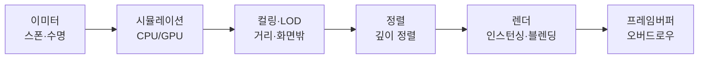
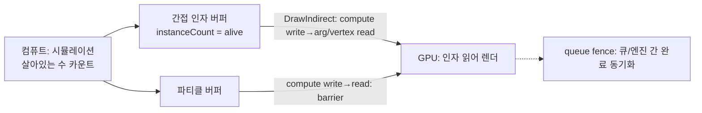
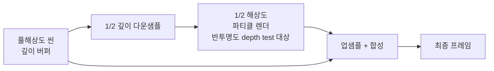

## 들어가며

파티클/VFX 시스템은 *화려한 시각 효과* 와 *프레임 예산* 사이의 줄다리기다. 폭발 하나가 수천 개의 파티클을 뿜고, 각 파티클은 시뮬레이션되고 정렬되고 투명하게 블렌딩되어 화면에 그려진다. 파티클은 대개 작고 단순하지만 *수가 많고 겹쳐 그려진다* — 그래서 비용은 개별 파티클의 복잡도가 아니라 *총 개수 × 화면 점유 픽셀 × 블렌딩 횟수* 에서 폭발한다. VFX 엔지니어의 거의 모든 결정은 *시각 품질 ↔ 시뮬레이션 비용(CPU/GPU) ↔ 채움 비용(fill-rate)* 의 삼각 트레이드오프 위에 놓인다.

이 글은 그 트레이드오프를 따라 파티클 시스템의 구성요소를 한 흐름으로 정리한다. 파티클 데이터가 메모리에 어떻게 배치되고 이미터가 수명을 어떻게 관리하는지, 시뮬레이션을 CPU와 GPU 중 어디서 돌릴지, 컴퓨트 셰이더와 간접 렌더링이 어떻게 CPU를 비우는지, 투명 파티클의 정렬과 오버드로우가 왜 진짜 병목인지, 텍스처 시트와 인스턴싱이 드로우콜을 어떻게 줄이는지, LOD와 컬링으로 보이지 않는 비용을 어떻게 추리는지, 동적 품질 스케일링이 프레임 목표를 어떻게 지키는지, 그리고 이 모두를 어떻게 측정하고 프로파일링하는지를 다룬다.



이 글의 목표.

1. **파티클 시스템 아키텍처** — 데이터 레이아웃, 이미터, 풀링, SoA.
2. **시뮬레이션** — CPU 대 GPU, 업데이트 비용, SIMD, 가변 시간 스텝.
3. **GPU 컴퓨트 파티클** — 컴퓨트 셰이더 시뮬레이션, 간접 렌더링, GPU 정렬.
4. **렌더링과 오버드로우** — 빌보드, 인스턴싱, 알파 블렌딩, fill-rate.
5. **정렬과 투명** — 깊이 정렬, 블렌드 모드, 정렬 비용.
6. **텍스처 시트·트레일·고급 VFX** — 플립북, 리본, 디칼, 볼류메트릭.
7. **LOD·컬링·품질 스케일링** — 거리 LOD, 컬링, 동적 파티클 수, 적응 품질.
8. **프로파일링·플랫폼** — GPU 프로파일러, 오버드로우 시각화, 모바일·VR.


---

## 목차
1. [파티클 시스템 아키텍처](#1-파티클-시스템-아키텍처)
2. [시뮬레이션 — CPU 대 GPU](#2-시뮬레이션--cpu-대-gpu)
3. [GPU 컴퓨트 파티클](#3-gpu-컴퓨트-파티클)
4. [렌더링과 오버드로우](#4-렌더링과-오버드로우)
5. [정렬과 투명](#5-정렬과-투명)
6. [텍스처 시트·트레일·고급 VFX](#6-텍스처-시트트레일고급-vfx)
7. [LOD·컬링·품질 스케일링](#7-lod컬링품질-스케일링)
8. [프로파일링·플랫폼](#8-프로파일링플랫폼)


---

## 1. 파티클 시스템 아키텍처

### 파티클은 작고 많다

파티클 하나는 위치, 속도, 색, 크기, 나이 같은 작은 데이터 묶음이지만 개수가 크다. 따라서 핫 경로에서 개별 힙 할당과 포인터 추적을 피하고, 대량의 동일 구조 데이터를 연속 저장해 일괄 처리하는 것이 기본이다. 개별 객체가 기능적으로 틀린 것은 아니지만, 파티클마다 `new`와 가상 호출을 사용하는 구조는 할당기·단편화·캐시·분기 비용이 개수에 누적되어 대규모 효과에 불리하다.

핵심 자료구조는 *고정 크기 버퍼 + 살아 있는 개수* 다. 파티클은 배열의 앞쪽에 빽빽이 모이고, 죽으면 *맨 뒤 살아 있는 파티클과 교환(swap-remove)* 해 구멍을 메운다. 이 풀은 *순서를 보장하지 않는(unordered) dense 풀* 이라는 전제 위에 선다. 슬롯 인덱스를 잡고 있는 trail·child emitter·외부 핸들은 swap으로 슬롯이 바뀔 때 *재배치된 인덱스를 통지받아 재매핑* 해야 한다. 순서가 필요한 리본·트레일은 이 풀과 *별도 저장소* 를 유지한다.

```cpp
struct ParticlePool {
    static constexpr int kMax = 4096;   // 이미터당 상한
    int aliveCount = 0;                 // [0, aliveCount) 가 살아 있음

    void Kill(int i) {
        // 죽은 파티클을 맨 끝 살아 있는 것과 교환하고 개수만 줄인다
        --aliveCount;
        SwapAll(i, aliveCount);         // 모든 속성 배열에서 i ↔ aliveCount 교환
    }
};
```

이 구조의 장점은 명확하다. *할당이 없다* (버퍼는 한 번 잡고 재사용), *살아 있는 파티클이 메모리에 연속* 이라 업데이트 루프가 캐시를 선형으로 읽으며, *삭제가 O(1)* 다.

### AoS 대 SoA — 데이터 레이아웃이 곧 성능

파티클 속성을 메모리에 어떻게 배치하느냐가 시뮬레이션 속도를 좌우한다. 두 방식이 있다.

*AoS(Array of Structs)* 는 파티클 하나의 모든 속성을 한 구조체에 모은다.

```cpp
struct Particle {                       // AoS: 한 파티클 = 한 구조체
    Vec3 pos, vel;
    Vec4 color;
    float size, age, lifetime;
};
std::vector<Particle> particles;        // 구조체 배열
```

*SoA(Struct of Arrays)* 는 같은 속성끼리 별도 배열로 모은다.

```cpp
struct ParticleSoA {                    // SoA: 속성별 배열
    float posX[kMax], posY[kMax], posZ[kMax];
    float velX[kMax], velY[kMax], velZ[kMax];
    float age[kMax], lifetime[kMax], size[kMax];
    Vec4  color[kMax];
};
```

업데이트 루프가 위치와 속도만 건드린다면(`pos += vel * dt`), AoS는 같은 캐시 라인에 있는 `color`, `size`까지 가져올 수 있어 유효 대역폭이 낮아진다. SoA는 필요한 배열만 선형으로 읽어 캐시 라인 활용률을 높이고 SIMD 벡터화도 단순하게 만든다. 다만 여섯 개 위치·속도 배열을 모두 읽고 쓰는 비용과 정렬, write-allocate, 하드웨어 prefetch까지 포함한 실제 효율은 측정해야 한다.

| 측면 | AoS | SoA |
|---|---|---|
| 부분 속성 업데이트 | 안 쓰는 필드까지 캐시에 로드 | 필요한 배열만 선형 접근 |
| SIMD 벡터화 | 어려움 (스트라이드 접근) | 자연스러움 (연속 접근) |
| 파티클 단위 접근 | 직관적 (한 곳에 모임) | 흩어짐 (여러 배열 인덱싱) |
| 캐시 활용(부분 갱신) | 낮음 | 높음 |

대량 시뮬레이션의 핫 루프에서는 *SoA가 표준* 이다. 단점은 "파티클 i의 모든 속성"을 보려면 여러 배열을 인덱싱해야 한다는 것뿐인데, 시뮬레이션은 속성별로 처리하므로 거의 문제되지 않는다.

### 이미터 — 스폰과 수명의 관리자

*이미터(emitter)* 는 파티클을 *생성하고 죽이는* 주체다. "초당 100개를 원뿔 모양으로 분사" 같은 규칙을 들고, 매 프레임 *스폰 예산* 을 계산해 새 파티클을 풀에 채우고, 수명이 다한 것을 제거한다.

```cpp
struct Emitter {
    ParticlePool pool;
    float spawnRate = 100.0f;            // 초당 스폰 수
    float spawnAccumulator = 0.0f;       // 소수 스폰을 누적
    ShapeDesc shape;                     // 스폰 위치·방향 분포

    void Update(float dt) {
        // 1) 수명 갱신 + 죽은 파티클 제거
        for (int i = pool.aliveCount - 1; i >= 0; --i) {
            pool.age[i] += dt;
            if (pool.age[i] >= pool.lifetime[i]) pool.Kill(i);
        }
        // 2) 스폰: 누적기로 소수 스폰 처리 (예: 60fps에서 1.67개/프레임)
        spawnAccumulator += spawnRate * dt;
        int toSpawn = (int)spawnAccumulator;
        spawnAccumulator -= toSpawn;
        for (int n = 0; n < toSpawn && pool.aliveCount < ParticlePool::kMax; ++n)
            Spawn();
    }
};
```

이 `Emitter::Update`와 2절의 `SimulateCPU`는 모두 나이를 직접 더하므로, 같은 파티클 풀에 둘을 함께 호출하면 나이가 한 프레임에 두 번 증가한다. 둘은 *대체 경로* 다 — 수명·나이 증가의 owner를 한쪽으로 정하고, 다른 쪽은 읽기와 죽음 큐 소비만 맡긴다.

스폰 누적기는 정수 절삭으로 생기는 장기 평균 오차를 줄인다. 입력 `dt`의 합이 실제 경과 시간을 나타내고 풀 소진·클램프가 없다는 가정 아래, 충분히 긴 구간의 스폰 수가 `spawnRate × elapsedTime`을 따른다. 개별 프레임의 스폰 시각은 여전히 프레임 경계로 양자화되므로 고속 이동 이미터는 프레임 구간 안에서 위치·시각을 분산 샘플해야 띠 모양 뭉침을 피할 수 있다.

수명(`lifetime`)은 *모든 속성의 시간축* 이다. 색·크기·속도는 보통 나이의 함수 — `color = colorCurve(age / lifetime)`, `size = sizeCurve(t)` — 로 정의된다. 그래서 파티클은 시간에 따라 부드럽게 변하며 사라진다. 이 *나이 정규화(0~1) → 곡선 평가* 패턴이 파티클 룩의 대부분을 만든다.

### 풀링 — 이미터도 재사용한다

파티클 버퍼만 풀링하는 게 아니다. *이미터 자체도 풀링* 한다. 게임에서 폭발·총구 화염·타격 이펙트는 *순간적으로 생성되고 사라지는* 일회성 이미터다. 매번 이미터를 할당/해제하면 GC 부담(매니지드 런타임)이나 단편화(네이티브)가 생긴다.

```cpp
class EmitterPool {
    std::vector<Emitter> emitters_;      // 미리 확보된 이미터
    std::vector<int> freeList_;
public:
    Emitter* Acquire() {                 // 할당 없이 꺼냄
        if (freeList_.empty()) return nullptr;   // 풀 소진 → 우선순위로 회수 (7절)
        int idx = freeList_.back(); freeList_.pop_back();
        emitters_[idx].Reset();
        return &emitters_[idx];
    }
    void Release(Emitter* e) { freeList_.push_back(e->index); }
};
```

풀 크기가 *동시 이펙트 상한* 을 정의한다. 포화 시에는 화면 기여도, 거리, gameplay 중요도와 수명에 따른 우선순위로 신규 효과를 거부하거나 낮은 우선순위 효과를 축출한다. 플랫폼별 상한은 고정 예시를 복사하지 않고 GPU 시간, overdraw, 메모리와 발열 측정으로 정한다.

## 2. 시뮬레이션 — CPU 대 GPU

### CPU 파티클 — 유연하지만 비싼 전송

CPU에서 파티클을 시뮬레이션하면 게임 로직의 자료구조와 같은 주소 공간에서 충돌 검사, 콜백과 이벤트를 만들기 쉽다. 업데이트 루프는 단순하다.

```cpp
void SimulateCPU(ParticleSoA& p, int count, float dt, Vec3 gravity) {
    for (int i = 0; i < count; ++i) {
        p.velX[i] += gravity.x * dt;        // 힘 적분 (gravity 세 성분 모두)
        p.velY[i] += gravity.y * dt;
        p.velZ[i] += gravity.z * dt;
        p.posX[i] += p.velX[i] * dt;        // 위치 적분
        p.posY[i] += p.velY[i] * dt;
        p.posZ[i] += p.velZ[i] * dt;
        p.age[i] += dt;                     // 나이 증가는 owner 한 곳에서만 (1절 Emitter와 택일)
    }
}
```

`gravity`의 세 성분을 모두 적분해 GPU 의사코드(`p.vel += gravity * dt`)와 의미를 맞췄다. 아래 AVX 예제는 `float gy`를 받는 *Y 성분 축약형* 이므로, 두 backend를 비교할 때는 같은 중력 정의(예: x=z=0)를 쓰거나 SIMD 버전도 세 성분을 다루도록 맞춘다.

렌더링에 필요한 속성이 CPU에서 바뀌면 그 결과를 GPU가 읽을 수 있는 버퍼에 써야 한다. 예를 들어 파티클당 32바이트를 10만 개 갱신하면 프레임당 약 3.05MiB의 버퍼 쓰기가 발생한다. 이것이 병목인지는 UMA 여부, 버퍼 매핑 방식, 프레임레이트와 다른 전송량에 따라 달라진다. CPU 파티클의 허용 개수는 고정 범위가 아니라 시뮬레이션 복잡도와 업로드 예산으로 정한다.

### GPU 파티클 — 전송을 없애는 거래

GPU에서 시뮬레이션하면 파티클 상태를 GPU 메모리에 유지한 채 업데이트하고 렌더링할 수 있어 파티클별 결과의 매 프레임 CPU→GPU 업로드를 없앤다. 스폰 명령, 전역 파라미터와 동기화는 여전히 전송된다. 대가는 CPU 게임 로직과의 결합이 어려워진다는 점이다. GPU 결과가 필요하면 readback 버퍼와 펜스로 비동기 회수할 수 있지만, 같은 프레임에 CPU가 기다리면 파이프라인 병렬성을 잃는다.

| 측면 | CPU 파티클 | GPU 파티클 |
|---|---|---|
| 규모 | CPU·업로드 예산에 의해 제한 | GPU 연산·메모리·오버드로우 예산에 의해 제한 |
| 전송 비용 | 매 프레임 업로드 (병목) | 파티클별 업로드 없음 (파라미터·명령만) |
| 게임 로직 연동 | 쉬움 (충돌·콜백) | 어려움 |
| 결과 리드백 | CPU에 이미 존재 | 지연 회수 가능, 즉시 대기하면 stall |
| 디버깅 | 쉬움 | 어려움 (GPU 상태) |

판단 기준은 *규모와 상호작용* 이다. *적은 수지만 게임플레이에 영향* (충돌해서 데미지를 주는 발사체, 게임 로직이 위치를 읽는 파티클)은 CPU. *대량의 순수 시각 효과* (불꽃, 먼지, 마법 입자처럼 게임에 영향 없이 보이기만 하는 것)는 GPU. 많은 엔진이 *둘 다 제공* 해 이펙트별로 고른다.

### SIMD — 여러 파티클을 한 명령으로

CPU 시뮬레이션을 SoA로 두면 *SIMD(SSE/AVX)* 로 한 번에 4~8개 파티클을 처리할 수 있다. 위 스칼라 루프를 AVX로 벡터화한다.

```cpp
void SimulateAVX(ParticleSoA& p, int count, float dt, float gy) {
    __m256 vdt = _mm256_set1_ps(dt);
    __m256 vgy = _mm256_set1_ps(gy * dt);
    int i = 0;
    for (; i + 8 <= count; i += 8) {                  // 8개씩 처리
        __m256 vy = _mm256_loadu_ps(&p.velY[i]);
        vy = _mm256_add_ps(vy, vgy);                  // velY += gy*dt
        _mm256_storeu_ps(&p.velY[i], vy);

        __m256 px = _mm256_loadu_ps(&p.posX[i]);
        __m256 vx = _mm256_loadu_ps(&p.velX[i]);
        px = _mm256_fmadd_ps(vx, vdt, px);            // posX += velX*dt (FMA)
        _mm256_storeu_ps(&p.posX[i], px);
        // posY, posZ 동일 ...
    }
    for (; i < count; ++i) { /* 나머지 스칼라 처리 */ }
}
```

AVX 레지스터는 `float` 여덟 개를 담지만, 이것이 곧 실행 시간 8배 개선을 뜻하지는 않는다. 로드·스토어 대역폭, 명령 의존성, 나머지 처리와 이미 컴파일러가 수행한 자동 벡터화가 상한을 낮춘다. 예제는 정렬을 보장하지 않으므로 `loadu/storeu`를 사용했다. 32바이트 정렬을 형식 계약으로 보장한다면 aligned load를 쓸 수 있다. AoS와 SoA의 선택은 대상 CPU에서 스칼라·자동 벡터화·명시적 SIMD 버전을 같은 데이터로 측정해 결정한다. `_mm256_fmadd_ps`는 AVX가 아니라 *FMA* 명령이므로 AVX만 켠 빌드에서는 컴파일·실행되지 않는다. AVX+FMA를 target feature로 명시하고 런타임 CPU feature dispatch로 분기하거나, FMA가 없는 경로에는 `_mm256_mul_ps`+`_mm256_add_ps` fallback을 제공한다.

### 가변 시간 스텝과 적분 안정성

프레임 시간(`dt`)이 커지면 적분 오차가 늘고, 충돌을 이산 시점에만 검사하는 파티클은 얇은 장애물을 건너뛸 수 있다. 강한 스프링이나 비선형 힘이 있는 경우에는 명시적 오일러가 불안정해질 수도 있다. 단순한 중력·항력 시각 효과와 게임플레이 발사체는 필요한 정확도가 다르므로 시간 정책도 분리한다.

*시간 스텝 고정(fixed timestep)*: 시뮬레이션을 항상 작은 고정 간격(예: 16ms)으로 돌리고, 프레임 `dt` 가 크면 여러 번 반복한다. 안정적이지만 부하가 클 때 반복이 늘어 더 느려진다 — *나선형 죽음(spiral of death)* 위험.

*시간 스텝 클램프(clamp)*: `dt` 를 상한(예: 33ms)으로 자른다. 큰 멈춤 후 파티클이 한 번에 점프하지 않게 막는다. 시각 파티클은 물리적 정확성보다 *안 터지는 것* 이 중요하므로 *클램프가 흔하다*.

```cpp
void UpdateEmitter(Emitter& e, float frameDt) {
    float dt = std::min(frameDt, 0.033f);   // 33ms로 클램프: 큰 점프 방지
    e.Update(dt);
}
```

순수 시각 파티클은 긴 hitch 뒤의 시간을 버리거나 시스템별 최대 substep을 둘 수 있다. 다만 캡처 재현, 동기화된 연출, 테스트가 필요하면 시각 효과에도 결정론적 시드와 시간 입력이 필요하다. 게임플레이 발사체는 파티클 표현과 분리해 고정 틱, 연속 충돌 또는 충분한 substep으로 검증한다.

## 3. GPU 컴퓨트 파티클

### 컴퓨트 셰이더 시뮬레이션

GPU 파티클의 핵심은 *컴퓨트 셰이더* 가 GPU 메모리의 파티클 버퍼를 직접 업데이트하는 것이다. 파티클 데이터는 *구조화 버퍼(structured buffer)* 에 상주하고, 컴퓨트 셰이더가 스레드 하나당 파티클 하나를 맡아 병렬로 적분한다.

```cpp
// 컴퓨트 셰이더 (HLSL 의사코드)
// numthreads(256,1,1) — 워크그룹당 256 스레드
RWStructuredBuffer<Particle> particles;     // GPU 상주 파티클
cbuffer Params { float dt; float3 gravity; uint aliveCount; }

void CSMain(uint id : SV_DispatchThreadID) {
    if (id >= aliveCount) return;            // 범위 밖 스레드 종료
    Particle p = particles[id];
    p.vel += gravity * dt;
    p.pos += p.vel * dt;
    p.age += dt;
    particles[id] = p;
}
```

CPU는 `Dispatch(ceil(aliveCount/256), 1, 1)` 한 번으로 수십만 파티클을 발진한다. 파티클별 상태의 매 프레임 전송이 없다 — 상태는 GPU에 상주하고 *시뮬레이션도 렌더링도 GPU 안에서* 끝난다. dt·중력 같은 전역 파라미터와 스폰 명령만 오간다.

스폰과 죽음도 GPU에서 처리한다. 죽은 파티클의 슬롯을 *원자적 연산(atomic)* 으로 관리하는 *프리 리스트(free list)* 나 *append/consume 버퍼* 를 쓴다. 죽으면 슬롯 인덱스를 free 리스트에 `append`, 스폰하면 `consume` 한다 — CPU 개입 없이 풀이 GPU에서 자가 관리된다.

여기서 연결 규약이 하나 필요하다. 위 `CSMain`처럼 `[0, aliveCount)`를 선형 순회하는 dispatch는 살아 있는 파티클이 *밀집(dense)* 해 있다는 전제에 기댄다. 임의 슬롯 free-list나 append/consume 버퍼를 도입하면 살아 있는 파티클이 흩어지므로, (a) GPU가 유지하는 `aliveIndex[]`로 간접 접근하거나 (b) 주기적으로 dense compaction하거나 (c) 살아 있는 슬롯만 모으는 별도 버퍼를 써야 한다. CPU가 `aliveCount`를 모르는 단계라면 고정 capacity로 dispatch하고 셰이더에서 조기 종료하거나, 컴퓨트 셰이더가 `DispatchIndirect` 인자를 직접 채우게 한다.

### 간접 렌더링 — CPU가 개수를 모를 때

GPU가 스폰/죽음을 관리하면 *CPU는 살아 있는 파티클 수를 모른다*. 그런데 드로우콜은 보통 "정점 N개를 그려라"처럼 *CPU가 개수를 지정* 해야 한다. 매 프레임 GPU에서 개수를 리드백하면 파이프라인이 멈춘다.

해법은 *간접 드로우(indirect draw)* 다. 드로우콜의 인자(정점 수, 인스턴스 수)를 *GPU 버퍼에 담아두고*, CPU는 "이 버퍼에 든 인자로 그려라"라고만 명령한다. 컴퓨트 셰이더가 살아 있는 개수를 세어 그 버퍼에 직접 써넣는다.



```cpp
// CPU: 개수를 모른 채 간접 드로우만 발진
context->DrawIndexedInstancedIndirect(argBuffer, 0);
// instanceCount는 GPU의 컴퓨트 셰이더가 argBuffer에 써둔 값
```

이 구조에서는 파티클별 CPU 루프를 디스패치와 간접 드로우 명령으로 바꿀 수 있어 CPU 명령 수를 파티클 수와 분리한다. GPU의 시뮬레이션·정렬·픽셀 작업은 여전히 파티클과 프래그먼트 수에 따라 증가하고, 이미터별 디스패치와 리소스 관리 비용도 남는다. 확장성은 작업이 사라져서가 아니라 대량 병렬 하드웨어와 GPU 상주 데이터로 이동해서 얻는다.

### GPU 정렬 — 투명 파티클의 골칫거리

일반적인 `source-over` 투명 파티클은 정확한 합성을 위해 가시 표면을 뒤에서 앞으로 처리해야 한다. 파티클 중심 깊이 정렬은 이를 근사하며, 서로 교차하는 쿼드나 큰 볼륨의 픽셀별 순서는 완전히 해결하지 못한다. GPU 파티클을 정렬하려면 키 생성과 정렬도 GPU에서 처리하는 편이 데이터 왕복을 피한다.

GPU 정렬은 *비트닉 정렬(bitonic sort)* 이나 *기수 정렬(radix sort)* 의 병렬 버전을 컴퓨트 셰이더로 구현한다. 비트닉 정렬은 $O(n \log^2 n)$ 비교로 데이터 독립적인 접근 패턴을 가져 GPU에 적합하다. 매 프레임 수십만 키를 정렬하는 비용은 무시 못 한다 — 그래서 *정렬을 피하는* 선택이 흔하다.

- *가산 블렌딩(additive)* 은 순서 무관 — 불꽃·마법 효과는 가산으로 두어 정렬을 *완전히 생략* 한다(5절).
- *정렬 빈도를 낮춘다* — 매 프레임이 아니라 몇 프레임에 한 번, 또는 카메라가 크게 움직일 때만.
- *근사 정렬* — 완벽한 순서 대신 대략적 깊이 버킷으로 나눠 비용을 줄인다.

### 컴퓨트-그래픽스 동기화

같은 프레임 안에서 컴퓨트(시뮬레이션)와 그래픽스(렌더링)가 *같은 파티클 버퍼* 를 쓴다. 컴퓨트가 쓰기를 끝내기 전에 그래픽스가 읽으면 데이터 경쟁이다. *리소스 배리어(resource barrier)/펜스* 로 "컴퓨트 쓰기 완료 → 그래픽스 읽기" 순서를 강제한다.

이 배리어가 *GPU 파이프라인을 부분적으로 직렬화* 한다 — 컴퓨트가 끝날 때까지 렌더가 기다린다. 잘 설계하면 다른 작업(다음 프레임 준비, 무관한 패스)을 그 사이에 겹쳐 *비동기 컴퓨트(async compute)* 로 빈 시간을 메운다. 콘솔처럼 하드웨어가 정해진 환경에서 비동기 컴퓨트가 특히 효과적이다.

간접 실행에서는 의존성이 하나 더 있다. 컴퓨트가 *간접 인자 버퍼* 를 쓰고 그래픽스가 그 인자를 읽으므로, 파티클 UAV뿐 아니라 인자 버퍼에도 쓰기→읽기 의존성을 세워야 한다. *배리어* 는 같은 큐 안의 자원 상태 전이를, *큐 펜스* 는 큐/엔진 간 완료를 다룬다 — 둘은 역할이 다르다. CPU가 기다리지 않는 것과 GPU 메모리 의존성이 사라진 것도 다르므로, 예시 API 하나를 기준으로 compute write → indirect argument/vertex read 의존성과 queue fence, 자원 수명을 함께 명시한다.

## 4. 렌더링과 오버드로우

### 빌보드 — 파티클을 카메라로 돌리기

많은 연기·불꽃 파티클은 카메라를 향하는 view-aligned billboard로 그린다. 축 고정 billboard, 속도 방향으로 늘인 stretched billboard, 리본과 메시 파티클은 다른 회전 규칙을 사용한다. 쿼드의 정점 비용은 작지만 화면을 크게 덮고 겹칠수록 픽셀 비용이 커진다.

```cpp
// 빌보드: 카메라의 right/up 벡터로 쿼드 4정점 생성 (정점 셰이더에서)
Vec3 right = cameraRight * size;
Vec3 up    = cameraUp    * size;
quad[0] = center - right - up;   // 좌하
quad[1] = center + right - up;   // 우하
quad[2] = center - right + up;   // 좌상
quad[3] = center + right + up;   // 우상
```

빌보드 대신 *메시 파티클* (작은 3D 모델, 예: 잔해·파편)을 쓰면 입체감이 살지만 정점·삼각형 비용이 개수에 곱해진다. *작고 형태가 중요하지 않은 것은 빌보드, 형태가 보이는 잔해는 메시* 로 나눈다.

### 인스턴싱 — 드로우콜을 하나로

파티클 수천 개를 *하나씩 드로우콜* 하면 드로우콜 오버헤드(드라이버·상태 변경)가 폭발한다. *인스턴싱(instancing)* 은 *같은 메시(쿼드)를 한 번의 드로우콜로 N개 그린다* — 인스턴스별로 다른 위치·색·크기를 인스턴스 버퍼에서 읽는다.

```cpp
// 인스턴스 버퍼: 파티클당 인스턴스 데이터 한 줄
struct ParticleInstance {
    Vec3  pos;
    float size;
    Vec4  color;
    Vec2  uvOffset;     // 텍스처 시트 프레임 (6절)
};
// 드로우콜 한 번으로 aliveCount개 인스턴스
context->DrawInstanced(/*verts*/4, /*instances*/aliveCount, 0, 0);
```

이로써 한 이미터의 모든 파티클이 *드로우콜 하나* 로 그려진다. CPU 파티클이라면 이 인스턴스 버퍼를 매 프레임 채워 업로드하고(2절의 전송 비용), GPU 파티클이라면 GPU에 이미 있는 데이터를 인스턴스 소스로 바로 쓴다. 인스턴싱은 *드로우콜 수* 를 줄이지 그 자체로 *fill-rate* 를 줄이지 않는다 — 채움 문제는 따로 남는다.

### 오버드로우 — VFX의 진짜 병목

파티클 비용의 *진짜 주범* 은 오버드로우(overdraw)다. 반투명 파티클은 보통 깊이 테스트는 켜고 깊이 쓰기는 끄므로, 불투명 기하 뒤의 프래그먼트는 깊이 테스트에서 제거될 수 있다. 그러나 불투명 깊이를 통과한 *반투명 레이어끼리는* 깊이 쓰기 없이 겹쳐 *겹친 만큼 픽셀 셰이더가 반복 실행* 된다. 연기 효과 하나가 화면을 가득 덮으면서 50장이 겹치면, 그 영역의 픽셀은 *50번 셰이딩* 된다. 1080p 전체를 50번 오버드로우하면 *약 1억 픽셀 셰이더 호출* — 단순한 셰이더라도 GPU가 무릎 꿇는다.

오버드로우 비용을 정량화하면 이렇다.

| 상황 | 화면 점유 | 평균 겹침 | 픽셀 셰이더 호출(1080p) |
|---|---|---|---|
| 작은 불꽃 다수 | 10% | 3× | ~62만 |
| 중간 연기 구름 | 40% | 10× | ~830만 |
| 화면 덮는 폭발 | 100% | 30× | ~6,200만 |

겹침 배수가 곧 비용 배수다. 그래서 VFX 최적화의 핵심은 *오버드로우를 줄이는 것* 이다.

- *파티클 셰이더를 극단적으로 단순화* — 오버드로우되는 픽셀은 셰이더 한 줄도 비싸다. 텍스처 샘플 1회, 곱셈 몇 번으로 끝낸다.
- *개수와 화면 피복을 함께 줄인다* — 파티클 수가 적어도 큰 쿼드가 화면을 넓게 덮으면 더 비쌀 수 있다. 효과의 projected alpha coverage와 평균 겹침을 직접 측정한다.
- *반투명 영역을 타이트하게* — 텍스처의 빈(알파 0) 영역까지 쿼드로 덮으면 그만큼 헛된 픽셀이다. 알파가 있는 영역에 *꼭 맞는 다각형(trimmed polygon)* 으로 쿼드를 잘라 빈 픽셀을 제거한다.
- *해상도를 낮춰 그린다* — 파티클을 *절반 해상도 오프스크린 버퍼* 에 그린 뒤 업스케일하면 fill-rate가 1/4로 준다. 부드러운 연기·안개는 저해상도로도 티가 안 난다.

### 저해상도 파티클과 합성

저해상도 렌더링은 fill-rate 병목의 가장 강력한 처방이다. 부드러운 파티클(연기, 안개, 먼지)을 *1/2 또는 1/4 해상도 버퍼* 에 그리고, 풀 해상도 씬에 다시 합성한다.



함정은 *경계 아티팩트* 다. 저해상도 파티클을 풀 해상도 기하와 합성할 때, 깊이 불연속(파티클이 물체 가장자리를 지날 때) 부분에 *경계가 번진다*. *깊이 인식 업샘플(depth-aware/bilateral upsample)* 로 가장자리에서 풀 해상도 깊이를 참조해 번짐을 줄인다. 이 합성 비용을 감안해도, 오버드로우가 심한 장면에서는 저해상도 파티클이 큰 순이득이다.

## 5. 정렬과 투명

### 왜 정렬이 필요한가

일반적인 알파 `over` 블렌딩은 순서에 의존한다. 뒤에서 앞으로 그려야 고정 기능 블렌더가 올바른 층 순서를 누적한다. 많은 투명 패스가 뒤의 투명층을 보존하기 위해 깊이 테스트는 켜고 깊이 쓰기는 끄지만, alpha-to-coverage, dithered transparency, OIT처럼 다른 정책도 있다.

파티클 중심의 카메라 공간 깊이나 투영 깊이를 키로 정렬하는 것은 흔한 근사다. 유클리드 거리 정렬은 화면 깊이 순서와 다를 수 있고, 쿼드가 교차하면 어떤 객체 단위 정렬도 픽셀별 정답을 만들지 못한다. 정확도 요구가 높으면 쪼개기, depth peeling, per-pixel OIT 같은 더 비싼 방법이 필요하다.

### 블렌드 모드가 정렬 요구를 바꾼다

핵심 통찰은 *블렌드 모드에 따라 정렬이 필요하기도, 불필요하기도* 하다는 것이다.

| 블렌드 모드 | 식 | 정렬 필요? | 용도 |
|---|---|---|---|
| 알파 블렌딩 | $s\alpha + d(1-\alpha)$ | 필요 | 연기, 안개, 반투명 |
| 가산(additive) | $s + d$ | 불필요 (교환법칙) | 불꽃, 빛, 마법, 에너지 |
| 순수 곱셈(multiply) | $s \cdot d$ | 불필요 (교환법칙) | 색 감쇠 |
| 프리멀티플라이드 over | $s + d(1-\alpha)$ | 필요 | 가장자리·필터링이 안정적인 over |

*같은 가산 블렌딩을 쓰는 homogeneous 그룹 안에서는 교환법칙이 성립* 한다 — `a + b + c` 는 순서가 어떻든 같고, 같은 곱셈끼리도 마찬가지다. 그 그룹 *안에서는* 정렬이 필요 없다. 불꽃, 폭발 섬광, 마법 입자처럼 빛나는 효과를 가산으로 두면 정렬 비용이 0이 된다. 이것이 VFX에서 가산 블렌딩이 흔한 실용적 이유 중 하나다 — 보기 좋을 뿐 아니라 그 그룹 안에서 순서 무관이다.

다만 이 순서 독립은 *다른 연산과 섞인 전체 렌더 패스* 로 확장되지 않는다. 반투명 연기(알파 $a$)와 가산 발광 $L$을 배경 $B$ 위에 합성할 때, 발광을 먼저 더한 뒤 연기를 over하면 $(1-a)(B+L)$인데, 연기를 먼저 over한 뒤 발광을 더하면 $(1-a)B+L$이 되어 $aL$만큼 다르다. 예를 들어 $a=0.5$, $L=1$이면 발광이 연기에 가려지는 정도가 순서에 따라 달라진다 — over와 가산을 섞으면 정렬이 다시 의미를 가진다.

정렬이 필요한 대상은 연기·안개에 한정되지 않고, 비가환 블렌드 연산으로 합성하는 모든 투명 효과다. 효과의 광학적 의미가 가산 발광이라면 가산 블렌딩으로 정렬을 없앨 수 있지만, 비용 때문에 물질의 외관을 임의로 가산으로 바꾸면 색과 에너지 보존이 틀어진다.

### 합성 연산의 대수 — over의 비가환성과 결합성

위 표의 "정렬 필요?" 열은 결과만 적어 둔 것이다. 왜 알파는 순서에 의존하고 가산은 안 하는지, 왜 하필 *뒤→앞* 인지, 표의 "불필요 (교환법칙)"가 무엇을 뜻하는지는 합성 연산자의 대수에서 나온다. (색·알파 값 자체의 표현은 색·감마 소유 개념을 전제하고, 여기서는 합성 *순서* 의 대수만 본다.)

핵심 도구는 Porter-Duff의 *over* 연산자다. 색을 알파로 미리 곱한 *프리멀티플라이드* 표현 $c=\alpha C$로 한 층을 쌍 $(c,\alpha)$로 적으면, "A를 B 위에" 합성하는 연산은

$$A \mathbin{\text{over}} B = \big(\,c_A + (1-\alpha_A)\,c_B,\ \ \alpha_A + (1-\alpha_A)\,\alpha_B\,\big).$$

투과율 $\bar\alpha\equiv 1-\alpha$로 두면 알파 성분이 $\bar\alpha_{AB}=1-\alpha_A-(1-\alpha_A)\alpha_B=\bar\alpha_A\bar\alpha_B$로 깔끔히 곱해진다 — 두 층을 통과한 빛은 각 투과율의 곱만큼 남는다(Beer-Lambert와 같은 골격).

*비가환성이 곧 정렬 요구다.* $A\mathbin{\text{over}}B$의 색은 $c_A+\bar\alpha_A c_B$인데 $B\mathbin{\text{over}}A$는 $c_B+\bar\alpha_B c_A$로, 일반적으로 다르다. 수치 반례: 빨강 $C_A=(1,0,0)$·파랑 $C_B=(0,0,1)$, 둘 다 $\alpha=0.5$, 불투명 흰 배경 $(1,1,1)$ 위에 합성한다. 빨강을 앞에 두고 뒤→앞으로(파랑 먼저, 빨강 나중) 그리면 $(0.75,0.25,0.5)$(빨강 우세), 앞→뒤로 그리면 $(0.5,0.25,0.75)$(파랑 우세)가 나온다. 같은 두 층인데 순서만 뒤집어 *눈에 띄게 다른 색* 이다 — 이것이 정렬을 빠뜨린 알파 파티클이 "색이 새는" 이유다.

*왜 하필 뒤→앞인가.* 고정 기능 블렌드 `SRC_ALPHA, ONE_MINUS_SRC_ALPHA`는 매 드로우마다 "소스 over 프레임버퍼"를 수행한다. 뒤 층부터 그리면 결과가 $F\mathbin{\text{over}}(M\mathbin{\text{over}}B)$ — 카메라에서 먼 것이 안쪽에 오는 물리적으로 옳은 누적이다. 앞→뒤로 같은 블렌드를 돌리면 $B\mathbin{\text{over}}(M\mathbin{\text{over}}F)$가 되어 위 반례처럼 틀린다.

*결합성은 그룹 합성을 허락한다.* over는 가환은 아니지만 결합법칙은 성립한다. 색 성분을 펼치면

$$(A\mathbin{\text{over}}B)\mathbin{\text{over}}C:\ c_A+\bar\alpha_A c_B+\bar\alpha_A\bar\alpha_B c_C,$$
$$A\mathbin{\text{over}}(B\mathbin{\text{over}}C):\ c_A+\bar\alpha_A\big(c_B+\bar\alpha_B c_C\big)=c_A+\bar\alpha_A c_B+\bar\alpha_A\bar\alpha_B c_C$$

로 정확히 같고, 투과율도 양쪽 모두 $\bar\alpha_A\bar\alpha_B\bar\alpha_C$다(따라서 알파는 $1-\bar\alpha_A\bar\alpha_B\bar\alpha_C$로 같다). 이 결합성은 같은 해상도에서 층 순서를 유지한 부분 합의 괄호를 바꾸는 것을 허용한다. 오프스크린 프리멀티플라이드 버퍼에 파티클을 합성한 뒤 씬 위에 올리는 구조의 대수적 기반이다. 그러나 저해상도 렌더링은 다운샘플, 깊이 근사와 업샘플 필터를 추가하므로 풀 해상도 결과와 정확히 같지 않다. 특히 파티클 사이에 불투명 기하가 끼는 깊이 불연속에서는 한 장의 저해상도 층으로 묶는 것 자체가 근사다. 프리멀티플라이드 표현은 필터링 시 색 번짐과 이중 알파 곱을 피하는 데 중요하지만, 해상도 손실까지 없애 주지는 않는다.

*가산·곱셈은 가환이라 순서가 사라진다.* $s+d$와 $s\cdot d$는 결합·가환을 모두 만족하므로 $\sum_i s_i$·$\prod_i s_i$가 순서에 무관하다. 정렬 키 자체가 의미를 잃어 비용이 0이 된다(표의 "불필요"의 근거).

*OIT 계열은 근사 여부가 갈린다.* over는 결합적이되 *가환이 아니므로* 층을 마음대로 재배열할 수 없다 — 정렬을 피하려면 연산자를 바꾸거나 프래그먼트를 저장하는 수밖에 없다. *가중 블렌딩 OIT* 는 over를 깊이 가중 평균(가환·결합 연산)으로 대체해 *순서 독립* 을 산다 — 정확한 over가 아니므로 깊이 차가 큰 겹침에서 어긋나지만, 연기·안개의 부드러운 룩에는 흔히 충분하다. 즉 *가중 블렌딩* OIT는 "비가환 연산을 가환 연산으로 갈아 정렬을 없애되 정확도를 내준다"는 거래다. 반면 프래그먼트를 저장·정렬하는 per-pixel OIT나 depth peeling은 충분한 저장 공간과 패스 수를 주면 기준 over 결과(ground truth)에 도달한다 — 근사의 대가는 연산이 아니라 메모리·대역폭과 레이어 상한이다. OIT 전체를 하나의 근사 기법으로 묶지 않는다.

### 정렬 비용을 줄이는 실무

알파 블렌딩 파티클이 불가피할 때, 정렬 비용을 줄이는 방법들이다.

- *이미터 단위 정렬* — 파티클 개별이 아니라 이미터 단위로 거리 정렬하고, 한 이미터 내부는 정렬하지 않는다(또는 가산으로). 정렬 키 수가 파티클 수에서 이미터 수로 줄어든다.
- *정렬 키 캐싱* — 카메라가 거의 안 움직이면 이전 정렬 순서를 재사용한다. 거리 변화가 임계값을 넘을 때만 재정렬.
- *기수 정렬(radix sort)* — 거리를 정수 키로 양자화해 $O(n)$ 기수 정렬로 비교 정렬을 대체한다. 대량에서 비교 기반보다 빠르다.
- *순서 독립 투명(OIT)* — 가중 블렌딩(weighted blended OIT) 같은 근사 기법으로 정렬을 우회한다. 저장 공간을 층 수와 분리할 수 있지만 픽셀 셰이딩과 블렌드 비용은 여전히 투명 프래그먼트 수와 오버드로우에 비례한다.

정렬 키가 무엇을 근사하는지도 코드 위에 드러내 둔다 — 제곱 유클리드 거리는 카메라 공간 *view depth* 의 휴리스틱일 뿐 화면 깊이 순서와 정확히 일치하지 않는다. 평행 billboard라면 `dot(cameraForward, p.pos - camPos)`를 키로 쓰는 편이 기준에 가깝고, 교차 도형에서는 어떤 단일 primitive 키도 픽셀별 정답을 만들지 못한다.

```cpp
// 거리를 양자화해 기수 정렬 키로 (뒤→앞: 큰 거리가 먼저)
uint32_t SortKey(const Particle& p, Vec3 camPos) {
    float dist = LengthSq(p.pos - camPos);       // 제곱 거리 (sqrt 생략)
    return ~FloatToSortableUint(dist);           // 비트 반전: 내림차순
}
```

OIT는 *정렬을 메모리·셰이더 비용으로 거래* 하는 또 하나의 트레이드오프다. 파티클이 많고 정렬이 병목이면 OIT가, 파티클이 적당하고 정확성이 중요하면 명시적 정렬이 낫다.

## 6. 텍스처 시트·트레일·고급 VFX

### 플립북 — 한 장에 담은 애니메이션

폭발이나 연기 같은 *애니메이션되는 파티클* 은 여러 프레임의 그림이 필요하다. 프레임마다 별도 텍스처를 쓰면 텍스처 전환(상태 변경)이 일어나 인스턴싱이 깨진다. *텍스처 시트(flipbook/sprite sheet)* 는 모든 프레임을 *격자로 한 텍스처에 모은다* — 예: 8×8 = 64프레임.

파티클은 나이에 따라 *어느 셀을 볼지* UV 오프셋을 계산한다.

```cpp
// 플립북: 나이로 프레임 선택 → UV 오프셋 (8x8 격자)
Vec2 FlipbookUV(float ageNorm, int cols, int rows, Vec2 localUV) {
    int count = cols * rows;
    int frame = std::clamp((int)(ageNorm * count), 0, count - 1);
    int fx = frame % cols, fy = frame / cols;
    float w = 1.0f / cols, h = 1.0f / rows;
    return Vec2((fx + localUV.x) * w, (fy + localUV.y) * h);
}
```

`cols`/`rows`는 양수여야 하고 `ageNorm`은 `[0,1]`의 유한값이어야 한다. 또한 bilinear/trilinear 샘플링이 *이웃 프레임을 섞지 않도록* 셀 경계에 gutter/duplicate border를 두거나 mip-aware packing·texture array를 쓴다 — 단순 UV 오프셋만으로는 모든 mip에서 프레임이 분리되지 않는다. 마지막 프레임은 clamp할지 loop할지, 그리고 `ageNorm = age / lifetime`에서 `lifetime`의 정의를 명시한다.

모든 프레임이 한 텍스처에 있으므로 텍스처 변경 없이 인스턴싱을 유지할 수 있다. 단순 프레임 블렌딩은 인접한 색 프레임 두 장을 샘플한다. motion-vector flipbook은 여기에 모션 벡터 텍스처와 재투영 연산이 추가될 수 있으므로 "정확히 샘플 2배"라고 일반화할 수 없다. 실제 셰이더의 텍스처 fetch와 오버드로우를 함께 측정한다.

텍스처 시트는 *해상도 트레이드오프* 도 있다. 64프레임을 한 텍스처에 넣으면 프레임당 해상도가 1/8로 준다. 디테일이 중요하면 시트를 키우거나(메모리↑) 프레임 수를 줄인다(끊김↑).

### 트레일과 리본

*트레일(trail)/리본(ribbon)* 은 움직이는 물체 뒤에 남는 띠다 — 칼 휘두름, 미사일 궤적, 마법 흔적. 점들의 경로를 따라 *연속된 쿼드 띠* 를 생성한다. 핵심은 *과거 위치의 히스토리* 를 링 버퍼로 들고, 인접한 두 점 사이에 사각형을 만드는 것이다.

```cpp
struct Trail {
    Vec3 points[kMaxPoints];     // 과거 위치 링 버퍼
    int  head = 0, count = 0;
    float width;

    void AddPoint(Vec3 p) {      // 일정 거리마다 점 추가
        points[head] = p;
        head = (head + 1) % kMaxPoints;
        count = std::min(count + 1, kMaxPoints);
    }
    // 렌더: 인접 점 사이에 width 폭 쿼드 띠 생성, 끝으로 갈수록 페이드
};
```

함정은 *점 간격* 이다. 너무 촘촘하면 정점이 폭발하고, 너무 성기면 띠가 각진다. *이동 거리 기반 샘플링* (일정 거리마다 점 추가)으로 속도와 무관하게 균일한 띠를 만든다. 급격한 방향 전환에서 띠가 꼬이거나 뒤집히는 것은 *법선 일관성* 으로 다룬다 — 인접 세그먼트의 폭 방향을 부드럽게 잇는다.

### 디칼과 볼류메트릭

*디칼(decal)* 은 표면에 투영하는 텍스처다 — 탄흔, 핏자국, 그을음. 디퍼드 렌더링에서는 디칼 볼륨을 그려 G-buffer 속성을 읽고 수정하는 별도 패스나 타일 단위 처리를 사용할 수 있다. 메시 표면을 다시 세분화하지 않고 여러 재질 속성을 바꿀 수 있다는 장점이 있지만, 패스와 오버드로우가 공짜가 되는 것은 아니다. 디칼이 누적되므로 개수 상한과 수명으로 관리한다.

*볼류메트릭(volumetric) 효과* — 안개, 빛 산란(god rays), 두꺼운 연기 — 는 빌보드로 흉내 내기 어려운 *부피감* 을 표현한다. *레이 마칭(ray marching)* 으로 3D 텍스처/노이즈를 카메라 광선을 따라 적분한다. 품질이 높지만 *샘플 수에 비례해 매우 비싸다* — 그래서 *저해상도 렌더(4절) + 적은 스텝 + 시간적 누적(temporal accumulation)* 으로 비용을 분산한다. 볼류메트릭은 *품질 스케일링(7절)의 첫 번째 절단 대상* 이 흔하다 — 저사양에서 빌보드 안개로 대체한다.

## 7. LOD·컬링·품질 스케일링

### 거리 LOD — 멀면 단순하게

멀리 있는 파티클 효과는 화면에서 작아 디테일이 보이지 않는다. *거리 LOD(Level of Detail)* 로 거리에 따라 파티클 수·시뮬레이션 복잡도·셰이더 품질을 단계적으로 낮춘다.

```cpp
struct VFXLevelOfDetail {
    float spawnMultiplier;       // 스폰 수 배율
    float updateInterval;        // 시뮬레이션 주기 (멀면 드물게)
    bool  useCheapShader;        // 단순 셰이더
};
VFXLevelOfDetail PickLOD(float distance) {
    if (distance < 10.0f)  return { 1.0f,  0.0f,  false };  // 풀 디테일
    if (distance < 30.0f)  return { 0.5f,  0.033f, false }; // 절반 파티클
    if (distance < 60.0f)  return { 0.2f,  0.066f, true };  // 1/5, 저가 셰이더
    return { 0.0f, 0.0f, true };                            // 신규 스폰 중단 (기존 파티클은 수명까지 유지)
}
```

멀어질수록 *스폰을 줄이고(파티클 수↓), 업데이트 주기를 늘리고(시뮬레이션↓), 셰이더를 단순화* 한다. 함정은 *LOD 전환 팝핑* 이다 — 파티클 수가 갑자기 줄면 눈에 띈다. 전환 거리 부근에서 *부드럽게 페이드* 하거나, 카메라 이동 방향으로 *히스테리시스* (들어갈 때와 나갈 때 임계값을 다르게)를 둬 깜빡임을 막는다.

### 컬링 — 안 보이는 것은 그리지 않는다

절두체 컬링으로 화면 밖 이미터의 렌더링을 건너뛴다. 시뮬레이션까지 멈출지는 효과 의미에 달려 있다. 일회성 장식은 정지·fast-forward할 수 있지만, 다시 보일 수 있는 지속 효과는 저빈도 업데이트, 해석적 시간 전진 또는 상태 체크포인트가 필요하다. 경계 부피도 초기 스폰 영역만이 아니라 속도·수명 동안 도달할 최대 범위를 보수적으로 포함해야 한다.

*오클루전 컬링* 은 벽 뒤 이미터를 추가로 추린다. 비싼 정밀 검사 대신, 큰 이펙트만 대략적 오클루전으로 검사하는 식으로 비용을 제한한다. *화면 점유 컬링* 도 있다 — 화면에서 몇 픽셀 안 되는 작은 효과는 아예 끈다.

### 동적 파티클 수 — 프레임 예산을 지킨다

품질 스케일링은 VFX가 자신의 GPU·CPU 예산을 지속적으로 넘을 때 파티클 수나 셰이더 품질을 낮추는 제어 문제다. 총 프레임 시간만 보면 AI나 그림자 병목까지 VFX 탓으로 오인할 수 있으므로, 가능하면 VFX 패스의 GPU 타이머와 시뮬레이션 CPU 시간을 사용한다. 측정값은 여러 프레임에 걸쳐 필터링하고, 조정 사이에 cooldown과 히스테리시스를 둔다.

```cpp
// 적응 품질의 골격: VFX GPU 시간의 필터된 값으로 천천히 조정
struct AdaptiveQuality {
    float globalScale = 1.0f;        // 0.1 ~ 1.0
    float filteredVfxMs = 0.0f;
    float vfxBudgetMs = 2.0f;        // 제품·기기별 설정 예
    float cooldown = 0.0f;

    void Update(float vfxGpuMs, float dt) {
        filteredVfxMs = LerpExp(filteredVfxMs, vfxGpuMs, /*halfLife=*/0.5f, dt);
        cooldown = std::max(0.0f, cooldown - dt);
        if (cooldown > 0.0f) return;
        if (filteredVfxMs > vfxBudgetMs * 1.1f)
            globalScale = std::max(0.1f, globalScale - 0.05f);  // 줄임
        else if (filteredVfxMs < vfxBudgetMs * 0.8f)
            globalScale = std::min(1.0f, globalScale + 0.02f);  // 천천히 복구
        cooldown = 0.25f;
    }
};
// 스폰 시: actualSpawn = baseSpawn * globalScale * lodMultiplier
```

내릴 때는 빠르게(끊김 즉시 대응), 올릴 때는 천천히(진동 방지) 하는 *비대칭 조정* 이 안정적이다. 이 한 배율이 모든 이미터의 스폰에 곱해지지만, 이것은 *목표* 이지 hard budget 보장이 아니다. `spawnScale=0`·`updateInterval=0`만으로 이미 살아 있는 파티클이 즉시 cull되는 것은 아니고(수명만큼 반응이 지연된다), 최소 품질에서도 예산 초과가 가능하다. 따라서 requested quality·simulation policy·render visibility를 분리하고, 이 평균 GPU 시간 controller는 heuristic으로만 쓰며, 긴급 hard cap·critical effect 예외·결과 지연은 별도 정책으로 둔다.

### 효과 우선순위 — 무엇을 먼저 버리나

파티클·이미터 풀(1절)이 소진되면 *무엇을 포기할지* 정해야 한다. 각 이펙트에 *우선순위* 를 부여한다 — 게임플레이상 중요한 이펙트(보스 공격 경고, 회복 표시)는 높게, 순수 장식(배경 먼지)은 낮게. 풀이 부족하면 *낮은 우선순위·먼·화면 밖 이펙트부터 버린다*.

이는 오디오의 voice stealing과 같은 구조다 — 한정된 자원(보이스/파티클 슬롯)을 우선순위로 분배하고, 부족하면 중요도가 낮은 것을 회수한다. 적응 품질이 *전체 부하* 를 낮춘다면, 효과 우선순위는 *어느 이펙트를 살릴지* 를 정한다. 둘이 함께 "중요한 이펙트는 끝까지 또렷, 장식은 부하에 따라 희생"을 만든다.

## 8. 프로파일링·플랫폼

### 무엇을 측정하는가

VFX는 *GPU 바운드* 가 되기 쉬워, 측정 항목이 분명하다.

| 지표 | 의미 | 위험 신호 |
|---|---|---|
| 파티클 GPU 시간 | 시뮬레이션+렌더 GPU 비용 | 프레임 예산 잠식 |
| 활성 파티클 수 | 동시 시뮬레이션 | 풀 상한 근접 |
| 오버드로우 배수 | 평균 픽셀 겹침 | fill-rate 병목 |
| 드로우콜 수 | 배칭 효율 | 인스턴싱 깨짐 |
| 정렬 시간 | 투명 정렬 비용 | 알파 블렌딩 과다 |
| VFX 텍스처 메모리 | 시트·플립북 점유 | 예산 초과 |

```cpp
struct VFXProfile {
    float  particleGpuMs;        // 파티클 GPU 시간 (프레임 예산 대비)
    int    activeParticles, activeEmitters;
    float  avgOverdraw;          // 평균 오버드로우 배수
    int    drawCalls;
    float  sortMs;
    size_t vfxTextureBytes;
};
```

핵심은 *오버드로우 배수* 다 — 활성 파티클 수가 적어도 오버드로우가 심하면 GPU가 멈춘다(4절). 파티클 수만 보면 병목을 놓친다. GPU 타임스탬프 쿼리로 *파티클 패스의 실제 GPU 시간* 을 재고, 그것이 프레임 예산 안에 드는지가 최종 판정이다.

### 오버드로우 시각화

VFX 디버깅의 핵심 도구는 *오버드로우 히트맵* 이다. 모든 파티클을 *가산 블렌딩으로 무채색 그레이* 로 그리면, 겹친 만큼 밝아진다 — 화면에서 흰 영역이 오버드로우 핫스팟이다. 연기 효과가 화면을 하얗게 태우면 그곳이 fill-rate를 먹는 곳이다.

추가 시각화: *셰이더 복잡도 히트맵* (픽셀당 명령 수를 색으로), *드로우콜별 GPU 시간 막대*, *활성 이미터 위치 오버레이*. "왜 이 장면이 느리지?"의 답은 보통 *특정 연기 이펙트의 오버드로우, 정렬되는 알파 파티클 과다, 또는 텍스처 시트 블렌딩* 인데, 이 시각화가 그 위치를 즉시 짚어준다.

### 플랫폼별 제약

- *모바일*: *타일 기반 렌더링(TBR, PowerVR·Apple 계열은 TBDR)* GPU라 오버드로우와 대역폭에 특히 민감하다. 투명 블렌딩이 타일 메모리 대역폭을 먹어 *반투명 파티클 수가 곧 발열·배터리* 다. 파티클 수·오버드로우·해상도를 공격적으로 줄이고, 컴퓨트 셰이더 지원이 제한적일 수 있어 *CPU 파티클 + 인스턴싱* 이 더 안전한 경우가 많다.
- *콘솔*: 고정 하드웨어라 *예산을 정밀하게 맞춘다*. 비동기 컴퓨트로 파티클 시뮬레이션을 다른 작업과 겹쳐 GPU 빈 시간을 활용한다(3절). 메모리가 고정이라 텍스처 시트·버퍼 예산이 엄격하다.
- *PC*: 사양 편차가 커 *품질 스케일링(7절)이 필수* 다. 저사양 GPU에서 풀 VFX는 프레임을 무너뜨린다 — 사용자 설정과 적응 품질로 폭넓게 대응한다.
- *VR*: *높은 프레임레이트(90fps+) × 양안 렌더* 라 오버드로우 비용이 두 배다. 투명·볼류메트릭을 절제하고, 저해상도 파티클·가산 블렌딩(정렬 생략)을 적극 쓴다. 프레임 누락이 곧 멀미라 예산 마감이 엄격하다.

### 병목 식별의 흐름

VFX가 느릴 때 진단 순서는 *GPU 바운드인지 먼저 확인* 하는 것이다. CPU 시간이 낮은데 프레임이 느리면 GPU 병목 — 그러면 *오버드로우 히트맵* 으로 fill-rate 핫스팟을 찾고, *해상도 절반 테스트* (파티클 해상도를 1/2로 강제)로 fill-rate 병목인지 확인한다. 절반에서 빨라지면 오버드로우가 원인이다. 드로우콜이 많으면 인스턴싱이 깨진 것(텍스처 전환·상태 변경), 정렬 시간이 높으면 알파 블렌딩 파티클이 과다한 것이다. 각 신호가 *4·5절의 구체적 처방* (셰이더 단순화, 저해상도 렌더, 가산 블렌딩, 정렬 우회)으로 직결된다.


---

## 결론

파티클/VFX 시스템의 모든 결정은 *시각 품질 ↔ 시뮬레이션 비용 ↔ 채움 비용(fill-rate)* 의 삼각 트레이드오프 위에 놓인다. 데이터 레이아웃(SoA로 캐시·SIMD 활용), 시뮬레이션 위치(CPU의 유연성 대 GPU의 규모), 블렌드 모드(가산으로 정렬 생략), 렌더 해상도(저해상도로 fill-rate 절감), LOD와 적응 품질(부하를 프레임 예산에 맞춤) — 모두 이 삼각형 위에서 어디에 무게를 둘지의 선택이다.

특히 VFX의 진짜 병목은 *개별 파티클의 복잡도가 아니라 오버드로우* 라는 점이 다른 서브시스템과 구별된다. 수만 개 파티클을 시뮬레이션하는 비용보다, 화면을 수십 번 겹쳐 그리는 픽셀 셰이더 비용이 GPU를 먼저 무너뜨린다. 그래서 최적화의 무게중심이 "더 적은 파티클"이 아니라 "더 적은 겹침, 더 단순한 픽셀, 더 낮은 해상도"로 이동한다. 가산 블렌딩이 정렬을 공짜로 만들고, 저해상도 합성이 fill-rate를 1/4로 줄이며, 동적 파티클 수가 프레임 예산을 자동으로 지킨다.

이 트레이드오프를 다루는 기반 구조는 일관된다. 고정 버퍼와 SoA가 대량 데이터를 캐시 친화적으로 담고, 이미터 풀과 효과 우선순위가 동시 이펙트를 제한하며, 컴퓨트 셰이더와 간접 렌더링이 대규모 파티클의 CPU 비용을 상수로 만들고, LOD·컬링·적응 품질이 보이지 않는 부하를 추려낸다. 그리고 오디오와 마찬가지로, VFX의 성패는 *측정 가능성* 에 달렸다 — 오버드로우 히트맵과 GPU 타임스탬프가 "어디서 fill-rate가 새는가"를 보이게 만드는 프로파일링이 화려함을 프레임 예산 안에서 지키는 마지막 도구다.

## 더 읽을거리

- "GPU Gems" 시리즈 — 파티클 시뮬레이션·정렬·볼류메트릭의 GPU 구현 사례.
- "Real-Time Rendering" (Akenine-Möller 외) — 투명·블렌딩·OIT·오버드로우의 이론과 실무.
- Unreal Engine Niagara / Unity VFX Graph 문서 — 데이터 지향 파티클·GPU 시뮬레이션·모듈러 이미터의 산업 워크플로.
- Porter & Duff, "Compositing Digital Images" (SIGGRAPH 1984) — over 연산자·프리멀티플라이드 알파·합성 대수의 원전.
- "Weighted Blended Order-Independent Transparency" (McGuire & Bavoil) — 정렬을 우회하는 근사 투명 기법.
- GDC 발표들 — AAA 타이틀의 GPU 파티클·저해상도 합성·볼류메트릭 안개 사례.
- Bitonic Sort / GPU Radix Sort 참고 구현 — 대량 파티클 깊이 정렬의 병렬 알고리즘.
