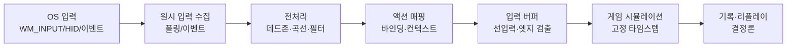
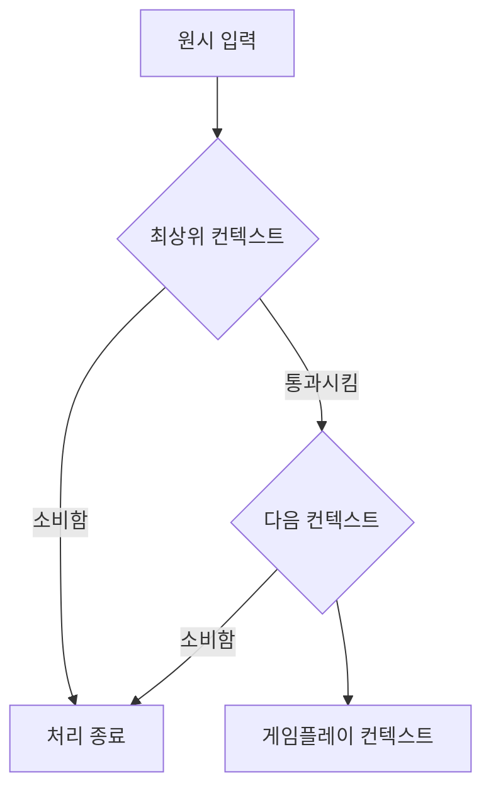
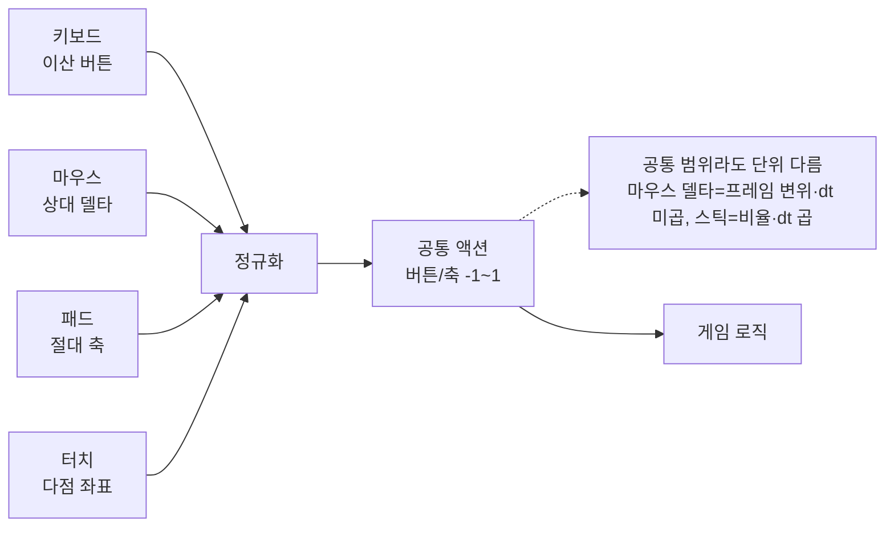
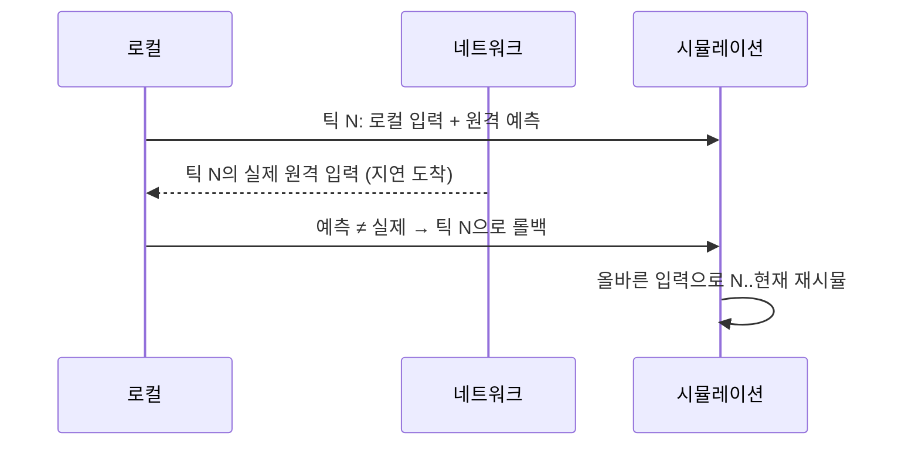

## 들어가며

입력 시스템은 *반응성(responsiveness)* 과 *일관성(consistency)* 사이의 줄다리기다. 플레이어는 버튼을 누른 순간 캐릭터가 반응하기를 바라고, 그 반응이 60fps든 144fps든 프레임이 튀든 *항상 똑같기를* 바란다. 그런데 이 둘은 자주 충돌한다. 지연을 줄이려고 입력을 가장 늦게 읽으면 프레임마다 처리 양이 달라지고, 일관성을 위해 입력을 고정 타임스텝에 가두면 반응이 한 박자 늦는다. 게다가 키보드·마우스·게임패드·터치는 *서로 다른 물리적 신호* 를 내고, 같은 게임을 누구는 30fps로 누구는 240fps로 돌린다.

이 글은 그 줄다리기를 따라 입력 엔진의 구성요소를 한 흐름으로 정리한다. 원시 입력이 OS에서 어떻게 들어오는지, 폴링과 이벤트 중 무엇을 택할지, 프레임 경계에서 입력을 어떻게 안정화하는지, 물리적 버튼을 *액션* 으로 추상화하고 리바인딩하는지, 아날로그 신호를 데드존과 응답 곡선으로 길들이는지, 키보드·패드·터치를 하나의 표면 뒤로 통합하는지, 입력에서 화면까지의 지연을 어떻게 *측정* 하는지, 그리고 입력을 *결정론적으로* 기록해 리플레이·롤백에 쓰는지를 다룬다.



이 글의 목표.

1. **입력 파이프라인과 폴링 대 이벤트** — OS 입력의 형태, 두 모델의 트레이드오프, 프레임 안정화.
2. **타이밍과 입력 지연** — 고정·가변 타임스텝, vsync, 지연의 분해.
3. **액션 매핑과 리바인딩** — 물리 입력의 추상화, 컨텍스트 스택, 저장.
4. **아날로그 처리: 데드존과 곡선** — 스틱·트리거·마우스의 길들이기.
5. **다중 장치 통합** — 키보드·마우스·패드·터치를 한 표면으로.
6. **입력 버퍼링과 인식** — 선입력 윈도우, 엣지 검출, 시퀀스 인식.
7. **결정론과 리플레이** — 입력 기록, 재현, 롤백 넷코드의 기반.
8. **측정·디버깅·접근성** — 지연 측정, 시각화, 리매핑·토글.


---

## 목차
1. [입력 파이프라인과 폴링 대 이벤트](#1-입력-파이프라인과-폴링-대-이벤트)
2. [타이밍과 입력 지연](#2-타이밍과-입력-지연)
3. [액션 매핑과 리바인딩](#3-액션-매핑과-리바인딩)
4. [아날로그 처리 데드존과 곡선](#4-아날로그-처리-데드존과-곡선)
5. [다중 장치 통합](#5-다중-장치-통합)
6. [입력 버퍼링과 인식](#6-입력-버퍼링과-인식)
7. [결정론과 리플레이](#7-결정론과-리플레이)
8. [측정·디버깅·접근성](#8-측정디버깅접근성)


---

## 1. 입력 파이프라인과 폴링 대 이벤트

### OS는 입력을 두 가지 형태로 준다

게임 엔진이 다루는 입력은 결국 OS와 드라이버가 만든 신호다. 그 신호가 게임에 도달하는 형태는 크게 둘이다. 하나는 *이벤트(event)* — OS가 메시지 큐에 "키 1번이 눌림", "마우스가 (x,y)로 이동"을 *밀어 넣는다*. 다른 하나는 *폴링(polling)* — 게임이 매 프레임 "지금 1번 키 상태가 뭐냐", "스틱 좌표가 얼마냐"를 *직접 묻는다*.

Windows의 경우 키보드·마우스의 표준 메시지(`WM_KEYDOWN`, `WM_MOUSEMOVE`)는 이벤트 모델이고, Raw Input(`WM_INPUT`)도 메시지로 도착하지만 가속·탄도 곡선이 적용되지 않은 원시 값을 준다. `RAWMOUSE`의 `usFlags`는 *상대 이동(`MOUSE_MOVE_RELATIVE`)* 과 *절대 이동(`MOUSE_MOVE_ABSOLUTE`)* 을 구분하며, 절대 이동은 가상 데스크톱 좌표(장치에 따라 정규화 범위일 수 있음)를 보고한다 — 상대 카운트와 화면 좌표를 같은 필드로 섞으면 안 된다. 게임패드의 XInput은 *폴링 전용* 이다 — `XInputGetState`로 매 프레임 패드 상태 전체를 한 번에 긁어온다. 즉 현실의 엔진은 두 모델을 *동시에* 다룬다.

### 두 모델의 트레이드오프

이벤트 모델은 장치나 OS가 보고한 *변화의 기록* 을 전달한다. 키가 눌리고 떼진 순서와 입력 타임스탬프를 보존할 수 있어, 한 게임 프레임 안에서 일어난 짧은 탭도 상태의 엣지로 복원할 수 있다. 다만 이벤트라고 해서 물리 장치의 연속 궤적을 모두 아는 것은 아니다. 장치 자체의 보고 주기보다 빠른 변화는 애초에 표본화되지 않고, 일부 윈도 메시지는 합쳐질 수 있으며, 타임스탬프의 기준과 정밀도도 API마다 다르다. 게임 루프가 느려지면 큐 처리 시점도 입력 시점보다 늦어진다.

현재 상태만 반환하는 폴링 API는 단순하고 자료구조가 평평하다. 대신 API가 별도의 전이 기록이나 누적 델타를 제공하지 않는다면 두 호출 사이에 눌렀다 떼진 버튼을 복원할 수 없다. 예를 들어 30fps 게임이 상태 스냅샷만 프레임마다 읽는다면, 약 33ms의 호출 간격 안에서 완료된 짧은 탭은 관측되지 않을 수 있다. 반대로 폴링이라는 호출 형식이라도 API가 이벤트 버퍼나 누적 카운터를 함께 제공한다면 이 한계는 완화된다. 핵심 구분은 함수 호출 방식이 아니라 *전이 이력이 보존되는가* 다.

```cpp
// 폴링: 현재 상태만 (XInput 스타일)
struct PadState {
    uint16_t buttons;       // 비트마스크
    float    lx, ly, rx, ry;
    float    lt, rt;
};
PadState now = QueryPad(0);     // 이 순간의 스냅샷

// 이벤트: 변화의 흐름 (Win32 메시지 스타일)
while (PeekMessage(&msg, ...)) {
    if (msg.message == WM_KEYDOWN)  OnKeyDown(msg.wParam, TimeStamp(msg));
    if (msg.message == WM_KEYUP)    OnKeyUp(msg.wParam, TimeStamp(msg));
}
```

### 실무의 절충: 이벤트로 수집, 상태로 통합

대부분의 엔진은 *이벤트로 모으고 프레임 상태로 합성* 한다. 한 프레임 동안 도착한 모든 이벤트를 소진하면서, 그 결과를 *현재 프레임의 입력 상태* 로 누적한다. 이렇게 하면 "한 프레임에 눌렀다 뗀 짧은 탭"도 상태에 *엣지로 기록* 되어 사라지지 않는다.

```cpp
struct InputState {
    std::bitset<256> down;          // 현재 눌린 키
    std::bitset<256> pressedEdge;   // 이번 프레임에 새로 눌림
    std::bitset<256> releasedEdge;  // 이번 프레임에 떼짐
    float mouseDx, mouseDy;         // 누적 델타
};

void BeginFrame(InputState& s) {
    s.pressedEdge.reset();
    s.releasedEdge.reset();
    s.mouseDx = s.mouseDy = 0.0f;
    // 한 프레임에 도착한 모든 이벤트 소진
    for (Event& e : DrainEventQueue()) {
        if (e.type == KeyDown && !s.down[e.key]) {
            s.down[e.key] = true;  s.pressedEdge[e.key] = true;
        } else if (e.type == KeyUp) {
            s.down[e.key] = false; s.releasedEdge[e.key] = true;
        } else if (e.type == MouseMove) {
            s.mouseDx += e.dx;     s.mouseDy += e.dy;   // 델타는 합산
        }
    }
    // 폴링 장치(패드)는 따로 한 번 긁어 같은 상태에 병합
    MergePadState(s, QueryPad(0));
}
```

핵심은 *세 가지 질의* 를 모두 답할 수 있게 만드는 것이다 — "지금 눌려 있나(`down`)", "방금 눌렸나(`pressedEdge`)", "방금 떼졌나(`releasedEdge`)". 점프는 눌린 *엣지* 에, 조준은 눌린 *상태* 에, 차징 해제는 떼진 *엣지* 에 반응한다. 엣지 정보를 잃으면 이 구분이 무너진다.

이 집계는 *정상적인 key up이 도착한다* 는 가정 위에서만 성립한다. 창 포커스 상실, 장치 분리, 컨텍스트 전환에서는 up 이벤트가 오지 않을 수 있어 `down`이 눌린 채 남는다(sticky input). 플랫폼의 취소·포커스 상실 알림을 받으면 장치 상태를 neutral로 되돌리고 `down`을 지운 뒤 진행 중인 action을 *취소* 해야 한다 — 취소→중립화→action cancel의 이 수명 경계는 UI(Part06)와 공유한다. 정상 경로에서 일부 key 이벤트가 단순 생략되는 것과는 구분한다.

### 입력 수집을 언제 돌리나

입력 수집을 루프의 어디에 두느냐는 입력이 어느 시뮬레이션 틱에 귀속되는지를 결정한다. 한 번의 가변 스텝만 실행하는 단순 루프에서는 게임 로직 직전에 수집할수록 더 최근 입력을 반영할 가능성이 크다. 그러나 고정 틱, 이벤트 타임스탬프, 렌더 스레드 분리, 네트워크 입력 지연이 있는 엔진에서는 "항상 직전"이라는 규칙만으로 충분하지 않다. OS 이벤트는 가능한 자주 펌프해 타임스탬프가 붙은 큐에 보존하고, 각 시뮬레이션 틱은 자신의 시간 구간에 속한 입력을 소비해야 한다. 렌더 직전 카메라에만 최신 입력을 반영하는 late update도 시뮬레이션 입력과 별도 경로로 둘 수 있다.

## 2. 타이밍과 입력 지연

### 고정 타임스텝과 가변 타임스텝

게임 시뮬레이션은 두 방식으로 시간을 다룬다. *가변 타임스텝(variable timestep)* 은 매 프레임 실제 경과 시간 `dt`를 받아 그만큼 전진한다 — 프레임마다 시뮬레이션 양이 다르다. *고정 타임스텝(fixed timestep)* 은 시뮬레이션을 *항상 같은 간격* (예: 1/60초)으로 쪼개 돌린다 — 렌더링이 빠르든 느리든 물리·로직은 동일한 스텝으로 전진한다.

입력의 관점에서 고정 타임스텝은 틱 번호와 입력 명령을 일대일로 대응시키기 쉽다는 장점이 있다. 하지만 고정 `dt`만으로 결정론이 보장되지는 않는다. 난수 소비 순서, 부동소수점 환경, 컨테이너 순회 순서, 스레드 스케줄, 초기 상태와 실행 파일까지 같아야 같은 결과를 기대할 수 있다. 가변 타임스텝은 실행마다 달라지는 `dt`가 입력에 하나 더 들어가므로 재현 조건을 만들기 더 어렵다.

```cpp
// 고정 타임스텝 + 입력 누적
const double kFixed = 1.0 / 60.0;     // 16.67ms 스텝
double accumulator = 0.0;

void Frame(double frameDt) {
    PollInput();                       // 이번 프레임 입력 수집
    accumulator += frameDt;
    while (accumulator >= kFixed) {
        InputCommand cmd = SampleInputForTick();   // 이 틱의 입력 스냅샷
        Simulate(cmd, kFixed);                       // 고정 스텝 전진
        accumulator -= kFixed;
    }
    Render(accumulator / kFixed);      // 남은 비율로 보간 렌더
}
```

여기서 함정이 하나 있다. 예제처럼 렌더 프레임당 한 번만 입력 상태를 만들면, `while`이 여러 번 도는 동안 같은 상태가 여러 틱에 복제될 수 있다. 엣지를 첫 틱에서만 소비하는 것은 중복 발화를 막지만, 이벤트가 실제 어느 틱 사이에 들어왔는지는 복원하지 못한다. 재현성이 필요한 루프는 이벤트에 단조 시계 타임스탬프나 목표 틱 번호를 붙여 보관하고, 각 틱 구간의 이벤트로 `InputCommand`를 구성한다. 프레임이 빨라 시뮬레이션 틱이 실행되지 않더라도 이벤트는 큐에 남아 다음 틱에서 소비돼야 한다.

### 입력 지연의 분해

"입력 지연"은 단일 숫자가 아니라 *누적 파이프라인* 이다. 버튼을 누른 물리적 순간부터 그 결과가 화면 픽셀로 바뀌어 눈에 들어오기까지, 여러 단계가 각자의 지연을 더한다.

| 단계 | 지연을 만드는 요인 | 관측에 필요한 값 |
|---|---|---|
| 장치 → OS | 센서 스캔, 장치 보고 주기, 무선·USB 전송 | 장치 보고 타임스탬프·간격 분포 |
| OS → 게임 | 스케줄링, 메시지 병합·큐, 게임의 수집 시점 | OS 이벤트 시각과 수집 시각 |
| 입력 → 시뮬레이션 | 틱 경계, 입력 버퍼, 작업 스케줄 | 입력이 소비된 틱 |
| 시뮬레이션 → GPU 제출 | CPU 프레임 구성과 렌더 스레드 | 제출 시각 |
| GPU → 표시 | GPU 실행, present 모드, 큐 깊이, 스캔아웃 | GPU 타임스탬프와 present 통계 |
| 패널 | 스캔 위치, 픽셀 응답, 디스플레이 후처리 | 광센서 또는 고속 촬영 |

각 단계는 기기와 실행 모드에 따라 분포가 달라진다. 따라서 "60Hz는 총 몇 ms"라는 보편 상수는 없다. 지연 최적화는 입력 사건에 식별자를 붙여 단계별 시각을 연결하고, 평균뿐 아니라 중앙값과 상위 분위수, 최악 구간을 함께 보는 작업이다.

### 지연 예산의 정량 — 샘플링 지연과 파이프라인 깊이

주기적 샘플링 경계 하나는 유용한 이상 모델을 제공한다. 소비자가 주기 $T$마다 읽고 입력 발생 위상이 그 주기와 독립이며 균등하다고 가정하면 다음 읽기까지의 대기는 아래 분포를 따른다.

*재샘플링 경계(resampling boundary)* — 비동기 생산자가 주기 $T$로 읽는 동기 소비자에게 신호를 넘기는 지점이다. 입력은 다음 읽기 순간까지 기다린다. 생산자 타이밍이 소비자 클록과 무관하면 입력 발생 시각이 한 샘플 구간 안에 균등하게 떨어지므로, 대기 시간은

$$L \sim \mathrm{Uniform}(0, T),\qquad \mathbb{E}[L]=\frac{T}{2},\qquad L_{\max}=T,\qquad \mathrm{Var}(L)=\frac{T^2}{12}.$$

이 식은 가정 아래의 결과이지 모든 장치의 보장이 아니다. 장치 내부 필터, 이벤트 병합, 스케줄링 지터, 서로 동기화된 클록은 균등성과 독립성을 깨뜨린다. 그래도 각 경계가 지연 예산에 어떤 차수로 들어가는지 보는 출발점으로는 유용하다.

- 주기 $T_{\text{device}}$의 장치 보고
- 주기 $T_{\text{sample}}$의 게임 입력 수집 또는 시뮬레이션 틱
- 고정 주사 FIFO 표시에서의 present 경계

나머지 단계는 상수가 아니라 일반 확률변수 $X_j$로 두는 편이 안전하다. CPU 작업 시간, GPU 실행 시간, OS 스케줄링, 패널 응답이 여기에 속한다. 고정 주사율의 FIFO 큐가 포화되어 입력을 담은 프레임 앞에 완성 프레임이 정확히 $q$개 있다면 큐 항을 근사적으로 $qT_{\text{present}}$로 쓸 수 있다. mailbox, immediate, VRR, 프레임 생성에서는 이 등식이 성립하지 않는다.

기댓값은 선형성이므로 *독립성 없이* 더할 수 있다.

$$\mathbb{E}[L_{\text{total}}]\approx qT_{\text{present}}+\sum_i\frac{T_i}{2}+\sum_j\mathbb{E}[X_j].$$

분산은 일반적으로 각 항의 분산과 *공분산* 을 함께 더한다.

$$\mathrm{Var}\Big(\sum_k Y_k\Big)=\sum_k\mathrm{Var}(Y_k)+2\sum_{k<l}\mathrm{Cov}(Y_k,Y_l).$$

경계와 일반 항이 서로 *무상관* 이면 모든 공분산이 0이라 단순 합으로 줄어든다. 독립은 공분산을 0으로 만드는 *충분조건* 중 하나일 뿐, 필요조건이 아니다.

$$\mathrm{Var}(L_{\text{total}})\approx\sum_i\frac{T_i^2}{12}+\sum_j\mathrm{Var}(X_j).$$

종속이면서 공분산이 0인 대조 예로 $X\in\{-1,0,1\}$이 각각 $\frac13$ 확률이고 $Y=X^2$인 경우가 있다. $Y$는 $X$에 완전히 종속이지만 $\mathbb{E}[X]=0$, $\mathbb{E}[XY]=\mathbb{E}[X^3]=0$이라 $\mathrm{Cov}(X,Y)=0$이므로 $X$와 $Y$의 분산은 공분산 항 없이 더해진다.

예를 들어 장치 보고 1ms, 게임 샘플링 16.67ms, FIFO 표시 경계 16.67ms를 서로 독립인 주기 경계로 *가정* 하면, 이 세 경계의 평균 대기만 $0.5+8.34+8.34\approx17.2$ms다. 여기에 실제 CPU·GPU 실행, 큐, 스캔 위치와 패널 응답이 더해진다. 이 계산은 특정 시스템의 총지연 예측이 아니라, 무엇을 측정해야 하는지 보여 주는 예다.

두 가지 핵심 관찰이 따라온다.

*큰 주기의 경계가 더 큰 평균과 분산을 만든다.* 다른 조건이 같다면 $T$를 줄일수록 그 경계의 평균 대기는 $T/2$만큼 줄어든다. 다만 장치 설정 하나의 개선량을 전체 파이프라인 개선량으로 오해하면 안 된다.

*프레임레이트는 여러 경계에 영향을 줄 수 있다.* 입력 수집과 렌더 제출이 프레임 주기에 묶여 있다면 높은 프레임레이트가 두 경계를 함께 줄인다. 그러나 시뮬레이션 틱이 별도이거나 큐 깊이가 시간 단위로 유지되거나 GPU가 포화되면 같은 비율의 감소를 보장하지 않는다.

수집 위치는 입력이 마감 시각을 통과하느냐를 바꾼다. 시뮬레이션의 입력 마감 직전에 읽으면 더 최근 사건을 같은 틱에 넣을 수 있지만, OS 이벤트 펌프와 작업 의존성을 무시한 채 무조건 늦추면 오히려 마감 실패와 지터가 생긴다. 그래서 저지연 설계는 수집, 시뮬레이션, 카메라 late update의 마감 시각을 따로 측정한다.

실패 경계 둘. 재샘플링 클록들이 *상관* 되면(예: 입력 장치가 vsync에 동기된 드문 경우) 균등 가정이 깨져 지연이 0 또는 $T$로 잠기고, 매끄러운 지터 대신 주기적 비트 스터터가 난다. 또 프레임레이트가 미고정(언캡)이면 $T_{\text{frame}}$가 비정상(non-stationary)이라 실제 퍼짐이 정상 상태 $\sigma$보다 넓어진다.

### vsync와 입력 지연의 관계

고정 주사율의 FIFO present는 찢김을 막는 대신 완성 프레임을 표시 경계까지 기다리게 할 수 있고, 앞선 프레임이 큐에 있으면 입력을 담은 프레임의 표시가 더 늦어진다. 그러나 "vsync on" 하나로 동작을 단정할 수는 없다. immediate는 찢김을 허용하고, mailbox는 오래된 대기 프레임을 교체할 수 있으며, VRR은 허용 범위 안에서 표시 시점을 프레임 완료에 맞춘다. 합성기와 API의 present mode도 결과를 바꾼다.

절충안은 present mode, VRR, 프레임 제한, 최대 대기 프레임 수를 함께 조정하는 것이다. VRR도 범위를 벗어나거나 저프레임 보상에 들어가면 동작이 달라지고, 큐를 지나치게 줄이면 GPU 유휴와 프레임 타임 불안정이 늘 수 있다. 목표는 특정 조합을 외우는 것이 아니라 각 모드에서 실제 엔드 투 엔드 지연과 프레임 페이싱을 함께 측정하는 것이다.

### 프레임레이트 독립성

같은 게임이 30fps와 240fps에서 *똑같이 조작* 되어야 한다. 이를 깨는 흔한 버그가 *프레임 기반 누적* 이다. "매 프레임 회전값에 0.5도 더하기"는 프레임레이트가 8배면 회전이 8배 빨라진다. 모든 시간 의존 양은 `dt`로 스케일하거나(가변), 고정 스텝 안에서 처리해야(고정) 한다.

마우스 델타와 패드 스틱은 여기서 성질이 다르다. 마우스 *델타* 는 이미 "이만큼 움직였다"는 *변위* 라 `dt`를 곱하면 안 된다 — 프레임 사이 누적 델타를 그대로 쓴다. 반면 스틱 *기울기* 는 "이 방향으로 이만한 속도"라는 *비율* 이라 반드시 `dt`를 곱한다. 이 둘을 혼동해 마우스에 `dt`를 곱하면 저프레임에서 감도가 폭증하는 고전적 버그가 난다.

## 3. 액션 매핑과 리바인딩

### 물리 입력을 액션으로 추상화

게임 로직이 "스페이스바가 눌렸나"를 직접 묻게 만들면, 리바인딩·패드 지원·플랫폼 이식이 전부 코드 수정이 된다. 해법은 *한 단계의 간접* 이다 — 물리 입력(키·버튼·축)을 *추상 액션(action)* 에 매핑하고, 게임은 액션만 묻는다.

```cpp
enum class Action { Jump, Fire, MoveX, MoveY, Aim, /* ... */ };

struct Binding {
    enum Kind { Button, Axis } kind;
    Action  action;
    int     deviceCode;     // 키코드 또는 패드 버튼/축 코드
    float   scale = 1.0f;   // 축 방향 뒤집기·감도
};

// 게임 로직은 물리 코드를 모른다
if (input.Pressed(Action::Jump)) Jump();
float move = input.AxisValue(Action::MoveX);
```

이 한 겹의 추상이 입력 시스템의 척추다. 점프가 스페이스든 패드 A버튼이든 게임 로직은 동일하다. 키보드의 W/S 두 버튼이 하나의 `MoveY` 축으로 합성되고, 패드 스틱의 아날로그 Y가 같은 `MoveY`에 들어간다 — 게임은 -1~+1 값만 본다.

### 컨텍스트 스택

같은 버튼이 상황에 따라 다른 일을 한다. 게임플레이 중 B버튼은 "구르기"지만 메뉴에서는 "뒤로", 차량 탑승 중엔 "부스트"다. 이를 if문으로 흩뿌리면 금세 엉킨다. *입력 컨텍스트(context)* 를 *스택* 으로 쌓는 구조가 깔끔하다.



```cpp
struct InputContext {
    std::unordered_map<int, Action> bindings;
    bool consumeUnbound = false;   // 매핑 없는 입력을 막을지
};

// 스택 위에서 아래로: 누군가 소비하면 멈춤
Action ResolveAction(int code, const std::vector<InputContext*>& stack) {
    for (auto it = stack.rbegin(); it != stack.rend(); ++it) {
        auto found = (*it)->bindings.find(code);
        if (found != (*it)->bindings.end()) return found->second;
        if ((*it)->consumeUnbound) break;   // 모달 메뉴: 아래로 안 흘림
    }
    return Action::None;
}
```

메뉴를 열면 메뉴 컨텍스트를 *푸시* 하고 `consumeUnbound`로 게임플레이를 차단한다. 닫으면 *팝* 한다. 일시정지·대화·인벤토리가 모두 이 한 메커니즘으로 처리된다.

### 리바인딩과 저장

플레이어가 키를 바꾸려면 *바인딩이 데이터* 여야 한다 — 코드가 아니라 직렬화 가능한 테이블. 리바인딩 UI는 "다음 누르는 키를 이 액션에 할당"이라는 *캡처 모드* 로 동작한다.

```cpp
// 리바인딩 캡처: 다음 입력을 잡아 액션에 묶는다
void StartRebind(Action target) { rebindTarget_ = target; capturing_ = true; }

void OnAnyInput(int code) {
    if (!capturing_) return;
    // 충돌 검사: 이미 다른 액션이 쓰는 코드인가
    if (Action conflict = FindBinding(code); conflict != Action::None)
        UnbindOrSwap(conflict, code);
    SetBinding(rebindTarget_, code);
    capturing_ = false;
    SaveBindingsToDisk();      // JSON/INI로 영속화
}
```

함정이 몇 개 있다. *충돌* — 한 코드를 두 액션에 묶으면 둘 다 발화한다. 명시적으로 막거나(거부) 교환(swap)한다. *복구 불가* — 모든 키를 바인딩 해제하면 메뉴조차 못 열 수 있다. 그래서 "기본값 복원"과 메뉴 탐색은 사용자가 해제할 수 없는 복구 액션으로 보장한다. 특정 키 하나에만 의존하면 그 키가 없는 장치나 접근성 요구를 놓치므로, 지원 장치별 복구 경로와 설정 파일 초기화 경로를 함께 둔다. *장치별 분리* — 키보드 바인딩과 패드 바인딩은 별도 테이블로 둔다. 같은 액션이 키보드는 스페이스, 패드는 A버튼이다.

## 4. 아날로그 처리: 데드존과 곡선

### 데드존이 필요한 이유

아날로그 스틱은 중립 위치에서도 *완전한 0* 을 내지 못한다. 마모·드리프트로 손을 떼도 (0.03, -0.05) 같은 작은 값이 남는다. 이걸 그대로 쓰면 *캐릭터가 혼자 움직인다*. 그래서 작은 입력을 0으로 죽이는 *데드존(dead zone)* 이 필요하다.

가장 단순한 *축별 데드존* 은 각 축을 독립적으로 자른다. 문제는 *대각선* 이다 — 두 축을 따로 자르면 중립 영역이 *사각형* 이 되어, 수직·수평 방향으로는 입력이 축에 스냅되어 쉬운 반면 대각선이 어색하다. 실무 표준은 *방사형 데드존(radial dead zone)* 이다 — 벡터의 *크기* 로 자르고, 남은 구간을 0~1로 *재정규화* 한다.

```cpp
// 방사형 데드존 + 재스케일. 0 <= inner < outer, 유한값 전제
std::optional<float2> ApplyRadialDeadzone(float2 stick, float inner, float outer) {
    if (!isfinite(stick.x) || !isfinite(stick.y) ||
        !isfinite(inner) || !isfinite(outer) || inner < 0 || outer <= inner)
        return std::nullopt;                         // 잘못된 범위·비유한 입력 거부
    float mag = length(stick);
    if (mag <= inner || mag == 0) return float2{0, 0};  // 원점·안쪽 데드존 → 0
    float clamped = std::min(mag, outer);            // 바깥 포화
    float t = (clamped - inner) / (outer - inner);   // 0~1 재정규화
    return stick * (t / mag);                        // 방향 보존, 크기만 리매핑
}
```

`inner = 0`이어도 원점에서 0을 안전하게 반환하고, `inner < 0`이거나 `outer <= inner`, 비유한 파라미터는 `std::nullopt`로 거부한다 — 입력을 조용히 다른 유효 범위로 바꾸지 않는다.

재정규화가 핵심이다. 데드존만 자르고 재스케일을 안 하면, 스틱을 살짝 기울였을 때 갑자기 데드존 경계의 값(예: 0.25)이 튀어나와 *입력이 점프* 한다. 재정규화는 데드존 직후를 0에서 부드럽게 시작하게 만든다.

### 응답 곡선

데드존을 통과한 0~1 값을 *그대로* 쓸지, *곡선* 으로 다시 매핑할지가 다음 결정이다. 선형은 정직하지만 *정밀 조작* 이 어렵다 — 살짝 기울여 천천히 걷고 싶은데 입력이 바로 커진다. *지수 곡선* 은 작은 입력을 더 작게 눌러 미세 조작 영역을 넓힌다.

```cpp
// 응답 곡선: exponent>1이면 미세 조작 영역 확장
float ApplyResponseCurve(float v, float exponent) {
    float sign = (v < 0) ? -1.0f : 1.0f;
    return sign * std::pow(std::abs(v), exponent);   // 부호 보존
}
```

| 곡선 | exponent | 특성 | 용도 |
|---|---|---|---|
| 선형 | 1.0 | 정직, 거친 미세 조작 | 이동 |
| 약한 지수 | 예: 1.5~2.0 | 미세 조작 영역 확장 | 조준·카메라의 시작 후보 |
| 강한 지수 | 예: 2.5~3.0 | 큰 입력만 빠름 | 장치·게임별 검증 필요 |

조준 카메라에는 지수 곡선이 흔하다 — 스틱을 조금 기울이면 *천천히 정밀하게*, 끝까지 밀면 *빠르게 휙* 도는 감각이 난다. 이 곡선과 데드존, 그리고 *민감도(sensitivity)* 배율이 합쳐져 "조작감"을 만든다. 실제 카메라 회전에서는 여기에 피치 클램프, 자동 보정, 입력과 카메라 갱신의 프레임 순서까지 함께 설계해야 한다.

### 트리거와 마우스

*트리거(아날로그 버튼)* 는 0~1의 압력값을 낸다. 디지털 버튼처럼 쓰려면 *임계값(threshold)* 으로 이진화하되, 채터링을 막는 *히스테리시스* 를 둔다 — 켜지는 임계(0.6)와 꺼지는 임계(0.4)를 다르게 해, 경계에서 떨릴 때 on/off가 진동하지 않게 한다.

```cpp
// 트리거 히스테리시스: 켜짐/꺼짐 임계를 분리
bool TriggerToButton(float pressure, bool prev) {
    if (prev)  return pressure > 0.4f;   // 켜진 상태면 0.4 밑으로 떨어져야 꺼짐
    else       return pressure > 0.6f;   // 꺼진 상태면 0.6 넘어야 켜짐
}
```

*마우스* 는 또 다르다. OS의 일반 마우스 입력에는 *포인터 가속* 과 탄도 곡선이 적용되어, 같은 물리적 거리를 천천히/빠르게 움직이면 다른 픽셀 수가 나온다. 데스크톱엔 유용하지만 *조준엔 독* 이다 — 근육 기억이 깨진다. 그래서 FPS는 *원시 입력(raw input)* 을 쓴다 — OS 가속을 우회한 순수 카운트 델타를 받아, 게임 내 감도만 곱한다. 이것이 "마우스 1:1"의 정체다.

## 5. 다중 장치 통합

### 한 표면 뒤로 통합하기

키보드·마우스·게임패드·터치는 물리적으로 전혀 다른 신호를 낸다 — 키보드는 이산 버튼, 마우스는 상대 델타, 패드는 절대 축, 터치는 다점 좌표. 게임 로직이 이 차이를 일일이 알면 코드가 장치 수만큼 분기한다. 3절의 *액션* 추상이 이 통합의 출구다 — 모든 장치를 *공통 액션 표면* 으로 정규화한다.



버튼은 모두 *눌림/엣지* 로, 방향은 모두 *-1~+1 축* 으로 정규화한다. 키보드 WASD는 두 쌍의 버튼을 합쳐 2D 축을 만들고, 마우스 델타는 조준 축으로, 패드 스틱은 그대로 축으로 들어간다. 게임은 `AxisValue(MoveX)`만 묻고 어느 장치인지 모른다. 다만 *장치 독립* 은 단위와 소비 빈도까지 같게 만든다는 뜻이 아니다 — 마우스 *델타* 는 프레임 사이 *변위*(`dt`를 곱하지 않음)이고 패드 스틱 *기울기* 는 *비율*(`dt`를 곱함)이다. 2절의 구분처럼 `MoveAxis`·`LookDelta`·`LookRate`처럼 소비 단위가 다른 축은 이름과 경로를 분리해, 카메라 코드가 둘을 혼동하지 않게 한다.

### 활성 장치 추적

장치를 통합해도 *지금 누가 조작 중인지* 는 알아야 한다 — 버튼 프롬프트를 키보드 아이콘으로 보일지 패드 아이콘으로 보일지가 여기 달렸다. *마지막으로 입력이 들어온 장치* 를 추적해 활성 장치로 삼는다.

```cpp
enum class DeviceType { KeyboardMouse, Gamepad, Touch };

void OnInputFromDevice(DeviceType dev, float magnitude) {
    // 노이즈로 인한 깜빡임 방지: 임계 이상의 입력만 전환 트리거
    if (magnitude > kSwitchThreshold && dev != activeDevice_) {
        activeDevice_ = dev;
        OnActiveDeviceChanged(dev);   // UI 프롬프트 아이콘 갱신
    }
}
```

함정은 *스틱 드리프트로 인한 오판* 이다. 패드를 연결만 하고 키보드로 플레이 중인데, 스틱 드리프트가 임계를 넘으면 프롬프트가 패드로 깜빡인다. 그래서 전환 임계를 데드존보다 충분히 높게 잡는다. 반대로 진동 모터의 떨림이 가속도계에 영향을 주는 패드도 있어, 전환 판정엔 *의도적 입력* (버튼 눌림, 큰 스틱 이동)만 쓴다.

### 핫플러그

패드는 게임 도중 연결·해제될 수 있다. 장치 이벤트를 구독하되 플레이어 슬롯과 물리 장치 ID를 분리하고, 재연결 시 올바른 사용자에게 되돌린다. 로컬 싱글플레이는 활성 장치 분리 시 일시정지할 수 있지만 온라인 경기처럼 멈출 수 없는 게임은 안전한 입력 중립 상태와 재연결 UI를 사용한다.

```cpp
void OnDeviceConnected(DeviceId id)    { padSlots_.Assign(id); }
void OnDeviceDisconnected(DeviceId id) {
    if (id == activePad_) { PauseGame(); ShowReconnectPrompt(); }
    padSlots_.Release(id);
}
```

### 멀티플레이어 입력 분리

로컬 멀티플레이어는 *여러 장치를 여러 플레이어에 귀속* 시켜야 한다. 패드 0은 플레이어 1, 패드 1은 플레이어 2. 입력 상태를 *전역 싱글톤이 아니라 플레이어별로* 분리하는 것이 핵심이다 — 처음부터 `InputState`를 플레이어 인덱스로 들고, 액션 질의에 플레이어를 명시한다. 전역 입력으로 시작했다가 나중에 멀티를 붙이면 거의 전면 재작성이 된다.

### 터치의 특수성

터치는 *버튼이 없다* — 화면 위 좌표뿐이다. 그래서 *가상 컨트롤* 을 화면에 그려 매핑한다. 가상 조이스틱은 첫 터치 지점을 중심으로 삼고, 드래그 벡터를 스틱 축으로 변환한다. *멀티터치* 추적이 필수다 — 왼쪽 엄지의 이동 조이스틱과 오른쪽 엄지의 조준이 동시에 움직이므로, 각 터치 포인트를 *고유 ID로 추적* 해 섞이지 않게 한다.

```cpp
// 가상 조이스틱: 첫 터치를 원점으로 잡고 그 포인터를 캡처한다
void UpdateVirtualStick(TouchPoint t) {
    if (t.phase == Began) { activeId_ = t.id; origin_ = t.pos; }  // owner ID 캡처
    if (t.id != activeId_) return;                                // 다른 손가락 무시
    if (t.phase == Ended || t.phase == Cancelled) {               // 끝·취소(포커스 상실 포함)
        SetAxis(Action::MoveX, 0.0f);                             // 중립화
        SetAxis(Action::MoveY, 0.0f);
        activeId_ = kNoTouch;                                     // capture 해제
        return;
    }
    float2 delta = t.pos - origin_;
    float2 axis  = clampLength(delta / kStickRadius, 1.0f);
    SetAxis(Action::MoveX, axis.x);
    SetAxis(Action::MoveY, axis.y);
}
```

손가락은 마우스보다 *굵고 부정확* 하다 — 터치 타깃은 플랫폼 권장 크기를 확보한다. Apple은 44×44 *포인트(pt, 논리 단위)* 를, Android는 48×48 *dp(밀도 독립 픽셀)* 를 권장한다. 포인트·dp는 물리 mm나 물리 픽셀과 같지 않으며, 실제 물리 크기는 화면 scale/DPI에 따라 달라진다 — 논리 단위를 '44~48px'처럼 물리 크기·물리 픽셀과 동일시하면 고DPI 기기에서 타깃이 지나치게 작아진다. 손가락이 버튼을 가리는 *오클루전* 을 감안해 중요한 피드백은 손가락 밖에 표시한다.

## 6. 입력 버퍼링과 인식

### 선입력 윈도우

플레이어가 점프 직전에 공격 버튼을 *살짝 일찍* 눌렀다고 그 입력을 버리면 "분명 눌렀는데 안 나갔다"는 불만이 된다. *선입력 버퍼(input buffer)* 는 입력을 즉시 버리지 않고 *짧은 시간 동안 보관* 했다가, 해당 액션이 가능해지는 순간 소비한다.

```cpp
struct BufferedInput {
    Action action;
    double timestamp;
};
std::deque<BufferedInput> buffer_;
const double kBufferWindow = 0.15;   // 제품 플레이테스트용 예시 값

void PushInput(Action a, double now) { buffer_.push_back({a, now}); }

// 액션이 가능해진 순간 호출: 윈도우 내 입력이 있으면 소비
bool ConsumeBuffered(Action a, double now) {
    for (auto it = buffer_.begin(); it != buffer_.end(); ++it) {
        if (it->action == a && now - it->timestamp <= kBufferWindow) {
            buffer_.erase(it);
            return true;
        }
    }
    return false;
}
```

윈도우 크기는 조작감과 의도 오인식 사이의 정책이다. 짧을수록 정확한 시각을 요구하고, 길수록 관용적이지만 오래된 입력이 늦게 발동할 수 있다. 장르 이름만으로 밀리초를 고정하지 않고 액션 종류, 애니메이션 취소 규칙, 입력 장치와 플레이테스트 분포로 정한다. 코요테 타임은 과거 입력을 보관하는 선입력과 달리, 지상 판정이 끝난 뒤에도 점프 가능 상태를 잠시 연장한다는 점에서 구현 상태가 다르다.

### 엣지 검출과 토글

1절에서 만든 `pressedEdge`/`releasedEdge`가 여기서 다시 쓰인다. *눌린 순간* 에만 발화해야 하는 액션(점프, 메뉴 선택)은 엣지로 판정한다. 그렇지 않으면 버튼을 누르고 있는 동안 매 프레임 발화한다. *길게 누르기(hold)* 와 *짧게 누르기(tap)* 의 구분도 엣지에 시간을 결합해 만든다.

```cpp
// 탭 vs 홀드 구분: release 시점에도 duration으로 완결 판정
void UpdateButton(bool down, bool pressedEdge, bool releasedEdge, double now) {
    if (pressedEdge) { active_ = true; holdFired_ = false; pressStart_ = now; }
    if (!active_) return;
    double duration = now - pressStart_;
    if (releasedEdge) {
        active_ = false;
        if (holdFired_) { holdFired_ = false; return; }   // 이미 홀드 발행 → 중복 없음
        if (duration >= kHoldThreshold) OnHold();         // 임계 경계 포함
        else OnTap();
        return;
    }
    if (down && !holdFired_ && duration >= kHoldThreshold) {
        OnHold();  holdFired_ = true;                     // 임계 통과 시 1회
    }
}
```

`now`는 단조 증가해야 하고 각 엣지는 시간순으로 한 번만 전달한다. 임계값을 넘긴 채 떼면 홀드이고, release 시점의 `duration`이 임계값과 *같으면* 이 예제에서는 홀드로 정한다(제품 정책에 따라 탭으로 둘 수도 있다). 이미 홀드를 발행했으면 release에서 중복 발행하지 않으며, 포커스 상실·장치 분리는 이 판정과 별도로 `Cancel`로 상태를 중립화한다.

### 시퀀스 인식

격투 게임의 커맨드(↓↘→ + 펀치)는 *입력의 순서와 타이밍* 을 인식한다. 입력 히스토리를 *타임스탬프와 함께* 링 버퍼에 기록하고, 등록된 *모션 패턴* 과 매칭한다. 핵심은 *각 입력 사이의 시간 제한* 이다 — ↓ 다음 → 까지 너무 오래 걸리면 무효.

```cpp
struct InputRecord { int direction; double time; };
std::deque<InputRecord> history_;     // 최근 N개, 오래된 건 폐기

// 패턴 매칭: 뒤에서부터 역순으로, 각 단계 시간 제한 검사
bool MatchMotion(const std::vector<int>& pattern, double maxGap, double now) {
    int p = (int)pattern.size() - 1;
    double prevTime = now;
    for (auto it = history_.rbegin(); it != history_.rend() && p >= 0; ++it) {
        if (prevTime - it->time > maxGap) return false;     // 너무 느림 → 실패
        if (it->direction == pattern[p]) { p--; prevTime = it->time; }
    }
    return p < 0;     // 패턴을 모두 소진했으면 성공
}
```

뒤에서부터 매칭하는 이유는 *가장 최근 입력* 이 커맨드의 *끝* 이기 때문이다. 관용성을 위해 패턴 사이에 *불필요한 중간 입력을 허용* 하거나(↓↓↘ 도 ↓↘로 인정), *방향 근사* (정확한 ↘ 대신 → 와 ↓ 사이면 통과)를 더한다. 이 관용성의 정도가 게임의 입력 난이도를 정의한다.

### 버퍼 오버플로우

버퍼는 무한하지 않다. 입력이 폭주하거나(연타) 프레임이 길게 멈추면 버퍼가 찬다. *고정 크기 링 버퍼* 로 오래된 입력을 자동 폐기하는 것이 안전하다 — 어차피 선입력 윈도우를 넘긴 입력은 무효이므로, 윈도우보다 넉넉한 크기면 충분하다. 동적 할당으로 버퍼를 키우면 실시간성을 해친다.

## 7. 결정론과 리플레이

### 결정론의 조건

같은 초기 상태와 같은 입력을 같은 실행 계약 아래 처리했을 때 같은 결과가 나오는 성질이 *결정론(determinism)* 이다. 실행 계약에는 실행 파일과 에셋 버전, 플랫폼의 수치 환경, 스레드·작업 순서까지 포함된다. 이것이 리플레이·롤백 넷코드·자동 테스트의 공통 토대다. 고정 타임스텝과 틱별 입력 스냅샷은 필요한 기반이지만 충분조건은 아니다.

입력 측면의 핵심은 입력을 틱 단위의 데이터로 직렬화하는 것이다. 그러면 입력 경로는 재생할 수 있지만, 전체 시뮬레이션 재현에는 같은 초기 상태·외부 이벤트·실행 계약과 내부 결정론이 추가로 필요하다.

```cpp
// 틱당 입력 명령: 시뮬레이션이 보는 유일한 입력
struct InputCommand {
    uint16_t held;           // 눌린 채 유지된 버튼
    uint16_t pressed;        // 이 틱에 새로 눌린 엣지
    uint16_t released;       // 이 틱에 떼진 엣지
    int8_t   moveX, moveY;   // 양자화된 축 (-127~127)
    int8_t   aimX,  aimY;
};   // 고정 크기 → 틱당 일정 바이트로 직렬화 가능
```

축을 *정수로 양자화* 하는 이유가 있다. 부동소수 값을 그대로 저장하면 플랫폼·컴파일러 간 미세한 비트 차이가 결과를 갈라놓을 수 있다. 입력을 작은 정수로 양자화하면 직렬화가 작고 결정론에 유리하다.

`held`만 직렬화하면 같은 틱 안의 down+up이 '입력 없음'과 구별되지 않는다. 그래서 `held`(지속 상태)와 `pressed`/`released`(엣지)를 분리한다. 여러 엣지의 *순서* 까지 필요한 액션(예: 시퀀스 인식)에는 작은 ordered event 배열을 덧붙인다.

### 리플레이: 입력만 저장한다

리플레이를 화면 녹화로 만들면 용량이 크다. 결정론적 시뮬레이션에서는 초기 상태, 틱별 입력 스트림, 결정에 영향을 주는 외부 이벤트와 버전 식별자를 저장해 상태를 재구성할 수 있다. 카메라·VFX처럼 비결정적 시각 계층까지 동일하게 재현하려면 그 계층의 시드와 이벤트도 기록해야 한다.

```cpp
// 기록: 틱마다 입력 명령을 스트림에 append
void RecordTick(uint32_t tick, const InputCommand& cmd) {
    replayStream_.Write(cmd);          // 틱당 고정 바이트
}

// 재생: 저장된 입력을 그대로 시뮬레이션에 주입
void PlaybackTick(uint32_t tick) {
    InputCommand cmd = replayStream_.Read();
    Simulate(cmd, kFixed);             // 실제 입력 대신 기록된 입력
}
```

위 예제 구조가 패딩 없이 10바이트로 직렬화된다고 가정하면 60Hz 입력 본문은 초당 600바이트, 시간당 약 2.2MB다. 실제 포맷에는 헤더, 체크포인트, 외부 이벤트, 무결성 정보가 추가된다. 더 줄이려면 *변화 없는 틱을 델타 압축* (버튼 상태가 안 바뀐 구간은 카운트로)한다.

### 디싱크 진단

리플레이가 중간에 어긋나는 원인은 숨은 비결정성뿐 아니라 초기 상태·에셋·실행 파일 버전 불일치, 입력 누락, 직렬화 오류일 수도 있다.

| 원인 | 증상 | 대처 |
|---|---|---|
| 프레임 의존 난수 | 재생할 때마다 다름 | 시드 고정, 틱 카운터로 시드 |
| 부동소수 비일관 | 플랫폼 간 어긋남 | 결정론 수학·정수 양자화 |
| 컨테이너 순회 순서 | 해시맵 순서 의존 | 정렬된 순회·안정 ID |
| 미기록 입력 소스 | 일부 입력 누락 | 모든 입력을 명령으로 |

진단의 표준 도구는 *체크섬* 이다 — 일정 틱마다 게임 상태의 해시를 기록해, 재생 시 같은 틱에서 해시가 갈라지는 *정확한 순간* 을 찾는다. 그 틱에서 무엇이 달랐는지 좁혀 들어가면 원인이 드러난다.

### 롤백 넷코드의 기반

온라인 대전의 *롤백 넷코드(rollback netcode)* 도 같은 토대 위에 선다. 원격 플레이어의 입력은 네트워크 지연만큼 늦게 도착하므로, 로컬에서는 원격 입력을 *예측* 하고 진행한다. 실제 입력이 도착해 예측과 다르면, 그 틱으로 *되감아(rollback)* 올바른 입력으로 *다시 시뮬레이션* 한다.



이것이 가능한 전제가 *결정론* 이다 — 같은 입력으로 다시 돌리면 같은 결과가 나와야 되감기가 의미를 가진다. 그래서 롤백을 쓰려면 *상태 저장/복원(snapshot)* 이 빠르고, 한 프레임에 여러 틱을 재시뮬할 만큼 시뮬레이션이 가벼워야 한다. 입력을 작은 명령으로 직렬화한 설계가 여기서 그대로 네트워크 전송 단위가 된다.

### 입력 검증

서버 권위(server authority) 모델에서는 클라이언트가 보낸 입력을 그대로 믿지 않는다. 존재하지 않는 액션, 허용 범위를 벗어난 축, 틱당 허용되지 않은 명령 조합과 빈도를 검증하고, 효과는 서버 시뮬레이션이 산출한다. 물리 마우스 속도처럼 장치 DPI·감도·보조 기능에 따라 달라지는 값은 단독 치팅 판정 기준으로 적합하지 않다. 입력이 명령 구조로 정형화되어 있으면 범위 검사, 속도 제한, 서버 측 재시뮬레이션을 적용하기 쉽다.

## 8. 측정·디버깅·접근성

### 입력 지연을 측정하는 법

지연은 추측이 아니라 측정의 대상이다. 외부 고속 카메라로 버튼 또는 LED와 화면 변화를 동시에 찍으면 소프트웨어 내부 계측이 놓치는 장치·패널 구간까지 포함할 수 있다. 240fps 촬영은 프레임당 약 4.17ms의 시간 해상도를 제공한다. 더 정밀한 분석에는 입력 액추에이터와 광센서를 연결한 지연 분석기를 쓰고, 반복 측정으로 분포를 구한다.

엔진 내부 측정도 병행한다. 입력 이벤트에 *수신 타임스탬프* 를 박고, 그 입력이 *시뮬레이션에 반영된 틱*, *렌더 제출 시각* 까지 추적하면 파이프라인의 어느 단계가 지연을 먹는지 분해할 수 있다.

```cpp
struct InputLatencyProbe {
    double deviceTimestamp;   // OS가 준 입력 발생 시각
    double collectedTime;     // 게임이 수집한 시각
    double simulatedTime;     // 시뮬레이션에 반영된 시각
    double renderedTime;      // 렌더 제출 시각
    // collected - device : 수집 지연
    // simulated - collected : 큐 대기
    // rendered - simulated : 렌더 파이프라인
};
```

### 무엇을 시각화하나

입력은 *눈에 안 보여* 디버깅이 어렵다. 그래서 *시각화* 가 필수다 — 현재 눌린 키·버튼 오버레이, 스틱 좌표를 원 위에 점으로(데드존 경계와 함께), 입력 히스토리 타임라인, 그리고 *발화된 액션 로그*. "분명 점프 눌렀는데 안 됐다"의 답은 보통 *엣지를 놓쳤거나, 버퍼 윈도우를 넘겼거나, 컨텍스트가 입력을 소비했거나, 데드존에 먹혔거나* 인데, 이 시각화가 그 이유를 즉시 보여준다.

| 지표 | 의미 | 위험 신호 |
|---|---|---|
| 엔드 투 엔드 지연 | 누름→화면 | 장르·플랫폼 목표의 상위 분위수 초과 |
| 수집→시뮬 지연 | 큐 대기 | 설계한 틱 마감보다 지속적으로 늦음 |
| 드롭된 입력 수 | 놓친 엣지 | 0이 아니면 버그 |
| 버퍼 점유율 | 선입력 큐 | 상한 근접 |
| 활성 장치 전환 빈도 | 프롬프트 깜빡임 | 드리프트 오판 |

### 자동화 입력과 리플레이 테스트

7절의 결정론 기반은 *테스트* 에도 그대로 쓰인다. 기록된 입력 스트림을 *재생* 하면, 같은 시나리오를 매번 동일하게 재현해 회귀를 잡는다. *합성 입력 스크립트* (틱 10에 점프, 틱 20에 공격)로 엣지 케이스를 자동 검증한다 — 동시 입력, 한 프레임 안의 눌렀다 뗌, 핫플러그 중 입력, 컨텍스트 전환 경계 같은 사람 손으로 재현하기 힘든 상황을 결정론적으로 찍어 누른다.

```cpp
// 합성 입력 스크립트: 틱 기반 주입으로 결정론적 테스트
struct ScriptedInput {
    uint32_t tick;
    InputCommand cmd;
};
void InjectScripted(uint32_t tick, const std::vector<ScriptedInput>& script) {
    for (auto& s : script)
        if (s.tick == tick) OverrideInput(s.cmd);   // 실제 입력 대체
}
```

다만 `InjectScripted`는 이미 *양자화된* `InputCommand`를 주입하므로 raw timestamp 순서, focus/device 전환, 컨텍스트 라우팅, IME 처리는 우회한다. raw 이벤트 어댑터(수집→상태→명령) 테스트와 tick 명령 재생 테스트를 분리하고, 0틱·다중틱 구간과 같은 프레임 안의 down/up 같은 경계는 *앞단 어댑터* 에서 검증한다.

### 접근성: 입력의 또 다른 일관성

접근성은 입력 시스템의 *일관성* 을 더 넓은 사용자에게 확장하는 일이다. 핵심 기능은 대부분 이미 만든 구조 위에 얹힌다.

- *전면 리바인딩* — 3절의 데이터화된 바인딩이 그대로 접근성 기능이 된다. 모든 액션이 재할당 가능하면 한 손 조작·보조 장치 사용자가 자신의 배치를 만든다.
- *토글 대 홀드* — 6절의 탭/홀드 구분을 옵션으로 노출한다. "조준 길게 누르기"를 "조준 토글"로 바꾸면 버튼을 계속 누르기 어려운 사용자가 플레이할 수 있다.
- *반응 시간 조정* — 6절의 입력 버퍼 윈도우·시퀀스 시간 제한을 늘려, 빠른 입력이 어려운 사용자에게 더 넓은 관용을 준다.
- *연타 보조* — 연타 요구를 길게 누르기로 대체한다. 반복 발화를 입력 시스템이 대신 생성한다.
- *보조 입력 장치* — 장치를 공통 액션 표면(5절)으로 정규화해 두면, 특수 컨트롤러도 표준 장치처럼 액션에 매핑된다.

접근성 기능이 *나중에 덧붙이기 어려운* 이유는, 입력이 코드에 하드코딩되어 있을 때다. 처음부터 *액션 추상 + 데이터 바인딩 + 조정 가능한 타이밍 파라미터* 로 설계하면, 접근성은 새 시스템이 아니라 *기존 파라미터의 노출* 이 된다.


---

## 결론

입력 시스템의 모든 결정은 *반응성 ↔ 일관성* 의 줄다리기 위에 놓인다. 입력을 시뮬레이션 직전에 가장 늦게 읽으면 지연이 줄지만, 고정 타임스텝에 가두면 재현성이 생긴다. 폴링은 단순하지만 프레임 사이 사건을 놓치고, 이벤트는 정확하지만 비동기로 밀린다. 데드존은 드리프트를 막지만 미세 입력을 죽이고, 선입력 버퍼는 관용을 주지만 의도치 않은 발동을 부른다 — 모두 이 두 축 사이에서 어디에 무게를 둘지의 선택이다.

이 줄다리기를 다루는 기반 구조는 일관된다. 이벤트로 수집해 프레임 상태로 합성하고, 물리 입력을 액션으로 추상화해 리바인딩·다중 장치·접근성을 한 겹의 간접으로 흡수하며, 데드존과 응답 곡선이 아날로그 신호를 길들이고, 선입력 버퍼와 엣지 검출이 타이밍 관용을 만들고, 틱 단위 입력 명령의 직렬화가 결정론·리플레이·롤백·테스트를 한 데이터 모델로 통일한다. 마우스 델타와 스틱 기울기를 혼동하지 않는 것, 엣지 정보를 잃지 않는 것 같은 작은 규율이 이 모든 것의 바닥에 깔린다.

입력의 성패는 결국 *측정 가능성* 에 달렸다. 누름에서 화면까지의 지연, 놓친 엣지, 버퍼 점유, 활성 장치 전환을 보이게 만드는 측정과 시각화가, "분명 눌렀는데 안 됐다"는 체감을 데이터로 바꾼다. 그리고 그 측정과 결정론적 리플레이가, 손으로 재현하기 힘든 입력 엣지 케이스를 자동으로 찍어 누르는 마지막 도구가 된다.

## 더 읽을거리

- Microsoft Raw Input / XInput 문서 — 원시 입력과 게임패드 폴링의 플랫폼 기준 동작.
- USB HID 사양 — 입력 장치가 OS에 신호를 보고하는 프로토콜과 폴링레이트.
- GDC 발표 "Trials Fusion" 및 격투 게임 입력 세션 — 선입력 윈도우·커맨드 인식의 실무 튜닝.
- GGPO 및 롤백 넷코드 자료 — 결정론적 시뮬레이션과 입력 예측·롤백의 구현.
- "Game Programming Patterns" (Robert Nystrom)의 Command 패턴 — 입력을 명령 객체로 추상화하는 구조.
- 각 플랫폼 접근성 가이드라인 — 리매핑·토글·반응 시간 조정의 권장 사항.
- I. Scott MacKenzie, Colin Ware, "Lag as a Determinant of Human Performance in Interactive Systems," Proc. INTERCHI '93, pp. 488–493 (1993) — 지연이 Fitts 난이도 지수에 곱으로 작용해 이동 시간·오류율을 키운다는 측정(225ms 지연에서 오류율 214% 증가). 지연 정량화의 인간 성능 근거.
- NVIDIA, "Reflex Low Latency Platform" — 주변기기·게임 시뮬·렌더 큐·스캔아웃으로 나눈 시스템 지연 파이프라인의 공학적 측정과, CPU 제출을 늦춰 입력을 마지막 순간에 샘플링하는 저지연 기법.
