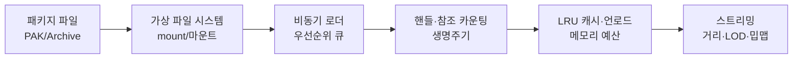
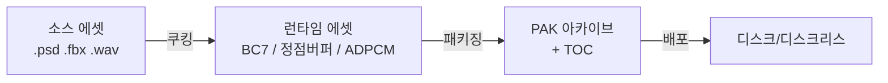
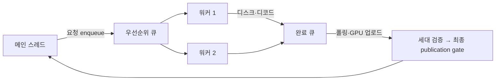
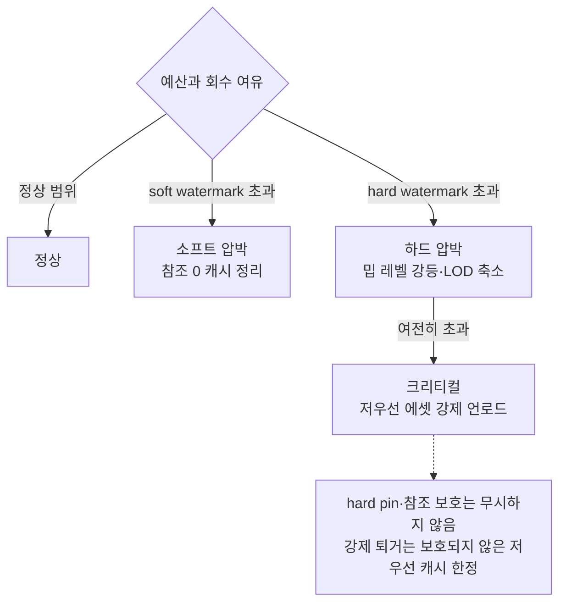
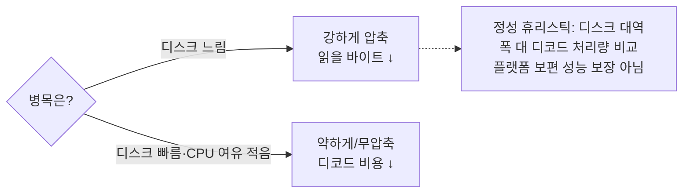

## 들어가며

게임의 리소스 관리 시스템은 *로딩 속도* 와 *메모리* 사이의 끝없는 줄다리기다. 모든 에셋을 미리 메모리에 올려두면 로딩은 즉각적이지만 메모리가 폭발하고, 모든 에셋을 디스크에서 그때그때 읽으면 메모리는 가볍지만 끊김과 지연이 생긴다. 그래서 리소스 시스템의 거의 모든 결정은 *지연(latency) ↔ 메모리(footprint) ↔ 처리량(throughput)* 의 삼각 트레이드오프 위에 놓인다.

이 글은 그 트레이드오프를 따라 리소스 매니저의 구성요소를 한 흐름으로 정리한다. 에셋이 빌드 파이프라인에서 어떤 패키지로 굽혀 디스크 I/O 횟수를 줄이는지, 핸들과 참조 카운팅이 에셋의 생명주기를 어떻게 추적하는지, 비동기 로더가 메인 스레드를 막지 않고 어떻게 일을 나르는지, 거리·LOD 기반 스트리밍이 거대한 월드를 어떻게 한정된 메모리에 담는지, LRU 캐시와 언로드 정책이 메모리 예산을 어떻게 지키는지, 의존성 그래프가 공유 에셋의 중복 로드와 조기 해제를 어떻게 막는지, 핫 리로드가 개발 반복을 어떻게 가속하는지, 그리고 이 모두를 어떻게 측정하고 프로파일링하는지를 다룬다.



이 글의 목표.

1. **에셋 파이프라인과 패키징** — 빌드 시점 변환, PAK 구조, 가상 파일 시스템.
2. **핸들과 참조 카운팅** — 간접 참조, 약한 참조, 의존성 그래프.
3. **비동기·스트리밍 로딩** — 워커 풀, 우선순위 큐, 거리·LOD 스트리밍.
4. **메모리 예산과 단편화** — 타입별 예산, OOM 방지, 단편화 대응.
5. **LRU 캐시와 언로드** — 캐시 정책, 다단계 계층, 무효화.
6. **압축과 포맷** — 블록 압축, 패키지 압축, 압축률 대 로딩 속도.
7. **핫 리로드와 개발 모드** — 파일 감시, 포인터 패치, DLC·패치.
8. **프로파일링과 최적화** — 로딩 시간, 누수, I/O 병목, 모니터링.


---

## 목차
1. [에셋 파이프라인과 패키징](#1-에셋-파이프라인과-패키징)
2. [핸들과 참조 카운팅](#2-핸들과-참조-카운팅)
3. [비동기·스트리밍 로딩](#3-비동기스트리밍-로딩)
4. [메모리 예산과 단편화](#4-메모리-예산과-단편화)
5. [LRU 캐시와 언로드](#5-lru-캐시와-언로드)
6. [압축과 포맷](#6-압축과-포맷)
7. [핫 리로드와 개발 모드](#7-핫-리로드와-개발-모드)
8. [프로파일링과 최적화](#8-프로파일링과-최적화)


---

## 1. 에셋 파이프라인과 패키징

### 소스 에셋과 런타임 에셋

아티스트가 만드는 파일과 게임이 로드하는 파일은 다르다. `.psd`, `.fbx`, `.wav` 같은 *소스 에셋(source asset)* 은 편집에 최적화돼 있어 크고 느리다. 런타임이 이걸 그대로 읽으면 *매번 파싱·변환* 해야 한다 — PNG 디코딩, 텍스처 압축, 메시 삼각화, 정점 캐시 최적화 전부 런타임 비용이 된다.

그래서 빌드 파이프라인은 소스 에셋을 런타임 에셋(cooked asset, baked asset)으로 미리 변환한다. PNG는 대상 GPU의 블록 압축 텍스처로, FBX는 엔진 스키마의 정점·인덱스·애니메이션 데이터로, WAV는 플랫폼 디코더와 품질 정책에 맞는 형식으로 굽는다. 런타임 파싱과 변환을 최소화하되, 버전·범위·무결성 검증과 GPU 전송 준비까지 완전히 사라지는 것은 아니다.



메모리 매핑 가능한 블롭은 로딩 비용을 줄일 수 있지만 C++ 객체 메모리를 그대로 파일에 쓰는 방식은 안전한 스키마가 아니다. 컴파일러 ABI, 패딩, 엔디언, 포인터 크기와 정렬이 바뀌면 형식이 깨지고, 파일 안의 절대 포인터는 다른 주소에 매핑할 수 없다. 파일 포맷은 고정 폭 정수, 명시적 엔디언, 상대 오프셋·인덱스, 정렬과 버전 필드를 정의하고 모든 오프셋과 길이를 검증해야 한다. 같은 빌드·플랫폼에서만 쓰는 블롭도 생성 도구와 런타임이 공유하는 스키마 계약이 필요하다.

### 패키지 파일 — I/O 횟수를 줄인다

수만 개의 개별 파일을 따로 여는 것은 비효율적이다. 파일 하나를 열 때마다 *디렉토리 탐색, 파일 핸들 할당, 메타데이터 읽기* 가 일어나고, 흩어진 파일은 *디스크 시크(seek)* 를 유발한다. HDD에서 시크는 수 ms 단위이고, 콘솔의 인증·샌드박스 파일시스템은 파일 오픈 자체가 비싸다.

해법은 *패키지 파일(package file, PAK/archive)* 이다 — 수천 개 에셋을 *하나의 큰 파일로 이어붙이고*, 앞이나 뒤에 *목차(TOC, Table of Contents)* 를 둔다. TOC는 각 에셋의 이름(또는 해시), 오프셋, 크기, 압축 여부를 담는다.

```cpp
struct PakEntry {
    uint64_t assetId;      // 쿠킹 단계가 발급한 안정 ID
    uint64_t offset;       // 패키지 내 바이트 오프셋
    uint32_t sizeOnDisk;   // 압축된 크기
    uint32_t sizeInMemory; // 압축 해제 후 크기
    uint16_t flags;        // 압축 방식, 암호화 등
};

struct PakFile {
    File*                            handle;
    std::unordered_map<uint64_t, PakEntry> toc;  // assetId → entry
};
```

패키지는 파일 열기와 메타데이터 탐색을 묶고 관련 읽기를 큰 요청으로 합칠 수 있게 한다. 패키지가 하나일 필요는 없고 패치·DLC·스트리밍 청크 단위로 여러 개를 마운트할 수 있다. TOC의 ID 충돌은 쿠킹 단계에서 거부하며, 런타임이 경로 해시만으로 서로 다른 에셋을 조용히 같은 항목으로 취급해서는 안 된다. 관련 에셋의 인접 배치는 HDD 시크뿐 아니라 SSD의 작은 요청·시스템 콜 오버헤드도 줄일 수 있다.

### 패키지 레이아웃 — 순서가 곧 속도

패키지 안에서 *에셋의 배치 순서* 가 로딩 성능을 결정한다. 한 레벨에서 함께 쓰이는 에셋을 패키지에서 *연속 배치* 하면, 디스크 헤드가 한 방향으로만 읽어 시크가 사라진다. 이를 *로드 순서 최적화(load order optimization)* 라 하며, 보통 *실제 플레이 세션의 에셋 접근 순서를 기록* 해 그 순서대로 다시 패킹한다.

광학 미디어(디스크)나 느린 eMMC에서는 이 차이가 극적이다. 무작위 배치 대비 순차 배치가 로딩을 수 배 단축한다. SSD에서도 *읽기 요청을 큰 청크로 묶을 수 있어* 시스템 콜 오버헤드와 큐 깊이 측면에서 이득이 있다.

### 가상 파일 시스템

여러 패키지를 *하나의 통합된 경로 공간* 으로 다루는 계층이 *가상 파일 시스템(VFS, Virtual File System)* 이다. 게임 코드는 `OpenFile("textures/hero.tex")` 라고만 요청하고, VFS가 *어느 패키지의 어느 오프셋* 인지 해석한다.

```cpp
class VirtualFileSystem {
    std::vector<PakFile*> mounts_;   // 마운트 순서 = 우선순위

    std::optional<PakLocation> Resolve(std::string_view path) const {
        uint64_t id = ResolveAssetId(path);   // manifest와 mount별 경로 규칙 사용
        // 나중에 마운트된 패키지가 앞선 것을 덮어쓴다 (오버라이드)
        for (auto it = mounts_.rbegin(); it != mounts_.rend(); ++it) {
            if (auto* e = (*it)->Find(id)) return PakLocation{*it, *e};
        }
        return std::nullopt;
    }
};
```

마운트(mount) 순서가 *오버라이드 우선순위* 를 만든다. 베이스 게임 패키지를 먼저 마운트하고 패치 패키지를 나중에 마운트하면, 같은 경로의 에셋은 *패치 쪽이 이긴다* — 이것이 패치·DLC·모드의 기반이다. 원본 패키지를 건드리지 않고 *덮어쓰는 패키지를 추가* 하는 것만으로 에셋을 교체한다. 개발 모드에서는 *느슨한 파일(loose file) 디렉토리* 를 최상위로 마운트해, 패키지를 다시 굽지 않고도 개별 파일을 교체한다(7절).

이 예제의 VFS는 경로를 `(패키지, 오프셋, 크기, 압축·암호화 메타데이터)`로 해석할 뿐 데이터를 읽지 않는다. 툴의 작은 동기 요청은 이 위치를 즉시 읽을 수 있지만, 런타임 스트리밍은 위치를 비동기 I/O 큐에 넘겨야 메인 스레드가 막히지 않는다. 경로 해석과 I/O 완료를 같은 `Open` 호출로 숨기면 실수로 동기 읽기를 호출하기 쉽다. 비동기 요청은 해석 시점의 위치만 받아서는 안 되고 그 요청이 도는 동안 마운트가 유지되도록 요청마다 마운트 스냅샷 또는 파일 소유 핀을 함께 잡아 reader 종료까지 unmount·pak 교체를 지연해야 하며, entry의 offset/length도 발급한 pak 버전과 묶어 읽어야 한다.

패키지 복호화는 VFS가 반환한 위치 뒤의 변환 단계에 둘 수 있다. 그러나 클라이언트가 복호화 키와 평문을 모두 가져야 하는 구조에서 암호화는 자산 추출 비용을 높일 뿐 비밀성을 영구 보장하지 않는다. 플랫폼 라이선스 검증인 DRM, 전송 구간 보호, 패키지 변조 검증, 에셋 난독화는 위협 모델과 키 수명이 서로 다르므로 하나의 “암호화” 기능으로 합치지 않는다.

## 2. 핸들과 참조 카운팅

### 포인터 대신 핸들

로드된 에셋을 *생포인터(raw pointer)* 로 들고 다니면 두 가지가 깨진다. 첫째, 에셋이 언로드되면 *댕글링 포인터* 가 된다. 둘째, 메모리 단편화를 줄이려 에셋을 *재배치(relocate)* 하면 모든 포인터가 무효가 된다. 그래서 리소스 시스템은 에셋을 *핸들(handle)* — 간접 참조를 통한 안정적 식별자 — 로 다룬다.

```cpp
struct ResourceHandle {
    uint32_t index;       // 슬롯 배열 인덱스
    uint32_t generation;  // 재사용 감지용 세대 카운터
};

struct ResourceSlot {
    void*    data;        // 실제 에셋 (재배치되면 여기만 갱신)
    uint32_t generation;  // 슬롯 재사용 시 증가
    int32_t  refCount;
    AssetState state;     // Unloaded / Loading / Loaded / Failed
    std::vector<ResourceHandle> heldDeps;  // 이 에셋이 잡은 의존성
#ifdef RESOURCE_TRACKING
    uint64_t assetId;                      // 누수 덤프용
    std::vector<CallStack> acquirers;      // 누가 Acquire 했나
#endif
};
```

핸들은 슬롯 배열의 인덱스와 세대(generation)다. 실제 데이터 포인터는 슬롯 안에만 있으므로 재배치 시 간접 참조 지점만 바꿀 수 있다. 세대 검사는 해제 후 슬롯 재사용을 감지하지만, 카운터가 래핑되지 않을 충분한 비트 폭과 정책이 필요하다. `Resolve` 결과의 생포인터를 장기간 보관하면 다음 재배치에서 다시 무효가 되므로, 포인터 대여 범위를 프레임·잡·read guard 같은 짧은 수명으로 제한해야 한다. 또한 아래 `Resolve`는 인덱스·세대만 확인하므로 `Unloaded`·`Loading`·`Failed` 슬롯도 그대로 반환한다 — 유효한 핸들과 실제로 사용 가능한 `Loaded` 자원은 다르므로, 데이터 대여는 `Loaded`(그리고 GPU 상주)까지 확인하는 별도 질의나 read guard로 분리해야 한다.

```cpp
ResourceSlot* Resolve(ResourceHandle h) {
    if (h.index >= slots_.size()) return nullptr;
    ResourceSlot& s = slots_[h.index];
    if (s.generation != h.generation) return nullptr;  // 이미 해제·재사용됨
    return &s;
}
```

### 참조 카운팅 — 누가 쓰는지 센다

에셋을 언제 메모리에서 내릴지 결정하려면 활성 소유자를 추적해야 한다. 참조 카운팅은 한 방법이지만 `ResourceHandle` 값 자체는 소유권이 아니다. `Acquire/Release`를 수동 호출하면 예외·조기 반환에서 누락되기 쉬우므로, 강한 참조는 복사·소멸이 카운트를 관리하는 RAII `ResourceRef`로 감싸고, 약한 핸들은 카운트를 올리지 않는 별도 타입으로 구분하는 편이 안전하다.

```cpp
ResourceHandle Acquire(uint64_t assetId) {
    ResourceHandle h = FindOrCreateSlot(assetId);
    ResourceSlot* s = Resolve(h);
    if (s->refCount++ == 0)          // 0→1 재참조
        cache_.OnAcquire(h);         // eviction 후보에서 먼저 제거
    if (s->state == Unloaded) RequestLoad(h);  // 첫 참조면 로드 시작
    return h;
}

void Release(ResourceHandle h) {
    ResourceSlot* s = Resolve(h);
    if (!s) return;                  // 이미 죽은 핸들 — 안전하게 무시
    if (--s->refCount == 0) {
        // 즉시 언로드하지 않는다 — 5절 LRU 캐시에 넘긴다
        cache_.MarkUnreferenced(h);
    }
}
```

예제의 `int32_t refCount`는 모든 수명 연산을 한 리소스 스레드에 직렬화한다는 계약을 가정한다. 여러 스레드가 직접 증감한다면 원자성뿐 아니라 0 전환과 재Acquire, 언로드 작업 사이의 경쟁을 상태 머신으로 해결해야 한다. 카운트 0에서 즉시 언로드하지 않고 캐시 후보로 넘기는 정책은 재사용 히치를 줄이지만, 메모리 압박 시 회수될 수 있어야 한다.

### 약한 참조

참조 카운트를 올리지 않고 에셋을 *가리키기만* 하고 싶을 때가 있다. 디버그 도구의 에셋 목록, 캐시 자체의 추적 테이블 같은 곳이다. 이들이 강한 참조(`refCount`를 올리는 참조)를 가지면 *에셋이 영원히 안 내려간다*. *약한 참조(weak reference)* 는 카운트를 올리지 않고, 접근 시점에 *아직 살아있는지* 만 확인한다. 핸들의 세대 검사가 바로 약한 참조의 메커니즘이다 — 약한 핸들을 Resolve했을 때 세대가 어긋나면 *그 에셋은 이미 사라진 것* 이다.

### 의존성 그래프

에셋은 다른 에셋을 참조한다. 머티리얼은 텍스처를, 모델은 머티리얼을, 프리팹은 모델·사운드를 참조한다. 이 *의존성(dependency)* 을 무시하면 두 가지 버그가 난다. 모델만 로드하고 머티리얼을 안 올려 *분홍색 누락 텍스처* 가 뜨거나, 모델을 내리면서 *다른 모델도 쓰는 공유 텍스처를 같이 내려* 다른 모델이 깨진다.

해결책은 *의존성 그래프(dependency graph)* 다. 각 에셋은 자신이 의존하는 에셋 목록을 가지며, 로드 시 의존성을 *먼저 또는 함께* 로드하고 각 의존 에셋의 참조 카운트를 올린다.

```cpp
void LoadWithDependencies(ResourceHandle h) {
    AssetHeader* hdr = ReadHeader(h);
    for (uint64_t depId : hdr->dependencies) {
        ResourceHandle dep = Acquire(depId);   // 참조 카운트 +1, 재귀 로드
        Resolve(h)->heldDeps.push_back(dep);   // 내가 잡은 의존성 기록
    }
    // Acquire 반환은 의존성 ready를 보장하지 않는다: 강한 의존성의 완료를 기다린다.
    for (ResourceHandle dep : Resolve(h)->heldDeps) {
        if (!WaitReadyOrFail(dep)) {           // 실패·취소는 부모로 전파
            UnloadDependencies(h);             // 취득 도중 실패 — 이미 잡은 pin을 되돌린다
            MarkFailed(h);
            return;
        }
    }
    LoadPayload(h);
}

void UnloadDependencies(ResourceHandle h) {
    for (ResourceHandle dep : Resolve(h)->heldDeps)
        Release(dep);   // 내 참조만 내린다 — 다른 사용자가 있으면 안 내려감
    Resolve(h)->heldDeps.clear();
}
```

참조 카운팅은 공유 에셋의 소유자 수를 표현한다. 동일 ID의 동시 요청을 한 물리 로드로 합치는 일은 `Unloaded→Loading` 전이를 원자적으로 소유하고 나머지 요청을 같은 future에 결합하는 별도 deduplication 규칙이 담당한다. 의존성 `Acquire`의 반환도 그 의존성이 `Loaded`임을 보장하지 않으므로, 재귀 로드가 비동기라면 모든 강한 의존성의 완료(또는 실패)를 기다린 뒤에만 부모를 `Loaded`로 게시하고, 취득 도중 실패하면 이미 잡은 의존성 참조를 되돌린다. 모델 A와 B가 같은 텍스처 T를 쓰면 T의 강한 참조 수는 2이며, 둘이 모두 놓은 뒤에야 캐시·언로드 후보가 된다.

순환 의존성(A→B→A)은 참조 카운팅의 약점이다 — 서로를 잡고 있어 외부 참조가 사라져도 둘 다 0이 안 된다. 에셋 의존성은 보통 *DAG(방향 비순환 그래프)* 로 설계해 순환을 빌드 시점에 금지하는 것이 정석이다. 쿠킹 단계에서 의존성을 위상 정렬해 순환을 *빌드 에러* 로 잡는다.

## 3. 비동기·스트리밍 로딩

### 메인 스레드를 막지 않는다

에셋 로드는 디스크 읽기, 압축 해제·파싱, 런타임 리소스 생성과 GPU 전송으로 이뤄진다. 각 단계의 시간은 저장 장치, 캐시 적중, 포맷, 데이터 크기와 API에 따라 크게 달라지며 프레임 예산보다 길 수 있다. 이를 게임 루프의 메인 스레드에서 동기로 실행하면 완료될 때까지 프레임 진행이 멈춘다. 그래서 블로킹 I/O와 CPU 디코드는 워커 작업으로 분리하고, 메인 스레드는 완료 큐·future·이벤트 같은 비차단 경계로 결과를 받는다.



핵심은 작업을 *단계(stage)* 로 쪼개는 것이다. 디스크 읽기와 압축 해제는 워커가 맡는다. GPU 단계의 스레드 규칙은 API와 엔진 소유 모델에 따라 다르다. OpenGL 컨텍스트처럼 현재 스레드 제약이 있는 경우도 있고, 명시적 API처럼 워커가 커맨드를 기록하고 복사 큐에 제출할 수 있는 경우도 있다. 어느 경우든 리소스 생명주기와 제출 순서를 소유하는 렌더 계층을 통과시켜야 한다. 일반적인 파이프라인은 "디스크 → 디코드 → GPU 전송 기록·제출 → 사용 가능 신호 → 메인 통지"다.

```cpp
enum class LoadStage { ReadDisk, Decode, UploadGPU, Finalize, Done };

struct LoadJob {
    ResourceHandle handle;
    LoadStage      stage;
    int            priority;
    Blob           rawBytes;     // ReadDisk 결과
    DecodedData    decoded;      // Decode 결과
    std::atomic<bool> cancelled{false};
};
```

### 우선순위 큐와 스케줄링

모든 로드가 똑같이 급하지 않다. *플레이어 바로 앞에 보일 에셋* 은 시급하고, *멀리 있을지도 모를 예측 프리로드* 는 여유가 있다. 그래서 로드 큐는 *우선순위 큐* 다. 우선순위는 보통 *카메라까지 거리, 화면 내 여부, 게임플레이 중요도* 로 매긴다.

```cpp
struct LoadScheduler {
    std::priority_queue<LoadJob*, std::vector<LoadJob*>, ByPriority> pending_;
    std::mutex mtx_;
    std::condition_variable cv_;
    bool stopped_ = false;

    void Submit(LoadJob* job) {
        { std::lock_guard lk(mtx_); pending_.push(job); }
        cv_.notify_one();
    }
    LoadJob* NextOrWait() {           // 워커가 호출: empty 확인과 대기를 같은 동기화 경계에서
        std::unique_lock lk(mtx_);
        cv_.wait(lk, [&] { return !pending_.empty() || stopped_; });
        if (pending_.empty()) return nullptr;   // stopped_
        LoadJob* j = pending_.top(); pending_.pop();
        return j;
    }
    void Stop() { { std::lock_guard lk(mtx_); stopped_ = true; } cv_.notify_all(); }
};
```

우선순위는 동적으로 바뀔 수 있어야 한다. 다만 `std::priority_queue` 안에 들어간 객체의 `priority` 필드만 수정하면 힙 순서가 자동으로 복구되지 않는다. 우선순위 변경 시 항목을 새 버전으로 다시 넣고 꺼낼 때 오래된 버전을 버리거나, decrease/increase-key를 지원하는 인덱스 힙을 사용한다. 카메라에서 멀어진 요청은 강등·취소하고, 가까워진 요청은 승격하되 오래 기다린 낮은 우선순위 작업이 영원히 굶지 않도록 aging도 둔다.

### 취소

비동기 로딩에서 *취소(cancellation)* 는 필수다. 플레이어가 빠르게 지나친 영역의 에셋, 닫혀버린 메뉴의 텍스처는 로드할 필요가 없어진다. 취소 없이는 *이미 무의미해진 로드* 가 큐를 채워 정작 필요한 로드를 밀어낸다. 취소는 *각 단계 시작 시 플래그 검사* 로 구현한다 — 진행 중인 디스크 읽기 한 청크는 끝내되, 다음 단계로 넘어가기 전에 취소되었으면 중단하고 자원을 회수한다. 취소 플래그를 세우는 것과 job을 회수하는 것은 별개이므로, 취소된 job은 슬롯 상태·waiter·GPU 수명을 정리하고 완료를 통지한 뒤 회수한다. 동일 물리 로드를 공유하는 요청 중 하나가 취소돼도 다른 참조가 남아 있으면 로드 자체는 취소하지 않는다.

```cpp
void WorkerLoop(LoadScheduler& sched) {
    while (true) {
        LoadJob* j = sched.NextOrWait();                     // empty 확인과 대기가 같은 동기화 경계
        if (!j) break;                                       // Stop() 이후
        if (j->cancelled.load()) { Recycle(j); continue; }   // 단계 진입 전 검사

        switch (j->stage) {
            case LoadStage::ReadDisk: j->rawBytes = ReadFromPak(j->handle); break;
            case LoadStage::Decode:   j->decoded  = Decompress(j->rawBytes); break;
            // UploadGPU는 렌더 스레드 큐로 넘긴다
            default: break;
        }
        if (j->cancelled.load()) { Recycle(j); continue; }   // 단계 완료 후 재검사
        AdvanceStage(j);
    }
}
```

### 거리 기반 스트리밍

오픈 월드는 *전체를 메모리에 못 담는다*. 수십 km²의 텍스처·메시·콜리전을 다 올리면 수십 GB다. *스트리밍(streaming)* 은 *플레이어 주변만 메모리에 유지* 하고, 멀어진 영역을 내리며 다가오는 영역을 미리 올린다.

가장 흔한 단위는 *셀(cell) 또는 타일(tile)* 격자다. 월드를 격자로 나누고, 플레이어 위치 기준 *반경 안의 셀* 을 로드 대상으로 삼는다.

```cpp
void UpdateStreaming(Vec3 playerPos) {
    int cx = int(std::floor(playerPos.x / kCellSize));   // Part09 WorldToCell과 같은 floor 규약
    int cz = int(std::floor(playerPos.z / kCellSize));
    std::set<CellId> wanted;
    for (int dz = -kRadius; dz <= kRadius; ++dz)
    for (int dx = -kRadius; dx <= kRadius; ++dx) {
        CellId id{cx + dx, cz + dz};
        wanted.insert(id);
        int dist = std::abs(dx) + std::abs(dz);
        RequestCell(id, /*priority=*/ -dist);   // 가까울수록 우선
    }
    for (CellId loaded : loadedCells_)           // wanted에 없는 셀은 언로드
        if (!wanted.count(loaded)) ReleaseCell(loaded);
}
```

스트리밍에는 *히스테리시스(hysteresis)* 가 필요하다. 로드 반경과 언로드 반경을 똑같이 두면, 플레이어가 셀 경계에서 진동할 때 *같은 셀을 올렸다 내렸다* 반복한다(스래싱). 언로드 반경을 로드 반경보다 *한두 셀 크게* 잡아, 들어온 셀이 곧바로 나가지 않게 한다.

### LOD와 밉맵 스트리밍

같은 에셋도 거리에 따라 다른 상세도만 필요하다. 멀리 있는 모델은 저폴리 LOD(Level of Detail)로 바꿀 수 있고, 화면 footprint가 작은 표면은 낮은 해상도의 밉맵만 샘플한다. 밉맵 스트리밍은 작은 밉 꼬리를 기본 상주 집합으로 두는 정책이 흔하고, 카메라가 가까워질 때 고해상도 밉을 추가한다. 어떤 밉을 최소 상주시키는지는 시각적 폴백, 메모리 예산, sparse residency 지원에 따른 정책이지 API의 보장은 아니다.

이것이 메모리 절약의 핵심이다. 4096² BC7 텍스처는 베이스 레벨이 16MiB이고 전체 밉 사슬은 약 21.33MiB다. 화면에서 256픽셀 정도로 보일 때 256² 레벨 한 장은 64KiB이고, 그보다 작은 밉 꼬리까지 합치면 약 85KiB다. 실제 필요 집합은 트라이리니어·이방성 필터, 스트리밍 여유분과 API의 메모리 배치 단위를 포함해 더 커진다.

가상 텍스처(virtual texturing)는 이를 극단까지 민다 — 거대한 텍스처를 *고정 크기 타일* 로 쪼개고, 셰이딩에 *실제로 샘플링되는 타일만* 온디맨드로 로드한다. 화면에 보이는 타일을 GPU 피드백으로 수집해 그 타일만 스트리밍하므로, 텍스처 총량과 무관하게 *메모리는 화면 해상도에 비례* 한다.

### 밉 스트리밍의 메모리 산술 — 기하급수 사슬과 화면 footprint

위에서 "필요 밉만 들고 있으면 텍스처 메모리가 수 분의 일로 준다"·"메모리는 화면 해상도에 비례"라고 결과만 진술했는데, 이 절감은 정확히 계산되는 양이다. 픽셀당 바이트(블록 압축 단가 $b$)는 색·감마 소유 개념으로 전제하고, 여기서는 밉 사슬의 합과 화면에서 필요한 밉 레벨만 유도한다.

전제로 한 변 $T$ 텍스처에서 밉 레벨 $k$는 한 변 $T/2^k$, 텍셀 수 $T^2/4^k$다. 전체 사슬의 바이트는 공비 $1/4$ 기하급수다.

$$M_\text{full}=b\,T^2\sum_{k=0}^{\log_2 T}\frac1{4^k}=b\,T^2\cdot\frac{1-4^{-(\log_2 T+1)}}{1-\tfrac14}\xrightarrow{T\gg1}\frac43\,b\,T^2.$$

즉 밉맵 전체는 베이스($k{=}0$)보다 약 33%만 더 든다 — 밉을 "거의 공짜로" 다는 근거다. 4096² BC7($b{=}1$바이트/텍셀)이면 베이스 16MiB, 사슬 전체 $\tfrac43\cdot16=21.33$MiB.

필요 밉 레벨은 화면 한 픽셀이 덮는 텍셀 수 $\rho$(텍셀 밀도)로 정한다. OpenGL 명세는 화면 좌표 $x,y$에 대한 텍셀 좌표 $u,v$의 도함수로

$$\rho=\max\!\left(\sqrt{\Big(\tfrac{\partial u}{\partial x}\Big)^2+\Big(\tfrac{\partial v}{\partial x}\Big)^2},\ \sqrt{\Big(\tfrac{\partial u}{\partial y}\Big)^2+\Big(\tfrac{\partial v}{\partial y}\Big)^2}\right),\qquad \lambda=\log_2\rho$$

로 정의하고, 상주 최저 밉은 $m=\lfloor\lambda\rfloor$다(Williams의 피라미드 파라메트릭). 한 변 $T$ 텍스처가 화면에서 한 변 $S$ 픽셀을 덮으면 $\rho=T/S$, $\lambda=\log_2(T/S)$. 4096 텍스처가 화면 256픽셀이면 $\rho=16$, $\lambda=4$, 밉 4부터 상주.

밉 $m$ 이상만 상주하면 그 꼬리도 같은 기하급수라 닫힌 형태로 합쳐진다.

$$M_\text{res}(m)=b\,T^2\sum_{k=m}^{\log_2 T}\frac1{4^k}\approx\frac43\,b\Big(\frac{T}{2^m}\Big)^2=\frac43\,b\,S^2.$$

이 이상 모델에서는 $M_\text{res}$가 원본 텍스처 해상도 $T$보다 화면 footprint $S$에 의해 정해진다는 점이 핵심이다. 다만 위 등식은 $\lambda$를 연속으로 본 근사이고 실제 밉은 $m=\lfloor\lambda\rfloor$의 정수라, $T/S$가 정확히 2의 거듭제곱이 아니면 $T/2^m$은 $S$가 아니라 $[S,2S)$에 놓인다. 따라서 정수 밉 이후 실제 면적은 $S^2$가 아니라 $[S^2,4S^2)$ 규모이며, $\tfrac43$ 꼬리 근사도 실제 블록 크기와 마지막 밉의 패딩을 무시한 하한이다. 4096² 텍스처를 256픽셀로 보는 경우는 $T/S=16$으로 경계에 정확히 걸려 밉4부터 $\tfrac43\cdot256^2=87{,}381$바이트$\approx85$KiB — 같은 형식의 전체 사슬 21.33MiB와 비교하면 약 $1/256$이다. 실제 상주량은 페이지·타일 단위와 필터 여유분, 정수 밉 경계 때문에 이 하한보다 커질 수 있다.

이 식은 가상 텍스처가 디스크의 전체 원본 크기와 현재 상주 메모리를 분리할 수 있는 이유를 보여 준다. 그러나 실제 상주량이 화면 픽셀 수만으로 엄밀히 닫히는 것은 아니다. 여러 뷰, 가려졌다가 곧 나타날 타일의 프리페치, 이방성 footprint, 타일 경계와 페이지 테이블, 최소 상주 mip, 캐시 여유분과 반복 UV가 추가된다. 따라서 화면 footprint는 작업 집합의 주항이고, 실제 예산은 이 오버헤드와 시간적 working set을 포함해 측정한다.

경계 조건이 이 모델의 한계를 드러낸다.

- *트라이리니어·이방성.* 트라이리니어는 인접 두 밉을 샘플링하므로 둘 다 상주해야 한다. 이방성 footprint는 화면 픽셀의 텍스처 공간 장축과 단축을 따로 본다. 단축 길이로 더 고운 밉을 고르고 장축을 따라 여러 샘플을 쓰되, 장축/단축 비가 최대 이방성을 넘으면 실효 단축을 `major/maxAniso`까지 키운다. 단순히 항상 $\log_2(\text{maxAniso})$를 빼는 것은 과보수적일 수 있다.
- *밉 팝과 히스테리시스.* $m=\lfloor\lambda\rfloor$는 정수 경계에서 튄다. 카메라가 $\lambda{=}4$ 부근에서 진동하면 밉4를 올렸다 내렸다 반복(스트리밍 스래싱)한다. 거리 스트리밍과 같은 히스테리시스가 필요하다 — 승급은 $\lambda<m_\text{res}-\epsilon$, 강등은 $\lambda>m_\text{res}+\epsilon$에서만 한다. 이때 경계는 *연속* $\lambda$에 두어야 하며, 정수 desired 사이의 상수 차이로 비교하면 한 단계짜리 요청을 영원히 무시하거나 경계 진동을 막지 못하는 설정이 생긴다.
- *스트리밍 지연.* 순간이동·급접근으로 $\lambda$가 급락하면 고해상 밉이 아직 디스크에 있어 그 로드 지연 동안 흐릿하게 보인다(블러 인). 상주 집합 갱신은 카메라보다 한 발 앞서야 하고, 그래서 곧 가까워질 텍스처를 미리 채운다(5절 캐시 워밍).
- *업로드 대역폭.* 밉 한 꼬리를 새로 올리는 비용은 $\tfrac43 b(T/2^m)^2$ 바이트다. 여러 텍스처가 동시에 한 레벨씩 승급하면 프레임당 업로드가 몰려 히치가 난다 — 승급도 우선순위 큐로 분산한다.

```cpp
// texel-space footprint의 장축/단축 길이로 연속 LOD lambda를 계산한다.
float DesiredLambda(float major, float minor, int maxAniso) {
    float effectiveMinor = std::max(minor, major / std::max(maxAniso, 1));
    return std::log2(std::max(effectiveMinor, 1e-8f));
}
// wanted=요청 목표, requested=발행된 로드, resident=실제 사용 가능한 수준.
// 승급·강등은 정수 desired 차가 아니라 연속 lambda의 진입·이탈 경계에서 판정한다.
void UpdateResidentMip(TextureStream& t, float lambda) {
    // residentMip이 작을수록 고해상. lambda가 경계를 벗어날 때만 wantedMip을 갱신.
    int m = std::clamp((int)std::floor(lambda), 0, kMaxMip);
    if (lambda < t.residentMip - kMipHysteresis) t.wantedMip = m;       // 승급
    else if (lambda > t.residentMip + kMipHysteresis) t.wantedMip = m;  // 강등
    // 경계 내면 wanted 유지 — 한 단계 요청도 장기 유지되면 반영된다
    if (t.wantedMip != t.requestedMip) { t.requestedMip = t.wantedMip; RequestMipLoad(t); }
}
void OnMipLoadComplete(TextureStream& t) {   // 로드·fence 완료 후에만 호출
    t.residentMip = t.requestedMip;          // 완료 전에는 resident를 올리지 않는다
}
```

## 4. 메모리 예산과 단편화

### 타입별 예산

플랫폼은 *고정된 메모리 한계* 를 갖는다. 콘솔은 게임에 허용된 메모리가 정확히 정해져 있고, 모바일은 OS가 *초과 시 앱을 죽인다*. 그래서 리소스 시스템은 *메모리 예산(memory budget)* 을 두고, 타입별로 상한을 나눈다.

```cpp
struct MemoryBudget {
    size_t textures;      // 플랫폼·품질 등급 설정에서 주입
    size_t meshes;
    size_t audio;
    size_t animations;
};
struct MemoryUsage {
    size_t textures, meshes, audio, animations;  // 물리 상주(active) 바이트
    size_t inflight;                             // 로드·디코드·staging 예약 바이트
    size_t pendingEviction;                      // 참조 0, fence/reclaim 대기 — 아직 물리 상주
};
```

예산을 타입별로 쪼개는 이유는 *한 타입의 폭주가 다른 타입을 굶기지 않게* 하기 위해서다. 텍스처가 통제 없이 늘어 사운드·메시 메모리까지 먹으면, 오디오가 끊기고 콜리전 메시가 못 올라온다. 타입별 상한은 *각 시스템의 최소 동작* 을 보장하는 칸막이다.

예산은 물리 메모리 총량이 아니라 OS·그래픽 드라이버·엔진 코어·최악 장면의 일시적 할당을 제외한 뒤 정한다. 통합 메모리와 분리 VRAM, 품질 등급, 백그라운드 정책에 따라 텍스처·메시·오디오·스트리밍 버퍼의 몫이 달라진다. 플랫폼 이름만으로 고정 표를 만들면 기기 세대와 장면 working set을 놓친다. 또한 LRU에서 논리적으로 뺀 바이트는 GPU/reader fence 전에는 실제로 회수되지 않으므로, 물리 상주와 인플라이트 예약, 아직 회수되지 않은 퇴거 대기 바이트를 따로 집계하고 공유 에셋은 한 번만 센다.

### 예산 초과 처리

예산에 다가가면 *수동적으로 기다리지 않고 능동적으로 줄인다*. 단계적 대응이 정석이다.



soft/hard watermark는 회수가 완료되기까지 필요한 시간과 인플라이트 업로드의 최악 크기를 남겨 두도록 정한다. 첫 단계는 참조 0 캐시를 줄이고, 부족하면 밉·LOD·프리페치 범위를 낮춘다. 활성 사용자가 읽는 에셋을 강제로 해제해서는 안 되며, 마지막에는 품질 저하·로드 거부·안전한 화면 전환 같은 명시적 실패 경로가 필요하다. 모든 OOM을 복구할 수 있다고 가정할 수는 없으므로 예약 메모리와 실패 주입 테스트도 둔다.

모바일 OS는 memory warning 또는 trim 수준 같은 압박 신호를 제공할 수 있다. 콜백 자체에서 무거운 동기 해제를 몰아 실행하기보다 안전한 리소스 스레드에 회수 목표를 전달하고, 미리 분류한 비필수 캐시부터 줄인다. 신호가 오기 전에 자체 watermark로 대응해야 하며, OS가 항상 충분한 사전 경고를 준다고 가정해서는 안 된다.

### 단편화

장시간 플레이에서 *할당과 해제가 뒤섞이면* 단편화(fragmentation)가 쌓인다. 총 여유 메모리는 충분한데 *연속된 큰 블록* 이 없어 *큰 텍스처 할당이 실패* 하는 상황이다. 디스크리스·관리 메모리 없는 콘솔 환경에서 단편화는 *실질적 OOM* 이다.

대응은 *할당자 설계* 에 있다. 에셋 메모리는 범용 `malloc`이 아니라 *전용 할당자* 로 관리한다.

- *풀 할당자(pool allocator)*: 같은 크기·정렬 등급의 객체를 고정 슬롯으로 관리해 외부 단편화를 없앤다. 요청보다 큰 슬롯을 쓰는 내부 낭비는 남는다.
- *링·아레나 할당자(arena)*: 레벨 단위로 묶어 *통째로 비운다*. 레벨이 끝나면 그 아레나 전체를 리셋해 단편화를 0으로.
- *재배치 가능 힙(relocatable heap)*: 핸들 간접 참조(2절)를 이용해 *블록을 모아 압축(compaction)* 한다. 빈 공간을 한쪽으로 몰아 큰 연속 블록을 만든다. 핸들 덕에 *데이터가 움직여도 참조는 안 깨진다*.

```cpp
// 개념 예제: reader가 없는 safe point, trivially relocatable 블록만 가정.
// 목적지를 먼저 계산·검증한 뒤 slot과 Block 메타데이터를 한 커밋으로 갱신한다.
void Compact(RelocatableHeap& heap) {
    std::vector<size_t> dst;                 // 이동 전에 계획을 완성
    size_t write = 0;
    for (const Block& b : heap.LiveBlocksInOrder()) {   // 정렬된 live block만
        if (!b.size || !b.alignment) return;            // 잘못된 계획이면 상태를 건드리지 않는다
        dst.push_back(AlignUp(write, b.alignment));
        write = dst.back() + b.size;
    }
    size_t i = 0;
    for (Block& b : heap.LiveBlocksInOrder()) {
        uint8_t* writePtr = heap.base + dst[i++];
        if (b.ptr != writePtr) {
            memmove(writePtr, b.ptr, b.size);   // 앞으로 당긴다
            b.ptr = writePtr;                   // heap 내부 메타데이터도 함께 갱신
            Resolve(b.owner)->data = writePtr;  // 슬롯 포인터 갱신 (핸들은 불변)
        }
    }
    heap.freeTop = heap.base + write;   // 뒤쪽 전체가 연속 여유 공간
}
```

이 compaction은 모든 CPU reader가 멈춘 safe point와 trivially relocatable 데이터라는 강한 가정이 필요하다. 일반 C++ 객체는 move/destructor 계약을 따라야 하고, GPU 주소·descriptor·진행 중인 커맨드가 참조하는 메모리는 GPU fence 이전에 옮길 수 없다. 레벨 단위 아레나는 수명이 실제로 함께 끝나는 데이터에는 단순하지만, 공유 에셋과 스트리밍 셀처럼 수명이 겹치면 별도 소유 계층이 필요하다.

## 5. LRU 캐시와 언로드

### 참조 0 ≠ 즉시 해제

2절에서 참조 카운트가 0이 된 에셋을 *즉시 내리지 않는다* 고 했다. 곧 다시 쓰일 가능성이 높기 때문이다. 레벨을 잠깐 벗어났다 돌아오거나, 무기를 바꿨다 다시 드는 흔한 패턴에서 매번 디스크를 다시 읽으면 *히치* 가 난다. 그래서 참조 0 에셋은 *캐시(cache)* 에 들어가, 메모리가 필요해질 때까지 *살아있는 채로 대기* 한다.

캐시의 동작은 단순하다. 참조 0이 되면 캐시에 등록(아직 메모리 점유), 다시 Acquire되면 *디스크를 안 거치고 즉시 부활*, 메모리 압박이 오면 캐시에서 *오래된 것부터 진짜로 언로드*.

### LRU 정책

캐시가 가득 찼을 때 *무엇을 먼저 버릴지* 가 캐시 정책이다. *LRU(Least Recently Used)* 는 *가장 오래 안 쓰인 것* 을 버린다 — 시간적 지역성(최근 쓴 것은 곧 또 쓴다)에 기댄 가장 견고한 기본값이다.

LRU는 *해시맵 + 이중 연결 리스트* 로 O(1) 구현한다. 해시맵이 핸들→노드를, 리스트가 사용 순서를 유지한다. 접근할 때마다 *리스트 맨 앞으로* 옮기고, 버릴 때 *맨 뒤를 뗀다*.

```cpp
class LruCache {
    struct Node { ResourceHandle h; size_t bytes; Node *prev, *next; };
    std::unordered_map<uint64_t, Node*> map_;
    Node *head_ = nullptr, *tail_ = nullptr;   // head=최근, tail=오래됨
    size_t bytes_ = 0, capacity_;

    void MarkUnreferenced(ResourceHandle h) {
        if (Node* existing = Find(h)) return;          // 중복 등록 금지
        Node* n = CreateNode(h);
        map_.emplace(Key(h), n);
        bytes_ += n->bytes;
        PushFront(n);
        while (bytes_ > capacity_ && tail_) {          // 예산 초과 시
            Node* victim = tail_;
            Unlink(victim);
            map_.erase(Key(victim->h));
            bytes_ -= victim->bytes;
            ActuallyUnload(victim->h);                 // 진짜 언로드 (디스크로 환원)
            DestroyNode(victim);
        }
    }

    void OnAcquire(ResourceHandle h) {
        Node* n = Find(h);
        if (!n) return;
        Unlink(n);                                      // 다시 강한 참조가 생김
        map_.erase(Key(h));
        bytes_ -= n->bytes;
        DestroyNode(n);
    }
};
```

이 캐시는 참조 카운트 전이와 같은 리소스 스레드에서 직렬화된다고 가정한다. `0→1` 재Acquire가 일어나면 `OnAcquire`가 반드시 eviction 목록에서 먼저 제거돼야 하며, 언로드와 경쟁할 수 있는 구조라면 상태 전이 또는 락으로 승자를 정해야 한다. 단순 LRU는 크기가 큰 항목 하나와 작은 항목 여러 개의 가치도 구분하지 못하므로 byte cost, 재로드 비용과 우선순위를 함께 반영할 수 있다.

LRU의 약점은 *대형 순차 스캔* 이다. 한 번만 쓰고 버릴 에셋(컷신 한 장면)이 대량으로 들어오면 *자주 쓰는 에셋을 캐시에서 밀어낸다* — 이를 캐시 오염(cache pollution)이라 한다. 대안으로 *LFU(Least Frequently Used)* 는 사용 빈도를 세 자주 쓰는 것을 보호하지만, 빈도 카운트가 *과거에 갇혀* 더 이상 안 쓰는 옛 인기 에셋이 남는 문제가 있다. 실무는 보통 *LRU에 약간의 빈도·우선순위 가중* 을 더한 변형(예: 한 번만 접근한 항목은 별도 큐로)을 쓴다.

### 다단계 캐시 계층

캐시는 *여러 층* 으로 둔다. 빠르고 작은 상위 캐시부터 느리고 큰 하위 캐시까지의 계층은, 적중률과 비용의 균형을 맞춘다.

| 계층 | 위치 | 적중 비용 | 미스 시 |
|---|---|---|---|
| 디코드 캐시 | 메모리(즉시 사용 형태) | ~0 | 압축 해제 필요 |
| 압축본 캐시 | 메모리(압축 상태) | 디코드 비용 | 디스크 읽기 |
| 디스크 캐시 | 로컬 스토리지 | 디스크 읽기 | 원격/패키지 추출 |

상위 캐시 미스는 *하위 캐시에서 채워진다*. 디코드 캐시에서 빠진 에셋이 압축본 캐시에 있으면 *디스크 없이 디코드만* 하면 된다. 이 계층은 특히 *런타임 압축 해제 비용* 을 조절한다(6절) — 메모리가 빠듯하면 압축본만 들고 매번 디코드하고, 여유가 있으면 디코드 결과까지 캐시한다.

### 캐시 워밍과 무효화

*캐시 워밍(cache warming)* 은 *미리 채워두기* 다. 로딩 화면 동안, 또는 게임플레이 한가한 틈에 *곧 필요할 에셋을 예측 로드* 해 캐시에 넣는다. 레벨 입구의 에셋, 다음 컷신, 인접 영역을 미리 데워두면 *실제 필요 시점의 히치* 가 사라진다. 예측은 보통 *디자이너가 지정한 프리로드 목록* 이나 *씬 전환 그래프* (어느 레벨에서 어느 레벨로 갈 수 있는지)에 기반한다.

*캐시 무효화(cache invalidation)* 는 *캐시된 데이터가 더 이상 유효하지 않을 때* 버리는 것이다. 개발 중 에셋이 디스크에서 바뀌면(7절 핫 리로드), 캐시된 옛 버전을 무효화하고 다시 로드해야 한다. 무효화 누락은 *바뀐 에셋이 화면에 반영 안 되는* 혼란스러운 버그를 만든다. 보통 *콘텐츠 해시* 나 *파일 타임스탬프* 를 캐시 키에 포함해, 소스가 바뀌면 키가 달라져 자동으로 미스가 나게 한다.

## 6. 압축과 포맷

### 압축은 메모리·디스크를 CPU로 바꾼다

압축은 *공간을 시간으로 거래* 한다. 압축 파일은 디스크와(포맷에 따라) 메모리를 아끼지만, 로드 시점에 *압축 해제 CPU* 를 쓴다. 이 거래의 손익은 *디스크가 병목이냐 CPU가 병목이냐* 에 달렸다.

느린 디스크(HDD, 광학, 모바일 eMMC)에서는 *압축이 로딩을 빠르게 한다* — 읽을 바이트가 적어 디스크 시간이 줄고, 디코드는 그 절약분보다 싸다. 빠른 NVMe SSD에서는 반대일 수 있다 — 디스크가 워낙 빨라 *디코드가 오히려 병목* 이 되면, 약하게 압축하거나 안 하는 편이 빠르다. 그래서 압축 선택은 *목표 하드웨어의 디스크 대역폭과 디코드 처리량의 비교* 다.



### 블록 압축 텍스처

일반 압축(zlib, LZ4)과 *텍스처 블록 압축(block compression)* 은 다르다. zlib은 *디코드해서 원본 크기로 되돌려야* GPU가 쓸 수 있다 — 즉 메모리에서는 압축 효과가 없다. 반면 BC/ASTC/ETC 같은 블록 압축은 *GPU가 압축된 채로 직접 샘플링* 한다 — *디스크에서도 메모리에서도 압축된 상태로 유지* 되는 것이 결정적 차이다.

| 포맷 | 플랫폼 | 압축률(RGBA 대비) | 용도 |
|---|---|---|---|
| BC1 (DXT1) | PC/콘솔 | 8× | 불투명 컬러 |
| BC3 (DXT5) | PC/콘솔 | 4× | 알파 포함 컬러 |
| BC5 | PC/콘솔 | 4× | 노멀맵(2채널) |
| BC7 | PC/콘솔 | 4× | 고품질 컬러 |
| ASTC | 모바일/콘솔 | 가변(블록 크기) | 모바일 범용 |
| ETC2 | 모바일 | 4~8× | 구형 모바일 호환 |

BC 계열은 보통 4×4 텍셀 블록을 고정 비트로 인코딩하지만 모드와 블록 크기는 형식마다 다르다. "끝점 색 두 개와 보간 인덱스"는 BC1류의 직관이지 BC7·ASTC 전체의 설명이 아니다. 이들은 여러 partition·endpoint·weight 모드와 가변 블록 크기를 사용할 수 있다. GPU가 샘플 시 하드웨어로 블록을 해석하므로 CPU 디코드는 필요 없지만, 텍스처 유닛 처리와 캐시·메모리 대역폭 비용까지 0인 것은 아니다. 4096² RGBA8 베이스 레벨은 64MiB이고 BC7 베이스는 16MiB다.

쿠킹 파이프라인은 *플랫폼별로 다른 블록 포맷* 을 굽는다(1절). PC 빌드는 BC7, 모바일 빌드는 ASTC로 같은 소스를 변환한다.

### 메시와 패키지 압축

메시도 압축한다. *정점 양자화(vertex quantization)* 는 위치·노멀·UV를 float32 대신 *16비트 또는 더 작은 정수* 로 줄인다. 노멀은 *팔면체 인코딩(octahedral encoding)* 으로 3채널을 2채널로 압축한다. 인덱스는 *삼각형 스트립이나 메시 최적화(메시오프티마이저류)* 로 정점 캐시 효율을 높이며 줄인다. 이들은 *디스크 크기뿐 아니라 GPU 대역폭* 까지 줄인다 — 작은 정점은 정점 셰이더 입력 대역폭을 아낀다.

*패키지 전체 압축* 은 또 다른 층이다. 블록 압축 텍스처와 양자화 메시를 담은 패키지를 *다시 LZ4/Oodle류로 압축* 한다. 여기서 핵심 지표는 *압축 해제 처리량(decompression throughput)* 이다 — GB/s 단위로 얼마나 빨리 푸느냐가 로딩 속도를 직접 결정한다. 압축률이 약간 낮아도 *디코드가 압도적으로 빠른* 알고리즘이 로딩에는 유리한 경우가 많다. 이미 블록 압축된 텍스처는 추가 압축이 잘 안 먹으므로(엔트로피가 높다), 패키지 압축은 *메시·애니메이션·스크립트 같은 비텍스처 데이터* 에서 이득이 크다.

## 7. 핫 리로드와 개발 모드

### 개발 반복 속도

에셋을 수정할 때마다 *게임을 재시작* 하면 반복이 느리다. 텍스처 색 하나 바꾸려 레벨을 다시 로드하면 분 단위가 날아간다. *핫 리로드(hot reload)* 는 *게임 실행 중에 바뀐 에셋을 감지해 교체* 한다 — 수정-저장-즉시 반영의 반복이 초 단위로 줄어든다.

핫 리로드는 *느슨한 파일 마운트* 위에서 동작한다(1절). 개발 빌드는 패키지 대신 *원본 디렉토리를 최상위 마운트* 해, 파일을 직접 감시할 수 있게 한다.

### 파일 감시와 교체

OS의 파일 변경 알림으로 에셋 디렉터리를 감시한다. 편집기는 임시 파일 생성·rename·여러 번의 쓰기로 한 번의 저장을 표현할 수 있으므로 이벤트 하나를 곧바로 완성 파일로 간주하면 안 된다. 경로별 debounce, rename 추적과 크기·해시 안정 확인 뒤 쿠킹을 예약하고, 같은 버전의 중복 이벤트는 합친다.

```cpp
void OnFileChanged(std::string_view path) {
    // 경로 해시가 아니라 manifest가 발급한 안정 AssetId로 해석한다.
    for (uint64_t id : ManifestAssetIds(path)) {
        auto target = FindLoadedHandle(id);   // 로드 안 된 에셋이면 무시
        if (!target) continue;

        // 백그라운드에서 새 버전 로드 (3절 비동기 파이프라인 재사용)
        ResourceHandle newData = LoadFresh(id);
        // 장기 raw 포인터 대신 핸들·기대 세대·콘텐츠 revision을 넘긴다
        PendingSwap swap{ .target = *target, .expectedGeneration = target->generation,
                          .revision = ++contentRevision_[id], .fresh = newData };
        swapQueue_.Push(swap);                // 프레임 경계에서 적용, 최신 revision만 반영
    }
}
```

핸들 간접 참조는 CPU가 다음에 `Resolve`할 때 새 버전을 보게 만든다. 큐에 넣은 항목은 장기 대여이므로 적용 시 expectedGeneration을 다시 확인해 슬롯 재사용을 걸러내고, 여러 편집이 겹치면 최신 revision의 로드가 완료된 뒤에만 교체한다. 그러나 머티리얼이 GPU descriptor나 네이티브 리소스 핸들을 캐시했다면 슬롯 포인터 교체만으로 갱신되지 않는다. 의존성 그래프를 통해 descriptor 재빌드·버전 변경 통지를 보내거나, 렌더 시 안정 ID를 다시 해석하는 테이블이 필요하다.

타입별 주의점이 있다. 텍스처·메시는 *GPU 리소스 재생성* 이 필요하므로 렌더 스레드 안전 지점에서 교체한다. 의존성이 바뀌는 변경(머티리얼이 새 텍스처를 참조하게 됨)은 *의존성 그래프를 다시 풀어*(2절) 새 의존성을 잡고 옛것을 놓는다. 셰이더는 *재컴파일* 이 끼어 가장 비싸다.

### 안전한 교체 시점

교체는 해당 버전을 읽는 CPU 잡과 GPU 명령의 수명을 추적하는 안전 지점에서 수행한다. "프레임 끝"이라고 해서 모든 비동기 잡과 GPU 사용이 끝났다고 보장되지는 않는다. CPU는 epoch/read guard, GPU는 fence 또는 timeline 값으로 옛 버전의 마지막 사용 완료를 확인한 뒤 해제한다. 고정된 한두 프레임 지연은 GPU가 그보다 더 늦을 수 있어 안전성 증명이 아니다.

핫 리로드는 *개발 빌드 전용* 이다. 출시 빌드는 패키지에서만 읽고 파일 감시를 끈다 — 감시 스레드와 느슨한 파일 검사 오버헤드를 제거한다.

### DLC와 패치

출시 후 *콘텐츠 추가(DLC)와 버그 수정(패치)* 도 같은 마운트 메커니즘 위에 선다. DLC는 *새 에셋을 담은 추가 패키지를 마운트* 하는 것이고, 패치는 *바뀐 에셋을 담은 패키지를 더 높은 우선순위로 마운트* 해 원본을 오버라이드하는 것이다.

```cpp
vfs.Mount("base.pak",  /*priority=*/0);   // 원본
vfs.Mount("dlc1.pak",  /*priority=*/1);   // 추가 콘텐츠
vfs.Mount("patch3.pak",/*priority=*/2);   // 최신 패치가 이긴다
```

패치 크기를 줄이려면 *바뀐 에셋만* 패치 패키지에 담아야 한다 — 1GB 텍스처 패키지에서 한 텍스처만 고쳤다고 1GB를 재배포하면 안 된다. 그래서 패키지를 *에셋 단위 또는 작은 청크 단위* 로 쪼개 두거나, *바이너리 델타(binary diff)* 로 변경분만 배포한다. 에셋 번들의 입도(granularity)가 *패치 크기와 빌드 시간의 절충* 을 결정한다 — 잘게 쪼개면 패치는 작아지지만 번들 수가 늘어 TOC와 마운트 비용이 커진다.

## 8. 프로파일링과 최적화

### 무엇을 측정하는가

리소스 시스템은 *로딩 시간과 메모리* 라는 두 축으로 측정한다. 둘은 직접 보이지 않으므로 *계측(instrumentation)* 이 필수다.

| 지표 | 의미 | 위험 신호 |
|---|---|---|
| 레벨 로드 시간 | 첫 진입까지 걸린 시간 | 제품의 로딩 목표 상위 분위수 초과 |
| 프레임 중 히치 | 메인 스레드 블로킹 로드 | 플랫폼 프레임 예산 초과 스파이크 |
| 메모리 사용/예산 | 타입별 점유율 | 회수 여유분까지 침범 |
| 캐시 적중률 | LRU 캐시 hit/miss | 낮으면 디스크 재읽기 |
| 인플라이트 로드 수 | 진행 중 비동기 작업 | 큐 적체 |
| 디스크 읽기 대역폭 | 실제 I/O 처리량 | 이론치 미달 |
| 중복 로드 횟수 | 같은 asset+revision 활성 물리 요청 중복 | 0이어야 정상 |

```cpp
struct ResourceProfile {
    float  levelLoadSeconds;
    float  worstHitchMs;            // 프레임 중 최대 블로킹
    size_t memoryByType[kTypeCount];
    float  cacheHitRate;
    int    inflightLoads;
    int    duplicateLoadsThisSession;
    int    suppressedDuplicateRequests;
    float  diskMBps;
};
```

핵심은 *메인 스레드 히치* 다. 로딩이 백그라운드에서 도는 한 총 로드 시간이 길어도 게임은 안 멈춘다. 문제는 *동기로 새는 부분* — GPU 업로드, 한 프레임에 몰린 finalize, 동기 셰이더 컴파일이다. 프로파일러로 *어느 단계가 메인 스레드를 막는지* 를 찾아 워커로 옮기거나 *프레임에 분산(amortize)* 한다.

### 중복 로딩 탐지

같은 에셋이 *두 번 로드* 되는 것은 흔하고 비싼 버그다. 보통 *경로 정규화 실패* (`Tex/a.png`와 `tex/A.PNG`가 다른 키로 취급)나 *참조 카운팅 우회* 에서 생긴다. 중복은 메모리를 두 배로 먹고 디스크를 두 번 읽는다. 방지는 *로드 직전 해시 테이블 조회* 다 — 이미 로드 중이거나 로드된 에셋이면 *기존 핸들의 참조만 올린다*.

```cpp
ResourceHandle FindOrCreateSlot(uint64_t assetId) {
    if (auto it = liveSlots_.find(assetId); it != liveSlots_.end()) {
        return it->second;            // 이미 존재 — 중복 로드 방지
    }
    ResourceHandle h = AllocSlot();
    liveSlots_[assetId] = h;
    return h;
}

// 물리 로드를 발행하는 유일한 지점 (2절 Acquire가 Unloaded일 때만 호출)
void RequestLoad(ResourceHandle h) {
    ResourceSlot* s = Resolve(h);
    if (!s) return;
    if (s->state == Loading || s->state == Loaded) {
        ++profile_.suppressedDuplicateRequests;  // 상태 검사가 막은 중복 시도 — 실제 로드 아님
        return;                                  // 진행 중·완료된 로드에 합류
    }
    if (HasOtherActivePhysicalLoad(h)) {         // 같은 asset+revision에 살아있는 물리 요청이 둘
        ++profile_.duplicateLoadsThisSession;    // 상태 검사를 우회한 실제 중복 (0이어야 정상)
        return;
    }
    s->state = Loading;
    SubmitLoadJob(h);                           // 3절 비동기 파이프라인
}
```

슬롯 조회에서 걸러진 요청은 *중복 방지 성공* 이므로 세지 않는다. `Loading`·`Loaded` 분기에서 조기 반환한 시도는 *차단한 중복 시도* 로서 `suppressedDuplicateRequests` 에만 세고, 실제 중복은 같은 asset+revision에 활성 물리 요청이 둘 이상 존재하는 사건으로 정의해 `duplicateLoadsThisSession` 에 센다 — 위 표가 후자를 0으로 기대하는 이유이며, 0이 아니면 상태 검사를 우회해 물리 로드가 두 번 발행된 경로가 있다는 뜻이다.

경로를 키로 쓰기 전에 가상 파일 시스템의 규칙에 따라 정규화한다. `.`·`..` 해소, 구분자와 루트 규칙 통일은 일반적으로 필요하지만, 무조건 소문자화하면 대소문자를 구분하는 파일 시스템이나 패키지에서 서로 다른 에셋을 충돌시킨다. 가장 안전한 기본 키는 쿠킹 단계가 발급한 안정적 asset ID이며, 경로 비교의 대소문자와 Unicode 정규화는 mount별 계약으로 둔다. 디버그 빌드에서는 서로 다른 원본이 같은 ID를 갖는 충돌도 검사한다.

### 메모리 누수 탐지

참조 카운팅의 누수는 *Release 누락* 이다 — 카운트가 0에 영영 도달하지 않아 에셋이 *영구 상주* 한다. 누적되면 OOM이다. 탐지는 *참조 추적(reference tracking)* 으로 한다. 디버그 빌드에서 각 Acquire에 *호출 스택을 기록* 하고, 레벨 종료 시 *카운트가 0이 아닌 에셋의 보유자* 를 덤프한다.

```cpp
#ifdef RESOURCE_TRACKING
void Acquire(uint64_t id) {
    /* ... */
    Resolve(h)->acquirers.push_back(CaptureCallStack());  // 누가 잡았나
}
void DumpLeaks() {
    for (auto& s : slots_)
        if (s.refCount > 0)            // 레벨 끝났는데 살아있음
            LogLeak(s.assetId, s.refCount, s.acquirers);
}
#endif
```

레벨 전환은 *누수의 자연 검문소* 다. 영구 상주로 의도된 에셋 목록을 제외하고, 레벨 종료 후에도 남은 에셋은 *전부 누수 후보* 다. 이 검사를 자동화하면 누수가 빌드에 들어오는 즉시 잡힌다.

### 디스크 I/O 병목

로딩이 느린데 CPU·메모리가 한가하면 *디스크가 병목* 이다. 진단은 *실제 읽기 대역폭과 이론치 비교* 다. NVMe가 수 GB/s인데 실측이 수십 MB/s면 *작은 무작위 읽기로 시간을 낭비* 하는 것이다 — 패키지 레이아웃(1절)이 흩어졌거나, 읽기를 *너무 잘게* 쪼갰거나, 시스템 콜 오버헤드에 묶인 것이다.

해법은 작은 읽기를 적절한 청크로 합치고 접근 순서와 패키지 배치를 맞추는 것이다. 너무 큰 요청 하나는 긴급한 작은 요청의 우선순위를 막을 수 있으므로 큐 깊이와 취소 입도도 함께 설계한다. `io_uring`이나 플랫폼 스트리밍 API는 비동기 요청과 배치를 돕는다. DirectStorage류 경로도 하드웨어·드라이버·압축 형식에 따라 GPU 또는 최적화된 CPU 압축 해제와 직접 GPU 대상 I/O를 사용할 수 있는 것이지, 모든 요청이 자동으로 CPU와 중간 사본을 완전히 우회하는 것은 아니다.

### 실시간 모니터링

리소스는 눈에 안 보여 *상시 오버레이* 가 디버깅을 좌우한다. 타입별 메모리 막대(예산 대비), 인플라이트 로드 목록(에셋·단계·우선순위), 캐시 적중률, 셀 스트리밍 상태(로드/로딩중/언로드를 색으로) 오버레이가 표준이다. "왜 이 텍스처가 흐릿하지?"의 답은 보통 *밉이 아직 안 올라왔거나, 예산 초과로 강등됐거나, 로드가 취소됐거나* 인데, 이 모니터가 그 이유를 즉시 보여준다. 측정 가능성이 곧 *예산 안에서 품질을 지키는* 능력이다.


---

## 결론

리소스 관리의 모든 결정은 *지연 ↔ 메모리 ↔ 처리량* 의 삼각 트레이드오프 위에 놓인다. 패키징(I/O 횟수를 줄여 지연을 산다), 압축(메모리·디스크를 CPU로 거래), 스트리밍(메모리를 지연·복잡도로 거래), 캐시(메모리를 들여 재로드 지연을 없앤다) — 모두 이 삼각형 위에서 어디에 무게를 둘지의 선택이다.

이 트레이드오프를 다루는 기반 구조는 일관된다. 핸들 간접 참조와 명시적 대여 수명이 재배치·교체를 가능하게 하고, 참조 카운팅은 소유자를 세며, 로드 상태 머신은 동시 요청을 한 작업으로 합친다. 비동기 파이프라인, 스트리밍, 캐시, 메모리 watermark와 회수 정책이 함께 있어야 메인 스레드 히치와 OOM 위험을 줄일 수 있다. 핸들 하나만으로 GPU 수명·동시성·핫 리로드가 자동 해결되지는 않는다.

규모가 큰 게임일수록 로딩 화면 없는 끊김 없는 월드가 경쟁력이 되고, 그 경쟁력은 *측정 가능성* 에서 나온다 — 레벨 로드 시간, 프레임 히치, 메모리 예산, 캐시 적중률, 중복 로드를 보이게 만드는 프로파일링과 오버레이가 "빠른 로딩과 작은 메모리"를 동시에 지키는 마지막 도구다.

## 더 읽을거리

- "Game Engine Architecture" (Jason Gregory) — 리소스 매니저, 핸들, 패키지 파일, 비동기 로딩의 구조적 정리.
- Khronos / Microsoft 텍스처 압축 문서 — BC1~BC7, ASTC, ETC2 포맷의 인코딩과 GPU 샘플링.
- Oodle / LZ4 문서 — 압축 해제 처리량 중심 패키지 압축 알고리즘의 설계 철학.
- "GPU Gems" 및 가상 텍스처(virtual texturing) 발표들 — 타일 기반 온디맨드 텍스처 스트리밍.
- Lance Williams, "Pyramidal Parametrics" (SIGGRAPH 1983, Computer Graphics 17(3):1–11) — 밉맵 원전과 LOD 선택의 피라미드 모델.
- OpenGL 4.6 Core Profile Specification §8.14 (Texture Minification) — 스케일 인자 $\rho$와 LOD $\lambda=\log_2\rho$ 계산의 표준 정의.
- DirectStorage / 콘솔 스트리밍 API 문서 — GPU 직결 스트리밍과 CPU 우회 압축 해제.
- meshoptimizer 저장소 — 정점 양자화·캐시 최적화·메시 압축의 오픈 구현 참고.
