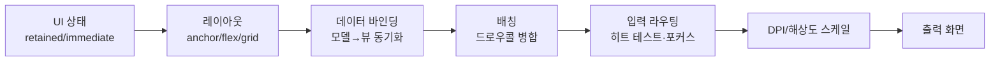
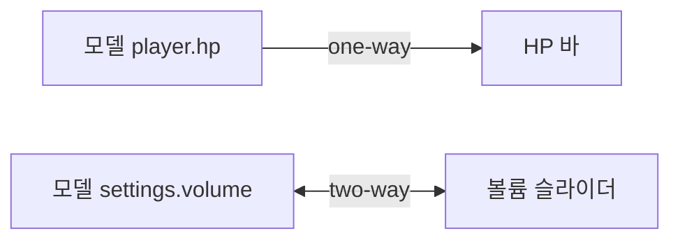
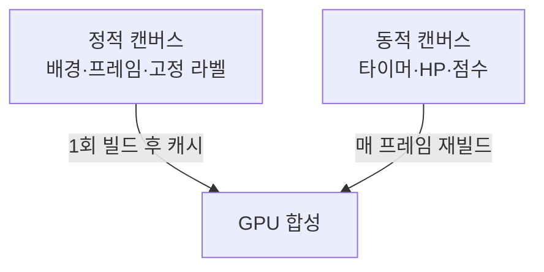
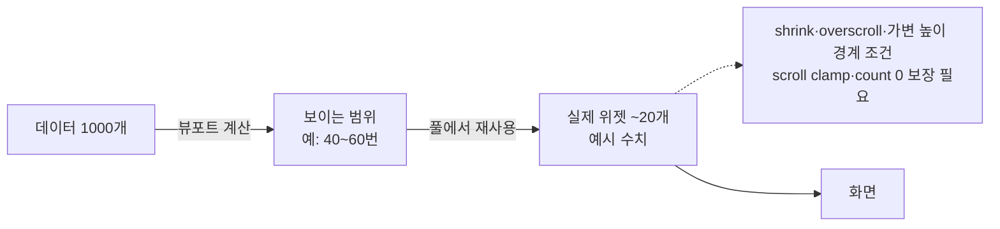

## 들어가며

게임 UI 시스템은 *디자이너의 표현 자유* 와 *시스템의 단순함* 사이의 줄다리기다. 화려한 레이아웃, 풍부한 애니메이션, 깊은 계층 구조는 직관적인 화면을 만들지만, 그만큼 코드 복잡도와 프레임당 비용이 늘어난다. 반대로 단순한 구조는 빠르고 디버깅하기 쉽지만, 복잡한 화면을 짜려면 손으로 좌표를 박아야 한다. 그래서 UI 엔진의 거의 모든 결정은 *유연성 ↔ 복잡도 ↔ 성능* 의 삼각 트레이드오프 위에 놓인다.

이 글은 그 트레이드오프를 따라 UI 시스템의 구성요소를 한 흐름으로 정리한다. UI 상태를 어떻게 보관할지(retained 대 immediate), 위젯의 크기와 위치를 어떤 규칙으로 계산할지(앵커·플렉스·그리드), 게임 데이터를 화면에 어떻게 동기화할지(데이터 바인딩), 수백 개의 위젯을 어떻게 적은 드로우콜로 그릴지(배칭), 입력을 어떤 위젯에 어떤 순서로 전달할지(히트 테스트·포커스), 천차만별의 해상도와 DPI를 어떻게 맞출지(스케일), 다국어 텍스트와 접근성을 어떻게 다룰지(텍스트·현지화·접근성), 수천 행 리스트를 어떻게 감당할지(가상화), 그리고 보이지 않는 버그를 어떻게 들여다볼지(디버깅)를 다룬다.



이 글의 목표.

1. **상태 모델** — retained 대 immediate, 위젯 트리, 더티 전파.
2. **레이아웃 시스템** — 앵커·피벗, 플렉스, 그리드, 측정·배치 2패스.
3. **데이터 바인딩** — 모델↔뷰 동기화, 옵저버, 일방향 대 양방향.
4. **배칭과 드로우콜** — 캔버스, 아틀라스, 정점 버퍼, 더티 재빌드.
5. **입력 라우팅과 포커스** — 히트 테스트, 캡처·버블, 포커스·탭 이동.
6. **DPI와 해상도 스케일** — 가상 해상도, 세이프 에어리어, 폰트 스케일.
7. **텍스트·현지화·접근성** — shaping·BiDi, 현지화, IME, 접근성 트리.
8. **가상화** — 긴 리스트의 윈도잉, 위젯 풀, 텍스트 렌더링 비용.
9. **디버깅과 프로파일링** — 인스펙터, 배치 분석, 레이아웃 추적.


---

## 목차
1. [상태 모델 — retained vs immediate](#1-상태-모델--retained-vs-immediate)
2. [레이아웃 시스템](#2-레이아웃-시스템)
3. [데이터 바인딩](#3-데이터-바인딩)
4. [배칭과 드로우콜](#4-배칭과-드로우콜)
5. [입력 라우팅과 포커스](#5-입력-라우팅과-포커스)
6. [DPI와 해상도 스케일](#6-dpi와-해상도-스케일)
7. [텍스트·현지화·접근성](#7-텍스트현지화접근성)
8. [가상화](#8-가상화)
9. [디버깅과 프로파일링](#9-디버깅과-프로파일링)


---

## 1. 상태 모델 — retained vs immediate

### 두 패러다임

UI 시스템을 가르는 첫 번째 갈림길은 *위젯의 상태를 어디에 보관하는가* 다. 답이 두 가지다.

*Retained mode(보존 모드)* 는 위젯과 계층을 영속 객체로 보관한다. 버튼 하나가 메모리에 사는 객체이고, 위치·텍스트·콜백을 필드로 가진다. 이 구조는 변경 추적과 캐시를 붙이기 좋지만, retained라는 사실만으로 변경된 부분만 갱신된다고 보장되지는 않는다. 레이아웃·그리기 명령·GPU 버퍼를 어느 입도로 캐시하는지는 별도 구현 결정이다.

*Immediate mode(즉시 모드)* 는 호출 코드가 매 프레임 UI 구조를 선언한다. `if (Button("저장")) Save;`처럼 위젯 함수 호출이 그리기 명령과 상호작용을 만든다. 호출로 생성한 일시적 구조는 프레임 끝에 버릴 수 있지만, 포커스·열린 창·텍스트 편집·스크롤처럼 프레임을 넘는 상태까지 전혀 없는 것은 아니다. Dear ImGui 같은 구현은 안정적 ID를 키로 내부 상태를 보존한다.

```cpp
// retained: 객체를 한 번 만들고 보관, 이후엔 갱신만
Button* save = new Button("저장");
save->onClick = [] { Save(); };
panel->AddChild(save);          // 트리에 영속
// ... 이후 프레임들에서는 save 객체가 계속 존재

// immediate: 매 프레임 호출, 객체 없음
void DrawUI() {
    if (ImGui::Button("저장")) Save();   // 그리기+입력을 한 줄에
}                                         // 프레임 끝나면 호출 구조는 버려짐(상호작용 상태는 ID 키로 보존)
```

### 트레이드오프

두 모델의 차이는 *상태를 누가 소유하는가* 로 귀결된다.

| 축 | Retained | Immediate |
|---|---|---|
| 위젯 상태 | 프레임워크가 객체로 보관 | 게임 데이터는 호출 코드 소유, 프레임워크는 ID 키 상호작용 상태 보존 |
| 코드량 | 생성·연결·해제 코드 많음 | 한 줄로 그리기+입력 |
| 동기화 | 모델↔뷰 바인딩 또는 명시적 갱신 | 호출 시 읽은 모델 상태를 즉시 반영 |
| 비용 | 영속 트리·변경 추적·캐시 비용 | 매 프레임 선언 실행·레이아웃·명령 생성 비용 |
| 레이아웃 | 복잡한 레이아웃에 유리 | 단순 흐름 레이아웃에 적합 |
| 용도 | 플레이어용 HUD·메뉴 | 디버그·에디터 도구 |

immediate mode의 매력은 호출 시점의 게임 상태를 직접 읽어 명령을 만들 수 있다는 것이다. 별도 뷰 객체에 값을 복사하는 동기화 코드는 줄지만, 호출 코드가 오래된 데이터나 잘못된 ID를 쓰면 여전히 상태 버그가 생긴다. 또한 보이는 위젯 선언을 매 프레임 실행하므로 위젯 수와 레이아웃·텍스트 비용이 그대로 CPU 작업이 된다. 이런 성질 때문에 상태가 게임 측에 있고 빠른 반복이 중요한 디버그 도구와 에디터에 잘 맞는다.

retained mode는 영속 트리 덕분에 더티 전파, 레이아웃 결과, 텍스트 shaping과 정점 버퍼를 재사용할 수 있다. 캐시가 제대로 구현되면 정적인 화면의 CPU 갱신 비용을 크게 낮출 수 있다. 대신 게임 상태와 위젯 상태가 두 곳에 존재할 수 있어 데이터 바인딩과 수명 관리가 필요하다. 어느 모델이 빠른지는 이름이 아니라 실제 캐시 입도, 위젯 수, 변경 빈도와 렌더 백엔드로 결정된다.

### 위젯 트리

retained UI의 뼈대는 *위젯 트리* 다. 모든 위젯은 부모를 하나 갖고 자식을 여럿 가진다. 좌표는 *부모 기준 상대 좌표* 로 두고, 렌더 직전에 부모를 거슬러 올라가며 *월드(스크린) 좌표* 로 합성한다.

```cpp
struct Widget {
    Widget*  parent = nullptr;
    std::vector<Widget*> children;

    Rect     localRect;          // 부모 기준 위치·크기
    Rect     worldRect;          // 합성된 스크린 좌표 (캐시)
    bool     visible = true;
    bool     dirtyLayout = true; // 레이아웃 재계산 필요
    bool     dirtyVisual = true; // 정점 재생성 필요

    virtual ~Widget() = default;          // Widget* 삭제 계약: base로 delete해도 파생 소멸자 실행

    virtual void Measure(Vec2 avail) {}   // 1패스: 원하는 크기 계산
    virtual void Arrange(Rect final) {}   // 2패스: 자식 배치
    virtual void BuildGeometry(VertexBuffer&) {}
};
```

이 트리는 위젯을 `Widget*`로 소유·삭제하는 다형 컨테이너이므로 소멸자가 `virtual`이어야 한다(base로 delete해도 파생 위젯의 정리 코드가 실행된다). 바인딩된 구독 토큰 해제와 이벤트 디스패치 중 파괴 지연도 이 소멸 계약 위에서 정한다.

트리 구조가 그대로 *세 가지 순회* 의 대상이 된다. 레이아웃(2절)은 트리를 아래→위(Measure), 위→아래(Arrange)로 두 번 훑고, 입력(5절)은 아래→위로 히트 테스트하며, 렌더(4절)는 깊이 우선으로 그린다. UI 시스템의 거의 모든 알고리즘이 이 트리 순회의 변형이다.

### 더티 플래그 — 안 바뀐 건 건드리지 않는다

retained의 성능 비결은 *더티 플래그(dirty flag)* 다. 위젯의 어떤 속성이 바뀌면 그 위젯(과 영향받는 조상/자식)에 `dirty` 표시를 켜고, 매 프레임 *더티한 것만* 재계산한다. 화면 대부분이 정지해 있는 메뉴에서, 깜빡이는 커서 하나만 더티면 나머지는 전부 캐시를 쓴다.

```cpp
void Widget::SetText(const std::string& t) {
    if (text_ == t) return;          // 변화 없으면 더티 안 켬 (중요)
    text_ = t;
    dirtyLayout = true;              // 텍스트가 바뀌면 크기가 달라질 수 있음
    dirtyVisual = true;
    InvalidateLayoutUpward();        // 부모도 자식 크기 변화로 재배치 필요
}
```

더티 전파의 함정은 *방향* 이다. 텍스트가 바뀌면 그 위젯의 크기가 달라지고, 크기가 달라지면 *부모의 레이아웃* 이 영향받는다(형제들이 밀린다). 그래서 레이아웃 더티는 *위로* 전파한다. 반대로 부모의 위치가 바뀌면 *자식 전부* 의 월드 좌표가 어긋나므로, 월드 좌표 더티는 *아래로* 전파한다. 이 두 방향을 헷갈리면 "바꿨는데 화면이 안 변하는" 또는 "안 바꿨는데 매 프레임 전체가 재계산되는" 버그가 난다. 후자는 특히 잡기 어렵다 — 화면은 멀쩡한데 CPU만 잡아먹는다.


## 2. 레이아웃 시스템

### 앵커와 피벗

가장 단순한 배치 규칙은 *앵커(anchor)* 다. 자식의 위치를 절대 픽셀이 아니라 *부모 사각형 안의 비율* 로 정의한다. 앵커 (0,0)은 부모의 좌상단, (1,1)은 우하단, (0.5,0.5)는 중앙이다. 부모 크기가 바뀌어도 자식은 비율을 유지하므로, 해상도가 달라져도 "우상단 미니맵"은 우상단에 남는다.

*피벗(pivot)* 은 위젯 자신의 기준점이다. 피벗 (0.5,0.5)면 위젯의 중심, (0,0)이면 좌상단이 기준점이 된다. 아래 예제처럼 두 모서리 offset으로 사각형을 확정하는 모델에서 `pivot`은 사각형 위치를 바꾸지 않고 회전·스케일의 원점(transform origin)과 위치 표현 기준만 정한다. `anchoredPosition + pivot`으로 위치 자체를 정하는 모델과는 구분해서 읽어야 한다.

```cpp
struct AnchorLayout {
    Vec2 anchorMin, anchorMax;   // 부모 안 비율 (0~1)
    Vec2 pivot;                  // 자신의 기준점
    Vec2 offsetMin, offsetMax;   // 앵커로부터 픽셀 오프셋

    Rect Resolve(const Rect& parent) const {
        Vec2 aMin = parent.pos + parent.size * anchorMin;
        Vec2 aMax = parent.pos + parent.size * anchorMax;
        return { aMin + offsetMin, (aMax + offsetMax) - (aMin + offsetMin) };
    }
    Vec2 TransformOrigin(const Rect& resolved) const {
        return resolved.pos + resolved.size * pivot;
    }
};
```

이 단순 모델에서 앵커와 offset은 최종 사각형의 두 모서리를 정하고, pivot은 그 사각형 안에서 회전·스케일의 원점과 위치 표현 기준을 정한다. 실제 엔진이 `anchoredPosition + sizeDelta + pivot` 형식을 쓴다면 이 값들을 모서리 offset으로 바꾸는 변환을 명시해야 한다. `pivot` 필드만 저장하고 계산 어디에도 쓰지 않으면 설명과 구현이 어긋난다.

앵커의 강력함은 *늘어나는 영역* 에 있다. anchorMin=(0,0), anchorMax=(1,1)에 offset을 0으로 두면 위젯이 *부모를 꽉 채우며 함께 늘어난다*. 좌우 패딩을 고정하려면 offsetMin.x=20, offsetMax.x=-20처럼 둔다 — 이러면 해상도가 넓어져도 좌우 20px 여백을 유지하며 가운데가 늘어난다. 배경 패널·전체화면 오버레이가 이 패턴이다.

### 플렉스 레이아웃 — 흐름 배치

앵커는 *한 위젯을 부모에 맞추는* 데 좋지만, *여러 위젯을 줄세우는* 데는 약하다. 버튼 다섯 개를 가로로 균등 배치하려면 일일이 앵커를 계산해야 한다. 여기서 *플렉스(flex) 레이아웃* 이 등장한다. 자식들을 한 축(가로/세로)으로 나열하고, 남는 공간을 *flex 계수* 에 따라 나눠 가진다.

```cpp
struct FlexContainer {
    enum { Row, Column } direction = Row;
    float gap = 8.0f;                 // 자식 간 간격

    void Arrange(const Rect& self) {
        if (children.empty()) return; // size()-1의 unsigned underflow와 불필요한 분배 방지
        float fixedSum = 0, flexSum = 0;
        for (auto* c : children) {
            if (c->flexGrow > 0) flexSum += c->flexGrow;
            else                 fixedSum += MainSize(c->desiredSize);
        }
        float free = MainSize(self.size) - fixedSum - gap * (children.size()-1);
        float cursor = 0;
        for (auto* c : children) {
            float main = (c->flexGrow > 0)
                ? free * (c->flexGrow / flexSum)    // 남는 공간을 비율로
                : MainSize(c->desiredSize);          // 고정 크기
            PlaceChild(c, cursor, main);
            cursor += main + gap;
        }
    }
};
```

예제는 양의 남는 공간을 `flexGrow`로 나누는 최소 골격이다. 실제 flexbox에는 공간이 부족할 때의 `flexShrink`, 최소·최대 크기, content basis, 줄바꿈과 정렬이 필요하다. 위 코드 그대로 `free<0`이면 flex 자식 크기가 음수가 될 수 있으므로, 제품 구현은 제약 해결과 overflow 정책을 먼저 적용한다. 일부 기능만 구현하면서 CSS flexbox와 같은 의미론이라고 부르면 에셋 제작자가 잘못된 기대를 갖는다.

### 그리드 레이아웃

격자 형태의 배치 — 인벤토리 슬롯, 스킬 트리, 상점 진열 — 는 *그리드(grid) 레이아웃* 이 맞다. 행과 열을 정의하고 자식을 셀에 채운다. 셀 크기를 고정으로 둘 수도, 비율(`1fr`)로 늘릴 수도, 콘텐츠에 맞출(`auto`) 수도 있다.

```cpp
struct GridLayout {
    std::vector<TrackSize> columns;   // 각 열의 크기 정의
    std::vector<TrackSize> rows;
    float colGap = 4, rowGap = 4;

    // 1단계: fixed/auto 트랙 확정 → 남는 폭을 fr 트랙이 분배 (플렉스와 동형)
    std::vector<float> ResolveTracks(const std::vector<TrackSize>& tracks,
                                     float total, float gap);
};
```

고정 트랙을 빼고 남는 공간을 `fr`에 나눈다는 일부 단계는 flex와 닮았다. 그러나 `auto`·min/max-content, 여러 트랙을 가로지르는 항목과 행·열의 intrinsic size 결합 때문에 그리드는 단순히 flex를 2차원으로 두 번 실행한 것과 같지 않다. 제한된 게임 UI 그리드라면 고정·비율 트랙만 지원해 알고리즘을 단순화할 수 있고, CSS 수준 표현력을 목표로 하면 명세의 track sizing 단계를 별도로 구현해야 한다.

### 측정과 배치 — 2패스

Measure와 Arrange를 분리한 2단계 구조는 흔하다. 부모는 자식의 원하는 크기를 모으고, 확정된 공간을 다시 자식에게 분배한다. 다만 텍스트 줄바꿈처럼 가용 폭이 원하는 높이를 바꾸거나 순환 제약이 있으면 한 번의 bottom-up과 한 번의 top-down만으로 수렴하지 않을 수 있다. 프레임워크는 제약을 단방향으로 제한하거나 재측정 횟수와 순환 탐지를 둔다.

```cpp
void Widget::LayoutPass(Rect finalRect) {
    Measure(finalRect.size);      // 1패스 (bottom-up): 각자 desiredSize 계산
    Arrange(finalRect);           // 2패스 (top-down): 실제 위치 배치
}

void TextLabel::Measure(Vec2 avail) {
    // 텍스트를 avail.x 폭에 줄바꿈했을 때 필요한 크기
    desiredSize = MeasureText(text_, font_, avail.x);
}
void StackPanel::Measure(Vec2 avail) {
    Vec2 sum{0,0};
    for (auto* c : children) {
        c->Measure(avail);                    // 자식 먼저 (bottom-up)
        sum.y += c->desiredSize.y;
        sum.x = std::max(sum.x, c->desiredSize.x);
    }
    desiredSize = sum;                        // 자식 합이 곧 내 크기
}
```

*Measure 패스(bottom-up)* 는 트리 잎에서 시작해 "이 위젯이 원하는 크기(desiredSize)"를 위로 모은다. 텍스트 라벨은 글자를 재서, 패널은 자식 크기를 합쳐서 자신의 크기를 정한다. *Arrange 패스(top-down)* 는 루트가 받은 화면 크기를 자식들에게 나눠주며 최종 사각형을 확정한다.

이 2패스 구조의 *함정* 은 비용이다. 매 프레임 전체 트리를 두 번 도는 것은 깊고 넓은 UI에서 비싸다. 특히 텍스트 측정(`MeasureText`)은 글자마다 글리프 메트릭을 조회하므로 무겁다. 그래서 *더티 플래그* 로 안 바뀐 서브트리는 캐시된 desiredSize를 재사용하고, 측정 결과를 *캐시* 한다. "프레임 시간이 갑자기 튀는데 화면은 정적"이라면, 매 프레임 텍스트를 재측정하고 있을 가능성이 높다 — 1절의 더티 전파가 잘못 설계된 전형적 증상이다.


## 3. 데이터 바인딩

### 모델과 뷰의 분리

retained UI의 근본 문제는 *상태가 두 곳에 있다* 는 것이다(1절). 플레이어 HP는 게임 로직의 변수이고, HP 바는 UI 위젯이다. 둘을 손으로 맞추면 `player.hp -= 10; hpBar->SetValue(player.hp);` 처럼 *데이터를 바꿀 때마다 뷰 갱신 코드를 같이 써야* 한다. 한 군데라도 빠지면 화면이 거짓말을 한다.

*데이터 바인딩(data binding)* 은 이 연결을 *선언적* 으로 만든다. "이 HP 바는 player.hp를 본다"고 한 번 선언하면, hp가 바뀔 때 바가 *자동으로* 따라간다.

```cpp
// 관찰 가능한 값: 바뀌면 구독자에게 알린다
template<typename T>
class Observable {
    T value_;
    std::vector<std::function<void(const T&)>> observers_;
public:
    explicit Observable(T initial) : value_(std::move(initial)) {}
    void Set(const T& v) {
        if (v == value_) return;             // 변화 없으면 알림 안 함
        value_ = v;
        for (auto& obs : observers_) obs(v); // 구독자 전원에게 통지
    }
    const T& Get() const { return value_; }
    void Subscribe(std::function<void(const T&)> f) {
        observers_.push_back(std::move(f));
    }
};
```

이 코드는 단일 UI 스레드와 통지 중 구독 목록이 바뀌지 않는다는 축약 가정이다. 실제 구현은 구독 토큰에 세대 번호를 주고, 콜백 중 해제·추가를 지연 적용하거나 안정한 슬롯 컨테이너를 사용한다. 다른 스레드의 게임 상태를 UI 옵저버가 직접 호출하게 두지 않고, 스냅샷이나 UI 스레드 명령 큐를 경계로 둔다.

```cpp
// 선언: HP 바를 player.hp에 묶는다 (한 번만)
player.hp.Subscribe([hpBar](int hp) { hpBar->SetValue(hp); });
// 이후 어디서든 player.hp.Set(...)만 하면 바가 자동 갱신
```

### 일방향과 양방향

바인딩에는 방향이 있다.

*일방향(one-way) 바인딩* 은 모델→뷰로만 흐른다. HP 바, 점수 표시, 미니맵처럼 *화면이 데이터를 보여주기만* 하는 경우다. 대부분의 게임 UI가 일방향이다 — HUD는 게임 상태를 비추는 거울일 뿐이다.

*양방향(two-way) 바인딩* 은 모델↔뷰가 서로 흐른다. 설정 메뉴의 슬라이더, 텍스트 입력 필드처럼 *사용자가 화면에서 값을 바꾸면 모델도 바뀌어야* 하는 경우다. 슬라이더를 끌면 `volume`이 바뀌고, 다른 곳에서 `volume`이 바뀌면 슬라이더도 움직인다.



양방향의 함정은 피드백 루프다. 동일성 검사는 중요한 첫 방어지만 충분하지 않을 수 있다. 부동소수 변환, 단위 변환과 clamp가 왕복할 때 값이 조금씩 달라질 수 있기 때문이다. 업데이트 출처 토큰 또는 reentrancy guard로 자기 통지를 무시하고, 변환을 한쪽에서 정규화하며, 부동소수 값에는 도메인에 맞는 동등성 규칙을 사용한다.

### 바인딩 표현식과 변환

실무에서는 모델 값을 그대로 보여주지 않는다. `hp`는 정수지만 화면엔 `"75 / 100"` 문자열로, 0~100 값이 0~1 비율 바로 들어가야 한다. *변환기(converter)* 가 모델 타입과 뷰 타입 사이를 잇는다.

```cpp
struct Binding {
    Observable<int>* source;             // player.hp
    Widget*          target;             // 라벨
    std::function<std::string(int)> fmt; // 변환: 75 → "75 / 100"

    void Connect() {
        auto* w = target;
        auto  f = fmt;
        source->Subscribe([w, f](int v){ w->SetText(f(v)); });
        target->SetText(fmt(source->Get()));   // 초기 동기화 (중요)
    }
};
```

초기 동기화를 빠뜨리는 것이 흔한 버그다. 구독만 걸고 *현재 값으로 한 번 갱신* 하지 않으면, hp가 처음 바뀌기 전까지 화면이 비어 있거나 옛값을 보인다. 바인딩을 거는 순간 *반드시 한 번은 즉시 값을 밀어 넣어야* 한다.

### 바인딩의 비용과 정리

옵저버 패턴의 *수명 문제* 가 게임 UI에서 특히 위험하다. 위젯이 파괴됐는데 모델의 구독자 목록에 *죽은 위젯을 가리키는 람다* 가 남아 있으면, 다음 통지에서 해제된 메모리에 접근한다. 메뉴를 열고 닫기를 반복하면 구독자 목록이 끝없이 늘기도 한다(누수).

해법은 *구독 토큰* 이다. Subscribe가 핸들을 반환하고, 위젯이 파괴될 때 그 핸들로 구독을 *반드시 해제* 한다. 위젯 트리의 소멸자에서 자신이 건 모든 바인딩을 끊는 것을 규약으로 삼는다.

```cpp
class Widget {
    std::vector<SubscriptionToken> bindings_;   // 내가 건 구독들
public:
    virtual ~Widget() {
        for (auto& t : bindings_) t.Unsubscribe();  // 죽기 전에 전부 해제
    }
};
```

이 규약이 없으면 "메뉴를 여러 번 열었다 닫으니 프레임이 느려진다"는 증상이 나타난다 — 죽은 구독자가 쌓여 매 통지가 점점 무거워진다. 데이터 바인딩은 편하지만, *수명 관리* 가 그 편함의 대가다.


## 4. 배칭과 드로우콜

### 드로우콜이 비싼 이유

UI는 작은 사각형과 글리프가 많아, 순진하게 위젯마다 드로우콜을 내면 CPU 명령 기록·상태 검증·제출 비용이 위젯 수에 비례한다. 드로우콜당 비용은 API, 드라이버, 검증 계층, 상태 변경량과 기록 방식에 따라 달라지므로 고정된 마이크로초 상수로 둘 수 없다. 중요한 사실은 작은 쿼드의 정점 작업보다 명령 수가 먼저 병목이 될 수 있다는 점이며, 실제 비용은 CPU 프로파일러로 측정한다.

*배칭(batching)* 은 *여러 쿼드를 하나의 드로우콜로 합치는* 것이다. 같은 텍스처·셰이더·블렌드 상태를 쓰는 쿼드들의 정점을 하나의 큰 정점 버퍼에 모아 한 번에 그린다. 500개 위젯이 같은 아틀라스를 쓰고 clip·blend·파이프라인 상태가 연속이면 드로우콜 1개로 끝난다.

### 텍스처 아틀라스

배칭의 전제는 연속된 그리기 항목이 호환되는 파이프라인·블렌드·클립 상태와 리소스 바인딩을 공유하는 것이다. 전통적 백엔드에서는 여러 UI 이미지를 하나의 텍스처 아틀라스에 모아 텍스처 변경을 줄인다. 텍스처 배열, descriptor indexing, bindless texture를 지원하는 백엔드는 여러 텍스처를 한 배치에서 인덱싱할 수도 있으므로, "한 텍스처만 가능"은 보편 규칙이 아니다.

```cpp
struct Sprite {
    TextureId atlas;     // 같은 아틀라스를 공유해야 배칭됨
    Rect      uv;        // 아틀라스 안 위치 (0~1 정규화)
};
// 같은 atlas와 호환 clip/blend/pipeline 상태가 연속이면 정점을 모아 드로우콜 1개
```

아틀라스가 여러 장으로 나뉘면(텍스처가 너무 많아 한 장에 안 들어감), *아틀라스 단위로 드로우콜이 쪼개진다*. 그래서 자주 같이 그려지는 UI(같은 화면의 위젯들)는 *같은 아틀라스* 에 모으는 것이 중요하다. 빌드 파이프라인에서 아틀라스 패킹을 화면/메뉴 단위로 묶는 이유다. 캔버스를 나눌 때도 화면의 시각적 z순서가 유지되도록 그리기 순서를 보존해야 한다.

### 정점 버퍼 빌드와 더티 재빌드

배칭의 실제 작업은 *위젯 트리를 순회하며 정점을 모으는* 것이다. 위젯마다 쿼드 4개 정점(또는 텍스트면 글자 수만큼)을 공통 버퍼에 쌓고, 마지막에 통째로 GPU에 올린다.

```cpp
void BuildBatch(Widget* root, VertexBuffer& vb) {
    if (!root->visible) return;
    root->BuildGeometry(vb);          // 자신의 쿼드 정점을 vb에 추가
    for (auto* c : root->children)
        BuildBatch(c, vb);            // 깊이 우선 (그리기 순서 = 트리 순서)
}
```

여기서 1절의 *더티 플래그* 가 결정적이다. 매 프레임 전체 정점을 다시 만드는 것은 위젯이 많으면 비싸다. 화면 대부분이 정지해 있다면 *바뀐 위젯의 정점만* 갱신하고 나머지는 캐시된 버퍼를 재사용해야 한다.

```cpp
void Canvas::Render() {
    if (anyVisualDirty_) {            // 하나라도 바뀌었으면
        vb_.Clear();
        BuildBatch(root_, vb_);       // 정점 재생성
        vb_.Upload();                 // GPU 업로드 (비싼 부분)
        anyVisualDirty_ = false;
    }
    Draw(vb_);                        // 매 프레임은 그리기만
}
```

### 캔버스 분리 — 정적과 동적을 가른다

더티 재빌드의 *함정* 은 입자 단위다. 하나의 거대 캔버스에 정적 위젯 1000개와 *매 프레임 바뀌는 숫자 하나* 가 섞여 있으면, 그 숫자 때문에 매 프레임 1000개 정점을 통째로 재빌드한다. 더티 한 비트가 전체 재빌드를 유발하는 것이다.

해법은 *캔버스 분리* 다. 정적인 위젯(배경, 프레임)과 자주 바뀌는 위젯(타이머, HP 숫자)을 *별도 캔버스* 에 둔다. 정적 캔버스는 한 번 빌드하고 영원히 캐시하고, 동적 캔버스만 매 프레임 재빌드한다.



캔버스를 너무 잘게 쪼개면 *캔버스마다 드로우콜* 이 생겨 배칭 이득이 줄고, 너무 크게 묶으면 작은 변화가 큰 재빌드를 유발한다. 실무 규칙은 *변화 빈도가 비슷한 위젯끼리 묶는* 것이다 — "거의 안 바뀜", "가끔 바뀜", "매 프레임 바뀜"을 다른 캔버스로. 이 분리가 잘못되면 "정적인 메뉴인데 CPU가 높다"는 전형적 증상이 나온다.

### 오버드로우

UI는 *반투명 레이어가 겹쳐* 같은 픽셀을 여러 번 칠하기 쉽다 — 전체화면 어두운 배경 위에 패널, 그 위에 또 패널. *오버드로우(overdraw)* 는 픽셀 채우기 비용을 곱으로 늘려, 특히 *픽셀 채우기 능력이 약한 모바일 GPU* 에서 병목이 된다. 완전히 가려지는 위젯은 그리지 않고(컬링), 큰 반투명 영역은 한 겹으로 합치며, 보이지 않는 위젯은 트리에서 *visible=false* 로 일찍 가지치기한다.

### 드로우콜과 더티 재빌드의 비용 모델 — 캔버스 분리의 최적 입자

앞의 두 절은 "드로우콜은 비싸다", "잘게 쪼개면 드로우콜이 늘고 크게 묶으면 재빌드가 커진다"를 *결과* 로만 진술했다. 이 둘 사이에는 최적점이 있고, 그 위치는 두 상수의 비로 닫힌다.

*드로우콜 비용.* 한 프레임의 UI CPU 비용을 드로우콜 수 $D$와 정점 수 $V$로 분해하면

$$
C_{\text{CPU}} \approx D\,c_{\text{dc}} + V\,c_v,
$$

$c_{\text{dc}}$는 드로우콜 하나를 기록·검증·제출하는 평균 한계 비용이고, $c_v$는 CPU에서 정점·명령 데이터를 만드는 평균 한계 비용이다. 위젯마다 드로우콜을 내면 $D=N$, 호환 상태끼리 배칭하면 $D=B$로 줄어 *드로우콜 항* 은 $Nc_{\text{dc}}$에서 $Bc_{\text{dc}}$가 된다. $N/B$는 이 항만의 개선 비율이며 전체 UI 시간의 가속비가 아니다. 텍스트 shaping, 레이아웃, 버퍼 업로드, 픽셀 셰이딩이 남기 때문이다. $c_{\text{dc}}$와 $c_v$는 대상 백엔드에서 회귀 또는 마이크로벤치마크로 추정한다.

*더티 재빌드 비용.* 캔버스 $j$가 정점 $n_j$개를 갖고 프레임당 확률 $p_j$로 더티해진다고 하면($p_j$는 그 캔버스가 바뀌는 프레임 비율), 프레임당 재빌드 기대 일은

$$
\mathbb{E}[W_{\text{rebuild}}] = c_b \sum_j p_j n_j,
$$

$c_b$는 정점당 빌드+업로드 비용이다. 정점 $N_s$개의 정적 영역과 매 프레임 바뀌는 정점 $n_d$개의 동적 영역($p{=}1$)을 *한 캔버스* 에 섞으면 그 캔버스의 $p$가 1이 되어 매 프레임 $c_b(N_s{+}n_d)$ 전부를 다시 만든다 — 더티 한 비트가 전체를 오염시킨다. 정적과 동적을 *분리* 하면 정적은 $p\approx0$(첫 프레임 이후), 동적만 $p{=}1$이라 $W\approx c_b n_d$로 떨어진다. 절감 인자는 $(N_s{+}n_d)/n_d$다.

*최적 입자 — 한계 분석.* 분리는 공짜가 아니다. 캔버스를 하나 늘리면 호환 배치가 갈라져 드로우콜이 하나 더 붙을 수 있다. 정점 $S$개의 정적 영역과 정점 $s$개의 동적 영역이 한 캔버스에 있고, 동적 영역이 프레임당 확률 $p$로 전체 캔버스를 더럽힌다고 하자. 정적 빌드 비용을 충분히 긴 구간에 상각하면, 분리 전후의 기대 비용 차이는 근사적으로

$$
\Delta C = C_{\text{분리 후}}-C_{\text{분리 전}}
\approx c_{\text{dc}}-p\,c_bS.
$$

분리가 이득($\Delta C<0$)인 조건은

$$
p\,c_bS > c_{\text{dc}}.
$$

즉 분리로 아끼는 정적 재빌드 기대 비용이 추가 명령 비용보다 커야 한다. $p$가 작으면 큰 정적 영역도 함께 두는 편이 나을 수 있고, 매 프레임 바뀌면 더 작은 정적 영역도 분리할 가치가 있다. 실제 시스템에서는 버퍼 업로드의 고정 비용과 배치 병합 여부까지 포함해 임계값을 측정해야 한다.

```cpp
// 측정한 평균 비용으로 분리의 한계 이득을 추정한다.
bool ShouldIsolate(int staticVerts, float dirtyProbability,
                   float drawCost, float rebuildCostPerVertex) {
    float savedRebuild = dirtyProbability * staticVerts * rebuildCostPerVertex;
    return savedRebuild > drawCost;
}
```

*실패 경계.* 첫째, 같은 문자열을 매 프레임 `SetText`하면 값이 바뀌지 않아도 캔버스의 $p$를 1로 만들 수 있다. `if (value==new) return` 가드가 불필요한 더티 전파를 막는다. 둘째, 캔버스를 과도하게 쪼개면 추가 드로우콜과 버퍼 전환 비용이 재빌드 절감을 추월한다. 셋째, 오버드로우는 별도 축이다. 픽셀 비용은 대략 $A_{\text{screen}}\cdot O\cdot c_{\text{fill}}$로 증가하므로, CPU 명령과 재빌드 비용을 줄여도 큰 반투명 레이어가 겹치면 GPU fill-rate에서 막힐 수 있다.


## 5. 입력 라우팅과 포커스

### 히트 테스트 — 어느 위젯이 클릭됐나

포인터(마우스·터치) 입력의 출발점은 *히트 테스트(hit test)* 다. 화면 좌표 (x,y)에서 *가장 위에 있는, 입력을 받는 위젯* 을 찾는다. 위젯 트리를 *그리기 순서의 역순* (위에 그려진 것부터)으로 훑으며, 점이 위젯 사각형 안에 들고 visible·interactive하면 그것이 타깃이다.

```cpp
Widget* HitTest(Widget* node, Vec2 p) {
    if (!node->visible) return nullptr;
    bool inside = node->worldRect.Contains(p);
    if (!inside && node->clipChildren) return nullptr;  // 그리기와 같은 클리핑 규칙
    // 자식을 역순으로 (나중에 그린 = 위에 있는 것 우선)
    for (auto it = node->children.rbegin(); it != node->children.rend(); ++it) {
        if (Widget* hit = HitTest(*it, p))
            return hit;                       // 가장 위 자식이 먹음
    }
    if (!inside) return nullptr;              // overflow로 통과한 자식만 경계 밖에서 맞음
    return node->interactive ? node : nullptr; // 자식이 안 먹으면 자신
}
```

그리기와 히트 테스트는 부모 경계를 같은 규칙으로 처리해야 한다. `clipChildren=false`면 자식이 부모 rect 밖으로 나가도 그려지므로 히트 테스트도 그 자식을 통과시키고, 자르려면 `BuildBatch`는 누적 clip과 자식의 그리기 영역을 교차시키고 같은 scissor·stencil 규칙을 적용한다. 일부만 보이는 자식까지 순회에서 통째로 빼면 안 된다. 스크롤·외부 scissor의 누적 clip은 별도로 유지하고 hit-test에서도 그 clip을 검사한다. worldRect 자체를 clip 사각형으로 덮어쓰면 원래 geometry와 좌표 변환을 잃는다. 회전·스케일이 있으면 점을 역 local 변환으로 자식 공간에 옮겨 hit한다.

히트 테스트의 함정은 비직사각 위젯과 투명 영역이다. 원형 버튼은 원·다각형 같은 명시적 hit shape를 쓰는 편이 빠르고 접근성 영역도 예측 가능하다. 텍스처 알파 테스트가 꼭 필요하면 CPU용 마스크·저해상도 비트맵을 따로 보관하며, 시각적으로 투명하더라도 의도한 최소 터치 영역은 유지해야 한다. 전체 화면 투명 패널은 `hitTestVisible`과 모달 정책을 명시하지 않으면 아래 입력을 조용히 삼킬 수 있다.

### 캡처와 버블 — 이벤트가 흐르는 방향

히트된 위젯이 입력을 *독점* 하지 않는다. 이벤트는 트리를 따라 *흐른다*. 표준 모델은 두 단계다.

*캡처(capture) 단계* 는 루트→타깃으로 내려가며, 조상이 먼저 이벤트를 *가로챌* 기회를 준다. 모달 다이얼로그가 뒤쪽 입력을 막거나, 드래그 영역이 자식의 클릭을 먼저 채는 데 쓴다.

*버블(bubble) 단계* 는 타깃→루트로 올라가며, 자식이 처리하지 않은 이벤트를 조상이 받는다. 버튼이 클릭을 처리하지 않으면 그 부모 패널이 받는 식이다. 자식이 `handled=true`를 세우면 버블이 멈춘다.

```cpp
bool Dispatch(Widget* target, Event& e) {
    // 1) 캡처: 루트→타깃 (조상이 먼저 가로챌 기회)
    std::vector<Widget*> path;
    for (Widget* w = target; w; w = w->parent) path.push_back(w);
    for (auto it = path.rbegin(); it != path.rend(); ++it)
        if ((*it)->OnCapture(e)) return true;     // 조상이 채감
    // 2) 버블: 타깃→루트 (안 처리되면 위로)
    for (Widget* w : path)
        if (w->OnEvent(e)) return true;           // handled되면 멈춤
    return false;
}
```

이 두 단계 모델이 *모달*, *드래그*, *툴팁*, *컨텍스트 메뉴* 같은 복잡한 상호작용을 깔끔하게 처리하게 한다. 캡처가 없으면 모달 창 뒤의 버튼이 클릭되는 버그를 일일이 막아야 하고, 버블이 없으면 "리스트 아이템 안의 어디를 눌러도 아이템이 선택됨" 같은 자연스러운 동작을 위젯마다 다시 짜야 한다.

다만 캡처·버블은 이미 정해진 타깃의 경로를 따라갈 뿐, 타깃 선택 자체를 바꾸지 않는다. 모달과 배경 버튼이 형제라면 배경 버튼으로 정해진 경로에 모달이 없으므로, 모달의 캡처 콜백만으로 뒤 입력을 막을 수 없다. 모달 범위는 `activeModalRoot` 또는 `inputScope`를 히트 테스트·포커스 탐색에 먼저 적용해 정하고, 캡처 단계와 포인터 캡처(드래그 중 포인터 독점)는 용어와 수명을 분리해 다룬다.

dispatch 경로는 raw `Widget*`의 벡터이므로, 콜백이 위젯을 제거·재부모화하면 남은 capture/bubble 단계와 `focused` 포인터가 무효가 될 수 있다. 이벤트 콜백 중 파괴는 지연 파괴(deferred destruction) 큐로 미루고, 재부모화 시 현재 경로를 유지할지 취소할지와 위젯 세대(handle) 검사 정책을 함께 정한다.

### 마우스·터치·게임패드 통합

게임 UI는 *세 종류의 입력* 을 같은 위젯이 받아야 한다 — 마우스(포인터+호버), 터치(멀티터치, 호버 없음), 게임패드/키보드(포커스 이동). 이들을 위젯마다 따로 처리하면 코드가 폭발한다. 그래서 *추상 입력 이벤트* 로 통합한다.

```cpp
enum class UIEvent {
    PointerEnter, PointerExit,    // 마우스 호버 (터치엔 없음)
    PointerDown, PointerUp, Click,
    Drag, Scroll,
    FocusGained, FocusLost,       // 게임패드/탭 이동
    Submit, Cancel,               // 게임패드 A/B, 키보드 Enter/Esc
};
```

포인터는 위치·캡처·down/up 취소 규칙을 거쳐 `Activate` 의미를 만들고, 포커스 장치의 Submit도 같은 위젯 활성화 명령으로 수렴시킬 수 있다. 그러나 마우스 클릭을 처음부터 Submit 한 종류로 지우면 드래그, 우클릭, 멀티터치와 포인터 취소 정보를 잃는다. 장치별 저수준 이벤트와 위젯의 고수준 의미 이벤트를 두 계층으로 나눈다.

### 포커스와 탭 이동

마우스가 없는 입력(게임패드, 키보드)에는 *포커스(focus)* 개념이 필요하다. 한 시점에 *하나의 위젯이 포커스* 를 갖고, 방향키·탭으로 포커스를 옮기며, Submit으로 포커스된 위젯을 활성화한다.

```cpp
struct FocusManager {
    Widget* focused = nullptr;

    void Move(Direction dir) {
        Widget* next = FindNearestInDirection(focused, dir);  // 공간 탐색
        if (next) SetFocus(next);
    }
    void SetFocus(Widget* w) {
        if (w == focused) return;                             // 동일 위젯 재설정은 no-op
        if (focused) focused->OnEvent({UIEvent::FocusLost});
        focused = w;
        if (w) w->OnEvent({UIEvent::FocusGained});            // nullptr면 focus clear
    }
    void ClearFocus() { SetFocus(nullptr); }
};
```

`SetFocus(nullptr)`는 포커스를 지우는 clear로 동작하고, 같은 위젯을 다시 설정하면 lost/gained를 중복 발행하지 않는다. 빈 모달·리스트에서 포커스를 비우는 API와 위젯 파괴 시 `ClearFocus` 호출 시점, 포커스 콜백의 reentrancy를 이벤트 경계 규약에서 함께 다룬다.

포커스 이동에는 두 방식이 있다. *탭 순서(tab order)* 는 위젯마다 명시적 순번을 주는 선형 이동이고, *방향 탐색(directional)* 은 현재 포커스 위젯에서 *방향키가 가리키는 쪽에 가장 가까운* 위젯을 기하적으로 찾는다. 게임패드 UI는 방향 탐색이 자연스럽다 — 위를 누르면 위에 있는 버튼으로 간다. 함정은 *비어 있는 방향* 과 *순환* 이다. 방향키를 눌렀는데 그쪽에 위젯이 없으면 포커스가 사라지지 않게 현재 위치를 유지하고, 가장자리에서 반대편으로 감쌀지(wrap) 멈출지를 메뉴 성격에 맞게 정한다. 포커스 위젯은 *항상 시각적으로 표시* 되어야 한다 — 패드 사용자가 "지금 뭐가 선택됐는지" 모르면 메뉴를 못 쓴다.


## 6. DPI와 해상도 스케일

### 가상 해상도

가상 해상도(reference resolution)는 디자인 단위를 viewport의 논리 좌표에 매핑하는 한 정책이다. 종횡비가 크게 달라지면 단순 확대만으로 해결되지 않으므로 앵커, safe area, 재배치와 콘텐츠 우선순위가 함께 필요하다.

```cpp
struct CanvasScaler {
    Vec2  referenceResolution{1920, 1080};
    float matchWidthOrHeight = 0.5f;     // 0=폭 기준, 1=높이 기준

    float ComputeScale(Vec2 screen) const {
        float scaleW = screen.x / referenceResolution.x;
        float scaleH = screen.y / referenceResolution.y;
        // 폭·높이 스케일을 로그 보간 (종횡비가 달라도 부드럽게)
        return std::exp(std::lerp(std::log(scaleW), std::log(scaleH),
                                  matchWidthOrHeight));
    }
};
```

로그 보간은 폭·높이의 비율을 대칭적으로 섞어 하나의 균등 스케일을 만든다. 하지만 남는 공간이나 잘리는 영역을 결정하지는 않는다. viewport aspect가 기준과 다르면 레이아웃이 남은 공간을 재분배하거나 letterbox·crop 정책을 적용해야 한다.

### 물리 DPI와 논리 픽셀

같은 픽셀 해상도라도 화면의 물리 크기는 다르다. OS는 많은 환경에서 논리 좌표와 framebuffer 픽셀 사이의 scale factor를 제공한다. 이 값은 물리 DPI 측정값과 같지 않을 수 있고, 데스크톱 모니터의 보고 DPI는 부정확할 수 있다. 플랫폼 접근성 배율과 게임 내 UI scale도 별도 입력이다.

```cpp
// layout은 OS 논리 좌표에서 수행한다.
float layoutScale = ComputeCanvasScale(logicalViewport) * userUiScale;

// 래스터화할 때만 논리 좌표를 framebuffer 픽셀로 바꾼다.
Vec2 framebufferPerLogical = framebufferSizePx / logicalViewport;
Vec2 rasterScale = layoutScale * framebufferPerLogical;
```

중요한 규칙은 같은 배율을 두 번 적용하지 않는 것이다. `logicalViewport`가 이미 OS DPI scaling을 반영했다면 canvas scale 계산에 물리 framebuffer 크기를 다시 넣고 OS scale을 곱해서는 안 된다. 텍스트의 shaping 크기는 논리 단위로 결정하고, bitmap glyph atlas는 필요한 raster scale에 맞는 해상도 버킷을 선택한다. SDF/MSDF도 무한 확대가 가능한 것은 아니므로 품질 범위 밖에서는 다른 atlas 또는 vector rasterization이 필요하다.

### 세이프 에어리어

모바일은 *노치, 펀치홀, 둥근 모서리, 홈 인디케이터* 가 화면 일부를 가린다. 화면 가장자리에 붙인 UI(체력 바, 버튼)가 노치에 잘리거나 둥근 모서리에 먹힌다. OS가 *세이프 에어리어(safe area)* — 가려지지 않는 직사각형 — 를 알려준다.

```cpp
struct SafeArea {
    Rect Apply(const Rect& fullScreen) const {
        // OS가 준 inset만큼 안쪽으로 줄인 영역
        return { fullScreen.pos + Vec2{insetLeft, insetTop},
                 fullScreen.size - Vec2{insetLeft+insetRight,
                                        insetTop+insetBottom} };
    }
};
```

규칙은 *상호작용·중요 정보는 세이프 에어리어 안* 에, *배경·장식은 전체 화면* 으로 두는 것이다. 배경이 노치 아래까지 꽉 차야 어색하지 않지만, 버튼이 노치에 잘리면 누를 수 없다. 세이프 에어리어를 앵커의 부모 사각형으로 삼으면(2절), 노치 있는 기기와 없는 기기가 같은 레이아웃 코드로 처리된다.

### 폰트와 비율의 함정

폰트와 원형 아이콘의 로컬 geometry를 비균등 확대하면 형태가 왜곡되므로 이들은 균등 스케일을 사용한다. 반면 배경 패널과 레이아웃 영역은 9-slice, 타일링과 responsive reflow로 가로·세로 공간을 다르게 흡수할 수 있다. 모든 좌표를 무조건 정수 픽셀로 반올림하면 애니메이션이 떨리고 subpixel text placement를 잃는다. 픽셀 아트, 1픽셀 선과 bitmap 글리프처럼 필요한 요소만 최종 framebuffer 공간에서 snap하고, 나머지는 subpixel 위치와 적절한 필터링을 유지한다.


## 7. 텍스트·현지화·접근성

### 문자열에서 화면의 글리프까지

문자열의 바이트를 글꼴 아틀라스에서 같은 번호의 그림으로 찾는 방식은 ASCII에서만 우연히 동작한다. 실제 텍스트 파이프라인은 아래 처리 단계를 분리한다.

```text
UTF-8/UTF-16 바이트
  -> Unicode scalar value
  -> grapheme·word·line break 분석
  -> BiDi 방향 run + script run
  -> font fallback
  -> shaping: glyph ID, advance, offset, cluster
  -> line layout
  -> glyph rasterization/atlas
  -> quad 또는 vector draw
```

*코드 포인트(code point)* 와 사용자가 한 글자로 인식하는 *grapheme cluster* 는 다르다. `é`는 하나의 코드 포인트일 수도 있고 `e + combining acute` 두 코드 포인트일 수도 있다. 가족 emoji는 여러 emoji와 ZWJ가 한 cluster를 만들 수 있다. 따라서 커서 이동, backspace, 선택 영역과 글자 수 제한을 UTF-8 바이트나 코드 포인트 하나씩 처리하면 문자를 반으로 자른다. 편집 동작은 Unicode grapheme boundary를 사용하고, 저장 포맷의 byte offset과 UI cluster index 사이 변환을 명시한다.

### Shaping과 양방향 텍스트

Shaping은 코드 포인트 열을 glyph ID와 위치로 바꾸는 과정이다. 합자 때문에 여러 코드 포인트가 glyph 하나가 될 수 있고, 하나의 코드 포인트가 여러 glyph로 분해될 수도 있다. 아랍 문자는 문맥에 따라 형태가 달라지고, 인도계 문자는 glyph 순서가 코드 포인트 순서와 달라질 수 있다. `glyph = font[codepoint]` 루프는 이런 문자를 올바르게 그리지 못한다.

양방향 텍스트는 문자열 전체를 단순히 뒤집는 문제가 아니다. 아랍어 문장 안의 숫자·영문·구두점은 서로 다른 방향 run을 만들고, Unicode BiDi 알고리즘이 논리 순서에서 시각 순서를 계산한다. 일반적인 순서는 문단 방향 분석 → script·font run 분할 → 각 run shaping → 시각 순서 배치다. HarfBuzz 같은 shaping 엔진과 ICU·플랫폼 Unicode 라이브러리를 사용하는 이유는 이 규칙을 직접 일부만 구현하면 언어별 예외에서 깨지기 때문이다.

```cpp
struct ShapedGlyph {
    FontFaceId face;
    uint32_t glyphId;
    uint32_t clusterByteOffset;  // 원문으로 hit-test하기 위한 매핑
    Vec2 advance;
    Vec2 offset;
};

struct ShapeKey {
    TextHash text;
    FontStackId fonts;
    float fontSize;            // 논리 em 크기
    FontVariationId variation; // variable font 축 값
    uint32_t fontRevision;     // 폰트 내용/버전
    LocaleId locale;
    TextDirection direction;
    FeatureSet features;
    float wrapWidth;
};
```

shape cache key에는 문자열만이 아니라 font stack, 논리 em 크기, variable font 축 값, 폰트 revision, locale, 방향, OpenType feature와 줄바꿈 폭이 들어가야 한다. 같은 text/font stack도 크기·variation·revision이 달라지면 glyph와 advance가 달라진다. 폭이 달라지면 line break가 달라지고, locale과 font fallback이 달라지면 glyph와 advance도 달라진다. 반면 glyph atlas는 `(font face, glyph ID, raster size, render mode)`를 키로 둔다. glyph atlas의 face ID도 같은 font instance(크기·variation·revision) 정책과 연결한다. shaping 결과와 bitmap raster cache를 분리하면 DPI 변경 때 문자열 전체를 다시 분석하지 않고 필요한 glyph만 다른 해상도로 굽을 수 있다.

### 줄바꿈, fallback과 아틀라스 수명

공백에서만 줄을 나누면 CJK, Thai, emoji와 긴 URL에서 실패한다. line break는 Unicode line breaking property와 locale별 단어 분리를 사용하고, hyphenation은 언어별 사전·패턴이 필요한 별도 기능으로 둔다. 줄 높이도 한 글꼴의 ascent/descent만 보지 않고 한 줄에 실제 사용된 fallback face와 inline object를 포함해 계산한다.

font fallback은 현재 face에 glyph가 없을 때 font stack의 다음 face를 선택한다. 한 문장 안에서 Latin, Hangul, Arabic과 emoji face가 섞일 수 있다. fallback 선택이 플랫폼마다 달라지면 줄 길이와 레이아웃도 달라지므로, 재현 가능한 UI가 필요하면 출시 빌드에 명시적 font set과 우선순위를 포함한다. 라이선스와 메모리 때문에 모든 Unicode glyph를 미리 아틀라스에 넣을 수는 없으므로 동적 atlas는 다음 정책이 필요하다.

- glyph upload는 렌더 스레드의 프레임 예산 안에서 분산한다.
- atlas page가 가득 차면 사용 중인 glyph를 덮어쓰지 않도록 세대·fence를 추적한다.
- eviction 때문에 텍스트 geometry가 가리키던 UV가 바뀌면 해당 batch를 무효화한다.
- 누락 glyph는 tofu를 조용히 내기보다 원문 코드 포인트와 선택된 font stack을 진단 로그에 남긴다.

SDF/MSDF는 한 atlas를 여러 크기에서 재사용하는 범위를 넓히지만 작은 크기의 hinting과 매우 큰 확대, 복잡한 색상 emoji까지 모두 해결하지 않는다. bitmap, SDF, vector outline과 color glyph 경로를 글꼴·크기·플랫폼에 따라 선택한다.

### 현지화는 문자열 교체가 아니다

문장 중간에 변수 문자열을 이어 붙이면 언어별 어순, 성·수와 격 변화를 표현할 수 없다. UI 코드는 완성 문장 단위의 message ID와 구조화된 인자를 넘기고, locale 데이터가 plural·select 규칙을 적용해야 한다.

```text
bad:
  "You have " + count + " item(s)"

message:
  inventory.count {count, plural,
      =0 {No items}
      one {# item}
      other {# items}}
```

레이아웃은 번역문 확장을 견뎌야 한다. 고정 폭 버튼에 글자를 축소해 억지로 넣는 대신 wrap, 최소 크기, 우선순위에 따른 축약과 스크롤 정책을 둔다. pseudo-localization은 문자열을 길게 만들고 악센트·RTL 표시를 섞어 하드코딩, 잘림과 mirrored icon 오류를 실제 번역 전에 찾는다. 숫자·날짜·통화 형식도 locale formatter가 소유하며, 문자열을 렌더 직전에 임의 `printf`로 조립하지 않는다.

### 텍스트 입력과 IME

키 이벤트만 받아 문자 입력을 만들면 dead key, 한글 조합, 일본어·중국어 IME, 모바일 소프트 키보드와 음성 입력을 처리하지 못한다. 텍스트 입력 위젯은 OS가 전달하는 *편집 명령* 과 *composition* 을 받는다.

```cpp
struct CompositionState {
    std::string preeditUtf8;     // 아직 확정되지 않은 조합 문자열
    TextRange selection;         // 조합 안의 선택 범위
    TextRange replacement;       // 기존 문서에서 대체할 범위
};
```

확정 텍스트와 preedit를 같은 영구 문자열로 취급하지 않고, 조합 중 밑줄·후보창 위치를 표시한다. OS에 caret의 화면 사각형을 알려 후보창이 올바른 위치에 뜨게 하고, focus가 바뀌면 composition commit/cancel 규칙을 적용한다. 플랫폼 API가 UTF-16 code unit offset을 주고 내부 저장이 UTF-8이면 변환 테이블을 사용해야 하며, 이를 code point index로 오해하면 surrogate pair와 결합 문자가 깨진다.

### 시각 트리와 의미 트리

화면에 그린 위젯 트리는 접근성 도구가 필요한 정보와 같지 않다. 아이콘만 있는 버튼도 screen reader에는 role, accessible name, state와 action이 있어야 하고, 장식 이미지는 의미 트리에서 제외해야 한다.

```cpp
struct AccessibilityNode {
    Role role;               // Button, Slider, List, ListItem, TextField...
    LocalizedText name;
    LocalizedText value;
    StateFlags state;        // focused, disabled, checked, expanded...
    Rect screenBounds;
    std::vector<Action> actions;
};
```

키보드·패드 focus 순서와 screen reader 탐색 순서가 시각적 읽기 순서와 일치하는지 검증한다. 색만으로 상태를 전달하지 않고 텍스트·형태·소리를 함께 제공하며, 텍스트 확대, 고대비, reduced motion, 길게 누르기 대체와 입력 재바인딩을 레이아웃 제약으로 취급한다. 가상화된 리스트는 화면에 위젯이 몇 개 없더라도 전체 항목 수, 현재 항목의 index와 스크롤 action을 의미 트리에 노출해야 한다.

텍스트·현지화·접근성은 마지막 장식 단계가 아니다. shaping 결과가 레이아웃 크기를 만들고, locale이 줄바꿈과 focus 순서를 바꾸며, 의미 트리가 입력 라우팅과 위젯 수명에 제약을 준다. 이 세 축을 초기에 데이터 모델에 포함해야 시각 트리만 완성한 뒤 시스템을 다시 쓰는 일을 피할 수 있다.

## 8. 가상화

### 긴 리스트의 문제

인벤토리, 상점 목록, 채팅 로그, 리더보드 — 게임 UI는 *수백~수천 항목* 의 리스트를 다룬다. 항목마다 위젯(아이콘, 텍스트, 버튼)을 만들면, 1000개 항목에 위젯 수천 개가 생긴다. 화면엔 *동시에 10~20개만 보이는데* 나머지 980개를 위해 메모리·레이아웃·정점이 낭비된다.

*가상화(virtualization)* 는 *보이는 것만 실제 위젯으로 만드는* 기법이다. 1000개 데이터가 있어도 화면에 보이는 ~20개 분량의 위젯만 존재하고, 스크롤하면 그 위젯들을 *재활용* 해 다른 데이터를 보여준다.



### 윈도잉과 위젯 풀

가상화의 두 부품은 *윈도잉(windowing)* 과 *위젯 풀* 이다. 윈도잉은 스크롤 위치에서 *어느 데이터 인덱스가 보이는지* 를 계산하고, 풀은 *고정 개수의 위젯을 재사용* 한다.

```cpp
struct VirtualList {
    int   totalItems;            // 1000
    float itemHeight = 48;       // 유한한 양수; 0이면 윈도잉 나눗셈 불가
    float scrollY = 0;
    int   visibleCount = 0;      // 이번 프레임에 쓰는 위젯 수 (pool_ capacity와 구분)
    std::vector<Widget*> pool_;  // 화면 분량 + 여유분만 (예: 24개)

    void Update(float viewportH) {
        if (!std::isfinite(viewportH) || viewportH < 0 || !std::isfinite(scrollY) ||
            !std::isfinite(itemHeight) || itemHeight <= 0) return;
        int total = std::max(0, totalItems);
        float extent = total * itemHeight;
        // 데이터 shrink·overscroll 뒤에도 scroll을 현재 content extent로 clamp
        scrollY = std::clamp(scrollY, 0.0f, std::max(0.0f, extent - viewportH));

        int first = std::clamp((int)(scrollY / itemHeight), 0, total);
        int count = (int)(viewportH / itemHeight) + 2;      // 여유 2개
        count = std::clamp(count, 0, total - first);        // 음수 count 방지

        EnsurePool(count);                  // 풀에 위젯 count개 확보
        for (int i = 0; i < count; ++i) {
            Widget* w = pool_[i];
            BindItem(w, dataModel[first + i]);          // 데이터 갈아끼우기
            w->localRect.pos.y = (first + i) * itemHeight - scrollY;
            w->visible = true;
        }
        for (int i = count; i < (int)pool_.size(); ++i)
            pool_[i]->visible = false;       // 범위 밖에 남은 재사용 위젯 비활성
        visibleCount = count;
    }
};
```

핵심은 *전체 콘텐츠 높이(totalItems × itemHeight)는 그대로 두되, 위젯은 보이는 만큼만* 만든다는 것이다. 스크롤바는 전체 높이 기준으로 그려지므로 사용자는 1000개가 다 있는 것처럼 느끼지만, 실제로는 24개 위젯이 데이터만 갈아끼우며 재활용된다. 1000개 항목 리스트의 메모리·레이아웃 비용이 24개 수준으로 떨어진다.

`EnsurePool`은 `pool_`의 capacity를 확보하는 일과 이번 프레임에 실제로 쓰는 `visibleCount`를 분리한다. 범위가 줄면 남은 위젯을 숨기고, 재사용한 위젯은 이전 바인딩의 구독·비동기 이미지 요청·포커스 상태를 먼저 해제한 뒤 binding generation과 data item ID를 갱신해야 오래된 통지가 새 항목에 섞이지 않는다.

### 가변 높이와 점프 스크롤

고정 높이 항목은 윈도잉이 *나눗셈 한 번* 으로 끝나지만(`scrollY / itemHeight`), *가변 높이*(긴 글, 이미지 섞인 채팅)는 어렵다. n번째 항목이 화면 어디인지 알려면 0~n-1의 높이를 다 더해야 한다. 해법은 *누적 높이 인덱스* 를 미리 계산하거나, 항목 높이를 *추정* 하고 측정 후 보정하는 것이다.

```cpp
// 가변 높이: 누적 오프셋 테이블로 이진 탐색
// cumHeight[i] = 0~i-1 항목 높이 합, cumHeight[N] = 전체 높이 (N = 항목 수)
std::vector<float> cumHeight;
int FindFirstVisible(float scrollY) {
    // scrollY를 초과하는 첫 누적 위치를 이진 탐색 → 그 직전이 첫 보이는 항목, O(log n)
    if (cumHeight.empty()) return 0;       // 빈 목록: end sentinel 0
    int end = (int)cumHeight.size() - 1;   // cumHeight[N] = 전체 높이 = end sentinel
    int i = (int)(std::upper_bound(cumHeight.begin(), cumHeight.end(), scrollY)
                  - cumHeight.begin());
    if (i > end) return end;               // scrollY가 전체 높이 이상이면 보이는 항목 없음
    return std::max(0, i - 1);
}
```

이 검색의 반환값은 첫 보이는 항목 index(0~N-1) 또는 목록 끝을 뜻하는 end sentinel N이다. 스크롤이 전체 높이에 도달하면 N을 반환하므로 호출자는 이를 유효한 항목 index로 쓰면 안 된다. 빈 목록은 N=0의 end를 반환한다.

가변 높이의 *함정* 은 점프 스크롤이다. 스크롤바를 중간으로 확 끌면 안 본 항목들의 높이를 모르므로 위치가 어긋나, 끌었다 놓을 때 콘텐츠가 *튀는* 현상이 생긴다. 추정 높이로 일단 배치하고 실제 측정으로 보정하되, 보정이 시각적으로 안 튀게 *현재 보이는 항목을 기준점으로 고정* 한다.

### 가상화와 텍스트 비용

가상화가 특히 중요한 이유는 텍스트 shaping, 줄바꿈, 글리프 조회와 정점 생성이 항목 수에 누적되기 때문이다. 전체 $N$개 대신 보이는 항목과 여유분 $V$개만 만들면 *항목별 UI 구축 항* 의 상한을 $O(N)$에서 $O(V)$로 줄인다. 총 프레임 시간이 정확히 $N/V$배 빨라지는 것은 아니며, 데이터 조회·스크롤 인덱스·합성 비용은 남는다. 위젯 재사용 시 데이터와 폭이 같으면 shaping과 텍스트 geometry 캐시도 재사용한다.


## 9. 디버깅과 프로파일링

### UI는 안 보이는 게 많다

UI 버그에는 *화면만 봐서는 원인이 드러나지 않는 것* 이 있다 — 위젯이 분명 있는데 0×0 크기로 접혔거나, 투명 패널이 입력을 삼키거나, 부모가 visible=false라 통째로 안 보이거나, 캔버스 재빌드가 매 프레임 도는데 화면은 멀쩡하거나. 이런 문제는 화면만 봐서는 원인을 모른다. 그래서 *시각화 도구* 가 UI 디버깅의 필수다.

### 위젯 인스펙터

가장 기본은 *런타임 위젯 트리 인스펙터* 다. 실행 중에 위젯 트리를 펼쳐 보고, 각 위젯의 사각형·앵커·visible·interactive·바인딩 상태를 들여다본다. 화면에서 위젯을 클릭하면 트리에서 강조되고, 트리에서 고르면 화면에 *경계 박스* 가 그려진다.

```cpp
struct WidgetInspector {
    void DrawOverlay(Widget* w) {
        DrawRectOutline(w->worldRect, w->visible ? Green : Red);
        DrawRectOutline(ResolveAnchorRect(w), Yellow);   // 앵커 영역
        if (w == selected_)
            DrawText(Format("rect=%s pivot=%s dirty=%d",
                            w->worldRect, w->pivot, w->dirtyLayout));
    }
};
```

인스펙터가 즉답하는 질문들이 있다. "버튼이 안 보인다" → 경계 박스가 0 크기인가(레이아웃 실패), 화면 밖인가(앵커 오류), visible=false인가. "버튼이 안 눌린다" → 위에 다른 위젯의 박스가 겹치는가(입력 가로채기). 박스를 보는 순간 원인이 좁혀진다.

### 배치와 드로우콜 분석

성능 디버깅의 핵심 지표는 *드로우콜 수와 배치 분할 지점* 이다(4절). 프로파일러가 "이번 프레임 드로우콜 N개, 배치가 어디서 끊겼는가"를 보여줘야 한다 — 배치가 깨지는 가장 흔한 이유는 *다른 아틀라스를 쓰는 위젯이 중간에 끼어든* 것이다.

| 지표 | 의미 | 위험 신호 |
|---|---|---|
| 드로우콜 수 | 배칭 효율 | 위젯 수에 비례하면 배칭 실패 |
| 배치 분할 횟수 | 텍스처/상태 전환 | 잦으면 아틀라스 분산 |
| 캔버스 재빌드/초 | 더티 재빌드 빈도 | 정적 화면인데 높으면 더티 오염 |
| 텍스트 메시 생성/프레임 | 글리프 빌드 비용 | 스크롤 중 폭증 → 가상화 부재 |
| 레이아웃 패스 시간 | 측정·배치 비용 | 정적 화면인데 매 프레임 → 더티 오설계 |
| 오버드로우 배율 | 픽셀 중복 칠 | 기기별 fill-rate 예산 초과 |

```cpp
struct UIProfile {
    int   drawCalls, batchBreaks;
    int   canvasRebuilds;          // 매 프레임 (정적 화면이면 0이어야)
    int   textMeshBuilds;
    float layoutMs, renderMs;
    float overdrawFactor;          // 칠해진 픽셀 / 화면 픽셀
};
```

가장 잡기 어려운 버그는 *재빌드 오염* 이다 — 화면은 정지인데 `canvasRebuilds`가 매 프레임 1 이상이면, 어딘가 매 프레임 더티를 켜는 코드가 있다. 흔한 원인은 *같은 값을 매 프레임 다시 Set* 하는 것(`SetText`에 같은 문자열을 매번 넣어 더티가 켜짐)이다. 3절의 `if (value == new) return` 가드가 빠진 곳을 찾으면 된다.

### 레이아웃 추적과 단계별 시각화

레이아웃 버그는 *2패스 중 어디서 틀어졌는지* 가 핵심이다(2절). 측정값(desiredSize)과 배치 결과(finalRect)를 위젯마다 *덤프* 해, "이 위젯이 원한 크기"와 "실제 받은 크기"를 비교한다. 둘이 다르다고 곧바로 실패는 아니다 — 가용 공간, stretch, min/max, overflow 정책 때문에 정상 레이아웃에서도 두 값은 다르고, 빈·collapsed 위젯의 desiredSize=0도 정상일 수 있다. 부모의 sizing 정책과 constraint를 위반했는지, 정상 stretch·collapsed인지를 나란히 보고 실제 측정 오류와 구분한다.

```cpp
void DumpLayout(Widget* w, int depth) {
    LogIndent(depth);
    Log("%s  desired=%s  final=%s  %s",
        w->TypeName(), w->desiredSize, w->worldRect.size,
        w->dirtyLayout ? "[DIRTY]" : "");
    for (auto* c : w->children) DumpLayout(c, depth + 1);
}
```

여기에 *단계별 시각화* 를 더한다 — 측정 패스 후의 desiredSize를 한 색으로, 배치 후의 finalRect를 다른 색으로 겹쳐 그리면, 둘의 차이가 *레이아웃이 자식을 어떻게 늘리거나 잘랐는지* 를 그대로 보여준다. 플렉스에서 free 공간 분배가 어긋나거나 그리드 트랙 계산이 틀린 것이 눈에 보인다. UI는 시각적 산출물이므로, 디버깅도 *시각적* 이어야 가장 빠르다.


---

## 결론

UI 시스템의 모든 결정은 유연성, 복잡도와 성능의 거래다. retained는 영속 트리와 캐시를 제공하지만 수명·동기화가 필요하고, immediate는 호출 코드가 매 프레임 구조를 선언하지만 내부 상호작용 상태와 프레임별 CPU 작업은 남는다. 레이아웃, 데이터 바인딩, 배칭, 입력 라우팅, 논리 좌표와 framebuffer 변환, 가상화는 각각 다른 비용과 실패 경계를 가진다.

이 트레이드오프를 다루는 기반 구조는 일관된다. 위젯 트리가 레이아웃·입력·렌더 순회의 공통 대상이 되고, 더티 플래그가 안 바뀐 부분을 건너뛰며, 2패스 레이아웃이 크기와 위치를 분리해 풀고, 데이터 바인딩이 모델과 뷰를 잇고, 캔버스 분리와 아틀라스 배칭이 드로우콜을 누르며, 캡처·버블 디스패치가 입력을 라우팅하고, 가상화가 대량 항목을 화면 분량으로 줄인다. retained UI의 성능은 *얼마나 적게 다시 계산하는가* 에 달렸고, 그 바닥에는 더티 전파를 정확히 설계하는 일이 깔린다.

UI는 시각적 산출물이라 디버깅도 시각적이어야 한다. 위젯 경계 박스, 배치 분할 분석, 레이아웃 단계별 시각화가 "안 보이는 버그"를 보이게 만든다. 화면은 멀쩡한데 CPU만 먹는 재빌드 오염, 보이지 않는 위젯이 삼키는 입력, 측정과 배치가 어긋난 레이아웃 — UI 문제의 대부분은 이 도구들이 즉답한다. 들리지 않는 오디오를 프로파일링으로 들여다보듯, *보이지 않는 UI 비용* 을 보이게 만드는 것이 품질을 예산 안에서 지키는 마지막 도구다.

## 더 읽을거리

- Dear ImGui 저장소와 위키 — immediate mode UI의 설계 철학과 한 줄 위젯 API.
- Flexbox·Grid CSS 명세(W3C) — 트랙 분배·정렬·줄바꿈 레이아웃 알고리즘의 표준 정의.
- [Unicode Standard Annex #9](https://www.unicode.org/reports/tr9/) / [#14](https://www.unicode.org/reports/tr14/) / [#29](https://www.unicode.org/reports/tr29/) — 양방향 배치, 줄바꿈, grapheme·word 경계의 표준 알고리즘.
- [HarfBuzz 문서](https://harfbuzz.github.io/) — script run을 glyph ID·advance·cluster로 바꾸는 shaping 모델.
- [ICU MessageFormat 가이드](https://unicode-org.github.io/icu/userguide/format_parse/messages/) — locale별 plural·select와 구조화된 메시지 작성.
- Matthias Wloka, "Batch, Batch, Batch: What Does It Really Mean?"(GDC 2003, NVIDIA) — 드로우콜 CPU 고정 비용과 프레임당 배치 한도의 정량 원전.
- Cass Everitt 외, "Approaching Zero Driver Overhead"(GDC 2014) — 현대 API에서 드로우콜당 비용 $c_{\text{dc}}$를 낮추는 제출 기법.
- Chris Green, "Improved Alpha-Tested Magnification for Vector Textures and Special Effects"(Valve) — SDF 폰트로 해상도 독립 텍스트를 그리는 기법.
- WPF / Avalonia 문서 — Measure/Arrange 2패스 레이아웃과 데이터 바인딩의 retained mode 구현 사례.
- 모바일 플랫폼의 세이프 에어리어·디스플레이 컷아웃 가이드라인 — 노치·DPI 대응의 OS 측 규약.
- "Game UI Discoveries"(GDC UX 트랙 발표들) — 특정 발표·저자를 지목하는 근거가 아니라 게임패드 포커스 이동·입력 통합·가상화 리스트 사례를 찾아보는 넓은 탐색 경로다.
