## 들어가며

Git은 분산 버전 관리 시스템이다. 일반적인 전체 clone은 각 개발자가 저장소의 히스토리와 객체 사본을 가지며, 네트워크 없이도 커밋, 브랜치 생성, 히스토리 조회가 가능하다. 중앙 서버 장애 중에도 로컬 작업을 계속할 수 있다. 다만 특정 원격의 이슈·권한·CI·LFS 저장소까지 clone에 복제되는 것은 아니다.

Git의 본질은 스냅샷의 연결이다. 각 커밋은 변경 사항의 차이(diff)가 아니라 그 시점의 파일 트리 전체에 대한 포인터를 저장한다. 변경되지 않은 파일은 이전 스냅샷을 그대로 참조한다. 이 구조 덕분에 브랜치 전환과 히스토리 탐색이 빠르다.

이 문서는 Git의 작동 원리, 일상적인 명령어와 워크플로우, 자주 마주치는 문제 상황과 대처법, 그리고 다중 계정 운영 같은 실무 시나리오를 정리한다.

---

## 목차
1. [Git의 구조와 작동 원리](#git의-구조와-작동-원리)
2. [기본 명령어와 작업 흐름](#기본-명령어와-작업-흐름)
3. [브랜치와 병합](#브랜치와-병합)
4. [원격 저장소](#원격-저장소)
5. [협업 워크플로우](#협업-워크플로우)
6. [되돌리기와 히스토리 수정](#되돌리기와-히스토리-수정)
7. [자주 마주치는 문제 상황](#자주-마주치는-문제-상황)
8. [다중 계정 관리](#다중-계정-관리)
9. [고급 기능](#고급-기능)
10. [.gitignore와 .gitattributes](#gitignore와-gitattributes)
11. [게임 개발과 Git: 대용량 바이너리 에셋](#게임-개발과-git-대용량-바이너리-에셋)

---

## Git의 구조와 작동 원리

### 4개의 영역

Git은 파일을 4개의 영역으로 나누어 관리한다. 각 영역은 명령어로 이동된다.

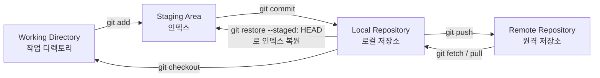

- Working Directory: 현재 체크아웃된 파일들이 있는 작업 공간이다.
- Staging Area: 다음 커밋에 포함될 변경 사항을 모아두는 인덱스다.
- Local Repository: `.git` 폴더 내의 객체 데이터베이스다.
- Remote Repository: GitHub, GitLab 등 외부 서버의 저장소다.

### .git 폴더의 내부 구조

일반 작업 저장소의 `.git` 디렉토리는 Git 메타데이터를 담는다. linked worktree나 submodule에서는 `.git`이 실제 위치를 가리키는 파일일 수 있고, bare 저장소는 작업 트리 없이 저장소 디렉토리 자체에 메타데이터를 둔다.

```
.git/
├── HEAD              # 현재 브랜치를 가리키는 포인터
├── config            # 로컬 설정
├── objects/          # 모든 객체 (blob, tree, commit, tag)
├── refs/
│   ├── heads/        # 로컬 브랜치
│   ├── tags/         # 태그
│   └── remotes/      # 원격 브랜치
├── index             # Staging Area 데이터
└── logs/             # ref 변경 이력 (reflog)
```

### 4종류의 객체

Git은 모든 데이터를 4종류의 객체로 저장한다. 각 객체는 저장소의 object format에 따른 해시로 식별된다. 기본 SHA-1 외에 SHA-256 형식도 있으므로 식별자를 항상 40자리로 가정하지 않는다.

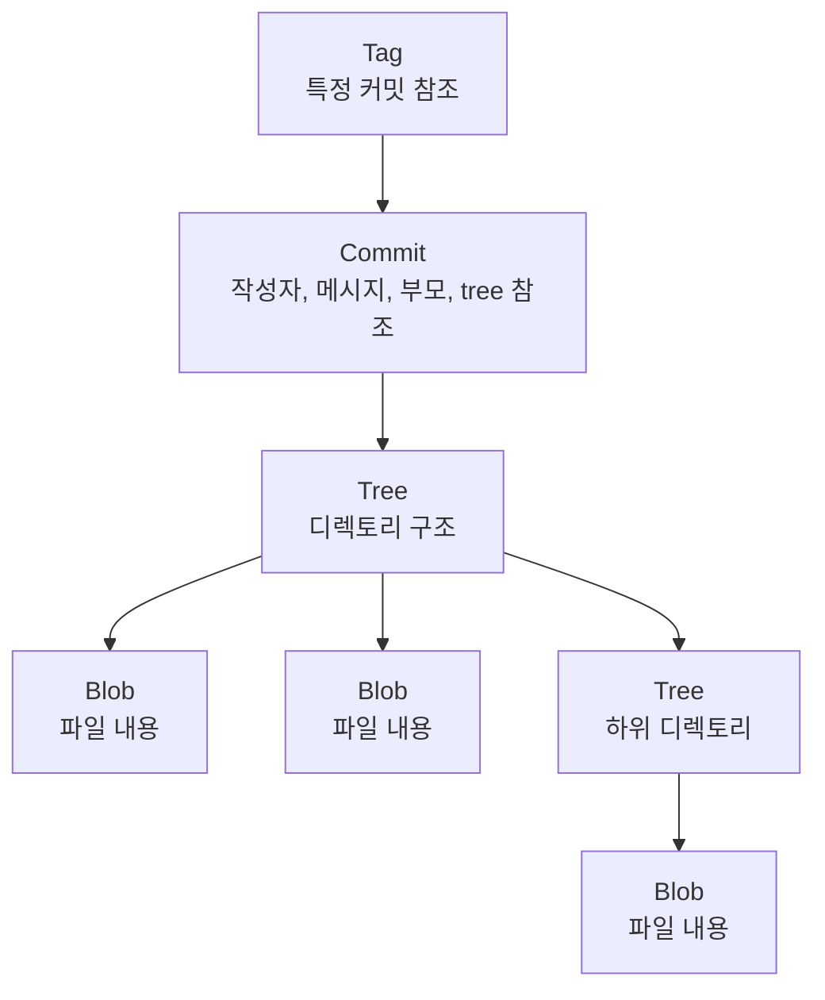

- Blob: 파일 내용 자체를 담는다. 파일명은 포함하지 않는다.
- Tree: 디렉토리 구조를 표현한다. blob과 다른 tree에 대한 참조를 가진다.
- Commit: 시점을 표현한다. tree, 부모 commit, 작성자, 메시지를 담는다.
- Tag: 주로 특정 커밋에 이름을 붙인다. annotated tag 객체는 다른 Git 객체도 가리킬 수 있고, lightweight tag는 별도 tag 객체 없이 ref만 둔다.

### 커밋 그래프

각 커밋은 부모 커밋을 참조한다. 머지 커밋은 부모가 둘 이상이다. 이 참조들이 모여 방향성 비순환 그래프(DAG)를 이룬다.

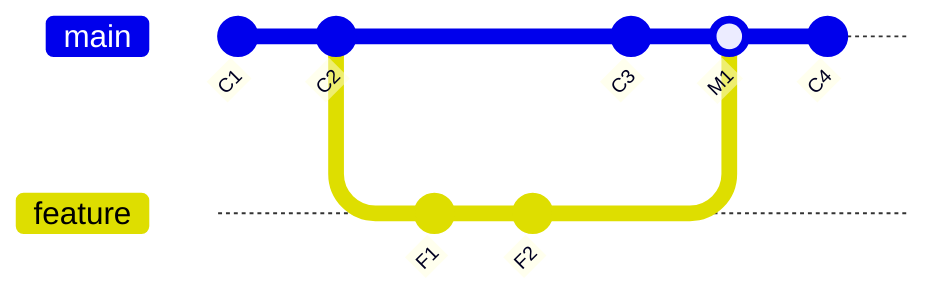

---

## 기본 명령어와 작업 흐름

### 저장소 시작

```bash
# 새 저장소 초기화
git init

# 원격 저장소 복제
git clone https://github.com/user/repo.git
git clone git@github.com:user/repo.git  # SSH
git clone --depth 1 <url>               # 최근 커밋 1개만 (얕은 복제)
```

### 상태 확인

```bash
git status              # 현재 변경 상태
git status -s           # 짧은 형식

git diff                # Working Dir vs Staging
git diff --staged       # Staging vs 마지막 커밋
git diff HEAD           # Working Dir vs 마지막 커밋
git diff main..feature  # 두 브랜치 비교
```

### 변경 사항 기록

```bash
git add <file>          # 특정 파일 스테이징
git add .               # 현재 디렉토리 이하 모든 변경
git add -A              # 저장소 전체 변경 (삭제 포함)
git add -p              # 패치 단위로 부분 스테이징

git commit -m "메시지"
git commit -am "메시지" # 추적 중인 파일을 add + commit
git commit --amend      # 마지막 커밋 수정
```

### 히스토리 조회

```bash
git log                         # 전체 로그
git log --oneline               # 한 줄씩
git log --graph --all --oneline # 그래프로 모든 브랜치
git log -p <file>               # 특정 파일의 변경 내역
git log --author="이름"
git log --since="2 weeks ago"
git log --grep="버그"           # 메시지 검색

git show <commit>               # 특정 커밋 상세
git blame <file>                # 줄별 마지막 수정자
```

### 일반적인 작업 흐름

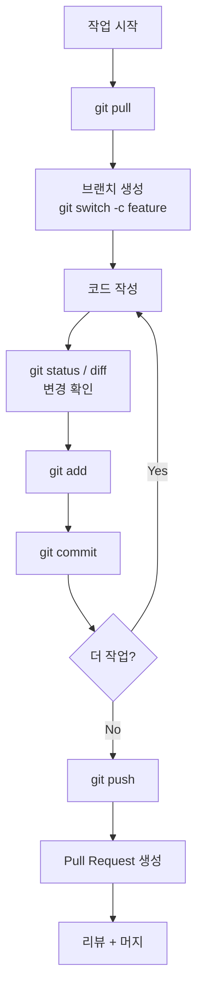

---

## 브랜치와 병합

### 브랜치는 포인터다

브랜치는 단순히 커밋을 가리키는 가벼운 포인터다. 새 브랜치는 파일 트리를 복사하지 않고 ref를 추가하므로 가볍다. 실제 41바이트 파일인지 여부는 해시 및 files/packed-refs/reftable 저장 형식에 따라 다르다. 따라서 브랜치를 자주, 작게 만들어도 무방하다.

### 브랜치 명령어

```bash
git branch                  # 로컬 브랜치 목록
git branch -a               # 원격 포함 전체
git branch -v               # 마지막 커밋과 함께

git switch <branch>         # 브랜치 전환 (Git 2.23+)
git switch -c <branch>      # 새 브랜치 생성 + 전환
git checkout <branch>       # 구버전 (브랜치 전환 + 파일 복원 겸용)

git branch -d <branch>      # 머지된 브랜치 삭제
git branch -D <branch>      # 강제 삭제
git branch -m <new>         # 현재 브랜치 이름 변경
```

### Merge vs Rebase

두 브랜치를 합치는 방식은 크게 두 가지다.

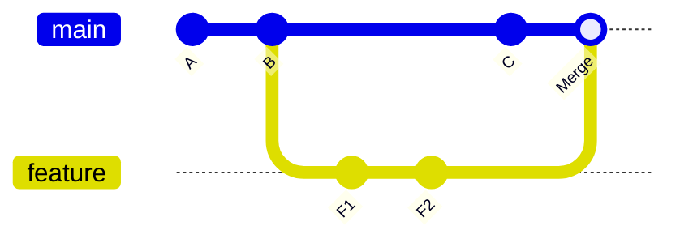

Merge는 양쪽 히스토리를 연결한다. 분기된 히스토리는 머지 커밋으로 통합하고, fast-forward가 가능하면 기본적으로 ref만 이동한다.

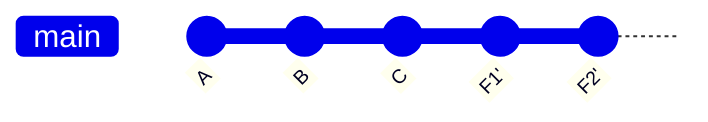

Rebase는 feature 브랜치의 커밋들을 main 끝에 다시 적용한다. 히스토리가 직선이 된다.

```bash
# Merge: fast-forward 가능 여부와 무관하게 머지 커밋 생성
git switch main
git merge --no-ff feature

# Fast-forward (분기 없으면 포인터만 이동)
git merge feature

# Squash: 여러 커밋을 하나로 압축해 머지
git merge --squash feature
git commit -m "feature 통합"

# Rebase: feature를 main 위에 다시 쌓기
git switch feature
git rebase main
```

### 병합 충돌 해결

같은 파일의 같은 영역을 양쪽이 수정한 경우 충돌이 발생한다.

```bash
git merge feature
# Auto-merging file.txt
# CONFLICT (content): Merge conflict in file.txt

git status                  # 충돌 파일 확인
# 파일을 열면 다음과 같은 마커가 보인다:
# <<<<<<< HEAD
# 현재 브랜치의 내용
# =======
# 머지 대상의 내용
# >>>>>>> feature

# 직접 편집하여 충돌 해결 후
git add <file>
git commit                  # merge 커밋 완성

# 머지를 포기하려면
git merge --abort
```

### 어떤 전략을 쓸 것인가

| 상황 | 권장 |
|-----|------|
| 공개 브랜치 통합 (main, develop) | merge |
| 내 로컬 브랜치를 최신화 | rebase |
| PR 머지 시 히스토리 정리 | squash merge |
| 이미 push한 커밋 | merge (rebase 금지) |

이미 푸시된 브랜치를 rebase하면 다른 협업자의 로컬 히스토리와 어긋나 강제 푸시가 필요하고, 이 과정에서 동료의 작업이 사라질 수 있다.

---

## 원격 저장소

### 원격 관리

```bash
git remote -v                                    # 원격 목록
git remote add origin <url>                      # 원격 추가
git remote remove origin                         # 원격 제거
git remote rename origin upstream                # 이름 변경
git remote set-url origin <new-url>              # URL 변경
```

### Fetch, Pull, Push

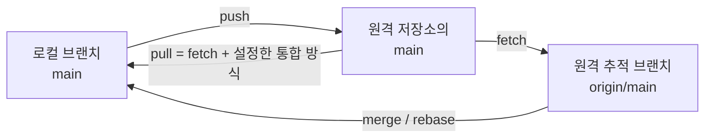

```bash
git fetch                       # 원격 변경 가져오기 (병합 안 함)
git fetch --all                 # 모든 원격 가져오기
git fetch --prune               # 삭제된 원격 브랜치 정리

git pull --ff-only              # fetch 후 fast-forward만 허용 (분기 시 중단)
git pull --no-rebase            # fetch + merge 방식 명시
git pull --rebase               # fetch + rebase (선형 히스토리)

git push                        # 현재 브랜치 푸시
git push -u origin feature      # 업스트림 설정과 함께 푸시
git push --tags                 # 태그 푸시
git push --force-with-lease     # 안전한 강제 푸시
git push origin --delete <br>   # 원격 브랜치 삭제
```

### --force vs --force-with-lease

`--force`는 원격 상태와 무관하게 덮어쓴다. 다른 사람이 그 사이 푸시한 커밋이 있으면 사라진다. `--force-with-lease`는 마지막으로 fetch한 시점과 원격 상태가 같을 때만 푸시를 허용한다. 강제 갱신이 합의된 경우에도 `--force-with-lease`를 사용한다. 다만 인자 없는 lease는 로컬 remote-tracking ref를 기준으로 하므로 편집기의 자동 fetch가 그 ref를 갱신하면 검토하지 않은 원격 변경을 덮어쓸 수 있다. `--force-with-lease=refs/heads/<branch>:<expected-commit>`처럼 확인한 기준 커밋을 명시하면 그 값과 원격이 같을 때만 갱신된다.

### 추적 브랜치

로컬 브랜치는 원격 브랜치를 추적할 수 있다. 추적 관계가 있으면 `git pull`, `git push`를 인자 없이 사용할 수 있다.

```bash
git branch -vv                                   # 추적 관계 확인
git branch --set-upstream-to=origin/main main    # 추적 설정
git push -u origin feature                       # 푸시하면서 추적 설정
```

---

## 협업 워크플로우

### Git Flow

장기 릴리스 사이클을 가진 제품에 적합하다. 5종류의 브랜치를 사용한다.

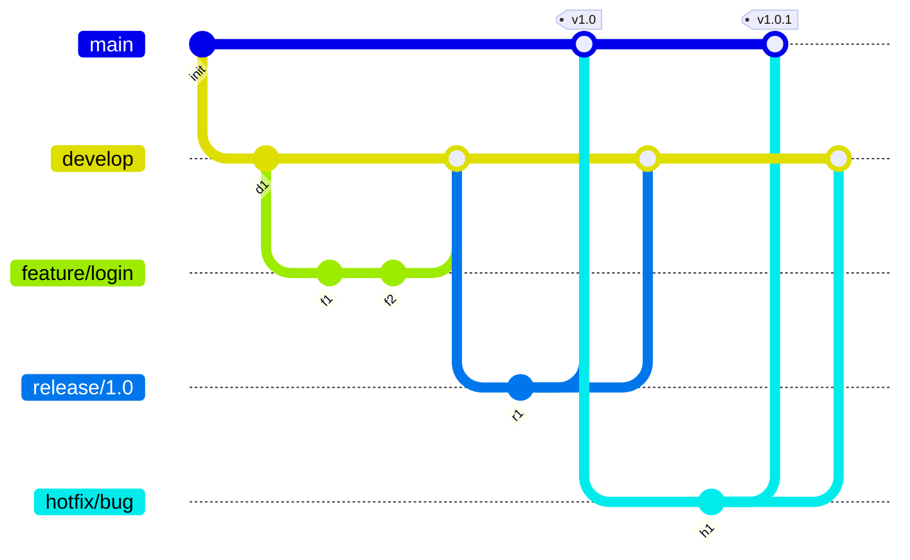

- main: 배포된 코드만 머지된다.
- develop: 다음 릴리스의 통합 브랜치다.
- feature/*: 기능 단위 작업 브랜치다.
- release/*: 릴리스 안정화 브랜치다.
- hotfix/*: 운영 긴급 패치 브랜치다.

### GitHub Flow

지속 배포 환경에서 적합하다. 단순하다.

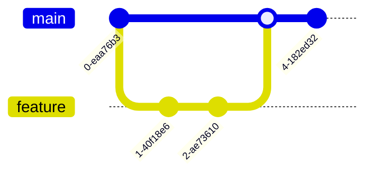

- main에서 직접 feature 브랜치를 만든다.
- PR을 통해 리뷰 후 main에 머지한다.
- main에 머지되면 즉시 배포된다.

### Trunk-Based Development

단일 메인 브랜치(trunk)에 자주, 작게 통합한다. feature flag로 미완성 기능을 숨긴다. 대규모 팀과 CI/CD가 성숙한 환경에서 효과적이다.

### Fork-PR 워크플로우

오픈소스 기여 방식이다.

```bash
# 1. 원본 저장소를 GitHub에서 fork

# 2. 내 fork 클론
git clone git@github.com:내계정/repo.git
cd repo

# 3. 원본을 upstream으로 추가
git remote add upstream https://github.com/원본/repo.git

# 4. feature 브랜치 작업 + 푸시
git switch -c fix/typo
# 작업
git push -u origin fix/typo

# 5. GitHub에서 원본을 향한 PR 생성

# 6. upstream 변경 동기화
git fetch upstream
git switch main
git merge upstream/main
git push
```

### 좋은 커밋의 조건

- 하나의 논리적 변경만 담는다. 무관한 변경은 별도 커밋으로 분리한다.
- 메시지는 명령형 현재 시제로 쓴다. "Add feature"이지 "Added feature"가 아니다.
- 첫 줄은 50자 이내, 본문은 72자 줄바꿈이 관례다.
- "왜" 변경했는지 설명한다. "무엇"은 diff가 보여준다.

```
feat: 사용자 프로필 캐싱 추가

기존에는 모든 요청에서 DB를 조회해 응답 시간이 평균 80ms였다.
Redis 기반 캐시 도입으로 캐시 히트 시 5ms로 단축된다.
TTL은 사용자 정보 변경 빈도를 고려해 5분으로 설정했다.

Closes #142
```

---

## 되돌리기와 히스토리 수정

### 작업 취소의 단계별 매트릭스

| 상태 | 명령어 |
|-----|------|
| Working Dir 변경 폐기 | `git restore <file>` |
| Staging 취소 (Working Dir 보존) | `git restore --staged <file>` |
| 마지막 커밋 메시지 수정 | `git commit --amend` |
| 마지막 커밋 취소 (변경 보존) | `git reset --soft HEAD~1` |
| 마지막 커밋 취소 (Working Dir 보존) | `git reset HEAD~1` |
| 마지막 커밋 취소 (전부 폐기) | `git reset --hard HEAD~1` |
| 푸시한 커밋 안전하게 되돌림 | `git revert <commit>` |

### reset의 3가지 모드

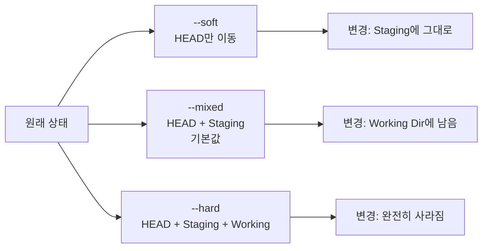

`--hard`는 위험하다. Working Directory의 변경 사항이 사라진다. 실행 전 `git status`로 잃어도 되는 변경인지 확인한다.

### revert와 reset의 차이

```bash
# reset: 히스토리에서 커밋을 삭제 (위치 이동)
git reset --hard HEAD~1

# revert: 그 커밋의 반대 변경을 새 커밋으로 추가
git revert <commit>
```

공유 브랜치(main 등)에서 이미 푸시된 커밋은 `revert`를 쓴다. `reset` 후 강제 푸시는 다른 협업자의 작업을 망가뜨린다.

### Interactive Rebase로 히스토리 정리

```bash
git rebase -i HEAD~5
```

편집기에서 각 커밋에 대해 명령어를 지정한다.

```
pick   abc1234 첫 번째 커밋
squash def5678 두 번째 커밋   # 이전 커밋과 합치기
reword ghi9012 세 번째 커밋   # 메시지 수정
edit   jkl3456 네 번째 커밋   # 커밋 자체를 수정
drop   mno7890 다섯 번째 커밋 # 삭제
```

- pick: 그대로 사용한다.
- reword: 메시지만 수정한다.
- edit: 일시 정지하고 커밋 내용을 수정할 기회를 준다.
- squash: 이전 커밋과 합친다. 메시지는 합쳐서 편집한다.
- fixup: squash와 같지만 메시지를 버린다.
- drop: 커밋을 삭제한다.
- 순서 변경: 줄 자체를 옮긴다. `reorder`라는 todo 명령을 쓰는 것은 아니다.

이미 푸시된 커밋에 대해 rebase를 하면 강제 푸시가 필요하므로, 공유 브랜치에서는 사용하지 않는다.

---

## 자주 마주치는 문제 상황

### 잘못된 브랜치에서 커밋한 경우

```bash
# main에서 작업한 커밋을 feature로 옮기기
git switch -c feature        # 현재 위치에서 feature 생성
git switch main
git reset --hard origin/main # main을 원격 상태로 되돌림
git switch feature           # feature에 커밋이 살아있음
```

### 커밋을 안 했는데 다른 브랜치로 전환해야 할 때

```bash
git stash                  # 변경 사항 임시 저장
git switch other-branch
# 작업 후
git switch original-branch
git stash pop              # 변경 사항 복원

git stash list             # stash 목록
git stash show -p          # 내용 확인
git stash drop             # stash 삭제
git stash apply stash@{2}  # 특정 stash 적용 (목록에 유지)
```

### Pull 시 충돌이 났을 때

```bash
git pull
# CONFLICT 발생

# 옵션 1: 충돌 해결 후 머지
# 파일 편집
git add <file>
git commit               # 머지 커밋 완성

# 옵션 2: rebase 방식으로 다시 시도
git merge --abort
git pull --rebase

# 옵션 3: 일단 포기
git merge --abort
```

### 커밋했지만 푸시 전에 변경을 추가하고 싶을 때

```bash
git add <file>
git commit --amend --no-edit  # 메시지 유지, 변경만 추가
git commit --amend             # 메시지도 수정
```

이미 푸시한 커밋에 amend를 하면 강제 푸시가 필요하므로 협업 브랜치에서는 사용하지 않는다.

### 실수로 삭제한 브랜치 복구

```bash
git reflog                # 모든 HEAD 이동 이력
# abc1234 HEAD@{5}: checkout: moved from feature to main
# def5678 HEAD@{6}: commit: 마지막 작업

git switch -c feature def5678  # 그 시점에서 브랜치 재생성
```

reflog 항목은 기본적으로 90일간 유지되지만, 어느 ref에서도 도달할 수 없는(unreachable) 커밋의 항목은 30일이 지나면 만료된다(`gc.reflogExpire`=90일, `gc.reflogExpireUnreachable`=30일). 삭제된 브랜치의 커밋은 후자에 해당하므로 30일 안에 복구하는 것이 안전하다.

### 큰 파일을 실수로 커밋한 경우

```bash
# 가장 최근 커밋이라면
git rm --cached big-file.zip
echo "big-file.zip" >> .gitignore
git commit --amend

# 이미 여러 커밋 전에 들어갔다면 (히스토리에서 완전 제거)
git filter-repo --path big-file.zip --invert-paths
# 또는 BFG Repo-Cleaner 사용
bfg --delete-files big-file.zip
```

공유된 히스토리를 다시 쓰면 조율된 강제 갱신과 다른 clone의 정리가 필요하다. 재클론이 흔한 복구 방법이며, 기존 clone을 유지하려면 이전 객체·브랜치를 다시 밀어 넣지 않도록 공식 이전 절차에 맞춰 정리한다.

### 커밋 안에 비밀번호/API 키를 푸시한 경우

1. 즉시 해당 키를 폐기(rotate)한다. 히스토리 제거보다 우선이다.
2. `git filter-repo`나 BFG로 히스토리에서 제거한다.
3. 강제 푸시한다.
4. 협업자에게 재클론을 요청한다.

GitHub의 경우 secret scanning이 자동으로 키를 감지해 알림을 보낼 수 있다. 푸시 전에 `git-secrets`, `pre-commit` 같은 도구로 차단하는 것이 더 안전하다.

### 잘못 푸시한 커밋을 되돌리기

```bash
# 안전한 방법: revert 커밋 추가
git revert <bad-commit>
git push

# 위험한 방법: 히스토리 재작성 (협업 브랜치에서 금지)
git reset --hard <good-commit>
git push --force-with-lease
```

### 머지 커밋 되돌리기

```bash
git revert -m 1 <merge-commit>
# -m 1: 첫 번째 부모(머지를 수행했던 브랜치, mainline)를 기준으로 되돌림
```

머지 커밋의 첫 번째 부모는 머지를 실행한 쪽 브랜치다. revert해도 히스토리상 "머지했다"는 사실 자체는 남으므로, 그때 제거한 변경을 다시 포함하려면 revert 커밋을 다시 revert하거나 원래 변경을 새로운 커밋으로 재작성해야 한다. 이후 새 커밋만 merge하는 것은 가능하지만 이전에 merge했다가 취소한 변경은 자동으로 재적용되지 않는다([revert-a-faulty-merge 문서](https://git-scm.com/docs/howto/revert-a-faulty-merge)).

### detached HEAD 상태에서 커밋한 경우

```bash
# 어떤 커밋을 직접 체크아웃하면 detached HEAD 상태가 된다
git checkout abc1234
# 여기서 커밋하면 어느 브랜치도 가리키지 않음

# 해결: 새 브랜치로 만들어 보존
git switch -c rescue-branch
```

### 파일 권한 변경만 표시되는 경우

Windows와 Unix 간 작업 시 실행 권한 비트가 변경되어 보일 수 있다.

```bash
git config core.fileMode false
```

### 줄바꿈(CRLF/LF) 문제

```bash
# Windows
git config --global core.autocrlf true   # 체크아웃 시 CRLF, 커밋 시 LF

# Mac/Linux
git config --global core.autocrlf input  # 커밋 시만 LF로 변환
```

`.gitattributes`로 저장소별 정책을 강제하는 것이 더 안정적이다.

```
* text=auto eol=lf
*.bat text eol=crlf
*.png binary
```

---

## 다중 계정 관리

개인 계정과 회사/팀 계정 등 여러 GitHub 계정을 사용해야 할 때가 있다. 핵심은 전역 설정과 로컬 설정의 우선순위를 활용하는 것이다.

### 설정의 우선순위

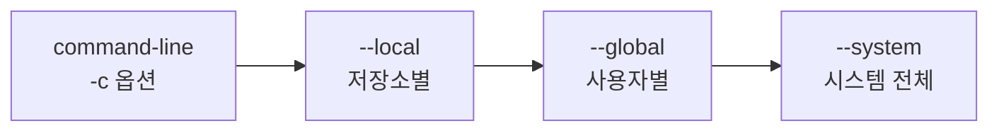

오른쪽으로 갈수록 우선순위가 낮다. 즉 `--local` 설정이 `--global`을 덮어쓴다.

### 기본 계정과 프로젝트별 계정 분리

```bash
# 메인 계정 (전역)
git config --global user.name "메인계정이름"
git config --global user.email "main@email.com"

# 특정 프로젝트만 다른 계정
cd /path/to/project
git config --local user.name "서브계정이름"
git config --local user.email "sub@email.com"
```

### 설정 확인

```bash
git config user.name              # 현재 적용되는 값
git config --global user.name     # 전역 값
git config --local user.name      # 로컬 값
git config --list --show-origin   # 어디서 온 설정인지 함께 표시
```

이 `user.name`/`user.email`은 커밋 작성자 메타데이터다. 원격 로그인 계정이나 접근 권한을 바꾸지 않는다. HTTPS credential과 SSH 키는 별도로 선택한다.

### Remote URL 변경

```bash
git remote -v                                       # 현재 remote 확인
git remote set-url origin https://github.com/계정/저장소.git
git remote set-url origin git@github.com:계정/저장소.git  # SSH
```

### Credential 캐시 초기화

기존 다른 계정의 인증 정보가 남아 있으면 새 계정 인증이 안 될 수 있다.

```bash
# Windows (Git Credential Manager 2.0부터 'git credential-manager'로 명령어 변경)
git credential-manager erase
cmdkey /delete:git:https://github.com

# Mac
git credential-osxkeychain erase
# 입력: host=github.com, protocol=https, 빈 줄

# Linux
git credential-cache exit
```

### SSH 키를 계정마다 분리

`~/.ssh/config` 파일을 사용하면 호스트 별칭으로 계정을 구분할 수 있다.

```
Host github-personal
    HostName github.com
    User git
    IdentityFile ~/.ssh/id_rsa_personal
    IdentitiesOnly yes

Host github-work
    HostName github.com
    User git
    IdentityFile ~/.ssh/id_rsa_work
    IdentitiesOnly yes
```

이후 remote URL은 호스트 별칭을 사용한다.

```bash
git remote add origin git@github-work:계정명/저장소명.git
```

### includeIf로 디렉토리별 자동 분리

```ini
# ~/.gitconfig
[user]
    name = 메인계정
    email = main@email.com

[includeIf "gitdir:~/work/"]
    path = ~/.gitconfig-work
```

```ini
# ~/.gitconfig-work
[user]
    name = 회사계정
    email = work@company.com
```

`~/work/` 아래의 모든 저장소는 자동으로 회사 계정 설정을 사용한다.

### 이미 잘못된 계정으로 커밋한 경우

```bash
# 마지막 커밋만
git commit --amend --author="이름 <email>" --no-edit

# 여러 커밋 (interactive rebase)
git rebase -i HEAD~5
# 각 커밋의 pick → edit으로 변경
# 각 커밋마다:
git commit --amend --author="이름 <email>" --no-edit
git rebase --continue
```

푸시되지 않은 커밋이라면 자유롭게 수정해도 된다. 푸시된 후 수정하면 강제 푸시가 필요하다.

---

## 고급 기능

### Stash: 임시 저장

```bash
git stash                          # 현재 변경 임시 저장
git stash push -m "메시지"          # 메시지와 함께
git stash -u                       # untracked 파일 포함
git stash list                     # 목록
git stash show -p stash@{0}        # 상세
git stash pop                      # 적용 성공 시 삭제. 충돌하면 stash는 남음
git stash apply stash@{2}          # 특정 stash 적용 (보존)
git stash drop stash@{1}           # 특정 stash 삭제
git stash clear                    # 모든 stash 삭제
git stash branch new-branch        # stash로 새 브랜치 생성
```

### Cherry-pick: 특정 커밋만 가져오기

```bash
git cherry-pick <commit>           # 한 개
git cherry-pick <c1>..<c2>         # 범위 (c1 제외, c2 포함)
git cherry-pick <c1>^..<c2>        # 범위 (c1 포함)
git cherry-pick --abort
git cherry-pick --continue
```

핫픽스 커밋을 main에서 release 브랜치로 옮길 때 자주 쓴다.

### Bisect: 이진 탐색으로 버그 찾기

```bash
git bisect start
git bisect bad                     # 현재가 버그 있음
git bisect good v1.0               # v1.0은 정상

# Git이 중간 커밋을 체크아웃해줌
# 테스트 후
git bisect good   # 또는 bad

# 반복하면 버그 도입 커밋을 찾음
git bisect reset                   # 종료
```

자동화하면 더 빠르다.

```bash
git bisect start HEAD v1.0
git bisect run npm test
```

### Reflog: 안전망

```bash
git reflog                # HEAD의 모든 이동
git reflog show feature   # 특정 브랜치의 이동

# 사라진 커밋 복구
git switch -c rescue abc1234
```

reset, rebase, branch 삭제 등으로 사라진 커밋도 reflog에 기록된 SHA를 알면 복구할 수 있다. 기본 보존 기간은 도달 가능한 항목 90일, 도달 불가능한 항목 30일이다([git-gc 문서](https://git-scm.com/docs/git-gc#Documentation/git-gc.txt-gcreflogExpire)).

### Worktree: 한 저장소, 여러 작업 디렉토리

```bash
git worktree add ../repo-feature feature
# ../repo-feature에서 feature 브랜치로 작업

git worktree list
git worktree remove ../repo-feature
```

같은 저장소를 여러 폴더에서 동시에 다른 브랜치로 체크아웃할 수 있다. stash 없이 컨텍스트 스위칭이 가능하다.

### Submodule: 저장소 안의 저장소

```bash
git submodule add <url> path/lib
git submodule update --init --recursive
git clone --recursive <url>            # 클론과 동시에 서브모듈 초기화

# 서브모듈 업데이트
git submodule update --remote
```

서브모듈은 특정 커밋을 고정한다. 그 자체가 별도 저장소이므로 변경 후 서브모듈 안에서 별도 push가 필요하다. 의존성 관리는 서브모듈보다 패키지 매니저가 적합한 경우가 많다.

### Tag

```bash
git tag v1.0                       # lightweight tag
git tag -a v1.0 -m "릴리스 1.0"     # annotated tag (작성자, 날짜, 메시지 포함)
git tag                            # 목록
git show v1.0
git push origin v1.0               # 특정 태그 푸시
git push --tags                    # 모든 태그 푸시
git tag -d v1.0                    # 로컬 삭제
git push origin --delete v1.0      # 원격 삭제
```

릴리스 버전은 annotated tag로 관리한다. CI에서 태그 기준으로 빌드/배포 트리거를 거는 경우가 많다.

### Hooks

`.git/hooks/` 안의 스크립트로 특정 이벤트에 자동 실행할 수 있다.

- pre-commit: 커밋 직전. 린트, 포맷, 단위 테스트.
- commit-msg: 커밋 메시지 검증.
- pre-push: 푸시 직전. 통합 테스트.
- post-merge: 머지 후. 의존성 재설치.

`.git/hooks/`는 클론 시 복사되지 않는다. 팀 단위로 공유하려면 `pre-commit` 같은 도구를 사용한다.

### 검색

```bash
git grep "패턴"                     # 추적 중인 파일에서 검색
git log -S "패턴"                   # 패턴이 추가/제거된 커밋 찾기 (pickaxe)
git log -G "정규식"                 # 정규식 기반 pickaxe
```

### 효율적인 alias

```bash
git config --global alias.co checkout
git config --global alias.br branch
git config --global alias.st status
git config --global alias.lg "log --graph --oneline --all"
git config --global alias.unstage "restore --staged"
```

---

## .gitignore와 .gitattributes

### .gitignore

추적되지 않은 파일 중 Git이 무시할 패턴을 지정한다.

```
# 주석은 #로 시작

# 특정 파일
secret.key

# 패턴
*.log
*.tmp

# 디렉토리
node_modules/
build/

# 부정 (예외)
!important.log

# 루트만 매칭
/config.local

# 깊이 무관
**/temp/

# 와일드카드
[Dd]ebug/
```

이미 추적 중인 파일은 .gitignore에 추가해도 무시되지 않는다. 추적에서 제외해야 한다.

```bash
git rm --cached <file>             # 추적 해제 (파일은 보존)
git rm --cached -r <directory>     # 디렉토리 단위
```

### .gitattributes

파일별 Git 동작을 제어한다.

```
# 자동 줄바꿈 처리
* text=auto eol=lf

# 바이너리 명시
*.png binary
*.jar binary

# 머지 전략 (내장 드라이버는 text, binary, union뿐이므로
# 'ours' 드라이버는 정의 필요: git config merge.ours.driver true)
package-lock.json merge=ours

# diff 표시 방식
*.ipynb diff=jupyter

# export 시 제외
.gitignore export-ignore
tests/ export-ignore

# Linguist (GitHub 언어 통계 제외)
vendor/* linguist-vendored
docs/* linguist-documentation
```

### 일반적인 .gitignore 예시 (다언어)

```
# OS
.DS_Store
Thumbs.db

# Editor
.vscode/
.idea/
*.swp

# Logs
*.log
logs/

# Dependencies
node_modules/
vendor/
__pycache__/

# Build
dist/
build/
out/
target/

# Environment
.env
.env.local

# Cache
.cache/
.parcel-cache/
```

GitHub의 [github/gitignore](https://github.com/github/gitignore) 저장소에 언어별 템플릿이 있다.

---

## 게임 개발과 Git: 대용량 바이너리 에셋

대용량 게임 에셋은 객체 저장·전송과 병합에서 부담을 만든다. 압축된 텍스처·오디오는 델타 압축 효율이 낮을 수 있지만 모든 바이너리 변경이 항상 파일 전체 크기만큼 늘어나는 것은 아니다. 도달 가능한 과거 객체는 유지되지만 unreachable 객체는 GC로 정리될 수 있으므로 저장소 크기가 영구히 단조 증가하는 것도 아니다.

텍스트인 Unity `.unity` 장면도 있고 전용 diff/merge 도구를 쓸 수 있는 형식도 있다. 반면 일반 텍스트 병합이 의미 없는 바이너리는 편집 충돌을 자동 결합하기 어려워 잠금이나 작업 분담이 중요하다. 일반 전체 clone은 히스토리를 받으므로 에셋 이력이 커지면 초기 전송 부담도 커진다.

### Git LFS

[Git LFS](https://git-lfs.com/)는 대용량 파일을 저장소 밖 별도 스토리지에 두고, 저장소에는 해시와 크기만 적힌 작은 포인터 파일을 커밋한다. checkout 시점에 실제 파일을 받아온다.

```bash
git lfs install                      # 기본: 사용자 필터 설정 + 현재 저장소 pre-push hook
# 저장소 설정에만 필터를 둘 때: git lfs install --local
git lfs track "*.png" "*.uasset" "*.umap"     # .gitattributes 에 filter=lfs 규칙 기록
git add .gitattributes               # 추적 규칙 자체도 커밋
git add Texture.png && git commit    # 이후는 평소처럼
```

`.gitattributes`에는 다음처럼 기록된다.

```text
*.png  filter=lfs diff=lfs merge=lfs -text
*.uasset filter=lfs diff=lfs merge=lfs -text lockable
*.umap filter=lfs diff=lfs merge=lfs -text lockable
```

`lockable`을 붙이면 `git lfs lock Maps/Level01.umap`으로 파일 잠금을 선언할 수 있다. 의미 있는 자동 병합이 어려운 에셋에서는 작업 분담과 잠금으로 동시 편집 충돌을 줄일 수 있다(잠그지 않은 파일은 읽기 전용으로 체크아웃된다).

주의할 점: LFS 추적을 시작해도 이미 일반 객체로 커밋된 과거 히스토리는 그대로다. 기존 저장소를 이전하려면 `git lfs migrate import --include="*.png"`로 히스토리를 다시 써야 하며, 이는 공유 브랜치 히스토리 재작성이므로 팀 전체 조율이 필요하다.

### 업계 현실: Perforce와의 분업

대형 스튜디오 다수는 에셋에 Perforce(Helix Core)를 쓴다. 중앙집중식이라 부분 체크아웃(워크스페이스 매핑)과 배타적 체크아웃이 1급 기능이고, 아티스트 워크플로우(잠그고 → 수정하고 → 제출)와 맞물린다. Unreal Engine 에디터의 소스 컨트롤 통합도 Perforce가 1순위다. 반면 코드에는 Git을 쓰는 하이브리드 구성이 흔하다 — 코드는 분산 브랜칭의 이점이 크고, 에셋은 잠금·부분 동기화의 이점이 크기 때문에 도구를 나누는 것이다. Git 단일 구성으로 가려면 LFS + 잠금 + (대형 저장소라면) partial clone(`--filter=blob:none`)과 sparse-checkout을 조합한다.

---

## 결론

Git의 강점은 분산 구조와 가벼운 브랜치다. 일반적인 전체 clone은 히스토리를 복제하므로 서버 장애 중에도 기록과 탐색이 가능하고, 브랜치 생성 비용이 사실상 0이므로 작은 단위로 자주 분기할 수 있다. 이 두 특성이 GitHub Flow나 Trunk-Based Development 같은 현대적 워크플로우의 기반이 된다.

명령어는 다양하지만 4개 영역(Working Directory, Staging, Local, Remote)과 4종류 객체(blob, tree, commit, tag), 그리고 브랜치는 포인터라는 사실을 이해하면 모든 동작이 일관되게 보인다. add는 Working Dir에서 Staging으로 이동시키고, commit은 Staging의 스냅샷으로 새 commit 객체를 만들며, push는 로컬 ref가 가리키는 객체들을 원격에 보낸다.

실무에서 가장 자주 쓰는 도구는 reflog와 stash다. reflog는 reset, rebase, 브랜치 삭제로 사라진 커밋을 만료 전(도달 불가능한 커밋 기준 기본 30일)까지 복구할 수 있게 해주는 안전망이다. stash는 미완성 작업을 잠시 치워두고 다른 브랜치로 옮길 때 마찰을 줄인다. 이 둘만 익숙해져도 Git이 훨씬 덜 무섭다.

협업의 황금률은 단순하다. 공유 브랜치의 히스토리는 다시 쓰지 않는다. 이미 푸시한 커밋을 되돌릴 때는 reset이 아니라 revert를 쓰고, rebase는 내 로컬 브랜치에서만 한다. 강제 푸시가 꼭 필요하면 `--force` 대신 `--force-with-lease`로 동료의 작업을 보호한다. 이 원칙을 지키면 Git의 위험한 명령어도 안전한 도구가 된다.

## 더 읽을거리

- Scott Chacon, Ben Straub, [Pro Git 2판](https://git-scm.com/book/ko/v2) — 특히 10장 "Git의 내부"가 객체 모델을 다룬다.
- [Git Reference Manual](https://git-scm.com/docs) — 각 명령어의 공식 문서.
- [Git 공식 문서: gitattributes](https://git-scm.com/docs/gitattributes), [gitignore](https://git-scm.com/docs/gitignore)
- Atlassian, [Merging vs. Rebasing](https://www.atlassian.com/git/tutorials/merging-vs-rebasing) — merge/rebase 트레이드오프 정리.
- [Git LFS 공식 사이트](https://git-lfs.com/), [git-lfs 문서: File Locking](https://github.com/git-lfs/git-lfs/wiki/File-Locking) — 게임 에셋 관리의 출발점.
- GitHub Blog, [Get up to speed with partial clone and shallow clone](https://github.blog/open-source/git/get-up-to-speed-with-partial-clone-and-shallow-clone/) — 대형 저장소 클론 전략.
