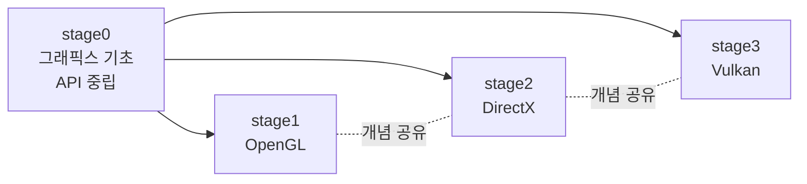

# 그래픽스 시리즈

저수준 그래픽스 프로그래밍을 *기초 이론* 에서 *세 가지 그래픽스 API* 까지 단계적으로 다루는 시리즈. API에 독립적인 개념(파이프라인·변환·래스터화·색·셰이딩·광원·가시성)을 먼저 세우고, 같은 개념을 OpenGL·DirectX·Vulkan으로 차례로 구현한다.

## 읽는 순서

**stage0(기초)** 가 토대다. 여기서 세운 추상 — 파이프라인의 단계, 좌표 변환의 수학, 래스터화 알고리즘, 색·감마, 셰이딩과 광원 이론, 가시성 — 은 어느 API에서나 그대로 통한다. stage1~3은 *같은 개념* 을 각 API의 구체적 객체와 함수로 *구현* 할 뿐이다. 그래서 어떤 API부터 시작하든 **stage0를 먼저 읽기** 를 권한다 — 그러면 stage1~3에서 낯선 함수를 만나도 "이건 어느 추상 단계인가"로 제자리에 끼워 넣을 수 있다.

## Stage 0 — 그래픽스 기초 (API 중립)

특정 라이브러리에 묶이지 않는 그래픽스 *자체* 의 기본. 변환 수학·래스터화·색·셰이딩 같은 개념을 한 API의 부속물이 아니라 독립된 토대로 다룬다.

| # | 회차 | 핵심 내용 |
|---|---|---|
| 01 | [파이프라인 개관](stage0_fund_01_pipeline_overview.md) | 정점→픽셀 추상 파이프라인, 프로그래머블/고정 함수, API별 매핑 표 |
| 02 | [좌표계와 변환](stage0_fund_02_coordinate_transform.md) | 동차좌표·MVP·투영행렬의 계약·원근 분할, NDC 컨벤션 API별 차이, 법선 변환 |
| 03 | [래스터화](stage0_fund_03_rasterization.md) | 엣지 함수·무게중심 좌표·top-left 규칙·원근 보정 보간, 래스터라이저 의사코드 |
| 04 | [색과 감마](stage0_fund_04_color_gamma.md) | 선형 vs sRGB, 감마 파이프라인, 알파 합성(over)·프리멀티플라이드, HDR·톤 매핑 |
| 05 | [셰이딩과 머티리얼](stage0_fund_05_shading_materials.md) | Lambert·Blinn-Phong → BRDF·Cook-Torrance, 광원 모델(방향광·점광·스폿)·역제곱 감쇠·다중 광원 누적, 이방성·SSS·투과·레이어드 머티리얼 |
| 06 | [깊이와 가시성](stage0_fund_06_depth_visibility.md) | 깊이 버퍼·reverse-Z·Z-fighting, 컬링, 투명 정렬·OIT, 앨리어싱·MSAA·TAA |
| 07 | [텍스처링과 샘플링](stage0_fund_07_texturing_sampling.md) | UV 매핑·필터링(bilinear/trilinear)·밉맵·비등방·래핑, 텍스처 종류와 색공간 |
| 08 | [프레임버퍼와 멀티패스](stage0_fund_08_framebuffer_multipass.md) | 오프스크린 렌더 타깃·후처리·MRT/G-buffer·포워드vs디퍼드·그림자 매핑 |
| 09 | [지오메트리와 메시](stage0_fund_09_geometry_mesh.md) | 정점·인덱스·법선/접선·인스턴싱·LOD·테셀레이션·디스플레이스먼트·메시 셰이더 |

## Stage 0-adv — 그래픽스 심화 (API 중립)

기초 트랙에서 배운 렌더링 개념을 바탕으로, 고정 래스터 파이프라인을 넘어 GPU 실행 구조·컴퓨트·전역 조명·자원 메모리를 다루는 *심화* 트랙이다.

| # | 회차 | 핵심 내용 |
|---|---|---|
| 01 | [GPU 아키텍처](stage0_adv_01_gpu_architecture.md) | SIMT·메모리 계층·점유율·발산·GPU 성능 모델 |
| 02 | [컴퓨트와 GPGPU](stage0_adv_02_compute_gpgpu.md) | 워크그룹·공유메모리·배리어·리덕션/스캔·GPU 주도 렌더링·발산/점유율 |
| 03 | [전역 조명과 레이트레이싱](stage0_adv_03_global_illumination_raytracing.md) | 간접광 근사·IBL·프로브·BVH·패스 트레이싱·하이브리드 렌더링·디노이징 |
| 04 | [GPU 자원 메모리](stage0_adv_04_gpu_memory_system.md) | 자원 배치·전송·서브할당·상주·동적 링·동기화·스트리밍 |

## Stage 1 — OpenGL

크로스 플랫폼의 고전. 상태 머신 모델과 GLSL로 그래픽스의 기본기를 익힌다.

| 구분 | 회차 |
|---|---|
| 기초 | [01 컨텍스트](stage1_gl_fund_01_context.md) · [02 변환](stage1_gl_fund_02_transform.md) · [03 파이프라인](stage1_gl_fund_03_pipeline.md) · [04 텍스처](stage1_gl_fund_04_texture.md) · [05 프레임버퍼](stage1_gl_fund_05_framebuffer.md) |
| 프로젝트 | [01 큐브](stage1_gl_proj_01_cube.md) · [02 모델](stage1_gl_proj_02_model.md) · [03 라이팅](stage1_gl_proj_03_lighting.md) · [04 그림자](stage1_gl_proj_04_shadow.md) · [05 후처리](stage1_gl_proj_05_postprocess.md) |

## Stage 2 — DirectX

COM 기반 객체 모델, HLSL, 그리고 DX11에서 DX12로의 명시적 저수준 전환.

| 구분 | 회차 |
|---|---|
| 기초 | [01 COM](stage2_dx_fund_01_com.md) · [02 리소스](stage2_dx_fund_02_resource.md) · [03 HLSL](stage2_dx_fund_03_hlsl.md) · [04 DX12](stage2_dx_fund_04_dx12.md) |
| 프로젝트 | [01 큐브](stage2_dx_proj_01_cube_dx11.md) · [02 모델](stage2_dx_proj_02_model_dx11.md) · [03 PBR](stage2_dx_proj_03_pbr_dx11.md) · [04 DX12 전환](stage2_dx_proj_04_dx12_transition.md) · [05 컴퓨트·DXR](stage2_dx_proj_05_compute_dxr.md) |

## Stage 3 — Vulkan

가장 명시적인 저수준 API. GPU 하드웨어 구조와 직접 마주한다.

| 구분 | 회차 |
|---|---|
| 기초 | [01 파이프라인](stage3_vk_fund_01_pipeline.md) · [02 Vulkan 코어](stage3_vk_fund_02_vulkan_core.md) |
| 프로젝트 | [01 텍스처 큐브](stage3_vk_proj_01_textured_cube.md) · [02 모델 로딩](stage3_vk_proj_02_model_loading.md) · [03 PBR](stage3_vk_proj_03_pbr.md) · [04 그림자](stage3_vk_proj_04_shadow.md) · [05 컴퓨트](stage3_vk_proj_05_compute.md) · [06 고급](stage3_vk_proj_06_advanced.md) |

## stage0 ↔ stage1~3 개념 지도

stage0의 각 기초가 API 회차의 어디서 구체화되는지의 빠른 참조.

| stage0 기초 | OpenGL | DirectX | Vulkan |
|---|---|---|---|
| 02 변환 | gl_fund_02 | (각 proj의 큐브/모델) | (각 proj의 큐브/모델) |
| 03 래스터화 | (고정 함수, 파이프라인 회차) | dx_fund_04 | vk_fund_01 |
| 04 색·감마 | gl_fund_04(텍스처)·05 | dx_fund_02 | vk_fund_01·02 |
| 05 셰이딩·광원·PBR | gl_proj_03 | dx_proj_03 | vk_proj_03 |
| 06 깊이·가시성 | gl_fund_05·proj_04 | dx_proj_01·04 | vk_fund_01·proj_04 |
| 07 텍스처·샘플링 | gl_fund_04 | dx_fund_02 | vk_proj_01·02 |
| 08 프레임버퍼·멀티패스 | gl_fund_05·proj_05 | dx_proj_04 | vk_fund_01·proj_04 |
| 09 지오메트리·메시 | gl_fund_03 | dx_fund_02 | vk_proj_02 |
| GPU 하드웨어 | 공통 stage0 심화에서 설명 | 공통 stage0 심화에서 설명 | 공통 stage0 심화에서 설명 |
