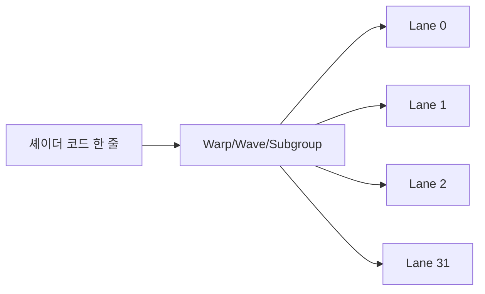
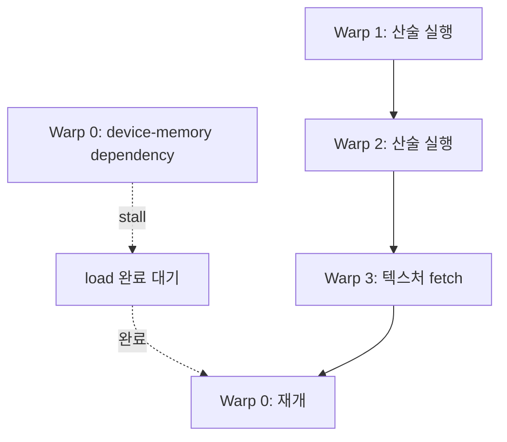
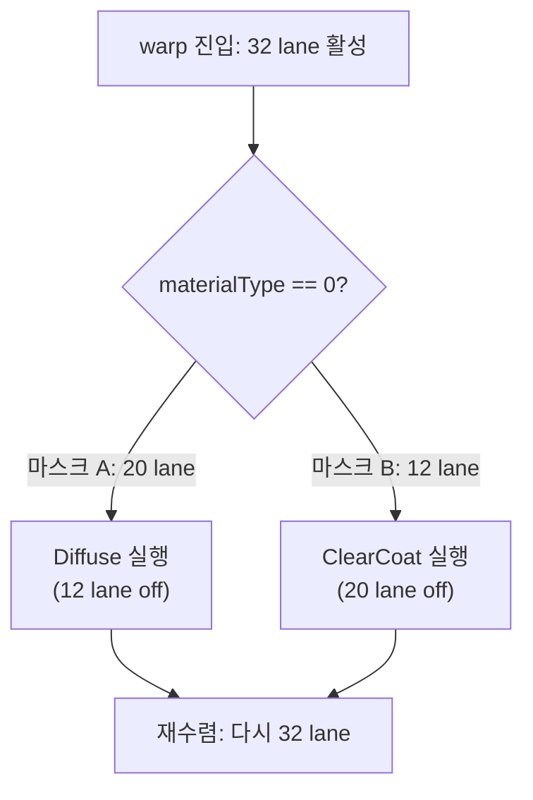

## 들어가며

GPU는 많은 산술 유닛에 규칙적인 병렬 작업을 공급해 처리량을 얻는 처리기다. 고성능 CPU 코어가 한두 스레드의 지연을 줄이기 위해 큰 비순차 실행 창·분기 예측·캐시에 많은 자원을 쓰는 반면, GPU는 더 많은 실행 lane과 resident 작업, 넓은 메모리 처리량에 다른 균형으로 자원을 배분한다. 실제 GPU도 캐시·스케줄러·분기 하드웨어를 가지므로 “제어 로직이 없는 단순 ALU 집합”은 아니다. 이 실행·메모리 단위를 무시하면 같은 수학을 수행하는 셰이더도 처리량이 크게 달라질 수 있다.

그래픽스 API는 정점, 픽셀, 컴퓨트 셰이더를 추상화하지만 실제 실행 단위는 스레드 하나가 아니라 warp, wave, subgroup 같은 묶음이다. 메모리 접근도 포인터 하나를 읽는 문제가 아니라 수십 lane의 주소가 얼마나 연속적인지, 캐시와 VRAM 대역폭을 얼마나 잘 쓰는지의 문제다. 분기 하나도 lane들이 같은 길을 가느냐 갈라지느냐에 따라 비용이 몇 배로 달라진다.

이 글은 현대 GPU의 실행 모델, 메모리 계층, 점유율(Occupancy), 분기 발산(Warp Divergence), 고정 기능 유닛을 정리한다. 정량적인 수치(레지스터 개수, 트랜잭션 크기)와 측정 기준(캐시 지연, 대역폭)을 곁들여 GPU가 어떤 단위로 무엇을 하는지를 구체적으로 본다. 목표는 셰이더 코드를 볼 때 "이 코드는 몇 개 lane이 함께 실행되고, 어느 메모리를 두드리며, 어느 하드웨어 유닛을 병목으로 만드는가"를 판단할 수 있게 만드는 것이다.


---

## 목차
1. [SIMT 실행 모델](#1-simt-실행-모델)
2. [메모리 계층](#2-메모리-계층)
3. [Occupancy와 지연 숨기기](#3-occupancy와-지연-숨기기)
4. [Warp Divergence](#4-warp-divergence)
5. [Fixed-Function 유닛](#5-fixed-function-유닛)
6. [아키텍처별 특성](#6-아키텍처별-특성)
7. [Occupancy 분석 도구](#7-occupancy-분석-도구)
8. [성능 특성 요약](#8-성능-특성-요약)


---

## 1. SIMT 실행 모델

GPU 셰이더의 소스 코드는 스레드 하나가 독립적으로 실행되는 것처럼 보인다.

```glsl
vec3 color = texture(albedo, uv).rgb;
color *= max(dot(normal, lightDir), 0.0);
```

하지만 하드웨어는 수십 개 스레드를 한 묶음으로 실행한다. NVIDIA는 전통적으로 32 lane warp를 사용하고, AMD는 RDNA 세대부터 wave32와 wave64를 둘 다 지원하며(GCN 세대는 wave64 고정이었다), Intel Xe는 SIMD8/16/32를 컴파일러가 고른다. Vulkan에서는 이 묶음을 subgroup으로 노출한다. 같은 명령이 여러 lane에 동시에 적용되므로 SIMT(Single Instruction, Multiple Threads) 모델이라고 부른다.



각 lane은 서로 다른 정점, 픽셀, 파티클을 처리하고, 하드웨어는 현재 같은 명령을 실행할 수 있는 활성 lane을 묶어 발행한다. 전통적인 NVIDIA warp는 공유 프로그램 카운터와 활성 마스크로 설명할 수 있지만 Volta 이후에는 lane별 프로그램 카운터·호출 스택을 유지하는 Independent Thread Scheduling을 사용한다. AMD·Intel의 실행 상태와 재수렴 방식도 같지 않다. 공통된 성능 사실은 같은 subgroup의 lane이 같은 경로를 탈수록 발행 슬롯을 더 잘 활용하고, 경로가 갈라지면 여러 경로를 활성 마스크를 달리해 처리해야 한다는 점이다.

### SIMT와 SIMD의 차이

SIMT는 SIMD(Single Instruction, Multiple Data)와 자주 혼동되지만 프로그래밍 모델의 추상 수준이 다르다. SIMD는 `_mm256_add_ps` 같은 폭 8짜리 벡터 연산을 *프로그래머가 직접* 다룬다. lane 사이의 분기나 개별 lane의 주소 계산을 코드로 명시해야 한다. SIMT는 그 폭을 하드웨어와 컴파일러가 가린다. 스칼라 코드처럼 `if`를 쓰면 컴파일러가 *실행 마스크(execution mask)* 와 분기 재수렴(reconvergence) 코드를 자동으로 깔아 준다.

SIMT는 여러 lane에 공통 명령을 발행한다는 점에서 SIMD와 닮았지만, “warp 하나 = 폭 32 ALU 하나 = 32비트 마스크 하나”는 NVIDIA의 특정 세대를 단순화한 그림일 뿐 GPU 일반 계약이 아니다. wave 폭, 한 명령을 실제 ALU 파티션에서 처리하는 cycle 수, 실행 마스크 표현과 lane별 실행 상태는 아키텍처마다 다르다. 프로그래머에게 중요한 공통 계약은 subgroup 폭을 질의하고, 활성 lane·재수렴·subgroup 동기화 규칙을 명시적으로 지키는 것이다.

### lane, warp, workgroup, grid

실행 단위는 계층을 이룬다. Vulkan/GLSL 컴퓨트 셰이더의 디스패치를 예로 들면 다음과 같다.

```glsl
layout(local_size_x = 64, local_size_y = 1, local_size_z = 1) in;
// vkCmdDispatch(cmd, 1024, 1, 1) 로 디스패치하면:
//   - 전체 invocation: 64 * 1024 = 65,536 개
//   - workgroup: 1024 개, 각 workgroup은 64 invocation
//   - subgroup 크기가 32인 장치: workgroup 하나당 2 subgroup
```

| 단위 | GLSL/Vulkan 용어 | 스케줄 단위 | 비고 |
|---|---|---|---|
| lane | invocation | 가장 작은 실행 단위 | `gl_LocalInvocationIndex` |
| warp/wave | subgroup | 실제 명령 발급 단위 | 크기는 구현·셰이더 단계에 따라 질의 |
| workgroup | local workgroup | shared memory 공유 단위 | `gl_WorkGroupID` |
| grid | dispatch | 디스패치 전체 | `vkCmdDispatch` 인자 |

subgroup은 하드웨어가 함께 명령을 발급하는 단위다. workgroup 크기가 실제 subgroup 크기의 배수가 아니면 마지막 subgroup에 비활성 lane이 생길 수 있다. 예를 들어 subgroup이 32인 실행에서 `local_size=48`이면 두 번째 subgroup의 절반만 활성이다. 그러나 subgroup 크기는 벤더 이름만으로 32 또는 64라고 고정할 수 없고, Vulkan에서는 장치 속성과 subgroup size control 기능을 질의해야 한다. workgroup 크기는 subgroup 충전뿐 아니라 레지스터·공유 메모리 사용량, workgroup당 병렬성, 문제의 타일 모양을 함께 바꾸므로 64·128·256 같은 후보를 실제 커널에서 측정해 고른다.

### subgroup 연산으로 직렬화 줄이기

Vulkan의 subgroup 연산은 이 묶음을 직접 활용한다. 같은 warp 안의 lane끼리는 레지스터 값을 셔플(shuffle)하거나 리덕션할 수 있어, 전역 메모리나 atomic을 거치지 않고도 lane 간 통신이 가능하다.

```glsl
#extension GL_KHR_shader_subgroup_arithmetic : require
#extension GL_KHR_shader_subgroup_ballot : require

uint aliveCount = subgroupAdd(uint(isAlive));   // warp 내 합산 (레지스터만 사용)
if (subgroupElect()) {                          // 대표 lane 하나 선출
    atomicAdd(globalAliveCount, aliveCount);    // 전역 atomic은 warp당 1회
}
```

각 활성 lane이 atomic을 한 번씩 발급하면 동일 주소의 read-modify-write가 직렬화될 수 있다. subgroup 안에서 먼저 합산하고 대표 lane 하나만 전역 atomic을 수행하면 전역 atomic 발급 수를 활성 lane 수에서 subgroup당 한 번으로 줄인다. 감소율은 subgroup 폭과 활성 lane 수에 달려 있으며 항상 1/32는 아니다. 파티클 컬링, 히스토그램, 가시성 카운트 같은 작업에서 흔히 쓰는 패턴이다.

## 2. 메모리 계층

GPU 메모리 계층은 CPU와 비슷해 보이지만 처리량 중심 설계의 비중이 크다. CPU도 out-of-order 실행, prefetch와 여러 미스를 겹쳐 latency를 숨기므로 L1 miss 하나가 곧 코어 전체 정지는 아니다. GPU는 여기에 많은 resident warp/wave를 두고, 한 warp가 dependency를 기다릴 때 ready 상태인 다른 warp의 instruction을 발행하는 방식으로 더 많은 latency를 겹친다.

| 계층 | 가시 범위 | 핵심 제약 | 대표 용도 |
|---|---|---|---|
| Register | lane/thread private | instruction dependency latency, register 수와 occupancy | 임시 변수, 중간 계산 |
| Shared/LDS | workgroup 공유 | 용량, bank mapping, barrier | 타일링, reduction, prefix sum |
| L0/L1/texture cache | SM/CU 또는 그 일부 | 아키텍처별 분리·통합 구조, locality | texture·buffer 재사용 |
| L2/last-level cache | GPU 전역 | 여러 engine/SM 경합, line/sector와 compression | buffer, image, atomic 경로 |
| device memory | GPU 전역 | memory controller·partition·row locality·대역폭 | 큰 texture, buffer, render target |

고정 cycle 표는 shader 모델·GPU 세대·clock·cache hit·dependency chain·측정 방식이 없으면 의미가 없다. register 연산도 instruction latency가 있고, device-memory load도 L2 hit·compression·coalescing과 memory-level parallelism에 따라 체감 비용이 달라진다. 벤더 profiler의 memory dependency stall, cache hit rate, bytes와 achieved bandwidth로 계층을 판정한다.

### 대역폭의 규모

GPU는 많은 memory channel과 넓은 GDDR/HBM 인터페이스로 높은 peak bandwidth를 제공하고, CPU는 cache hierarchy와 낮은 thread latency·일반 목적 접근에 다른 균형을 둔다. 제품 세대와 메모리 구성에 따라 수치가 크게 달라지므로 비교할 때는 해당 장치의 이론 peak와 profiler의 achieved bandwidth를 함께 적는다. 이론 peak를 못 채웠다고 곧 메모리 최적화 실패는 아니다. 작은 dispatch, dependency, partition imbalance, cache hit가 원인일 수 있다.

메모리 트래픽 대비 연산량의 비율을 *산술 강도(Arithmetic Intensity)* 라 부른다. 메모리에서 가져온 바이트 하나당 얼마나 많은 연산을 하느냐다. 산술 강도가 낮으면(예: 단순 복사, 가벼운 후처리) 대역폭 바운드(bandwidth-bound)가 되고, 높으면(예: 복잡한 PBR, 노이즈 함수) ALU 바운드가 된다. 어느 쪽인지 알아야 최적화 방향이 정해진다.

### Coalescing: 메모리 성능의 핵심

메모리 성능의 핵심은 coalescing이다. 같은 warp의 lane들이 연속 주소를 읽으면 하드웨어가 요청을 묶어 적은 트랜잭션으로 처리한다. lane마다 무작위 주소를 읽으면 트랜잭션이 분산되어 대역폭이 급격히 떨어진다.

하드웨어는 lane 요청을 cache line 또는 sector 단위의 여러 memory transaction으로 합친다. 단위와 합치는 규칙은 NVIDIA/AMD/Apple GPU 세대와 cache 경로에 따라 달라진다. 32 lane이 각각 4바이트를 연속 접근하면 128바이트 범위의 필요한 sector들로 묶이지만 “항상 정확히 한 transaction”인 것은 아니다. 흩어진 주소는 더 많은 sector와 cache line을 가져와 useful-byte 비율을 낮춘다. 최악의 요청 수와 손실 배율도 line 크기, 중복 주소, cache hit와 partition mapping에 달려 있다.

```glsl
// 좋은 패턴: 인접 lane이 인접 원소를 읽어 적은 수의 line/sector로 묶인다.
float x = data[gl_GlobalInvocationID.x];

// 나쁜 패턴 후보: lane마다 해시된 위치를 읽어 많은 line을 요구할 수 있다.
float y = data[hash(gl_GlobalInvocationID.x) & mask];
```

일부 필드만 대량 처리한다면 SoA(Structure of Arrays)가 useful bytes와 vectorized/coalesced 접근에 유리하다. 반대로 한 lane이 작은 구조체의 대부분 필드를 함께 읽고 cache line을 충분히 활용한다면 AoS도 합리적이다. AoSoA처럼 warp/wave 단위 block 안에서 필드를 묶는 절충도 있다. layout 선택은 “GPU면 SoA”가 아니라 한 pass가 실제로 읽는 필드 집합과 profiler의 sector/request 비율로 결정한다.

### Shared Memory와 뱅크 충돌

Shared Memory(NVIDIA), LDS(AMD)는 workgroup 안의 lane이 명시적으로 공유하는 온칩 메모리다. 일반적으로 장치 메모리 왕복보다 낮은 지연과 높은 재사용 대역폭을 제공하지만, 실제 차이는 bank 충돌·occupancy·캐시 적중·접근 의존성에 달려 있다. 같은 데이터를 여러 lane이 재사용하는 타일링 알고리즘의 핵심이다.

Shared/LDS는 여러 bank로 나뉘며, 같은 wave의 요청이 같은 bank의 서로 다른 주소에 몰리면 여러 cycle로 나뉠 수 있다. 32 bank·4바이트 interleave와 동일 주소 broadcast는 흔한 NVIDIA 예시지만 bank 수·폭·dual-port·wave 크기는 아키텍처마다 다르다. 아래 padding은 이 특정 mapping에서 stride 충돌을 피하는 패턴이며, 실제 target의 compiler와 profiler로 확인한다.

```glsl
shared float tile[32][32];
// 충돌 발생: 같은 열을 읽으면 stride 32 -> 모든 lane이 뱅크 0
float a = tile[gl_LocalInvocationID.x][0];
// 흔한 해법: 패딩으로 stride를 33으로 만들어 충돌 회피
shared float tilePadded[32][33];
```

### 텍스처 경로와 버퍼 경로

텍스처 샘플러는 일반 버퍼 로드보다 많은 일을 한다. 주소 모드(wrap/clamp), 필터링(bilinear/trilinear), mip 선택, anisotropic filtering을 전용 텍스처 유닛에서 처리한다. 색상 텍스처처럼 2D 공간 지역성이 강한 접근은 텍스처 캐시와 잘 맞는다 — 텍스처는 메모리에 선형이 아니라 *타일/스위즐(swizzle)* 순서로 저장되어, 2D 이웃 텍셀이 메모리에서도 가깝게 모인다.

반면 구조화 버퍼의 선형 접근은 SSBO/Storage Buffer 경로와 잘 맞는다. 같은 데이터라도 어느 경로로 읽느냐에 따라 캐시 동작이 달라진다. 인덱스 버퍼처럼 순차적으로 흩뿌려 읽는 데이터를 텍스처로 넣으면 텍스처 캐시의 2D 지역성 가정이 어긋나 오히려 손해다.

## 3. Occupancy와 지연 숨기기

Occupancy는 한 SM/CU에 동시에 resident 상태로 올라갈 수 있는 warp/wave의 비율이다. GPU는 메모리 접근 지연을 줄이는 대신, 한 warp가 기다리는 동안 다른 warp를 실행해 지연을 숨긴다. 이것이 GPU가 거대한 캐시 없이도 처리량을 유지하는 방식이다.



위 그림의 핵심은 warp 0이 memory dependency를 기다리는 동안 스케줄러가 ready warp의 명령을 발행할 수 있다는 점이다. 다만 resident warp가 많아도 모두 같은 memory dependency나 barrier에서 막히면 숨길 일이 없다. occupancy와 eligible/active warp, stall reason을 함께 봐야 한다.

### Occupancy를 제한하는 요소

Occupancy를 제한하는 요소는 네 가지다. SM 하나가 가진 자원(레지스터 파일, shared memory, warp 슬롯)을 warp들이 나눠 쓰기 때문이다.

| 제한 요소 | 증가 원인 | 결과 |
|---|---|---|
| Register 수 | 임시 변수 많음, 루프 전개 | resident warp 감소 |
| Shared Memory | workgroup 타일 크기 큼 | resident workgroup 감소 |
| Thread 수 | local size 과대 | block 수 제한 |
| 하드웨어 한계 | SM별 최대 warp/block 수 | 상한 고정 |

레지스터 압박은 흔한 제한이다. 예를 들어 NVIDIA SM 하나가 32비트 레지스터 65,536개를 제공하고 warp 폭이 32라고 가정하자. 산술적인 상한만 보면 lane당 32개일 때 $65,536/(32\cdot32)=64$ warp, lane당 96개일 때 $65,536/(96\cdot32)\approx21$ warp다. 실제 resident 수는 레지스터 할당 granularity, workgroup 단위 배치, 최대 thread·warp·block 수와 shared memory 제한 때문에 이 상한보다 작을 수 있다. 루프를 과하게 전개하거나 live 임시값을 늘리면 레지스터 사용량이 올라 resident warp가 줄어들 수 있다.

$$\text{resident warp} \approx \min\left(\frac{\text{레지스터 파일 크기}}{\text{warp당 레지스터}},\ \frac{\text{shared memory 총량}}{\text{workgroup당 shared}}\times\text{workgroup당 warp 수},\ \text{warp 슬롯 상한}\right)$$

### Occupancy가 높다고 항상 빠른 것은 아니다

단, occupancy가 높을수록 항상 빠른 것은 아니다. 레지스터를 줄이려고 값을 메모리에 spill하면 레지스터 접근이 로컬 메모리(실제로는 L1/L2/VRAM) 접근으로 바뀌어 오히려 느려진다. shared memory를 크게 써서 전역 메모리 접근을 줄이는 편이 occupancy 감소보다 이득일 때도 많다.

지연을 가리는 데 필요한 occupancy는 셰이더의 *메모리 의존성* 에 달려 있다. 메모리 접근이 드물고 산술이 빽빽한 셰이더(ALU 바운드)는 낮은 occupancy로도 ALU를 채울 수 있다. 메모리 접근이 잦은 셰이더는 더 높은 occupancy가 필요하다. "occupancy를 최대로"가 아니라 "지연을 가릴 만큼"이 목표다. 이 현상은 Volkov의 "Better Performance at Lower Occupancy" 발표가 잘 정리한다.

```text
성능 판단 순서
1. 산술 유닛이 놀고 있는가?
2. 메모리 대역폭이 포화됐는가?
3. register/shared memory 때문에 resident warp가 부족한가?
4. 분기 발산이나 atomic 직렬화가 lane을 놀리는가?
```

## 4. Warp Divergence

같은 subgroup 안의 lane들이 서로 다른 branch를 선택하면 한 번의 공통 명령 발행으로 모든 lane을 유효하게 처리할 수 없다. 개념적으로는 한쪽 활성 마스크로 A 경로를, 다른 마스크로 B 경로를 처리한다. 짧은 분기는 predication으로 바뀔 수 있고 현대 스케줄러의 재수렴 단위도 구현마다 다르지만, 실행한 경로마다 비활성 lane 슬롯이 생긴다는 처리량 손실은 공통이다.

```glsl
if (materialType == 0) {
    color = Diffuse();      // 일부 lane만 활성, 나머지는 마스크 off
} else {
    color = ClearCoat();    // 위와 반대 lane만 활성
}
```

subgroup 안에 diffuse 픽셀과 clear coat 픽셀이 섞이면 두 경로의 명령이 모두 필요하다. 32-lane NVIDIA warp를 예로 들면 한 lane만 `ClearCoat`를 선택해도 그 경로를 발행하는 동안 나머지 lane은 해당 명령에 유효한 일을 하지 못한다. 다만 컴파일러가 경로를 predication·inline·공통식 제거로 바꿀 수 있으므로 소스의 `if` 하나가 곧 하드웨어 분기 하나라는 뜻은 아니다.



### 발산의 비용 정량화

가장 단순한 직렬 마스크 모델에서 두 경로 비용을 $C_A$, $C_B$라 하면, subgroup 안에 두 경로가 섞인 구간의 발행 작업은 대략 $C_A+C_B$이고 모든 lane이 한쪽만 타면 그 경로만 필요하다. 이는 발산의 방향을 설명하는 상한 모델이지 wall-clock 시간의 등식은 아니다. 명령 의존성, predication, 메모리 지연, compiler if-conversion, 독립 스케줄링과 다른 warp의 실행이 관측 시간을 바꾼다.

| 분기 상황 | 실행 경로 | 상대 비용 |
|---|---|---|
| 모든 lane이 같은 경로 (coherent) | 한 경로 | 대략 $C_A$ 또는 $C_B$ |
| 두 경로로 갈림 (divergent) | 두 활성 마스크가 필요 | 단순 모델에서 최대 $C_A + C_B$ |
| 중첩 분기 4-way 발산 | 여러 활성 마스크가 필요 | 단순 모델에서 최대 $\sum_i C_i$ |

루프의 trip count가 lane마다 다르면 *가장 오래 도는 lane* 에 전체 warp가 묶인다. lane 31개는 10회에 끝나도 1개 lane이 1,000회 돈다면 warp 전체가 1,000회를 돈다. 가변 길이 루프(레이마칭, 동적 BVH 순회)는 이 효과가 크다.

### Coherent branch는 저렴하다

분기 자체가 항상 나쁜 것은 아니다. 모든 lane이 같은 조건을 선택하는 coherent branch는 저렴하다. 한 경로만 실행하면 되고, 컴파일러는 종종 분기 자체를 건너뛰는 코드를 생성한다.

```glsl
if (useShadow) {                    // draw call 단위 uniform
    shadow = SampleShadowMap();
}
```

`useShadow`가 draw call 단위 uniform이면 모든 lane이 같은 값을 보고 같은 경로를 탄다. 이런 *uniform control flow* 는 다른 경로의 실행 슬롯을 낭비하지 않으며, 컴파일러·드라이버가 specialization으로 제거할 수도 있다. 그래도 분기 명령과 선택한 경로 자체의 비용까지 0이 되는 것은 아니다. 비용 문제는 lane마다 조건이 달라지는 per-pixel branch에서 커진다. 화면 공간에서 인접 픽셀이 같은 subgroup에 묶이는 경우가 많으므로, 공간적으로 뭉친 조건은 고주파 마스크보다 보통 덜 발산한다.

### 발산을 줄이는 방법

발산을 줄이는 전략은 같은 일을 하는 lane을 같은 warp로 모으는 것이다.

- 머티리얼·셰이딩 종류별로 draw call을 정렬한다.
- 타일/클러스터 단위로 비슷한 작업을 묶는다(타일드 디퍼드, 클러스터드 셰이딩).
- 분기 대신 `mix`/`select` 같은 무분기(branchless) 산술로 두 결과를 모두 계산하고 고른다 — 단 두 경로 비용이 모두 싸야 이득이다.
- 가변 길이 작업은 컴팩션(compaction) 후 별도 디스패치로 분리해 active lane을 다시 채운다.

```glsl
// 분기 대신 select: 두 결과가 모두 싸면 발산보다 빠를 수 있다
float a = cheapPathA();
float b = cheapPathB();
result = mix(a, b, float(condition));
```

## 5. Fixed-Function 유닛

GPU에는 셰이더 코어 외에도 고정 기능 유닛이 많다. 이 유닛들은 프로그래머가 직접 코드를 쓰지 않지만 파이프라인 성능을 크게 결정한다. 셰이더가 아무리 가벼워도 이 유닛 중 하나가 포화되면 그것이 프레임 시간을 정한다.

| 유닛 | 역할 | 병목 예 |
|---|---|---|
| Texture Unit | 샘플링, 필터링, mip 선택 | 고해상도 텍스처 다중 샘플, trilinear/aniso |
| Rasterizer | 삼각형을 프래그먼트로 변환 | 미세 삼각형 과다, quad overshading |
| ROP/Output Merger | depth/stencil/blend/write | overdraw, alpha blending |
| Tessellator | 패치 세분화 | 과도한 tessellation factor |
| RT Unit | BVH traversal, triangle intersection | ray count 과다, 비일관 광선 |
| Copy/DMA Engine | 복사, 전송 | streaming upload, 잦은 작은 전송 |

### Rasterizer와 quad overshading

프래그먼트 셰이더는 화면 도함수를 만들 수 있도록 보통 *2×2 invocation quad*로 조직된다. 삼각형이 한 샘플만 덮더라도 도함수 계산에 필요한 이웃 lane이 helper invocation으로 셰이더 명령 일부를 실행할 수 있지만, helper는 attachment나 일반적인 부수 효과를 실제 프래그먼트처럼 기록하지 않는다. covered invocation과 helper invocation을 모두 실행 슬롯 관점에서 세는 현상이 quad overshading이다.

먼 거리의 빽빽한 지오메트리에서 한 covered lane을 위해 quad의 여러 lane 슬롯이 실행되고, 서로 다른 미세 삼각형이 같은 픽셀 영역에 별도 quad를 만들면 유효 셰이딩 효율이 크게 떨어진다. 배율은 삼각형 크기·배치·MSAA·VRS·구현에 달려 있다. LOD와 메시 단순화로 화면 공간 삼각형 크기를 관리하고, profiler의 shader invocation·helper/quad 효율 카운터로 판단한다.

### ROP와 overdraw

픽셀 셰이더가 가볍더라도 overdraw가 많으면 ROP와 depth/color bandwidth가 병목이 된다. overdraw는 한 화면 픽셀이 여러 번 그려지는 정도다. 반투명 파티클을 화면 가득 겹쳐 그리면 같은 픽셀에 수십 번의 blend read-modify-write가 일어나, 픽셀 셰이더가 단순 텍스처 한 장이라도 ROP 대역폭이 포화된다.

불투명 지오메트리를 *앞에서 뒤로(front-to-back)* 정렬하면 early depth가 가려진 셰이딩을 줄일 기회가 커진다. 반투명은 보통 *뒤에서 앞으로* 정렬하고 깊이 쓰기를 끄므로 반투명끼리 앞쪽 표면이 뒤쪽 셰이딩을 차단하지 못한다. 그래도 이미 기록된 불투명 깊이 뒤의 반투명 프래그먼트는 상태와 셰이더 조건이 허용하면 early depth로 탈락할 수 있다. 블렌드 순서와 깊이 쓰기 정책의 차이가 두 패스를 분리하는 핵심이다.

### RT Unit과 광선 일관성

RT 가속기는 BVH 순회와 삼각형 교차의 일부를 고정 기능으로 처리한다. 카메라의 인접 1차 광선은 방향과 시작점이 비슷해 순회 경로와 메모리 접근이 비교적 일관적일 수 있다. 반사·굴절·전역 조명의 2차 광선은 장면과 재질에 따라 방향이 흩어져 subgroup lane이 다른 노드를 방문하기 쉽다. 이때 발산과 캐시 효율 저하가 생기지만, ray당 배율은 BVH·장면·광선 분포·하드웨어에 따라 달라 고정할 수 없다. SER 같은 실행 재정렬 기법은 비슷한 후속 작업을 다시 묶어 lane 활용도를 회복하려는 시도다.

병목 유닛을 잘못 짚으면 최적화가 반대로 간다. ROP 바운드인 장면에서 픽셀 셰이더 명령을 줄여도 프레임 시간은 거의 안 변한다. 카운터로 어느 유닛이 포화됐는지 먼저 확인해야 한다.

## 6. 아키텍처별 특성

GPU 벤더마다 용어와 세부 구조는 다르지만 공통된 추상은 비슷하다. 실행 묶음, 연산 블록, 온칩 공유 메모리, 가속기 유닛이라는 골격은 모두 같고 이름만 다르다.

| 구분 | NVIDIA | AMD | Intel |
|---|---|---|---|
| 실행 묶음 | Warp 32 | Wave32/Wave64 | SIMD8/16/32 |
| 연산 블록 | SM | CU/WGP | Xe-core |
| 공유 메모리 | Shared Memory | LDS | SLM |
| RT 가속 | RT Core | Ray Accelerator | Ray Tracing Unit |
| 행렬 가속 | Tensor Core | Matrix Core 일부 세대 | XMX |

### subgroup size 가정의 위험

같은 GLSL/HLSL이라도 subgroup size에 고정된 가정을 넣으면 아키텍처가 바뀔 때 성능이 흔들린다. wave64를 가정하고 shared memory 인덱싱이나 prefix sum 폭을 64로 하드코딩한 셰이더를 wave32 하드웨어에서 돌리면, 절반의 가정이 어긋나 동작이 틀리거나 느려진다. `subgroupSize`를 쿼리하고, 32와 64 모두에서 합리적으로 동작하는 알고리즘을 택하는 편이 안전하다.

Vulkan은 이 차이를 subgroup size와 memory property 같은 장치 속성으로 노출한다. 실행 묶음의 폭과 subgroup 연산이 지원되는 셰이더 스테이지는 장치 속성 질의로 런타임에 읽는다. 벤더 이름이나 셰이더 컴파일 타임 상수로 폭을 고정하지 않는 것이 이 질의의 목적이다.

### subgroup size 고정 요청

특정 알고리즘이 고정 폭을 요구하면, RDNA처럼 두 폭을 지원하는 하드웨어에서 파이프라인 생성 시 원하는 폭을 요청하는 기능을 저수준 API가 제공한다. 다만 폭을 강제하면 하드웨어가 자연스럽게 고를 폭을 막아 occupancy나 명령 패킹이 나빠질 수 있으므로, 장치가 보고하는 지원 범위 안에서만 요청하고 측정 없이 강제하지 않는다.

### 메모리 타입 노출

저수준 API는 메모리 종류도 명시적으로 노출한다. 장치가 보고하는 메모리 타입의 속성 조합으로 어디에 무엇을 둘지 결정한다.

| 메모리 속성 | 위치 | 용도 |
|---|---|---|
| device-local | VRAM | 텍스처, 렌더 타깃, 자주 읽는 버퍼 |
| host-visible + host-coherent | 시스템 RAM (또는 BAR) | 업로드 스테이징, 매 프레임 갱신 |
| device-local + host-visible | ReBAR/스몰 BAR 영역 | 작은 빈번 업데이트 (가능 시) |

CPU가 채워야 하는 데이터는 host-visible 메모리에 쓰고, GPU가 자주 읽는 데이터는 device-local로 복사하는 것이 기본 패턴이다. ReBAR(Resizable BAR)가 켜진 시스템에서는 device-local이면서 host-visible인 큰 영역이 노출되어 스테이징 복사를 줄일 수 있다.

## 7. Occupancy 분석 도구

성능은 추측보다 카운터로 확인해야 한다. GPU 프로파일러는 셰이더별 register 수, occupancy, warp stall reason, texture cache hit rate, memory throughput을 보여준다. 특히 *stall reason* 이 핵심이다. warp가 멈춰 있다면 왜 멈췄는지(메모리 대기, 명령 의존성, 배리어, 명령 페치)를 알아야 다음 행동이 정해진다.

| 도구 | 대상 | 확인 항목 |
|---|---|---|
| NVIDIA Nsight Graphics | NVIDIA | shader profiler, warp stall, draw timing |
| AMD Radeon GPU Profiler | AMD | wave occupancy, cache, event timing |
| Intel GPA | Intel | EU occupancy, bandwidth, bottleneck |
| RenderDoc | 공통 | draw inspection, resource state, shader debug |
| PIX | DirectX 중심 | GPU capture, timing, pipeline state |

RenderDoc은 기능 디버깅에 강하고, 벤더 프로파일러는 성능 병목 식별에 강하다. 먼저 RenderDoc으로 실제 바인딩과 렌더 타깃을 확인하고, 이후 벤더 프로파일러로 병목 유닛을 좁히는 순서가 실전적이다.

### 애플리케이션 측 타임스탬프

프로파일러를 띄우지 않고도 패스별 GPU 시간을 측정할 수 있다. GPU timestamp query는 명령 스트림의 두 지점에 tick 값을 기록하게 하고, 두 값의 차에 장치가 보고하는 tick 주기(tick당 나노초)를 곱해 실제 시간으로 환산한다.

tick 주기는 정수가 아닐 수 있으므로 부동소수점으로 다루고, 기록된 값은 GPU가 그 지점을 실제로 지난 뒤에야 유효하므로 결과가 준비됐는지 확인한 뒤 읽는다. 패스별 시간을 프레임마다 기록하면 어느 패스가 비싼지 코드 안에서 추적할 수 있고, 디버그 라벨을 함께 남기면 RenderDoc과 벤더 도구의 호출 트리에서 패스 경계가 명확해진다.

### 병목 좁히기

병목을 좁히는 실용적 절차는 다음과 같다. 의심되는 자원을 *의도적으로 바꿔* 프레임 시간이 따라 변하는지 본다.

- 해상도를 절반으로 줄여 프레임 시간이 따라 줄면 픽셀(ALU/ROP/대역폭) 바운드다.
- 텍스처 해상도를 낮춰(혹은 mip 강제) 시간이 줄면 텍스처 대역폭/캐시 바운드다.
- 드로우 콜 수만 늘려 시간이 뛰면 CPU 또는 지오메트리/래스터 바운드일 수 있다.
- 셰이더를 빈 출력으로 바꿔도 시간이 그대로면 픽셀 셰이더가 병목이 아니다.

## 8. 성능 특성 요약

GPU 코드는 다음 질문으로 읽는다. 각 질문은 앞 절들에서 본 하드웨어 동작에 대응한다.

| 질문 | 의미 | 최적화 방향 |
|---|---|---|
| 같은 warp가 같은 경로를 타는가 | branch coherence | 정렬, 분기 제거, specialization |
| 메모리 주소가 연속적인가 | coalescing | SoA, 선형 버퍼, 타일링 |
| register가 과한가 | occupancy 제한 | 임시 변수 축소, 루프 구조 조정 |
| shared memory가 이득인가 | 전역 메모리 절감 | tile cache, prefix sum |
| texture/ROP/ALU 중 무엇이 포화됐는가 | 병목 유닛 | 카운터 기반 최적화 |
| atomic이 한 주소에 몰리는가 | 직렬화 | subgroup 사전 리덕션 |

CPU식 최적화는 "명령을 줄인다"에 집중하기 쉽다. GPU식 최적화는 "lane을 놀리지 않고, 메모리 트랜잭션을 묶고, 병목 유닛을 바꾼다"에 가깝다. 같은 알고리즘이라도 메모리 레이아웃과 분기 구조를 바꾸면 명령 수는 그대로인데 처리량이 몇 배로 달라진다. 이 차이가 그래픽스 성능 최적화의 출발점이다.

마지막으로, 위 질문들은 순서가 있다. 먼저 *어느 유닛이 병목인지* 를 카운터로 정하고, 그 유닛에 맞는 질문만 따진다. ALU 바운드인데 coalescing을 손보거나, 대역폭 바운드인데 명령을 줄이는 것은 시간 낭비다.


---

## 결론

GPU는 수십 lane이 한 묶음으로 같은 명령을 실행하는 SIMT 처리기다. warp/wave/subgroup, register, shared memory, cache, fixed-function 유닛이 함께 성능을 결정한다. 셰이더 코드는 스레드 하나의 절차처럼 보이지만 실제 비용은 묶음 실행, 메모리 coalescing, 분기 발산, occupancy로 나타난다. 레지스터 하나, 분기 하나, 메모리 접근 패턴 하나가 수십 lane의 처리량으로 증폭된다는 점이 CPU와 가장 다른 부분이다.

성능 판단은 추측보다 측정에 기반해야 한다. RenderDoc으로 상태를 확인하고, Nsight/RGP/GPA 같은 벤더 도구나 timestamp query로 occupancy, stall, bandwidth를 확인한다. 어느 유닛이 포화됐는지 먼저 정하고, 그 유닛에 맞는 최적화만 적용한다. 그래픽스 API의 세부 문법보다 중요한 것은 GPU가 어떤 단위로 실행하고 어떤 자원을 병목으로 만드는지 읽는 능력이다.

## 더 읽을거리

- Fabian Giesen, ["A trip through the Graphics Pipeline 2011"](https://fgiesen.wordpress.com/2011/07/09/a-trip-through-the-graphics-pipeline-2011-index/) — 하드웨어 유닛 관점의 파이프라인 해부.
- NVIDIA, [CUDA Programming Guide](https://docs.nvidia.com/cuda/cuda-programming-guide/) — SIMT·occupancy·coalescing 의 정식 문서.
- AMD, ["RDNA Architecture" 백서](https://gpuopen.com/rdna/) — wave32/64·캐시 계층의 벤더 시점.
- [Nsight Graphics](https://developer.nvidia.com/nsight-graphics) / [Radeon GPU Profiler](https://gpuopen.com/rgp/) — 본문 측정 도구.
