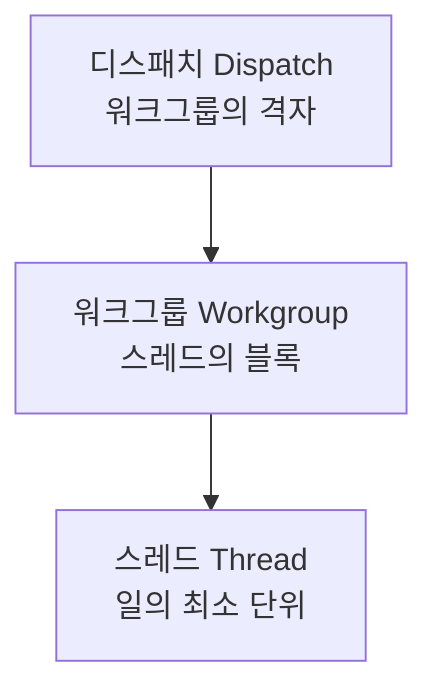
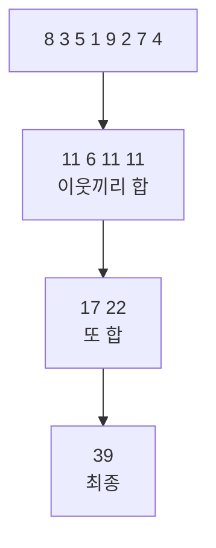

## 들어가며

전통적인 그래픽스 작업은 정점이 들어가고, 삼각형이 조립되고, 픽셀이 칠해지는 *래스터화 파이프라인* 안에서 수행된다. 이 파이프라인은 강력하지만 *틀에 박혀 있다*. 입력은 정점이어야 하고, 출력은 프레임버퍼여야 하며, 중간 단계는 고정된 순서를 따른다. 그런데 GPU의 본질은 *수천 개의 코어를 가진 대규모 병렬 프로세서* 다. 삼각형을 그리는 것은 그 능력의 한 가지 응용일 뿐이다.

*컴퓨트 셰이더(Compute Shader)* 는 이 틀을 벗어던진다. 정점도 삼각형도 픽셀도 없이, GPU를 *범용 병렬 계산기* 로 쓴다 — 이것이 *GPGPU(General-Purpose computing on GPU)* 다. 입자 수십만 개를 시뮬레이션하고, 이미지를 후처리하고, 물리를 풀고, 심지어 다음 프레임에 무엇을 그릴지를 GPU 스스로 결정한다(GPU 주도 렌더링). 메시 셰이더 역시 이 컴퓨트형 실행 모델을 지오메트리 처리에 적용한 사례다.

이 글은 컴퓨트 셰이딩을 API에 독립적으로 다룬다. 래스터 파이프라인 밖으로 나가는 이유, 스레드·워크그룹·디스패치로 짜인 실행 모델, 공유 메모리와 배리어, 병렬 알고리즘의 기본 패턴(리덕션·스캔), 그래픽스에서의 활용, 그리고 발산·점유율 같은 성능 특성을 정리한다. GPU 하드웨어의 세부보다 그 위에서 제공되는 *프로그래밍 모델* 에 집중한다.


---

## 목차
1. [래스터 파이프라인 밖으로](#1-래스터-파이프라인-밖으로)
2. [실행 모델: 스레드·워크그룹·디스패치](#2-실행-모델-스레드워크그룹디스패치)
3. [메모리 계층과 공유 메모리](#3-메모리-계층과-공유-메모리)
4. [병렬 패턴: 리덕션과 스캔](#4-병렬-패턴-리덕션과-스캔)
5. [그래픽스에서의 컴퓨트](#5-그래픽스에서의-컴퓨트)
6. [발산과 점유율](#6-발산과-점유율)
7. [메모리 모델과 데이터 경쟁](#7-메모리-모델과-데이터-경쟁)
8. [계층형 리덕션과 스캔](#8-계층형-리덕션과-스캔)
9. [메모리 접근 비용](#9-메모리-접근-비용)
10. [커널 비용 모델과 측정](#10-커널-비용-모델과-측정)
11. [비동기 컴퓨트의 조건](#11-비동기-컴퓨트의-조건)


---

## 1. 래스터 파이프라인 밖으로

래스터 파이프라인은 *고정된 입출력 계약* 을 강요한다. 정점 셰이더는 정점을 받아 클립 좌표를 내고, 프래그먼트 셰이더는 프래그먼트를 받아 색을 낸다. 이 틀은 삼각형 래스터화에 최적화돼 있지만, *삼각형과 무관한 계산* 에는 어색하다.

예를 들어 입자 10만 개의 물리를 풀고 싶다고 하자. 래스터 파이프라인으로 하려면 입자를 점 프리미티브로 그리고, 프래그먼트 셰이더에서 위치를 갱신해 텍스처에 쓰고, 다음 프레임에 그 텍스처를 다시 읽는 *편법(GPGPU의 초기 형태)* 을 써야 했다. 부자연스럽고 제약이 많았다.

컴퓨트 셰이더는 이 우회를 없앤다. 계약이 단순하다.

- **자원**: storage buffer/image를 포함한 명시적 읽기·쓰기 자원. 포맷·접근 권한·동기화 계약 안에서 scatter와 atomic을 사용할 수 있다.
- **실행**: 프리미티브와 래스터화가 아니라 응용이 정한 workgroup 격자를 디스패치한다.
- **협력**: 같은 workgroup의 invocation이 shared memory와 barrier로 협력한다.


핵심 자유는 실행 격자와 일의 단위를 응용이 정한다는 점이다. 일반적인 프래그먼트 *색 출력* 은 래스터화가 정한 attachment 위치로 가지만, 현대 프래그먼트 셰이더도 storage image·buffer를 통해 임의 위치 쓰기와 atomic을 할 수 있으므로 scatter 자체가 컴퓨트만의 고유 기능은 아니다. 컴퓨트의 차별점은 프리미티브·커버리지·고정 출력 병합 없이 배열 원소·입자·행렬 타일 같은 작업을 직접 디스패치하고, workgroup 협력 모델을 쓰는 데 있다.


## 2. 실행 모델: 스레드·워크그룹·디스패치

컴퓨트 셰이더는 *스레드(thread)* 하나의 관점에서 작성한다 — "나는 데이터의 어느 한 조각을 처리한다". 그 스레드 수천 개가 동시에 같은 코드를 서로 다른 데이터에 돌린다. 이것이 GPU 아키텍처의 *SIMT(Single Instruction, Multiple Thread)* 모델이고, 컴퓨트는 그것을 직접 노출한다.

스레드는 *3단 계층* 으로 조직된다.



| 단위 | 의미 | 식별자 |
|---|---|---|
| **디스패치(Dispatch)** | 한 번의 컴퓨트 실행 전체. 워크그룹의 격자(grid). | — |
| **워크그룹(Workgroup)** | 함께 협력하는 스레드 묶음(예: 64·256개). *공유 메모리·동기화 단위*. | `gl_WorkGroupID` |
| **스레드(Thread / Invocation)** | 일의 최소 단위. 보통 데이터 원소 하나. | `gl_LocalInvocationID`, `gl_GlobalInvocationID` |

응용은 *디스패치 크기*(워크그룹 몇 개)와 *워크그룹 크기*(스레드 몇 개)를 정한다. 예컨대 1920×1080 이미지를 처리하려면 워크그룹을 16×16(=256 스레드)로 두고 디스패치를 $\lceil1920/16\rceil\times\lceil1080/16\rceil = 120\times68$ 워크그룹으로 띄운다. 각 스레드는 자기 *전역 ID* 로 "내가 맡을 픽셀"을 계산한다.

```glsl
layout(local_size_x=16, local_size_y=16) in;   // 워크그룹 = 16×16 스레드
void main() {
    ivec2 p = ivec2(gl_GlobalInvocationID.xy);  // 내 픽셀 좌표
    if (p.x >= width || p.y >= height) return;  // 경계 넘으면 종료
    imageStore(outImg, p, process(imageLoad(inImg, p)));
}
```

*워크그룹 크기 선택*은 성능에 직결된다. 실제 subgroup 크기의 배수면 마지막 subgroup의 빈 lane을 줄일 수 있지만 그것만으로 최적이 되지는 않는다. 크기를 키우면 workgroup당 협력 범위가 넓어지는 대신 레지스터와 공유 메모리 점유가 커져 동시에 상주할 workgroup 수가 줄 수 있다. 장치가 보고한 한도와 subgroup 속성을 확인하고, 문제의 1D/2D 타일 모양을 보존한 여러 후보를 측정해야 한다. 워크그룹의 의미론적 경계는 분명하다. 공유 메모리와 workgroup 배리어로 직접 협력할 수 있는 것은 같은 workgroup의 invocation뿐이다.


## 3. 메모리 계층과 공유 메모리

컴퓨트의 위력은 단지 병렬이 아니라 *협력하는 병렬* 에 있다. 그 협력을 가능케 하는 것이 *공유 메모리(shared memory)* 와 *배리어(barrier)* 다.

GPU 메모리는 계층을 이룬다(GPU 아키텍처가 자세히).

| 메모리 | 범위 | 핵심 비용 |
|---|---|---|
| 레지스터 | invocation 하나 | 가장 낮은 접근 지연, 사용량이 occupancy를 제한 |
| **공유 메모리(shared)** | 한 워크그룹 | 온칩 재사용, bank 충돌·barrier 비용 |
| 전역 메모리(global) | 장치 전체 | 캐시·coalescing·VRAM 대역폭과 의존 지연 |

*공유 메모리* 는 한 워크그룹의 invocation이 함께 읽고 쓰는 작은 온칩 스크래치패드다. 여러 invocation이 같은 데이터를 반복해 읽는 경우 전역에서 협력적으로 한 번 가져와 재사용할 수 있다. 이미지 블러에서는 커널 폭과 타일 크기에 따라 중복 전역 읽기를 크게 줄일 수 있지만, 감소율과 성능 이득은 halo 비율·캐시 적중·bank 충돌·barrier 비용에 달려 있다.

협력에는 *동기화* 가 필요하다. 스레드 A가 공유 메모리에 쓴 값을 스레드 B가 읽으려면, "모두가 쓰기를 끝낼 때까지 기다린다"는 *배리어(barrier)* 가 있어야 한다.

```glsl
// 16x16 출력 타일 + 3x3 커널을 위한 한 texel halo
shared float tile[18][18];

// 모든 invocation이 협력해 18x18을 채운다. 이미지 경계는 clamp/mirror 등
// 제품의 주소 정책으로 처리한다. 함수 내부에는 workgroup barrier가 없다.
LoadTileWithHalo(tile, inImg, groupOrigin, gl_LocalInvocationIndex);
barrier();  // workgroup의 모든 invocation이 반드시 도달

ivec2 outPixel = groupOrigin + ivec2(gl_LocalInvocationID.xy);
if (all(lessThan(outPixel, imageSize(outImg)))) {
    float blurred = average9(tile,
        ivec2(gl_LocalInvocationID.xy) + ivec2(1));  // halo만큼 이동
    imageStore(outImg, outPixel, vec4(blurred));
}
```

부분 workgroup에서도 경계 밖 invocation이 `barrier()` 전에 return하면 나머지가 영원히 기다릴 수 있다. 그래서 전체 workgroup이 적재와 barrier를 마친 뒤 출력 범위만 조건부로 쓴다.

핵심 제약은 공유 메모리와 workgroup barrier의 범위가 한 workgroup이라는 점이다. 일반 디스패치 안에서는 서로 다른 workgroup의 실행 순서나 전역 합류점을 가정할 수 없다. 전역 메모리와 atomic은 충돌하는 갱신을 조정할 수 있지만 디스패치 전체 barrier를 만들어 주지는 않는다. 전역 단계 사이의 합류가 필요하면 보통 디스패치를 나누고 API 배리어로 실행·가시성을 연결하며, 제한적으로 cooperative launch 같은 별도 기능을 사용한다.


## 4. 병렬 패턴: 리덕션과 스캔

컴퓨트로 문제를 푼다는 것은 곧 *병렬 패턴* 으로 표현한다는 뜻이다. 순차 코드의 `for` 루프를 수천 스레드의 협력으로 바꾸는 정형화된 기법들이 있다.

**맵(Map)**: 가장 단순. 각 원소에 독립적으로 같은 연산. 스레드 하나당 원소 하나 — 후처리·입자 갱신이 여기 해당한다. 협력이 필요 없어 자명하게 병렬이다.

**리덕션(Reduction)**: 배열 전체를 하나로 접는다(합·최대·최소). 순차로는 $O(n)$이지만, *트리 모양* 으로 짝지어 접으면 $O(\log n)$ 단계에 끝난다.



각 라운드에서 스레드 절반이 이웃과 짝지어 합치고, 연속된 라운드마다 활성 스레드 수가 다시 절반으로 줄어든다. 공유 메모리와 배리어로 워크그룹 안에서 구현한다. 평균 밝기(자동 노출)·히스토그램·충돌 검출의 경계 상자가 모두 리덕션이다.

**스캔(Scan / Prefix Sum)**: 각 위치까지의 누적 합. 입력 `[3,1,4,1,5]` → 출력 `[0,3,4,8,9]`. 순차적으로 보이지만 *Blelloch 알고리즘* 으로 $O(\log n)$에 병렬화된다. 입자 시스템의 *압축(죽은 입자 제거)*, 정렬, GPU 메모리 할당에 쓰이는 핵심 빌딩 블록이다.

이 패턴들이 중요한 이유는, *순차적 사고를 병렬적 사고로 바꾸는 어휘* 이기 때문이다. "배열을 훑으며 합산"은 순차지만, "트리로 접는 리덕션"으로 다시 보면 GPU에 맞는다. 컴퓨트 프로그래밍의 절반은 문제를 맵·리덕션·스캔의 조합으로 재구성하는 일이다.


## 5. 그래픽스에서의 컴퓨트

컴퓨트는 GPGPU 범용 계산만이 아니라 *그래픽스 파이프라인 자체* 를 보강한다. 래스터 패스 사이사이에 컴퓨트 패스를 끼워 일을 더 효율적으로 한다.

| 용도 | 컴퓨트가 하는 일 |
|---|---|
| 후처리 | 블룸·DOF·톤매핑을 픽셀 병렬로 — 공유 메모리로 블러 가속 |
| 입자 시스템 | 수십만 입자의 물리·수명을 매 프레임 갱신 |
| 컬링 | 절두체·오클루전 컬링을 GPU에서 — *GPU 주도 렌더링* |
| 라이트 컬링 | 타일/클러스터별 영향 광원 추리기(Forward+) |
| 시뮬레이션 | 물·천·머리카락·유체 |
| 빌드 | 밉맵 생성·BVH 구축(레이트레이싱 가속 구조) |

특히 *GPU 주도 렌더링(GPU-driven rendering)* 이 현대적 흐름이다. 전통적으로 "무엇을 그릴지"(컬링·LOD 선택·드로우콜 생성)는 CPU가 정했다. 컴퓨트 셰이더로 이 결정을 GPU에 옮기면 — 컴퓨트가 컬링하고, 살아남은 객체의 드로우 인자를 버퍼에 써넣고, GPU가 그 버퍼로 *간접 드로우(indirect draw)* 를 실행한다 — CPU 병목과 CPU↔GPU 왕복이 사라진다. 메시 셰이더가 이 흐름의 지오메트리 쪽 구현이고, 둘 다 *그리기 결정을 GPU로* 옮기는 같은 방향이다.

요점: 컴퓨트는 래스터 파이프라인을 *대체* 하기보다 *보완* 한다. 삼각형 그리기는 여전히 전용 래스터 회로가 빠르고, 그 주변의 준비·후처리·시뮬레이션을 컴퓨트가 유연하게 맡는 *하이브리드* 가 현대 렌더러의 모습이다.


## 6. 발산과 점유율

컴퓨트의 성능은 *GPU를 얼마나 바쁘게 유지하느냐* 로 결정된다. 두 개념이 핵심이고, 둘 다 GPU 아키텍처가 깊게 다루지만 컴퓨트 설계에 직결되므로 짚는다.

**발산(Divergence)**: 같은 실행 묶음(warp/wave/subgroup — 폭은 구현마다 32, 64 등으로 다르다)의 스레드들은 같은 명령을 함께 발행받는다. 그런데 `if` 분기에서 lane마다 조건이 갈리면 하드웨어는 활성 마스크를 달리해 여러 경로를 처리해야 하므로 두 경로 비용이 모두 든다. 그래서 컴퓨트 커널은 *한 실행 묶음 안의 스레드가 같은 분기를 타도록* 데이터를 정렬하거나 분기를 줄이는 게 중요하다. 픽셀 2×2 쿼드는 원래 화면 도함수(`ddx`/`ddy`, 밉 LOD) 계산을 위한 묶음이고, 그 결과 인접 픽셀이 같은 묶음에 들어가 분기 일관성도 좋아지는 편이다.

**점유율(Occupancy)**: GPU 코어는 한 워프가 메모리를 기다리며 멈추면 *다른 워프로 즉시 전환* 해 지연을 숨긴다. 이 전환이 가능하려면 충분히 많은 워프가 *대기 중* 이어야 한다 — 그 비율이 점유율이다. 그런데 스레드가 레지스터를 너무 많이 쓰거나 워크그룹이 공유 메모리를 너무 많이 잡으면, 동시에 띄울 수 있는 워프 수가 줄어 점유율이 떨어지고 지연이 노출된다. 즉 *공유 메모리·레지스터를 아끼는 것* 과 *지연을 숨길 워프를 확보하는 것* 사이에 트레이드오프가 있다.

요약하면 컴퓨트 최적화는 세 가지 균형이다 — *발산을 줄이고*(워프가 같은 길을 가게), *점유율을 높이며*(놀 코어가 없게), *메모리 계층을 활용한다*(공유 메모리로 전역 접근을 줄이게). 이 셋이 GPU 아키텍처에서 본 하드웨어 특성을 코드로 풀어내는 실전 지침이다.

점유율은 목표가 아니라 지연 은닉의 수단이라는 점도 중요하다. 이미 연산량이 충분하거나 메모리 접근이 캐시에 잘 맞는 커널은 최대 점유율이 아니어도 빠를 수 있다. 반대로 점유율 100%여도 모든 워프가 같은 메모리 병목을 기다리면 처리량은 늘지 않는다. 레지스터를 억지로 줄여 점유율을 올리다가 spill이 발생하면 로컬 메모리라는 이름의 전역 메모리 접근이 늘어 오히려 느려진다.

## 7. 메모리 모델과 데이터 경쟁

컴퓨트 셰이더가 임의 위치에 쓸 수 있다는 자유는 두 스레드가 같은 위치를 동시에 읽고 쓸 가능성도 만든다. 결과의 정확성을 논하려면 세 질문을 분리해야 한다.

1. **원자성(atomicity)**: 한 쓰기가 중간 상태 없이 관찰되는가
2. **순서(ordering)**: 한 스레드의 두 메모리 연산이 다른 스레드에서 같은 순서로 보이는가
3. **가시성(visibility)**: 한 스레드의 쓰기가 다른 스레드의 읽기에 언제 보이는가

`barrier()`는 보통 같은 워크그룹의 실행 합류점이며, 모든 종류의 메모리 쓰기를 자동으로 전체 GPU에 공개하는 만능 장치가 아니다. API와 셰이더 언어는 공유 메모리, 버퍼, 이미지 등 저장 영역별 메모리 배리어를 구분한다. 서로 다른 디스패치나 그래픽 패스 사이의 가시성은 명령 제출 API의 파이프라인 배리어와 자원 상태 전이가 책임진다.

데이터 경쟁은 같은 메모리 위치에 동시 접근하고, 그중 하나 이상이 쓰기이며, 접근 사이에 적절한 동기화가 없을 때 생긴다. 다음 코드는 합계를 계산하는 것처럼 보이지만 틀렸다.

```glsl
// 여러 invocation이 동시에 읽고 더하고 쓴다.
sum = sum + values[id];
```

두 스레드가 같은 옛 `sum`을 읽으면 하나의 증가가 사라진다. `atomicAdd`는 이 갱신을 원자화하지만, 모든 스레드가 한 주소에서 직렬화되므로 정확하지만 느린 구현이 된다. 보통은 워크그룹마다 공유 메모리로 부분합을 만든 뒤, 워크그룹당 한 번만 전역 atomic을 수행한다.

```text
N개 전역 atomic
    ↓
각 워크그룹 내부 리덕션 + 워크그룹 수만큼 전역 atomic
```

원자적 연산도 순서를 전부 해결하지는 않는다. 예를 들어 생산자가 데이터를 쓴 뒤 `ready = 1`을 원자적으로 기록하고 소비자가 `ready`를 읽는 구조에서는, 데이터 쓰기가 플래그보다 먼저 보인다는 release/acquire 성질이 필요하다. 셰이더 언어와 API가 제공하는 메모리 의미를 확인하지 않고 원자 연산 하나만 추가하면 "플래그는 켜졌는데 데이터는 옛값"인 실패가 남는다.

정확한 병렬 커널은 다음 불변식으로 설명할 수 있어야 한다.

- 각 출력 원소를 쓰는 스레드는 하나뿐이거나, 다중 쓰기는 명시적 원자 연산·리덕션 규칙으로 결합된다.
- 배리어에 도달해야 하는 워크그룹의 모든 스레드는 실제로 도달한다.
- 한 패스의 출력이 다음 패스의 입력이 될 때 API 수준의 가시성 전이가 존재한다.
- 경계 밖 스레드는 메모리에 접근하지 않되, 조건부 조기 반환이 필수 배리어를 건너뛰지 않는다.

마지막 조건이 자주 사고를 만든다. 일부 스레드만 `return`한 뒤 나머지가 `barrier()`에 도달하면 워크그룹 전체가 교착되거나 결과가 정의되지 않을 수 있다. 경계 스레드도 배리어에는 참여시키고, 실제 읽기·쓰기만 조건으로 막는 구조가 필요하다.

## 8. 계층형 리덕션과 스캔

워크그룹 하나보다 큰 입력의 리덕션은 한 번의 공유 메모리 협력으로 끝나지 않는다. 서로 다른 워크그룹 사이에는 디스패치 내부 전역 배리어가 없기 때문이다. 따라서 전체 리덕션은 계층적으로 구성한다.

```text
Pass 1: 각 워크그룹이 입력 타일을 부분합 하나로 축약
Pass 2: 부분합 배열을 다시 축약
...
Pass k: 원소 하나
```

입력 $N$개, 워크그룹당 $B$개를 처리하면 첫 패스 출력은 대략 $\lceil N/B \rceil$개이고, 패스 수는 $O(\log_B N)$이다. 총 연산량은 여전히 $O(N)$이며, 실제 비용은 각 패스 사이의 전역 메모리 왕복과 디스패치 경계가 결정한다.

리덕션 연산에는 결합법칙이 필요하다.

$$
(a \oplus b) \oplus c = a \oplus (b \oplus c)
$$

정수 덧셈과 최댓값은 적합하지만, 부동소수점 덧셈은 반올림 때문에 엄밀히 결합적이지 않다. 병렬 리덕션은 순차 합산과 다른 순서로 더하므로 마지막 비트가 달라질 수 있다. 결과 재현성이 중요하면 고정된 트리 순서, 더 높은 정밀도, pairwise summation이나 보상 합산 같은 수치 기법이 필요하다.

스캔은 각 원소의 출력이 앞선 모든 원소에 의존하지만, 두 단계 트리로 병렬화할 수 있다.

1. **up-sweep**: 트리를 위로 올라가며 부분합을 만든다.
2. **down-sweep**: 루트에서 누적 접두값을 아래로 전파한다.

전체 입력의 스캔도 워크그룹별 스캔, 워크그룹 합계의 스캔, 각 그룹 결과에 앞 그룹 누적값을 더하는 세 단계로 확장한다. 이 구조는 살아 있는 입자 압축에서 특히 중요하다.

```text
alive flag:  [1, 0, 1, 1, 0]
exclusive scan:
             [0, 1, 1, 2, 3]
scatter 결과: 살아 있는 원소가 출력 0, 1, 2 위치로 이동
```

스캔은 "조건을 만족하는 원소를 순서대로 압축한다"를 병렬화하는 공통 도구다. GPU 주도 렌더링의 가시 객체 목록, 가변 길이 출력의 오프셋 계산, radix sort의 버킷 위치 계산이 같은 형태다.

## 9. 메모리 접근 비용

GPU는 계산보다 메모리 이동에 막히는 경우가 많다. 같은 수의 읽기라도 인접 스레드가 인접 주소를 읽는지에 따라 실제 메모리 트랜잭션 수가 달라진다. 워프의 스레드가 연속 주소를 읽으면 하드웨어가 소수의 넓은 거래로 합치는 *coalescing* 이 가능하다.

```text
좋은 접근: thread i → data[i]       연속 주소
나쁜 접근: thread i → data[i * 97]  넓게 흩어진 주소
```

구조체 배열에서 한 필드만 읽는 커널은 필요 없는 필드까지 메모리 거래에 끌고 올 수 있다. 그래서 대량 컴퓨트 데이터는 필드별 배열(SoA)이나 GPU 접근 패턴에 맞춘 압축 레이아웃이 유리하다. 단, 무조건 SoA가 정답은 아니며 한 스레드가 작은 구조체의 모든 필드를 함께 읽는다면 AoS가 더 적은 주소 계산과 거래를 만들 수 있다.

공유 메모리도 충돌이 없다면 빠르다. 공유 메모리는 여러 bank로 나뉘며 같은 실행 묶음의 스레드들이 같은 bank의 서로 다른 주소를 동시에 접근하면 직렬화될 수 있다. 행렬 전치처럼 접근 축이 바뀌는 커널에서 타일 한 열을 패딩하는 이유가 여기에 있다.

```glsl
shared float tile[32][33]; // 32가 아닌 33 stride로 bank 매핑 충돌 완화
```

캐시는 재사용 거리가 짧을 때만 도움이 된다. 한 번 읽고 다시 쓰지 않는 거대한 스트림은 캐시에 들어가도 곧 밀려난다. 이런 커널의 성능 상한은 메모리 대역폭으로 근사할 수 있다. 반대로 같은 타일을 여러 번 재사용하는 행렬 곱·블러는 공유 메모리와 캐시가 전역 메모리 트래픽을 크게 줄인다.

## 10. 커널 비용 모델과 측정

컴퓨트 커널이 연산 병목인지 메모리 병목인지 먼저 구분해야 최적화 방향이 나온다. 가장 간단한 지표는 산술 집약도(arithmetic intensity)다.

$$
\text{Arithmetic Intensity} =
\frac{\text{수행한 연산 수}}{\text{전역 메모리에서 이동한 바이트}}
$$

하드웨어의 최대 연산 처리량을 $P_{max}$, 메모리 대역폭을 $B_{max}$라 하면 달성 가능한 처리량의 상한은 대략 다음과 같다.

$$
P \le \min(P_{max}, B_{max} \times \text{Arithmetic Intensity})
$$

산술 집약도가 낮은 입자 복사·단순 필터는 대역폭 상한에 걸리므로 명령 몇 개를 줄이는 것보다 데이터 크기와 왕복 횟수를 줄이는 편이 중요하다. 산술 집약도가 높은 복잡한 셰이딩·행렬 연산은 연산 처리량, 발산, 레지스터 사용량이 더 중요하다.

CPU 타이머로 디스패치 호출 전후를 재면 GPU 실행 시간이 아니라 명령 기록·제출 비용을 재기 쉽다. GPU 타임스탬프 쿼리로 디스패치 전후의 장치 시간축을 측정하고, 다음을 함께 본다.

- 실행 시간과 처리 원소당 시간
- 전역 메모리 읽기·쓰기 바이트
- 캐시 적중률과 메모리 처리량
- 실행 묶음 활성 비율과 분기 효율
- 레지스터·공유 메모리 사용량, spill
- atomic 충돌과 배리어 대기

커널 하나만 빠르게 만들어도 전체 프레임이 빨라지지 않을 수 있다. 패스 분리로 늘어난 자원 전이, 임시 버퍼 왕복, CPU 제출 비용까지 포함한 전체 경로를 측정해야 한다. 작은 입력은 GPU 고정 비용보다 CPU SIMD 루프가 빠를 수 있으므로, 입력 크기에 따른 교차점도 측정 대상이다.

## 11. 비동기 컴퓨트의 조건

현대 GPU는 그래픽 작업과 컴퓨트 작업을 서로 다른 큐에서 겹쳐 실행할 수 있다. 그러나 큐가 둘이라고 물리 자원이 둘인 것은 아니다. 두 작업은 셰이더 코어, 캐시, 메모리 대역폭을 공유하므로 겹치기가 이득이 되려면 서로 다른 병목을 보완해야 한다.

예를 들어 래스터 패스가 고정 기능과 ROP에 막혀 셰이더 코어가 남는 동안, 연산 중심 컴퓨트 패스를 겹치면 사용률이 오른다. 반대로 둘 다 메모리 대역폭을 포화시키면 동시에 실행할수록 각각이 느려지고 전체 시간도 늘 수 있다.

비동기 컴퓨트의 정확성 조건은 자원 의존 그래프다. 컴퓨트가 쓰는 버퍼를 그래픽이 읽기 전에 완료 신호와 메모리 가시성이 연결되어야 하고, 독립 자원만 병렬로 실행할 수 있다.

```text
Graphics A ───────────────▶ Graphics C
             \             /
              Compute B ──

A가 B의 입력을 만들고, B 결과를 C가 읽는다면
A→B와 B→C에는 명시적 동기화가 필요하다.
```

좋은 후보는 프레임의 다른 부분과 의존성이 적고, 충분히 큰 작업이며, 그래픽 패스와 병목 자원이 다른 작업이다. 후보를 찾은 뒤에도 단일 큐 실행 시간과 겹친 실행의 전체 프레임 시간을 비교해야 한다. 비동기라는 이름은 가능성을 말할 뿐, 성능 향상을 보장하지 않는다.


---

## 결론

컴퓨트 셰이더는 래스터 파이프라인의 *고정 입출력 틀을 벗어나* GPU를 범용 병렬 프로세서로 쓴다. 실행은 *디스패치 → 워크그룹 → 스레드* 의 3단 계층이고, 협력은 *공유 메모리 + 배리어* 로 워크그룹 안에서 이뤄진다. 정확성은 데이터 경쟁, 원자성, 메모리 순서와 패스 사이 가시성을 명시할 때 확보된다.

문제를 푼다는 것은 *맵·리덕션·스캔* 같은 병렬 패턴과 계층적 패스로 재구성한다는 뜻이다. 성능은 발산과 점유율만이 아니라 메모리 거래, 재사용, 동기화, 산술 집약도와 전체 패스 경로로 결정된다. 비동기 컴퓨트 역시 독립 큐가 아니라 공유 자원 위의 겹치기이므로, 의존성과 병목을 측정해 이득을 증명해야 한다.


## 더 읽을거리

- [NVIDIA CUDA C++ Programming Guide](https://docs.nvidia.com/cuda/cuda-c-programming-guide/) — 워크그룹/공유 메모리/발산 모델의 가장 상세한 문서(개념은 컴퓨트 셰이더와 동일).
- Mark Harris, ["Optimizing Parallel Reduction in CUDA"](https://developer.download.nvidia.com/assets/cuda/files/reduction.pdf) — 리덕션 최적화의 고전 슬라이드.
- Guy E. Blelloch, "Prefix Sums and Their Applications" (1990) — 스캔 패턴의 이론적 기초.
- [OpenGL Wiki: Compute Shader](https://www.khronos.org/opengl/wiki/Compute_Shader) — API 측 명세 정리.
