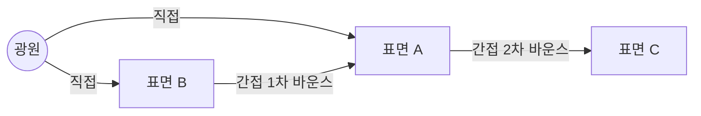
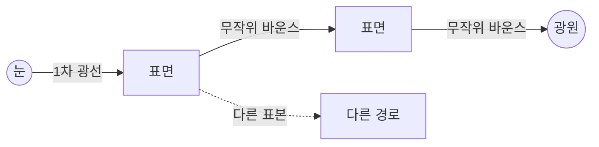
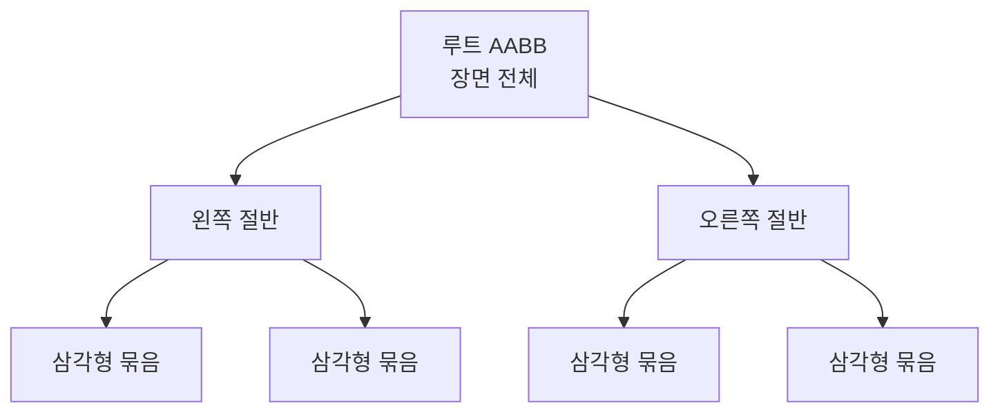
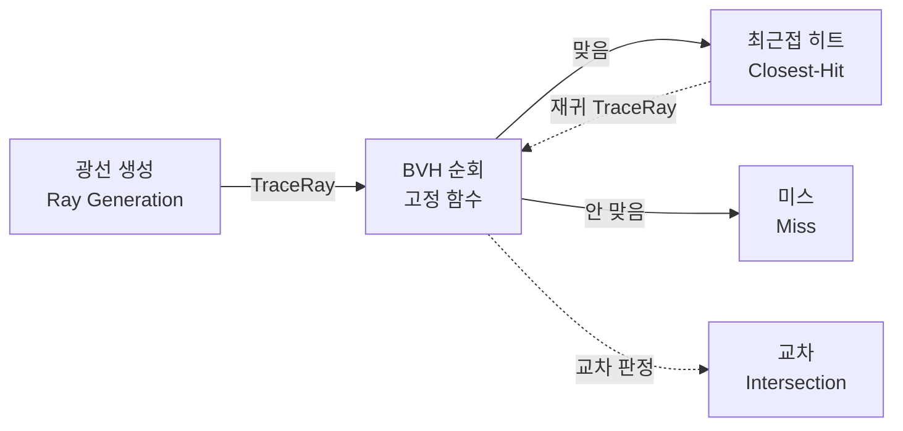
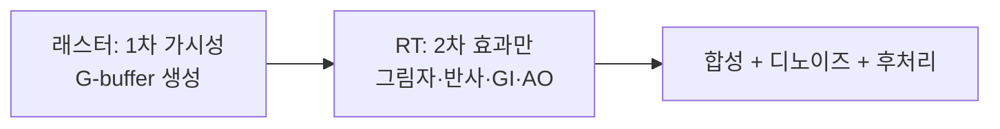

## 들어가며

전역 조명은 한 번의 직접광 계산을 넘어 장면 안에서 여러 번 반사·투과된 빛의 기여를 구하는 문제다. Ray tracing은 그 빛 전달 적분을 추정하기 위한 가시성 질의와 샘플링 도구이며, 둘은 별개의 유행 기술이 아니라 문제와 해법의 관계다.

이 글은 렌더링 방정식의 재귀, AO·IBL·probe·lightmap 같은 근사에서 시작해 BVH, path tracing, 하이브리드 ray tracing, 노이즈와 시간적 누적·디노이징까지를 연결한다.

---

## 목차

1. 직접광 너머: 반사되어 돌아오는 빛
2. 렌더링 방정식의 재귀
3. 앰비언트 오클루전
4. 이미지 기반 조명(IBL)
5. 라이트 프로브와 라이트맵
6. 패스 트레이싱과 실시간 GI
7. 광선-장면 교차
8. 가속 구조: BVH
9. 광선 셰이더 파이프라인
10. 하이브리드 렌더링
11. 광선의 비용과 노이즈
12. 디노이징과 시간적 누적

---

## 1. 직접광 너머: 반사되어 돌아오는 빛

직접광과 간접광의 차이를 그림으로 보자.

광원에서 표면으로 *한 번에* 온 빛이 직접광이고, 다른 표면에 *튕겨* 온 빛이 간접광이다. 간접광은 *몇 번이고* 튕긴다 — 1차 바운스, 2차 바운스, … 무한히. 각 바운스에서 표면이 파장별로 일부 빛을 흡수하고 나머지를 반사하므로(빨간 벽은 다른 파장보다 빨강을 더 반사한다), 간접광이 *색 번짐* 과 *부드러운 채움광* 을 만든다.

기본 래스터 파이프라인의 상수 주변광이 왜 틀렸는지가 이제 분명하다. 진짜 간접광은 *위치·방향·주변 형상에 따라 다르다* — 구석은 어둡고(빛이 덜 닿음), 밝은 벽 근처는 그 색으로 물든다. 상수 한 값은 이 변화를 전혀 못 담아, GI 없는 렌더링은 *평평하고 플라스틱 같은* 느낌을 준다. 구석이 인위적으로 밝고, 그림자가 새까맣고, 물체가 장면에 *속하지 않은* 것처럼 떠 보인다. GI의 모든 기법은 결국 *이 위치별 간접광을 얼마나 그럴듯하게/정확하게 구하느냐* 의 문제다.

## 2. 렌더링 방정식의 재귀

간접광이 *어려운* 근본 이유는 렌더링 방정식에 숨어 있다. 다시 적으면:

$$
L_o(p, \omega_o) = L_e + \int_{\Omega} f_r(p, \omega_i, \omega_o)\, L_i(p, \omega_i)\, (\mathbf{n}\cdot\omega_i)\, d\omega_i
$$

직접광만 볼 땐 $L_i$(들어오는 빛)가 *광원* 이라고 두면 적분이 광원에 대한 합으로 단순해졌다. 하지만 *진짜* $L_i$는 무엇인가? 방향 $\omega_i$에서 들어오는 빛은 — 그 방향에 보이는 *다른 표면이 내보내는 빛*, 즉 그 표면의 $L_o$다.

$$
L_i(p, \omega_i) = L_o(p', -\omega_i), \qquad p' = \text{방향 } \omega_i \text{에서 처음 만나는 표면}
$$

여기서 *재귀* 가 드러난다. 점 $p$의 나가는 빛을 알려면 주변 모든 점 $p'$의 나가는 빛을 알아야 하고, 그 $p'$의 빛을 알려면 또 그 주변을…. 방정식이 *자기 자신을 호출* 한다. 이 무한 재귀(=무한 바운스)가 GI를 *전역(global)* 문제로 만든다 — 한 점의 색이 장면 *전체* 에 의존한다. 직접광에서도 광원과 그 점 사이의 차폐를 알려면 다른 기하가 필요하다. 차이는 직접광에는 없는 *다른 표면의 출사광을 다시 구하는 재귀* 가 간접광에 추가된다는 것이다.

일반적인 복잡한 장면과 재질에 대해 이 재귀적 적분을 실시간에 쓸 수 있는 단순한 닫힌식으로 풀 수는 없다. 실용 기법은 장면·조명·바운스 범위를 제한해 미리 계산하거나, 공간 표현과 프로브로 근사하거나, 몬테카를로 표집으로 적분을 추정한다.

## 3. 앰비언트 오클루전

*앰비언트 오클루전(Ambient Occlusion, AO)* 은 간접광 자체를 푸는 기법이 아니라, 한 점에서 코사인 가중 반구가 얼마나 가려졌는지를 나타내는 기하 가시성 항이다. 균일하거나 천천히 변하는 환경광에 곱하면 구석·틈의 차폐를 값싸게 근사할 수 있지만, 방향성·색 번짐·다중 바운스는 만들지 못한다.

$$
AO(p) = \frac{1}{\pi}\int_{\Omega} V(p, \omega)\,(\mathbf{n}\cdot\omega)\, d\omega
$$

$V$는 *가시성*(그 방향이 트였으면 1, 막혔으면 0)이다. AO는 렌더링 방정식에서 *BRDF와 입사광을 떼고 가시성만* 남긴 단순화다 — 그래서 싸고, 그래서 부분적이다(빛의 색·방향은 무시, 가림만).

화면 공간 AO(SSAO)는 깊이와 법선 주변을 표집해 보이는 표면 근처의 차폐를 추정하는 널리 쓰이는 구현이다. HBAO·GTAO 계열은 horizon이나 가시성 적분을 더 잘 근사한다. 화면 밖·가려진 기하를 모르고 깊이 불연속과 반경 선택에 민감하므로, AO를 직접광 shadow나 물리적인 접촉 그림자의 대체물로 쓰면 안 된다. 엔진에 따라 baked AO, material AO, distance-field·ray-traced AO 또는 AO를 생략하는 정책을 선택한다.

## 4. 이미지 기반 조명(IBL)

야외나 큰 공간에서 간접광의 주된 출처는 *환경 전체* — 하늘·먼 풍경 — 다. *이미지 기반 조명(Image-Based Lighting, IBL)* 은 이 환경을 *환경 맵(큐브맵/구면 맵, 렌더 타깃)* 한 장으로 포착해, 그 맵을 *거대한 광원* 으로 쓴다. 환경 맵의 각 텍셀이 그 방향에서 오는 입사광 $L_i$다. IBL은 입사광을 공급하는 표현 방식이지 간접광만의 정의는 아니다. 하늘·태양의 직접 환경광과 촬영된 주변 표면의 반사광을 모두 담을 수 있다.

문제는 2절의 적분 — 셰이딩할 때마다 반구의 모든 환경 텍셀을 적분할 순 없다. 그래서 IBL은 *미리 적분(pre-integration)* 한다. 확산과 정반사를 나눠서:

- **확산 IBL**: 확산 BRDF는 방향에 둔감하므로, 환경 맵을 *코사인 가중으로 미리 합성* 한 *조도 맵(irradiance map)* 을 한 번 만들어 둔다. 셰이딩 때는 표면 법선 방향으로 이 작은 맵을 한 번 샘플링하면 끝 — 반구 적분이 텍스처 한 번 읽기가 된다.
- **정반사 IBL**: 거칠기에 따라 반사가 흐려지므로, 환경 맵을 *거칠기 레벨별로 미리 블러* 한 *프리필터 맵*(밉맵처럼 거칠수록 높은 레벨)과, BRDF를 미리 적분한 *2D LUT* 를 둔다. 이 둘을 곱해 합치는 것이 UE4가 대중화한 *분할 합(split-sum) 근사* 다.

IBL은 *먼 환경광* 을 미리 적분해 런타임 비용을 줄이면서 물리적으로 그럴듯한 반사와 채움광을 준다. 다만 환경맵 하나는 옆 벽의 색 번짐 같은 *국소적 바운스* 를 표현하지 못한다. 이 공간 변화는 지역 프로브, 복셀·서펠 표현 또는 광선 기반 GI처럼 위치에 따라 간접광을 갱신하는 기법이 맡는다.

### split-sum의 명시적 형태

반사 모델 자체(D·G·F·확산)는 전제로 두고, 여기서는 그 BRDF를 *환경맵에 대해 미리 적분* 하는 IBL 수식을 정리한다. 확산은 코사인 가중 반구 적분을 *조도 맵* $E$에 굽는다.

$$
E(\mathbf{n}) = \int_{\Omega} L_i(\omega_i)\,(\mathbf{n}\cdot\omega_i)\, d\omega_i, \qquad L_{o,\text{diff}} = \frac{c_{\text{albedo}}}{\pi}\, E(\mathbf{n})
$$

셰이딩 때는 법선 $\mathbf{n}$으로 작은 조도 맵을 한 번 샘플링하면 반구 적분이 끝난다.

정반사는 적분을 둘로 쪼개는 *분할 합(split-sum, Karis 2013)* 으로 근사한다. 입사광 평균과 BRDF 적분을 분리한다.

$$
\int_{\Omega} L_i\, f_{\text{spec}}\,(\mathbf{n}\cdot\omega_i)\, d\omega_i \;\approx\; \underbrace{\Big(\dfrac{\sum_k L_i(\omega_k)\,w_k}{\sum_k w_k}\Big)}_{\text{프리필터 맵}(\mathbf{r},\,\text{rough})} \cdot \underbrace{\big(F_0\, A + B\big)}_{\text{BRDF LUT}}
$$

첫 인수는 환경맵을 거칠기별로 GGX 중요도 표집해 미리 블러한 *프리필터 맵* 을 반사 벡터 $\mathbf{r}$로 샘플한 값(거칠수록 높은 밉)이다. Karis의 대표 구현은 $\mathbf n=\mathbf v=\mathbf r$로 두고 GGX half-vector에서 반사 방향을 만들며, $w_k=\max(\mathbf n\cdot\omega_k,0)$로 가중·정규화한다. 단순 무가중 평균과 같지 않으므로 prefilter의 표집·가중 규약과 BRDF LUT를 맞춰야 한다. 둘째 인수는 프레넬 $F_0$를 적분 밖으로 빼낸 분해의 두 항으로, $(\mathbf{n}\cdot\mathbf{v},\ \text{roughness})$로 인덱싱하는 *2D LUT* 두 채널이다.

$$
A = \int_{\Omega} \tfrac{f_{\text{spec}}}{F}\big(1-(1-\mathbf{v}\cdot\mathbf{h})^5\big)(\mathbf{n}\cdot\omega_i)\,d\omega_i, \qquad B = \int_{\Omega} \tfrac{f_{\text{spec}}}{F}(1-\mathbf{v}\cdot\mathbf{h})^5(\mathbf{n}\cdot\omega_i)\,d\omega_i
$$

$F_0$를 빼냈으므로 LUT는 *재질과 무관* 하다 — 한 번 구워 모든 재질·모든 환경에 재사용한다. 런타임 정반사 IBL은 결국 *프리필터 맵 샘플 한 번 × LUT 샘플 한 번* 으로 압축된다.

### 다중 산란 보정(Kulla-Conty)

단일 산란 미세면 모델은 미세면 사이를 *여러 번 튕기는* 빛을 누락한다. 그래서 거칠기가 클수록, 특히 금속에서 에너지를 잃어 *실제보다 어둡게* 보인다. LUT 두 채널의 합 $E_{ss} = A + B$는 프레넬을 $F=1$로 둔 기준 미세면의 단일 산란 방향 반사율이다. 실제 모든 재질의 에너지 비율과 같은 값은 아니지만, 이 기준의 손실분 $1 - E_{ss}$를 되돌리는 보정 항을 더한다. 실용형(Turquin 2019)은 단일 산란 정반사에 곱하는 한 인수로 정리된다.

$$
f_{\text{comp}} \approx f_{\text{ss}}\left[\,1 + F_0\left(\frac{1}{E_{ss}} - 1\right)\right]
$$

여기서 $f_{\text{comp}}$는 보정 후 전체 정반사 근사이며, 이를 $f_{\text{ss}}$에 다시 더하면 이중 계산이다. 이 인수는 거친 금속의 단일 산란 에너지 손실을 근사 보상한다. LUT를 이미 굽고 있으므로 추가 비용이 거의 없어, 현대 엔진의 IBL 경로에 표준으로 들어간다.

## 5. 라이트 프로브와 라이트맵

IBL이 *하나의 먼 환경* 을 가정한다면, 실내처럼 *위치마다 간접광이 다른* 장면은 어떻게 할까? 답은 *공간의 여러 지점에서 간접광을 미리 구해 두고 보간* 하는 것이다.

| 기법 | 무엇을 미리 굽나 | 적용 대상 |
|---|---|---|
| **라이트맵(Lightmap)** | 정적 표면의 *표면별* 간접광을 텍스처에 베이크 | 움직이지 않는 기하(벽·바닥) |
| **라이트 프로브(Light Probe)** | *공간의 점들* 에서의 조도(보통 구면 조화로 압축) | 움직이는 물체·동적 오브젝트 |
| **조도 볼륨(Irradiance Volume)** | 3D 격자의 프로브들 | 공간 전역 간접광 |

*라이트맵*은 고전 기법이다. 오프라인에서 정적 장면의 간접광을 유한한 표본과 바운스로 추정해 텍스처에 굽고, 런타임에는 그 결과를 샘플링한다. 복잡한 적분 비용을 런타임 밖으로 옮겨 정적 표면에는 매우 싸고 안정적인 GI를 주지만, 텍셀 해상도·UV 차트·베이크 노이즈와 누수에 따른 오차가 남는다. 조명이나 기하가 크게 바뀌면 다시 구워야 하고 움직이는 물체의 수광·차폐는 프로브나 동적 기법으로 보완한다.

*라이트 프로브* 가 그 빈틈을 메운다. 공간 곳곳에 점(프로브)을 두고 각 점에서 사방의 조도를 미리 구해, 보통 *구면 조화(Spherical Harmonics, SH)* — 방향별 밝기를 몇 개 계수로 압축 — 로 저장한다. 움직이는 캐릭터는 자기 위치 주변 프로브들을 보간해 간접광을 받는다. 현대적 확장인 *DDGI(Dynamic Diffuse GI)* 는 프로브를 *실시간 레이트레이싱* 으로 갱신해 동적 장면의 GI까지 다룬다. 이들 모두 핵심은 *비싼 GI 적분을 공간·시간에 분산해 미리·드물게 계산하고 보간* 하는 것이다.

## 6. 패스 트레이싱과 실시간 GI

근사들을 걷어내고 2절의 재귀 적분을 *정직하게* 푸는 방법이 *패스 트레이싱(path tracing)* 이다. 한 픽셀에서 광선을 쏴 표면에 맞으면, 거기서 또 *무작위 방향* 으로 광선을 튕기고, 또 튕기고… 여러 바운스를 따라가며 빛을 모은다. 이를 픽셀당 수백~수천 번 반복해 평균하면(*몬테카를로 적분*), 재귀 적분의 정답에 수렴한다. 여기서 평균하는 것은 방향 표본의 밝기 자체가 아니라 표집 확률밀도로 보정한 기여다. 한 반사 단계에서는 $f_r L_i\max(\mathbf n\cdot\omega_i,0)/p(\omega_i)$를 누적하고 경로를 따라 이 가중치를 이어 간다. 기여가 있는 경로를 표집할 수 있어야 하며, 유한 깊이에서 무조건 끊으면 바운스 절단 편향이 남는다. Russian roulette은 살아남은 경로를 생존 확률의 역수로 보정해 이를 다루는 방법이다.

패스 트레이싱은 선택한 기하·재질·광원 모델의 광 전달을 비교하는 기준(ground truth)으로 쓴다. 색 번짐·부드러운 그림자·코스틱스를 같은 틀에서 다룰 수 있지만, 좁고 드문 코스틱스 경로가 적은 표본으로 저절로 복원되는 것은 아니다. 대가는 *노이즈* 와 *비용* 이다. 표본이 적으면 알갱이(노이즈)가 끼고, 깨끗해지려면 수천 표본이 필요해 오프라인(영화 CG)에서 주로 썼다.

실시간은 두 길로 이 비용과 싸운다.

- **하드웨어 레이트레이싱 + 디노이징**: 최신 GPU의 RT 코어로 픽셀당 *한 줌의 광선* 만 쏘고, 그 노이즈를 *디노이저*(시간 누적 + 공간 필터, TAA 친척)로 지운다. *ReSTIR* 같은 표본 재사용 기법이 적은 광선으로 많은 광원을 다룬다. 이 RT 파이프라인 자체는 9절과 12절에서 본다.
- **근사 실시간 GI**: 광선 대신 장면을 *복셀*(VXGI)이나 *부호 거리장*(SDFGI)으로 단순화해 원뿔 추적으로 간접광을 근사하거나, 화면 공간 정보만으로 *화면 공간 GI(SSGI)* 를 한다. 정확도를 비용과 맞바꾼다.

요점: 실시간 GI는 *정확한 패스 트레이싱* 과 *값싼 근사(3~5절)* 사이의 스펙트럼이고, 하드웨어 RT의 보급으로 그 경계가 매년 정확한 쪽으로 옮겨가고 있다. 컴퓨트가 디노이징·복셀화·프로브 갱신의 일꾼이라는 점도 기억하자 — 복잡한 실시간 GI는 흔히 컴퓨트로 이런 보조 작업을 처리한다. 베이크한 lightmap·IBL을 래스터 셰이더로 사용하는 경로도 있으므로 컴퓨트가 모든 실시간 GI의 필수 조건인 것은 아니다.

## 7. 광선-장면 교차

레이트레이싱의 원자 연산은 *광선 하나가 장면의 무엇에 가장 먼저 맞는가* 다. 광선은 시작점 $\mathbf{o}$와 방향 $\mathbf{d}$로 정의된다.

$$
\mathbf{r}(t) = \mathbf{o} + t\,\mathbf{d}, \quad t > 0
$$

1차 광선(primary ray)은 카메라에서 각 픽셀을 향해 쏜다 — 래스터화의 투영을 *거꾸로* 한 셈이다. 광선이 삼각형에 맞으면 그 교차점에서 셰이딩하고, *거기서 다시* 광선을 쏠 수 있다.

| 2차 광선 | 무엇을 묻나 | 만드는 효과 |
|---|---|---|
| 그림자 광선 | 교차점 → 광원 사이가 막혔나? | 정확한 그림자(섀도맵 대안) |
| 반사 광선 | 반사 방향에 무엇이 보이나? | 거울·광택 반사 |
| 굴절 광선 | 표면을 통과하면 무엇이? | 유리·물 |
| GI 광선 | 무작위 방향의 간접광은? | 전역 조명 |

핵심은 *재귀* 다 — 반사 광선이 또 반사면에 맞으면 또 튕긴다. 렌더링 방정식 재귀가 여기서 *광선의 재귀* 로 직접 구현된다. 문제는 비용이다. 광선 하나가 "장면의 무엇에 맞는가"를 *모든 삼각형과 일일이* 검사하면 삼각형 $n$개에 $O(n)$ — 수백만 삼각형 × 수백만 광선은 불가능하다. 그래서 *가속 구조* 가 필수다.

## 8. 가속 구조: BVH

광선-장면 교차를 모든 primitive에 대한 $O(n)$ 선형 검사에서 벗어나게 해 주는 자료구조가 *경계 볼륨 계층(Bounding Volume Hierarchy, BVH)* 이다. 발상: 삼각형들을 *경계 상자(AABB)* 로 감싸고, 그 상자들을 더 큰 상자로 감싸 *트리* 를 만든다.

광선은 트리를 *위에서* 탐색한다 — 어떤 상자와 안 만나면 그 *하위 전체를 건너뛴다*. 광선이 왼쪽 절반 상자를 안 통과하면 거기 든 삼각형 수백만 개를 한 번에 버린다. 이때 트리의 높이 $O(\log n)$, 실제로 방문하는 노드 수, primitive 교차 시험 수는 서로 다른 값이다. 노드 bounds가 겹치거나 광선이 많은 상자와 겹치면 여러 가지를 방문해 최악에는 $O(n)$까지 갈 수 있으므로, $O(\log n)$은 일반 보장이 아니라 잘 구성된 계층에서의 평균적 경험값이다. 상자-광선 교차는 삼각형보다 훨씬 싸고(슬랩 테스트), 이 계층 덕에 레이트레이싱이 현실적 비용이 된다.

현대 API·하드웨어는 BVH를 *2단* 으로 나눈다.

- **BLAS(Bottom-Level)**: *한 메시* 의 삼각형 BVH. 메시별로 한 번 만들어 재사용.
- **TLAS(Top-Level)**: *인스턴스들* 의 BVH. 각 인스턴스는 BLAS + 변환 행렬을 가리킨다.

이 분리가 인스턴싱과 같은 이득을 준다 — 같은 메시(BLAS)를 여러 위치(TLAS 인스턴스)에 재사용하고, 메시가 강체 변환으로만 움직이면 *TLAS를 갱신* 해 같은 BLAS를 재사용할 수 있다. 스키닝·변형처럼 정점 위치가 바뀌면 해당 BLAS도 갱신하거나 다시 빌드해야 한다. BVH 빌드 자체는 비싸서, 보통 컴퓨트로 가속하고 정적 지오메트리는 미리 굽는다. GPU의 *RT 코어* 는 이 BVH 순회와 삼각형 교차를 *고정 함수 하드웨어* 로 처리해 — 래스터화기가 삼각형을 굽듯 — 광선을 굽는다.

## 9. 광선 셰이더 파이프라인

래스터 파이프라인이 정점·프래그먼트 셰이더로 짜였듯, 레이트레이싱도 *전용 셰이더 단계들* 의 파이프라인을 갖는다. 광선의 생애를 따라간다.

| 셰이더 | 역할 |
|---|---|
| **광선 생성(Ray Generation)** | 파이프라인 진입점. 픽셀마다 1차 광선을 쏘고(`TraceRay`) 결과를 모아 이미지에 쓴다 — 컴퓨트 디스패치와 닮았다. |
| **최근접 히트(Closest-Hit)** | 광선이 맞은 *가장 가까운* 표면에서 셰이딩. 여기서 *재귀로 또 TraceRay*(반사·그림자·GI). |
| **미스(Miss)** | 아무것도 안 맞았을 때. 보통 하늘/환경 맵(IBL) 반환. |
| **any-hit** | 후보 교차에 대해 호출되어 통과 여부를 판정(정렬 전). 알파 컷아웃 투명에 쓴다. opaque 플래그·컬링·이미 얻은 hit의 $t$ 범위·종료 정책에 따라 호출이 생략될 수 있고, API별 중복 호출 보장도 확인해야 한다. |
| **교차(Intersection)** | 삼각형이 아닌 커스텀 프리미티브(구·복셀) 교차 판정. 기본은 고정 함수 삼각형. |

이 구조의 핵심은 *셰이더 바인딩 테이블(SBT)* 로 "어느 물체에 맞으면 어느 히트 셰이더를 부를지"를 연결한다는 것이다 — 물체마다 다른 머티리얼(고급 머티리얼 모델)을 광선이 맞는 즉시 적용한다. 래스터의 "삼각형 → 프래그먼트 셰이더"가 여기선 "광선 히트 → 최근접 히트 셰이더"로 대응되는 셈이다.

## 10. 하이브리드 렌더링

순수 패스 트레이싱은 모든 것을 광선으로 풀지만 실시간엔 너무 비싸다. 그래서 현실의 실시간 RT는 *하이브리드* — 잘하는 일을 각 패러다임에 맡긴다.

핵심 통찰: *1차 가시성*(각 픽셀에 어떤 표면이 보이나)은 래스터화가 압도적으로 빠르다 — 전용 래스터 회로 + 깊이 버퍼. 그러니 래스터로 G-buffer를 만들고, *그 위에서* 광선은 풀기 어려운 2차 효과만 쏜다.

| 효과 | 하이브리드 방식 |
|---|---|
| 그림자 | G-buffer 위치 → 광원으로 그림자 광선 (섀도맵 해상도·투영 오차를 피하지만 표본 수·교차 정밀도·광선 오프셋 오차는 남음) |
| 반사 | G-buffer 위치 → 반사 방향 광선 (화면 밖도 반사, SSR의 한계 극복) |
| AO·GI | 반구로 광선 (SSAO·SSGI의 화면 공간 한계 극복) |

이것이 SSAO·SSGI의 화면 밖 정보 부족과 섀도맵의 광원 시점 투영·해상도 한계를 광선이 메우는 지점이다. 섀도맵 자체가 카메라 화면 밖의 기하를 모르는 것은 아니다. 래스터의 속도와 RT의 정확성을 합친 이 분업이 현세대 AAA 렌더러의 표준 구조다.

## 11. 광선의 비용과 노이즈

레이트레이싱이 여전히 비싼 이유는 둘이다.

**광선 비일관성(incoherence)**: 래스터화의 인접 픽셀은 메모리·실행이 *일관적*(coherent) — 같은 삼각형, 같은 텍스처를 본다(2×2 쿼드, 워프). 그런데 GI·거친 반사의 광선은 *무작위 방향* 으로 흩어져, 인접 픽셀의 광선이 장면의 *전혀 다른 곳* 을 친다. 이 공간·실행 경로의 비일관성이 캐시 적중과 워프 효율을 떨어뜨려 — 발산과 같은 문제 — 광선을 비싸게 만든다.

**적은 표본의 노이즈**: 몬테카를로 적분은 표본이 적으면 노이즈가 낀다. 실시간은 픽셀당 *1~몇 개* 광선밖에 못 쏘므로, 날것 그대로는 알갱이투성이다. 깨끗한 패스 트레이싱이 픽셀당 수천 표본을 쓰는 것과 대조된다.

그래서 실시간 RT의 전략은 *"적게 쏘고 똑똑하게 메운다"* 다. 광선 수를 줄이고, 부족한 표본은 (1) *시공간 재사용*(ReSTIR: 이웃·이전 프레임의 후보를 재가중해 재사용)과 (2) geometry·normal·motion 정보를 이용한 *디노이징* 으로 보완한다. 이때 디노이저는 없는 정보를 복원하는 마법이 아니라 편향과 ghosting을 감수해 분산을 줄이는 추정기다.

## 12. 디노이징과 시간적 누적

픽셀당 한 줌의 광선이 만든 노이즈를 *그럴듯한 매끈한 이미지* 로 바꾸는 것이 *디노이저(denoiser)* 다. 실시간 RT는 디노이저 없이는 성립하지 않는다 — 광선 비용을 감당 가능한 수준으로 줄이는 대가가 노이즈고, 그 노이즈를 지우는 게 디노이저다.

두 축으로 표본을 *빌려와* 메운다.

- **공간 필터링**: 이웃 픽셀의 광선 결과를 섞는다. 단, 경계를 뭉개지 않도록 G-buffer의 *법선·깊이·머티리얼* 을 *가이드* 삼아 — 같은 표면끼리만 섞는 *에지 인식 필터*(à trous 등). G-buffer가 여기서 또 쓰인다.
- **시간적 누적**: *이전 프레임* 의 결과를 모션 벡터로 재투영해 누적한다 — TAA와 같은 원리. 광선 수를 같은 프레임에 모두 지불하지 않고 여러 프레임에 분산할 수 있지만, 히스토리 버퍼·재투영·검증·필터 비용과 시간 지연을 지불한다.

대가는 TAA와 같다 — 빠른 움직임에서 *잔상(ghosting)* 과 시간적 지연. 그래서 모션 벡터 기반 기각, 분산 추정(SVGF) 같은 보정이 핵심 연구 주제다. 여기에 *업스케일링*(낮은 해상도로 RT하고 AI로 키우는 DLSS류)을 더해, 광선 수와 해상도를 동시에 줄이고 시공간 정보로 복원한다. 디노이징·재투영·업스케일은 대부분 컴퓨트 셰이더로 구현된다 — 레이트레이싱의 절반은 광선이고 절반은 그 결과를 다듬는 컴퓨트다.

---

## 결론

실시간 전역 조명은 정확한 해 하나를 구하는 문제가 아니라 제한된 광선과 프레임 시간으로 가장 중요한 빛 전달을 추정하고, 공간·시간 재사용과 디노이징으로 오차를 관리하는 문제다.

## 더 읽을거리

- James T. Kajiya, "The Rendering Equation" (SIGGRAPH 1986) — 모든 GI 기법의 출발점.
- Matt Pharr, Wenzel Jakob, Greg Humphreys, [*Physically Based Rendering*, 4th Edition](https://www.pbr-book.org/4ed/contents), Ch.2·Ch.13 — 몬테카를로 적분과 표면 광 전달(패스 트레이싱)의 표준 교과서. 볼륨 광 전달을 다룰 때만 Ch.14를 연결한다.
- [Lumen 기술 문서](https://dev.epicgames.com/documentation/en-us/unreal-engine/lumen-global-illumination-and-reflections-in-unreal-engine) — 거리장+화면 공간+RT 혼합 실시간 GI 의 실물.
- Cyril Crassin 외, "Interactive Indirect Illumination Using Voxel Cone Tracing" (2011) — 복셀 기반 GI 의 대표 논문.
- Peter Shirley, [*Ray Tracing in One Weekend* 시리즈](https://raytracing.github.io/) — 레이트레이서를 처음부터 구현하는 무료 표준 입문서.
- Microsoft, [DirectX Raytracing (DXR) Functional Spec](https://microsoft.github.io/DirectX-Specs/d3d/Raytracing.html) — 광선 셰이더 파이프라인·가속 구조의 공식 명세.
- Eric Haines, Tomas Akenine-Möller eds., [*Ray Tracing Gems*](https://www.realtimerendering.com/raytracinggems/), Adam Marrs, Peter Shirley, Ingo Wald eds., [*Ray Tracing Gems II*](https://www.realtimerendering.com/raytracinggems/rtg2/index.html) — 하이브리드·디노이징·ReSTIR 실전 기법 모음(무료 공개).
- Benedikt Bitterli 외, "Spatiotemporal reservoir resampling for real-time ray tracing with dynamic direct lighting" (SIGGRAPH 2020) — ReSTIR 원전.
