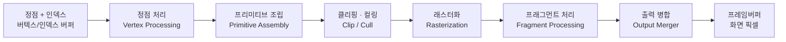
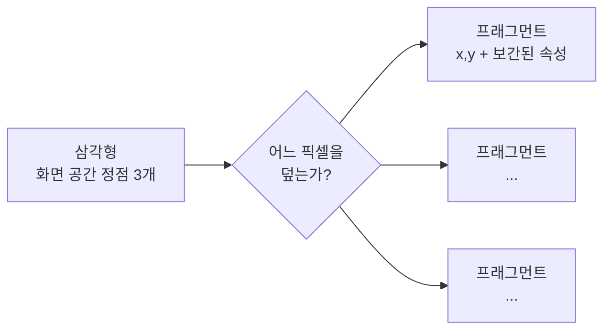
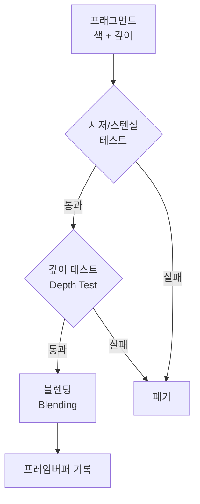

## 들어가며

OpenGL·Direct3D·Vulkan은 비슷한 래스터화 수학을 서로 다른 객체·명령·동기화 계약으로 노출한다. OpenGL의 `glDrawElements`, Direct3D의 indexed draw, Vulkan의 `vkCmdDrawIndexed`는 모두 정점과 인덱스로 프리미티브를 만들지만, 명령이 기록·제출되는 시점과 자원 상태를 책임지는 주체는 같지 않다.

이 글은 *그래픽스 래스터화 파이프라인* 의 논리적 순서를 API에 독립적으로 분해한다. 각 단계의 입력·출력, 호출 빈도의 비용 모델, 고정 함수와 셰이더의 경계, API가 응용에 넘기는 동기화 책임을 함께 본다. 논리적 파이프라인과 실제 GPU 하드웨어의 실행 순서를 구분하는 것이 출발점이다.


---

## 목차
1. [파이프라인이라는 추상](#1-파이프라인이라는-추상)
2. [정점 처리 단계](#2-정점-처리-단계)
3. [프리미티브 조립과 클리핑·컬링](#3-프리미티브-조립과-클리핑컬링)
4. [래스터화 단계](#4-래스터화-단계)
5. [프래그먼트 처리 단계](#5-프래그먼트-처리-단계)
6. [출력 병합 단계](#6-출력-병합-단계)
7. [프로그래머블과 고정 함수](#7-프로그래머블과-고정-함수)
8. [같은 추상, 다른 API](#8-같은-추상-다른-api)
9. [래스터화 너머: 대안 패러다임](#9-래스터화-너머-대안-패러다임)


---

## 1. 파이프라인이라는 추상

전통적인 래스터화 드로우의 입력은 정점 속성, 인덱스, 파이프라인 상태, 셰이더 자원이고 출력은 색·깊이·스텐실 attachment에 대한 갱신이다. 그 사이의 논리적 변환을 단계로 나눈 것이 그래픽스 파이프라인이다.



API가 보장하는 것은 *관측 가능한 논리적 결과* 다. 실제 GPU는 여러 드로우와 타일을 겹쳐 실행하고, 단계를 융합하거나 지연시키며, early depth처럼 논리적 테스트를 셰이더보다 앞당길 수 있다. 래스터화 순서와 동기화 규칙을 만족하는 한 물리적 실행이 위 그림의 직렬 컨베이어와 같을 필요는 없다. 이 구분을 놓치면 “앞 단계 호출이 끝났으니 메모리 쓰기도 보인다” 같은 잘못된 동기화 추론을 하게 된다.

핵심 어휘를 먼저 못 박아 두자.

| 용어 | 정의 |
|---|---|
| 프리미티브(Primitive) | 래스터화의 단위 도형. 거의 항상 삼각형(점·선도 있음). |
| 프래그먼트(Fragment) | 프리미티브가 픽셀 영역을 덮어 생성한 셰이딩 후보. 커버리지와 보간값을 가지며 여러 샘플을 갱신할 수 있다. |
| 드로우콜(Draw Call) | 현재 또는 기록된 상태로 정점·인스턴스 범위를 처리하라는 명령. 호출 반환과 GPU 완료는 같은 사건이 아니다. |
| 프레임버퍼(Framebuffer) | 색·깊이·스텐실 attachment를 렌더링 출력으로 묶은 논리적 대상. API에 따라 객체가 없을 수도 있다. |

프래그먼트와 픽셀 저장 위치를 같은 것으로 보면 MSAA와 오버드로를 설명할 수 없다. 한 픽셀 영역에 여러 프리미티브의 프래그먼트가 생길 수 있고, 하나의 프래그먼트가 여러 커버리지 샘플을 가질 수 있다. 프래그먼트 셰이더도 구현상 2×2 quad와 helper invocation으로 실행될 수 있어 “최종 픽셀 수 = 셰이더 호출 수”는 성립하지 않는다.


## 2. 정점 처리 단계

고전적인 정점 입력 경로의 첫 프로그래머블 단계다. *정점 셰이더(Vertex Shader)* 호출 수는 단순히 버퍼의 정점 개수와 같지 않다. indexed draw에서는 인덱스가 참조한 정점에 대해 호출되고, 구현의 post-transform cache가 같은 정점·인스턴스 조합의 결과를 재사용할 수 있다. 반대로 같은 정점 인덱스도 인스턴스나 입력 상태가 다르면 별도 호출이 필요하다. 실제 호출 수는 GPU 성능 카운터로 확인한다.

정점 셰이더의 *계약* 은 단순하다.

- **입력**: 한 정점의 속성(attribute) — 위치, 법선, 텍스처 좌표, 색, 스키닝 가중치 등. 응용이 정의한 임의의 데이터.
- **출력**: *클립 공간(Clip Space)* 위치 하나(필수) + 다음 단계로 넘길 보간 대상 속성들(선택).

가장 본질적인 책임은 *좌표 변환* 이다. 모델 로컬 좌표로 들어온 정점을, 모델·뷰·투영(MVP) 행렬을 곱해 클립 공간으로 보낸다.

```glsl
// 의사 GLSL — API 무관 개념
clipPos = projection * view * model * vec4(localPos, 1.0);
```

이 한 줄에는 좌표계의 사슬, 동차 좌표, 투영 행렬이 함께 들어 있다. 여기서 기억할 것은 *정점 처리의 출력이 클립 공간* 이라는 계약이다. 그 이후의 원근 분할과 화면 매핑은 고정 함수가 책임진다.

정점 처리는 좌표 변환 외에도 스키닝과 보간 입력 준비를 맡는다. 테셀레이션과 지오메트리 셰이더가 정점 처리와 조립 사이에 들어갈 수 있고, mesh shader 경로는 고전적인 정점 입력·조립 전면을 다른 작업 모델로 대체할 수 있다. 그래도 래스터라이저에 넘기는 최종 계약은 클립 좌표와 프리미티브·보간 속성이다.


## 3. 프리미티브 조립과 클리핑·컬링

정점 처리가 *낱개의 변환된 정점* 을 내놓으면, 이제 그것들을 *도형* 으로 묶어야 한다. 어떻게 묶을지는 드로우콜이 지정한 *프리미티브 토폴로지* 가 정한다.

| 토폴로지 | 의미 |
|---|---|
| Triangle List | 정점 3개씩 끊어 독립 삼각형 |
| Triangle Strip | 정점을 하나씩 밀며 삼각형 연쇄 (정점 재사용) |
| Line List / Strip | 선분 |
| Point List | 점 |

대부분의 3D 렌더링은 삼각형을 쓴다. 퇴화하지 않은 삼각형은 평면이고 볼록이라 내부 판정과 보간이 단순하다. 복잡한 다각형을 삼각분할하려면 구멍, 자기 교차, 정점 순서 같은 입력 조건을 먼저 정해야 하므로 “아무 다각형이나 자동으로” 쪼개지는 것은 아니다.

조립된 프리미티브는 래스터화 전에 두 종류의 *솎아내기* 를 거친다.

**클리핑(Clipping)**: 화면(정확히는 *뷰 절두체*)을 벗어난 부분을 잘라낸다. 절두체 면 하나를 걸친 삼각형은 그 면을 따라 잘려 새 정점이 생기고, 완전히 바깥인 삼각형은 통째로 버려진다. 이 작업이 클립 공간에서 일어나기 때문에 그 공간의 이름이 "클립"이다. *원근 분할 전, 4D 동차 좌표 상태에서* 자르면 절두체 경계를 선형 부등식으로 판정할 수 있고, 투영 뒤의 비선형 왜곡 때문에 생기는 잘못된 절단을 피할 수 있다.

**컬링(Culling)**: 백페이스 컬링은 투영 뒤 삼각형의 감김 방향으로 앞뒷면을 판정해 지정한 면을 래스터화하지 않는다. 이는 닫힌 불투명 메시의 내부 면 비용을 줄이지만, 절두체 컬링이나 오클루전 컬링처럼 객체가 실제로 가려졌는지를 판정하지는 않는다. 음수 스케일로 감김이 뒤집히거나 양면 재질을 그릴 때는 상태도 함께 바꿔야 한다.


## 4. 래스터화 단계

입력은 화면 공간으로 매핑된 프리미티브이고, 출력은 커버된 픽셀 영역의 프래그먼트와 샘플 커버리지다.



래스터화는 두 가지를 결정한다.

1. **커버리지**: 삼각형이 어떤 샘플 위치를 덮는가? 엣지 함수의 부호와 경계 포함 규칙으로 판정한다. MSAA에서는 픽셀 중심 하나가 아니라 여러 샘플 위치를 검사한다.
2. **보간**: 덮인 각 픽셀에서, 정점 3개의 속성(색·텍스처 좌표·깊이·법선)을 *무게중심 좌표(barycentric)* 로 섞어 그 픽셀의 값을 구한다. 단, 원근 투영 때문에 NDC 깊이를 제외한 속성에는 단순 선형 보간이 아니라 *원근 보정 보간* 이 필요하다.

전통 파이프라인에서 커버리지 생성은 고정 함수이며, 응용은 컬·필·샘플·깊이 바이어스 상태를 지정한다. 정확한 경계 포함 규칙과 subpixel 정밀도는 API 계약을 따라야 인접 삼각형 사이의 균열과 이중 커버리지를 피할 수 있다.


## 5. 프래그먼트 처리 단계

래스터화가 만든 프래그먼트의 셰이딩 작업은 *프래그먼트 셰이더(Fragment Shader)* — DirectX 용어로는 픽셀 셰이더 — 가 담당한다. 단순한 단일 샘플 파이프라인에서는 대략 프래그먼트당 한 invocation으로 생각할 수 있지만, helper invocation, sample-frequency shading, variable-rate shading, early/late test 때문에 프래그먼트·픽셀·샘플·invocation 수는 일대일이 아니다. 이 단계는 보통 한 프레임에서 가장 많은 invocation을 만들며, 실제 수는 GPU 카운터로 확인한다.

프래그먼트 셰이더의 *계약*:

- **입력**: 래스터화가 보간해 준 속성, 화면 좌표·깊이, primitive/sample 관련 내장값.
- **출력**: 그 프래그먼트의 색 하나(+ 선택적으로 깊이 수정, 다중 렌더 타깃이면 여러 색).

여기가 *겉모습이 결정되는 곳* 이다. 텍스처를 샘플링하고, 선형 색공간에서 조명을 계산하고, 그림자·반사·안개를 입힌다.

정점·프래그먼트 비용은 워크로드에 따라 어느 쪽도 지배할 수 있다. 대략적인 작업량은

$$
W_v = N_{\mathrm{VS}}\cdot C_v,\qquad
W_f = N_{\mathrm{FS}}\cdot C_f
$$

로 나눌 수 있지만 GPU 단계가 겹치므로 프레임 시간은 두 값을 단순 합한 것이 아니다. `N_VS`에는 인덱스 재사용과 인스턴싱, `N_FS`에는 오버드로·MSAA·helper invocation·early depth가 영향을 준다. 계산을 정점 단계로 옮기는 최적화는 보간해도 수학적으로 같은 값이고 정밀도·도함수 품질이 충분할 때만 유효하다.

early depth는 불투명 표면의 가려진 셰이딩을 줄일 수 있지만 항상 가능한 것은 아니다. 셰이더가 깊이를 임의로 쓰거나 `discard`와 관측 가능한 부작용을 사용하면 구현이 테스트를 늦추거나 보수적으로 실행해야 할 수 있다. 호출 횟수, early/late test 비율, texture·ALU·bandwidth 병목은 GPU 프로파일러로 구분한다.


## 6. 출력 병합 단계

프래그먼트 셰이더의 출력은 per-sample 연산을 거쳐 attachment에 반영된다. 아래 그림은 결과의 논리적 의존 관계이며 실제 구현은 허용될 때 깊이·스텐실 일부를 셰이더보다 먼저 수행할 수 있다.



- **깊이 테스트(Depth Test)**: 설정한 비교 함수로 현재 깊이와 저장된 깊이를 비교한다. `LESS`와 일반 투영에서는 가까운 값이 이기지만 reverse-Z의 `GREATER`, 깊이 쓰기 비활성화 등 다른 정책도 가능하다. 불투명 표면에서 일관된 비교와 쓰기를 사용할 때만 “가장 가까운 것이 남는다”는 직관이 성립한다.
- **스텐실 테스트(Stencil Test)**: 응용이 정의한 마스크. 거울·윤곽선·포털 같은 효과에 쓴다.
- **블렌딩(Blending)**: 통과한 소스 색과 attachment의 목적지 색을 설정된 식으로 결합한다. 일반 알파 `over`는 순서에 의존하므로 깊이 버퍼만으로 투명 표면 정렬 문제가 사라지지 않는다.

색 쓰기 마스크, 논리 연산, multisample resolve 같은 출력 계약도 attachment 형식과 상태에 묶인다. 따라서 “셰이더가 같은 색을 냈다”는 사실만으로 최종 프레임버퍼 값이 같다고 결론낼 수 없다.


## 7. 프로그래머블과 고정 함수

지금까지의 단계를 *누가 알고리즘을 결정하는가* 로 다시 갈라보면 파이프라인의 성격이 또렷해진다.

| 단계 | 종류 | 응용이 바꿀 수 있는 것 |
|---|---|---|
| 정점 처리 | **프로그래머블** | 알고리즘 전체(셰이더 코드) |
| 프리미티브 조립 | 고정 함수 | 토폴로지 선택 |
| 클리핑 | 고정 함수 | (거의 없음) |
| 컬링 | 고정 함수 | 컬 모드(앞/뒤/없음), 감김 방향 |
| 래스터화 | 고정 함수 | 필 모드, 샘플 수, 깊이 바이어스 |
| 프래그먼트 처리 | **프로그래머블** | 알고리즘 전체(셰이더 코드) |
| 출력 병합 | 고정 함수(설정형) | 깊이/스텐실/블렌딩 *상태* |

이 분할은 규격화된 커버리지·테스트를 전용 하드웨어로 처리하면서 장면마다 달라지는 변형·재질은 프로그램으로 남기는 선택이다. 다만 mesh shader, programmable sample positions, ray tracing처럼 경계는 세대와 기능에 따라 이동한다. “고정 함수”는 구현 회로가 반드시 별도 블록이라는 뜻이 아니라 응용이 알고리즘을 교체할 수 없다는 API 관점의 표현이다.

고정 함수 단계를 "설정형"이라 부르는 이유는, 알고리즘은 못 바꿔도 *상태(state)* 로 동작을 조절하기 때문이다. 깊이 테스트를 켤지, 어떤 비교 함수를 쓸지(`LESS`/`LEQUAL`…), 블렌딩 식을 무엇으로 할지는 모두 응용이 정하는 *파이프라인 상태* 다. OpenGL은 많은 상태를 동적으로 바꾸는 모델이고, Vulkan·Direct3D 12는 호환되는 상태를 *파이프라인 상태 객체* 로 미리 묶어 검증·컴파일 비용을 생성 시점으로 옮긴다.


## 8. 같은 추상, 다른 API

이제 핵심 — *같은 추상 단계가 각 API에서 어떤 이름으로 나타나는가*. 낯선 API 함수를 만나면 이 표에서 *어느 추상 단계인지* 부터 찾으면 길을 잃지 않는다.

| 추상 단계 | OpenGL | DirectX 11 | DirectX 12 | Vulkan |
|---|---|---|---|---|
| 정점 데이터 기술 | VAO + VBO | Input Layout + Vertex Buffer | Input Layout | `VkPipelineVertexInputStateCreateInfo` |
| 정점 처리 | Vertex Shader (GLSL) | Vertex Shader (HLSL) | 〃 | Vertex Shader (SPIR-V) |
| 프래그먼트 처리 | Fragment Shader | **Pixel** Shader | Pixel Shader | Fragment Shader |
| 파이프라인 상태 | 산재한 `glEnable`/상태 함수 | 상태 객체(Rasterizer/Blend/DepthStencil State) | **PSO**(파이프라인 상태 객체) | **`VkPipeline`** |
| 드로우 명령 | 컨텍스트가 암묵적 명령 스트림에 제출 | immediate/deferred context | 명령 리스트에 기록 후 큐 제출 | 명령 버퍼에 기록 후 큐 제출 |
| 출력 대상 | 기본/FBO attachment | RTV + DSV | RTV + DSV | 동적 렌더링 attachment 또는 render pass |
| 리소스 바인딩 | `glBindTexture` 등 슬롯 | 슬롯 바인딩 | Descriptor Heap / Root Sig | Descriptor Set |
| 자원 가시성 | 순서 규칙과 제한적 barrier, 드라이버 추적 | 드라이버 중심 hazard 추적 | 응용의 resource state·barrier | 응용의 stage/access/layout·barrier |

읽는 법 두 가지를 짚어 두자.

첫째, *용어 함정* 이 있다. OpenGL의 "Fragment Shader"와 DirectX의 "Pixel Shader"는 **같은 단계의 다른 이름** 이다(엄밀히는 프래그먼트가 더 정확한 표현 — 아직 픽셀이 아니므로). 이런 동의어를 알아두면 문서 사이를 건너다닐 때 헷갈리지 않는다.

둘째, *추상화와 책임의 차이* 가 있다. OpenGL 호출이 반환됐다고 GPU 실행이 끝난 것은 아니다. 드라이버가 암묵적인 명령 스트림과 자원 hazard를 관리한다는 뜻에서 즉시형 API라고 부른다. Direct3D 12와 Vulkan은 응용이 명령을 기록·제출하고 자원 상태와 동기화를 더 직접 기술한다. 차이는 함수 이름뿐 아니라 CPU 비용을 언제 지불하는지, 오류를 언제 발견하는지, 메모리 가시성을 누가 증명하는지에 있다.


## 9. 래스터화 너머: 대안 패러다임

지금까지 그린 것은 삼각형 커버리지에서 출발하는 래스터화 파이프라인이다. GPU는 이 경로 외에도 compute, ray tracing, video 같은 실행 경로를 제공할 수 있다.

| 패러다임 | 핵심 발상 | 강점 / 약점 |
|---|---|---|
| **래스터화** | 도형 → 픽셀 (도형마다 어느 픽셀을 덮는지) | 빠름, 하드웨어 가속 / 전역 광학(반사·그림자) 표현이 간접적 |
| **레이트레이싱** | 픽셀 → 도형 (픽셀마다 광선을 쏴 무엇에 맞는지) | 반사·굴절·그림자가 자연스러움 / 비쌈 |
| **레이 마칭 / SDF** | 거리 함수를 따라 광선을 전진 | 절차적 형상·볼륨 / 폴리곤 메시와 이질적 |

방향성만 보면 래스터화는 도형에서 샘플 후보를 만들고, 카메라 ray tracing은 이미지 샘플에서 장면 교차를 찾는다. 실제 ray tracing은 2차 광선, 파동형 스케줄링, 가속 구조 순회가 결합되므로 단순한 픽셀 루프와 같지는 않다. 하이브리드 렌더러는 패스별 비용과 노이즈·지연 요구에 따라 두 경로를 조합한다.

---

## 결론

래스터화 파이프라인은 정점·프리미티브에서 attachment 갱신까지의 *논리적 계약* 이다. 정점 처리, 조립·클리핑, 래스터화, 프래그먼트 처리, per-sample 연산이라는 골격은 여러 API가 공유하지만, 실제 하드웨어 실행 순서와 API의 제출·동기화 책임은 동일하지 않다.

프래그먼트·픽셀·샘플과 셰이더 invocation을 구분해야 작업량을 계산할 수 있다. 고정 함수는 교체 불가능한 API 계약이지 반드시 물리적으로 분리된 회로라는 뜻이 아니다. API를 옮길 때는 단계 이름뿐 아니라 클립 규칙, attachment, 자원 상태, barrier, 명령 완료 시점을 함께 옮겨야 한다.


## 더 읽을거리

- Tomas Akenine-Möller 외, *Real-Time Rendering, 4th Edition* (2018), Ch.2-3 — 파이프라인 전체 구조의 표준 교과서. <https://www.realtimerendering.com/>
- Fabian Giesen, ["A trip through the Graphics Pipeline 2011"](https://fgiesen.wordpress.com/2011/07/09/a-trip-through-the-graphics-pipeline-2011-index/) — 하드웨어 관점에서 단계별로 따라가는 명문.
- [Scratchapixel: Rasterization](https://www.scratchapixel.com/lessons/3d-basic-rendering/rasterization-practical-implementation/overview-rasterization-algorithm.html) — 래스터화를 코드로 직접 구현하며 배우는 자료.
- [OpenGL 4.6 Core Specification](https://registry.khronos.org/OpenGL/specs/gl/glspec46.core.pdf) — 논리적 파이프라인과 per-fragment operation의 규범적 계약.
- [Direct3D 12 Work Submission](https://learn.microsoft.com/en-us/windows/win32/direct3d12/command-queues-and-command-lists) — 명령 리스트 기록·제출과 자원 상태 책임.
- [Vulkan Specification](https://registry.khronos.org/vulkan/specs/latest/html/vkspec.html) — 명령 버퍼, 파이프라인, 동기화의 규범적 원문.
