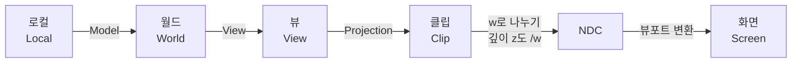

## 들어가며

3D 정점 하나가 화면의 픽셀 위치로 가기까지, 그것은 일련의 *좌표 공간* 을 통과한다. 모델 안에서의 위치(로컬)에서 출발해, 세계 속 위치(월드), 카메라가 보는 위치(뷰), 투영된 위치(클립), 정규화된 위치(NDC)를 거쳐 마침내 픽셀(화면)에 닿는다. 로컬→월드→뷰→클립은 동차 4×4 행렬로 합성할 수 있지만, 클립→NDC는 $w$로 나누는 비선형 단계이고 NDC→화면은 API의 뷰포트 변환이다. 앞의 행렬 합성을 *모델·뷰·투영(Model·View·Projection, MVP)* 변환이라 부른다.

이 변환의 수학은 *어떤 그래픽스 API를 쓰든 똑같다*. 행렬은 OpenGL을 모르고, 동차 좌표는 DirectX를 모른다. 그럼에도 이 주제가 입문자에게 어려운 이유는, API마다 *컨벤션* — 손잡이(handedness), NDC의 깊이 범위, Y축의 방향, 행렬을 메모리에 펼치는 순서 — 이 미묘하게 달라서, 한 API의 예제에서 배운 공식이 다른 API에서 깨지기 때문이다.

이 글은 변환의 *수학 자체* 를 API에 독립적으로 세우고, 컨벤션이 갈리는 지점마다 OpenGL·DirectX·Vulkan의 선택을 한 표로 명시한다. 투영 행렬이 만족해야 하는 계약과 클립 공간의 $w$가 왜 필요한지, 목표 정육면체가 API마다 어떻게 다른지, 법선은 왜 위치와 다른 행렬로 변환하는지를 다룬다. 곱셈 순서와 메모리 레이아웃의 실전 디테일까지 포함해 *모든 API의 공통 분모* 를 세운다.

---

## 목차
1. [좌표 공간의 사슬](#1-좌표-공간의-사슬)
2. [동차 좌표는 왜 필요한가](#2-동차-좌표는-왜-필요한가)
3. [모델 변환과 뷰 변환](#3-모델-변환과-뷰-변환)
4. [투영 행렬과 목표 정육면체](#4-투영-행렬과-목표-정육면체)
5. [클립 공간과 원근 분할](#5-클립-공간과-원근-분할)
6. [NDC 컨벤션: API별 차이](#6-ndc-컨벤션-api별-차이)
7. [법선 변환과 역전치 행렬](#7-법선-변환과-역전치-행렬)
8. [메모리 레이아웃과 곱셈 순서](#8-메모리-레이아웃과-곱셈-순서)

---

## 1. 좌표 공간의 사슬

정점이 픽셀로 가는 전체 흐름이다.

각 공간이 답하는 질문이 다르다.

| 공간 | 답하는 질문 | 결정 주체 |
|---|---|---|
| Local | 모델 자체 기준으로 이 정점은 어디인가 | 모델링 도구 |
| World | 게임 세계 기준으로 어디인가 | 씬/엔진 |
| View | 카메라 기준으로 어디인가 | 카메라 |
| Clip | 절두체를 정육면체로 펼친 4D 공간에서 어디인가 | 투영 행렬 |
| NDC | 정규화된 정육면체 안 어디인가 | 고정 함수(원근 분할) |
| Screen | 어느 픽셀인가 | 뷰포트 |

이 사슬에서 *프로그래머가 책임지는 부분* 과 *고정 함수가 책임지는 부분* 의 경계가 클립 공간이다. 정점 셰이더는 정점을 클립 공간까지만 보내면 되고(즉 MVP 곱까지), 그 뒤의 원근 분할(클립→NDC)과 뷰포트 변환(NDC→화면)은 GPU 고정 함수가 자동으로 한다. 그래서 *정점 처리의 출력 계약이 클립 공간* 이라는 사실이 여기서 수학적으로 구체화된다.

## 2. 동차 좌표는 왜 필요한가

3D 회전과 스케일은 3×3 행렬로 충분하지만, *이동(translation)* 은 행렬 곱으로 표현되지 않는다. 점 $\mathbf{p}$에 회전 $R$을 곱하면 $R\mathbf{p}$를 얻지만, 이동 벡터 $\mathbf{t}$를 *곱셈으로* 더할 자리가 3×3 안에는 없다. 변환을 $\mathbf{p}' = R\mathbf{p} + \mathbf{t}$로 쓰면 덧셈이 끼어들어, 여러 변환의 *합성* 이 깔끔한 행렬 곱이 되지 못한다.

해법이 *동차 좌표(Homogeneous Coordinates)* 다. 3D 점 $(x,y,z)$를 4D $(x,y,z,1)$로 확장하면, 이동도 4×4 행렬 곱이 된다.

$$
T = \begin{pmatrix}
1 & 0 & 0 & t_x \\
0 & 1 & 0 & t_y \\
0 & 0 & 1 & t_z \\
0 & 0 & 0 & 1
\end{pmatrix}, \qquad
T \begin{pmatrix} x \\ y \\ z \\ 1 \end{pmatrix} =
\begin{pmatrix} x + t_x \\ y + t_y \\ z + t_z \\ 1 \end{pmatrix}
$$

이제 모든 변환(이동·회전·스케일·투영)이 4×4 행렬로 통일되고, 변환의 연쇄는 단지 행렬을 미리 곱해 두는 일이 된다.

네 번째 성분 $w$는 *점과 방향을 구분* 하는 역할도 한다.

- $w = 1$: **위치(Point)** — 이동에 영향을 받는다.
- $w = 0$: **방향(Vector)** — 이동에 영향을 받지 않는다. 법선·접선 같은 방향 벡터가 여기 해당한다.

그리고 투영 단계에서 $w$는 또 한 번 변신한다. 원근 투영은 $w$를 *깊이에 비례하는 값* 으로 만들어 두고, 나중에 그 $w$로 나눠 *멀수록 작아지는* 원근 효과를 만든다(5절). 즉 $w$ 한 성분이 동차 좌표의 세 가지 일 — 이동의 표현, 점/방향 구분, 원근 분할 — 을 모두 담당한다.

## 3. 모델 변환과 뷰 변환

**모델 행렬** $M$은 로컬을 월드로 보낸다. 이동·회전·스케일의 합성이다. 합성 *순서* 가 중요한데, 일반적으로 $M = T \cdot R \cdot S$ — 스케일을 먼저, 회전을 다음, 이동을 마지막에 적용한다(행렬은 오른쪽부터 점에 곱해지므로 코드의 곱셈 순서와 적용 순서가 반대다). 순서를 바꾸면 결과가 달라진다. 예컨대 이동 후 회전하면 물체가 원점을 중심으로 *궤도* 를 돌고, 회전 후 이동하면 *제자리* 에서 돈 뒤 옮겨진다.

**뷰 행렬** $V$는 월드를 카메라 기준으로 옮긴다. *카메라를 움직이는* 대신 세계 전체에 카메라 변환의 역을 적용해 카메라를 원점에 고정한다고 생각할 수 있다. 카메라 위치를 $\mathbf e$, 카메라 좌표계의 $+X,+Y,+Z$ 단위축을 각각 $\mathbf r,\mathbf u,\mathbf b$라 하자. 직교 기저라면 회전의 역이 전치이므로 열벡터 표기의 뷰 행렬은 다음과 같다.

$$
V = \begin{pmatrix}
r_x & r_y & r_z & -\mathbf{r}\cdot\mathbf{e} \\
u_x & u_y & u_z & -\mathbf{u}\cdot\mathbf{e} \\
b_x & b_y & b_z & -\mathbf{b}\cdot\mathbf{e} \\
0 & 0 & 0 & 1
\end{pmatrix}
$$

오른손 카메라가 $-Z$를 바라보는 관습에서는 전방 벡터를 $\mathbf f=\operatorname{normalize}(\text{target}-\mathbf e)$로 정의하면 $\mathbf b=-\mathbf f$다. 따라서 세 번째 행은 $-\mathbf f$이고 평행이동 항은 $+\mathbf f\cdot\mathbf e$가 된다. 전방을 $\mathbf f$라고 부르면서 위 행렬의 세 번째 행에 그대로 넣으면 손잡이가 뒤집히므로, `lookAtRH`와 `lookAtLH` 구현에서는 기저의 정의부터 확인해야 한다.

## 4. 투영 행렬과 목표 정육면체

투영 행렬 $P$가 하는 일은 *뷰 절두체(view frustum)* — 카메라에서 뻗어 나가는 잘린 피라미드 — 안의 점들을 정육면체(NDC)로 펼치는 것이다. 멀리 있는 것은 작게, 가까운 것은 크게 보이도록.

원근의 본질은 나눗셈이다. 카메라(원점)에서 뷰 공간 깊이 $-z$(카메라가 $-Z$를 본다고 두자)에 있는 점 $(x, y, z)$를 거리 $n$(near 평면)의 스크린에 투영하면, *닮은 삼각형* 에 의해 투영 좌표는

$$
x' = \frac{n \cdot x}{-z}, \qquad y' = \frac{n \cdot y}{-z}
$$

즉 *$-z$로 나누는 것* 이 원근의 전부다. 멀수록($|z|$가 클수록) 좌표가 작아진다.

문제는 *행렬 곱이 선형이라 나눗셈을 직접 못 한다* 는 것이고, 이 글이 붙잡는 지점이 바로 여기다. 해법은 나눗셈을 행렬 밖으로 미루는 것이다 — 행렬은 $w_c = -z$가 되도록 클립 좌표를 만들어 두고, 실제 나눗셈은 그 뒤의 고정 함수(원근 분할)가 한다. 그래서 투영 행렬이 지켜야 할 계약이 둘로 갈린다.

1. **마지막 행이 $w_c$에 뷰 공간 깊이를 담는다.** 오른손 뷰에서는 $(0,0,-1,0)$이다. 이 한 행이 원근 분할과 클리핑 전체를 떠받친다.
2. **나머지 세 행이 $x,y,z$를 목표 정육면체의 축 범위에 맞춘다.** *어떤 정육면체가 목표인가* 는 API가 정한다.

수직 시야각 $\text{fovy}$, 종횡비 $a$, 근·원 평면 $n, f$의 대칭 절두체에서 NDC 깊이 $[-1,1]$을 목표로 하면 결과는 다음과 같다.

$$
P = \begin{pmatrix}
\dfrac{1}{a \tan(\text{fovy}/2)} & 0 & 0 & 0 \\[2mm]
0 & \dfrac{1}{\tan(\text{fovy}/2)} & 0 & 0 \\[2mm]
0 & 0 & -\dfrac{f+n}{f-n} & -\dfrac{2fn}{f-n} \\[2mm]
0 & 0 & -1 & 0
\end{pmatrix}
$$

각 항은 절두체의 여섯 경계면을 NDC 축 범위로 보내는 선형 조건을 풀면 나온다. 여기서 눈여겨볼 것은 그 대수가 아니라 *행별 역할 분담* 이다. 마지막 행이 계약 1이고, 첫 두 행이 화면 가로·세로 범위를, 세 번째 행이 깊이 범위를 담당한다.

실무에서 중요한 결과는 하나다. *깊이 범위를 바꾸면 세 번째 행만 바뀐다.* Direct3D·Vulkan처럼 NDC 깊이를 $[0,1]$로 보내는 경우에도 $x, y$ 스케일은 그대로이고, 손잡이와 화면 Y 방향만 부호로 흡수된다. 그래서 "한 API의 투영 행렬을 다른 API로 옮긴다"는 작업은 대부분 *세 번째 행 한 줄을 갈아 끼우는 일* 이 된다. 그 목표 정육면체가 정확히 무엇인지가 6절의 표다.

행·열벡터 표기를 바꾸면 위 행렬 전체가 전치되고 곱 순서도 뒤집힌다는 점만 덧붙인다. 그것은 수학이 아니라 표기 선택이며 8절에서 따로 분리한다.

## 5. 클립 공간과 원근 분할

투영 행렬을 곱한 결과 $(x_c, y_c, z_c, w_c)$가 *클립 공간* 좌표다. 아직 나눗셈 전이라 4D다. 이 공간이 "클립"인 이유는, *클리핑(절두체 밖 잘라내기)을 바로 여기서, 분할 전에* 하기 때문이다. 한 점이 절두체 안에 있을 조건이 클립 공간에서 깔끔한 부등식으로 표현된다.

$$
-w_c \le x_c \le w_c, \quad -w_c \le y_c \le w_c, \quad -w_c \le z_c \le w_c \;(\text{OpenGL})
$$

왜 분할 *전* 에 자를까? 카메라 뒤의 점은 $w_c < 0$이 되는데, 이런 점을 먼저 나눠 버리면 부호가 뒤집혀 *화면 앞쪽으로 잘못 접혀 들어온다*. 4D 동차 상태에서 잘라야 이 특이점을 안전하게 처리할 수 있다. 이것이 클리핑이 원근 분할보다 앞 단계인 근본 이유다.

클리핑을 통과하면 *원근 분할(perspective divide)* — 모든 성분을 $w_c$로 나눠 NDC를 얻는다.

$$
(x_n, y_n, z_n) = \left( \frac{x_c}{w_c}, \frac{y_c}{w_c}, \frac{z_c}{w_c} \right)
$$

$w_c = -z$는 카메라 축 방향의 뷰 공간 깊이(축방향 깊이)이며 유클리드 거리와 다르다. 예컨대 $(3,0,-4)$의 유클리드 거리는 5지만 $-z$는 4다. 이 나눗셈이 바로 *멀수록 작아지는* 원근 효과를 만든다. 그리고 이 $1/w_c$ 인자는 래스터화에서 한 번 더 등장한다 — 정점 속성을 화면에서 보간할 때 단순 선형 보간이 깨지는 *원근 보정 보간* 의 원인이 바로 이 분할이다. 마지막으로 *뷰포트 변환* 이 NDC $[-1,1]$을 픽셀 좌표 $[0, \text{width}]\times[0, \text{height}]$로 선형 매핑하면 화면 좌표가 나온다.

### 숫자로 따라가기

추상 공식을 실제 숫자로 한 번 돌려 보자. 대칭 절두체 $\text{fovy}=90°$, 종횡비 $a=1$, $n=1$, $f=11$로 두면 4절의 투영 행렬은 $x,y$ 스케일이 $1/\tan(45°)=1$, 세 번째 행이 $-\tfrac{f+n}{f-n}=-1.2$, $-\tfrac{2fn}{f-n}=-2.2$가 된다. 뷰 공간의 점 $A=(2,1,-5)$를 넣으면(동차 $w=1$):

$$
\begin{aligned}
x_c &= 1\cdot 2 = 2, & y_c &= 1\cdot 1 = 1, \\
z_c &= (-1.2)(-5) + (-2.2)(1) = 3.8, & w_c &= -(-5) = 5.
\end{aligned}
$$

원근 분할로 $\text{NDC} = (2/5,\, 1/5,\, 3.8/5) = (0.4,\, 0.2,\, 0.76)$. 이제 같은 $x,y$인데 *두 배 먼* 점 $B=(2,1,-10)$을 넣으면 $w_c=10$이 되어 $\text{NDC}=(0.2,\,0.1,\,0.98)$. 거리가 2배가 되자 화면 위치 $x_n$이 $0.4\to0.2$로 *정확히 절반* — 이것이 원근 축소다. 깊이 $z_n$은 $0.76\to0.98$로 far(1)에 더 가까워지는데, 그 간격이 거리에 *비선형* 으로 좁아진다는 점(깊이 정밀도 복선)도 눈에 띈다. 1920×1080 뷰포트라면 $A$의 $x_n=0.4$는 화면 $x=\tfrac{0.4+1}{2}\cdot1920=1344$ 픽셀에 떨어진다.

## 6. NDC 컨벤션: API별 차이

수학은 같아도 *목표 정육면체의 모양* 이 API마다 다르다. 이 차이를 모르고 한 API의 투영 행렬을 다른 API에 쓰면, 화면이 뒤집히거나 깊이가 깨진다. 핵심 세 축을 정리한다.

| 컨벤션 | OpenGL 기본 | Direct3D 기본 | Vulkan 기본 |
|---|---|---|---|
| 클립 깊이 조건 | $-w_c \le z_c \le w_c$ | $0 \le z_c \le w_c$ | $0 \le z_c \le w_c$ |
| NDC 깊이 $z_n$ 범위 | $[-1, 1]$ | $[0, 1]$ | $[0, 1]$ |
| NDC $+Y$의 화면 방향 | 위 | 위 | 양수 viewport 높이에서는 아래 |
| 프레임버퍼 좌표 원점 | 좌하단 관습 | 좌상단 | viewport의 `(x,y)`는 좌상단 |
| 흔한 카메라 관습 | 오른손, $-Z$ 전방 | 왼손, $+Z$ 전방 | 응용이 선택 |

**깊이 범위**가 실무에서 가장 자주 무는 함정이다. OpenGL의 기본 NDC 깊이 $[-1,1]$도 뷰포트 변환 뒤 깊이 버퍼의 $[0,1]$에 저장되므로, 이 범위만으로 일반적인 깊이 정밀도가 절반이 되지는 않는다. 차이는 부동소수점 깊이 버퍼에 *reverse-Z*를 적용할 때 선명해진다. DirectX·Vulkan의 $[0,1]$ 컨벤션은 near를 1, far를 0으로 보내는 매핑과 float의 0 근처 정밀도를 자연스럽게 결합한다. OpenGL도 `glClipControl(..., GL_ZERO_TO_ONE)`로 같은 컨벤션을 사용할 수 있다.

**Y축 방향**은 Vulkan으로 옮길 때 화면이 위아래로 뒤집히는 전형적 증상의 원인이다. 양수 `VkViewport::height`를 쓰면 NDC의 $+Y$가 프레임버퍼 아래쪽으로 매핑된다. 투영 행렬의 Y 스케일 부호를 뒤집거나, 지원되는 Vulkan 버전·기능에서 음수 높이 뷰포트를 지정해 다른 API와 맞춘다. 이 규칙은 텍스처 데이터의 “위쪽”과 별개다. 샘플러의 $(u,v)$는 정규화 좌표일 뿐 이미지 파일의 첫 행이 위인지 아래인지 규정하지 않으므로, 로더·에셋 파이프라인의 행 순서와 UV 규약을 따로 고정해야 한다.

**손잡이**는 행렬 자체가 아니라 *기저 부호* 의 문제라(3절), 어느 API든 양쪽을 다 쓸 수 있다. DirectXMath·GLM 모두 `...RH`/`...LH` 함수를 동시에 제공하는 것이 그 증거다. 중요한 것은 *엔진 안에서 하나로 통일* 하는 것이다.

요점: 투영 행렬을 직접 만들 때는 *목표 API의 NDC가 깊이 $[-1,1]$인지 $[0,1]$인지* 를 먼저 정하고 세 번째 행을 거기에 맞춰야 한다. $x,y$ 부분은 손잡이·Y축만 신경 쓰면 공유된다.

## 7. 법선 변환과 역전치 행렬

위치는 모델 행렬 $M$으로 변환하면 되지만, *법선(normal)* 을 같은 선형 변환으로 처리하면 비균등 스케일이나 shear에서 틀린다. 법선은 위치가 아니라 접평면을 나타내는 공변 벡터이기 때문이다. 월드 공간 법선이라면 $M$의 좌상단 3×3 선형부를 $A$로 두고, 뷰 공간 법선이라면 model-view의 선형부를 $A$로 둔다.

수학으로 보면, 법선 $\mathbf{n}$은 표면 접선 $\mathbf{t}$와 수직($\mathbf{n} \cdot \mathbf{t} = 0$)이라는 *관계* 로 정의된다. 변환 $M$ 후에도 이 수직을 유지하려면, 법선에 적용할 행렬 $N$은

$$
N = A^{-T}
$$

이어야 한다. 변환 후에도 모든 접선 $\mathbf t$와 수직이어야 하므로

$$
(N\mathbf n)^T(A\mathbf t)
=\mathbf n^TN^TA\mathbf t=0
$$

이고, 이를 원래 조건 $\mathbf n^T\mathbf t=0$과 같게 만들려면 $N^TA=I$, 즉 $N=A^{-T}$다. 순수 회전에서는 $A^{-T}=A$다. 균등 스케일 $A=sR$에서는 $A^{-T}=R/s$이고 $A=sR$과 같지는 않지만, 변환 후 정규화하면 $s>0$에서 같은 방향을 얻는다. 비균등 스케일과 shear에서는 방향 자체가 달라진다. $A$가 특이 행렬이면 역이 없으므로 0 스케일로 눌린 기하에는 정상적인 법선 변환도 정의되지 않는다.

## 8. 메모리 레이아웃과 곱셈 순서

마지막으로, 수학과 *직교* 하지만 자주 섞여 혼란을 주는 두 가지를 분리한다.

**메모리 레이아웃 (Row-major vs Column-major)**: 16개의 float을 메모리에 *어떤 순서로* 펼치느냐의 문제다. Row-major는 한 행을 연속으로 저장하고, Column-major는 한 열을 연속으로 저장한다. 같은 수학적 행렬이라도 메모리 바이트 배열이 다르다. GLSL 블록 행렬은 기본 column-major이고 HLSL 상수 버퍼 행렬의 기본 패킹은 column-major다. 다만 CPU 라이브러리와 셰이더의 `row_major`/`column_major` 한정자, 컴파일 옵션이 이 선택을 바꿀 수 있다. “DirectX는 무조건 row-major”처럼 API 이름만으로 단정하지 말고 CPU 저장, 셰이더 패킹, 벡터 곱을 각각 확인해야 한다.

**곱셈 순서 (벡터 컨벤션)**: 벡터를 행렬의 *오른쪽* 에 두느냐($M\mathbf{v}$, 열벡터) *왼쪽* 에 두느냐($\mathbf{v}^T M$, 행벡터)의 문제다. 이건 셰이더 코드와 수식 표기의 문제지 메모리와 무관하다. $M\mathbf{v}$ 컨벤션에서는 MVP를 `P * V * M`으로 쓰고, $\mathbf{v}^T M$ 컨벤션에서는 `M * V * P`로 쓴다.

두 선택이 *직교* 라는 게 핵심이다 — 레이아웃 2가지 × 순서 2가지 = 4가지 조합이 가능하다. 라이브러리와 예제 코드가 관습적으로 특정 조합을 택하기 때문에 마치 하나의 선택처럼 보일 뿐이다. 같은 기하 변환을 행벡터 표기로 전환하면 행렬도 전치되고 곱 순서도 뒤집히므로, 서로 다른 코드의 16개 숫자가 우연히 같아 보이는 경우도 있다. API를 사용할 때는 CPU 저장 레이아웃, 셰이더 버퍼 패킹, 셰이더의 곱 식을 각각 확인해야 한다.

---

## 결론

좌표 변환은 *로컬에서 화면까지 이어지는 공간의 사슬* 이고, 앞부분(로컬→월드→뷰→클립)은 4×4 행렬 변환이지만 마지막 고리는 행렬 곱이 아니라 *클리핑 → 원근 분할 → 뷰포트 변환* 이다. 동차 좌표의 $w$ 한 성분이 이동의 표현, 점/방향 구분, 원근 분할을 모두 떠받친다. 원근 투영의 핵심은 *$-z$로 나누는 것* 이며, 행렬은 $w_c = -z$를 만들어 두고 나눗셈은 고정 함수에 위임한다.

수학은 API 중립이지만 *목표 NDC의 모양* — 깊이 $[-1,1]$인지 $[0,1]$인지, Y축이 위인지 아래인지 — 은 API마다 다르므로, 투영 행렬을 만들 때는 항상 *목표 API의 컨벤션* 을 먼저 정해야 한다. 법선은 위치와 다른 *역전치* 행렬로 변환하고, 메모리 레이아웃과 곱셈 순서는 *직교한 별개의 선택* 임을 분리해 기억하면 라이브러리 사이를 건널 때 덜 헷갈린다.

## 더 읽을거리

- [Song Ho Ahn, OpenGL Transformation](https://www.songho.ca/opengl/gl_transform.html) — 변환 사슬 전 단계의 행렬 유도(투영 행렬 유도는 같은 사이트의 [OpenGL Projection Matrix](https://www.songho.ca/opengl/gl_projectionmatrix.html)가 특히 명료).
- Eric Lengyel, *Foundations of Game Engine Development, Vol.1: Mathematics* (2016) — 동차 좌표·역전치·핸디드니스의 엄밀한 정리.
- [OpenGL 4.6 Core Specification](https://registry.khronos.org/OpenGL/specs/gl/glspec46.core.pdf) — 클립 좌표, 원근 분할, 뷰포트 변환의 규범적 계약.
- [Vulkan Specification: Fixed-Function Vertex Post-Processing](https://registry.khronos.org/vulkan/specs/latest/html/vkspec.html#vertexpostproc) — Vulkan 클립 볼륨과 뷰포트 변환의 규범적 정의.
- [Scratchapixel: Perspective and Orthographic Projection Matrix](https://www.scratchapixel.com/lessons/3d-basic-rendering/perspective-and-orthographic-projection-matrix/projection-matrix-introduction.html) — 투영 행렬을 처음부터 유도.
