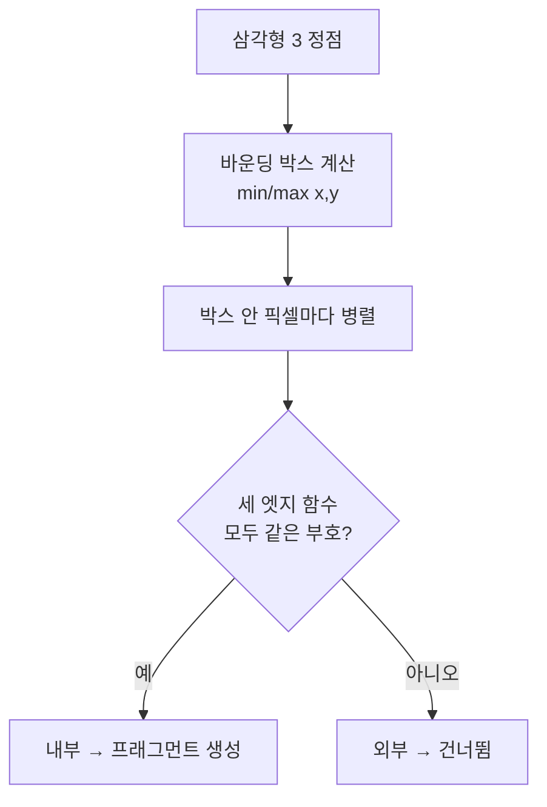

## 들어가며

좌표 변환을 끝내면 삼각형의 세 꼭짓점은 화면 위의 픽셀 좌표를 갖는다. 하지만 화면은 *연속적인 삼각형* 이 아니라 *이산적인 픽셀 격자* 다. "꼭짓점이 (12.3, 40.7), (88.1, 22.0), (50.5, 95.2)인 삼각형"을 "이 픽셀들을 이 색으로 칠하라"는 명령으로 바꾸는 것 — 이것이 *래스터화(Rasterization)* 다. 파이프라인에서 유일하게 *연속 기하* 가 *이산 픽셀* 로 변하는 지점이고, 그래서 래스터화 파이프라인의 이름이 여기서 나왔다.

이 단계는 그래픽스 API 문서에서 묘하게 *설명되지 않는다*. 고정 함수라 셰이더로 만질 수 없고 하드웨어가 알아서 처리하기 때문에, OpenGL·DirectX·Vulkan 입문서는 "삼각형이 래스터화된다"고 한 줄 적고 넘어가기 일쑤다. 하지만 그 안에서 일어나는 일 — 어떤 픽셀이 삼각형에 속하는지 판정하고, 속성을 보간하고, 원근 때문에 보간을 보정하는 것 — 을 이해하지 못하면 텍스처가 왜 일그러지는지, Z-fighting이 왜 생기는지, 소프트웨어 렌더러를 어떻게 짜는지 알 수 없다.

이 글은 래스터화를 *직접 구현할 수 있을 만큼* 분해한다. 엣지 함수로 삼각형 내부를 판정하고, 무게중심 좌표로 속성을 섞고, 원근 분할이 왜 단순 선형 보간을 망가뜨리는지와 그 보정법을 유도한다. 마지막에 이 모든 것을 합친 삼각형 래스터라이저 의사코드를 제시한다. 같은 알고리즘으로 GPU 없이 동작하는 소프트웨어 래스터라이저도 만들 수 있다.


---

## 목차
1. [삼각형을 픽셀로: 두 가지 접근](#1-삼각형을-픽셀로-두-가지-접근)
2. [엣지 함수](#2-엣지-함수)
3. [무게중심 좌표](#3-무게중심-좌표)
4. [Top-Left 규칙과 픽셀 중심](#4-top-left-규칙과-픽셀-중심)
5. [속성 보간](#5-속성-보간)
6. [원근 보정 보간](#6-원근-보정-보간)
7. [깊이 보간](#7-깊이-보간)
8. [통합: 삼각형 래스터라이저](#8-통합-삼각형-래스터라이저)


---

## 1. 삼각형을 픽셀로: 두 가지 접근

삼각형을 픽셀로 채우는 데는 역사적으로 두 갈래가 있었다.

**스캔라인(Scanline) 방식**: 삼각형을 *수평선 단위* 로 훑는다. 각 y 행에서 삼각형의 좌·우 엣지와의 교점을 구해 그 사이를 채운다. 직렬적이고 분기가 많지만 픽셀당 계산이 적어, 단일 코어 CPU 시절(초기 소프트웨어 렌더러)의 표준이었다.

**엣지 함수(Edge Function) 방식**: 삼각형의 바운딩 박스나 그 안의 타일에서 샘플이 삼각형 내부인지 판정한다. 엣지 함수는 증분 계산과 타일 단위 보수 판정에 적합하고, 샘플 판정을 병렬화하기 쉽다. 실제 GPU는 계층형 타일·quad·전용 raster unit을 사용하므로 모든 픽셀을 순진하게 바운딩 박스 루프로 방문한다고 해석해서는 안 된다. 소프트웨어 래스터라이저도 scanline, edge function, 타일 기반 접근을 워크로드에 맞게 조합한다.



이 글은 엣지 함수 방식을 다룬다. *왜 GPU가 이 방식을 택했는가* 가 곧 본 "고정 순서·독립 단계가 병렬성을 낳는다"의 구체적 사례다 — 픽셀들이 서로를 모른 채 동시에 판정될 수 있어야 수천 코어가 놀지 않는다.


## 2. 엣지 함수

엣지 함수의 핵심 발상: *유향 선분(directed edge)* 이 평면을 둘로 가르고, 한 점이 그 선분의 어느 쪽에 있는지는 *부호 있는 면적* 으로 알 수 있다. 두 점 $A, B$가 이루는 엣지에 대해 점 $P$의 엣지 함수는

$$
E_{AB}(P) = (B_x - A_x)(P_y - A_y) - (B_y - A_y)(P_x - A_x)
$$

이것은 벡터 $\overrightarrow{AB}$와 $\overrightarrow{AP}$의 *2D 외적(cross product)* 이고, 기하학적으로 삼각형 $ABP$ 넓이의 2배(부호 포함)다. 부호의 의미:

- $E_{AB}(P) > 0$: $P$가 엣지 $A{\to}B$의 *왼쪽*
- $E_{AB}(P) = 0$: $P$가 엣지 *위*
- $E_{AB}(P) < 0$: $P$가 엣지의 *오른쪽*

삼각형 $V_0, V_1, V_2$를 *일관된 감김 방향*(예: 반시계)으로 두면, 점 $P$가 삼각형 *내부* 에 있을 조건은 단순하다 — *세 엣지 함수가 모두 같은 부호*.

$$
E_{01}(P) \ge 0 \;\land\; E_{12}(P) \ge 0 \;\land\; E_{20}(P) \ge 0
$$

세 외적이 모두 양수면 $P$는 세 엣지 모두의 같은 쪽, 즉 안쪽에 있다. 이 판정이 *덧셈·곱셈만으로* 이뤄진다는 점이 중요하다 — 나눗셈도 분기도 없어 하드웨어로 굽기 좋다.

게다가 엣지 함수는 *증분 계산(incremental)* 이 가능하다. $E_{AB}(x, y)$는 $x, y$의 1차식이므로, 옆 픽셀로 한 칸 가면 값이 *상수만큼* 변한다.

$$
E(x+1, y) = E(x, y) - (B_y - A_y), \qquad E(x, y+1) = E(x, y) + (B_x - A_x)
$$

바운딩 박스의 시작 픽셀에서 한 번만 엣지 함수를 풀고, 이후엔 덧셈만으로 옆·아래 픽셀의 값을 갱신한다. 곱셈조차 없앤 이 증분 형태가 실제 하드웨어·고속 소프트웨어 래스터라이저의 모습이다.


## 3. 무게중심 좌표

엣지 함수는 *덤* 을 하나 더 준다 — 공짜로 *무게중심 좌표(barycentric coordinates)* 가 나온다. 삼각형 내부의 점 $P$를 세 꼭짓점의 가중 평균으로 표현하는 좌표다.

$$
P = \lambda_0 V_0 + \lambda_1 V_1 + \lambda_2 V_2, \qquad \lambda_0 + \lambda_1 + \lambda_2 = 1
$$

각 $\lambda_i$는 *$P$와 마주보는 부분 삼각형의 면적 비율* 이다. 그런데 부분 삼각형의 (2배) 면적이 바로 엣지 함수 값이므로,

$$
\lambda_0 = \frac{E_{12}(P)}{E_{12}(V_0)}, \quad \lambda_1 = \frac{E_{20}(P)}{E_{20}(V_1)}, \quad \lambda_2 = \frac{E_{01}(P)}{E_{01}(V_2)}
$$

분모는 삼각형 전체 면적의 2배(상수)다. 즉 *내부 판정에 이미 계산한 엣지 함수 값을 전체 면적으로 나누기만 하면* 무게중심 좌표가 나온다. 이 $(\lambda_0, \lambda_1, \lambda_2)$가 보간의 가중치다 — 꼭짓점에 어떤 속성(색·텍스처 좌표·법선)이 있든, 그 픽셀에서의 값은

$$
\text{attr}(P) = \lambda_0\,\text{attr}_0 + \lambda_1\,\text{attr}_1 + \lambda_2\,\text{attr}_2
$$

로 섞인다. 꼭짓점에서 $\lambda$는 $(1,0,0)$ 식이 되어 그 꼭짓점 값이 그대로 나오고, 내부에서는 부드럽게 보간된다. 무게중심 좌표가 래스터화와 셰이딩을 잇는 다리인 셈이다 — 단, 다음 두 절에서 보듯 *원근* 이 이 단순한 그림에 손을 댄다.

### 숫자로 따라가기

삼각형 $V_0=(0,0)$, $V_1=(4,0)$, $V_2=(0,4)$와 내부 점 $P=(1,1)$로 직접 계산해 보자. 엣지 함수 $E_{AB}(C)=(B_x{-}A_x)(C_y{-}A_y)-(B_y{-}A_y)(C_x{-}A_x)$를 그대로 적용한다.

$$
\begin{aligned}
\text{면적}\times2 &= E_{V_0V_1}(V_2) = (4)(4)-(0)(0) = 16 \quad(\text{즉 면적 }8), \\
e_0 = E_{V_1V_2}(P) &= (-4)(1)-(4)(-3) = 8, \\
e_1 = E_{V_2V_0}(P) &= (0)(-3)-(-4)(1) = 4, \\
e_2 = E_{V_0V_1}(P) &= (4)(1)-(0)(1) = 4.
\end{aligned}
$$

셋 다 양수 → $P$는 *내부*. 전체 면적($\times2=16$)으로 나누면 무게중심 $(\lambda_0,\lambda_1,\lambda_2)=(0.5,\,0.25,\,0.25)$, 합은 정확히 1이다. 검산: $0.5\,V_0+0.25\,V_1+0.25\,V_2 = (1,1) = P$ ✓. 꼭짓점 색이 빨강·초록·파랑이라면 $P$의 색은 $0.5(1,0,0)+0.25(0,1,0)+0.25(0,0,1)=(0.5,\,0.25,\,0.25)$ — 빨강에 가장 가까운 보라끼다($P$가 $V_0$에 제일 가까우니 당연하다). 이 한 점의 산수를 바운딩 박스의 모든 픽셀에 반복하면 삼각형이 칠해진다.


## 4. Top-Left 규칙과 픽셀 중심

이론을 실제 픽셀 격자에 올리면 두 가지 현실 문제가 생긴다.

**픽셀 중심 샘플링**: 픽셀은 점이 아니라 *작은 사각형* 이다. 관례적으로 좌표 $(x, y)$ 픽셀의 *중심* 은 $(x + 0.5, y + 0.5)$이고, 래스터화는 이 중심점이 삼각형 안에 있는지로 커버리지를 판정한다. 따라서 엣지 함수에 픽셀 정수 좌표가 아니라 $+0.5$ 보정된 중심을 넣어야 한다.

**Top-Left 규칙(공유 엣지 문제)**: 두 삼각형이 한 엣지를 *공유* 할 때(메시는 거의 항상 그렇다), 그 엣지 위에 정확히 놓인 픽셀 중심을 *양쪽 다* 칠하면 — 반투명 블렌딩에서 이중으로 그려져 *겹친 선* 이 보인다. *아무도 안* 칠하면 *틈(crack)* 이 생긴다. 둘 다 눈에 띄는 아티팩트다.

대표적인 해법이 *top-left 규칙* 이다. 엣지 위에 딱 걸린 샘플($E(P)=0$)은 그 엣지가 삼각형의 *위쪽 엣지* 이거나 *왼쪽 엣지* 일 때만 "내부"로 친다. 공유 엣지는 한 삼각형에겐 왼쪽/위, 다른 삼각형에겐 오른쪽/아래가 되므로, 같은 래스터화 규칙과 샘플 패턴 아래서는 *정확히 한 삼각형* 만 그 샘플을 갖는다. D3D는 이를 top-left 규칙으로 명시하고 OpenGL·Vulkan도 공유 경계의 소유권과 커버리지 규칙을 규정한다. 그러나 subpixel 정밀도, 샘플 위치, 보수적 래스터화와 API별 좌표 관례까지 모두 같다는 뜻은 아니므로, 서로 다른 API·장치의 전체 픽셀 집합이 비트 단위로 동일하다고 가정할 수는 없다.


## 5. 속성 보간

3절의 무게중심 보간 공식 — $\text{attr}(P) = \sum \lambda_i\,\text{attr}_i$ — 은 *화면 공간에서 선형* 이다. 색처럼 화면에 평평하게 깔리는 속성은 이걸로 충분하다. 문제는 *깊이가 다른 점들* 의 속성을 보간할 때 생긴다.

직관적 반례를 들자. 바닥에 깔린 체커보드 텍스처를 비스듬히 본다고 하자. 화면에서 가까운 칸은 크고 먼 칸은 작아 보인다 — 원근이다. 그런데 텍스처 좌표를 *화면 공간에서 선형으로* 보간하면, 화면상 같은 간격마다 텍스처 좌표가 같은 양만큼 증가한다. 결과적으로 먼 칸과 가까운 칸이 *같은 화면 크기* 로 그려져, 바닥이 종이접기처럼 꺾여 보인다. 실제로 초기 PlayStation 게임의 텍스처가 출렁이던 이유가 바로 이 *어파인(affine) 텍스처 매핑* — 원근 보정을 생략한 선형 보간 — 이었다.

원인은 원근 분할이다. 정점이 화면에 놓일 때 이미 $w$로 나눠졌으므로, *화면 공간의 균등 간격* 은 *3D 공간의 균등 간격* 에 대응하지 않는다. 화면에서 절반 지점이 3D에서는 절반보다 훨씬 먼 곳일 수 있다. 따라서 3D 표면에 붙은 속성(텍스처 좌표)을 화면 공간 무게중심으로 곧장 섞으면 틀린다.


## 6. 원근 보정 보간

해법은 *$1/w$도 함께 보간* 하는 것이다. 핵심 사실: 어떤 속성이든 *클립 공간의 $w$로 나눈 값* — 즉 $\text{attr}/w$ — 은 화면 공간에서 *진짜로 선형* 이다. 그리고 $1/w$ 자체도 화면 공간에서 선형이다. 따라서 다음 두 가지를 화면 공간 무게중심 $\lambda_i$로 선형 보간한 뒤,

$$
\left(\frac{\text{attr}}{w}\right)_P = \sum_i \lambda_i \frac{\text{attr}_i}{w_i}, \qquad
\left(\frac{1}{w}\right)_P = \sum_i \lambda_i \frac{1}{w_i}
$$

둘을 나누면 원근적으로 올바른 속성이 복원된다.

$$
\boxed{\;\text{attr}(P) = \dfrac{\displaystyle\sum_i \lambda_i\,\text{attr}_i / w_i}{\displaystyle\sum_i \lambda_i / w_i}\;}
$$

이것이 *원근 보정 보간(perspective-correct interpolation)* 이다. 직관적으로, $1/w$ 가중치가 *먼 꼭짓점(작은 $1/w$)의 영향을 줄이고 가까운 꼭짓점의 영향을 키워* 화면상의 왜곡을 정확히 상쇄한다.

현대 GPU는 이것을 자동으로 한다. 정점 셰이더가 클립 공간 $w$를 내보내면, 래스터화기는 보간 속성에 대해 위 보정을 *고정 함수* 로 수행한다. GLSL과 HLSL의 `noperspective` 한정자는 이 보정을 끄고 화면 공간 선형 보간을 선택한다. 깊이는 일반 varying과 같은 방식으로 복원해 쓰는 값이 아니라 API의 viewport depth 변환과 depth buffer 표현을 따르므로 별도의 정밀도 분석이 필요하다.


## 7. 깊이 보간

깊이도 보간해야 한다 — 깊이 테스트가 픽셀마다 깊이를 비교하기 때문이다. 그런데 깊이는 속성들과 사정이 다르다.

뷰 공간 깊이 $z_{\text{view}}$는 화면 공간에서 *비선형* 이라 5·6절의 원근 보정이 필요하다. 하지만 우리가 깊이 버퍼에 저장하는 값은 보통 *NDC 깊이* $z_n = z_c / w_c$다. 그리고 이 NDC 깊이는 — 투영 행렬이 그렇게 설계됐기 때문에 — *화면 공간에서 선형* 이다. 즉 NDC 깊이는 원근 보정 없이 무게중심으로 곧장 선형 보간해도 맞는다.

$$
z_n(P) = \lambda_0 z_{n,0} + \lambda_1 z_{n,1} + \lambda_2 z_{n,2}
$$

이 편의에는 대가가 있다. NDC 깊이가 화면 공간에서 선형이라는 말은, *뷰 공간 거리에 대해서는 비선형* 이라는 뜻이다. 구체적으로 $z_n$은 $1/z_{\text{view}}$에 비례해, near 평면 근처에 정밀도가 몰리고 far 쪽은 듬성해진다. 멀리 있는 두 면의 깊이가 같은 값으로 뭉개져 깜빡이는 *Z-fighting* 이 여기서 비롯된다. 이 정밀도 분포를 완화하려면 near 평면을 불필요하게 가깝게 두지 않고, 부동소수점 깊이 버퍼에서는 reverse-Z처럼 깊이 매핑을 뒤집어 정밀도 분포를 펴는 방법을 쓴다. 핵심은 *깊이는 NDC에서 선형 보간(원근 보정 불요), 그 밖의 속성은 원근 보정 보간* 이라는 비대칭이다.

### 왜 $1/w$와 $\text{attr}/w$가 화면 공간에서 선형인가 — 보정의 유도와 깊이 정밀도

5·6·7절은 세 가지 사실을 *결과로만* 썼다 — 표면 속성의 화면 공간 선형 보간은 틀리고, $\text{attr}/w$와 $1/w$는 화면 공간에서 선형이며, NDC 깊이는 보정 없이 선형이다. 셋은 따로 외울 규칙이 아니라 *하나의 항등식* 에서 한꺼번에 나온다.

**클립 공간 무게중심과 화면 공간 무게중심의 관계.** 삼각형 위의 한 점은 *클립 공간*(원근 분할 전)에서 꼭짓점의 1차 결합이다. 클립 좌표 $\mathbf{c}_i=(x_i^c,y_i^c,z_i^c,w_i)$와 클립 공간 무게중심 $\alpha_i$($\sum_i\alpha_i=1$)로

$$
(x^c,\,y^c,\,z^c,\,w)=\sum_i\alpha_i\,(x_i^c,\,y_i^c,\,z_i^c,\,w_i)
$$

네 성분 모두 $\alpha$의 1차식이다 — 특히 $w=\sum_i\alpha_i w_i$. 화면 위치는 원근 분할 $\mathbf{s}=(x^c/w,\;y^c/w)$로 얻고, 래스터화기가 푸는 무게중심 $\lambda_i$는 *이 화면 위치* $\mathbf{s}$에 대한 것이다($\mathbf{s}=\sum_i\lambda_i\mathbf{s}_i$, $\sum_i\lambda_i=1$, $\mathbf{s}_i=(x_i^c/w_i,\,y_i^c/w_i)$).

동차 좌표를 꼭짓점 화면 위치로 묶으면 $(x^c,y^c,w)=\sum_i\alpha_i w_i\,(s_{i,x},s_{i,y},1)$이고, 양변을 $w$로 나누면 $(s_x,s_y,1)=\sum_i\frac{\alpha_i w_i}{w}(s_{i,x},s_{i,y},1)$. 무게중심의 유일성(비퇴화 삼각형)으로 이 표현과 $\lambda_i$의 정의를 맞추면

$$
\boxed{\;\lambda_i=\frac{\alpha_i\,w_i}{w},\qquad w=\sum_j\alpha_j w_j\;}
$$

이 한 줄이 원근 보정의 *전부* 다 — 화면 무게중심 $\lambda_i$는 참 무게중심 $\alpha_i$를 *깊이 $w_i$로 가중* 한 값이다. 멀수록(큰 $w_i$) 화면에서 과대대표된다.

**세 사실의 동시 유도.** 화면 공간에서 선형인 양은 무엇이든 $\sum_i\lambda_i\cdot(\text{꼭짓점 값})$으로 쓸 수 있다(그것이 $\lambda_i$의 정의다). 위 관계와 $\sum_i\alpha_i=1$을 대입한다.

- $1/w$: $\displaystyle\sum_i\lambda_i\frac{1}{w_i}=\sum_i\frac{\alpha_i w_i}{w}\frac{1}{w_i}=\frac{1}{w}\sum_i\alpha_i=\frac{1}{w}$. 즉 $1/w$는 정확히 화면 무게중심으로 선형 보간된다.
- $\text{attr}/w$ (삼각형 위 선형 속성 $\text{attr}=\sum_i\alpha_i\,\text{attr}_i$): $\displaystyle\sum_i\lambda_i\frac{\text{attr}_i}{w_i}=\frac{1}{w}\sum_i\alpha_i\,\text{attr}_i=\frac{\text{attr}}{w}$. 둘을 나누면 6절의 보정식이 복원되고, 동시에 화면→클립 무게중심 역변환 $\alpha_i=\dfrac{\lambda_i/w_i}{\sum_j\lambda_j/w_j}$도 따라 나온다.
- NDC 깊이 $z_n=z^c/w$: $\displaystyle\sum_i\lambda_i z_{n,i}=\sum_i\lambda_i\frac{z_i^c}{w_i}=\frac{1}{w}\sum_i\alpha_i z_i^c=\frac{z^c}{w}=z_n$.

7절의 비대칭이 여기서 해명된다 — 일반 속성은 우리가 원하는 값이 $\text{attr}$ 자체($=\frac{\text{attr}/w}{1/w}$, $\mathbf{s}$에 비선형)라 나눗셈이 필요하지만, *깊이는 저장하는 값이 이미 $z^c/w$ 형태* 라 곧 "$\text{attr}/w$"에 해당해 그대로 선형이다. 별개의 규칙이 아니라 같은 항등식의 다른 쓰임이다.

**보정을 빠뜨리면 — 어파인 매핑의 정량 오차.** 깊이 $w_0,w_1$인 두 꼭짓점을 잇는 엣지의 *화면 중점* $\lambda=(0.5,0.5)$를 보자. 참 3D 매개변수는 $\alpha_1=\frac{0.5/w_1}{0.5/w_0+0.5/w_1}=\frac{w_0}{w_0+w_1}$인데 어파인 보간은 이를 $0.5$로 친다. $w_1=10w_0$(꼭짓점 1이 10배 멀다)이면 $\alpha_1=\frac{1}{11}\approx0.091$ — 화면 중점이 3D에서는 겨우 9% 지점이다. 텍스처 좌표 오차 $0.5-0.091=0.41$이 초기 PlayStation 바닥 텍스처가 출렁이던 정체다. 오차는 깊이비 $w_1/w_0$로 커진다($2{:}1\to0.17$, $4{:}1\to0.30$, $10{:}1\to0.41$). 삼각형이 화면에 평행하면($w_0{=}w_1$) 오차 0 — 어파인이 맞는 유일한 경우이고, GPU가 화면 정렬 데칼 등에서 `noperspective`로 보정을 끄는 근거다.

**깊이의 대가 — $1/z$ 분포와 정밀도.** $z_n$이 화면 공간 선형이라는 편의의 대가는 *뷰 거리에 대한 비선형* 이다. $[0,1]$ 깊이 관례에서 뷰 거리 $z\in[n,f]$에 대해

$$
z_d(z)=\frac{f}{f-n}\Bigl(1-\frac{n}{z}\Bigr)
$$

($z{=}n\to0$, $z{=}f\to1$)이고, $z_d$는 $1/z$의 1차식이다. 버퍼 한 스텝 $\delta z_d$가 덮는 *월드 거리 분해능* 은

$$
\delta z\approx\frac{\delta z_d}{\lvert dz_d/dz\rvert}=\delta z_d\,\frac{f-n}{f\,n}\,z^2
$$

로 $z^2$에 비례해 *far 쪽에서 가장 거칠다*. 24비트 정수 버퍼($\delta z_d=2^{-24}$), $n{=}0.1$, $f{=}1000$이면 $z{=}0.1$에서 약 $6\times10^{-9}$m, $z{=}1000$에서 약 $0.60$m다 — 멀리서 0.6m보다 가까운 두 면은 같은 깊이로 뭉개져 Z-fighting이 된다. far/near 정밀도 비는 $(f/n)^2=10^8$. 지배 손잡이는 *near 평면* 이다: $f\gg n$에서 far쪽 $\delta z\approx\delta z_d\,f^2/n$이라 $n$에 반비례 — $n$을 $0.1\to0.2$로만 늘려도 far 분해능이 절반(0.60m→0.30m)이 된다("near를 불필요하게 가깝게 두지 말라"의 정량 근거). 부동소수점 깊이 버퍼는 가수가 0 근처에 몰리므로 $1-z_d$를 저장하는 *reverse-Z* 로 float의 조밀한 구간을 far로 보내면, float의 로그형 간격과 $1/z$의 쌍곡 간격이 서로를 상당히 상쇄해 넓은 거리 범위에서 뷰 공간 *상대* 정밀도가 훨씬 고르게 된다(완전히 균일해지는 것은 아니며, 이 이득은 부동소수점 형식에서만 나온다).


## 8. 통합: 삼각형 래스터라이저

앞의 모든 조각을 하나로 합친 의사코드다. 정점은 이미 화면 공간 좌표 $(x, y)$와 NDC 깊이 $z$, 클립 공간 $w$, 그리고 속성을 갖는다고 가정한다.

```cpp
// 입력: 화면 공간 정점 v0,v1,v2 (각각 .x .y .z .w .attr, z는 NDC 깊이)
void RasterizeTriangle(const Vert& v0, const Vert& v1, const Vert& v2,
                       Framebuffer& fb, DepthBuffer& zb) {
    // 1) 바운딩 박스 (화면 클램프)
    int minX = floor(min3(v0.x, v1.x, v2.x)), maxX = ceil(max3(v0.x, v1.x, v2.x));
    int minY = floor(min3(v0.y, v1.y, v2.y)), maxY = ceil(max3(v0.y, v1.y, v2.y));
    clampToScreen(minX, minY, maxX, maxY, fb);

    // 2) 전체 면적(2배) — 0이면 퇴화 삼각형, 음수면 감김 반대
    float area = edge(v0, v1, v2);
    if (area == 0) return;
    float invArea = 1.0f / area;

    for (int y = minY; y <= maxY; ++y)
    for (int x = minX; x <= maxX; ++x) {
        Point2 p = { x + 0.5f, y + 0.5f };              // 4) 픽셀 중심

        // 2) 세 엣지 함수
        float e0 = edge(v1, v2, p);   // V0 에 대응
        float e1 = edge(v2, v0, p);   // V1
        float e2 = edge(v0, v1, p);   // V2

        // 내부 판정 + top-left 규칙(공유 엣지 중복 방지)
        if (!insideWithTopLeft(e0, e1, e2, v0, v1, v2)) continue;

        // 3) 화면 공간 무게중심
        float l0 = e0 * invArea, l1 = e1 * invArea, l2 = e2 * invArea;

        // 7) 깊이는 NDC에서 선형 보간 (원근 보정 불요)
        float z = l0*v0.z + l1*v1.z + l2*v2.z;
        if (z >= zb.At(x, y)) continue;                 // 깊이 테스트(가까운 게 작다 가정)

        // 6) 그 밖의 속성은 원근 보정 보간
        float w0 = l0 / v0.w, w1 = l1 / v1.w, w2 = l2 / v2.w;
        float invW = w0 + w1 + w2;
        Attr a = (w0*v0.attr + w1*v1.attr + w2*v2.attr) / invW;

        // 프래그먼트 셰이딩 → 출력 병합
        Color c = FragmentShade(a);
        zb.Set(x, y, z);
        fb.Set(x, y, c);
    }
}
```

이 한 함수에 래스터화의 핵심이 들어 있다 — 바운딩 박스 순회, 엣지 함수 내부 판정, 무게중심 좌표, 픽셀 중심과 top-left 규칙, 깊이의 선형 보간, 속성의 원근 보정 보간. 실제 GPU는 이걸 픽셀 단위가 아니라 *2×2 쿼드* 단위로, 증분 엣지 함수와 SIMD로 처리하지만 골격은 정확히 이것이다. 소프트웨어 래스터 백엔드도 본질적으로 같은 루프를 돈다.

---

## 결론

래스터화는 *연속 삼각형을 이산 표본으로* 바꾸는, 파이프라인에서 가장 기하학적인 단계다. 핵심 도구는 *엣지 함수* — 2D 외적의 부호로 내부를 판정하고, 그 값을 전체 면적으로 나누면 곧바로 *무게중심 좌표* 가 되어 속성 보간의 가중치를 준다. 픽셀·샘플 위치와 경계 소유 규칙은 공유 엣지의 겹침·틈을 막는다. 재현성의 범위는 같은 API가 보장한 정밀도와 샘플 계약까지이며, 서로 다른 API·장치의 비트 단위 커버리지 동일성까지 포함하지 않는다.

가장 미묘한 부분은 *보간* 이다. 원근 분할 탓에 화면 공간 선형 보간은 표면 속성을 일그러뜨리므로, $1/w$를 함께 보간해 나누는 *원근 보정 보간* 이 필요하다. 단 NDC 깊이만은 화면 공간에서 선형이라 보정 없이 섞으며, 그 대가로 깊이 정밀도가 비선형으로 분포한다.


## 더 읽을거리

- Juan Pineda, "A Parallel Algorithm for Polygon Rasterization" (SIGGRAPH 1988) — 엣지 함수 래스터화의 원전.
- Fabian Giesen, ["The barycentric conspiracy"](https://fgiesen.wordpress.com/2013/02/06/the-barycentric-conspirac/) 외 [Optimizing Software Occlusion Culling 시리즈](https://fgiesen.wordpress.com/2013/02/17/optimizing-sw-occlusion-culling-index/) — 엣지 함수·고정소수점·SIMD 래스터화 실전.
- Kok-Lim Low, ["Perspective-Correct Interpolation"](https://www.comp.nus.edu.sg/~lowkl/publications/lowk_persp_interp_techrep.pdf) (2002) — 원근 보정 보간의 유도.
- Paul S. Heckbert, Henry P. Moreton, "Interpolation for Polygon Texture Mapping and Shading" (in *State of the Art in Computer Graphics: Visualization and Modeling*, 1991) — $\lambda_i=\alpha_i w_i/w$ 관계와 쌍곡 보간 이론의 표준 유도.
- James F. Blinn, "Hyperbolic Interpolation" (*IEEE Computer Graphics and Applications* 12(4), 1992) — $1/w$ 보간 대수의 원전.
- Eugene Lapidous, Guofang Jiao, "Optimal Depth Buffer for Low-Cost Graphics Hardware" (SIGGRAPH/Eurographics Workshop on Graphics Hardware, 1999) — 깊이 정밀도 분포와 reverse-Z의 근거.
