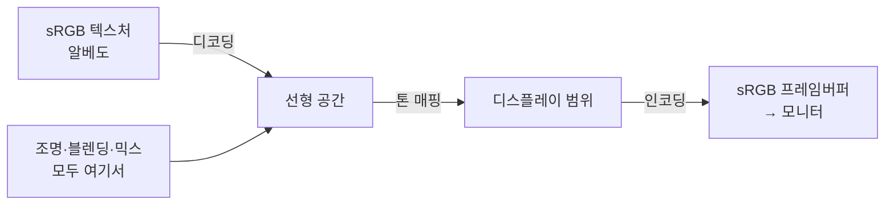

## 들어가며

래스터화가 프래그먼트를 만들고, 셰이더가 그 프래그먼트에 색을 칠한다. 그런데 *색* 이라는 게 생각보다 까다롭다. 셰이더에서 `(0.5, 0.5, 0.5)`를 출력했는데 화면에 나온 회색이 "중간 밝기"가 아니라 한참 어둡다. 텍스처 두 장을 50:50으로 섞었더니 경계가 칙칙해진다. 두 빛을 더했더니 결과가 물리적으로 틀린 밝기로 나온다. 이 모든 증상의 뿌리는 하나 — *감마(gamma)* 와 *색공간(color space)* 을 무시한 채 색을 숫자로만 다뤘기 때문이다.

색은 그래픽스에서 가장 자주, 가장 조용히 틀리는 주제다. 틀려도 프로그램이 멈추지 않고 그저 *조금 이상하게* 보일 뿐이라, 원인을 모른 채 넘어가기 쉽다. 하지만 PBR 라이팅이 물리적으로 맞으려면 모든 빛 계산이 *선형 공간* 에서 일어나야 하고, 그러려면 감마를 정확히 이해해야 한다.

이 글은 색을 숫자로 다루는 법을 기초부터 세운다. 색이란 무엇인지(빛의 스펙트럼과 RGB 삼자극), 감마와 sRGB가 왜 존재하며 어디서 변환이 일어나야 하는지, 선형 작업 공간과 저장 공간을 어떻게 분리하는지, 그리고 알파 합성(over 연산)과 프리멀티플라이드 알파, HDR과 톤 매핑의 기초까지 다룬다. 전부 API에 독립적인 *색의 물리와 표현* 이다.

---

## 목차
1. [색이란 무엇인가](#1-색이란-무엇인가)
2. [감마: 0.5가 중간 밝기가 아닌 이유](#2-감마-05가-중간-밝기가-아닌-이유)
3. [sRGB와 선형 공간](#3-srgb와-선형-공간)
4. [올바른 감마 파이프라인](#4-올바른-감마-파이프라인)
5. [알파와 합성](#5-알파와-합성)
6. [프리멀티플라이드 알파](#6-프리멀티플라이드-알파)
7. [HDR과 톤 매핑](#7-hdr과-톤-매핑)
8. [색 공간, 색역, 백색점](#8-색-공간-색역-백색점)
9. [정밀도, 밴딩, 디더링](#9-정밀도-밴딩-디더링)
10. [Scene-Referred에서 디스플레이까지](#10-scene-referred에서-디스플레이까지)

---

## 1. 색이란 무엇인가

물리적으로 빛은 *파장의 연속 스펙트럼* 이다. 그런데 사람 눈의 망막에는 서로 다른 파장 대역에 반응하는 세 종류의 원추세포(L·M·S, 대략 빨강·초록·파랑 민감)가 있어, 무한 차원의 스펙트럼을 *세 개의 숫자* 로 압축해 받아들인다. 이 생물학적 사실이 그래픽스의 출발점이다 — 우리는 모든 색을 *세 성분(RGB)* 으로 표현하고, 서로 다른 스펙트럼이라도 세 원추세포의 반응이 같으면 같은 색으로 보인다(*메타머리즘*).

여기서 핵심 구분 하나. RGB 삼자극 값은 *빛의 양(밝기)* 을 나타낼 수도 있고, *화면에 보낼 신호* 를 나타낼 수도 있는데 — 이 둘의 관계가 *선형이 아니다*. 이 비선형성이 감마의 정체다.

또 하나 미리 못 박을 것: *색의 합성과 빛의 계산은 물리량(선형 빛의 양)에서 해야 맞는다*. 빛 두 줄기를 합치면 광자 수가 더해지므로 $L_1 + L_2$가 맞고, 반투명 표면 너머를 보면 투과율이 곱해지므로 곱이 맞다. 이 덧셈·곱셈이 의미를 가지려면 숫자가 *빛의 양에 선형으로 비례* 해야 한다. 그런데 우리가 이미지 파일에 저장하고 화면에 보내는 값은 그렇지 않다 — 그게 문제의 씨앗이다.

## 2. 감마: 0.5가 중간 밝기가 아닌 이유

*감마 인코딩* 은 두 가지 이유로 존재한다. 하나는 역사적, 하나는 지각적이다.

**역사적 이유 (CRT)**: 옛 브라운관 모니터는 입력 전압 $V$에 대해 밝기 $L$이 $L \propto V^{\gamma}$ ($\gamma \approx 2.2$)인 비선형 응답을 가졌다. 전압을 절반으로 줘도 밝기는 절반이 아니라 $0.5^{2.2} \approx 0.22$로 떨어졌다. 이를 보정하려면 신호를 미리 $V \propto L^{1/2.2}$로 *역왜곡* 해 보내야 했다. CRT는 사라졌지만 이 인코딩은 표준으로 굳었다.

**지각적 이유 (밴딩 절약)**: 사람 눈은 어두운 영역의 밝기 차이에 훨씬 민감하다. 빛의 양을 *선형* 으로 8비트(256단계)에 균등 양자화하면, 어두운 쪽 단계가 너무 듬성해 *밴딩(banding)* — 그라데이션의 띠 — 이 보인다. 감마 인코딩($L^{1/2.2}$)은 어두운 영역에 더 많은 코드값을 배분해, 같은 8비트로 지각적으로 균등한 단계를 만든다. 그래서 CRT가 없는 지금도 8비트 이미지는 감마 인코딩으로 저장하는 게 합리적이다.

결과적으로, JPEG·PNG 파일이나 화면 프레임버퍼의 픽셀값 `0.5`는 *빛의 양 절반* 이 아니다. 디코딩하면 $0.5^{2.2} \approx 0.22$ — 실제 빛으로는 약 22%다. "중간값 0.5"가 중간 밝기로 안 보이는 이유가 이것이다. 코드값(인코딩된)과 빛의 양(선형)을 혼동하는 것이 모든 감마 버그의 근원이다.

## 3. sRGB와 선형 공간

*sRGB* 는 1996년 표준화된, 사실상 모든 소비자 이미지·웹·모니터의 기본 색공간이다. sRGB는 두 가지를 정한다.

1. **색역(gamut)과 원색**: R·G·B 각 원색이 실제로 어떤 물리적 색인지(CIE 색도 좌표로). 이건 "얼마나 진한 빨강까지 표현 가능한가"의 문제다.
2. **전달 함수(transfer function)**: 코드값과 선형 빛의 양 사이의 변환 곡선. 대략 $\gamma = 2.2$의 거듭제곱이지만, 정확히는 아주 어두운 영역에서 직선 구간을 둔 *조각별 함수* 다(0에서의 무한 기울기를 피하려고).

실무에서 자주 쓰는 근사·정확식:

$$
\text{근사: } \quad L = C^{2.2}, \quad C = L^{1/2.2}
$$

$$
\text{sRGB 정확식 (디코딩): } \quad
L =
\begin{cases}
C / 12.92 & C \le 0.04045 \\
\left(\dfrac{C + 0.055}{1.055}\right)^{2.4} & C > 0.04045
\end{cases}
$$

여기서 *선형 공간(linear space)* 이라는 용어가 핵심이다. 코드값 $C$를 전달 함수로 디코딩해 얻은 $L$이 *빛의 양에 선형으로 비례* 하는 공간이다. 빛을 더하고 곱하는 모든 계산 — 라이팅, 블렌딩, 밉맵 생성, 안티앨리어싱의 평균 — 은 이 선형 공간에서 해야 물리적으로 맞다. sRGB 코드값 그대로 더하면 틀린다.

GPU API는 이 변환을 고정 기능 포맷 경로로 제공한다. 지원되는 `sRGB` 텍스처 포맷을 샘플링하면 RGB가 선형 값으로 디코딩되어 셰이더에 전달된다. 렌더 타깃의 선형→sRGB 변환은 API별 쓰기 상태까지 맞아야 한다. 예를 들어 OpenGL은 sRGB attachment에 더해 `GL_FRAMEBUFFER_SRGB`를 활성화해야 하고, Direct3D·Vulkan도 sRGB view/format과 해당 쓰기 계약을 지켜야 한다. 변환 명령을 셰이더에서 없앨 수 있다는 뜻이지 비용과 상태 책임이 사라진다는 뜻은 아니다.

## 4. 올바른 감마 파이프라인

규칙은 한 문장이다 — *디코딩해서 선형으로 들여오고, 선형에서 계산하고, 인코딩해서 내보낸다.* 그림으로:

단계별로:

1. **입력 디코딩**: 색을 나타내는 텍스처(알베도·디퓨즈)는 sRGB로 저장돼 있으므로 *디코딩해서 선형으로* 읽는다. 단, *데이터* 텍스처 — 법선 맵, 거칠기, 메탈릭, AO — 는 색이 아니라 수치라 *절대 디코딩하면 안 된다*(linear/UNORM 포맷). 법선 맵을 실수로 sRGB로 읽는 것이 흔한 버그다.
2. **선형 공간 계산**: 모든 조명, 텍스처 블렌딩, 알파 합성을 선형 값으로 수행한다.
3. **출력 인코딩**: 최종 색을 sRGB로 인코딩해 프레임버퍼에 쓴다(또는 sRGB 프레임버퍼가 자동 처리).

*어디서 디코딩과 인코딩이 각각 한 번 일어나는지* 를 지키는 게 관건이다. 입력 디코딩을 빼먹고 sRGB 코드값을 선형값으로 계산한 뒤 정상적으로 출력 인코딩하면, 사실상 인코딩이 한 번 더 적용되어 화면이 *씻긴 듯 밝아진다*. 이미 sRGB인 값을 다시 인코딩하는 이중 인코딩도 같은 증상을 만든다. 반대로 선형 출력의 sRGB 인코딩을 빼먹으면 디스플레이 전달 함수가 선형값을 다시 어둡게 만들어 *전체적으로 어두워진다*.

왜 굳이 선형에서 계산해야 하는지 구체적 예. 빨강 $(1,0,0)$과 초록 $(0,1,0)$ 텍셀을 50:50으로 섞는다 하자. sRGB 코드값에서 평균하면 $(0.5, 0.5, 0)$ — 디코딩하면 각 채널 빛의 양이 0.22로, *원본보다 어두운* 칙칙한 갈색이 된다. 선형에서 평균하면 빛의 양이 $(0.5, 0.5, 0)$ — 인코딩하면 코드값 $\approx 0.73$로, *밝고 자연스러운* 노랑끼가 된다. 안티앨리어싱(엣지 픽셀의 평균)과 밉맵(텍셀 평균)도 같은 이유로 선형에서 해야 하며, 이를 어기면 머리카락·잎사귀 같은 고대비 엣지가 어두워진다.

## 5. 알파와 합성

*알파(alpha)* 는 색의 네 번째 채널이지만 의미는 파이프라인 계약이 정한다. 일반 합성에서는 불투명도 또는 커버리지를 나타내며, 재질의 물리적 투과율과 항상 같은 값은 아니다. 반투명 표면을 배경 위에 얹는 표준 합성 연산이 *over 연산자* 다. 전경의 straight RGB를 $C_s$, 알파를 $\alpha_s$라 하고 배경이 불투명($\alpha_d=1$)이라면:

$$
C_{\text{out}} = \alpha_s C_s + (1 - \alpha_s) C_d
$$

직관적이다 — 전경이 $\alpha_s$만큼 보이고, 나머지 $(1-\alpha_s)$만큼 불투명 배경이 비친다. 일반적인 두 반투명 층은 premultiplied 색 $C'_s=\alpha_s C_s$, $C'_d=\alpha_d C_d$로 쓰면 조건 없이 간결하다.

$$
C'_{\text{out}} = C'_s + (1-\alpha_s)C'_d,\qquad
\alpha_{\text{out}} = \alpha_s + (1-\alpha_s)\alpha_d
$$

straight RGB 결과가 필요하고 $\alpha_{\text{out}}>0$이면 $C_{\text{out}}=C'_{\text{out}}/\alpha_{\text{out}}$로 되돌린다. 불투명 목적지에 straight source를 바로 섞는 첫 식은 GPU 블렌드 상태 `src = SRC_ALPHA`, `dst = ONE_MINUS_SRC_ALPHA`로 표현할 수 있다.

두 가지 함정.

**선형 공간에서 해야 한다**: over 연산은 빛의 가중 합이므로 sRGB 코드값에서 블렌딩하면 반투명 엣지가 어두워진다. sRGB 렌더 타깃과 API의 sRGB 쓰기 상태가 모두 올바르면 목적지 RGB를 선형화해 블렌딩하고 저장 시 다시 인코딩한다. 포맷만 맞고 쓰기 상태가 빠지면 이 보정은 보장되지 않는다.

**순서 의존성**: over 연산은 *교환법칙이 성립하지 않는다*. A를 B 위에 얹은 것과 B를 A 위에 얹은 것은 다르다. 그래서 반투명 물체는 *뒤에서 앞 순서로* 정렬해 그려야 하고, 이 정렬이 불가능하거나 비싼 경우의 대안(OIT 등)이 주제다. 불투명 물체는 깊이 테스트가 순서를 자동으로 풀어주지만, 반투명은 그렇지 않다는 비대칭을 기억하자.

### 숫자로 따라가기

반투명 빨강 $C_s=(1,0,0)$, $\alpha_s=0.6$을 파랑 배경 $C_d=(0,0,1)$ 위에 얹어 보자(전부 *선형 공간* 값).

$$
C_{\text{out}} = 0.6\,(1,0,0) + (1-0.6)\,(0,0,1) = (0.6,\, 0,\, 0.4)
$$

빨강이 60%, 배경 파랑이 40% 비치는 자주색이다. 같은 장면을 *프리멀티플라이드* 로 하면 빨강을 $(\alpha_s C_s, \alpha_s) = (0.6, 0, 0, 0.6)$으로 저장하고, 블렌드 식 `src=ONE, dst=ONE_MINUS_SRC_ALPHA`로 $0.6{\cdot}(1,0,0)$이 이미 곱해진 채 더해져 *같은 결과* $(0.6,0,0.4)$를 낸다 — 곱셈 위치만 옮겼을 뿐이다(6절). 만약 이 합성을 sRGB 코드값에서 했다면 결과가 더 어둡게 틀어진다는 점이 4절의 교훈이다.

## 6. 프리멀티플라이드 알파

5절의 over 연산은 색과 알파를 따로 저장하는 *스트레이트(straight, non-premultiplied) 알파* 를 가정한다. 대안이 *프리멀티플라이드 알파(premultiplied alpha)* — 색에 미리 알파를 곱해 $(\alpha C, \alpha)$로 저장하는 방식이다. over 연산이 더 단순해진다.

$$
C_{\text{out}} = C_s' + (1 - \alpha_s) C_d, \qquad C_s' = \alpha_s C_s \;(\text{이미 곱해진 값})
$$

블렌드 식이 `src = ONE`, `dst = ONE_MINUS_SRC_ALPHA`가 되어 *합성이 결합법칙* 을 만족한다. 이게 왜 중요한가 — 세 가지 실질적 이득이 있다.

1. **필터링이 올바르다**: 텍스처를 축소(밉맵·이중선형)할 때, 스트레이트 알파는 *투명 픽셀의 (의미 없는) 색* 까지 평균에 끌어들여 엣지에 검은/흰 *프린지(fringe)* 를 만든다. 프리멀티플라이드는 색이 이미 알파로 가중돼 있어 투명 픽셀이 색에 기여하지 않으므로 프린지가 없다.
2. **합성 체인이 안전하다**: 여러 반투명 레이어를 중간 버퍼에 모았다가 다시 합성할 때, 프리멀티플라이드만이 수학적으로 일관된다.
3. **가산 혼합과 통합**: premultiplied over 식을 쓰는 HDR 합성 파이프라인에서는 $\alpha=0$이면서 RGB 에너지가 있는 확장 표현을 가산광에 사용할 수 있다. 다만 이는 $0\le C'\le\alpha$인 일반 불투명도 색의 범위를 벗어나는 별도 콘텐츠 계약이므로, 파일 포맷·필터·후처리가 음이 아닌 HDR RGB를 보존하는지 확인해야 한다.

UI 합성·이미지 처리·필름 합성에서 프리멀티플라이드가 널리 쓰이는 이유다. 텍스처를 만들 때 미리 색에 알파를 곱해두거나, 로드 시 변환한다. 알파 컷아웃의 검은 테두리는 투명 texel의 RGB bleed, 잘못된 straight-alpha 필터링, sRGB 공간의 밉 생성, atlas 경계 누출 등이 모두 원인일 수 있으므로 중간 mip와 RGB·alpha 채널을 따로 검사한다.

## 7. HDR과 톤 매핑

지금까지 색 성분을 $[0, 1]$로 암묵적으로 가정했다. 하지만 현실의 빛은 범위가 훨씬 넓다. 이 *높은 동적 범위(High Dynamic Range, HDR)* 를 표현하려면 장면 선형 값을 $[0,1]$에 미리 clamp하지 않고 선택한 부동소수점 포맷의 유한 범위와 정밀도 안에서 다뤄야 한다. 물리 기반 라이팅은 기준 노출보다 밝은 결과가 1을 넘는 것을 정상으로 취급한다.

문제는 *출력 장치* 다. 장면 선형 값 1은 물리적 휘도 하나로 고정된 숫자가 아니며, 출력 변환이 기준 백색과 장치의 최소·최대 휘도에 대응시킨다. 장면 값을 단순히 $[0,1]$로 clamp하면 밝은 영역이 같은 코드값으로 뭉개진다. 장면의 넓은 휘도 관계를 목표 디스플레이 범위로 매핑하는 단계가 *톤 매핑(tone mapping)* 이다.

톤 매핑 연산자는 단순한 단조 압축부터 toe와 shoulder를 가진 S자형 표시 변환까지 다양하다. 공통 목표는 밝은 영역을 부드럽게 *롤오프* 하면서 중요한 중간톤 대비와 색 관계를 보존하는 것이다. 대표적인 단순 연산자는:

$$
\text{Reinhard: } \quad C_{\text{out}} = \frac{C}{1 + C} \qquad \text{(간단하지만 하이라이트가 약간 칙칙)}
$$

ACES를 단순화한 실시간 근사, Uncharted2 계열 곡선, AgX 같은 더 정교한 표시 변환도 쓰인다. “ACES Filmic”이라는 이름의 짧은 셰이더가 ACES 전체 색 관리 파이프라인과 동일한 것은 아니다. 톤 매핑은 장면 선형 계산을 끝낸 뒤 출력 색역·전달 함수 인코딩 전에 적용한다.

*노출(exposure)* 은 톤 매핑 전에 장면 선형 값을 스케일하는 인자다. 물리 카메라에서는 조리개뿐 아니라 셔터 시간과 감도까지 함께 노출을 결정한다. 자동 노출은 로그 휘도 분포와 시간 적응 정책으로 이 스케일을 조절한다. HDR 출력은 단순히 “1보다 큰 버퍼 값을 표시”하는 것이 아니라 더 높은 목표 휘도, 기준 백색, PQ/HLG 같은 전달 체계와 메타데이터를 포함한 별도 출력 변환이다.

## 8. 색 공간, 색역, 백색점

"sRGB"는 문맥에 따라 두 가지를 가리켜 혼동을 만든다. 하나는 RGB 수치와 선형 광량 사이를 잇는 *전달 함수* 이고, 다른 하나는 빨강·초록·파랑 원색과 백색점을 정의한 *색 공간* 이다. 선형화는 전달 함수를 제거하는 일이지, 자동으로 다른 색역으로 바꾸는 일이 아니다.

RGB 값은 색 그 자체가 아니라 특정 원색 세 개를 얼마나 섞을지 나타내는 좌표다. 같은 `(1, 0, 0)`도 sRGB/Rec.709, Display-P3, Rec.2020에서 서로 다른 빨강을 뜻한다. 따라서 텍스처·렌더 타깃·디스플레이가 서로 다른 색 공간을 사용하면 원색과 백색점 정보를 포함한 변환이 필요하다.

선형 RGB 색 공간 사이의 변환은 보통 XYZ 같은 장치 독립 중간 공간을 거치는 3×3 행렬로 표현한다.

$$
\mathbf{c}_{dst} =
M_{XYZ\rightarrow dst}
M_{src\rightarrow XYZ}
\mathbf{c}_{src}
$$

이 행렬 변환은 입력과 출력이 *선형 값* 일 때만 의미가 있다. sRGB로 인코딩된 값을 그대로 행렬에 곱하면 전달 함수의 비선형성이 색 혼합에 섞여 결과가 틀어진다.

백색점은 "무채색으로 간주하는 광원의 색"이다. 두 색 공간의 원색이 같아도 백색점이 다르면 같은 중립 회색을 뜻하지 않는다. D65와 D50 사이처럼 백색점이 다른 변환에는 인간 시각의 순응을 근사하는 chromatic adaptation이 필요하다.

색역(gamut)은 그 색 공간이 표현할 수 있는 색의 범위다. 넓은 색역에서 좁은 색역으로 변환하면 표현 불가능한 out-of-gamut 색이 생긴다. 단순 clamp는 채도가 높은 색의 관계를 무너뜨릴 수 있으므로, 출력 목적에 따라 색역 압축이나 지각적 매핑 정책을 선택해야 한다.

게임 파이프라인의 실용적 원칙은 다음과 같다.

- 색 텍스처에는 원색·백색점·전달 함수 메타데이터가 필요하다.
- 법선·roughness·metallic 같은 데이터 텍스처에는 색 전달 함수를 적용하지 않는다.
- 조명과 합성은 하나의 명시된 선형 작업 공간에서 수행한다.
- 출력 경계에서 디스플레이 색 공간과 전달 함수로 변환한다.

## 9. 정밀도, 밴딩, 디더링

선형 광량은 넓은 범위를 가지며 어두운 영역의 작은 차이도 보존해야 한다. 8비트 UNORM 선형 버퍼는 단계가 균일하므로 어두운 그라데이션에 충분한 단계를 배정하지 못한다. sRGB 인코딩이 어두운 값에 더 많은 코드값을 배정하는 이유가 여기에 있다.

렌더 타깃 포맷 선택은 범위와 정밀도의 트레이드오프다.

| 포맷 계열 | 장점 | 한계 |
|---|---|---|
| 8비트 UNORM/sRGB | 작고 디스플레이 출력에 적합 | HDR 중간 계산과 반복 합성에 부족 |
| 10·11비트 packed float | 대역폭 대비 넓은 범위 | 채널별 정밀도와 알파 제약 |
| FP16 | 넓은 범위와 충분한 중간 정밀도 | 메모리·대역폭 증가, 매우 큰 값의 정밀도 한계 |
| FP32 | 높은 정밀도 | 대역폭과 저장 비용이 큼 |

양자화된 단계가 화면에서 띠로 보이는 현상이 밴딩이다. 디더링은 양자화 직전에 작은 노이즈를 더해 오차를 공간이나 시간에 분산한다. 값 하나의 오차는 늘 수 있지만, 규칙적인 경계가 불규칙한 미세 노이즈로 바뀌어 시각적으로 덜 거슬린다.

디더링은 *마지막 양자화 경계* 에 적용해야 한다. HDR 값에 너무 일찍 디더를 넣고 이후 톤매핑·블룸·스케일링을 수행하면 노이즈도 함께 변형된다. 시간 디더링을 쓰면 프레임마다 패턴을 바꾸되, 시간적 누적과 결합했을 때 잔상이나 노이즈가 남지 않는지 확인해야 한다.

알파도 정밀도 문제에서 예외가 아니다. 매우 낮은 알파를 반복 합성하면 작은 반올림 오차가 누적된다. 프리멀티플라이드 알파는 색 채널이 이미 알파 범위에 맞춰져 있어 보간과 필터링 경계에서 더 안정적이지만, 저장·블렌드·셰이더가 같은 표현을 사용해야 한다.

## 10. Scene-Referred에서 디스플레이까지

렌더러 내부의 HDR 값은 장면 속 빛의 상대적 관계를 표현하는 *scene-referred* 값이다. 디스플레이 출력은 특정 화면이 낼 수 있는 휘도와 색역에 맞춘 *display-referred* 값이다. 톤매핑은 이 둘 사이의 단순 clamp가 아니라, 장면의 넓은 밝기 관계를 제한된 출력 범위에 재배치하는 변환이다.

전체 출력 경계는 다음 순서로 생각할 수 있다.

SDR 출력에서는 보통 톤매핑 후 sRGB 계열 전달 함수로 인코딩한다. HDR 디스플레이에서는 PQ나 HLG 같은 출력 전달 체계를 사용할 수 있지만, "HDR 버퍼를 그대로 보낸다"는 뜻은 아니다. 최대 휘도, 기준 백색(paper white), UI 밝기, 디스플레이 능력에 맞춘 출력 변환이 필요하다.

노출은 장면의 어느 밝기를 기준 영역에 놓을지 정하고, 톤매핑 곡선은 하이라이트와 중간톤의 관계를 정한다. 자동 노출은 화면 휘도 통계에 따라 노출을 바꾸지만, 한 프레임의 평균만 따르면 밝은 폭발이나 검은 화면에서 급격히 펌핑한다. 로그 휘도, percentile, 적응 속도, 장면 전환 처리를 함께 설계해야 한다.

UI 합성 위치도 출력 의미를 바꾼다.

- 톤매핑 전에 UI를 합성하면 UI가 장면 노출과 톤매핑의 영향을 받는다.
- 톤매핑 후에 합성하면 SDR UI 밝기를 안정적으로 유지할 수 있지만 HDR 출력에서 기준 백색 정책이 필요하다.
- 월드 공간 UI와 화면 공간 UI는 서로 다른 합성 정책을 가질 수 있다.

출력 파이프라인 검증에는 기준 이미지 하나만으로 부족하다. 어두운 그라데이션, 포화 원색, 매우 밝은 하이라이트, 반투명 가장자리, SDR/HDR UI를 포함한 테스트 패턴을 사용하고, 각 중간 버퍼가 선형인지 인코딩된 값인지 캡처 도구에서 확인해야 한다. 가장 흔한 실패는 전달 함수를 두 번 적용하거나 전혀 적용하지 않는 것, 데이터 텍스처를 색으로 해석하는 것, 서로 다른 색 공간을 행렬 변환 없이 합성하는 것이다.

---

## 결론

색은 *빛의 양(선형)* 과 *저장·전송 코드값(감마 인코딩)* 이라는 두 얼굴만 가진 것이 아니다. 원색·백색점·전달 함수가 함께 있어야 RGB 수치의 의미가 정해진다. 모든 빛 계산 — 라이팅·블렌딩·믹스·밉맵·안티앨리어싱 — 은 명시된 선형 작업 공간에서 해야 물리적으로 맞다.

합성의 표준은 *over 연산* 이고, 필터링과 합성 체인의 정확성을 위해 *프리멀티플라이드 알파* 가 선호된다. 물리 기반 라이팅이 만드는 scene-referred HDR 값은 톤매핑·색역 매핑·출력 전달 함수를 거쳐 display-referred 값이 된다. 포맷 정밀도와 디더링, 기준 백색까지 포함해야 서로 다른 디스플레이에서 의도한 관계를 보존할 수 있다.

## 더 읽을거리

- John Novak, ["What every coder should know about gamma"](https://blog.johnnovak.net/2016/09/21/what-every-coder-should-know-about-gamma/) — 감마의 역사·지각 균등성·흔한 버그의 종합 정리.
- Thomas Porter, Tom Duff, "Compositing Digital Images" (SIGGRAPH 1984) — over 연산과 프리멀티플라이드 알파의 원전.
- [IEC 61966-2-1 (sRGB)](https://en.wikipedia.org/wiki/SRGB) — sRGB 전달 함수 명세 요약.
- Krzysztof Narkowicz, ["ACES Filmic Tone Mapping Curve"](https://knarkowicz.wordpress.com/2016/01/06/aces-filmic-tone-mapping-curve/) — 실전 톤 매핑 근사.
