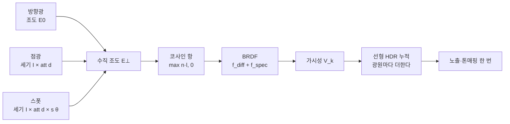

## 들어가며

셰이딩은 표면이 빛을 어떻게 반사·흡수·투과하는지 계산하는 과정이다. Lambert와 Phong 같은 단순 모델에서 시작해 미세면 BRDF, 이방성, 표면하 산란, 투과와 레이어드 머티리얼로 갈수록 같은 렌더링 방정식 아래의 가정과 근사가 달라진다.

이 글은 경험적 조명 모델과 물리 기반 BRDF를 연결하고, 그 BRDF에 들어갈 입사광이 어떤 광원 모델과 감쇠식에서 나오는지를 단위까지 맞춰 유도하며, 표준 금속·거칠기 모델이 표현하지 못하는 재질을 어떤 추가 항과 데이터로 다루는지 설명한다.

---

## 목차

1. 빛과 표면의 상호작용
2. Lambert 확산 반사
3. Phong과 Blinn-Phong 정반사
4. 경험적 모델의 한계
5. 렌더링 방정식과 BRDF
6. 미세면 모델: Cook-Torrance
7. 광원 모델: 입사광은 어디서 오는가
8. 거리 감쇠와 도달 반경
9. 다중 광원의 누적
10. 셰이딩 빈도: 플랫·고러드·퐁
11. 표준 모델이 깨지는 곳
12. 이방성 반사
13. 표면하 산란(SSS)
14. 투과와 굴절
15. 레이어드 머티리얼
16. 통합 머티리얼 모델

---

## 1. 빛과 표면의 상호작용

빛이 표면에 닿으면 세 갈래로 나뉜다 — *반사(reflection)*, *흡수(absorption)*, *투과(transmission)*. 불투명 표면에서는 투과가 없으니 반사와 흡수만 고려하면 되고, 우리가 보는 색은 *반사된 빛* 이다. 반사는 다시 두 종류로 갈린다.

| 반사 | 메커니즘 | 보이는 모습 |
|---|---|---|
| **확산(Diffuse)** | 빛이 표면 아래로 살짝 들어갔다 여러 방향으로 흩어져 나옴 | 방향과 무관한 부드러운 밝기, 물체 *고유색* |
| **정반사(Specular)** | 빛이 표면에서 거울처럼 한 방향으로 튕김 | 광원의 *하이라이트*, 시점에 따라 움직임 |

이 두 갈래가 셰이딩 모델의 두 항이 된다. 확산은 표면의 색(알베도)을 결정하고, 정반사는 광택과 재질감을 결정한다. 빨간 사과가 빨갛게 보이는 건 확산이 빨강만 반사하고 나머지를 흡수해서이고, 사과 표면의 반짝이는 점은 정반사다 — 그 하이라이트는 사과색이 아니라 *광원의 색* 이라는 데 주목하자(유전체의 정반사는 색을 입히지 않는다. 6절에서 이게 왜 중요한지 본다).

셰이딩에 필요한 기하 벡터를 먼저 정의한다(전부 단위 벡터).

- $\mathbf{n}$: 표면 법선(surface normal)
- $\mathbf{l}$: 광원 방향(표면 점 → 광원)
- $\mathbf{v}$: 시선 방향(표면 점 → 눈)
- $\mathbf{r}$: $\mathbf{l}$을 $\mathbf{n}$에 대해 반사시킨 방향
- $\mathbf{h}$: $\mathbf{l}$과 $\mathbf{v}$의 *중간 벡터(half vector)*, $\mathbf{h} = \dfrac{\mathbf{l}+\mathbf{v}}{|\mathbf{l}+\mathbf{v}|}$

이 벡터들의 내적 — 특히 $\mathbf{n}\cdot\mathbf{l}$, $\mathbf{n}\cdot\mathbf{v}$, $\mathbf{n}\cdot\mathbf{h}$ — 이 모든 셰이딩 공식의 재료다.

## 2. Lambert 확산 반사

확산 반사의 고전 모델이 *램버트(Lambert)* 다. 핵심은 *코사인 법칙* — 표면이 받는 빛의 양은 빛이 표면에 *얼마나 비스듬히* 닿느냐에 비례한다. 정면으로 받으면 최대, 비스듬할수록 약해지고, 뒤에서 오면 0이다. 이 "비스듬함"이 정확히 법선과 광원 방향의 내적이다.

$$
L_{\text{diffuse}} = c_{\text{albedo}} \cdot L_{\text{light}} \cdot \max(\mathbf{n}\cdot\mathbf{l},\, 0)
$$

$c_{\text{albedo}}$는 표면 고유색(반사율), $L_{\text{light}}$는 광원 세기다. $\max(\cdot, 0)$은 빛을 등진 면($\mathbf{n}\cdot\mathbf{l} < 0$)이 음수 밝기가 되는 걸 막는다. 램버트 확산의 중요한 성질은 *시선 방향 $\mathbf{v}$에 무관* 하다는 것 — 어느 각도에서 봐도 같은 밝기다. 빛이 표면 아래에서 무작위로 흩어져 나오기 때문에 방향성이 사라진다. 그래서 확산만 있는 물체는 분필이나 무광 페인트처럼 보인다.

여기에 보통 *주변광(ambient)* 한 항을 더한다. 현실에서는 빛이 벽·바닥에 튕겨 그림자 속도 완전히 깜깜하지 않은데, 이 *간접광* 을 제대로 계산하는 건 비싸므로(전역 조명) 고전 모델은 상수 한 항으로 대충 흉내 낸다.

$$
L = \underbrace{c_{\text{albedo}} \cdot L_{\text{ambient}}}_{\text{주변광}} + \underbrace{c_{\text{albedo}} \cdot L_{\text{light}} \cdot \max(\mathbf{n}\cdot\mathbf{l}, 0)}_{\text{확산}}
$$

이 주변광 상수항은 물리적으로 조잡하지만(그림자가 평평해 보인다), 현대 PBR에서는 *이미지 기반 조명(IBL)* 과 *앰비언트 오클루전* 으로 대체된다 — 그 출발점이 이 단순한 상수다.

## 3. Phong과 Blinn-Phong 정반사

정반사 하이라이트를 더하는 고전 모델이 *퐁(Phong, 1975)* 이다. 발상: 시선 $\mathbf{v}$가 *완벽한 반사 방향* $\mathbf{r}$에 가까울수록 강한 하이라이트가 보인다. 그 "가까움"을 내적의 거듭제곱으로 모델링한다.

$$
L_{\text{specular}} = L_{\text{light}} \cdot \max(\mathbf{r}\cdot\mathbf{v}, 0)^{\,\alpha}, \qquad \mathbf{r} = 2(\mathbf{n}\cdot\mathbf{l})\mathbf{n} - \mathbf{l}
$$

지수 $\alpha$가 *광택도(shininess)* 다 — 클수록 하이라이트가 작고 날카로워(거울에 가까움), 작을수록 넓고 부드럽다(무광에 가까움). 

*블린-퐁(Blinn-Phong, 1977)* 은 이를 개량한다. 반사 벡터 $\mathbf{r}$ 대신 *중간 벡터* $\mathbf{h}$를 써서, 표면 법선이 얼마나 $\mathbf{h}$에 정렬됐는지로 하이라이트를 본다.

$$
L_{\text{specular}} = L_{\text{light}} \cdot \max(\mathbf{n}\cdot\mathbf{h}, 0)^{\,\alpha}
$$

블린-퐁이 퐁보다 선호되는 이유가 둘 있다. 첫째, $\mathbf{h}$ 계산이 $\mathbf{r}$보다 싸고, 광원·시점이 무한히 멀다고 가정하면 $\mathbf{h}$가 표면 전체에서 상수라 더 빠르다. 둘째, 시선과 광원이 표면에 거의 평행할 때(스치는 각도) 퐁은 하이라이트가 부자연스럽게 잘리는데 블린-퐁은 더 그럴듯한 늘어진 하이라이트를 준다 — 실제 측정된 반사와도 더 잘 맞는다. OpenGL 고정 파이프라인을 비롯한 셀 수 없는 실시간 렌더러가 수십 년간 블린-퐁을 표준으로 썼다.

합치면 고전 셰이딩 모델의 전체 형태다.

$$
L = c_{\text{albedo}}L_{\text{amb}} + L_{\text{light}}\big[\,c_{\text{albedo}}\max(\mathbf{n}\cdot\mathbf{l},0) + k_s\max(\mathbf{n}\cdot\mathbf{h},0)^{\alpha}\,\big]
$$

### 숫자로 따라가기

표면 법선 $\mathbf{n}=(0,0,1)$, 광원이 법선에서 $60°$ 기운 방향 $\mathbf{l}=(\sin60°,0,\cos60°)=(0.866,0,0.5)$, 시선은 정면 $\mathbf{v}=(0,0,1)$이라 하자.

$$
\mathbf{n}\cdot\mathbf{l} = 0.5 \;\Rightarrow\; \text{확산} \propto 0.5
$$

중간 벡터는 $\mathbf{h}=\text{normalize}(\mathbf{l}+\mathbf{v})=\text{normalize}(0.866,0,1.5)=(0.5,0,0.866)$이므로 $\mathbf{n}\cdot\mathbf{h}=0.866$. 정반사 항은 광택도 $\alpha$에 따라

$$
0.866^{16} \approx 0.10, \qquad 0.866^{64} \approx 0.0001
$$

$\alpha=16$이면 하이라이트가 $0.10$으로 제법 보이지만, $\alpha=64$로 키우면 $0.0001$로 사실상 *한 점* 만 빛난다 — 광택도가 하이라이트를 어떻게 좁히는지가 숫자로 드러난다. 확산($0.5$)은 시선 $\mathbf{v}$와 무관하지만 정반사는 $\mathbf{h}$를 통해 시선에 의존하므로, 카메라가 움직이면 이 정반사 값만 바뀐다(2·3절의 핵심 차이).

## 4. 경험적 모델의 한계

블린-퐁은 빠르고 그럴듯하지만 *물리적으로 틀렸다*. 어디가 틀렸는지를 짚으면 PBR이 왜 필요한지 보인다.

1. **에너지 보존 위반**: 블린-퐁은 표면이 *받은 빛보다 많은 빛* 을 반사할 수 있다. $k_s$와 $\alpha$를 아티스트가 임의로 조절하므로, 반사 빛의 총량이 입사광을 넘어도 막을 장치가 없다. 물리적으로 표면은 받은 것 이상을 돌려줄 수 없다.

2. **재질이 조명에 따라 달라 보임**: 한 조명에서 잘 튜닝한 $k_s, \alpha$ 값이 다른 조명에서는 플라스틱처럼, 또는 금속처럼 *제멋대로* 보인다. 파라미터가 물질의 *물리적 성질* 이 아니라 *그 장면에서의 편법* 이라 재사용이 안 된다.

3. **프레넬 누락**: 모든 표면은 *스치는 각도(grazing angle)에서 반사가 강해진다* — 잔잔한 호수를 위에서 보면 바닥이 보이지만 멀리 비스듬히 보면 거울처럼 하늘이 비친다(프레넬 효과). 블린-퐁에는 이 각도 의존 반사가 없어, 실루엣 가장자리가 밋밋하다.

4. **거칠기와 하이라이트의 물리적 연결 없음**: 거친 표면은 하이라이트가 넓고 흐릴 뿐 아니라 *어두워야* 한다(빛이 넓게 퍼지므로). 블린-퐁의 $\alpha$는 하이라이트 크기만 바꿀 뿐 이 밝기-퍼짐의 물리적 트레이드오프를 담지 못한다.

이 결함들의 공통 원인은, 블린-퐁이 *빛의 물리* 가 아니라 *보기 좋은 곡선* 에서 출발했다는 데 있다. 해법은 빛이 실제로 어떻게 반사되는지를 기술하는 틀 — 렌더링 방정식과 BRDF — 에서 다시 시작하는 것이다.

## 5. 렌더링 방정식과 BRDF

1986년 Kajiya가 정식화한 *렌더링 방정식* 은 셰이딩의 *물리적 기초 헌법* 이다. 표면의 한 점 $p$에서 시선 방향 $\omega_o$로 나가는 빛 $L_o$를, 그 점에 들어오는 모든 방향 $\omega_i$의 빛을 *반구 적분* 해 표현한다.

$$
L_o(p, \omega_o) = L_e(p, \omega_o) + \int_{\Omega} f_r(p, \omega_i, \omega_o)\, L_i(p, \omega_i)\, (\mathbf{n}\cdot\omega_i)\, d\omega_i
$$

각 항의 의미:

- $L_e(p, \omega_o)$: 표면 자체가 내는 빛(발광). 이 글은 발광하지 않는 표면만 다루므로 이후로는 $L_e = 0$으로 두고 적분 항만 쓴다.
- $L_i(p, \omega_i)$: 방향 $\omega_i$에서 들어오는 빛.
- $(\mathbf{n}\cdot\omega_i)$: 램버트 코사인 항(2절). 비스듬히 오는 빛은 약하게 친다.
- $f_r(p, \omega_i, \omega_o)$: *BRDF(양방향 반사 분포 함수)*. "들어온 빛 $\omega_i$가 나가는 방향 $\omega_o$로 얼마나 반사되는가"를 주는 함수. **재질이 곧 BRDF다.**
- $\int_\Omega \cdots d\omega_i$: 모든 입사 방향에 대한 합.

BRDF가 핵심이다. 셰이딩 모델을 고른다는 것은 곧 *BRDF를 고른다* 는 뜻이다. 사실 2·3절의 고전 모델도 이 틀로 다시 쓸 수 있다 — 램버트 확산은 $f_r = c_{\text{albedo}}/\pi$인 *상수 BRDF* 다(방향 무관). 블린-퐁의 정반사 항도 일종의 BRDF지만, 물리 BRDF가 만족해야 할 두 성질을 어긴다.

- **상반성(reciprocity)**: $f_r(\omega_i, \omega_o) = f_r(\omega_o, \omega_i)$. 빛의 경로는 뒤집어도 같다.
- **에너지 보존**: 모든 방향으로 반사된 빛의 합이 입사광을 넘지 않는다.

PBR이란 결국 *이 두 성질을 만족하는 물리적 BRDF를 쓰는 것* 이다. 실시간에서는 직접광을 광원마다 합산하고 간접광을 IBL 등으로 근사한다. 대표적인 Cook-Torrance 미세면 모델은 법선 분포, 기하 가림, Fresnel 항으로 정반사를 구성하고 에너지 보존 범위 안에서 확산 반사와 결합한다.

## 6. 미세면 모델: Cook-Torrance

현대 실시간 PBR의 정반사 BRDF는 거의 예외 없이 *미세면(microfacet) 이론* 에 기반한 *Cook-Torrance* 형태다. 발상: 거시적으로 매끄러워 보이는 표면도 미시적으로는 수많은 *작은 완벽 거울(미세면)* 의 집합이다. 표면이 거칠수록 이 미세 거울들의 방향이 제멋대로라 하이라이트가 넓게 퍼지고, 매끄러울수록 정렬돼 날카로운 반사가 된다.

정반사 BRDF는 세 함수의 곱으로 쓰인다.

$$
f_{\text{spec}}(\omega_i, \omega_o) = \frac{D(\mathbf{h})\; G(\omega_i, \omega_o)\; F(\omega_o, \mathbf{h})}{4\,(\mathbf{n}\cdot\omega_i)(\mathbf{n}\cdot\omega_o)}
$$

| 항 | 이름 | 답하는 질문 |
|---|---|---|
| $D$ | 법선 분포(Normal Distribution) | 미세면 중 *몇 %가 $\mathbf{h}$ 방향* 을 향해(=빛을 눈으로 반사) 정렬됐나? 거칠기가 결정. |
| $G$ | 기하 감쇠(Geometry / Shadowing-Masking) | 미세면들이 서로를 *가리고 그림자* 지는 손실은? 스치는 각도에서 중요. |
| $F$ | 프레넬(Fresnel) | 이 각도에서 반사 대 투과 비율은? 스치는 각도일수록 반사↑. |

$D$는 미세면 방향 분포, $G$는 한 번 반사되는 경로에서의 shadowing·masking, $F$는 각도별 반사 비율을 모델링한다. $G$는 단일 산란 미세면 BRDF의 기하 가림 항이지, 가려진 에너지가 다른 미세면에서 다시 산란되는 *다중 산란 에너지 보상* 자체는 아니다. 거친 표면의 단일 산란 모델이 잃는 에너지는 별도 multiple-scattering BRDF나 보정으로 다룬다. 흔히 $D$는 GGX/Trowbridge-Reitz, $F$는 Schlick 근사를 쓴다.

$$
F(\theta) \approx F_0 + (1 - F_0)(1 - \cos\theta)^5 \quad (\text{Schlick})
$$

여기서 *금속/유전체 워크플로* 가 나온다. $F_0$는 정면에서의 반사율인데 —

- **유전체(비금속)**: 공기와의 경계에서 $F_0=((n_1-n_2)/(n_1+n_2))^2$로 굴절률에 따라 달라진다. 많은 비금속에 쓰는 실용적 기본값이 약 0.04일 뿐 상수 법칙은 아니며, 보통 가시광에서 거의 무채색으로 취급한다. 물체의 베이스 컬러는 주로 확산·표면하 성분에 나타난다.
- **금속(metal)**: 확산이 없고, $F_0$가 *물체의 고유색*(금=금색, 구리=주황) 자체. 금속의 광택이 색을 띠는 이유.

그래서 흔한 metallic-roughness 워크플로는 *베이스 컬러·거칠기·금속성* 텍스처로 표면을 기술한다. 금속성이 0이면 베이스 컬러를 확산색으로 쓰고 제품이 정한 dielectric $F_0$를 적용하며, 금속성이 1이면 확산을 끄고 베이스 컬러를 복소 굴절률을 근사한 유색 $F_0$로 쓴다. 중간 metallic 값은 대개 서로 다른 물질이 픽셀 footprint 안에 섞인 마스크·필터 결과이지 물리적으로 “반쯤 금속인 균질 물질”을 뜻하지 않는다. 단순 에너지 분배에서는 확산에 $(1-F)$를 곱하지만, 다중 산란과 diffuse 모델에 따라 더 정교한 보정이 필요하다.

### 세 항의 명시적 형태와 조립

아래 식은 널리 쓰이는 GGX + Schlick + metallic-roughness 직접광 구현 한 가지다. PBR 전체의 유일한 식은 아니다. Disney 계열 diffuse, exact Smith masking, clearcoat·sheen·anisotropy, multiple scattering, spectral 모델처럼 다른 선택이 있다. API가 바뀌어도 BRDF의 수학은 유지되지만 셰이더 정밀도, 도함수, subgroup과 텍스처 포맷 같은 실행 계약도 결과에 영향을 준다.

법선 분포 $D$는 GGX/Trowbridge-Reitz를 쓴다. 긴 꼬리가 거친 표면의 자연스러운 하이라이트 번짐을 준다.

$$
D(\mathbf{h}) = \frac{\alpha^2}{\pi\big[(\mathbf{n}\cdot\mathbf{h})^2(\alpha^2 - 1) + 1\big]^2}, \qquad \alpha = \text{roughness}^2
$$

거칠기를 *제곱* 해 $\alpha$로 쓰는 Disney 관례가 거칠기 슬라이더의 체감 변화를 지각적으로 고르게 만든다.

기하 감쇠 $G$는 Smith 분리형 — 빛 방향과 시선 방향의 가림을 따로 구해 곱한다. 각 항은 Schlick-GGX 근사를 쓴다.

$$
G(\mathbf{l}, \mathbf{v}) = G_1(\mathbf{l})\, G_1(\mathbf{v}), \qquad G_1(\omega) = \frac{\mathbf{n}\cdot\omega}{(\mathbf{n}\cdot\omega)(1-k) + k}
$$

$k$는 거칠기에서 다시 매핑한다 — 직접광은 $k = (\text{roughness}+1)^2 / 8$, IBL은 $k = \text{roughness}^2 / 2$ (Karis). 두 용도의 $k$가 다른 것이 흔한 버그 지점이다.

프레넬 $F$는 위의 Schlick 근사($F_0 + (1-F_0)(1-\mathbf{v}\cdot\mathbf{h})^5$)를 그대로 쓴다. 세 항을 조립하면 정반사 BRDF와, 에너지 보존을 위해 정반사분을 뺀 확산 BRDF가 나온다.

$$
f_{\text{spec}} = \frac{D\, G\, F}{4(\mathbf{n}\cdot\mathbf{l})(\mathbf{n}\cdot\mathbf{v})}, \qquad f_{\text{diff}} = (1 - F)(1 - \text{metallic})\frac{c_{\text{albedo}}}{\pi}
$$

한 광원이 주는 출사 휘도는 둘의 합에 입사광과 코사인 항을 곱한 것이다. 광원이 여럿이면 광원마다 더한다.

$$
L_o = \big(f_{\text{diff}} + f_{\text{spec}}\big)\, L_i\, (\mathbf{n}\cdot\mathbf{l})
$$

이 식은 단일 산란 GGX 기반 직접광의 최소 골격이다. 실제 렌더러는 광원 크기와 단위, visibility, normal mapping, 에너지 보상, 간접광 적분과 추가 material lobe를 같은 radiometric 계약으로 결합한다. 특히 거친 미세면에서 한 번 가려진 빛을 소멸시켜 버리는 단일 산란 모델은 실제보다 어두워질 수 있으므로 Kulla-Conty 계열 에너지 보상이나 다중 산란 모델을 선택할 수 있다.

## 7. 광원 모델: 입사광은 어디서 오는가

5절의 렌더링 방정식은 반구의 *모든* 방향에서 오는 $L_i$를 요구한다. 그런데 2~6절은 그 자리에 "광원 세기"라는 덩어리 하나를 넣고 지나갔다. 이 절은 그 덩어리를 연다 — 실시간 렌더러가 쓰는 *점상 광원(punctual light)* 이 무엇의 근사이고, 반구 적분이 어떻게 광원 하나당 곱셈 몇 번으로 붕괴하는지다.

### 방사량과 단위

빛의 양을 재는 방식은 네 가지이고, *무엇으로 나눴는가* 가 이들을 가른다.

| 양 | 기호 | 정의 | 방사(radiometric) | 측광(photometric) |
|---|---|---|---|---|
| 복사속 | $\Phi$ | 단위 시간당 에너지 | W | lm(루멘) |
| 복사 세기 | $I$ | 입체각당 복사속 | W·sr⁻¹ | cd(칸델라) |
| 조도 | $E$ | 면적당 도달 복사속 | W·m⁻² | lx(럭스) |
| 복사 휘도 | $L$ | 투영 면적·입체각당 복사속 | W·m⁻²·sr⁻¹ | cd·m⁻²(nit) |

방사량은 물리적 에너지를, 측광량은 같은 에너지를 사람 눈의 파장별 감도로 가중한 값을 잰다. 렌더러 내부의 수학은 완전히 같고 눈금만 다르므로, 아래 유도는 어느 쪽으로 읽어도 성립한다. 실무에서 조명 파라미터를 lm·cd·lx로 받는 이유는 제조사 사양서와 조명 설계 자료가 그 단위로 쓰여 있어서다.

sr(스테라디안)은 *무차원* 유도 단위다. 그래서 $E = L\,\Omega$ 같은 식이 차원 검산을 통과한다. 단위 기호가 구분하는 것은 차원이 아니라 *무엇에 대해 적분된 양인가* 다 — 면적으로 나눴는지, 입체각으로 나눴는지, 둘 다인지.

BRDF $f_r$의 단위는 sr⁻¹이다. 그래야 렌더링 방정식의 피적분 함수가

$$
\underbrace{f_r}_{\text{sr}^{-1}}\cdot \underbrace{L_i}_{\text{W·m}^{-2}\text{·sr}^{-1}}\cdot \underbrace{(\mathbf{n}\cdot\omega_i)}_{\text{무차원}}\cdot \underbrace{d\omega_i}_{\text{sr}} \;=\; \text{W·m}^{-2}\text{·sr}^{-1}
$$

로 다시 복사 휘도가 되어 좌변 $L_o$와 맞는다. 셰이딩 코드 한 줄이 물리적으로 말이 되는지 보려면 이 곱을 따라가면 된다.

### 점상 광원이라는 델타 근사

현실의 광원은 크기가 있다. 전구는 지름 몇 cm의 구, 형광등은 긴 막대, 태양은 각지름 약 $0.53°$의 원반이다. 표면의 한 점에서 보면 광원은 반구의 *어떤 입체각 $\Omega$* 를 차지하고, 그 방향들에서 유한한 복사 휘도가 들어온다.

실시간 렌더링의 첫 번째 큰 단순화는 그 입체각을 0으로 보내는 것이다. 광원의 크기를 없애면 입사 방향이 하나로 고정되고 반구 적분이 그 방향의 값 하나로 붕괴한다. 대신 복사 휘도는 유한할 수 없다 — 넓이 0에서 유한한 빛이 나오려면 밀도가 발산해야 한다. 그래서 점상 광원의 입사광은 함수가 아니라 *분포* 로 쓴다.

$$
L_i(\omega) = E_\perp\,\delta(\omega - \mathbf{l}), \qquad \int_{\Omega}\delta(\omega-\mathbf{l})\,d\omega = 1
$$

$\delta$는 구면 위의 디랙 델타(단위 sr⁻¹)이고 $\mathbf{l}$은 광원 방향이다. 이것을 5절의 적분에 넣으면 적분이 사라진다.

$$
L_o(\mathbf{v}) = \int_{\Omega} f_r(\omega,\mathbf{v})\,E_\perp\,\delta(\omega-\mathbf{l})\,(\mathbf{n}\cdot\omega)\,d\omega = f_r(\mathbf{l},\mathbf{v})\,E_\perp\,\max(\mathbf{n}\cdot\mathbf{l},\,0)
$$

$E_\perp$는 *광선에 수직인 면이 받는 조도* 다(W·m⁻² 또는 lx). 기울어진 표면이 실제로 받는 조도는 투영 면적만큼 줄어 $E = E_\perp\,(\mathbf{n}\cdot\mathbf{l})$이 되고, 이것이 2절의 코사인 법칙을 방사량으로 다시 쓴 형태다. 램버트의 코사인은 표면의 성질이 아니라 *빛이 비스듬히 깔리면 같은 복사속이 더 넓은 면적에 퍼진다* 는 기하다.

여기서 나오는 결론 하나가 단위 혼동의 뿌리를 끊는다. **점상 광원은 복사 휘도를 갖지 않는다.** 셰이더 uniform에 올리는 "광원 색·세기"는 복사 휘도가 아니라 조도(방향광) 또는 복사 세기(점광·스폿)다. 이 구분을 흐리면 광원 값의 물리적 의미가 장면마다 달라져, 노출과 톤매핑을 물리적 기준에 맞출 수 없게 된다.

### 세 가지 광원 타입

세 타입은 $\mathbf{l}$과 $E_\perp$를 구하는 방법만 다르고, 위 식의 나머지는 공유한다.

| 광원 | 무엇을 모델링하나 | 근사의 내용 | $\mathbf{l}$ | $E_\perp$ |
|---|---|---|---|---|
| 방향광 | 태양·달처럼 장면보다 훨씬 먼 광원 | 거리를 무한으로 → 광선이 평행 | 상수(광원 방향의 반대) | 상수 $E_0$ |
| 점광 | 전구·횃불처럼 사방으로 고르게 방사하는 작은 광원 | 광원의 반지름을 0으로 | $(\mathbf{p}_l - \mathbf{p})/d$ | $I\cdot\mathrm{att}(d)$ |
| 스폿 | 손전등·무대 조명처럼 원뿔 안으로만 나가는 광원 | 점광 + 방향에 따른 세기 분포 | 점광과 같음 | $I\cdot\mathrm{att}(d)\cdot s(\theta)$ |

*방향광* 에 거리 감쇠가 없는 이유는 두 층이다. 우선 정의상 방향광은 복사 세기가 아니라 *조도로 직접* 기술되므로 식에 거리 파라미터가 아예 없다. 그 정의가 정당한 이유는, 실제 태양도 역제곱을 따르지만 장면 범위 안에서 그 변화가 측정 불가능할 만큼 작기 때문이다. 지구-태양 거리 $1.496\times10^{11}$ m에 대해 장면 크기를 1 km로 잡으면 감쇠의 상대 변화는

$$
\frac{\Delta(1/d^2)}{1/d^2} \approx \frac{2\Delta d}{d} = \frac{2\times 10^{3}}{1.496\times 10^{11}} \approx 1.3\times 10^{-8}
$$

이다. half float의 상대 정밀도가 약 $5\times10^{-4}$이니, 이 변화는 저장조차 되지 않는다.

*점광* 과 *스폿* 은 반대로 거리가 전부다. 그 $\mathrm{att}(d)$가 무엇이어야 하는지를 이어서 유도한다.

### 숫자로 따라가기: 태양을 델타로 바꾸면

태양의 각지름은 약 $0.53°$이므로, 반각 $\theta$인 원뿔의 입체각 공식

$$
\Omega_{\text{cone}} = \int_0^{2\pi}\!\!\int_0^{\theta}\sin\theta'\,d\theta'\,d\phi = 2\pi\,(1-\cos\theta)
$$

에 $\theta = 0.265° = 4.63\times10^{-3}$ rad을 넣으면 $\Omega_{\odot} \approx 6.7\times10^{-5}$ sr이다. 반구 전체가 $2\pi \approx 6.28$ sr이니 하늘의 약 $0.001\%$다.

맑은 정오의 직사 조도를 $E_\perp \approx 100{,}000$ lx라 하면, 태양을 *유한한* 광원으로 볼 때의 원반 휘도는

$$
L_{\odot} = \frac{E_\perp}{\Omega_{\odot}} \approx \frac{10^{5}}{6.7\times10^{-5}} \approx 1.5\times10^{9}\ \text{cd·m}^{-2}
$$

이다. 문헌이 보고하는 태양 휘도 약 $1.6\times10^{9}$ cd·m⁻²와 같은 자릿수이므로, 위 단위 연결이 어긋나지 않았다는 검산이 된다. 델타 근사는 $\Omega\to 0$, $L\to\infty$의 극한을 취하면서 곱 $L\,\Omega = E_\perp$만 유한하게 남긴다 — 델타가 하는 일이 정확히 이것이다.

버려지는 것은 그 $0.53°$가 만드는 *반그림자* 다. 가림 물체에서 1 m 떨어진 지점의 그림자 경계는 $1\,\text{m}\times\tan(0.53°)\approx 9$ mm 폭으로 번져야 하는데, 점상 광원은 이 폭을 0으로 만들어 항상 칼같은 경계를 준다. 그림자를 부드럽게 만드는 기법들이 존재하는 이유가 여기서 시작한다.

### 스폿의 원뿔 falloff

스폿은 점광의 복사 세기에 방향 의존 인수를 곱한 것이다. 널리 쓰이는 형태는 안쪽·바깥쪽 원뿔 반각 $\theta_i \le \theta_o$ 사이를 *코사인 공간에서* 선형 보간한다.

$$
s(\theta) = \mathrm{clamp}\!\left(\frac{\cos\theta - \cos\theta_o}{\cos\theta_i - \cos\theta_o},\;0,\;1\right), \qquad \cos\theta = (-\mathbf{l})\cdot\mathbf{a}
$$

$\mathbf{a}$는 스폿의 조준 방향(단위 벡터)이다. 각도가 아니라 코사인으로 보간하는 이유는 내적이 이미 코사인을 주기 때문이다 — 각을 복원하려면 역삼각함수가 필요하고, 경계 위치는 어느 공간에서 보간하든 같다.

이 선형 보간에는 결함이 하나 있다. $s$가 0에 닿는 바깥 경계와 1에 닿는 안쪽 경계 *양쪽에서 도함수가 꺾인다*. 밝기 자체는 연속이지만 기울기가 불연속이라, 매끄러운 벽면 위에서 사람 눈은 그 꺾임을 띠(마하 밴드)로 읽는다. $s^2$을 쓰면 $\mathrm{d}(s^2)/\mathrm{d}\theta = 2s\,s'$이 $s=0$에서 0이 되어 *바깥* 이음매만 사라지고, 두 끝 모두에서 도함수가 0인 $\mathrm{smoothstep}$ 계열을 쓰면 양쪽이 사라진다.

원뿔각과 밝기의 관계에는 규약 함정이 있다. 스폿을 *복사 세기* $I$로 정의하면 원뿔을 좁혀도 원뿔 안의 밝기는 그대로이고 총 복사속만 준다. 반대로 *총 복사속* $\Phi$로 정의하면 $I = \Phi/\Omega_{\text{cone}}$이 되어 좁힐수록 밝아진다. 반각을 $45°$에서 $30°$로 줄이면 $\Omega_{\text{cone}}$이 $1.84$ sr에서 $0.842$ sr로 줄어 세기가 약 $2.19$배가 된다. 어느 규약인지 명시하지 않으면 아티스트가 원뿔각을 만질 때마다 장면 노출이 흔들린다. glTF의 punctual light 확장은 점광·스폿을 cd, 방향광을 lx로 못 박아 이 모호함을 없앴다.

### 델타 근사가 지불하는 값

반그림자를 잃는 것 말고도 대가가 있다. 6절의 $D$는 거칠기가 작을수록 좁고 높은 봉우리가 되는데, 점상 광원은 반사시킬 상이 *한 점* 뿐이다. 거울에 가까운 표면에서 하이라이트가 차지하는 화면 면적이 사실상 0이 되어, 광원의 상이 맺혀야 할 자리에 아무것도 보이지 않거나 픽셀 하나가 극단적으로 밝아져 카메라가 움직일 때마다 깜빡인다(스페큘러 앨리어싱). 실무의 대응은 거칠기에 하한을 두거나, 광원에 반지름을 주어 반사 로브를 그 각도만큼 넓히는 것이다. 후자 — 구·튜브·사각 면광원과 그 BRDF 적분 — 는 점상 모델을 벗어나므로 이 글의 범위 밖이다. 발광 표면(emissive)도 같은 이유로 여기 들어오지 않는다.

## 8. 거리 감쇠와 도달 반경

### 역제곱은 왜 성립하는가

총 복사속 $\Phi$를 사방으로 고르게 내보내는 점 광원의 복사 세기는 $I = \Phi/4\pi$다. 이 빛이 반지름 $d$인 구면 전체를 통과하고 구면 넓이가 $4\pi d^2$이므로, 구면에 수직인 면이 받는 조도는

$$
E_\perp = \frac{\Phi}{4\pi d^2} = \frac{I}{d^2}
$$

이다. 같은 결론을 입체각으로도 얻는다 — 넓이 $A$인 표면 조각이 거리 $d$에서 차지하는 입체각은 $A/d^2$로 줄고, 광원이 그 입체각으로 보내는 복사속은 $I\,A/d^2$이므로 면적당으로 나누면 $I/d^2$다.

중요한 것은 이것이 *흡수가 아니라 기하* 라는 점이다. 빛이 거리를 지나며 사라지는 게 아니라 같은 양이 넓게 퍼질 뿐이다. 공기나 안개에 의한 실제 흡수·산란은 이와 무관한 지수 감쇠 인수로 곱해지며, 참여 매질을 다루지 않는 이 글에서는 1로 둔다.

### 숫자로 따라가기: 전구 하나

$1{,}000$ lm LED 전구가 사방으로 고르게 방사한다고 하자.

$$
I = \frac{1{,}000\ \text{lm}}{4\pi\ \text{sr}} \approx 79.6\ \text{cd}
$$

| 거리 | $E_\perp = I/d^2$ |
|---:|---:|
| 1 m | $79.6$ lx |
| 2 m | $19.9$ lx |
| 4 m | $5.0$ lx |

거리가 2배가 되면 조도는 정확히 $1/4$이다. 참고로 맑은 날 직사광은 약 $100{,}000$ lx, 흐린 날 실외는 약 $1{,}000$ lx다. 실내 전구 하나와 정오의 태양 사이에 네다섯 자릿수가 놓인다는 뜻이고, 이것이 조명 값을 8비트가 아니라 부동소수점 HDR로 다뤄야 하는 이유다.

### 순수 역제곱이 실시간에서 깨지는 두 곳

첫째, $d\to 0$에서 $E_\perp\to\infty$다. 원인은 반지름을 0으로 보낸 근사 자체에 있다 — 반지름 $r_l$인 구 광원이라면 표면에 가장 가까워도 조도가 $I/r_l^2$로 유한하다.

둘째, $1/d^2$은 어떤 거리에서도 0이 되지 않는다. 광원 하나가 장면 전체에 영향을 주므로, "이 픽셀에 어떤 광원이 닿는가"를 추릴 근거가 없다. 유한한 도달 반경은 물리가 주는 게 아니라 렌더러가 정해야 하는 값이다.

고전 게임식은 첫 번째 문제만 푼다.

$$
\mathrm{att}(d) = \frac{1}{k_c + k_l d + k_q d^2}
$$

$k_c$는 $d=0$에서 값을 $1/k_c$로 묶어 발산을 막고, $k_q d^2$이 원래의 역제곱이며, $k_l d$에는 물리적 근거가 없다 — 중간 거리의 곡선 모양을 손으로 조절하는 손잡이다. 널리 인용되는 계수표들은 "명시한 거리에서 $\mathrm{att}$가 약 $0.01$이 되도록" 푼 값이라, 그 거리는 물리적 사거리가 아니라 *1% 문턱을 넘는 지점* 이다.

문제는 이 식도 0이 되지 않는다는 것이다. 결국 반경 $r$에서 잘라내야 하고, 그 순간 밝기가 $\mathrm{att}(r)$만큼 *계단* 으로 떨어진다. 사람 눈의 밝기 변별 문턱이 좋은 조건에서 1% 안팎이므로, 1% 문턱으로 자른 경계는 매끄러운 벽·바닥의 그라디언트 위에서 광원을 둘러싼 링으로 드러날 수 있다. 광원이 움직이면 그 링도 함께 미끄러져 더 눈에 띈다.

### 윈도잉된 역제곱

현대 렌더러가 쓰는 형태는 역제곱에 *창(window)* 함수를 곱해 반경에서 값과 기울기를 동시에 0으로 만든다.

$$
\mathrm{att}(d) = \frac{1}{d^2}\left[\mathrm{clamp}\!\left(1-\left(\frac{d}{r}\right)^{4},\;0,\;1\right)\right]^{2}
$$

검산해 보자. $u = (d/r)^4$, $w = (1-u)^2$로 두면 $d<r$에서

$$
\frac{dw}{dd} = 2(1-u)\cdot\left(-\frac{4d^{3}}{r^{4}}\right)
$$

이고 $d=r$에서 $u=1$이므로 $w=0$, $dw/dd = 0$이다. 따라서 곱의 미분

$$
\frac{d}{dd}\left[\frac{w}{d^{2}}\right] = \frac{w'}{d^{2}} - \frac{2w}{d^{3}}
$$

의 두 항이 $d=r$에서 모두 0이 되어, 감쇠는 반경에서 $C^1$으로 사라진다. 계단도 꺾임도 남지 않는다.

여기서 falloff 설계의 일반 규칙이 나온다. **0이 되는 지점에서 도함수도 0이어야 한다.** 스폿 원뿔의 선형 보간이 경계에서 띠를 만드는 것도, 거리 컷오프가 링을 만드는 것도 같은 위반이다.

대가는 에너지다. 창은 반경 근처의 빛을 물리적 값보다 깎아내므로 총 복사속이 보존되지 않는다.

| $d/r$ | $\left[1-(d/r)^{4}\right]^{2}$ | 순수 역제곱 대비 |
|---:|---:|---:|
| $0.25$ | $0.992$ | $-0.8\%$ |
| $0.50$ | $0.879$ | $-12\%$ |
| $0.75$ | $0.467$ | $-53\%$ |
| $0.90$ | $0.118$ | $-88\%$ |
| $1.00$ | $0.000$ | $-100\%$ |

이 편향을 감수할 만한 이유는, $r$을 충분히 크게 잡으면 크게 깎이는 구간이 이미 $1/d^2$ 때문에 어두워져 있기 때문이다. $r$을 아끼면 광원이 눈에 띄게 짧아지고, $r$을 키우면 컬링이 걸러 내야 할 픽셀이 늘어난다 — 감쇠식이 곧 성능 예산이 되는 지점이다.

### 근거리 가드와 월드 단위

$d\to0$의 발산은 창으로 풀리지 않으므로 따로 막아야 한다. 흔한 두 방법의 성질이 다르다.

| 방법 | 성질 |
|---|---|
| $1/(d^2+1)$ | 분모에 상수 1을 더해 근거리를 누른다. 구현이 가장 짧다. |
| $1/\max(d^2,\,r_l^2)$ | 반지름 $r_l$인 구 광원의 표면 조도를 상한으로 삼는다. |

앞의 형태에는 함정이 있다. 더하는 1은 *월드 단위 하나* 이므로, 미터 단위 장면에서는 광원 반경 1 m 안쪽을 크게 눌러 근처가 눈에 띄게 어두워지고, 센티미터 단위 장면에서는 1 cm 안쪽만 눌러 사실상 아무 일도 하지 않는다. 같은 셰이더를 단위가 다른 프로젝트로 옮겼을 때 조명 밝기가 달라지는 원인이 된다. 뒤의 형태는 광원마다 물리적 반지름을 주므로 단위에 무관하고 해석도 분명하다.

### 도달 반경은 어떻게 정하나

임계 조도 $\epsilon$ 아래를 버린다고 하면 $I/r^2 = \epsilon$에서

$$
r = \sqrt{I/\epsilon}
$$

이다. 핵심은 $\epsilon$이 *노출 이후의 화면 밝기* 로 정해져야 한다는 것이다. 같은 광원이라도 어두운 실내로 노출을 맞춘 장면에서는 훨씬 멀리까지 보이므로, 노출과 무관하게 고정한 반경은 밝은 장면에서 낭비이고 어두운 장면에서 잘림이다. 물리적으로 정직한 감쇠일수록 반경이 커진다는 점도 감수해야 한다 — 세기가 100배면 반경은 10배다.

경계를 하나 명시해 둔다. 각 픽셀이 실제로 어느 광원의 영향권에 드는지 추려 내는 일 — 타일·클러스터 광원 컬링 — 은 한 프레임의 자료 구조와 패스 구성의 문제라 이 글의 범위 밖이다. 이 절이 그쪽에 넘기는 것은 *유한하고 $C^1$인 영향 반경* 이라는 계약이다. 그 계약이 없으면 컬링은 애초에 성립할 수 없고, 계약이 $C^0$에 그치면 컬링의 경계가 화면에 보인다.

## 9. 다중 광원의 누적

### 왜 그냥 더해도 되는가

광원이 여럿일 때 기여를 더하는 것은 관례가 아니라 적분의 선형성이다. 입사 복사 휘도가 광원별 기여의 합 $L_i = \sum_k L_i^{(k)}$로 쓰이면,

$$
L_o = \int_{\Omega} f_r \Big(\sum_k L_i^{(k)}\Big)(\mathbf{n}\cdot\omega_i)\,d\omega_i = \sum_k \int_{\Omega} f_r\,L_i^{(k)}\,(\mathbf{n}\cdot\omega_i)\,d\omega_i = \sum_k L_o^{(k)}
$$

가 된다. $f_r$는 표면의 성질일 뿐 입사광에 의존하지 않으므로 합 밖으로 나온다.

그 아래의 물리는 두 층이다. 맥스웰 방정식이 선형이라 전자기장은 중첩되고, 서로 *비간섭(incoherent)* 인 광원들에서는 중첩된 장의 세기를 시간 평균할 때 교차항이 사라져 *에너지가 더해진다*. 예외는 광원들끼리 간섭이 살아 있는 경우(레이저 스페클처럼 상호 가간섭인 광원)뿐이다. 박막 두께가 파장 규모인 이리데센스(15절)는 한 입사파가 위·아래 계면에서 갈라진 성분끼리의 간섭이라 진폭을 더한 뒤 제곱하는 계산이 필요하지만, 그 결과는 각도·파장의 함수인 반사율로 $f_r$의 프레넬 자리에 흡수되므로 광원별 합산은 그대로 성립한다.

### 가시성은 광원별 인수다

가림을 넣으면 각 항 앞에 그 광원 고유의 가시성 $V_k \in [0,1]$이 붙는다.

$$
L_o(\mathbf{v}) = \sum_k V_k\;\big[f_{\text{diff}} + f_{\text{spec}}(\mathbf{l}_k,\mathbf{v})\big]\;E_{\perp,k}\;\max(\mathbf{n}\cdot\mathbf{l}_k,\,0)
$$

$$
E_{\perp,k} = \begin{cases} E_0 & \text{방향광} \\ I_k\,\mathrm{att}(d_k) & \text{점광} \\ I_k\,\mathrm{att}(d_k)\,s(\theta_k) & \text{스폿} \end{cases}
$$

이 구조가 실시간 조명 비용의 형태를 결정한다. BRDF 평가도, 가시성 판정도 광원마다 한 번씩이므로 비용이 광원 수에 선형이다. $V_k$를 실제로 구하는 방법 — 섀도 맵, 광선 질의, 그 정밀도와 편향 — 은 가시성 기법의 문제라 이 글의 범위 밖이고, 여기서 확정할 것은 *가시성이 광원마다 따로 붙는 인수* 라는 구조뿐이다.

6절이 한 광원에 대해 쓴 $L_o = (f_{\text{diff}} + f_{\text{spec}})\,L_i\,(\mathbf{n}\cdot\mathbf{l})$의 $L_i$ 자리에 들어가는 값이 바로 이 $E_{\perp,k}$다. 관례적 표기가 그 자리를 $L_i$라 부를 뿐, 점상 광원에서 그 값은 복사 휘도가 아니다.

### $\pi$는 어디로 갔는가

2절의 고전 램버트 식에는 $1/\pi$가 없고 6절의 $f_{\text{diff}}$에는 있다. 모순이 아니라 *무엇을 광원 값에 흡수시켰는가* 의 차이이며, 두 관례를 섞는 것이 실무의 흔한 사고다.

물리적으로 정직한 형태는 $L_o = \dfrac{c_{\text{albedo}}}{\pi}\,E_\perp\,(\mathbf{n}\cdot\mathbf{l})$이다. 에너지 검산을 해 보자. 램버트 표면은 반구로 균일한 복사 휘도를 내보내므로, 단위 면적당 나가는 복사속(복사 발산도)은

$$
\int_{\Omega} L_o\,(\mathbf{n}\cdot\omega_o)\,d\omega_o = L_o \int_{\Omega}\cos\theta\,d\omega_o = \pi L_o
$$

이고, 여기에 위 식을 넣으면 $c_{\text{albedo}}\,E_\perp(\mathbf{n}\cdot\mathbf{l}) = c_{\text{albedo}}E$ — 받은 조도의 정확히 알베도 배가 나간다. 조도와 복사 발산도가 둘 다 면적당 양이라 이 비교는 단위가 맞는다. $1/\pi$를 빼면 표면이 받은 것의 $\pi$배를 내보내는 셈이 된다.

고전 식은 $L_{\text{light}} \equiv E_\perp/\pi$로 두고 $\pi$를 광원 값에 숨긴 것이다. 한 렌더러 안에서 일관되면 그림은 같지만, 확산에만 $1/\pi$를 넣고 정반사에는 넣지 않거나 그 반대로 하면 두 성분의 상대 밝기가 $\pi\approx3.14$배 어긋난다. 물리 값으로 만든 머티리얼을 옮겼을 때 "확산만 유독 밝다/어둡다"는 증상의 흔한 원인이다.

### 선형성이 성립하지 않는 곳

위 합은 *선형 HDR 값* 에서만 성립한다. 노출 스케일은 선형이라 합과 교환되지만, 톤매핑 곡선 $T$, 감마 인코딩, $[0,1]$ 클램프는 모두 비선형이다.

$$
T\Big(\sum_k L_o^{(k)}\Big) \;\neq\; \sum_k T\big(L_o^{(k)}\big)
$$

광원별로 패스를 나눠 각각 톤매핑한 뒤 더하거나, 8비트 버퍼에 조명 기여를 누적하면 밝은 영역이 먼저 포화해 결과가 어두워지고 색상이 틀어진다. 조명 누적 지점이 부동소수점 선형 버퍼여야 하는 것은 포워드든 디퍼드든 구조와 무관한 요구다.

이 절들이 다룬 범위를 정리하면, 직접광 하나가 표면에 도달해 BRDF에 곱해지기까지다. 그 빛을 무엇이 가리는지($V_k$), 환경 전체가 보내는 빛을 어떻게 적분하는지, 수백 개 광원 중 어느 것이 이 픽셀에 닿는지는 각각 가시성·전역 조명·프레임 구조가 답할 질문이다. 2절에서 상수 하나로 얹었던 주변광 항은 그중 두 번째 자리를 임시로 메워 둔 자리 표시자다.

## 10. 셰이딩 빈도: 플랫·고러드·퐁

마지막으로 *어디서 셰이딩을 계산하느냐* — 빈도의 문제다. 같은 조명 모델이라도 정점에서 계산하느냐 픽셀에서 계산하느냐에 따라 품질과 비용이 갈린다. 정점 셰이더와 프래그먼트 셰이더의 역할 분담이 여기서 구체화된다.

| 방식 | 셰이딩 위치 | 결과 |
|---|---|---|
| **플랫(Flat)** | 삼각형당 1회 | 면이 각져 보임(저폴리 미학) |
| **고러드(Gouraud)** | *정점* 에서 계산, 색을 보간 | 부드럽지만 하이라이트가 정점 사이에서 뭉개짐 |
| **퐁(Phong) 셰이딩** | *법선* 을 보간, *픽셀* 마다 계산 | 하이라이트가 정확, 비쌈 |

용어 혼동 주의: *퐁 셰이딩(Phong shading)* 은 3절의 *퐁 반사 모델(Phong reflection)* 과 다른 개념이다. 전자는 "법선을 보간해 픽셀마다 셰이딩"이라는 *빈도* 의 이야기이고, 후자는 "$\max(\mathbf{r}\cdot\mathbf{v},0)^\alpha$"라는 *조명 공식* 의 이야기다. 둘 다 Bui Tuong Phong이 제안해 이름이 겹칠 뿐이다.

고러드 셰이딩의 함정이 직관적이다 — 정점에서만 조명을 계산하고 색을 보간하면, 작고 날카로운 정반사 하이라이트가 *정점 사이 면 한가운데에 떨어질 때* 통째로 사라진다(보간은 정점 값만 잇기 때문). 그래서 정반사가 중요한 표면은 *법선을 보간하고 픽셀마다 조명을 계산* 하는 퐁 셰이딩을 쓴다. 현대 GPU는 픽셀 셰이딩이 충분히 빨라 사실상 모든 PBR이 픽셀 단위(퐁 셰이딩 빈도)로 동작한다 — 고러드는 모바일·저사양이나 의도적 레트로 스타일에서나 본다. 보간되는 법선은 픽셀마다 다시 정규화해야 한다는 점($\text{normalize}$), 그리고 그 법선이 역전치 행렬로 변환돼 있어야 한다는 점이 실전의 디테일이다.

## 11. 표준 모델이 깨지는 곳

Cook-Torrance + 램버트 모델은 네 가지를 *암묵적으로 가정* 한다. 고급 머티리얼은 각 가정을 깨는 데서 출발한다.

| 표준 가정 | 깨는 재질 | 필요한 확장 |
|---|---|---|
| 정반사가 *방향 무관*(등방성) | 브러시드 메탈·머리카락·천 | 이방성(12절) |
| 빛이 *표면에서만* 반사 | 피부·왁스·대리석·우유 | 표면하 산란(13절) |
| 표면이 *불투명* | 유리·물·보석 | 투과·굴절(14절) |
| 표면이 *한 겹* | 자동차 도장·니스·천 | 레이어(15절) |

공통점은 *빛-표면 상호작용을 더 정교하게* 모델링한다는 것이다. 표준 모델은 "빛이 점에서 즉시 반사"로 단순화했지만, 실제 빛은 미세 구조의 방향을 따르고(이방성), 표면 아래를 헤매다 나오고(SSS), 매질을 통과하며 휘고(굴절), 여러 층을 거친다(레이어). 중요한 건 이 확장들이 *표준 PBR을 버리는 게 아니라 위에 쌓는다* 는 것 — 에너지 보존·프레넬·미세면의 원칙은 그대로 유지된다.

## 12. 이방성 반사

표준 미세면 모델은 *등방성(isotropic)* — 미세면이 모든 방향으로 고르게 분포한다고 본다. 그래서 하이라이트가 *둥글다*. 그런데 *브러시드 메탈*(한 방향으로 갈린 금속), *머리카락*, *천* 은 미세 구조가 *한 방향으로 정렬* 돼 있어, 하이라이트가 그 결과 수직으로 *길게 늘어난다*. 냄비 바닥의 줄무늬 반사, 머리카락의 띠 모양 하이라이트가 그 예다.

수학적으로는 법선 분포 $D$를 *접선 방향과 종법선 방향에서 다른 거칠기* 를 갖도록 바꾼다.

$$
\text{등방성: } \alpha \quad\longrightarrow\quad \text{이방성: } (\alpha_t, \alpha_b)
$$

거칠기가 접선축 $\alpha_t$과 종법선축 $\alpha_b$로 갈리므로, 셰이더는 그 점의 *접선 방향* 을 알아야 한다 — 바로 *접선 공간(TBN)* 이다. 거기서 법선 매핑을 위해 유도한 접선이 이방성 반사의 *결 방향* 으로 재사용된다. 흐름 방향을 텍스처(*flow map*)로 칠해 머리카락 가닥이나 솔질 방향을 픽셀마다 바꾸기도 한다. 요점: 이방성은 표준 모델에 *방향 정보 한 축* 을 더한 확장이고, 그 축을 메시의 접선이 공급한다.

## 13. 표면하 산란(SSS)

표준 모델은 빛이 *표면에서 즉시* 반사된다고 본다. 하지만 피부·왁스·대리석·우유·잎 같은 *반투명 유전체* 에서는, 빛이 표면 *아래로 들어가* 내부에서 여러 번 산란한 뒤 *다른 지점으로* 나온다. 이것이 *표면하 산란(Subsurface Scattering, SSS)* 이다. 귀에 빛을 비추면 붉게 투과되고, 피부가 *말랑하고 생기 있게* 보이는 것이 전부 SSS다 — 빛이 들어간 곳과 나온 곳이 다르기 때문에 표면이 *부드럽게 빛을 머금는다*.

엄밀한 모델은 *BSSRDF* — 입사점과 출사점이 *다른* 양방향 산란 분포다(BRDF는 두 점이 같다고 가정). 실시간 근사는 둘로 갈린다.

- **확산 프로파일(diffuse profile)**: 빛이 한 점에서 들어가 주변으로 얼마나 번지는지를 *반경별 감쇠 곡선* 으로 모델링. 피부는 빨강이 가장 멀리 번져(헤모글로빈) 그림자 경계가 *붉게* 물든다.
- **화면 공간 SSS(SSSSS)**: 후처리로, 렌더된 확산광을 깊이 인식 블러로 번지게 해 SSS를 흉내. 싸고 실시간 친화적.

핵심은 *빛이 표면을 통과해 번진다* 는 것 — 그래서 SSS 재질은 가장자리(빛이 얇게 투과하는 곳)가 밝게 빛나고(*translucency*), 디테일이 부드럽게 뭉개진다. 표준 램버트 확산을 이 *번짐* 으로 대체하는 것이 SSS의 본질이다.

## 14. 투과와 굴절

불투명 가정을 깨면 *투과(transmission)* 다. 유리·물·보석은 빛을 *통과* 시키고, 그 과정에서 프레넬이 *반사 대 투과* 비율을 정한다 — 정면에선 대부분 투과(바닥이 보임), 스치는 각도에선 대부분 반사(거울처럼)되는 그 효과가 투명 재질에서 가장 극적이다.

투과한 빛은 *굴절(refraction)* 된다 — 매질의 *굴절률(IOR)* 차이로 광선이 꺾인다(스넬의 법칙). 물 $1.33$, 유리 $1.5$, 다이아몬드 $2.4$ 같은 IOR이 빛이 얼마나 휘는지를 정한다. 빨대가 물에서 꺾여 보이고, 다이아몬드가 반짝이는 것이 굴절이다.

| 구분 | 모델링 |
|---|---|
| 얇은 표면(thin) | 유리창·비눗방울 — 두께 무시, 한 번 굴절 근사 |
| 두꺼운 매질(thick) | 물체 유리·물 — 들어가고 나오는 두 번 굴절, 내부 흡수 |
| 거친 투과 | 젖빛 유리 — 미세면 분포를 투과에 적용 |

굴절은 래스터화에 까다롭다 — "표면 뒤에 무엇이 보이나"는 *광선* 으로 푸는 게 자연스럽다. 실시간 래스터에선 배경을 텍스처로 잡아 UV를 굴절 방향으로 *비트는* 화면 공간 근사를 쓰지만, 정확한 굴절·코스틱스·내부 반사는 레이트레이싱의 영역이다. 그래서 투과는 GI·RT와 자연스럽게 맞물린다.

## 15. 레이어드 머티리얼

한 겹 가정을 깨면 *레이어드 머티리얼* 이다. 많은 표면이 *여러 층* 으로 이뤄진다 — 그 각 층이 빛과 따로 상호작용한다.

- **클리어코트(clearcoat)**: 자동차 도장·니스·라커. 색을 띤 *베이스 층* 위에 *맑은 코팅 층* 이 덮여, 코팅이 *제2의 정반사*(보통 더 날카롭고 무채색)를 더한다. 차 표면에 *두 겹의 하이라이트* — 코팅의 선명한 반사 + 금속 도료의 반사 — 가 보이는 게 그 증거다.
- **시트(sheen)**: 벨벳·천. 스치는 각도에서 *가장자리가 환하게* 빛나는 천 특유의 반사. 표준 미세면으로는 안 나와 별도 항을 더한다.
- **이리데센스(iridescence)**: 비눗방울·곤충 날개. 박막 간섭으로 *각도에 따라 색이 변하는* 반사.

레이어드의 핵심은 *층마다 프레넬과 미세면을 따로 계산하고 합친다* 는 것이다(층 수만큼 반복). 위층을 통과한 빛만 아래층에 닿고, 아래층 반사는 다시 위층 프레넬로 감쇠된다. 에너지 보존을 층 간에 지키는 게 까다롭지만, 원리는 표준 모델의 *적층* 이다.

## 16. 통합 머티리얼 모델

이 모든 확장을 *제각각의 셰이더* 로 두면 관리가 지옥이다. 그래서 현대 렌더러는 디즈니의 *Principled BRDF*(2012)가 대중화한 *통합(uber) 머티리얼 모델* 을 쓴다 — 하나의 머티리얼이 *여러 파라미터* 로 표준 PBR부터 모든 고급 변형까지 표현한다.

| 파라미터 | 켜는 것 |
|---|---|
| base color · metallic · roughness | 표준 PBR |
| anisotropic | 이방성(12절) |
| subsurface | SSS(13절) |
| transmission · IOR | 투과·굴절(14절) |
| clearcoat · sheen | 레이어(15절) |

아티스트는 *물질의 성질* 을 직관적 슬라이더로 기술하고("거칠기 0.3, 금속성 0, 투과 0.9, IOR 1.5 = 젖빛 유리"), 셰이더가 그에 맞는 항들을 켠다. 이것이 본 PBR의 약속 — *물질을 물리적으로 기술하면 어떤 조명에서도 일관* — 을 고급 재질로 확장한 것이다. glTF의 PBR 확장, ASWF가 관리하는 독립 표준 MaterialX가 이 통합 모델을 표준화해, 한 머티리얼 정의가 여러 엔진·렌더러에서 같게 보이도록 한다.

대가는 *셰이더 복잡도와 비용* 이다. 모든 항을 항상 계산하면 느리므로, 실제로는 *셰이더 변형(permutation)* 이나 동적 분기로 켜진 기능만 계산한다 — 한 워프 안에서 분기가 갈리면 두 경로 비용을 모두 치르는 *분기 발산* 에 주의해야 한다. 통합 모델은 표현력과 성능의 균형 위에 선다.

---

## 결론

머티리얼 모델은 보기 좋은 수식의 모음이 아니라 에너지 보존, 상호성, 데이터 비용과 실시간 예산 사이의 계약이다. 표준 모델로 충분한 범위와 별도 로브·근사가 필요한 범위를 구분해야 한다.

그 계약은 표면 쪽에서만 성립하지 않는다. BRDF가 아무리 정확해도 입사광의 단위와 감쇠가 어긋나면 결과는 틀린다. 점상 광원은 광원의 입체각을 0으로 보내 반구 적분을 곱셈 몇 번으로 바꾸는 근사이고, 그 대가로 반그림자와 매끄러운 표면의 하이라이트를 잃는다. 거리 감쇠는 역제곱만이 물리이고 나머지 항은 유한한 영향권을 얻기 위해 감수하는 편향이며, 값이 0이 되는 지점에서 도함수까지 0인 falloff만이 화면에 이음매를 남기지 않는다. 광원을 더할 수 있는 것은 적분이 선형이기 때문이고, 그 선형성은 선형 HDR 값에서만 유지된다.

## 더 읽을거리

- Brian Karis, ["Real Shading in Unreal Engine 4"](https://cdn2.unrealengine.com/Resources/files/2013SiggraphPresentationsNotes-26915738.pdf) (SIGGRAPH 2013 Course Notes) — 실시간 PBR 표준이 된 UE4 셰이딩 모델.
- Brent Burley, ["Physically-Based Shading at Disney"](https://disneyanimation.com/publications/physically-based-shading-at-disney/) (SIGGRAPH 2012) — 알베도·거칠기·금속성 워크플로의 원전.
- Matt Pharr 외, [*Physically Based Rendering: From Theory to Implementation*](https://www.pbr-book.org/) — 렌더링 방정식·BRDF 이론의 표준 교과서(무료 공개).
- Naty Hoffman, "Background: Physics and Math of Shading" (SIGGRAPH PBR Course) — 방사량 정의와 미세면 모델 수학의 친절한 유도.
- Tomas Akenine-Möller 외, *Real-Time Rendering, 4th Edition*, Ch.5 "Shading Basics" §5.2 — 방향광·점광·스폿의 표준 정의와 광량 단위 정리.
- Khronos Group, [`KHR_lights_punctual` glTF 확장 명세](https://github.com/KhronosGroup/glTF/blob/main/extensions/2.0/Khronos/KHR_lights_punctual/README.md) — 점상 광원 세 타입의 파라미터와 cd/lx 단위 규약의 1차 출처.
- Eric Heitz, "Understanding the Masking-Shadowing Function in Microfacet-Based BRDFs" (JCGT 2014) — 미세면 G 항의 엄밀한 기초.
- [Google Filament: Material Models](https://google.github.io/filament/Filament.html) — 클리어코트·이방성·시트·SSS 를 포함한 실시간 머티리얼 모델의 공개 문서(수식+코드).
- Eugene d'Eon, David Luebke, "Advanced Techniques for Realistic Real-Time Skin Rendering" (*GPU Gems 3*, Ch.14) — SSS 확산 프로파일의 고전.
