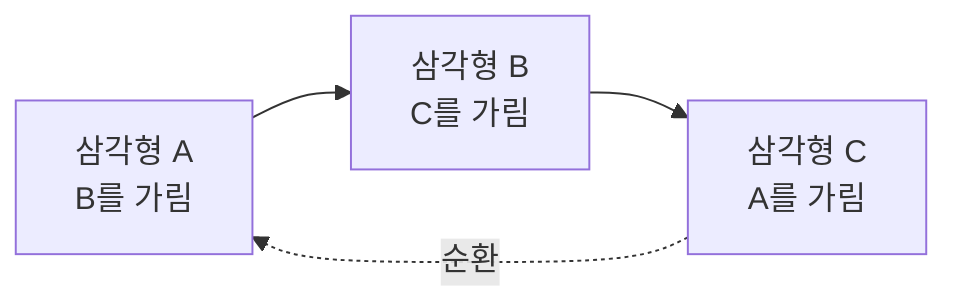

## 들어가며

셰이더가 프래그먼트마다 멋진 색을 계산해도, 그 색이 화면에 *남는다는 보장은 없다*. 앞에 있는 불투명한 벽에 가려진 프래그먼트는 버려져야 하고, 화면 밖을 향한 면은 애초에 그릴 필요가 없으며, 반투명 유리는 뒤의 것과 *순서대로* 섞여야 한다. 이 "무엇이 보이고 무엇이 가려지는가"의 문제 — *가시성(visibility)* — 이 파이프라인의 마지막 관문인 출력 병합에서 풀린다.

가시성은 컴퓨터 그래픽스의 가장 오래된 문제 중 하나다. 1970년대에는 삼각형을 어떤 순서로 그릴지가 알고리즘의 핵심 화두였지만, *깊이 버퍼(Z-buffer)* 라는 우아한 해법이 등장하면서 불투명 물체의 가시성은 *픽셀 단위로 자동* 풀리게 됐다. 그러나 그 편리함에는 정밀도라는 함정이 따라오고(Z-fighting), 반투명 물체에는 여전히 정렬 문제가 남으며, 이산 픽셀 격자는 *계단 현상(aliasing)* 이라는 또 다른 숙제를 던진다.

이 글은 프래그먼트가 픽셀이 되기까지의 마지막 관문들을 다룬다. 깊이 버퍼가 가시성을 어떻게 자동으로 푸는지, 그 깊이 정밀도가 왜 비선형이며 reverse-Z가 왜 답인지, 컬링으로 일을 어떻게 줄이는지, 반투명이 왜 정렬을 요구하는지, 그리고 앨리어싱의 정체와 MSAA·TAA를 비롯한 안티앨리어싱 기법을 정리한다. 여기에 early-Z, Hi-Z, Z-prepass, 오클루전 컬링의 지연까지 묶으면 출력 병합 단계가 단순한 마지막 저장 단계가 아니라 렌더링 성능의 중심이라는 점이 드러난다.


---

## 목차
1. [가시성 문제](#1-가시성-문제)
2. [화가 알고리즘과 그 실패](#2-화가-알고리즘과-그-실패)
3. [깊이 버퍼](#3-깊이-버퍼)
4. [깊이 정밀도와 reverse-Z](#4-깊이-정밀도와-reverse-z)
5. [컬링: 일을 줄이는 법](#5-컬링-일을-줄이는-법)
6. [투명과 정렬](#6-투명과-정렬)
7. [앨리어싱과 안티앨리어싱](#7-앨리어싱과-안티앨리어싱)
8. [Early-Z, Hi-Z, Z-prepass](#8-early-z-hi-z-z-prepass)
9. [오클루전 컬링의 지연과 오류](#9-오클루전-컬링의-지연과-오류)
10. [TAA와 히스토리 검증](#10-taa와-히스토리-검증)
11. [가시성 디버깅](#11-가시성-디버깅)


---

## 1. 가시성 문제

3D 장면을 2D 화면에 그릴 때, 한 픽셀 위에는 *여러 표면이 겹쳐* 투영될 수 있다. 카메라에서 광선을 쏘면 책상도, 그 뒤 벽도, 그 뒤 바깥 풍경도 같은 픽셀 방향에 놓인다. 불투명하다면 *가장 가까운 표면만* 보여야 한다. 이 "픽셀마다 가장 가까운 표면을 고르는" 문제가 *은면 제거(hidden surface removal)* 또는 가시성 문제다.

개념적으로 두 가지 접근이 있다.

- **물체 공간(object space)**: 그리기 전에 기하 관계로 정렬·분할한다. 순진한 모든 쌍 비교는 $O(n^2)$이고 공간 자료구조로 후보를 줄일 수 있지만, 교차·순환 관계를 해소하는 분할 비용이 남는다.
- **이미지 공간(image space)**: 그리는 동안 샘플마다 지금까지 통과한 깊이를 기억하며 갱신한다. 깊이 버퍼의 비용은 삼각형 수만이 아니라 래스터화된 샘플 수와 오버드로에 비례하지만, 각 샘플의 비교가 단순하고 병렬화하기 쉽다.

현대 GPU는 압도적으로 이미지 공간 — 깊이 버퍼 — 를 쓴다. 왜 이게 이겼는지는 화가 알고리즘의 실패를 보면 분명해진다.


## 2. 화가 알고리즘과 그 실패

가장 직관적인 가시성 해법은 *화가 알고리즘(painter's algorithm)* 이다. 화가가 먼 배경부터 칠하고 가까운 것을 위에 덧칠하듯, *삼각형을 먼 것부터 가까운 순으로 정렬* 해 순서대로 그린다. 나중에 그린(가까운) 것이 먼저 그린(먼) 것을 자연스럽게 덮는다.

문제는 *안정적인 정렬 순서가 존재하지 않을 수 있다* 는 것이다. 세 삼각형이 *서로 물고 물리게* 겹치면 — A가 B를 가리고, B가 C를 가리고, C가 A를 가리는 순환 — 어떤 순서로 그려도 틀린다. 또 삼각형이 서로 *관통* 하면(바닥에 반쯤 박힌 벽) 하나의 삼각형 안에서도 앞뒤가 갈려 삼각형 단위 정렬로는 표현이 안 된다.



근본 원인은 *정렬의 단위가 삼각형* 인데 가시성은 *픽셀 단위* 로 갈린다는 불일치다. 매 프레임 전 삼각형을 정렬하는 비용($O(n \log n)$)도 부담이다. 그래서 불투명 물체에는 화가 알고리즘을 버리고, 가시성을 픽셀 단위로 내려 푸는 깊이 버퍼로 옮겨갔다. (단, 화가 알고리즘은 *반투명* 에서 부분적으로 부활한다 — 6절.)


## 3. 깊이 버퍼

*깊이 버퍼(depth buffer, Z-buffer)* 의 발상은 단순하면서 강력하다. 색 버퍼와 *같은 해상도* 의 버퍼를 하나 더 두고, 각 픽셀에 *지금까지 그려진 것 중 가장 가까운 깊이* 를 저장한다. 프래그먼트를 그릴 때마다 비교한다.

```cpp
// 출력 병합 단계의 깊이 테스트
float zNew = fragment.windowDepth;    // 뷰포트 깊이 범위로 매핑된 프래그먼트 깊이
if (zNew < depthBuffer[x][y]) {       // 더 가까우면 (가까운 게 작다 가정)
    depthBuffer[x][y] = zNew;         // 깊이 갱신
    colorBuffer[x][y] = fragment.color;  // 색 기록
}
// 아니면 폐기 — 이미 더 가까운 게 있다
```

불투명 표면이 같은 비교 함수와 깊이 쓰기를 사용하고 깊이가 서로 다르면 제출 순서와 무관하게 가장 가까운 표면이 남는다. 동일 양자화 깊이에서 `LESS`를 쓰면 먼저 쓴 표면이 남고, 블렌딩·깊이 쓰기 비활성·셰이더 부수 효과가 있으면 순서 독립성이 깨진다. 비용도 단순 $O(n)$이 아니라 대략 $O(n+F)$이며 $F$는 생성·시험한 프래그먼트 또는 샘플 수다.

깊이 버퍼는 가시성 정답뿐 아니라 성능 최적화의 근거도 준다. 불투명 물체를 *앞에서 뒤로* 대략 정렬하면 가려질 프래그먼트를 셰이딩 전에 탈락시킬 기회가 늘어난다. 이 최적화가 early-Z이며, 조건이 맞으면 프래그먼트 셰이더 invocation을 건너뛴다. 비싼 셰이딩 전에 깊이만 먼저 채우는 Z-prepass도 같은 기회를 의도적으로 만든다. 깊이 테스트의 비교 함수(`LESS`/`LEQUAL`/`GREATER` 등), 깊이 쓰기 여부, 스텐실 상태, 블렌딩 상태는 출력 병합의 상태로 응용이 정한다.

단 early-Z는 언제나 켜지는 마법이 아니다. 프래그먼트 셰이더가 깊이를 직접 쓰거나, `discard`/`clip`으로 프래그먼트를 조건부 폐기하거나, UAV/image 같은 순서가 중요한 부수 효과를 내면 GPU는 깊이 테스트를 셰이더 뒤로 미뤄야 할 수 있다. 같은 깊이 버퍼를 쓰더라도 파이프라인 상태와 셰이더 코드에 따라 실제 실행 비용이 크게 달라지는 이유다.


## 4. 깊이 정밀도와 reverse-Z

깊이 버퍼의 어두운 면이 *정밀도* 다. 흔히 저장하는 NDC 깊이는 화면 공간에서 선형인 대신 *뷰 공간 거리에 대해 비선형* 이다 — 상수항을 포함한 $A+B/z_{\text{view}}$ 꼴이다. 결과적으로 깊이 버퍼 비트의 대부분이 *near 평면 근처* 에 몰리고, 먼 거리는 듬성듬성한 값만 남는다.

구체적 증상이 *Z-fighting* 이다. 멀리 있는 두 표면(예: 먼 벽에 붙은 포스터)의 깊이가 정밀도 부족으로 *같은 양자화 값* 으로 뭉개지면, 프레임마다 어느 쪽이 이길지 흔들려 *깜빡이는 얼룩* 이 생긴다. near 평면을 너무 가깝게(예: 0.001) 잡으면 정밀도 분포가 더 극단적으로 쏠려 증상이 심해진다 — *near를 최대한 멀리* 잡는 게 첫 번째 처방이다.

부동소수점 깊이 버퍼의 근본 처방이 *reverse-Z*다. 표준 투영은 near=0, far=1로 보내는데, IEEE 754 부동소수점은 0에 가까울수록 표현 가능한 값의 절대 간격이 작다. 이미 투영식의 $1/z$ 때문에 near에 깊이 값이 몰리는데 float의 촘촘한 영역까지 near에 겹친다. 매핑을 near=1, far=0으로 뒤집으면 먼 거리가 0 근처의 작은 간격을 사용하고, 투영의 비선형 분포와 float 지수 분포가 서로 보완한다.

| 방식 | near | far | float 정밀도와의 관계 |
|---|---|---|---|
| 표준 깊이 | 0 | 1 | $1/z$ 쏠림 + float 쏠림이 *겹쳐* far가 매우 부정확 |
| **reverse-Z** | 1 | 0 | 먼 거리의 절대 간격을 크게 줄이고 상대 오차를 안정화 |

“거의 균등”은 정확한 표현이 아니다. 정밀도는 여전히 거리와 형식에 의존하지만, 32비트 float reverse-Z는 넓은 거리 범위에서 뷰 공간 상대 정밀도를 훨씬 고르게 만든다. 반면 D24 같은 고정소수점 깊이 버퍼는 표현 간격이 전체 $[0,1]$에서 일정하므로 매핑을 뒤집기만 해서는 표현 가능한 깊이 평면의 수가 늘지 않는다. reverse-Z의 큰 이득은 **부동소수점 깊이 형식과 결합할 때** 나온다.

reverse-Z를 쓰려면 투영 행렬을 near=1, far=0으로 만들고, 깊이 비교를 `GREATER`/`GREATER_EQUAL`로 뒤집으며, 깊이 버퍼를 0으로 클리어한다. Direct3D·Vulkan은 $[0,1]$ 클립 깊이를 기본으로 쓰고, OpenGL은 `glClipControl(..., GL_ZERO_TO_ONE)`로 같은 형태를 택하는 편이 좋다. 무한 far 평면을 쓰면 투영식도 단순해지고 아주 먼 지오메트리를 표현하기 쉬워지지만, 동일 평면·부정확한 모델링·깊이 바이어스 문제까지 자동으로 없애는 것은 아니다.

### 숫자로 따라가기

쏠림이 얼마나 심한지 숫자로 보자. $[0,1]$ 깊이 매핑은 뷰 거리 $z$에 대해 $z_n = \dfrac{f(z-n)}{z(f-n)}$이다. $n=0.1$, $f=1000$으로 몇 점을 찍으면:

| 뷰 거리 $z$ | $z_n$ (깊이 버퍼 값) |
|---|---|
| 0.1 (near) | 0.000 |
| 0.2 | 0.500 |
| 1.0 | 0.900 |
| 10 | 0.990 |
| 1000 (far) | 1.000 |

near에서 *겨우 0.1만큼* 더 간 $z=0.2$에서 이미 깊이 버퍼 범위의 *절반(0.5)* 을 써 버린다. $z=10$이면 99%를 소진해, 나머지 $z=10\sim1000$의 990 단위가 마지막 1%를 나눠 갖는다. 실제 정밀도는 이 투영 분포와 깊이 형식의 양자화 간격을 함께 봐야 한다. float reverse-Z는 먼 거리를 0 근처의 더 촘촘한 값으로 옮겨 이 손실을 크게 줄이고, near를 0.1 대신 1.0으로 키우는 것 역시 어떤 깊이 형식에서도 투영 분포를 완화한다.


## 5. 컬링: 일을 줄이는 법

가장 빠른 그리기는 *안 그리는 것* 이다. *컬링(culling)* 은 보일 리 없는 것을 파이프라인 이른 단계에서 솎아내 일을 줄인다. 단계별로 점점 더 일찍, 더 크게 솎는다.

| 컬링 | 솎는 단위 | 시점 | 판정 |
|---|---|---|---|
| **백페이스(Back-face)** | 삼각형 | 래스터화 전 | 감김 방향이 카메라 반대 |
| **절두체(Frustum)** | 물체/청크 | 드로우콜 전(CPU) | 바운딩 볼륨이 절두체 밖 |
| **오클루전(Occlusion)** | 물체 | 드로우콜 전후 | 다른 물체에 완전히 가려짐 |

**백페이스 컬링**은 일관된 감김을 가진 닫힌 불투명 표면에서 카메라 반대쪽을 향한 삼각형을 래스터화 전에 버린다. 삼각형의 화면 공간 부호 있는 면적으로 앞뒤를 판정하는 고정 기능 단계라 비용이 작다. 볼록한 닫힌 물체에서는 상당한 비율을 제거하지만 정확히 절반이라는 보장은 없고, 열린 메시·양면 재질·카메라가 내부에 있는 경우에는 적용 조건이 달라진다.

**절두체 컬링**은 카메라 시야(절두체) *밖* 의 물체를 아예 드로우콜조차 안 보낸다. 물체마다 바운딩 구/박스를 절두체 여섯 평면과 검사한다. CPU에서 일어나는 *씬 레벨* 최적화로, 넓은 월드에서 효과가 가장 크다.

**오클루전 컬링**은 시야 안이지만 *다른 불투명 물체에 완전히 가려진* 것을 솎는다(벽 뒤의 방 전체). 가장 강력하지만 가장 어렵다 — "무엇이 무엇을 가리는지" 자체가 가시성 문제라, 깊이 버퍼 기반 쿼리나 별도 가시성 자료구조를 쓴다. 세 컬링은 배타적이 아니라 *누적* 된다 — 절두체로 시야 밖을, 오클루전으로 가려진 것을, 백페이스로 뒷면을 차례로 걷어내고 남은 것만 셰이딩한다.


## 6. 투명과 정렬

불투명 물체의 가시성은 깊이 버퍼가 순서 무관하게 풀어준다. 그런데 *반투명* 물체는 사정이 다르다. over 연산은 *교환법칙이 성립하지 않아*, 뒤의 것을 먼저 그리고 앞의 것을 나중에 섞어야 올바르다. 즉 반투명은 *화가 알고리즘으로 회귀* 한다 — 2절의 그 정렬 문제가 부활한다.

표준 절차는 *둘로 나누는 것* 이다.

1. **불투명 패스**: 모든 불투명 물체를 (대략 앞→뒤로) 그린다. 깊이 쓰기 켬. 가시성은 깊이 버퍼가 푼다.
2. **반투명 패스**: 반투명 물체를 *뒤→앞으로 정렬* 해 그린다. 깊이 *테스트는 켜되 쓰기는 끈다* — 불투명에 가려진 부분은 버리되, 반투명끼리는 깊이를 덮어쓰지 않아 뒤의 반투명이 비치게 한다.

이 방식의 한계는 명확하다. *물체 단위 정렬* 이라 서로 관통하거나 순환 겹친 반투명(2절의 그 경우)은 여전히 틀리고, 한 물체 안에서 앞뒤가 갈리는 경우(반투명 구의 앞면과 뒷면)도 처리가 어렵다. 그래서 정렬에 의존하지 않는 *순서 독립 투명(Order-Independent Transparency, OIT)* 기법들이 있다.

| OIT 기법 | 발상 | 비용 |
|---|---|---|
| Depth Peeling | 깊이를 한 겹씩 벗기며 여러 패스로 정확히 합성 | 패스 수만큼 비쌈 |
| Weighted Blended OIT | 깊이 기반 가중치로 순서 무관 근사 합성 | 싸고 근사적 |
| Per-pixel linked list | 픽셀마다 프래그먼트 리스트를 모아 정렬 후 합성 | 메모리·정렬 부담 |

대부분의 실시간 응용은 *정렬 + 깊이 쓰기 끄기* 로 충분히 버티고, 머리카락·연기·유리가 많이 겹치는 장면에서만 OIT를 도입한다. *알파 테스트(컷아웃)* — 알파가 임계값 미만이면 프래그먼트를 통째로 버려 불투명처럼 취급 — 는 잎·울타리처럼 *반투명이 아니라 구멍 뚫린 불투명* 인 경우의 값싼 우회로로, 정렬 없이 깊이 버퍼를 그대로 쓴다.


## 7. 앨리어싱과 안티앨리어싱

마지막 숙제는 화면이 *이산 픽셀 격자* 라는 데서 온다. 래스터화는 *픽셀 중심 한 점* 이 삼각형 안인지로 커버리지를 정한다 했다. 이 *점 샘플링* 이 *앨리어싱(aliasing)* 을 낳는다 — 비스듬한 엣지가 *계단(jaggies)* 으로 보이고, 가는 선이 끊기며, 멀리서 반복되는 텍스처가 *모아레* 무늬로 어른거린다.

원인은 신호 처리의 *나이퀴스트 정리* 다. 삼각형 엣지는 *무한히 날카로운(고주파)* 신호인데, 픽셀당 한 번의 샘플링은 그 고주파를 담기엔 *표본이 부족* 하다. 표현할 수 없는 고주파가 저주파로 *접혀 들어와(alias)* 계단과 모아레로 나타난다. 근본 해법은 둘 — *더 많이 샘플링* 하거나, *고주파를 미리 제거(필터링)* 하거나.

| 기법 | 발상 | 특징 |
|---|---|---|
| **SSAA** (Supersampling) | 더 높은 해상도로 그린 뒤 축소 | 최고 품질, 비용도 최고(N배 셰이딩) |
| **MSAA** (Multisample) | 커버리지·깊이만 다중 샘플, *셰이딩은 픽셀당 1회* | 엣지 앨리어싱에 효율적, 표준 |
| **FXAA/SMAA** (Post-process) | 최종 이미지에서 엣지를 찾아 흐림 | 매우 쌈, 약간 뭉개짐 |
| **TAA** (Temporal) | *여러 프레임* 의 샘플을 누적·재투영 | 시간축 샘플로 저렴하게 고품질, 잔상 위험 |

MSAA의 핵심은 커버리지·깊이를 여러 샘플 위치에서 평가하면서 기본 설정에서는 프래그먼트 셰이딩 결과를 여러 커버된 샘플에 공유할 수 있다는 점이다. sample-frequency shading, 샘플 한정 입력, 구현의 helper invocation을 사용하면 셰이딩 횟수는 늘어난다. SSAA보다 적은 셰이딩으로 기하 경계를 개선할 수 있지만, 셰이더 내부의 고주파 정반사나 알파 텍스처에는 별도 필터링·alpha-to-coverage가 필요하다.

현대 엔진은 디퍼드 렌더링·고해상도와 궁합이 좋은 *TAA* 로 많이 옮겨갔다 — 매 프레임 샘플 위치를 미세하게 흔들고(jitter) 이전 프레임을 재투영해 누적하면, 시간축에서 사실상 슈퍼샘플링한 효과를 싸게 얻는다. 대가는 움직임에서의 잔상(ghosting)과 흐림이라, 이를 줄이는 보정이 활발한 연구 주제다. 그리고 모든 안티앨리어싱의 *평균* 연산은 반드시 *선형 공간* 에서 해야 — sRGB 코드값을 평균하면 고대비 엣지가 어두워진다 — 올바른 결과가 나온다.


## 8. Early-Z, Hi-Z, Z-prepass

깊이 테스트는 개념적으로 출력 병합 단계에서 일어난다. 하지만 성능 관점에서는 가능하면 프래그먼트 셰이더 *전에* 일어나야 한다. 셰이더가 100개의 텍스처 샘플을 읽고 복잡한 조명을 계산한 뒤에야 "이미 벽 뒤에 가려진 픽셀"이라고 판정되면, 깊이 버퍼는 정답은 맞히지만 비용은 아끼지 못한다.

GPU는 보통 세 층으로 가시성을 최적화한다.

| 단계 | 단위 | 역할 | 실패 조건 |
|---|---|---|---|
| Early-Z | 프래그먼트 | 셰이더 실행 전에 깊이·스텐실 테스트 | 셰이더가 깊이·폐기·부수 효과를 바꿀 때 |
| Hi-Z | 타일/블록 | 작은 깊이 요약으로 여러 픽셀을 한 번에 탈락 | 깊이 요약이 보수적으로 판정 불가할 때 |
| Late-Z | 프래그먼트 | 셰이더 결과가 깊이·폐기·부수 효과를 바꾼 경우 최종 판정 | 상태·셰이더에 따라 필요 |

*Hi-Z(Hierarchical Z)* 는 깊이 버퍼의 피라미드 요약이다. 예를 들어 8×8 픽셀 블록의 최소 깊이 또는 최대 깊이를 별도로 저장하면, 새 삼각형의 깊이 범위가 그 블록 전체보다 뒤에 있다는 판정을 한 번에 할 수 있다. 그러면 64개 픽셀을 각각 래스터화하고 셰이딩하지 않아도 블록 단위로 버린다. 다만 최소·최대 중 어느 쪽을 저장하고 어떻게 비교할지는 깊이 규약에 달려 있다. 표준 LESS 깊이에서 전체 영역이 가려졌다고 안전하게 판정하려면 블록의 *최대* 깊이보다 대상의 가장 가까운 깊이가 커야 한다. 최소값과 비교하면 블록 일부가 앞에 있어도 가려진 것으로 오판한다(예: 블록 깊이가 [0.2, 0.9]일 때 대상 0.5는 최소값과 비교하면 가려졌지만 실제로는 0.9 표본에서 보인다). reverse-Z에서는 clear 값과 부등식, reduction 방향을 함께 반대로 뒤집어야 한다. 타일 기반 GPU와 데스크톱 GPU 모두 형태는 다르지만 비슷한 계층적 깊이 요약을 쓴다.

Z-prepass는 이 최적화를 노골적으로 끌어내는 렌더링 구조다.

```text
1. 깊이 전용 패스
   - 불투명 지오메트리만 그린다
   - 컬러 쓰기 끔
   - 깊이 쓰기 켬
   - 값싼 셰이더 또는 셰이더 없음

2. 셰이딩 패스
   - 같은 불투명 지오메트리를 다시 그린다
   - 깊이 테스트 켬
   - 깊이 쓰기 끔 또는 동일 깊이만 통과
   - 비싼 재질·조명 셰이더 실행
```

이 구조는 드로우를 두 번 보내므로 항상 이득이 아니다. 장면이 단순하고 프래그먼트 셰이더가 싸면 지오메트리 비용만 두 배가 된다. 반대로 화면 대부분을 덮는 복잡한 불투명 물체가 많고, 픽셀 셰이딩이 비싸며, 오버드로가 큰 장면에서는 첫 패스가 깊이를 먼저 채워 뒤쪽 프래그먼트의 셰이더 실행을 대량으로 막는다. 기준은 단순하다. *두 번째 지오메트리 제출 비용보다 줄어드는 픽셀 셰이딩 비용이 클 때* Z-prepass가 이긴다.

깊이 비교 함수도 이 구조에 맞춰 정해야 한다. 표준 깊이에서는 첫 패스가 `LESS` 또는 `LEQUAL`로 깊이를 쓰고, 두 번째 패스는 `EQUAL` 또는 `LEQUAL`로 같은 표면만 셰이딩한다. reverse-Z에서는 첫 패스가 `GREATER` 또는 `GEQUAL`로 깊이를 쓰고, 두 번째 패스는 `EQUAL` 또는 `GEQUAL`을 쓴다. `EQUAL`은 깊이 매핑을 뒤집어도 바뀌지 않는다. 두 패스의 정점 변환·래스터화·알파 컷아웃이 같은 표면과 깊이를 만들어야 하며, 첫 패스와 다른 변형이나 폐기 조건을 쓰면 `EQUAL`에서 표면이 빠질 수 있다. 비교 함수를 틀리면 깊이 버퍼는 조용히 모든 프래그먼트를 버리거나, 반대로 아무것도 버리지 않는 상태가 된다.


## 9. 오클루전 컬링의 지연과 오류

오클루전 컬링은 "어떤 물체가 다른 물체 뒤에 완전히 가려졌는가"를 묻는다. 이 질문은 깊이 버퍼가 가장 잘 답하지만, CPU가 드로우콜을 보내기 *전에* 답을 알고 싶다는 점에서 모순이 생긴다. GPU는 실제 깊이를 알고 있고, CPU는 그 결과를 기다리면 파이프라인이 멈춘다.

대표적인 구현은 다음 셋이다.

| 방식 | 판정 위치 | 장점 | 위험 |
|---|---|---|---|
| 하드웨어 오클루전 쿼리 | GPU | 실제 깊이 버퍼 기준이라 정확 | 결과를 바로 읽으면 CPU-GPU 동기화 발생 |
| 지난 프레임 Hi-Z 재사용 | CPU/GPU | 동기화 없이 빠름 | 카메라 이동 시 한 프레임 늦은 판정 |
| 소프트웨어 래스터/포털 | CPU | 드로우콜 전 결정 가능 | 구현 복잡, 보수적 근사 필요 |

실시간 렌더러는 보통 *보수적 판정* 을 택한다. 보일 수도 있는 물체는 그린다. 안 보인다고 잘못 판정해 버리면 물체가 갑자기 사라지는 팝핑이 생기지만, 보이지 않는 물체를 실수로 그리는 것은 성능 손실일 뿐 화면 오류는 아니다. 따라서 오클루전 컬링은 공격적인 최적화가 아니라, 틀릴 때 화면이 깨지지 않도록 보수적으로 설계하는 가시성 시스템이다.

지연도 중요하다. 지난 프레임의 깊이로 현재 프레임을 컬링하면 카메라가 빠르게 회전할 때 새로 보이는 물체가 한 프레임 늦게 나타날 수 있다. 이를 줄이려면 바운딩 볼륨을 약간 키우고, 최근에 보였던 물체는 몇 프레임 동안 강제로 유지하며, 카메라 속도가 큰 순간에는 컬링을 덜 공격적으로 한다. 오클루전 컬링의 품질은 알고리즘 하나보다 이런 히스테리시스 정책에서 갈린다.


## 10. TAA와 히스토리 검증

TAA는 여러 프레임을 누적해 하나의 고품질 이미지를 만든다. 핵심은 단순한 블러가 아니라 *재투영(reprojection)* 이다. 현재 픽셀의 표면이 이전 프레임에서 어느 픽셀에 있었는지 모션 벡터로 찾아가, 그 색을 현재 프레임의 새 샘플과 섞는다.

```text
현재 픽셀
  -> 깊이로 현재 표면 위치 복원
  -> 모션 벡터로 이전 프레임 위치 계산
  -> 이전 색(history) 샘플
  -> 현재 색과 가중 평균
  -> 히스토리 버퍼에 저장
```

문제는 이전 색이 항상 같은 표면의 색이 아니라는 점이다. 가림 물체 뒤에서 새로 드러난 영역(disocclusion), 빠르게 움직이는 물체의 가장자리, 투명·입자·반사처럼 안정된 깊이와 모션 벡터가 없는 표면에서는 이전 프레임의 색이 현재 픽셀과 무관할 수 있다. 이 값을 그대로 섞으면 잔상과 번짐이 생긴다.

그래서 TAA는 히스토리 검증을 함께 둔다. 깊이 비교는 같은 좌표계와 깊이 규약에서 해야 한다. 카메라가 움직이면 같은 월드 표면도 현재와 이전 프레임의 raw depth가 달라지므로, 현재 표면을 이전 카메라로 재투영해 얻은 예상 깊이와 그 위치의 이전 깊이를 비교하거나 공통 공간으로 복원해 비교한다.

| 검증 | 판정 | 효과 |
|---|---|---|
| 깊이 차이 | 재투영한 현재 표면의 예상 이전 깊이와 이전 깊이 버퍼 값이 크게 다름 | 새로 드러난 영역의 히스토리 폐기 |
| 속도 차이 | 주변 픽셀과 모션 벡터 불연속 | 움직이는 경계의 잔상 감소 |
| 색상 클램프 | 이전 색이 현재 주변 색 범위를 벗어남 | 과거 색이 끌려오는 현상 억제 |
| 반응형 마스크 | 입자·UI·반짝임 등 누적 금지 영역 표시 | 흐려지면 안 되는 요소 보호 |

TAA가 어려운 이유는 품질 목표가 서로 충돌하기 때문이다. 히스토리를 많이 믿으면 노이즈와 계단은 줄지만 잔상이 남고, 히스토리를 쉽게 버리면 잔상은 줄지만 화면이 다시 반짝인다. 현대 업스케일러와 안티앨리어싱 기법이 모션 벡터, 깊이, 노멀, 노출, 반응형 마스크를 많이 요구하는 이유가 여기에 있다. 시간축 샘플링은 강력하지만, *같은 표면의 같은 신호를 누적하고 있는가* 를 매 픽셀마다 검증해야 한다.


## 11. 가시성 디버깅

가시성 문제는 최종 이미지에서는 "깜빡임", "사라짐", "잔상", "계단"처럼 보이지만 원인은 서로 다르다. 따라서 렌더러는 최종 컬러만 보여주면 안 된다. 깊이, 오버드로, 컬링 결과, 모션 벡터를 따로 볼 수 있어야 한다.

실무적으로 유용한 디버그 뷰는 다음과 같다.

| 디버그 뷰 | 보여주는 것 | 찾는 문제 |
|---|---|---|
| Depth view | 깊이 버퍼 값 또는 선형화된 거리 | near/far 설정, reverse-Z 오류, Z-fighting |
| Overdraw view | 픽셀별 셰이딩 횟수 | Z-prepass 필요성, 정렬 문제 |
| Hi-Z/Occlusion view | 컬링된 물체와 통과한 물체 | 과도한 컬링, 한 프레임 팝핑 |
| Transparency layers | 반투명 정렬 순서와 레이어 수 | 유리·입자 합성 오류 |
| Motion vector view | 픽셀별 화면 공간 속도 | TAA 잔상, 잘못된 재투영 |

계측값도 같이 남겨야 한다. 드로우콜 수, 삼각형 수, 프래그먼트 셰이더 실행량, early-Z 통과율, 오클루전으로 제거된 물체 수, TAA 히스토리 폐기율이 프레임마다 기록되면 문제의 위치가 좁혀진다. 예를 들어 FPS가 낮은데 드로우콜과 삼각형 수는 안정적이고 오버드로만 급증한다면, 병목은 기하 처리보다 가려진 픽셀의 셰이딩에 가깝다. 반대로 물체가 사라졌다가 나타나면 성능 카운터보다 컬링 디버그 뷰와 카메라 히스토리를 먼저 봐야 한다.


---

## 결론

가시성 — 무엇이 보이고 무엇이 가려지는가 — 은 *깊이 버퍼* 가 픽셀 단위로 자동으로 푼다. 삼각형 정렬에 의존하던 화가 알고리즘이 순환·관통 겹침에서 무너지는 것과 달리, 깊이 버퍼는 순서 무관하게 가장 가까운 표면을 픽셀마다 골라내고 early-Z라는 성능 이점까지 준다. 대가인 *깊이 정밀도의 비선형 쏠림* 은 Z-fighting을 낳으며, near를 멀리 잡고 *reverse-Z* 를 쓰는 것이 표준 처방이다.

*컬링* — 백페이스·절두체·오클루전 — 은 보일 리 없는 것을 점점 더 일찍 솎아 셰이딩할 양을 줄인다. 이 최적화는 early-Z, Hi-Z, Z-prepass와 결합될 때 픽셀 셰이딩 비용을 크게 낮춘다. 다만 오클루전 컬링은 CPU-GPU 지연과 보수적 판정 문제를 가진다. *반투명* 은 over 연산의 비가환성 때문에 정렬(깊이 쓰기 끄기)로 회귀하며, 정렬이 불가능한 경우 OIT로 우회한다. 마지막으로 이산 샘플링이 낳는 *앨리어싱* 은 SSAA·MSAA·post·TAA로 완화하되, TAA는 모션 벡터와 히스토리 검증이 품질을 결정한다.

깊이 테스트, 컬링, 투명 정렬, 안티앨리어싱은 모두 한 질문의 다른 답이다. *최종 픽셀에 어떤 표본을 남길 것인가?* 좌표 변환과 래스터화가 프래그먼트 후보를 만들면, 가시성 단계는 그 후보를 줄이고 합쳐 실제 화면을 완성한다. 이 원리는 OpenGL·DirectX·Vulkan에서 객체와 함수 이름이 달라도 동일하다. 차이는 API 이름이 아니라, 깊이 상태·렌더 순서·히스토리 데이터·디버그 계측을 얼마나 일관된 정책으로 묶느냐에서 생긴다.


## 더 읽을거리

- Nathan Reed, ["Depth Precision Visualized"](https://www.reedbeta.com/blog/depth-precision-visualized/) — 깊이 비선형성과 reverse-Z 의 시각적 분석. (NVIDIA 재게재판: ["Visualizing Depth Precision"](https://developer.nvidia.com/blog/visualizing-depth-precision/))
- Matt Pettineo, ["A Quick Overview of MSAA"](https://therealmjp.github.io/posts/msaa-overview/) — MSAA 동작 원리와 한계의 깊은 정리.
- Morgan McGuire 외, "Weighted Blended Order-Independent Transparency" (JCGT 2013) — 실시간 OIT 의 대표 기법.
- *Real-Time Rendering, 4th Edition*, Ch.5 (앨리어싱), Ch.19 (가시성·컬링).
