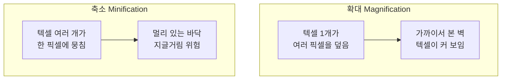
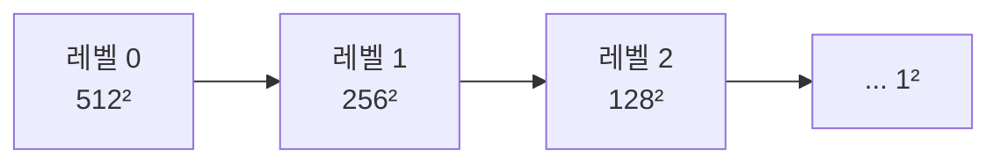
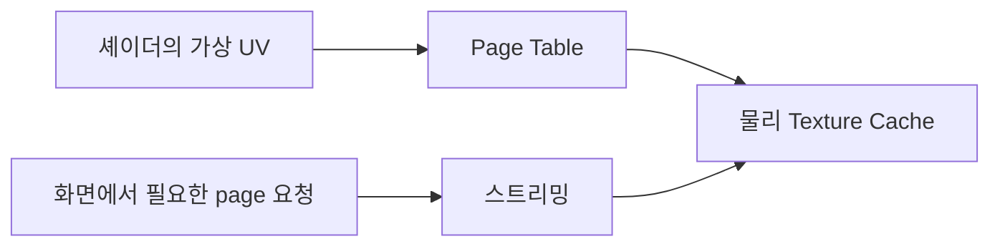

## 들어가며

앞의 여섯 편이 정점에서 픽셀까지 *파이프라인을 따라* 걸었다면, 이 편은 그 파이프라인의 프래그먼트 단계에 가장 많은 디테일을 공급하는 입력 — *텍스처(texture)* 를 깊게 본다. 삼각형 하나하나에 색을 일일이 칠하는 대신, 이미지 한 장을 표면에 *입혀* 벽돌·나뭇결·금속의 무늬를 단숨에 얻는 기법이다. 현대 렌더링에서 표면의 거의 모든 정보 — 색(알베도), 굴곡(법선 맵), 거칠기, 금속성 — 이 텍스처로 전달된다.

텍스처링이 단순한 "이미지 붙이기"가 아닌 이유는 *샘플링(sampling)* 때문이다. 텍스처는 유한한 텍셀(texel) 격자인데, 그것을 임의 크기·임의 각도의 표면에 입히면 한 텍셀이 여러 픽셀로 늘어나거나(확대) 여러 텍셀이 한 픽셀로 뭉친다(축소). 이 불일치를 어떻게 메우느냐 — 어떻게 *필터링* 하고 *밉맵* 을 쓰느냐 — 가 화질을 좌우한다. 멀리 있는 텍스처가 지글거리는 것도, 비스듬한 바닥이 흐려지는 것도 전부 샘플링 이론의 문제다.

이 글은 텍스처와 샘플링을 API에 독립적으로 다룬다. UV 매핑, 텍셀과 정규화 좌표, 확대·축소와 필터링(nearest·bilinear·trilinear), 밉맵이 왜 필요하고 LOD를 어떻게 고르는지, 비등방 필터링, 래핑 모드, 그리고 텍스처의 종류와 색공간 연결까지. 앨리어싱 이론이 여기서 *텍스처 공간* 으로 되돌아온다.


---

## 목차
1. [텍스처와 UV 매핑](#1-텍스처와-uv-매핑)
2. [텍셀과 정규화 좌표](#2-텍셀과-정규화-좌표)
3. [확대와 축소](#3-확대와-축소)
4. [필터링: nearest와 bilinear](#4-필터링-nearest와-bilinear)
5. [밉맵과 trilinear](#5-밉맵과-trilinear)
6. [비등방 필터링](#6-비등방-필터링)
7. [래핑 모드](#7-래핑-모드)
8. [텍스처의 종류와 색공간](#8-텍스처의-종류와-색공간)
9. [샘플링 이론과 화면 도함수](#9-샘플링-이론과-화면-도함수)
10. [텍스처 압축과 블록 오차](#10-텍스처-압축과-블록-오차)
11. [가상 텍스처링과 Residency](#11-가상-텍스처링과-residency)


---

## 1. 텍스처와 UV 매핑

*텍스처* 는 표면에 입히는 데이터의 격자다. 보통 2D 이미지지만, 1D·3D·큐브맵 형태도 있다. 핵심은 *3D 표면의 각 점이 텍스처의 어느 위치에서 값을 읽을지* 를 정하는 것 — 이 대응이 *UV 매핑(UV mapping)* 이다.

메시의 각 정점은 위치·법선과 함께 *텍스처 좌표* $(u, v)$를 갖는다. 모델러가 3D 표면을 가위로 펼쳐 평평한 2D 텍스처 위에 늘어놓는 작업(*UV 언래핑*)으로 이 좌표가 정해진다. 종이 지구본을 평면 세계지도로 펼치는 것과 같다. 래스터화 단계가 본 *원근 보정 보간* 으로 삼각형 내부 각 픽셀의 $(u, v)$를 채워주고, 프래그먼트 셰이더는 그 좌표로 텍스처를 *샘플링* 한다.

```glsl
// 프래그먼트 셰이더 — 보간된 uv로 텍스처에서 색을 읽는다
vec4 albedo = texture(uAlbedoMap, uv);
```

UV 매핑이 표면-텍스처 대응을 정한다는 점이 중요하다. 같은 텍스처라도 UV를 어떻게 펼치느냐에 따라 무늬가 늘어나거나 반복되거나 이음새가 보인다. *텍스처 좌표는 정점 속성* 이라 모델에 구워지고, 셰이더에서 스크롤·스케일·회전시켜 애니메이션(흐르는 물, 컨베이어 벨트)을 만들 수도 있다.


## 2. 텍셀과 정규화 좌표

텍스처의 한 점을 *텍셀(texel, texture element)* 이라 부른다 — 화면의 픽셀에 대응하는 텍스처 쪽 용어다. 512×512 텍스처는 텍셀 26만여 개의 격자다.

텍스처 좌표 $(u, v)$는 거의 항상 *정규화(normalized)* 되어 있다 — 텍스처 해상도와 무관하게 $[0, 1]$ 범위를 쓴다. $(0,0)$은 한 모서리, $(1,1)$은 반대 모서리다. 이 정규화 덕분에 *해상도 독립성* 을 얻는다 — 같은 UV를 가진 모델에 512×512든 4096×4096이든 어떤 텍스처를 물려도 매핑이 그대로 동작한다. 텍스처를 고해상도로 교체해도 UV를 다시 만들 필요가 없다.

(원점이 좌상단인지 좌하단인지는 API마다 다르다. OpenGL은 전통적으로 좌하단을, DirectX와 Vulkan은 좌상단을 기준으로 설명되는 경우가 많다. 텍스처가 위아래로 뒤집혀 보이는 흔한 버그의 원인이다.)

샘플링의 본질적 문제가 여기서 나온다. 보간된 UV는 *연속값*(예: $u = 0.6234$)인데 텍셀은 *이산 격자* 다. $u = 0.6234$에 정확히 놓인 텍셀은 없다. 가장 가까운 텍셀을 고를 것인가, 주변 텍셀을 섞을 것인가 — 이것이 *필터링* 의 문제이고, 화면 픽셀과 텍셀의 크기 관계(확대냐 축소냐)에 따라 답이 갈린다.


## 3. 확대와 축소

표면이 화면에서 차지하는 크기는 거리·각도에 따라 변하므로, 텍셀과 픽셀의 크기 비율이 고정되지 않는다. 두 경우로 갈린다.



**확대(Magnification)**: 텍스처를 *원래보다 크게* 본다. 한 텍셀이 여러 화면 픽셀에 걸친다(벽에 코를 박은 경우). 문제는 *블록화* — 그냥 가장 가까운 텍셀을 쓰면 거대한 사각형 픽셀이 보인다. 해법은 주변 텍셀을 부드럽게 섞는 보간(bilinear).

**축소(Minification)**: 텍스처를 *원래보다 작게* 본다. 한 화면 픽셀이 여러 텍셀을 덮는다(멀리 있는 타일 바닥). 이쪽이 훨씬 까다롭다. 한 픽셀이 덮는 여러 텍셀 중 *한 점만* 샘플링하면, 앨리어싱이 *텍스처 공간* 에서 그대로 재현된다 — 멀리 있는 줄무늬가 *모아레* 로 어른거리고, 카메라가 움직이면 텍스처가 *지글지글(shimmering)* 끓는다. 이건 화면 엣지 앨리어싱과 같은 나이퀴스트 문제다 — 고주파(촘촘한 텍셀)를 한 번의 점 샘플링으로 담을 수 없어 저주파로 접혀 든다.

확대는 보간으로 비교적 쉽게 풀리지만, 축소는 *여러 텍셀의 평균* 이 필요하고 그것을 매 픽셀 실시간으로 구하는 게 비싸다 — 그 해법이 5절의 밉맵이다. API는 확대용 필터(`magFilter`)와 축소용 필터(`minFilter`)를 *따로* 설정하게 하는데, 두 경우의 최적해가 다르기 때문이다.


## 4. 필터링: nearest와 bilinear

샘플링이 연속 UV에서 값을 정하는 두 기본 방식이다.

**최근접(Nearest / Point)**: UV에 *가장 가까운 텍셀 하나* 를 그대로 쓴다. 가장 싸고, 텍셀 경계가 *또렷* 하다. 픽셀 아트·도트 그래픽·인덱스 데이터(타일 ID 맵)처럼 *경계가 뭉개지면 안 되는* 경우에 쓴다. 확대하면 큼직한 사각형이 보인다.

**이중선형(Bilinear)**: UV를 둘러싼 *가장 가까운 텍셀 4개* 를 위치 비율로 가중 평균한다. 1D 선형 보간을 가로·세로 두 축에 적용해서 "이중(bi)선형"이다.

$$
c = (1-s)(1-t)\,c_{00} + s(1-t)\,c_{10} + (1-s)t\,c_{01} + st\,c_{11}
$$

여기서 $(s, t)$는 4-텍셀 격자 안에서의 소수 위치다. 결과는 텍셀 사이가 *부드럽게* 이어져, 확대해도 블록 대신 매끄러운 그라데이션이 보인다. GPU 텍스처 유닛이 4-탭 이중선형을 하나의 샘플 명령으로 제공하므로 셰이더에서 네 번 읽어 직접 섞는 것보다 효율적이다. 그래도 샘플러 처리량, 캐시 라인과 메모리 대역폭을 소비하므로 공짜는 아니며, 대규모 fetch 워크로드에서는 필터 모드가 병목에 영향을 준다.

이중선형은 *확대* 의 블록화를 잘 풀지만 *축소* 의 지글거림은 못 푼다 — 4개 텍셀만 보는데 한 픽셀이 수십 텍셀을 덮으면, 그 수십 개 중 4개만 골라 평균하는 셈이라 나머지가 무시되어 여전히 앨리어싱이 남는다. 축소를 제대로 풀려면 *덮인 텍셀 전체* 를 반영해야 하고, 그것을 미리 계산해 두는 것이 밉맵이다.

### 숫자로 따라가기

4-텍셀 격자의 밝기가 $c_{00}=0.2$, $c_{10}=0.8$, $c_{01}=0.4$, $c_{11}=1.0$이고 UV가 그 격자 안 $(s,t)=(0.25,0.75)$에 떨어졌다 하자. 가중치는 $(1{-}s)(1{-}t)=0.1875$, $s(1{-}t)=0.0625$, $(1{-}s)t=0.5625$, $st=0.1875$(합 1)이므로

$$
c = 0.1875(0.2)+0.0625(0.8)+0.5625(0.4)+0.1875(1.0) = 0.5
$$

$t=0.75$라 *위쪽 두 텍셀*($c_{01},c_{11}$)에 무게가 쏠려, 가까운 $c_{01}=0.4$ 쪽으로 당겨진 $0.5$가 나온다. 최근접이었다면 가장 가까운 $c_{01}=0.4$ 하나만 골라 *불연속* 이지만, 이중선형은 네 텍셀을 섞어 *연속* 이다 — UV가 조금 움직이면 결과도 조금 움직인다.


## 5. 밉맵과 trilinear

*밉맵(mipmap)* 은 텍스처를 *절반씩 줄인 사본들* 을 미리 만들어 사슬처럼 쌓아 둔 것이다. 512×512 원본 아래 256×256, 128×128, … 1×1까지. 각 단계(레벨)는 위 단계를 *4텍셀 평균* 으로 줄인 것이라, *이미 여러 텍셀이 평균된* 상태다. ("MIP"은 라틴어 *multum in parvo* — "작은 곳에 많은 것" — 에서 왔다.)



핵심 발상: 축소 시 *여러 텍셀을 실시간 평균* 하는 대신, *이미 알맞게 평균된 작은 레벨* 을 골라 거기서 이중선형 샘플링한다. 멀리 있는 바닥은 작은 밉 레벨을 읽어, 그 한 번의 샘플이 사실상 넓은 영역의 평균이 된다 — 지글거림이 사라진다. 비용은 메모리 약 +33%(기하급수 합 $1 + 1/4 + 1/16 + \cdots = 4/3$)뿐이고, 오히려 작은 텍스처를 읽어 *캐시 효율은 좋아진다*.

어느 레벨을 고를까? GPU는 인접 픽셀 사이에서 UV가 *얼마나 빨리 변하는지*(화면 도함수 $\partial u/\partial x$ 등)를 보고 *LOD(Level of Detail)* 를 계산한다. UV가 픽셀당 많이 변하면(텍스처가 축소돼 촘촘하면) 높은(작은) 레벨을, 천천히 변하면 낮은(큰) 레벨을 고른다. GPU가 픽셀을 *2×2 쿼드* 로 처리하는 이유 중 하나가 이 도함수를 이웃 픽셀 차이로 구하기 위함이다(쿼드 언급과 연결된다).

계산된 LOD는 보통 소수다(예: 2.7). 정수 레벨만 쓰면 레벨이 바뀌는 경계에 *눈에 띄는 띠(밉 밴딩)* 가 생긴다. *삼중선형(Trilinear)* 필터링이 이를 푼다 — 인접한 두 정수 레벨(2와 3)에서 각각 이중선형 샘플링한 뒤, 그 둘을 소수부(0.7)로 한 번 더 선형 보간한다. 논리적으로 두 mip 레벨을 읽으므로 point/bilinear보다 샘플링 작업과 필요한 데이터가 늘지만, 실제 비용이 정확히 2배인지는 캐시·압축·샘플러 처리량에 달려 있다.

한 가지 함정: 밉맵 *생성* 의 평균은 색 텍스처라면 선형 빛에서 해야 한다. sRGB 코드값을 그대로 평균해 밉을 만들면 멀리 있는 고대비 텍스처가 어두워진다. sRGB 샘플링의 자동 디코딩과 밉 생성은 별개 계약이며, 런타임 생성 명령의 필터링 규칙과 포맷 지원도 API별로 확인해야 한다. 에셋 빌드에서 디코딩→필터링→인코딩을 명시하고 알파 커버리지·법선 재정규화처럼 데이터 종류별 축소 규칙을 적용하는 편이 재현 가능하다.


## 6. 비등방 필터링

밉맵 + 삼중선형은 *정면에서 본 축소* 는 잘 풀지만, *비스듬히 본* 표면에서 새 문제가 생긴다. 비스듬한 바닥은 한 픽셀이 덮는 텍스처 영역이 *정사각형이 아니라 길쭉한 타원* 이다 — 시선 방향으로는 멀리까지(많은 텍셀), 가로로는 좁게(적은 텍셀).

밉맵은 *정사각형 영역* 을 가정한다. 길쭉한 픽셀 발자국에 밉 레벨을 맞추려면 *짧은 축* 기준으로는 너무 흐리고, *긴 축* 기준으로는 지글거린다. GPU는 안전하게 *흐린 쪽* 을 택하므로, 비스듬한 바닥이 멀어질수록 *과도하게 흐려진다*. 도로·복도·잔디밭이 지평선 근처에서 뭉개지는 전형적 증상이다.

*비등방 필터링(Anisotropic Filtering)* 이 이를 푼다. 길쭉한 발자국을 *긴 축을 따라 여러 번 샘플링* 해(예: 16×) 그 결과를 평균한다. 긴 방향의 디테일을 살리면서 짧은 방향의 평균도 유지해, 비스듬한 표면이 선명하다. 비용은 샘플 수에 비례(2×·4×·8×·16×)하지만, 길쭉한 경우에만 추가 샘플을 쓰므로(이름의 "비등방=방향에 따라 다름") 정면 표면에는 부담이 없다. 현대 GPU에서 가장 가성비 좋은 화질 옵션으로 꼽혀, 게임 설정의 "AF 16×"가 바로 이것이다.

정리하면 축소 화질의 사다리다 — *점 샘플(지글거림) → 이중선형(여전히 지글) → 밉맵+삼중선형(정면 OK, 비스듬 흐림) → 비등방(비스듬도 선명)*.


## 7. 래핑 모드

UV가 $[0, 1]$을 *벗어나면* 어떻게 할까? 타일을 반복하려고 $(0,0)$~$(4,4)$로 UV를 주거나, 보간·스크롤로 범위를 넘는 경우다. *래핑 모드(wrap mode)* 가 범위 밖 좌표의 텍셀을 정한다.

| 모드 | 동작 | 용도 |
|---|---|---|
| **Repeat** | 정수부를 버려 $[0,1]$ 반복 | 벽돌·타일·잔디 등 반복 무늬 |
| **Clamp to Edge** | 범위 밖은 가장자리 텍셀로 고정 | 단일 이미지, 가장자리 번짐 방지 |
| **Mirror** | 반복하되 매번 좌우 반전 | 이음새 없는 대칭 타일링 |
| **Clamp to Border** | 범위 밖은 지정한 테두리색 | 데칼·라이트맵·아틀라스 경계 |

래핑은 무늬 반복뿐 아니라 *아티팩트 방지* 와도 얽힌다. 한 장 이미지를 `repeat`로 두면, 이중선형 필터링이 $u \approx 0$과 $u \approx 1$의 텍셀을 섞어 *반대편 가장자리가 번지는* 이음새가 생긴다 — `clamp to edge`가 이를 막는다. 반대로 타일 무늬는 `repeat`이라야 경계가 매끄럽게 이어진다(단, 타일 자체가 *이음새 없이* 설계돼 있어야 한다). 텍스처 아틀라스(여러 작은 텍스처를 한 장에 모은 것)에서는 인접 타일이 필터링으로 새어 드는 *블리딩(bleeding)* 이 골칫거리라, 타일 사이에 여백(거터)을 두거나 clamp로 관리한다.


## 8. 텍스처의 종류와 색공간

현대 PBR에서 한 표면은 *여러 장의 텍스처* 로 기술된다. 그런데 이들은 *데이터의 성격* 이 달라, 색공간 처리가 종류마다 다르다 — 이걸 틀리는 게 흔한 버그다.

| 텍스처 | 담는 것 | 색공간 | 샘플링 시 |
|---|---|---|---|
| 알베도/베이스컬러 | 표면 고유색 | **sRGB** | 디코딩해 선형으로 읽기 |
| 법선 맵(Normal) | 표면 굴곡(법선 XYZ를 RGB로) | **선형(linear)** | 절대 디코딩 금지 |
| 거칠기/메탈릭/AO | 수치 파라미터 | **선형** | 디코딩 금지 |
| 발광(Emissive) | 스스로 내는 빛 색·강도 | 에셋 계약에 따라 sRGB LDR 또는 선형 HDR | LDR 색이면 디코딩, HDR 선형이면 그대로 |

핵심 구분: *색을 담은 텍스처* 만 sRGB로 디코딩하고, *수치를 담은 데이터 텍스처* 는 선형 그대로 읽어야 한다. 법선 맵은 색이 아니라 *방향 벡터* 를 RGB 채널에 인코딩한 것($(r,g,b) \to$ 법선 $(x,y,z) = 2\cdot\text{rgb}-1$)이라, sRGB로 디코딩하면 벡터가 휘어 라이팅이 *미묘하게 전부 틀어진다*. "법선 맵을 sRGB로 읽는 게 흔한 버그"라 한 것이 바로 이 지점이다. API에서 텍스처를 만들 때 *포맷 자체* 로 이를 선언한다 — 알베도는 `SRGB` 포맷, 법선·거칠기는 `UNORM`(선형) 포맷.

특별히 *법선 맵* 은 표면 디테일을 *지오메트리 없이* 흉내 내는 핵심 기법이다. 실제 메시는 평평해도, 법선 맵이 픽셀마다 법선을 흔들어 셰이딩이 울퉁불퉁한 표면처럼 빛에 반응하게 만든다 — 벽돌의 줄눈, 가죽의 결, 금속의 흠집이 폴리곤 수를 늘리지 않고 표현된다. 이때 법선은 *접선 공간(tangent space)* 에 저장되므로, 셰이더에서 접선·종법선·법선으로 만든 TBN 기저를 이용해 월드 공간으로 변환해야 한다.

## 9. 샘플링 이론과 화면 도함수

텍스처 필터링은 "가까운 텍셀 몇 개를 섞는다"보다 근본적인 문제다. 프래그먼트 하나는 텍스처의 점 하나가 아니라 화면 픽셀 하나가 덮는 *텍스처 영역* 을 대표한다. 이상적인 값은 그 영역 위의 텍스처 신호를 적분해 평균한 값이다.

확대에서는 한 텍셀이 여러 픽셀을 덮으므로 원래 이산 표본 사이의 연속 신호를 복원해야 한다. bilinear 필터는 텐트 모양 복원 필터를 사용한 근사다. 축소에서는 한 픽셀이 여러 텍셀을 덮으므로, 픽셀 주파수보다 높은 텍스처 성분을 먼저 제거하지 않으면 앨리어싱이 생긴다. 밉맵은 서로 다른 축소율을 위해 미리 저역 통과한 신호를 저장한 것이다.

셰이더는 인접 프래그먼트 묶음에서 UV의 화면 변화량을 근사할 수 있다.

$$
\frac{\partial (u,v)}{\partial x}, \qquad
\frac{\partial (u,v)}{\partial y}
$$

이 두 벡터는 화면의 한 픽셀이 텍스처 공간에서 만드는 평행사변형 footprint를 근사한다. 등방성 밉 선택은 보통 두 벡터의 길이 중 큰 값으로 footprint 크기를 추정하고 로그를 취해 LOD를 고른다.

$$
\lambda =
\log_2
\left(
\max\left(
\left\lVert \frac{\partial \mathbf{uv}}{\partial x} \right\rVert,
\left\lVert \frac{\partial \mathbf{uv}}{\partial y} \right\rVert
\right)
\cdot \text{textureSize}
\right)
$$

비등방 필터링은 이 footprint가 길고 가는 경우를 한 정사각형 밉 표본으로 뭉개지 않고 긴 축을 따라 여러 번 샘플한다. 즉 "비스듬한 바닥이 왜 흐려지는가"의 답은, 한 픽셀이 텍스처 공간에서 정사각형이 아니라 매우 긴 타원을 덮는데 등방성 필터가 가장 긴 축에 맞춘 거친 밉 하나를 선택하기 때문이다.

도함수에도 정확성 조건이 있다. GPU는 보통 2×2 프래그먼트 quad의 값 차이로 도함수를 계산한다. quad 안에서 서로 다른 분기를 타거나 일부 lane이 discard된 뒤 도함수를 요구하면 값이 불안정하거나 정의되지 않을 수 있다. 절차적 UV를 불연속적으로 바꾸거나 texture atlas 경계를 넘길 때 LOD가 튀는 이유도 도함수가 그 불연속을 큰 축소율로 해석하기 때문이다.

명시적 LOD나 gradient를 넘기는 기능은 자동 도함수가 의미를 잃는 경우를 위한 도구다. 레이 트레이싱처럼 화면 quad가 없는 실행 모델, 비선형 좌표 변환, 수동 atlas 샘플링에서는 footprint를 별도로 추정해야 한다.

## 10. 텍스처 압축과 블록 오차

텍스처는 렌더러의 가장 큰 메모리와 대역폭 소비자 중 하나다. 압축은 디스크 용량만 줄이는 것이 아니라 GPU가 샘플링할 때 VRAM과 캐시로 이동하는 바이트를 줄인다. 일반 이미지 압축과 달리 GPU 텍스처 압축은 *임의 위치의 작은 블록을 독립적으로 복호화* 할 수 있어야 한다.

BC, ETC, ASTC 계열 포맷은 보통 작은 픽셀 블록을 제한된 수의 endpoint와 보간 인덱스로 표현한다. 이 구조는 고정 크기와 빠른 랜덤 접근을 주지만 블록 안 색 분포를 근사하므로 오차가 생긴다.

| 데이터 | 압축에서 중요한 성질 |
|---|---|
| 알베도 | 색 경계와 저주파 그라데이션 |
| 법선 | 복호화 후 벡터 방향 오차와 재정규화 |
| roughness·metallic | 작은 수치 오차가 셰이딩에 미치는 영향 |
| HDR 환경맵 | 넓은 범위와 밝은 점광원의 보존 |

같은 포맷을 모든 텍스처에 쓰면 안 된다. 법선 맵은 RGB 색 오차보다 방향 오차가 중요하므로 두 채널을 저장하고 세 번째 성분을 복원하는 방식이 유리할 수 있다. roughness는 작은 양자화 오차가 하이라이트 폭을 크게 바꿀 수 있다. 채널 패킹은 메모리를 줄이지만 서로 다른 해상도·압축 요구를 한 이미지에 묶는 대가가 있다.

압축 아티팩트는 밉 레벨에서도 누적된다. 원본을 먼저 압축한 뒤 그 결과에서 밉을 만들면 블록 오차가 저해상도 레벨로 전파된다. 일반적으로 선형 원본에서 의미에 맞는 필터로 각 밉을 만들고, 각 레벨을 독립적으로 압축한다. 법선 밉은 단순 평균 후 재정규화가 필요하고, 알파 테스트 텍스처는 밉에서 coverage를 보존하지 않으면 멀리서 잎이 사라진다.

품질 평가는 평균 픽셀 오차만으로 부족하다. 화면에서 텍스처가 어떤 크기·각도·조명으로 보이는지에 따라 오차의 가시성이 달라진다. 포맷 선택은 대표 장면의 GPU 대역폭, VRAM 사용량, 시각적 경계 사례를 함께 비교해야 한다.

## 11. 가상 텍스처링과 Residency

거대한 월드의 모든 고해상도 텍스처를 동시에 VRAM에 둘 수는 없다. 가상 텍스처링은 텍스처를 작은 page로 나누고, 현재 화면에 필요한 page만 물리 메모리에 올린다. CPU 가상 메모리와 비슷하게 논리 주소 공간과 실제 저장 공간을 분리한다.



샘플링은 먼저 page table에서 가상 좌표가 물리 캐시의 어느 위치에 있는지 찾고, 그 위치를 읽는다. page가 없으면 더 낮은 해상도의 상위 밉을 대신 사용하고 스트리밍 요청을 남긴다. 이 fallback이 없으면 미로딩 영역이 빈색이나 잘못된 메모리로 보인다.

residency 정책은 제한된 캐시에 어떤 page를 남길지 정한다. 단순히 현재 보이는 page만 유지하면 카메라가 흔들릴 때 page가 반복 퇴거·재로딩되는 thrashing이 생긴다. 화면 면적, 카메라 속도, 예상 이동 방향, 최근 사용 시각, 스트리밍 대역폭을 함께 고려하고 여유 cache를 둔다.

가상 텍스처의 실패는 평균 프레임 시간이 아니라 *늦게 도착한 데이터가 보이는 품질 저하* 로 나타난다. 측정해야 할 지표는 다음과 같다.

- 요청 page 수와 실제 I/O 바이트
- cache hit rate와 반복 퇴거율
- page 요청부터 residency까지의 지연
- fallback 밉이 화면에 노출된 픽셀 비율
- 순간 이동과 빠른 회전에서의 최악 품질

가상 텍스처링은 메모리를 없애지 않는다. page table, 물리 캐시, 중복 경계, 스트리밍 버퍼와 I/O 비용을 지불하고 작업 집합만 VRAM에 유지한다. 월드 규모와 카메라 이동이 이 복잡도를 정당화할 때 사용한다.


---

## 결론

텍스처링은 *이미지를 표면에 입히는* 일이지만, 그 핵심은 *샘플링* 이다. UV 매핑이 표면-텍스처 대응을 정하고, 정규화 좌표가 해상도 독립성을 주며, 연속 UV와 이산 텍셀의 불일치를 *필터링* 으로 메운다. 확대는 이중선형 보간으로 풀리지만, *축소* 는 앨리어싱이 텍스처 공간에서 재현되는 어려운 문제다.

축소 화질의 사다리는 *밉맵*(미리 평균한 축소 사본)으로 시작한다 — 삼중선형으로 레벨 전환을 매끄럽게 하고, *비등방 필터링* 으로 비스듬한 표면의 과도한 흐림을 푼다. LOD와 비등방성은 화면 도함수로 추정한 텍스처 footprint의 근사이며, 불연속 좌표와 분기에서는 그 근사가 깨질 수 있다.

PBR 시대의 텍스처는 *색이냐 데이터냐* 로 색공간·밉 생성·압축 정책이 갈린다. GPU 블록 압축은 랜덤 샘플링과 대역폭을 위해 오차를 받아들이며, 가상 텍스처링은 논리 주소와 물리 residency를 분리해 거대한 작업 집합을 스트리밍한다.

텍스처 객체·샘플러·포맷의 API 표현은 달라도, 연속 좌표에서 이산 텍셀을 복원하고 축소 시 고주파를 제거해야 한다는 샘플링 문제는 동일하다.


## 더 읽을거리

- Lance Williams, "Pyramidal Parametrics" (SIGGRAPH 1983) — 밉맵의 원전.
- [LearnOpenGL: Textures](https://learnopengl.com/Getting-started/Textures) — 필터링·래핑·밉맵의 구현 중심 설명.
- Paul S. Heckbert, ["Fundamentals of Texture Mapping and Image Warping"](https://www.cs.cmu.edu/~ph/texfund/texfund.pdf) (1989) — 텍스처 샘플링 이론의 고전.
- *Real-Time Rendering, 4th Edition*, Ch.6 (Texturing).
