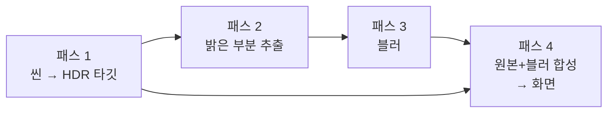
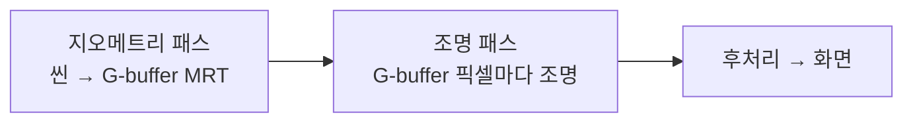
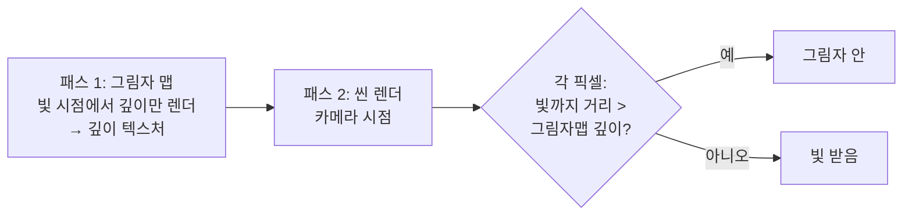
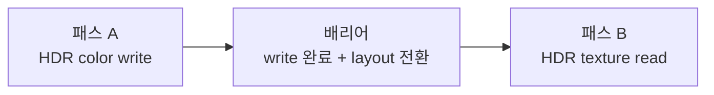
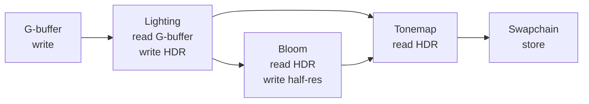
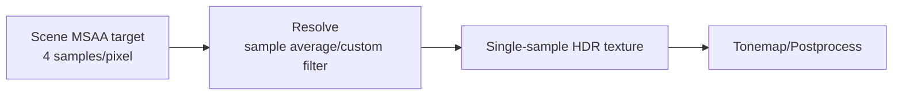

## 들어가며

렌더링 출력은 반드시 화면으로 곧장 갈 필요가 없다. 그림자, 블룸, 피사계 심도, 반사, 디퍼드 라이팅 같은 효과는 중간 결과를 텍스처에 기록하고 다른 패스가 다시 읽는 구조를 사용한다. 한 프레임을 만들기 위해 서로 의존하는 렌더 패스를 여러 번 실행하는 것이 *멀티패스 렌더링(multi-pass rendering)* 이다.

이것을 가능케 하는 도구가 *프레임버퍼(framebuffer)* 다. 프레임버퍼는 색·깊이·스텐실 출력이 기록될 attachment 집합과 그 상태를 묶는다. 색을 텍스처에 렌더링하고(render-to-texture), 그 텍스처를 소비 패스에서 샘플링하면 렌더링 결과를 데이터로 다시 사용할 수 있다. 이 생산자-소비자 관계가 후처리, 디퍼드 셰이딩, 그림자 매핑의 공통 골격이다.

이 글은 프레임버퍼와 멀티패스를 API에 독립적으로 다룬다. 오프스크린 렌더 타깃의 구성(색·깊이·스텐실 어태치먼트), 멀티패스의 발상, 풀스크린 후처리, 다중 렌더 타깃(MRT)과 G-buffer, 포워드 대 디퍼드 셰이딩의 트레이드오프, 그리고 멀티패스의 대표 사례인 그림자 매핑을 정리한다. 여기에 패스 사이의 리소스 의존성, 배리어, load/store, MSAA resolve까지 더하면 멀티패스는 단순한 효과 목록이 아니라 한 프레임의 데이터 흐름을 설계하는 문제가 된다.


---

## 목차
1. [화면 너머: 오프스크린 렌더 타깃](#1-화면-너머-오프스크린-렌더-타깃)
2. [프레임버퍼의 구성](#2-프레임버퍼의-구성)
3. [멀티패스 렌더링의 발상](#3-멀티패스-렌더링의-발상)
4. [풀스크린 후처리](#4-풀스크린-후처리)
5. [다중 렌더 타깃과 G-buffer](#5-다중-렌더-타깃과-g-buffer)
6. [포워드 vs 디퍼드 셰이딩](#6-포워드-vs-디퍼드-셰이딩)
7. [멀티패스의 사례: 그림자 매핑](#7-멀티패스의-사례-그림자-매핑)
8. [리소스 의존성과 배리어](#8-리소스-의존성과-배리어)
9. [대역폭, load/store, transient attachment](#9-대역폭-loadstore-transient-attachment)
10. [MSAA resolve와 ping-pong](#10-msaa-resolve와-ping-pong)


---

## 1. 화면 너머: 오프스크린 렌더 타깃

기본 파이프라인의 최종 출력은 *기본 프레임버퍼(default framebuffer)* — 윈도우 시스템이 제공하는, 화면에 표시되는 버퍼다. 그런데 GPU는 *임의의 텍스처* 를 출력 대상으로 삼을 수 있다. 화면 대신 텍스처에 그리는 것을 *오프스크린 렌더링(off-screen rendering)* 또는 *render-to-texture* 라 한다.


이 한 단계의 우회 — 화면이 아니라 텍스처로 — 가 엄청난 표현력을 연다. 텍스처에 그린 결과를 *다시 샘플링* 할 수 있으므로:

- 렌더된 이미지 전체에 효과를 입힐 수 있다(후처리: 블룸·톤매핑·색보정).
- 빛의 시점에서 그린 깊이를 그림자 판정에 쓸 수 있다(그림자 매핑).
- 거울·수면에 비친 장면을 텍스처로 렌더해 반사로 쓸 수 있다.
- 표면 속성(색·법선·깊이)을 여러 텍스처에 미리 저장했다가 나중에 조명한다(디퍼드).

공통점은 *렌더링 결과를 즉시 화면에 버리지 않고, 데이터로 보관해 되먹인다* 는 것이다. API마다 이름은 다르지만 추상은 동일하다.

| 추상 개념 | OpenGL | DirectX | Vulkan |
|---|---|---|---|
| 렌더 대상 묶음 | FBO | RTV/DSV 바인딩 | `VkFramebuffer` |
| 색 출력 대상 | color attachment | render target view | color attachment |
| 깊이·스텐실 출력 대상 | depth/stencil attachment | depth stencil view | depth/stencil attachment |
| 패스 의존성 | 대체로 암묵적 상태 전환 | 리소스 배리어 | render pass/subpass dependency |

이름은 달라도 핵심 질문은 같다. *이번 패스가 어느 이미지를 쓰고, 다음 패스가 어느 이미지로 읽는가?*


## 2. 프레임버퍼의 구성

프레임버퍼는 단일 이미지가 아니라 여러 *어태치먼트(attachment)* 의 묶음이다. 파이프라인의 출력 병합 단계가 쓰는 버퍼들이 여기 모인다.

| 어태치먼트 | 담는 것 | 쓰는 단계 |
|---|---|---|
| 색(Color) | 픽셀 색(RGBA). 여러 개 가능(MRT, 5절) | 블렌딩 |
| 깊이(Depth) | 픽셀 깊이 | 깊이 테스트 |
| 스텐실(Stencil) | 픽셀 마스크 | 스텐실 테스트 |

색 어태치먼트는 *텍스처* 로 만들어 나중에 샘플링하거나, *렌더버퍼(renderbuffer)* — 샘플링 안 할 거면 더 가벼운 쓰기 전용 저장소 — 로 만든다. 깊이 버퍼도 텍스처로 만들면 *깊이를 샘플링* 할 수 있어, 그림자 매핑(7절)이나 SSAO·소프트 파티클 같은 깊이 기반 효과의 입력이 된다.

어태치먼트의 *포맷* 선택이 중요하다. 색 버퍼를 8비트 정수 포맷으로 두면 1을 넘는 HDR 빛을 담지 못해 톤매핑 전에 잘려 버린다. 그래서 후처리를 쓰는 파이프라인은 중간 색 타깃을 *부동소수점 HDR 포맷*(예: RGBA16F)으로 두고, 최종 화면 출력 직전에만 톤매핑+sRGB 인코딩으로 8비트에 담는다. 깊이 포맷은 보통 24비트 이상을 쓰며, reverse-Z와 넓은 깊이 범위가 필요하면 32비트 float이 유리하다.

> 해상도 주의: 한 프레임버퍼의 모든 어태치먼트는 보통 *같은 해상도* 여야 한다. 색과 깊이가 짝이 맞아야 깊이 테스트가 픽셀 단위로 정렬되기 때문이다.


## 3. 멀티패스 렌더링의 발상

*패스(pass)* 는 "특정 출력 대상에 파이프라인을 한 번 가동하는 것"이다. 단순한 장면은 1패스 — 씬을 화면에 한 번 그리면 끝 — 면 충분하다. 하지만 많은 효과는 *한 패스의 출력이 다음 패스의 입력* 이 되어야 풀린다.



위는 *블룸(bloom)* 의 전형적 4패스 구조다. 각 패스가 이전 패스의 텍스처를 읽어 변형한다. 멀티패스가 강력한 이유는 *문제를 분해* 하기 때문이다 — "빛나는 효과"를 한 셰이더로 짜는 대신, 추출→블러→합성의 단순한 단계로 나눠 각각을 독립적으로 만든다.

비용도 분명하다. 패스마다 *전체 픽셀을 다시 처리* 하므로, 대역폭(텍스처 읽고 쓰기)이 패스 수에 비례해 늘어난다. 그래서 멀티패스 설계의 핵심은 *어느 패스를 낮은 해상도로 돌릴 수 있는가*(블러는 반해상도로 충분)와 *패스를 어떻게 합치는가* 다. 또한 패스 사이에는 *동기화* 가 필요하다. 패스 1이 텍스처 쓰기를 끝내야 패스 2가 읽을 수 있다. OpenGL은 이를 대체로 암묵 처리하지만, Vulkan·DX12는 배리어와 렌더 패스 의존성으로 명시해야 한다. 이 차이가 현대 API의 명시성이다.


## 4. 풀스크린 후처리

*후처리(post-processing)* 는 렌더된 이미지 *전체* 에 화면 공간 효과를 입히는 패스다. 씬을 텍스처에 렌더한 뒤, *화면을 꽉 채우는 사각형(풀스크린 쿼드)* 을 그리며 프래그먼트 셰이더로 픽셀마다 그 텍스처를 변형한다.

```glsl
// 후처리 프래그먼트 셰이더 — 렌더된 씬 텍스처를 입력으로
vec3 color = texture(uSceneHDR, uv).rgb;
color = ApplyBloom(color, uv);
color = Tonemap(color * uExposure);     // HDR 선형 값을 디스플레이 범위로 압축
fragColor = vec4(color, 1.0);           // sRGB 프레임버퍼가 인코딩
```

흔한 후처리 효과:

| 효과 | 하는 일 |
|---|---|
| 톤 매핑·노출 | HDR을 디스플레이 범위로 |
| 블룸 | 밝은 부분이 번지는 광채 |
| 피사계 심도(DOF) | 초점 밖을 깊이 기반으로 흐림 |
| 모션 블러 | 속도 벡터 기반 흐림 |
| 색 보정(LUT) | 영화적 색감 |
| FXAA·SMAA·TAA | 후처리 안티앨리어싱 |

후처리는 *기하와 무관* 하다는 점이 특징이다. 입력은 이미 렌더된 2D 이미지(+깊이·속도 버퍼)뿐이고, 셰이더는 픽셀당 한 번 그 텍스처들을 읽어 변형한다. 화면 공간에서 도는 이미지 처리에 가깝다. 깊이 버퍼를 입력으로 받으면(2절의 깊이 텍스처) DOF·SSAO·안개처럼 *3D 정보가 필요한* 화면 공간 효과도 가능해진다 — 이것이 깊이를 텍스처로 보관하는 실익이다.

이 풀스크린 패스를 위해 후처리·톤매핑은 색 파이프라인에서 *인코딩 직전* 위치를 차지한다. 씬은 HDR 선형으로 렌더 → 후처리(블룸 등)도 선형에서 → 톤매핑 → sRGB 인코딩 → 화면. 순서를 지켜야 색이 맞는다.


## 5. 다중 렌더 타깃과 G-buffer

한 패스가 *여러 색 어태치먼트에 동시에* 쓰는 것을 *다중 렌더 타깃(Multiple Render Targets, MRT)* 이라 한다. 프래그먼트 셰이더가 색 하나가 아니라 여러 출력을 내보낸다.

```glsl
layout(location=0) out vec4 gAlbedo;    // 색
layout(location=1) out vec4 gNormal;    // 법선
layout(location=2) out vec4 gMaterial;  // 거칠기·메탈릭
// 한 번의 래스터화로 세 텍스처를 동시에 채운다
```

MRT의 대표 용도가 *G-buffer(geometry buffer)* 다. 씬의 *표면 속성* — 색(알베도), 법선, 거칠기·메탈릭, 깊이 — 을 한 번의 지오메트리 패스로 여러 텍스처에 저장한다. 조명은 아직 안 한다. 화면의 각 픽셀에 대해 "여기 어떤 표면이 있는가"의 정보를 *화면 공간에 펼쳐* 두는 것이다. 이 G-buffer가 디퍼드 셰이딩의 토대다.

| G-buffer 어태치먼트 | 담는 표면 속성 |
|---|---|
| 알베도 | 베이스 컬러 |
| 법선 | 픽셀당 표면 법선(월드/뷰 공간) |
| 머티리얼 | 거칠기·메탈릭·AO |
| 깊이 | 위치 복원에 사용 |

MRT가 가능한 이유는 래스터화가 한 번 돌면서 모든 어태치먼트의 같은 픽셀을 동시에 채울 수 있기 때문이다 — 지오메트리를 한 번만 처리하고 여러 데이터를 뽑아낸다.

### 숫자로 따라가기

G-buffer가 *대역폭을 먹는다* 는 말을 수치로 보자. 1920×1080(약 207만 픽셀)에서 알베도·법선·머티리얼을 각 RGBA8(4B), 깊이를 32비트(4B)로 두면 픽셀당 *16바이트*, 한 화면 분량은 약 33MB다. 각 attachment를 한 번 쓰고 한 번 읽는 이상화된 하한은 프레임당 약 66MB, 60fps에서 약 4GB/s다. 실제 트래픽은 오버드로·MSAA·load/store·추가 타깃 때문에 늘거나, 타일 메모리·압축·캐시 적중으로 외부 메모리 왕복이 줄 수 있다. 포워드 셰이딩은 이 G-buffer 왕복을 피하는 대신 가시 프래그먼트에서 필요한 조명·재질 데이터를 즉시 소비한다.


## 6. 포워드 vs 디퍼드 셰이딩

조명을 *언제* 계산하느냐로 렌더링 구조가 크게 둘로 갈린다. 이 선택이 멀티패스 설계의 가장 큰 분기점이다.

**포워드 셰이딩(Forward)**: 전통적 방식. 각 물체를 그릴 때 *그 자리에서 바로* 모든 광원에 대해 조명을 계산한다. 지오메트리 패스와 조명이 한 몸이다.

- 장점: 단순하고, 투명·MSAA와 자연스럽게 호환되며, 머티리얼이 자유롭다.
- 단점: 광원 컬링 없이 모든 프래그먼트가 모든 광원을 순회하면 비용이 대략 *셰이딩된 프래그먼트 수 × 광원 수* 로 증가한다. 가려질 프래그먼트에서 이미 조명을 계산했다면 오버드로도 그대로 낭비된다.

**디퍼드 셰이딩(Deferred)**: 조명을 *미룬다(defer)*. 먼저 지오메트리 패스로 G-buffer(5절)에 표면 속성만 저장하고, 그다음 *별도의 조명 패스* 에서 화면의 각 픽셀에 대해 G-buffer를 읽어 조명을 계산한다.



- 장점: 표준 단일층 G-buffer에서는 지오메트리 패스의 오버드로와 비싼 조명 평가를 분리하고, 저장된 표면 표본에 대해서만 조명을 계산한다. 타일·클러스터 광원 컬링과 결합하면 많은 국소 광원을 효율적으로 다룰 수 있다.
- 단점: G-buffer가 *대역폭·메모리* 를 많이 먹고, 표준 단일층 표현은 한 픽셀·샘플에 여러 투명 표면을 보존하지 못한다. 투명은 별도 forward/OIT 경로가 흔하며, 다층 G-buffer 같은 대안은 메모리와 복잡도가 커진다. MSAA는 표면 불연속에서 sample별 속성·조명을 다뤄야 해 까다롭고, 머티리얼 표현도 G-buffer 포맷에 제약된다.

실무에서는 둘을 섞는다 — 불투명은 디퍼드로 효율을 얻고, *투명은 별도 포워드 패스* 로 그려 합성한다. 본 "불투명 패스 + 반투명 패스" 분리가 여기서 디퍼드/포워드 분리와 맞물린다. *포워드+(Forward+, 타일 기반)* 같은 절충안은 화면을 타일로 나눠 타일마다 영향을 주는 광원만 추려, 포워드의 유연성과 디퍼드의 다중 광원 효율을 모두 노린다.


## 7. 멀티패스의 사례: 그림자 매핑

멀티패스의 가장 교과서적인 예가 *그림자 매핑(shadow mapping)* 이다. 래스터화 파이프라인은 기본적으로 광선을 추적하지 않으므로, 그림자가 자동으로 생기지 않는다. 그림자는 별도 가시성 기법으로 만들어야 한다. 그림자 매핑의 발상은 단순하고 우아하다.

> 어떤 점이 그림자 안에 있다 ⟺ 그 점이 *광원에서 보이지 않는다*(광원과 그 점 사이에 다른 표면이 있다).

이를 두 패스로 푼다.



1. **그림자 맵 패스**: *광원의 시점* 에서 씬을 렌더하되, 색은 버리고 *깊이만* 텍스처에 저장한다(2절의 깊이 텍스처). 이 깊이 맵은 "광원에서 각 방향으로 가장 가까운 표면까지의 거리"다.
2. **씬 패스**: *카메라 시점* 에서 씬을 그리며, 각 픽셀의 월드 위치를 *광원 시점 좌표로 변환*(변환을 광원 기준으로 재사용)한다. 그 위치의 *광원까지 거리* 와 *그림자 맵에 저장된 깊이* 를 비교 — 더 멀면 사이에 무언가 있다는 뜻이니 *그림자 안*, 같으면 *빛을 받는다*.

깊이 비교가 곧 가시성 판정이라는 점에서, 그림자 매핑은 깊이 버퍼 아이디어를 *광원 시점으로* 재활용한 것이다. 다만 *이산 깊이 텍스처* 를 비교하므로 샘플링 문제가 그대로 따라온다. 그림자 경계의 *계단(샘플링 해상도 한계)*, 자기 그림자가 얼룩지는 *섀도 애크니(shadow acne, 깊이 정밀도)*, 이를 줄이는 *바이어스* 와 *PCF(여러 탭 평균으로 부드러운 경계)* 가 실전의 핵심이다. 큐브맵 6면으로 점광원 전방향 그림자를, 여러 해상도 맵으로 넓은 범위를 덮는 *캐스케이드 섀도 맵(CSM)* 등 확장이 많지만, 골격은 언제나 *빛 시점 깊이 패스 + 카메라 시점 비교* 의 2패스다.


## 8. 리소스 의존성과 배리어

멀티패스 렌더링의 본질은 이미지 리소스의 상태 전환이다. 같은 텍스처가 어떤 패스에서는 색 어태치먼트로 *쓰기 대상* 이고, 다음 패스에서는 셰이더가 읽는 *샘플 텍스처* 가 된다. 이 두 역할은 동시에 성립할 수 없다. GPU가 쓰는 중인 이미지를 셰이더가 읽으면, 읽은 값이 이전 프레임인지 현재 패스의 일부 결과인지 정의되지 않는다.

따라서 패스 사이에는 의존성이 생긴다.



이 의존성은 두 가지를 보장해야 한다.

| 보장 | 의미 |
|---|---|
| 실행 순서 | 읽는 작업이 필요한 쓰기보다 먼저 실행되지 않는다 |
| 메모리 가시성 | 앞 패스가 쓴 픽셀 값이 뒤 패스에서 보인다 |

OpenGL 같은 전통 API는 바인딩 상태를 바꾸면 드라이버가 대부분의 전환을 추론한다. 개발자는 편하지만 드라이버가 보수적으로 동기화할 수 있어 비용을 예측하기 어렵다. Vulkan·DX12 같은 명시적 API는 이미지를 `COLOR_ATTACHMENT`에서 `SHADER_READ_ONLY` 같은 상태로 직접 전환하고, 어떤 파이프라인 단계의 쓰기가 어떤 단계의 읽기보다 앞서야 하는지 지정한다. 불편하지만 렌더러가 의존성 그래프를 정확히 알고 있을 때 불필요한 동기화를 줄일 수 있다.

가장 위험한 패턴은 일반 color attachment에 쓰는 이미지를 같은 draw의 일반 texture sampling으로 다시 읽는 피드백 루프다.

```text
잘못된 패턴:
  SceneColor를 렌더 타깃으로 바인딩한다
  같은 SceneColor를 셰이더에서 샘플링한다
  SceneColor에 다시 쓴다
```

기본 래스터화 계약에서는 fragment 간 실행 순서와 attachment write의 즉시 가시성이 없으므로 이런 피드백 결과는 정의되지 않거나 API의 명시적 feedback-loop 기능·barrier를 요구한다. storage image의 coherent 접근, raster-order 기능처럼 제한된 예외도 있지만 별도 동기화 계약이다. 블러처럼 전체 이전 이미지를 읽어 새 이미지를 쓰려면 입력과 출력을 분리한 ping-pong 구조가 가장 이식성 높다.


## 9. 대역폭, load/store, transient attachment

프레임버퍼 비용은 셰이더 연산보다 메모리 대역폭에서 터지는 경우가 많다. 4K 해상도는 약 830만 픽셀이다. RGBA16F 색 타깃 하나는 픽셀당 8B이므로 한 번 전체 화면에 쓰기만 해도 약 66MB다. 이것을 읽고 다시 쓰는 후처리 패스 하나는 대략 132MB의 색 트래픽을 만든다. 여기에 깊이, G-buffer, 모션 벡터, 블룸 체인이 붙으면 프레임 하나가 수백 MB의 내부 대역폭을 소비한다.

그래서 렌더 패스는 단순히 "어디에 그리는가"가 아니라 *이 어태치먼트의 기존 내용을 유지해야 하는가* 를 함께 표현해야 한다.

| 정책 | 의미 | 쓰는 경우 |
|---|---|---|
| Load | 이전 내용을 메모리에서 읽어 온다 | 누적, 부분 갱신 |
| Clear | 시작 값을 상수로 채운다 | 새 프레임 색/깊이 초기화 |
| DontCare | 이전 내용이 필요 없다 | 중간 임시 타깃 |
| Store | 패스 결과를 메모리에 저장한다 | 다음 패스나 화면 출력에 필요 |
| DontCare store | 결과를 저장하지 않는다 | 깊이 전용 임시, 타일 내부만 사용 |

타일 기반 GPU에서는 이 차이가 특히 크다. 화면을 작은 타일로 나눠 온칩 메모리에서 렌더링한 뒤, 필요할 때만 외부 메모리에 저장한다. 중간 깊이 버퍼나 임시 MSAA 색 버퍼처럼 다음 패스에서 읽지 않는 어태치먼트는 외부 메모리에 저장하지 않아도 된다. 이를 *transient attachment* 로 취급하면 대역폭과 전력 사용이 줄어든다.

데스크톱 GPU에서도 같은 사고가 유효하다. 렌더 그래프는 각 패스가 어떤 리소스를 읽고 쓰는지 모아 전체 프레임의 의존성 그래프를 만든다. 그러면 두 임시 텍스처의 수명이 겹치지 않을 때 같은 메모리를 재사용하고, 필요 없는 store를 제거하며, 가능한 패스들을 합쳐 대역폭을 줄일 수 있다.



이 그래프에서 G-buffer는 조명 패스 이후 필요 없고, 블룸 임시 타깃은 톤매핑 이후 필요 없다. 렌더 그래프의 메모리 최적화는 이런 수명 정보를 이용한다. 따라서 멀티패스를 설계할 때는 "패스 순서"만이 아니라 *각 리소스의 첫 사용, 마지막 사용, 읽기/쓰기 상태* 를 함께 기록해야 한다.


## 10. MSAA resolve와 ping-pong

MSAA 렌더 타깃은 픽셀 하나에 여러 샘플을 가진다. 깊이·커버리지·색이 샘플 단위로 저장되므로, 일반 텍스처처럼 바로 후처리 셰이더에서 읽기 어렵다. 화면이나 후처리 입력으로 쓰려면 여러 샘플을 하나의 픽셀 색으로 합치는 *resolve* 단계가 필요하다.



resolve는 단순 평균처럼 보이지만 파이프라인 위치가 중요하다. HDR 색은 resolve 후 톤매핑하는 것이 보통 자연스럽다. 샘플마다 톤매핑한 뒤 평균하면 비선형 연산 때문에 결과가 달라진다. 깊이는 평균하면 의미가 없어, 보통 가장 가까운 샘플 또는 별도 규칙으로 다룬다. 디퍼드 셰이딩에서 MSAA가 까다로운 이유가 여기에 있다. G-buffer의 법선·거칠기·깊이를 샘플별로 유지하면 메모리와 대역폭이 폭증하고, 픽셀 하나로 resolve하면 엣지의 서로 다른 표면 정보가 섞인다.

블러와 반복 후처리에는 ping-pong 구조가 필요하다. 같은 텍스처를 동시에 읽고 쓸 수 없으므로 두 텍스처를 번갈아 쓴다.

```text
BlurX: A를 읽어 B에 쓴다
BlurY: B를 읽어 A에 쓴다
BlurX: A를 읽어 B에 쓴다
BlurY: B를 읽어 A에 쓴다
```

이 패턴은 블룸, 가우시안 블러, 히스토리 누적, 임시 업스케일 체인에서 반복된다. 중요한 것은 텍스처 개수가 많을수록 좋은 것이 아니라, 의존성 때문에 동시에 살아 있어야 하는 리소스만 남기는 것이다. 렌더 그래프가 있으면 A와 B의 수명을 추적해 다른 임시 패스와 메모리를 공유할 수 있다.


---

## 결론

프레임버퍼의 핵심은 *출력 대상이 화면일 필요가 없다* 는 것이다. 텍스처에 렌더하고 그 결과를 다음 패스의 입력으로 되먹이는 *멀티패스 렌더링* 이 현대의 거의 모든 고급 효과를 떠받친다. 프레임버퍼는 색·깊이·스텐실 어태치먼트의 묶음이고, HDR 후처리를 위해 중간 타깃은 부동소수점 포맷으로 두었다가 최종 출력에서만 톤매핑+인코딩한다.

*풀스크린 후처리* 는 렌더된 이미지에 화면 공간 효과(톤매핑·블룸·DOF·AA)를 입히고, *MRT* 는 한 패스로 여러 텍스처(G-buffer)를 채운다. 조명을 언제 하느냐가 *포워드*(그 자리에서, 단순하지만 광원 수에 취약)와 *디퍼드*(G-buffer에 미뤘다 화면 공간에서, 다중 광원에 강하지만 투명·MSAA에 약함)를 가르며, 실무는 둘을 섞는다. *그림자 매핑* 은 멀티패스의 전형으로, 빛 시점 깊이 패스와 카메라 시점 비교의 2패스 구조다.

단일 드로우가 픽셀을 만드는 단위라면, 프레임버퍼와 멀티패스는 여러 드로우와 중간 결과를 엮어 *한 프레임을 구성하는 단위* 다. 이때 핵심은 출력 결과를 다음 입력으로 재사용하는 것뿐 아니라, 각 이미지가 언제 쓰이고 언제 읽히며 언제 버려지는지 명시하는 것이다. 배리어, load/store, transient attachment, MSAA resolve, ping-pong은 모두 이 리소스 수명 관리의 다른 표현이다. API마다 FBO, 렌더 패스, 렌더 타깃처럼 이름은 달라도 한 프레임의 데이터 흐름을 정확히 표현해야 한다는 원리는 같다.


## 더 읽을거리

- Lance Williams, "Casting Curved Shadows on Curved Surfaces" (SIGGRAPH 1978) — 섀도 매핑의 원전.
- Michael Deering 외 (SIGGRAPH 1988)·Saito & Takahashi (1990) 의 G-buffer 계보와 함께, Shawn Hargreaves, "Deferred Shading" (GDC 2004) — 디퍼드 렌더링 보급의 기점.
- [LearnOpenGL: Framebuffers](https://learnopengl.com/Advanced-OpenGL/Framebuffers), [Deferred Shading](https://learnopengl.com/Advanced-Lighting/Deferred-Shading) — 구현 예제.
- Wolfgang Engel ed., 각 권의 *GPU Pro / GPU Zen* 시리즈 — 멀티패스 기법의 실무 모음.
