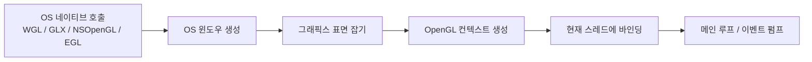
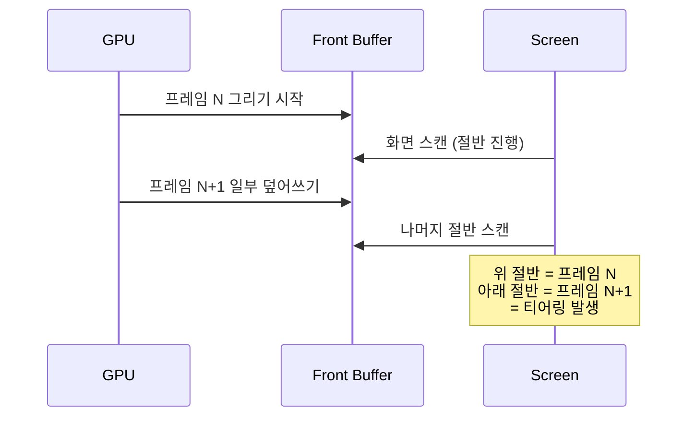
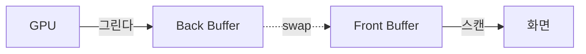
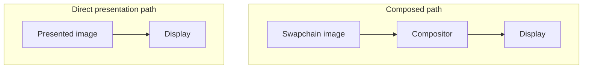
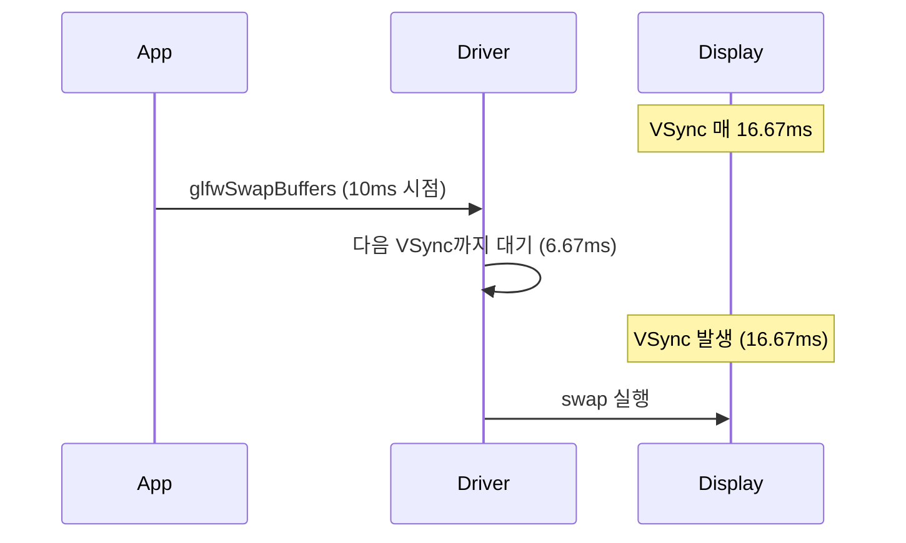

## 들어가며

OpenGL은 그 자체로 윈도우를 만들지 못한다. OpenGL은 GPU 드라이버가 제공하는 거대한 상태 머신(State Machine)에 대한 표준화된 호출 인터페이스다. 윈도우를 띄우고, OS의 그래픽스 표면을 잡고, 그 위에 OpenGL 상태 머신을 묶는 작업은 *컨텍스트 생성(Context Creation)* 이라 부르고, OS마다 달라서 OpenGL 표준이 아니라 플랫폼별 API의 영역이다.

윈도우 시스템과 OpenGL의 분리는 1992년 SGI가 OpenGL을 표준화하면서부터 의도된 것이다. X11은 GLX, Win32는 WGL, macOS는 NSOpenGL, 모바일 네이티브 환경에서는 EGL을 흔히 사용한다. 웹 애플리케이션은 브라우저의 WebGL 컨텍스트 API를 사용하며, 브라우저 내부의 EGL 사용 여부와는 구분해야 한다. 이 차이를 매번 직접 다루기는 어려우므로 GLFW나 SDL 같은 외부 라이브러리가 추상화 계층을 제공한다.

이 글의 목표는 다음 다섯 가지다.

1. GLFW로 OS 독립적인 윈도우와 OpenGL 3.3 Core Profile 컨텍스트를 만든다.
2. 픽셀 포맷(색상/깊이/스텐실/더블 버퍼)을 명시적으로 지정한다.
3. `glfwSwapBuffers`로 더블 버퍼링을 동작시키고, V-Sync 옵션을 제어한다.
4. `GL_KHR_debug`를 활용해 OpenGL 호출 오류를 콜백으로 받아 콘솔에 출력한다.
5. GLAD로 OpenGL 함수 포인터를 동적 로딩하고, 함수 포인터 모델을 이해한다.

이 글의 범위는 검은 화면을 띄우고 매 프레임 디버그 메시지를 받을 수 있는 OpenGL 실행 기반까지다. 정점 데이터와 드로우콜은 포함하지 않으며, 컨텍스트·픽셀 포맷·함수 로딩·프레젠테이션·진단 경계만 완결한다.


---

## 목차
1. [GLFW와 SDL: 컨텍스트 생성 라이브러리 비교](#1-glfw와-sdl-컨텍스트-생성-라이브러리-비교)
2. [Core Profile과 Compatibility Profile](#2-core-profile과-compatibility-profile)
3. [컨텍스트 힌트와 픽셀 포맷](#3-컨텍스트-힌트와-픽셀-포맷)
4. [더블 버퍼링과 SwapBuffers의 메커니즘](#4-더블-버퍼링과-swapbuffers의-메커니즘)
5. [V-Sync, Adaptive VSync, Enhanced Sync](#5-v-sync-adaptive-vsync-enhanced-sync)
6. [KHR_debug 콜백 등록과 메시지 해석](#6-khr_debug-콜백-등록과-메시지-해석)
7. [Extension 로딩과 GLAD vs GLEW](#7-extension-로딩과-glad-vs-glew)
8. [통합 예제: 컨텍스트 + 디버그 + 메인 루프](#8-통합-예제-컨텍스트--디버그--메인-루프)


---

## 1. GLFW와 SDL: 컨텍스트 생성 라이브러리 비교

OpenGL 컨텍스트를 만들려면 다음 셋을 모두 처리해야 한다.



플랫폼별 API를 직접 다루면 이 단계마다 윈도우 핸들 타입(`HWND`, `Window`, `NSWindow`), 컨텍스트 핸들 타입(`HGLRC`, `GLXContext`, `NSOpenGLContext`)을 구분해야 한다. 이 추상화는 GLFW와 SDL이 가장 널리 쓰인다.

### GLFW: 그래픽스 전용

GLFW(Graphics Library Framework)는 OpenGL·OpenGL ES 컨텍스트, Vulkan 윈도우 표면, 윈도우와 입력을 다룬다. 오디오·네트워크·이미지 로딩 같은 게임 부수 기능은 빠져 있다.

핵심 특성은 다음과 같다.

- C 인터페이스, zlib/libpng 라이선스
- 윈도우 핸들은 `GLFWwindow*` 단일 추상 타입
- 이벤트는 명시적 폴링(`glfwPollEvents`)
- 입력 콜백 등록 모델 (`glfwSetKeyCallback` 등)
- 윈도우·입력·컨텍스트 관리에 범위를 둔 라이브러리

### SDL: 게임 풀 스택

SDL(Simple DirectMedia Layer)은 윈도우·컨텍스트·오디오·입력·파일 시스템·스레딩 등을 제공한다. 네트워크는 SDL 코어가 아니라 SDL_net 같은 별도 라이브러리의 영역이다. 아래 코드는 SDL2 기준이며 SDL3의 함수 시그니처와 섞지 않는다.

- C 인터페이스, zlib 라이선스
- 윈도우는 `SDL_Window*`, OpenGL 컨텍스트는 `SDL_GLContext`
- 이벤트는 큐 기반(`SDL_PollEvent`)
- 입력은 이벤트 큐와 상태 폴링을 중심으로 처리
- 모바일을 포함한 여러 플랫폼의 멀티미디어 기능 제공

### 핵심 차이

| 항목 | GLFW | SDL |
|---|---|---|
| 라이선스 | zlib/libpng | zlib |
| 기능 범위 | 윈도우·입력·컨텍스트 | 오디오 등 멀티미디어 기능 포함 |
| 오디오 | 없음 | 내장 |
| 입력 모델 | 콜백 중심 | 큐 + 폴링 |
| 이벤트 펌프 | `glfwPollEvents` 또는 `glfwWaitEvents` | `SDL_PollEvent`/`SDL_WaitEvent` 등이 펌프 수행 |
| 컨텍스트 핸들 | `GLFWwindow*` 내부 | 분리된 `SDL_GLContext` |
| 모바일 지원 | 미지원 | 전면 지원 |
| 멀티 윈도우 | 지원 | 지원 |
| Vulkan 지원 | `glfwCreateWindowSurface` | `SDL_Vulkan_*` |

그래픽스 학습용 예제는 창 생성과 OpenGL 컨텍스트 관리에 초점을 두고, 입력·오디오·네트워크 같은 게임 시스템은 별도 모듈로 둔다는 가정을 따른다. 따라서 더 가벼운 GLFW를 사용한다. SDL의 풀 스택 기능이 필요하면 같은 컨텍스트 생성 흐름이 SDL에서도 그대로 적용된다.

### GLFW의 최소 컨텍스트 생성

GLFW로 OpenGL 3.3 Core 컨텍스트를 만드는 최소 코드는 다음과 같다.

```cpp
#include <GLFW/glfw3.h>
#include <iostream>

int main() {
    if (!glfwInit()) {
        std::cerr << "glfwInit failed\n";
        return 1;
    }

    glfwWindowHint(GLFW_CONTEXT_VERSION_MAJOR, 3);
    glfwWindowHint(GLFW_CONTEXT_VERSION_MINOR, 3);
    glfwWindowHint(GLFW_OPENGL_PROFILE, GLFW_OPENGL_CORE_PROFILE);
    glfwWindowHint(GLFW_OPENGL_FORWARD_COMPAT, GLFW_TRUE); // macOS의 Core 요구

    GLFWwindow* window = glfwCreateWindow(800, 600, "GL", nullptr, nullptr);
    if (!window) {
        glfwTerminate();
        return 1;
    }

    glfwMakeContextCurrent(window);

    while (!glfwWindowShouldClose(window)) {
        glfwSwapBuffers(window);
        glfwPollEvents();
    }

    glfwDestroyWindow(window);
    glfwTerminate();
    return 0;
}
```

이 코드는 컨텍스트 생성의 최소 경로일 뿐이다. 실제 초기화는 요청한 색·깊이·스텐실·MSAA 픽셀 포맷이 선택됐는지 조회하고, 함수 포인터 로더 성공 여부, debug callback, swap interval과 종료 순서를 검증해야 한다.

### SDL의 최소 컨텍스트 생성

비교를 위해 SDL2의 동일한 작업을 보인다.

```cpp
#include <SDL.h>
#include <iostream>

int main(int argc, char** argv) {
    if (SDL_Init(SDL_INIT_VIDEO) < 0) {
        std::cerr << "SDL_Init failed: " << SDL_GetError() << "\n";
        return 1;
    }

    SDL_GL_SetAttribute(SDL_GL_CONTEXT_MAJOR_VERSION, 3);
    SDL_GL_SetAttribute(SDL_GL_CONTEXT_MINOR_VERSION, 3);
    SDL_GL_SetAttribute(SDL_GL_CONTEXT_PROFILE_MASK,
                        SDL_GL_CONTEXT_PROFILE_CORE);
    SDL_GL_SetAttribute(SDL_GL_CONTEXT_FLAGS,
                        SDL_GL_CONTEXT_FORWARD_COMPATIBLE_FLAG); // macOS Core

    SDL_Window* window = SDL_CreateWindow(
        "GL", SDL_WINDOWPOS_UNDEFINED, SDL_WINDOWPOS_UNDEFINED,
        800, 600, SDL_WINDOW_OPENGL);
    SDL_GLContext ctx = SDL_GL_CreateContext(window);

    bool running = true;
    while (running) {
        SDL_Event e;
        while (SDL_PollEvent(&e)) {
            if (e.type == SDL_QUIT) running = false;
        }
        SDL_GL_SwapWindow(window);
    }

    SDL_GL_DeleteContext(ctx);
    SDL_DestroyWindow(window);
    SDL_Quit();
    return 0;
}
```

함수 이름과 핸들 타입이 다를 뿐 흐름은 동일하다. 속성 힌트 → 윈도우와 컨텍스트 생성 → 메인 루프 → 정리. 힌트는 생성할 컨텍스트의 속성이므로 윈도우 생성 호출보다 먼저 설정한다.

## 2. Core Profile과 Compatibility Profile

OpenGL 3.0(2008)에서 표준은 *Deprecation Model* 을 도입했다. 고정 함수 파이프라인(Fixed-Function Pipeline)에 속하는 함수들(`glBegin`, `glEnd`, `glLight`, `glMatrixMode` 등)을 *deprecated* 로 표시했고, OpenGL 3.2(2009)에서는 두 프로파일(Profile)로 분기시켰다.

- **Core Profile**: deprecated된 함수들을 *제거* 한다. 셰이더가 강제된다.
- **Compatibility Profile**: 구버전 코드와의 호환을 위해 deprecated 함수를 유지한다.

### 무엇이 사라졌는가

Core에서 제거된 주요 기능은 다음과 같다.

| 기능 | Compatibility | Core | 대체 |
|---|---|---|---|
| `glBegin`/`glEnd` 즉시 모드 | 사용 가능 | 제거 | VBO + DrawArrays |
| 행렬 스택 (`glPushMatrix` 등) | 사용 가능 | 제거 | 셰이더 uniform |
| 고정 라이팅 (`glLight*`) | 사용 가능 | 제거 | 셰이더에서 직접 |
| `glMaterial` | 사용 가능 | 제거 | 셰이더 uniform |
| `glTranslate`/`glRotate`/`glScale` | 사용 가능 | 제거 | 직접 행렬 합성 |
| 디스플레이 리스트 (`glNewList`) | 사용 가능 | 제거 | VBO/UBO 캐시 |
| Selection/Feedback 모드 | 사용 가능 | 제거 | Compute / Transform Feedback |
| GL_QUADS, GL_POLYGON 토폴로지 | 사용 가능 | 제거 | 삼각형으로 분해 |

### 왜 분리했는가

성능과 단순성이다. 1992년 OpenGL 1.0의 즉시 모드는 정점 하나마다 함수 호출과 드라이버의 상태 검증·마샬링을 거쳐야 했다. 현대 GPU는 수십만 정점을 한 번에 처리하기 때문에, 매 정점을 함수 호출로 보내는 모델은 드라이버 오버헤드가 GPU 작업 시간을 압도한다. Core Profile은 이런 패턴 자체를 봉쇄한다.

또한 드라이버 입장에서도 두 모드를 동시에 지원하면 상태 추적 코드가 복잡해진다. Core 전용 드라이버는 단순화된 상태 머신만 다루면 된다.

### 벤더별 지원 정책

macOS는 OpenGL 2.1의 legacy 경로와 3.2 이상 Core 경로를 구분한다. 3.2 이상 컨텍스트는 forward-compatible Core여야 하며, 지원 상한은 4.1이다. Compatibility가 모든 버전에서 지원되지 않는다는 뜻은 아니다. Apple은 macOS 10.14부터 OpenGL을 deprecated로 두었다. Windows·Linux에서는 설치한 드라이버의 버전·프로파일 지원을 확인한다. 벤더 이름만으로 Compatibility의 지원 수준이나 최적화 품질을 순위화할 수는 없다.

### Forward Compatible 컨텍스트

Core Profile에는 또 하나의 옵션이 있다. *Forward Compatible* 컨텍스트는 *현재 버전에서 deprecated된 기능* 까지 추가로 제거한다.

```cpp
glfwWindowHint(GLFW_OPENGL_FORWARD_COMPAT, GL_TRUE);
```

OpenGL 3.3에서 forward compatible을 켜면 Core에도 남아 있는 deprecated 기능인 와이드 라인(line width > 1) 등을 사용할 수 없게 된다. macOS는 forward compatible 컨텍스트를 요구한다. 다른 플랫폼에서도 켜는 편이 미래 호환성에 안전하다.

### 기본 선택

OpenGL 3.3 Core + Forward Compatible을 기본으로 한다. 3.3은 다음 이유로 적합하다.

- 2010년 발표되어 널리 지원되지만 실제 드라이버의 컨텍스트 생성 성공과 버전 확인 필요
- 셰이더 기반 모던 OpenGL의 기초가 모두 들어 있음 (VAO, UBO, Sampler Object)
- macOS 4.1 Core와 호환
- 모바일 OpenGL ES 3.0과 많은 핵심 기능이 겹치지만 컨텍스트·GLSL·기능 지원은 별도 확인

OpenGL 4.x의 추가 기능(Tessellation, Compute Shader, ARB_bindless 등)은 필요한 곳에서 확장 단위로 가져온다.

## 3. 컨텍스트 힌트와 픽셀 포맷

GLFW의 `glfwWindowHint`는 *다음에 만들 윈도우* 의 속성을 미리 설정한다. 한 번 설정한 힌트는 윈도우가 만들어진 뒤에도 그대로 유지되며, `glfwDefaultWindowHints`를 호출해 명시적으로 초기화하거나 직접 다른 값으로 덮어쓰거나 GLFW를 종료할 때까지 누적된다.

### 컨텍스트 버전과 프로파일

```cpp
glfwWindowHint(GLFW_CONTEXT_VERSION_MAJOR, 3);
glfwWindowHint(GLFW_CONTEXT_VERSION_MINOR, 3);
glfwWindowHint(GLFW_OPENGL_PROFILE, GLFW_OPENGL_CORE_PROFILE);
glfwWindowHint(GLFW_OPENGL_FORWARD_COMPAT, GL_TRUE);
```

`MAJOR`, `MINOR`는 *최소* 버전이다. 드라이버는 더 높은 버전의 컨텍스트를 만들 수 있다. 정확히 이 버전이 필요하다면 `glGetIntegerv(GL_MAJOR_VERSION,...)`로 사후 확인한다.

### 디버그 컨텍스트

```cpp
#ifdef _DEBUG
    glfwWindowHint(GLFW_OPENGL_DEBUG_CONTEXT, GL_TRUE);
#endif
```

디버그 컨텍스트는 지원되는 진단 경로에서 더 강한 오류 보고를 요청한다. OpenGL 3.3의 debug bit만으로 `GL_KHR_debug` 지원이 생기는 것은 아니며, 확장·함수 포인터 확인과 출력 활성화·콜백 등록은 별도 단계다. 릴리스에서는 약간의 오버헤드가 있으므로 디버그 빌드에만 켠다.

### 픽셀 포맷 힌트

| 힌트 | 기본값 | 의미 |
|---|---|---|
| `GLFW_RED_BITS` / `GREEN` / `BLUE` | 8 | 색상 채널 비트 수 |
| `GLFW_ALPHA_BITS` | 8 | 알파 비트 수 |
| `GLFW_DEPTH_BITS` | 24 | 깊이 버퍼 비트 수 |
| `GLFW_STENCIL_BITS` | 8 | 스텐실 비트 수 |
| `GLFW_DOUBLEBUFFER` | `GL_TRUE` | 더블 버퍼링 활성화 |
| `GLFW_SAMPLES` | 0 | MSAA 샘플 수 (0 = 비활성) |
| `GLFW_SRGB_CAPABLE` | `GL_FALSE` | 기본 프레임버퍼의 sRGB 인코딩 |

### 깊이 버퍼 비트 수

OpenGL은 깊이 버퍼 비트 수에 따라 가까운 객체와 먼 객체의 분해능(Z-Resolution)이 달라진다. 16비트는 65,536 단계, 24비트는 16,777,216 단계, 32비트 부동소수점은 더 미세한 분포를 가진다.

원근 투영(Perspective Projection)에서 깊이 값은 비선형으로 분포된다. NDC 깊이 $z_{ndc}$는 다음과 같이 변환된다.

$$z_{ndc} = \frac{f + n}{f - n} + \frac{2 f n}{(f - n) \, z_{view}}$$

여기서 $n$은 near plane(양수 거리), $f$는 far plane(양수 거리), $z_{view}$는 카메라 좌표계의 z 값이다. OpenGL의 오른손 좌표계 + 카메라 -Z 방향 컨벤션에서 카메라 *앞쪽 점* 의 $z_{view}$는 음수이고, $-z_{view}$가 카메라 축방향 깊이에 해당한다(유클리드 거리와는 다르다). 식의 분모에 $z_{view}$가 들어가므로 결과는 near 근처에 정밀도가 몰리는 비선형 분포를 가진다. near를 너무 작게 잡으면 멀리 있는 두 표면이 같은 깊이 값으로 양자화되어 *Z-fighting* 이 발생한다.

24비트 깊이는 일반 게임에서 충분하다. 매우 넓은 야외 풍경(wide-range scene)에서는 32비트 부동소수점 + Reverse-Z 기법을 사용한다.

### MSAA 샘플 수

```cpp
glfwWindowHint(GLFW_SAMPLES, 4);
```

다중 표본 안티앨리어싱(Multisample Anti-Aliasing)은 한 픽셀당 여러 샘플을 잡아 가장자리를 부드럽게 만든다. 4×는 한 픽셀당 4개 샘플, 8×는 8개다. 이 힌트는 *기본 프레임버퍼* 의 샘플 수를 결정한다. FBO를 직접 만들면 그쪽 샘플 수는 별도로 지정한다.

기본 프레임버퍼 MSAA는 셰이더 작성 단계에서 큰 영향이 없지만, 후처리(post-processing)를 적용하기 어렵다. 후처리를 쓰려면 FBO를 거쳐야 하므로 기본 프레임버퍼는 1× 로 두고 FBO에서 MSAA를 잡는 패턴이 일반적이다.

### sRGB 프레임버퍼

```cpp
glfwWindowHint(GLFW_SRGB_CAPABLE, GL_TRUE);
```

이 힌트는 기본 프레임버퍼가 sRGB 인코딩을 지원하도록 만든다. `glEnable(GL_FRAMEBUFFER_SRGB)`를 호출하면 셰이더에서 출력한 선형 색상이 자동으로 sRGB 공간으로 변환되어 화면에 표시된다. 조명 계산은 선형 공간에서 수행하고, 최종 디스플레이 출력 경계에서 한 번만 sRGB로 인코딩해야 한다.

### 힌트 적용 순서

힌트는 `glfwCreateWindow` 호출 *이전* 에 설정해야 한다. 한 번 설정한 힌트는 다음 윈도우에도 계속 적용되므로, 다른 속성으로 윈도우를 만들고 싶으면 그 직전에 새 힌트를 다시 설정하거나 `glfwDefaultWindowHints`로 초기화해야 한다.

```cpp
glfwWindowHint(GLFW_CONTEXT_VERSION_MAJOR, 3);
glfwWindowHint(GLFW_CONTEXT_VERSION_MINOR, 3);
// ... 모든 힌트 설정 후
GLFWwindow* w = glfwCreateWindow(800, 600, "GL", nullptr, nullptr);
// 힌트는 그대로 유지되어 이후 다른 윈도우에도 영향을 준다
glfwDefaultWindowHints();  // 다음 윈도우용으로 초기화하고 싶으면 명시 호출
```

여러 윈도우를 만들 때 힌트가 자동으로 사라진다고 착각하면 디버그가 어려워진다. 윈도우 생성 함수 직전에 *필요한 모든 힌트를 다시 명시* 하거나 `glfwDefaultWindowHints` 후 새로 설정하는 패턴이 안전하다.

## 4. 더블 버퍼링과 SwapBuffers의 메커니즘

### 단일 버퍼링의 문제

단일 버퍼링의 개념적 위험은 표시 엔진이 읽는 표면을 렌더러가 동시에 갱신한다는 점이다. 전형적인 래스터 스캔 디스플레이는 한 갱신 주기 동안 화면 위치를 순서대로 읽으므로, 읽기 경계 앞뒤에 서로 다른 프레임 내용이 놓이면 *티어링(Tearing)* 이 보인다. 실제 스캔 방향과 합성 경로는 디스플레이·운영체제에 따라 다르다.



### 더블 버퍼링의 동작

더블 버퍼링은 화면이 보는 *전면 버퍼(Front Buffer)* 와 GPU가 그리는 *후면 버퍼(Back Buffer)* 를 분리한다. GPU는 후면에 자유롭게 그리고, 한 프레임이 완성되면 두 버퍼를 *swap* 한다.



`glfwSwapBuffers(window)`는 완성된 back buffer의 표시를 요청한다. 이름이 swap이어도 물리적 포인터 교환, 복사, compositor 제출 중 어느 경로인지는 윈도 시스템과 present 모델이 정한다. 호출 반환은 표시 완료나 GPU 완료를 뜻하지 않는다.

### Swap 방식: Copy vs Page Flip

표시 모델은 크게 blit/copy, flip 계열, compositor가 여러 표면을 합성하는 경로, 조건을 만족한 표면을 직접 스캔하는 경로로 나눌 수 있다. flip은 표면 소유권이나 큐의 역할을 바꾸는 모델이지 C++ 포인터 두 개를 교환한다는 보장은 아니다. 현대 운영체제는 창 모드에서도 flip 계열과 direct/independent flip을 사용할 수 있으므로 “창 모드=항상 복사, 전체 화면=항상 page flip”은 성립하지 않는다.



표시 경로는 운영체제·창 모드·드라이버·present 모델에 따라 달라진다. 합성 경로는 추가 큐와 복사를 만들 수 있지만, "윈도우 모드는 항상 1~2프레임 느리다"는 규칙은 아니다. 현대 Windows의 flip model과 Independent Flip 조건에서는 테두리 없는 창도 직접 표시와 가까운 경로를 사용할 수 있다. 전체 화면 전용 여부는 추측이 아니라 PresentMon 같은 도구로 present mode와 input-to-photon 분포를 측정해 결정한다.

### 트리플 버퍼링

후면 버퍼를 하나 더 두면 GPU와 표시 엔진이 동시에 보유할 수 있는 완성 프레임 수가 늘어난다. 이는 일부 present 모델에서 GPU 유휴와 정수 배수로 급락하는 현상을 줄일 수 있지만, 큐가 깊어지면 더 오래된 입력으로 만든 프레임이 표시되어 지연이 늘 수 있다. 실제 버퍼 수와 큐 정책은 윈도 시스템과 드라이버가 결정하므로 "트리플 버퍼링이면 항상 30fps 급락을 피한다"로 일반화할 수 없다.

대부분 OS와 드라이버는 세부 구현을 가린다. NVIDIA Fast Sync와 AMD Enhanced Sync는 단순히 "트리플 버퍼링"의 다른 이름이 아니라, 표시 시점에 완성된 프레임 중 하나를 선택해 높은 렌더 속도에서 티어링과 대기를 절충하는 드라이버 정책이다. 게임에서 버퍼 수와 present mode를 정밀 제어하려면 OpenGL의 swap interval만으로는 부족하며 OS별 API와 드라이버 경로를 확인해야 한다.

### Front Buffer 직접 그리기는 사용하지 않는다

GLFW는 `GLFW_DOUBLEBUFFER` 힌트를 `GL_FALSE`로 두면 단일 버퍼 컨텍스트를 만들 수 있다. 이 모드에서는 `glFlush`로 강제 플러시한다. 매우 특수한 디버그 도구나 즉시 출력이 필요한 도구 외에는 쓰지 않는다.

### 메인 루프 패턴

더블 버퍼링이 활성화된 컨텍스트의 일반적인 메인 루프는 다음과 같다.

```cpp
while (!glfwWindowShouldClose(window)) {
    // 입력 처리
    glfwPollEvents();

    // 렌더링: 후면 버퍼에 그린다
    glClear(GL_COLOR_BUFFER_BIT | GL_DEPTH_BUFFER_BIT);
    Render();

    // 후면을 화면에 노출한다
    glfwSwapBuffers(window);
}
```

두 호출의 순서가 프레임 결과의 논리적 정확성을 반드시 바꾸는 것은 아니지만 입력 지연에는 영향을 줄 수 있다. 입력을 시뮬레이션·렌더링 직전에 샘플링하면 해당 프레임에 반영될 가능성이 커진다. 반면 swap이나 프레임 제한에서 긴 대기가 발생한다면 그 대기 뒤에 이벤트를 처리해야 오래된 입력으로 다음 프레임을 시작하지 않는다. 플랫폼의 이벤트 전달 방식과 프레임 페이싱을 함께 측정한다.

## 5. V-Sync, Adaptive VSync, Enhanced Sync

### V-Sync의 본질

고정 주사율 화면은 일정 주기로 스캔을 시작한다. 60Hz는 약 16.67ms, 144Hz는 약 6.94ms, 240Hz는 약 4.17ms 주기다. swap interval 1은 일반적으로 완성 프레임의 표시를 수직 갱신 경계에 맞추도록 요청한다. `glfwSwapBuffers` 호출 자체가 항상 그 자리에서 다음 VBlank까지 블록하는 것은 아니다. 드라이버 큐와 윈도 시스템이 호출을 먼저 반환시키고 이후 프레임에서 생산자를 막을 수도 있다.



V-Sync의 효과는 다음과 같다.

- 티어링 제거 (가장 큰 이유)
- 표시되는 새 프레임 수가 갱신률을 넘지 않음
- 마감을 놓쳤을 때 present 모델에 따라 이전 프레임 반복, 큐 대기, 불균일한 프레임 페이싱이 생길 수 있음
- 생산 속도가 표시·큐 용량을 넘으면 swap 또는 이후 호출에서 CPU에 backpressure가 걸릴 수 있음

### V-Sync 설정

GLFW는 `glfwSwapInterval`로 V-Sync를 제어한다.

```cpp
glfwSwapInterval(0);   // V-Sync 비활성 (티어링 가능)
glfwSwapInterval(1);   // 갱신 경계마다 표시하도록 요청
glfwSwapInterval(2);   // 지원 경로에서 두 갱신 주기 간격을 요청
glfwSwapInterval(-1);  // Adaptive VSync (지원 시)
```

interval은 렌더 루프의 계산 속도를 직접 고정하는 명령이 아니라 present 간격 요청이다. 큐가 허용되면 CPU와 GPU가 더 앞서 작업할 수 있고, 실제 표시율·차단 위치·2 이상의 interval 지원은 플랫폼과 드라이버가 결정한다.

`-1`은 플랫폼이 `EXT_swap_control_tear` 또는 동등한 음수 swap interval을 지원할 때 adaptive 동작을 요청한다. 프레임이 갱신 마감을 맞추면 동기화하고, 이미 마감을 놓친 경우 늦은 swap을 허용해 추가 주기 대기를 피하는 정책이다. 지원 여부와 실제 동작은 윈도 시스템·드라이버에서 조회해야 하며 제조사별 지원을 고정 사실로 가정하지 않는다.

### V-Sync와 입력 지연

V-Sync 자체보다 *입력 샘플링 시각, 렌더 시간, 완성 프레임 큐 깊이, 표시 스캔 위치* 의 합이 입력 지연을 결정한다. 다음은 큐가 하나뿐이고 60Hz 고정 주사율이며 특정 시각에 입력을 샘플링한다고 가정한 예시다.

```text
T=0ms:   사용자 입력 발생
T=10ms:  glfwPollEvents가 입력 수집 (다음 프레임 시작)
T=15ms:  렌더링 완료, glfwSwapBuffers 호출
T=16.67ms: 다음 VSync, swap 실행
T=33.34ms: 그 다음 VSync, 화면이 새 프레임을 모두 스캔 완료
```

이 타임라인에서는 약 33ms가 나오지만 보편적인 최대값은 아니다. 입력이 샘플링 직후 발생하면 한 주기를 더 기다리고, 드라이버가 여러 완성 프레임을 큐잉하면 지연이 더 늘 수 있다. 반대로 late input sampling, 짧은 렌더 큐, VRR, 높은 주사율은 줄인다. V-Sync를 끄면 완성된 부분을 다음 스캔 위치에서 빨리 볼 수 있지만 화면 한 장에 서로 다른 프레임이 섞이는 티어링이 생긴다.

| 모드 | 티어링 | 표시율/페이싱 | 지연을 좌우하는 조건 |
|---|---|---|---|
| V-Sync Off | 가능 | 렌더 속도와 스캔이 독립 | 입력 샘플 시각, 스캔 위치, 렌더 큐 |
| V-Sync On | 억제 | 고정 갱신 경계에 표시 | 마감 준수, 큐 깊이, swap 차단 위치 |
| Adaptive | 마감 실패 구간에서 가능 | 지원 정책에 따라 전환 | 음수 interval 지원과 드라이버 구현 |
| VRR | 범위 안에서 억제 | GPU 완료 시각에 갱신 | VRR 범위, 상한 근처 정책, LFC |

### Adaptive VSync, FreeSync, G-Sync

전통적 V-Sync는 모니터 리프레시 레이트가 *고정* 된 시대의 해법이다. 가변 리프레시 레이트(Variable Refresh Rate, VRR) 모니터는 리프레시 신호 자체를 GPU에 맞춰 조정한다.

- **NVIDIA G-Sync**: 모니터에 G-Sync 모듈 또는 G-Sync Compatible 인증
- **AMD FreeSync**: HDMI/DisplayPort 표준 VRR
- **VESA Adaptive-Sync**: DisplayPort 표준

VRR 범위 안에서는 디스플레이가 프레임 완료 시각에 맞춰 갱신할 수 있어 고정 V-Sync의 경계 대기를 줄이면서 티어링을 억제한다. 다만 범위 상한에 닿았을 때의 V-Sync 정책, 하한 아래의 LFC, 드라이버 큐가 지연을 결정한다. VRR만 켠다고 큐잉 지연까지 사라지는 것은 아니다.

OpenGL에는 Vulkan·DXGI처럼 명시적인 present mode 선택이 없으므로 VRR 활성화의 상당 부분은 OS와 드라이버 정책에 맡겨진다. 그래도 애플리케이션은 전체 화면/창 모드, swap interval, 프레임 상한, 렌더 큐를 조절하고 실제 present mode와 지연을 확인해야 한다.

### Fast Sync / Enhanced Sync

NVIDIA Fast Sync(2016), AMD Enhanced Sync(2017)는 *프레임 레이트가 모니터 리프레시 레이트보다 높을 때* 의 동작을 개선한다. 일반 V-Sync는 빠르게 그릴 수 있어도 swap을 대기시켜 GPU 자원을 낭비한다. Fast/Enhanced Sync는 GPU가 계속 새 프레임을 그리되 swap 시점에 *가장 최근 완성된 프레임* 을 사용한다.

이 기능은 드라이버 패널 설정에서 켜며, 게임 코드에서 명시적으로 활성화하지 않는다.

### 권장 설정

기본 예제는 다음과 같이 설정한다.

```cpp
glfwMakeContextCurrent(window);
glfwSwapInterval(1);  // 기본은 V-Sync 활성
```

벤치마크 측정 시에는 `glfwSwapInterval(0)`로 끄고 GPU의 *원시 처리량* 을 측정한다.

## 6. KHR_debug 콜백 등록과 메시지 해석

### 디버그 출력의 필요성

OpenGL의 오류 보고 모델은 두 가지였다.

1. **glGetError 폴링**: `glGetError`는 설정된 오류 플래그 하나를 반환하고 그 플래그를 지운다. 여러 플래그가 있으면 반환 순서는 보장되지 않으며, 이미 설정된 플래그에 해당하는 반복 오류는 합쳐질 수 있다. 모든 플래그를 비우려면 `GL_NO_ERROR`까지 반복 호출한다. 어느 호출이 실패했는지 정확히 알기 어렵고, 호출마다 폴링하면 성능 저하가 크다.
2. **디버그 출력**: `GL_KHR_debug` 확장(또는 ARB_debug_output 전신)이 콜백 모델을 추가한다.

콜백 방식이 압도적으로 편하다. OpenGL 4.3에서 코어로 승격됐고, 3.3에서도 확장이 지원되면 사용 가능하다.

### 디버그 컨텍스트 활성화

먼저 컨텍스트 생성 시 디버그 모드를 켠다.

```cpp
#ifdef _DEBUG
    glfwWindowHint(GLFW_OPENGL_DEBUG_CONTEXT, GL_TRUE);
#endif
```

디버그 컨텍스트는 다음을 가능케 한다.

- 디버그 메시지 콜백 활성화
- 추가적인 호출 검증
- 더 자세한 오류 정보

릴리스 빌드에서는 디버그 컨텍스트를 끈다. 일반 컨텍스트에서도 지원되는 디버그 출력을 활성화하고 콜백을 등록할 수 있지만, 드라이버가 어떤 메시지를 생성할지는 debug 컨텍스트와 같은 수준으로 보장되지 않는다.

### 콜백 등록

콜백 함수의 시그니처는 다음과 같이 정해져 있다.

```cpp
void GLAPIENTRY DebugCallback(
    GLenum source,
    GLenum type,
    GLuint id,
    GLenum severity,
    GLsizei length,
    const GLchar* message,
    const void* userParam);
```

콜백 등록은 `glDebugMessageCallback`으로 한다.

```cpp
void EnableGLDebug() {
    GLint flags = 0;
    glGetIntegerv(GL_CONTEXT_FLAGS, &flags);
    if (!(flags & GL_CONTEXT_FLAG_DEBUG_BIT)) {
        // 이 예제는 정책상 debug 컨텍스트에서만 콜백을 사용한다.
        return;
    }

    // 디버그 컨텍스트 bit는 KHR_debug 진입점 제공을 보장하지 않는다.
    // GL 4.3+ 또는 KHR_debug 지원과 함수 포인터 로드 성공을 먼저 확인한다.
    const bool hasKHRDebug = (GLVersion.major > 4) ||
                             (GLVersion.major == 4 && GLVersion.minor >= 3) ||
                             GLAD_GL_KHR_debug;
    if (!hasKHRDebug || glDebugMessageCallback == nullptr) {
        // 미지원이면 glGetError 폴링 폴백으로 넘어간다.
        return;
    }

    glEnable(GL_DEBUG_OUTPUT);
    glEnable(GL_DEBUG_OUTPUT_SYNCHRONOUS);
    glDebugMessageCallback(DebugCallback, nullptr);
    glDebugMessageControl(GL_DONT_CARE, GL_DONT_CARE, GL_DONT_CARE,
                          0, nullptr, GL_TRUE);
}
```

`GL_DEBUG_OUTPUT_SYNCHRONOUS`는 콜백이 메시지를 만든 *GL 호출 스레드* 에서 *그 호출이 반환되기 전* 실행되도록 한다. 이 플래그가 없으면 드라이버가 임의 스레드에서 비동기로 콜백을 호출할 수 있어 디버거가 콜 스택을 정확히 보여주지 못한다.

### 콜백 구현

source/type/severity를 사람이 읽을 수 있는 문자열로 변환해 출력한다.

```cpp
static const char* SourceToStr(GLenum s) {
    switch (s) {
        case GL_DEBUG_SOURCE_API:             return "API";
        case GL_DEBUG_SOURCE_WINDOW_SYSTEM:   return "WINSYS";
        case GL_DEBUG_SOURCE_SHADER_COMPILER: return "SHADER";
        case GL_DEBUG_SOURCE_THIRD_PARTY:     return "3RDPARTY";
        case GL_DEBUG_SOURCE_APPLICATION:     return "APP";
        case GL_DEBUG_SOURCE_OTHER:           return "OTHER";
    }
    return "?";
}

static const char* TypeToStr(GLenum t) {
    switch (t) {
        case GL_DEBUG_TYPE_ERROR:                return "ERROR";
        case GL_DEBUG_TYPE_DEPRECATED_BEHAVIOR:  return "DEPRECATED";
        case GL_DEBUG_TYPE_UNDEFINED_BEHAVIOR:   return "UB";
        case GL_DEBUG_TYPE_PORTABILITY:          return "PORTABILITY";
        case GL_DEBUG_TYPE_PERFORMANCE:          return "PERF";
        case GL_DEBUG_TYPE_MARKER:               return "MARKER";
        case GL_DEBUG_TYPE_PUSH_GROUP:           return "PUSH";
        case GL_DEBUG_TYPE_POP_GROUP:            return "POP";
        case GL_DEBUG_TYPE_OTHER:                return "OTHER";
    }
    return "?";
}
```

콜백 본체는 다음과 같이 작성한다.

```cpp
void GLAPIENTRY DebugCallback(GLenum source, GLenum type, GLuint id,
                               GLenum severity, GLsizei length,
                               const GLchar* msg, const void* user)
{
    // GL_DEBUG_TYPE_PUSH_GROUP / POP_GROUP은 앱이 glPush/PopDebugGroup으로 넣은 마커 알림이라 무시
    if (type == GL_DEBUG_TYPE_PUSH_GROUP || type == GL_DEBUG_TYPE_POP_GROUP)
        return;

    const char* sev = "?";
    switch (severity) {
        case GL_DEBUG_SEVERITY_HIGH:         sev = "HIGH";   break;
        case GL_DEBUG_SEVERITY_MEDIUM:       sev = "MED";    break;
        case GL_DEBUG_SEVERITY_LOW:          sev = "LOW";    break;
        case GL_DEBUG_SEVERITY_NOTIFICATION: sev = "NOTE";   break;
    }

    std::fprintf(stderr, "[GL %s/%s/%s id=%u] %s\n",
                 SourceToStr(source), TypeToStr(type), sev, id, msg);

    if (severity == GL_DEBUG_SEVERITY_HIGH) {
        // 심각한 오류는 즉시 디버거 트랩
        std::fflush(stderr);
        // __debugbreak() 또는 raise(SIGTRAP) 등
    }
}
```

`GL_DEBUG_SEVERITY_HIGH` 메시지는 보통 *애플리케이션이 잘못 호출* 한 결과다. 이 시점에 디버거를 트랩하면 콜 스택에서 원인을 즉시 찾을 수 있다.

### Severity 수준의 의미

| Severity | 의미 | 예 |
|---|---|---|
| HIGH | 정의되지 않은 동작, 명백한 오류 | 비활성 셰이더 사용, 잘못된 enum |
| MEDIUM | 비추천 사용, 잠재적 문제 | deprecated 함수 호출 |
| LOW | 정보성 경고 | 성능 힌트 |
| NOTIFICATION | 단순 알림 | 셰이더 컴파일 완료, 메모리 할당 정보 |

NOTIFICATION은 NVIDIA 드라이버에서 매 셰이더 컴파일이나 버퍼 할당마다 발생해 콘솔이 매우 시끄러워진다. 다음과 같이 끌 수 있다.

```cpp
glDebugMessageControl(GL_DONT_CARE, GL_DONT_CARE,
                      GL_DEBUG_SEVERITY_NOTIFICATION,
                      0, nullptr, GL_FALSE);
```

### 벤더별 메시지 차이

같은 코드라도 드라이버별로 메시지 내용이 다르다.

메시지 ID·문구·심각도 분류는 구현에 따라 달라질 수 있다. 특정 벤더의 메시지가 항상 가장 상세하다거나 다른 벤더는 별도 검증이 필요 없다고 가정하지 않는다. 목표 드라이버에서 의도적 오류가 보고되는지 확인하고, 메시지가 없다는 사실과 렌더링 정확성을 구분한다.

### Push / Pop Group과 RenderDoc

`glPushDebugGroup` / `glPopDebugGroup`은 디버그 마커를 만든다. RenderDoc 같은 GPU 디버거가 이 마커를 사용해 호출 트리를 그룹화한다.

```cpp
glPushDebugGroup(GL_DEBUG_SOURCE_APPLICATION, 0, -1, "Shadow Pass");
DrawShadowMap();
glPopDebugGroup();

glPushDebugGroup(GL_DEBUG_SOURCE_APPLICATION, 0, -1, "Main Pass");
DrawScene();
glPopDebugGroup();
```

이 마커들은 자체적으로는 영향이 없지만 OpenGL 캡처를 지원하는 RenderDoc·NVIDIA Nsight Graphics 같은 도구에서 호출 트리를 명확히 보여 준다. 큰 게임의 디버그 가독성을 크게 개선한다.

### 디버그 콜백을 켜지 않은 컨텍스트의 폴백

디버그 컨텍스트를 만들지 못했거나 KHR_debug를 지원하지 않는 환경에서는 `glGetError` 폴링으로 폴백한다.

```cpp
void CheckGLError(const char* file, int line) {
    GLenum err;
    while ((err = glGetError()) != GL_NO_ERROR) {
        std::fprintf(stderr, "[GL ERROR] %s:%d code=0x%X\n",
                     file, line, err);
    }
}

#define GL_CHECK() CheckGLError(__FILE__, __LINE__)
```

매 호출마다 부르지는 않고, 큰 단위(프레임 끝, 패스 끝)마다 부른다. 디버그 콜백이 동작한다면 폴링은 필요하지 않다.

## 7. Extension 로딩과 GLAD vs GLEW

### 함수 포인터의 동적 로딩

OpenGL은 라이브러리에 정적으로 링크되는 형태가 아니라, 드라이버가 노출하는 *함수 포인터* 의 집합이다. Win32에서는 `wglGetProcAddress`, X11에서는 `glXGetProcAddress`, macOS에서는 `dlsym`을 통해 함수 포인터를 얻는다.

```cpp
// Win32 예시 (글래드 같은 로더가 내부에서 하는 일)
typedef void (APIENTRY* PFNGLGENBUFFERSPROC)(GLsizei, GLuint*);
PFNGLGENBUFFERSPROC glGenBuffers =
    (PFNGLGENBUFFERSPROC)wglGetProcAddress("glGenBuffers");
```

Windows의 `opengl32.dll`은 OpenGL 1.1 진입점을 export하고, 그 이후 함수는 보통 `wglGetProcAddress`로 얻는다. 위 예제는 1.5 함수이므로 이 경로를 보인다. 1.1 함수는 DLL의 `GetProcAddress` 경로가 필요할 수 있다. Linux의 전통적인 ABI가 보장하는 심볼 집합과 실제 구현이 추가 export하는 심볼은 구분해야 하므로, `libGL`이 새 함수를 절대로 export하지 않는다고 가정하지 않는다. 즉 `glGenBuffers`(1.5), `glCreateProgram`(2.0), `glBindVertexArray`(3.0) 모두 동적 로딩 대상이다.

### 직접 로딩의 부담

OpenGL 4.6에는 약 700개의 함수가 있다. 모두 타입 정의 + 함수 포인터 변수 + 로딩 코드를 직접 작성하는 것은 비현실적이다. 이를 자동화하는 것이 *OpenGL 로더(Loader)* 다.

| 라이브러리 | 모델 | 라이선스 | 특징 |
|---|---|---|---|
| GLAD | 코드 생성 | MIT | 웹 도구 또는 CLI로 헤더+소스 생성 |
| GLEW | 사전 생성 헤더·소스/라이브러리 | BSD/MIT 계열 등 | 기본은 폭넓은 확장 포함, custom 생성도 가능 |
| glbinding | C++ 바인딩 | MIT | 타입 안전한 함수 바인딩 |
| epoxy | 런타임 로딩 | MIT | 사용 시점에 자동 로딩 |
| GLAD2 | 차세대 GLAD | MIT | 멀티 컨텍스트, 멀티 API |

### GLAD 사용

GLAD1은 https://glad.dav1d.de 에서, GLAD2는 https://gen.glad.sh 에서 필요한 OpenGL 버전과 확장을 선택해 *그 조합에 맞는 헤더와 소스* 를 다운로드한다. 이 절의 예제는 GLAD1 생성물(`glad/glad.h` + `gladLoadGLLoader`)을 기준으로 하므로, 헤더 경로와 초기화 API가 다른 GLAD2 생성물과 한 프로젝트에서 섞지 않는다.

이 글의 통합 예제는 OpenGL 3.3 Core와 `GL_KHR_debug` 확장을 포함해 생성한 GLAD1 헤더를 전제로 한다. 그래야 debug 관련 선언을 컴파일할 수 있으며, 런타임 지원 여부는 여전히 별도로 확인한다.

생성된 파일 구조:

```text
glad/
├── include/
│   ├── glad/glad.h
│   └── KHR/khrplatform.h
└── src/
    └── glad.c
```

사용은 간단하다.

```cpp
#include <glad/glad.h>     // GLFW보다 먼저!
#include <GLFW/glfw3.h>

int main() {
    glfwInit();
    glfwWindowHint(GLFW_CONTEXT_VERSION_MAJOR, 3);
    glfwWindowHint(GLFW_CONTEXT_VERSION_MINOR, 3);
    glfwWindowHint(GLFW_OPENGL_PROFILE, GLFW_OPENGL_CORE_PROFILE);

    GLFWwindow* w = glfwCreateWindow(800, 600, "GL", nullptr, nullptr);
    glfwMakeContextCurrent(w);

    // 컨텍스트가 현재 스레드에 바인딩된 후에 로딩
    if (!gladLoadGLLoader((GLADloadproc)glfwGetProcAddress)) {
        std::cerr << "gladLoadGLLoader failed\n";
        return 1;
    }

    std::cout << "GL Version: " << glGetString(GL_VERSION) << "\n";
    // 이제 모든 GL 함수를 사용할 수 있다
}
```

`<glad/glad.h>`를 `<GLFW/glfw3.h>`보다 *먼저* 포함해야 한다. GLFW의 헤더는 OpenGL 헤더를 자체적으로 가져오는데, 두 곳에서 같은 함수 시그니처가 정의되면 충돌한다. `glad.h`가 먼저 들어가면 glad가 정의하는 `__gl_h_` 같은 OpenGL 헤더 가드를 GLFW가 감지해 OpenGL 헤더를 다시 가져오지 않는다(`GLFW_INCLUDE_NONE`을 직접 정의해 포함을 아예 막는 방법도 있다).

### GLEW 사용

GLEW는 사전 생성된 헤더·소스를 라이브러리로 사용하며 소스 빌드와 바이너리 배포를 지원한다. 기본 배포는 폭넓은 확장의 함수 포인터 정의를 제공한다.

```cpp
#define GLEW_STATIC
#include <GL/glew.h>
#include <GLFW/glfw3.h>

int main() {
    glfwInit();
    GLFWwindow* w = glfwCreateWindow(800, 600, "GL", nullptr, nullptr);
    glfwMakeContextCurrent(w);

    glewExperimental = GL_TRUE;  // 핵심 프로파일 호환
    if (glewInit() != GLEW_OK) {
        std::cerr << "glewInit failed\n";
        return 1;
    }
}
```

`glewExperimental = GL_TRUE`는 표준 확장 보고 경로에만 의존하지 않고 유효한 진입점이 있는 확장을 노출하도록 한다. 일부 Core Profile·드라이버 조합에서 필요한 설정으로 쓰였지만, 모든 버전에서 Core 지원을 켜는 필수 스위치와 같은 뜻은 아니다. 실제 사용은 컨텍스트 버전·확장 지원 확인과 함께 해야 한다.

### GLAD vs GLEW 비교

| 항목 | GLAD | GLEW |
|---|---|---|
| 빌드 | 소스 동봉 | 라이브러리 링크 |
| 크기 | 필요한 확장만 (수백 KB) | 전체 (~수 MB) |
| 설정 | 웹 또는 CLI 생성 | 시스템 패키지 또는 빌드 |
| Core Profile 지원 | 생성한 버전·프로파일에 따름 | GLEW 버전·드라이버 확인, 필요 시 `glewExperimental` |
| 멀티 컨텍스트 | GLAD2 지원 | 부분 지원 |
| 빌드 의존성 | 단일.c 파일 | 외부 lib |
| 업데이트 | 새 OpenGL 버전 시 재생성 | 새 GLEW 빌드 |

예제 코드는 GLAD를 사용한다. 코드 베이스에 단일 `.c` 파일 + 헤더 두 개로 끝나는 단순함, 필요한 확장만 골라 가져오는 가벼움, GLAD2의 멀티 컨텍스트 지원이 장점이다.

### GLAD2의 멀티 컨텍스트

여러 OpenGL 컨텍스트를 동시에 다루는 경우, 각 컨텍스트가 *서로 다른 함수 포인터 집합* 을 가질 수 있다. NVIDIA와 AMD의 GPU가 한 시스템에 동시에 있는 환경, 또는 여러 모니터의 별도 어댑터가 다른 케이스다.

GLAD2에서 `mx` 생성 옵션을 선택하면 *컨텍스트별 함수 포인터 테이블* 을 제공한다. 아래 `GladGLContext` 예제는 이 옵션으로 만든 헤더와 소스를 전제로 한다.

```cpp
GladGLContext ctx1, ctx2;
glfwMakeContextCurrent(window1);   // 로딩은 current 컨텍스트 기준
gladLoadGLContext(&ctx1, glfwGetProcAddress);
glfwMakeContextCurrent(window2);
gladLoadGLContext(&ctx2, glfwGetProcAddress);

glfwMakeContextCurrent(window1);
ctx1.GenBuffers(1, &buf1);
glfwMakeContextCurrent(window2);
ctx2.GenBuffers(1, &buf2);
```

일반 GLAD는 전역 테이블 하나를 사용하므로 서로 다른 컨텍스트의 함수 포인터와 지원 정보를 동시에 보존하지 못한다. 같은 구현의 호환 컨텍스트에서 테이블을 공유하는 경우와, 전환 때 다시 로드하거나 별도 테이블이 필요한 경우를 구분한다. 단일 컨텍스트만 사용한다면 일반 GLAD로 충분하다.

### 확장 가용성 확인

특정 확장이 현재 컨텍스트에서 지원되는지 확인하려면 다음과 같이 한다.

```cpp
GLint numExtensions = 0;
glGetIntegerv(GL_NUM_EXTENSIONS, &numExtensions);
for (GLint i = 0; i < numExtensions; ++i) {
    const char* name = (const char*)glGetStringi(GL_EXTENSIONS, i);
    if (std::strcmp(name, "GL_KHR_debug") == 0) {
        debugSupported = true;
    }
}
```

GLAD는 자체적으로 확장 boolean도 함께 생성해 준다.

```cpp
if (GLAD_GL_KHR_debug) {
    EnableGLDebug();
}
```

이 변수는 GLAD가 헤더 생성 시 포함시킨 확장에 대해서만 정의된다.

## 8. 통합 예제: 컨텍스트 + 디버그 + 메인 루프

지금까지의 모든 조각을 합친 완성 코드다.

### 디렉토리 구조

```text
project/
├── CMakeLists.txt
├── deps/
│   └── glad/
│       ├── include/glad/glad.h
│       ├── include/KHR/khrplatform.h
│       └── src/glad.c
├── src/
│   ├── main.cpp
│   ├── GLContext.h
│   └── GLContext.cpp
```

### CMakeLists.txt

```cmake
cmake_minimum_required(VERSION 3.16)
project(GLContextDemo CXX C)

set(CMAKE_CXX_STANDARD 20)
set(CMAKE_CXX_STANDARD_REQUIRED ON)

find_package(glfw3 REQUIRED)

add_library(glad STATIC deps/glad/src/glad.c)
target_include_directories(glad PUBLIC deps/glad/include)

add_executable(${PROJECT_NAME}
    src/main.cpp
    src/GLContext.cpp
)
target_link_libraries(${PROJECT_NAME} PRIVATE glad glfw)

# multi-config(Visual Studio 등)에서도 Debug 구성에만 정의되도록
# $<CONFIG:Debug> generator expression을 쓴다.
target_compile_definitions(${PROJECT_NAME} PRIVATE
    $<$<CONFIG:Debug>:ENABLE_GL_DEBUG>)
```

### GLContext.h

```cpp
#pragma once

#include <glad/glad.h>
#include <GLFW/glfw3.h>
#include <string>

class GLContext {
public:
    bool Init(int width, int height, const std::string& title);
    void Shutdown();

    GLFWwindow* Window() const { return window_; }
    bool ShouldClose() const { return glfwWindowShouldClose(window_); }

    void BeginFrame();
    void EndFrame();

private:
    GLFWwindow* window_ = nullptr;
};
```

### GLContext.cpp

콜백과 헬퍼들을 익명 네임스페이스에 둔다.

```cpp
#include "GLContext.h"
#include <cstdio>
#include <cstdlib>

namespace {

const char* SourceToStr(GLenum s) {
    switch (s) {
        case GL_DEBUG_SOURCE_API:             return "API";
        case GL_DEBUG_SOURCE_WINDOW_SYSTEM:   return "WINSYS";
        case GL_DEBUG_SOURCE_SHADER_COMPILER: return "SHADER";
        case GL_DEBUG_SOURCE_THIRD_PARTY:     return "3RDPARTY";
        case GL_DEBUG_SOURCE_APPLICATION:     return "APP";
        case GL_DEBUG_SOURCE_OTHER:           return "OTHER";
    }
    return "?";
}

const char* TypeToStr(GLenum t) {
    switch (t) {
        case GL_DEBUG_TYPE_ERROR:                return "ERROR";
        case GL_DEBUG_TYPE_DEPRECATED_BEHAVIOR:  return "DEPRECATED";
        case GL_DEBUG_TYPE_UNDEFINED_BEHAVIOR:   return "UB";
        case GL_DEBUG_TYPE_PORTABILITY:          return "PORTABILITY";
        case GL_DEBUG_TYPE_PERFORMANCE:          return "PERF";
        case GL_DEBUG_TYPE_OTHER:                return "OTHER";
    }
    return "?";
}
```

디버그 콜백은 severity를 짧은 문자열로 바꾼 뒤 표준 오류에 남긴다.

```cpp
// namespace 내부 이어서

void GLAPIENTRY OnGLDebug(GLenum source, GLenum type, GLuint id,
                           GLenum severity, GLsizei,
                           const GLchar* msg, const void*)
{
    if (type == GL_DEBUG_TYPE_PUSH_GROUP || type == GL_DEBUG_TYPE_POP_GROUP)
        return;

    const char* sev = "?";
    switch (severity) {
        case GL_DEBUG_SEVERITY_HIGH:         sev = "HIGH"; break;
        case GL_DEBUG_SEVERITY_MEDIUM:       sev = "MED";  break;
        case GL_DEBUG_SEVERITY_LOW:          sev = "LOW";  break;
        case GL_DEBUG_SEVERITY_NOTIFICATION: sev = "NOTE"; break;
    }

    std::fprintf(stderr, "[GL %s/%s/%s id=%u] %s\n",
                 SourceToStr(source), TypeToStr(type), sev, id, msg);
}

void OnGLFWError(int code, const char* desc) {
    std::fprintf(stderr, "[GLFW %d] %s\n", code, desc);
}

} // namespace
```

`Init`은 GLFW 초기화부터 디버그 콜백 등록까지 한 번에 처리한다.

```cpp
bool GLContext::Init(int width, int height, const std::string& title) {
    glfwSetErrorCallback(OnGLFWError);

    if (!glfwInit()) return false;

    glfwWindowHint(GLFW_CONTEXT_VERSION_MAJOR, 3);
    glfwWindowHint(GLFW_CONTEXT_VERSION_MINOR, 3);
    glfwWindowHint(GLFW_OPENGL_PROFILE, GLFW_OPENGL_CORE_PROFILE);
    glfwWindowHint(GLFW_OPENGL_FORWARD_COMPAT, GL_TRUE);
    glfwWindowHint(GLFW_RED_BITS, 8);
    glfwWindowHint(GLFW_GREEN_BITS, 8);
    glfwWindowHint(GLFW_BLUE_BITS, 8);
    glfwWindowHint(GLFW_DEPTH_BITS, 24);
    glfwWindowHint(GLFW_STENCIL_BITS, 8);
    glfwWindowHint(GLFW_DOUBLEBUFFER, GL_TRUE);

#ifdef ENABLE_GL_DEBUG
    glfwWindowHint(GLFW_OPENGL_DEBUG_CONTEXT, GL_TRUE);
#endif

    window_ = glfwCreateWindow(width, height, title.c_str(),
                               nullptr, nullptr);
    if (!window_) {
        glfwTerminate();
        return false;
    }

    glfwMakeContextCurrent(window_);
    glfwSwapInterval(1);  // V-Sync 기본 on

    if (!gladLoadGLLoader((GLADloadproc)glfwGetProcAddress)) {
        return false;
    }

    std::printf("GL Vendor:   %s\n", glGetString(GL_VENDOR));
    std::printf("GL Renderer: %s\n", glGetString(GL_RENDERER));
    std::printf("GL Version:  %s\n", glGetString(GL_VERSION));
    std::printf("GLSL:        %s\n",
                glGetString(GL_SHADING_LANGUAGE_VERSION));
```

디버그 컨텍스트가 실제로 만들어졌다면 `GL_KHR_debug` 콜백을 등록한다.

```cpp
// Init 내부 이어서

#ifdef ENABLE_GL_DEBUG
    GLint flags = 0;
    glGetIntegerv(GL_CONTEXT_FLAGS, &flags);
    // debug context bit만으로는 KHR_debug 진입점을 보장하지 않는다.
    // GL 4.3+ 또는 KHR_debug 지원과 함수 포인터 로드 성공을 함께 확인한다.
    const bool hasKHRDebug = (GLVersion.major > 4) ||
                             (GLVersion.major == 4 && GLVersion.minor >= 3) ||
                             GLAD_GL_KHR_debug;
    if ((flags & GL_CONTEXT_FLAG_DEBUG_BIT) &&
        hasKHRDebug && glDebugMessageCallback != nullptr) {
        glEnable(GL_DEBUG_OUTPUT);
        glEnable(GL_DEBUG_OUTPUT_SYNCHRONOUS);
        glDebugMessageCallback(OnGLDebug, nullptr);
        glDebugMessageControl(GL_DONT_CARE, GL_DONT_CARE, GL_DONT_CARE,
                              0, nullptr, GL_TRUE);
        glDebugMessageControl(GL_DONT_CARE, GL_DONT_CARE,
                              GL_DEBUG_SEVERITY_NOTIFICATION,
                              0, nullptr, GL_FALSE);
        std::puts("[GL] debug callback enabled");
    } else {
        // 미지원 환경은 6절의 CheckGLError를 패스 경계에 연결해 폴백한다.
        std::puts("[GL] KHR_debug unavailable; fall back to glGetError polling");
    }
#endif

    return true;
}
```

`BeginFrame`/`EndFrame`은 메인 루프의 양 끝을 감싼다.

```cpp
void GLContext::BeginFrame() {
    int w, h;
    glfwGetFramebufferSize(window_, &w, &h);
    glViewport(0, 0, w, h);
    glClearColor(0.05f, 0.05f, 0.07f, 1.0f);
    glClear(GL_COLOR_BUFFER_BIT | GL_DEPTH_BUFFER_BIT);
}

void GLContext::EndFrame() {
    glfwSwapBuffers(window_);
    glfwPollEvents();
}

void GLContext::Shutdown() {
    if (window_) {
        glfwDestroyWindow(window_);
        window_ = nullptr;
    }
    glfwTerminate();
}
```

### main.cpp

```cpp
#include "GLContext.h"
#include <cstdio>

int main() {
    GLContext gl;
    if (!gl.Init(1280, 720, "OpenGL Context Demo")) {
        std::fprintf(stderr, "Init failed\n");
        return 1;
    }

    while (!gl.ShouldClose()) {
        gl.BeginFrame();
        // 이 자리에 렌더링이 들어간다 (현재는 비어 있음)
        gl.EndFrame();
    }

    gl.Shutdown();
    return 0;
}
```

### 빌드와 실행

```bash
mkdir build && cd build
cmake -DCMAKE_BUILD_TYPE=Debug ..
cmake --build . -j
./GLContextDemo
```

콘솔 출력 예시(NVIDIA 환경):

```text
GL Vendor:   NVIDIA Corporation
GL Renderer: NVIDIA GeForce RTX 4070
GL Version:  3.3.0 NVIDIA 545.84
GLSL:        3.30 NVIDIA via Cg compiler
[GL] debug callback enabled
```

이 시점에서 어두운 윈도우가 뜨고 닫기 전까지 표시 주기에 맞춰 새 프레임을 swap한다. 디버그 메시지가 비어 있다면 정상이다.

### 의도적 오류로 디버그 콜백 검증

콜백이 동작하는지 확인하려면 메인 루프 안에 의도적인 잘못된 호출을 넣는다.

```cpp
glClear(0xDEAD);  // 허용되지 않은 비트가 든 mask: GL_INVALID_VALUE
```

다음과 같은 메시지가 매 프레임 출력되어야 한다.

```text
[GL API/ERROR/HIGH id=1281] GL_INVALID_VALUE error generated.
Mask is invalid.
```

NVIDIA 드라이버는 위와 비슷한 형식, AMD/Intel은 표현이 약간 다르다.


---

## 결론


OpenGL 컨텍스트는 *OS 윈도우* 위에 *GPU 드라이버 상태 머신* 을 얹는 추상이다. GLFW가 OS 차이를 추상화하고, GLAD가 함수 포인터를 동적 로딩하며, KHR_debug가 호출 검증의 콘솔 채널이 된다. 이 경계를 작은 컨텍스트 모듈로 격리하면 렌더링 코드가 윈도우 생성과 함수 로딩 세부사항에 오염되지 않는다.

세 가지 트레이드오프가 이 글의 핵심이다.

1. **윈도우 모드 vs 풀스크린 전용**: 표시 경로와 사용성의 선택이다. 현대 flip model에서는 창 모드도 낮은 지연이 가능하므로 실제 present mode를 측정한다.
2. **V-Sync vs 비동기 표시**: 전자는 티어링을 억제하고 후자는 새 프레임 일부를 더 빨리 보일 수 있다. VRR은 경계 대기를 줄이지만 렌더 큐와 범위 밖 동작은 별도로 관리한다.
3. **디버그 컨텍스트 vs 릴리스 컨텍스트**: 디버그는 콘솔 출력으로 즉시 오류를 잡고, 릴리스는 약간의 오버헤드를 피한다. 빌드 타입에 따라 자동 분기한다.

통합 코드는 컨텍스트 생성, 디버그 콜백, 이벤트 처리, 버퍼 교환이라는 최소 실행 경계를 보여 준다. 이 경계를 별도 모듈로 유지하면 렌더러가 플랫폼별 컨텍스트 생성과 함수 로딩 세부사항에 의존하지 않는다.

## 더 읽을거리

- [GLFW Documentation](https://www.glfw.org/documentation.html) — 윈도우·컨텍스트·입력의 공식 문서.
- [LearnOpenGL: Creating a window](https://learnopengl.com/Getting-started/Creating-a-window) — 같은 셋업의 대표 구현 자료.
- [OpenGL Wiki: Debug Output](https://www.khronos.org/opengl/wiki/Debug_Output) — KHR_debug 명세 정리.
- [GLAD 생성기](https://glad.dav1d.de/) — 로더 생성 도구.
