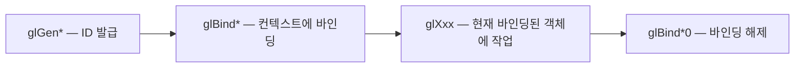
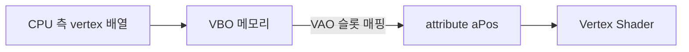

## 들어가며

OpenGL 컨텍스트 안에서 GPU에 정점 한 개를 흘려 넣으려면 *이름 있는 객체* 들이 차례로 만들어져야 한다. 정점 데이터를 담는 VBO(Vertex Buffer Object), 그 데이터를 어떤 속성으로 해석할지 기록한 VAO(Vertex Array Object), 인덱스를 보관하는 EBO(Element Buffer Object), 그리고 정점·픽셀 단위로 동작하는 셰이더 프로그램이다. 객체 하나하나의 생성·바인딩·해석 규약을 알지 못한 채 코드를 따라 치면, 사라진 삼각형의 원인을 어디서부터 찾아야 할지 모른다.

OpenGL은 *상태 머신* 이라는 표현이 자주 쓰인다. 객체를 만들면 ID 정수가 반환되고, 그 ID를 *바인딩(bind)* 하면 이후의 호출이 그 객체를 대상으로 한다. 객체는 직접 인자로 들어가지 않고 *현재 바인딩된 것* 이 암묵적으로 사용된다. 이 모델이 익숙해지면 단순하지만, 처음에는 어떤 호출이 어떤 객체에 영향을 주는지 추적하기 어렵다.

이 글의 결과물은 다음 다섯 가지를 갖춘 첫 정점 파이프라인이다.

1. VAO/VBO/EBO를 직접 만들고 데이터 흐름을 정리한다.
2. GLSL 정점·프래그먼트 셰이더를 컴파일하고 링크한다.
3. attribute(`in`)·varying(`in`/`out`)·uniform 세 가지 셰이더 입력의 의미를 구분한다.
4. UBO와 SSBO의 차이, std140과 std430의 패딩 규칙을 코드와 표로 정리한다.
5. 단일 삼각형에서 인덱스 큐브까지를 동작 가능한 코드로 묶는다.

이 글의 범위는 *데이터를 GPU에 흘려 넣고 셰이더 안에서 받아 쓰는 메커니즘*까지다. 이미지 샘플링은 범위 밖이며 VAO·버퍼·셰이더 인터페이스의 계약만 완결한다. 기준 컨텍스트는 OpenGL 3.3 Core이고, 더 높은 버전에서만 동작하는 기능(Direct State Access, Persistent Mapped Buffer, SSBO, `binding` 한정자 등)이 등장하면 그 자리에 요구 버전을 명시한다.


---

## 목차
1. [OpenGL 상태 머신과 객체 모델](#1-opengl-상태-머신과-객체-모델)
2. [VAO: 정점 속성 레이아웃의 기록](#2-vao-정점-속성-레이아웃의-기록)
3. [VBO: 정점 데이터의 GPU 적재](#3-vbo-정점-데이터의-gpu-적재)
4. [EBO: 인덱스 버퍼와 정점 재사용](#4-ebo-인덱스-버퍼와-정점-재사용)
5. [GLSL 기초와 셰이더 컴파일·링크](#5-glsl-기초와-셰이더-컴파일링크)
6. [attribute / in-out / uniform의 데이터 흐름](#6-attribute--in-out--uniform의-데이터-흐름)
7. [UBO와 std140 패딩 규칙](#7-ubo와-std140-패딩-규칙)
8. [SSBO와 std430의 차이](#8-ssbo와-std430의-차이)
9. [통합 예제: 삼각형부터 인덱스 큐브까지](#9-통합-예제-삼각형부터-인덱스-큐브까지)


---

## 1. OpenGL 상태 머신과 객체 모델

OpenGL의 모든 호출은 *현재 컨텍스트* 의 *현재 바인딩된 객체* 를 암묵적으로 대상으로 한다. 함수 시그니처에 객체 ID를 직접 받는 호출은 드물다. 대신 이 패턴이 반복된다.



이 모델은 *부수 효과* 가 많다. 한 객체에 작업하려고 다른 객체를 바인딩하면 이전에 바인딩되어 있던 객체가 빠진다. 코드가 길어질수록 *지금 어떤 객체가 바인딩되어 있는지* 를 추적하는 부담이 커진다.

### Direct State Access(DSA)

OpenGL 4.5 이후 *Direct State Access* 가 코어로 들어왔다. 4.5 코어의 DSA는 `ARB_direct_state_access` 확장과 동일한 함수군을 가진다. `EXT_direct_state_access`는 이름은 비슷하지만 함수 시그니처가 일부 다른 *별개* 확장으로, 4.5 코어 코드와 호환되지 않는다. DSA는 객체 ID를 함수 인자로 직접 받는다.

```cpp
// 전통적 방식
glGenBuffers(1, &vbo);
glBindBuffer(GL_ARRAY_BUFFER, vbo);
glBufferData(GL_ARRAY_BUFFER, size, data, GL_STATIC_DRAW);

// DSA 방식 (4.5+)
glCreateBuffers(1, &vbo);
glNamedBufferData(vbo, size, data, GL_STATIC_DRAW);
```

DSA가 더 명시적이고 디버그가 쉽다. 다만 OpenGL 3.3 호환을 위해 이 글은 전통적 방식을 기준으로 두고, DSA 등가 표현을 함께 적는다.

### 객체 종류와 ID

OpenGL의 주요 객체는 *모두 unsigned int ID* 로 식별된다.

| 객체 | 생성 함수 | 바인딩 함수 | 용도 |
|---|---|---|---|
| Buffer | `glGenBuffers` | `glBindBuffer(target, id)` | VBO/EBO/UBO/SSBO 통합 |
| Vertex Array | `glGenVertexArrays` | `glBindVertexArray(id)` | 정점 속성 레이아웃 |
| Texture | `glGenTextures` | `glBindTexture(target, id)` | 이미지 |
| Sampler | `glGenSamplers` | `glBindSampler(unit, id)` | 텍스처 샘플링 상태 |
| Framebuffer | `glGenFramebuffers` | `glBindFramebuffer(target, id)` | 렌더 타깃 |
| Shader | `glCreateShader` | (직접 바인딩 없음) | 셰이더 단계 코드 |
| Program | `glCreateProgram` | `glUseProgram(id)` | 링크된 파이프라인 |
| Query | `glGenQueries` | `glBeginQuery` | 시간/카운터 측정 |

Buffer 한 종류로 VBO·EBO·UBO·SSBO가 모두 표현된다는 점이 핵심이다. 같은 `GLuint` 값이 어떤 *target* 으로 바인딩되느냐에 따라 역할이 달라진다.

## 2. VAO: 정점 속성 레이아웃의 기록

VAO는 *정점 속성 포맷과 어느 VBO에서 데이터를 읽을지* 의 매핑을 기록하는 객체다. 직접 데이터를 가지지 않는다. 대신 *어느 VBO의 어디서 어떤 타입으로 읽어올지* 의 메타데이터를 담는다.

### VAO가 없으면 어떻게 되는가

OpenGL 3.3 Core Profile에서는 *VAO 없이는 그릴 수 없다*. 기본 VAO(이름 0)는 Compatibility Profile에만 있고, Core에서는 명시적으로 만든 VAO를 바인딩해야 `glDrawArrays` 같은 호출이 동작한다. 이걸 빼먹으면 검은 화면이 나오고 디버그 콜백이 `GL_INVALID_OPERATION`을 띄운다.

### 최소 VAO 설정

```cpp
GLuint vao;
glGenVertexArrays(1, &vao);
glBindVertexArray(vao);

// 이 시점부터 정점 속성 설정이 vao에 기록된다
glBindBuffer(GL_ARRAY_BUFFER, vbo);

glEnableVertexAttribArray(0);
glVertexAttribPointer(
    0,                  // location 0
    3,                  // 성분 수 (vec3)
    GL_FLOAT,           // 타입
    GL_FALSE,           // normalized
    sizeof(float) * 3,  // stride
    (void*)0            // offset
);

glBindVertexArray(0);  // 정리
```

VAO가 바인딩된 상태에서 호출한 `glVertexAttribPointer`와 `glEnableVertexAttribArray`가 그 VAO의 상태로 기록된다. 이후 다시 그 VAO를 바인딩하면 그 설정이 그대로 복원된다.

### VAO에 기록되는 것·기록되지 않는 것

미묘한 부분이다. VAO에 기록되는 항목은 다음과 같다.

| 항목 | VAO 기록 여부 |
|---|---|
| `glEnableVertexAttribArray` / `Disable` | 기록 |
| `glVertexAttribPointer`의 모든 인자 | 기록 |
| `glBindBuffer(GL_ELEMENT_ARRAY_BUFFER,...)` (EBO) | 기록 |
| `glBindBuffer(GL_ARRAY_BUFFER,...)` (VBO) | **기록 안 됨** (포인터 호출 시점에 *간접* 기록) |
| `glUseProgram` | 기록 안 됨 |
| Texture 바인딩 | 기록 안 됨 |
| Uniform 값 | 기록 안 됨 |

EBO 바인딩이 VAO에 *기록되는* 건 자주 잊어버리는 부분이다. VAO 바인딩 후 EBO를 바인딩하면 VAO가 그 EBO도 기억한다. 다음에 VAO만 바인딩하면 EBO도 함께 따라온다.

### 분리된 정점 속성(Separate Attribute) 모델

OpenGL 4.3 이후에는 더 명시적인 모델이 있다. 정점 속성과 VBO 바인딩 슬롯을 *분리* 한다.

```cpp
// 4.3+ 분리 모델
glBindVertexArray(vao);

// 속성 0: vec3 position, 슬롯 0에서 읽음
glEnableVertexAttribArray(0);
glVertexAttribFormat(0, 3, GL_FLOAT, GL_FALSE, 0);
glVertexAttribBinding(0, 0);  // 속성 0 → 슬롯 0

// VBO를 슬롯 0에 연결
glBindVertexBuffer(0, vbo, 0, sizeof(float) * 3);
```

같은 정점 데이터에 다른 셰이더 속성 매핑을 적용하기 쉬워진다. 다만 OpenGL 3.3과의 호환을 위해 이 글은 전통적 `glVertexAttribPointer`를 기본으로 둔다.

## 3. VBO: 정점 데이터의 GPU 적재

VBO는 *정점 데이터* 자체를 담는 GPU 측 메모리 블록이다. 같은 객체가 EBO/UBO/SSBO로도 쓰일 수 있다는 점이 OpenGL의 일관성이다.

### 데이터 업로드

```cpp
GLuint vbo;
glGenBuffers(1, &vbo);
glBindBuffer(GL_ARRAY_BUFFER, vbo);

float vertices[] = {
    -0.5f, -0.5f, 0.0f,
     0.5f, -0.5f, 0.0f,
     0.0f,  0.5f, 0.0f,
};

glBufferData(GL_ARRAY_BUFFER, sizeof(vertices), vertices, GL_STATIC_DRAW);
```

마지막 인자 `GL_STATIC_DRAW`는 *사용 패턴* 힌트다. 드라이버가 메모리 배치를 결정할 때 참고한다.

### Usage 힌트

| 힌트 | 의미 | 적합한 경우 |
|---|---|---|
| `GL_STATIC_DRAW` | 한 번 적재, 자주 그림 | 모델 정점, 정적 메시 |
| `GL_DYNAMIC_DRAW` | 자주 갱신, 자주 그림 | 동적 매시(주기적 갱신) |
| `GL_STREAM_DRAW` | 한 번 적재, 한두 번 그리고 버림 | UI 정점, 디버그 라인 |
| `GL_STATIC_READ` | GPU가 쓰고 CPU가 읽음 | Transform Feedback 결과 |
| `GL_DYNAMIC_COPY` | GPU가 쓰고 GPU가 다시 읽음 | Compute → Vertex 파이프라인 |

이 힌트는 *드라이버가 메모리를 어디(VRAM/PCIe/HOST)에 둘지* 의 결정에 영향을 주지만, 강제는 아니다. 잘못 지정해도 동작은 하지만 성능이 손해를 본다.

### glBufferSubData와 glMapBuffer

데이터를 한 번이 아니라 *지속적으로 갱신* 할 때는 두 가지 옵션이 있다.

```cpp
// 옵션 1: 부분 갱신 (작은 영역에 효율적)
glBufferSubData(GL_ARRAY_BUFFER, offset, size, newData);

// 옵션 2: 매핑 (큰 영역에 효율적)
void* ptr = glMapBufferRange(GL_ARRAY_BUFFER, offset, size,
                              GL_MAP_WRITE_BIT | GL_MAP_INVALIDATE_RANGE_BIT);
std::memcpy(ptr, newData, size);
glUnmapBuffer(GL_ARRAY_BUFFER);
```

`GL_MAP_INVALIDATE_RANGE_BIT`는 *기존 데이터를 보존할 필요 없음* 을 알려 드라이버가 동기화 비용을 건너뛰게 한다. 이 비트가 없으면 같은 영역을 GPU가 아직 읽고 있을 때 *동기화 stall* 이 발생할 수 있다.

### Buffer Orphaning과 Persistent Mapping

매 프레임 같은 VBO를 갱신하는 경우, 드라이버가 *이전 프레임이 끝날 때까지* 기다리는 *implicit synchronization* 비용이 발생한다. 이를 피하는 두 패턴이 있다.

**Buffer Orphaning**: 매 갱신 시 새 메모리 영역을 받는다.

```cpp
glBufferData(GL_ARRAY_BUFFER, size, nullptr, GL_STREAM_DRAW);   // 기존 메모리 버림
glBufferSubData(GL_ARRAY_BUFFER, 0, size, newData);             // 새 메모리에 기록
```

드라이버는 새 메모리를 잡고 이전 것은 GPU가 다 쓰면 회수한다. CPU·GPU 동기화 없이 흘러간다.

**Persistent Mapped Buffer**: 4.4+ `GL_ARB_buffer_storage` 사용.

```cpp
glBufferStorage(GL_ARRAY_BUFFER, size, nullptr,
                GL_MAP_WRITE_BIT | GL_MAP_PERSISTENT_BIT | GL_MAP_COHERENT_BIT);
void* ptr = glMapBufferRange(GL_ARRAY_BUFFER, 0, size,
                              GL_MAP_WRITE_BIT | GL_MAP_PERSISTENT_BIT | GL_MAP_COHERENT_BIT);
// 매 프레임 ptr에 직접 쓰기 (mapping 유지)
```

매 프레임 매핑/언매핑을 하지 않고 *영구 매핑* 된 포인터에 직접 쓴다. 동기화는 *GPU fence* 로 직접 관리한다. 가장 빠른 동적 버퍼 패턴이지만 동기화 책임이 사용자에게 넘어온다.

### Interleaved vs Separate

여러 정점 속성을 한 VBO에 둘 때, 두 가지 레이아웃이 있다.

**Interleaved (AoS)**: 한 정점의 모든 속성을 연속으로 둔다.

```cpp
struct Vertex { float pos[3]; float color[3]; float uv[2]; };
Vertex verts[] = { ... };  // pos, color, uv 가 연속

glVertexAttribPointer(0, 3, GL_FLOAT, GL_FALSE, sizeof(Vertex),
                      (void*)offsetof(Vertex, pos));
glVertexAttribPointer(1, 3, GL_FLOAT, GL_FALSE, sizeof(Vertex),
                      (void*)offsetof(Vertex, color));
glVertexAttribPointer(2, 2, GL_FLOAT, GL_FALSE, sizeof(Vertex),
                      (void*)offsetof(Vertex, uv));
```

**Separate (SoA)**: 속성마다 별도 VBO를 쓴다.

```cpp
GLuint posVBO, colorVBO, uvVBO;
// 각 VBO에 해당 속성만 적재
glBindBuffer(GL_ARRAY_BUFFER, posVBO);
glVertexAttribPointer(0, 3, GL_FLOAT, GL_FALSE, sizeof(float)*3, (void*)0);
glBindBuffer(GL_ARRAY_BUFFER, colorVBO);
glVertexAttribPointer(1, 3, GL_FLOAT, GL_FALSE, sizeof(float)*3, (void*)0);
```

Interleaved는 같은 정점의 모든 속성이 연속이라 캐시 친화적이다. Separate는 *일부 속성만 자주 갱신* 하는 케이스(애니메이션 본 가중치만 자주 변경 등)에서 갱신 대역폭이 작다. 게임 엔진 대부분은 Interleaved를 기본으로 쓴다.

## 4. EBO: 인덱스 버퍼와 정점 재사용

EBO는 *정점 인덱스 배열* 을 담는다. 같은 정점이 여러 삼각형에 공유되는 메시에서 정점 데이터를 한 번만 적재하고 인덱스로 참조한다.

### 큐브 예시: 정점 24개 vs 8개

큐브의 8개 모서리 정점만 두고 36개 인덱스로 12 삼각형을 그릴 수 있을 것 같지만, 보통은 *24개 정점* 을 쓴다. 왜인지 보자.

각 면의 텍스처 UV와 노멀이 다르므로 같은 위치의 정점이라도 *어느 면에 속하느냐에 따라 다른 속성을 가져야* 한다. 위치만 비교하면 8개로 충분하지만, 면별로 normal·UV·tangent를 분리해서 가지려면 6면 × 4개 = 24 정점이 필요하다. 인덱스는 면당 6개 × 6면 = 36개.

```cpp
// 큐브 24 정점 (위치 동일하지만 면별 normal/UV가 달라 별도 정점)
float verts[] = {
    // 앞면 (Z+)
    -0.5f, -0.5f,  0.5f,   // 0
     0.5f, -0.5f,  0.5f,   // 1
     0.5f,  0.5f,  0.5f,   // 2
    -0.5f,  0.5f,  0.5f,   // 3
    // 뒷면 (Z-)
    // ... (이하 5개 면)
};

// 36 인덱스 (면당 두 삼각형)
uint16_t indices[] = {
    0, 1, 2,  2, 3, 0,    // 앞면
    // ... (이하 5개 면)
};
```

### EBO 바인딩

```cpp
GLuint ebo;
glGenBuffers(1, &ebo);
glBindBuffer(GL_ELEMENT_ARRAY_BUFFER, ebo);
glBufferData(GL_ELEMENT_ARRAY_BUFFER, sizeof(indices), indices, GL_STATIC_DRAW);

// VAO 바인딩 중에 EBO를 바인딩하면 VAO가 EBO도 기억한다
```

### 인덱스 타입 선택

```cpp
glDrawElements(GL_TRIANGLES, count, GL_UNSIGNED_SHORT, 0);  // 16비트
glDrawElements(GL_TRIANGLES, count, GL_UNSIGNED_INT,   0);  // 32비트
```

| 타입 | 정점 수 한도 | 메모리 |
|---|---:|---|
| `GL_UNSIGNED_BYTE` | 256 | 1 byte/index |
| `GL_UNSIGNED_SHORT` | 65,536 | 2 bytes/index |
| `GL_UNSIGNED_INT` | 4,294,967,296 | 4 bytes/index |

`GL_UNSIGNED_BYTE`는 너무 작아 잘 쓰지 않는다. 일반 게임 메시는 `UNSIGNED_SHORT`로 충분하고(65,536 이하), 큰 LOD 메시는 `UNSIGNED_INT`다.

### Primitive Restart

OpenGL 3.3에서는 `GL_PRIMITIVE_RESTART`를 활성화하고 `glPrimitiveRestartIndex`로 *어떤 인덱스 값* 이 프리미티브 종료를 의미하는지 명시한다. 그 값이 인덱스 배열에 등장하면 strip이 끊긴다. Triangle strip이나 Line strip을 한 번의 draw call로 묶어 그릴 때 유용하다.

```cpp
glEnable(GL_PRIMITIVE_RESTART);
glPrimitiveRestartIndex(0xFFFF);  // 16비트 인덱스의 sentinel
uint16_t indices[] = {0, 1, 2, 3, 0xFFFF, 4, 5, 6, 7};
// 첫 strip: 0,1,2,3 / 두 번째 strip: 4,5,6,7
```

OpenGL 4.3+에서는 `GL_PRIMITIVE_RESTART_FIXED_INDEX`로 sentinel을 인덱스 타입의 최대값(`0xFFFF` / `0xFFFFFFFF`)에 자동 고정할 수도 있다. 이 글의 3.3 기준에서는 `glPrimitiveRestartIndex`로 명시적으로 지정한다.

## 5. GLSL 기초와 셰이더 컴파일·링크

GLSL(OpenGL Shading Language)은 C 계열 문법에 GPU 친화적 타입(`vec3`, `mat4`, `sampler2D`)을 더한 언어다. OpenGL 3.3은 GLSL 330, 4.6은 GLSL 460까지 지원한다.

### 첫 정점 셰이더

```glsl
#version 330 core

layout(location = 0) in vec3 aPos;
layout(location = 1) in vec3 aColor;

out vec3 vColor;  // 프래그먼트 셰이더로 전달

uniform mat4 uMVP;

void main() {
    gl_Position = uMVP * vec4(aPos, 1.0);
    vColor = aColor;
}
```

`#version` 지시어가 첫 줄에 와야 한다. `core`는 Core Profile 셰이더를 의미한다.

### 첫 프래그먼트 셰이더

```glsl
#version 330 core

in vec3 vColor;       // 정점 셰이더에서 전달

layout(location = 0) out vec4 FragColor;

void main() {
    FragColor = vec4(vColor, 1.0);
}
```

`layout(location = 0) out vec4 FragColor`는 0번 컬러 첨부에 출력된다. location 한정자를 명시해 두면 MRT를 도입하거나 셰이더 리플렉션이 들어올 때 동작이 명확해진다.

### 컴파일과 링크

```cpp
GLuint CompileShader(GLenum stage, const char* src) {
    GLuint shader = glCreateShader(stage);
    glShaderSource(shader, 1, &src, nullptr);
    glCompileShader(shader);

    GLint ok = 0;
    glGetShaderiv(shader, GL_COMPILE_STATUS, &ok);
    if (!ok) {
        char log[1024];
        glGetShaderInfoLog(shader, sizeof(log), nullptr, log);
        std::fprintf(stderr, "Shader compile error: %s\n", log);
        glDeleteShader(shader);
        return 0;
    }
    return shader;
}

GLuint LinkProgram(GLuint vs, GLuint fs) {
    GLuint program = glCreateProgram();
    glAttachShader(program, vs);
    glAttachShader(program, fs);
    glLinkProgram(program);

    GLint ok = 0;
    glGetProgramiv(program, GL_LINK_STATUS, &ok);
    if (!ok) {
        char log[1024];
        glGetProgramInfoLog(program, sizeof(log), nullptr, log);
        std::fprintf(stderr, "Program link error: %s\n", log);
        glDetachShader(program, vs);
        glDetachShader(program, fs);
        glDeleteProgram(program);
        return 0;   // 컴파일 헬퍼와 같은 실패 규약(0)
    }

    glDetachShader(program, vs);
    glDetachShader(program, fs);
    return program;
}
```

`glDetachShader`는 링크 후 셰이더 객체를 *프로그램으로부터 분리* 한다. 이후 `glDeleteShader(vs)`로 셰이더 객체를 해제할 수 있다. 프로그램은 자체적으로 컴파일된 코드를 들고 있어 셰이더 객체가 사라져도 동작한다.

### 셰이더 단계

그래픽 파이프라인의 단계는 정점·프래그먼트 두 개가 필수, Tess와 Geometry는 선택이다. Compute 셰이더는 그래픽 파이프라인의 일부가 아니라 `glDispatchCompute`로 별도 실행되는 *독립 경로* 다.

| 단계 | 종류 | 입력 | 출력 |
|---|---|---|---|
| Vertex | 그래픽 (필수) | 정점 속성, uniform | `gl_Position`, varying |
| Tess Control | 그래픽 (선택, 4.0+) | 패치 정점 | 테셀레이션 레벨 |
| Tess Evaluation | 그래픽 (선택, 4.0+) | 테셀레이션 좌표 | 새 정점 위치 |
| Geometry | 그래픽 (선택) | 프리미티브 | 0개 이상의 새 프리미티브 |
| Fragment | 그래픽 (필수) | varying, uniform, `gl_FragCoord` | 컬러 첨부 |
| Compute | *별도 경로* (4.3+) | UBO/SSBO/이미지 | SSBO/이미지 |

이 글은 정점 + 프래그먼트만 사용한다.

### `#version`과 호환성

`#version 330 core`는 *GLSL 3.30 문법으로 컴파일하겠다* 는 선언이다. OpenGL 3.3 이상의 컨텍스트라면 어디서든 컴파일·실행되고, 4.x 컨텍스트라도 GLSL 330 코드는 그대로 받아들인다. 다만 셰이더가 4.x 이후의 기능(예: `binding` 한정자, compute, SSBO)을 쓰려면 그 기능을 지원하는 GLSL 버전(`#version 420 core` 이상)이나 해당 확장(`GL_ARB_shading_language_420pack` 등)을 명시해야 한다.

GLSL ES(OpenGL ES, WebGL)는 별도 버전 체계다. 데스크톱 셰이더를 모바일에 그대로 쓰려면 정밀도 한정자(`highp`, `mediump`, `lowp`)와 일부 함수 차이를 처리해야 한다.

### #include는 표준이 아니다

GLSL은 표준에 `#include`가 *없다*. 셰이더를 여러 파일에 분할하려면 다음 중 하나를 쓴다.

- 빌드 시 텍스트 결합으로 직접 합쳐 넣기
- `GL_ARB_shading_language_include` 확장 (지원 드라이버가 적음)
- `GLSL` 코드를 C++ 측에서 string 결합으로 합치기

대부분 게임 엔진은 *빌드 시 결합* 또는 *런타임 결합* 패턴을 쓴다.

## 6. attribute / in-out / uniform의 데이터 흐름

GLSL의 데이터 입출력은 세 종류다. 각각 다른 *수명* 과 *공급자* 를 가진다.

### attribute (`in` at vertex shader)

정점마다 *다른 값*. CPU가 VBO에 적재하고 VAO가 슬롯을 결정한다. 정점 셰이더의 `layout(location = N) in vec3 aPos`가 입력이다.



### varying (`in`/`out` between stages)

셰이더 *단계 사이* 의 데이터 전달. 정점 셰이더의 `out vec3 vColor`가 프래그먼트 셰이더의 `in vec3 vColor`로 들어간다. 이름이 일치해야 한다.

```glsl
// vertex
out vec3 vColor;

// fragment
in vec3 vColor;
```

값은 *프리미티브 보간* 으로 자동 보간된다. flat·noperspective·smooth 같은 한정자로 보간 방식을 바꿀 수 있다.

```glsl
// flat: 보간 없이 provoking vertex의 값 그대로 (OpenGL 기본은 last vertex convention)
flat in int materialId;

// noperspective: 화면 공간에서 선형 보간 (원근 보정 없음)
noperspective in vec2 screenUV;
```

### uniform

*드로우 콜 단위로 일정한 값*. CPU가 셰이더 프로그램에 직접 설정한다.

```cpp
GLint loc = glGetUniformLocation(program, "uMVP");
glUseProgram(program);
glUniformMatrix4fv(loc, 1, GL_FALSE, mvpData);
```

uniform 종류별 함수가 다르다.

| 타입 | 함수 |
|---|---|
| float | `glUniform1f` / `glUniform1fv` |
| vec3 | `glUniform3f` / `glUniform3fv` |
| int | `glUniform1i` |
| mat4 | `glUniformMatrix4fv` |
| sampler2D | `glUniform1i` (텍스처 유닛 번호) |

`sampler2D`에 정수를 보내는 게 직관에 어긋난다. 셰이더에서 `sampler2D`는 *텍스처 유닛 번호* 로 식별되고, 그 유닛에 어느 텍스처가 바인딩됐는지는 `glActiveTexture` + `glBindTexture`로 결정된다. uniform 설정 전에는 `glUseProgram`이 먼저 호출되어 *현재 프로그램* 이 정해져 있어야 한다.

```cpp
glUseProgram(program);                  // uniform 설정 전 필수
glActiveTexture(GL_TEXTURE0);
glBindTexture(GL_TEXTURE_2D, textureID);
glUniform1i(samplerLoc, 0);             // sampler2D는 유닛 0을 본다
```

### 셋의 메모리 위치 비교

| 종류 | 갱신 빈도 | 저장 위치 | GPU 접근 |
|---|---|---|---|
| attribute | 정점마다 | VBO (GPU 메모리) | DMA로 fetch |
| varying | 프래그먼트마다 | 프리미티브 보간 (rasterizer 내부) | 보간 후 레지스터 |
| uniform | 드로우 콜마다 | uniform 슬롯 (GPU constant) | 상수처럼 빠른 fetch |

uniform은 작은 양의 자주 갱신되는 데이터에 적합하다. 다만 한 셰이더 프로그램의 *uniform 슬롯 수* 는 한정되고, 큰 행렬 배열을 uniform으로 두는 건 비효율이다. 그래서 UBO가 등장한다.

## 7. UBO와 std140 패딩 규칙

UBO(Uniform Buffer Object)는 *uniform 변수들의 묶음을 GPU 버퍼* 에 두는 모델이다. 같은 데이터가 여러 셰이더 프로그램에 공유될 수 있고, 갱신이 한 번이면 모든 프로그램에서 새 값을 본다.

### 셰이더 측 UBO 선언

```glsl
#version 330 core

layout(std140) uniform Camera {
    mat4 view;
    mat4 projection;
    vec3 cameraPos;
    float time;
};
```

`std140`은 *메모리 배치 규약* 이다. CPU 측 구조체와 똑같이 GPU에 적재되어야 하는데, 패딩 규칙이 까다롭다.

`binding = N` 한정자는 GLSL 4.20 또는 `GL_ARB_shading_language_420pack` 이후에 사용 가능하다. 3.3 Core 셰이더에서는 한정자 없이 선언하고, 바인딩 포인트는 CPU 측 `glUniformBlockBinding`으로 지정한다.

### std140 패딩 규칙

| 타입 | 정렬(byte) | 차지 공간(byte) |
|---|---:|---:|
| `float`, `int`, `bool` | 4 | 4 |
| `vec2` | 8 | 8 |
| `vec3` | 16 | 12 (뒤 4바이트 패딩) |
| `vec4` | 16 | 16 |
| `mat3` | 16 | **48** (vec3 3개 + 패딩) |
| `mat4` | 16 | 64 |
| `float arr[N]` | 16 | 16 × N (각 원소가 vec4 정렬) |
| `vec2 arr[N]` | 16 | 16 × N |

핵심은 다음 셋이다.

1. `vec3`는 *16바이트 정렬* 을 요구하지만 실제 성분 데이터는 12바이트다. 구조체 안에서 `vec3` 뒤에 `float`가 오면 그 4바이트 패딩 자리에 `float`가 들어가 공간을 절약할 수 있다.
2. *모든 배열의 각 원소* 는 16바이트 정렬을 받는다. 즉 `float arr[10]`은 160바이트(10 × 16)를 차지한다.
3. 구조체 전체도 16바이트 정렬이다.

### CPU 측 구조체 일치

C++에서 셰이더의 UBO와 일치하는 구조체를 짜려면 패딩을 *직접 의식해 배치한다*.

```cpp
struct CameraUBO {
    glm::mat4 view;        // offset 0,   size 64
    glm::mat4 projection;  // offset 64,  size 64
    glm::vec3 cameraPos;   // offset 128, base alignment 16, size 12
    float time;            // offset 140, size 4 (vec3 뒤 4바이트 자리에 들어간다)
};
static_assert(sizeof(CameraUBO) == 144, "UBO size mismatch");
```

`vec3 + float` 조합은 *공간을 아끼는 흔한 패턴* 이다. `vec3`는 16바이트 정렬을 받지만 성분 자체는 12바이트라, 그 뒤 4바이트 자리에 단일 `float`을 끼워 넣어 정렬을 깨지 않으면서 공간을 절약한다. 셰이더에서도 같은 순서로 선언하면 일치한다.

다만 *float를 vec3 앞에 두면* 패딩이 어긋난다.

```glsl
// 잘못된 순서
layout(std140) uniform Bad {
    float time;          // offset 0,  size 4
    // 12 byte padding (다음 vec3 정렬을 위해)
    vec3 cameraPos;      // offset 16, size 12
    // 4 byte padding
};  // 총 32 byte
```

CPU 측 코드를 셰이더와 동일한 순서로 두는 게 안전하다.

### UBO 바인딩과 갱신

```cpp
GLuint ubo;
glGenBuffers(1, &ubo);
glBindBuffer(GL_UNIFORM_BUFFER, ubo);
glBufferData(GL_UNIFORM_BUFFER, sizeof(CameraUBO), nullptr, GL_DYNAMIC_DRAW);

// 셰이더의 Camera 블록을 바인딩 포인트 0에 매핑
// (3.3 셰이더는 binding 한정자가 없으므로 CPU에서 명시적으로 연결)
GLuint blockIndex = glGetUniformBlockIndex(program, "Camera");
if (blockIndex == GL_INVALID_INDEX) {
    std::fprintf(stderr, "Uniform block 'Camera' not found\n");
} else {
    glUniformBlockBinding(program, blockIndex, 0);
}

// 같은 바인딩 포인트 0에 UBO를 묶는다
glBindBufferBase(GL_UNIFORM_BUFFER, 0, ubo);

// 매 프레임 갱신
CameraUBO data = { /* ... */ };
glBindBuffer(GL_UNIFORM_BUFFER, ubo);
glBufferSubData(GL_UNIFORM_BUFFER, 0, sizeof(data), &data);
```

`glGetUniformBlockIndex`로 셰이더 안의 블록 이름을 인덱스로 찾고, `glUniformBlockBinding`으로 그 인덱스를 바인딩 포인트 번호에 매핑한다. `glBindBufferBase`는 그 바인딩 포인트에 UBO를 묶는다. 셰이더 프로그램이 여러 개라도 같은 바인딩 포인트에 묶인 UBO는 *모두* 그 데이터를 본다. GLSL 4.20 이상이면 셰이더 안에 `layout(std140, binding = 0)`을 직접 적어 `glUniformBlockBinding` 호출을 생략할 수 있다.

### UBO 크기 한계

OpenGL 3.3은 UBO 크기 한도가 *최소 16,384 byte* 다(드라이버에 따라 더 클 수 있다). 큰 데이터(스켈레탈 본 행렬, 인스턴스 행렬 수천 개 등)는 SSBO로 가야 한다.

```cpp
GLint maxSize;
glGetIntegerv(GL_MAX_UNIFORM_BLOCK_SIZE, &maxSize);
// 이 컨텍스트가 허용하는 uniform block 최대 바이트 수
```

## 8. SSBO와 std430의 차이

SSBO(Shader Storage Buffer Object)는 *셰이더에서 읽기/쓰기 가능한 큰 버퍼* 다. OpenGL 4.3+ 또는 `GL_ARB_shader_storage_buffer_object` 확장이 필요하다.

### SSBO 선언

```glsl
#version 430 core

layout(std430, binding = 1) buffer Particles {
    vec4 data[];   // 가변 길이 배열 가능
};
```

SSBO 자체가 GLSL 4.30+ 기능이라 `#version 430 core` 이상이 필요하다. `binding` 한정자도 4.20+에서 사용 가능하므로 SSBO 셰이더에서는 자연스럽게 함께 쓴다.

UBO와 비슷하지만 다음 점이 다르다.

- `buffer` 키워드 (UBO는 `uniform`)
- `std430` 패딩 (std140보다 조밀)
- *읽기 + 쓰기* 모두 가능
- *가변 길이 배열* 지원 (마지막 멤버에 한해)
- 크기 한도가 훨씬 크다 (보통 수백 MB까지)

### std430의 차이점

std430은 std140의 가장 까다로운 패딩 규칙을 *완화* 한다.

| 항목 | std140 | std430 |
|---|---|---|
| `float arr[N]` 원소 정렬 | 16 byte | 4 byte |
| 구조체 정렬 | 16 byte | 가장 큰 멤버 정렬 |
| `vec3` 정렬 | 16 byte | 16 byte (동일) |
| `mat3` 차지 | 48 byte | 48 byte (동일) |

가장 큰 차이는 *배열 원소가 16바이트 정렬을 받지 않는다* 는 점이다. `float data[1000]`이 std140에서는 16,000 byte를 차지하지만 std430에서는 4,000 byte다.

따라서 *대량의 작은 데이터* 를 다룰 때 SSBO + std430이 메모리 효율적이다.

### SSBO 사용 예

```glsl
// 셰이더에서 직접 쓰기
layout(std430, binding = 1) buffer Particles {
    Particle items[];
};

void main() {
    uint id = gl_GlobalInvocationID.x;
    items[id].pos += items[id].vel * deltaTime;
}
```

```cpp
// CPU에서 SSBO 만들기
GLuint ssbo;
glGenBuffers(1, &ssbo);
glBindBuffer(GL_SHADER_STORAGE_BUFFER, ssbo);
glBufferData(GL_SHADER_STORAGE_BUFFER, particleCount * sizeof(Particle),
             nullptr, GL_DYNAMIC_COPY);

glBindBufferBase(GL_SHADER_STORAGE_BUFFER, 1, ssbo);
```

### Atomic 연산

SSBO는 *atomic 연산* 을 지원한다.

```glsl
layout(std430, binding = 0) buffer Counter {
    uint count;
};

// 동시에 여러 invocation이 안전하게 증가
uint myIndex = atomicAdd(count, 1);
```

`atomicAdd`, `atomicMin`, `atomicMax`, `atomicCompSwap` 등이 사용 가능하다. UBO에는 없다.

### 메모리 동기화

SSBO에 쓰고 다른 패스에서 읽으려면 *메모리 배리어* 가 필요하다.

```cpp
// SSBO에 쓴 다음 패스가 그 데이터를 읽는다면
glMemoryBarrier(GL_SHADER_STORAGE_BARRIER_BIT |
                GL_VERTEX_ATTRIB_ARRAY_BARRIER_BIT);
```

이 호출이 없으면 *이전 셰이더의 쓰기가 이후 단계의 읽기에서 보인다는 보장이 없다*. 호출 순서 자체가 어긋난다기보다, 메모리 가시성과 캐시 동기화가 강제되지 않아 stale한 값을 읽거나 부분 갱신된 값을 읽을 수 있다. 소비 방식(정점 fetch · 인덱스 fetch · uniform fetch · texture fetch · indirect command 등)에 맞는 barrier bit를 정확히 OR로 묶어야 한다. UBO는 일반적으로 *한 번 쓰고 여러 번 읽는* 패턴이라 배리어를 명시할 일이 적다.

### UBO vs SSBO 선택

| 기준 | UBO | SSBO |
|---|---|---|
| 크기 | ~64KB | 수백 MB |
| 접근 | 읽기 전용 | 읽기 + 쓰기 |
| atomic | 불가 | 가능 |
| std140 vs std430 | std140 (조밀치 못함) | std430 (조밀) |
| 캐시 | constant cache (빠름) | 일반 데이터 캐시 |
| 자주 갱신되는 작은 데이터 | 적합 | 과한 도구 |
| 컴퓨트가 결과를 쓰는 큰 배열 | 부적합 | 적합 |

작은 행렬·뷰 정보 → UBO, 대량 인스턴스 데이터·파티클 → SSBO가 자연스러운 분담이다.

## 9. 통합 예제: 삼각형부터 인덱스 큐브까지

지금까지의 객체들을 묶어 정점 한 점이 화면 픽셀로 닿는 첫 코드를 작성한다. 단계는 다음과 같다.

1. 단일 컬러 삼각형 (VBO + VAO만)
2. 인덱스 큐브 (EBO 추가)
3. UBO 도입 (uniform mat4를 UBO로)

### 단계 1: 컬러 삼각형

```glsl
// triangle.vert
#version 330 core
layout(location = 0) in vec3 aPos;
layout(location = 1) in vec3 aColor;

out vec3 vColor;

void main() {
    gl_Position = vec4(aPos, 1.0);
    vColor = aColor;
}
```

```glsl
// triangle.frag
#version 330 core
in vec3 vColor;
out vec4 FragColor;

void main() {
    FragColor = vec4(vColor, 1.0);
}
```

CPU 측 정점 데이터와 객체 생성:

```cpp
struct Vertex { float pos[3]; float color[3]; };

Vertex verts[] = {
    {{-0.5f, -0.5f, 0.0f}, {1.0f, 0.0f, 0.0f}},
    {{ 0.5f, -0.5f, 0.0f}, {0.0f, 1.0f, 0.0f}},
    {{ 0.0f,  0.5f, 0.0f}, {0.0f, 0.0f, 1.0f}},
};

GLuint vao, vbo;
glGenVertexArrays(1, &vao);
glGenBuffers(1, &vbo);

glBindVertexArray(vao);
glBindBuffer(GL_ARRAY_BUFFER, vbo);
glBufferData(GL_ARRAY_BUFFER, sizeof(verts), verts, GL_STATIC_DRAW);

// position
glEnableVertexAttribArray(0);
glVertexAttribPointer(0, 3, GL_FLOAT, GL_FALSE, sizeof(Vertex),
                      (void*)offsetof(Vertex, pos));
// color
glEnableVertexAttribArray(1);
glVertexAttribPointer(1, 3, GL_FLOAT, GL_FALSE, sizeof(Vertex),
                      (void*)offsetof(Vertex, color));

glBindVertexArray(0);
```

그리기:

```cpp
glClear(GL_COLOR_BUFFER_BIT);
glUseProgram(program);
glBindVertexArray(vao);
glDrawArrays(GL_TRIANGLES, 0, 3);
```

### 단계 2: 인덱스 큐브

큐브 정점 24개와 인덱스 36개를 적재한다. EBO를 VAO에 묶으면 그리기는 `glDrawElements`로 바뀐다.

```cpp
GLuint vao, vbo, ebo;
glGenVertexArrays(1, &vao);
glGenBuffers(1, &vbo);
glGenBuffers(1, &ebo);

glBindVertexArray(vao);

glBindBuffer(GL_ARRAY_BUFFER, vbo);
glBufferData(GL_ARRAY_BUFFER, sizeof(cubeVerts), cubeVerts, GL_STATIC_DRAW);

// VAO 바인딩 중에 EBO 바인딩 → VAO가 EBO도 기억
glBindBuffer(GL_ELEMENT_ARRAY_BUFFER, ebo);
glBufferData(GL_ELEMENT_ARRAY_BUFFER, sizeof(cubeIndices), cubeIndices,
             GL_STATIC_DRAW);

// 정점 속성 설정 (pos, color)
glEnableVertexAttribArray(0);
glVertexAttribPointer(0, 3, GL_FLOAT, GL_FALSE, sizeof(Vertex),
                      (void*)offsetof(Vertex, pos));
glEnableVertexAttribArray(1);
glVertexAttribPointer(1, 3, GL_FLOAT, GL_FALSE, sizeof(Vertex),
                      (void*)offsetof(Vertex, color));

glBindVertexArray(0);
```

그리기:

```cpp
glClear(GL_COLOR_BUFFER_BIT | GL_DEPTH_BUFFER_BIT);
glUseProgram(program);
glBindVertexArray(vao);
glDrawElements(GL_TRIANGLES, 36, GL_UNSIGNED_SHORT, 0);
```

깊이 버퍼는 `glEnable(GL_DEPTH_TEST)`로 켠다. MVP 행렬은 uniform으로 보낸다 (단계 3에서 UBO로 옮긴다).

### 단계 3: UBO 도입

각 행렬을 개별 uniform으로 보내면 호출 횟수가 많아진다. UBO에 묶어 한 번에 보낸다.

셰이더 변경:

```glsl
#version 330 core
layout(location = 0) in vec3 aPos;
layout(location = 1) in vec3 aColor;

layout(std140) uniform Camera {
    mat4 view;
    mat4 projection;
};

uniform mat4 uModel;  // 객체별이라 UBO 외부

out vec3 vColor;

void main() {
    gl_Position = projection * view * uModel * vec4(aPos, 1.0);
    vColor = aColor;
}
```

CPU 측 UBO 생성:

```cpp
struct CameraUBO {
    glm::mat4 view;
    glm::mat4 projection;
};

GLuint ubo;
glGenBuffers(1, &ubo);
glBindBuffer(GL_UNIFORM_BUFFER, ubo);
glBufferData(GL_UNIFORM_BUFFER, sizeof(CameraUBO), nullptr, GL_DYNAMIC_DRAW);

// 셰이더의 Camera 블록을 binding 0에 연결
GLuint blockIndex = glGetUniformBlockIndex(program, "Camera");
if (blockIndex == GL_INVALID_INDEX) {
    std::fprintf(stderr, "Uniform block 'Camera' not found in program\n");
    // 셰이더가 블록을 사용하지 않거나 이름이 어긋난 경우
} else {
    glUniformBlockBinding(program, blockIndex, 0);
}

// UBO를 binding 0에 묶기
glBindBufferBase(GL_UNIFORM_BUFFER, 0, ubo);
```

매 프레임 갱신:

```cpp
CameraUBO data;
data.view = glm::lookAt(eye, target, up);
data.projection = glm::perspective(fov, aspect, near, far);

glBindBuffer(GL_UNIFORM_BUFFER, ubo);
glBufferSubData(GL_UNIFORM_BUFFER, 0, sizeof(data), &data);
```

여러 객체를 그릴 때 카메라는 한 번만 갱신되고, 객체별 모델 행렬만 uniform으로 매 드로우 콜에 보낸다.

```cpp
for (auto& obj : objects) {
    glUniformMatrix4fv(modelLoc, 1, GL_FALSE, glm::value_ptr(obj.model));
    glBindVertexArray(obj.vao);
    glDrawElements(GL_TRIANGLES, obj.indexCount, GL_UNSIGNED_SHORT, 0);
}
```

이 패턴은 *per-frame*(카메라/광원), *per-material*(텍스처/PBR 파라미터), *per-object*(모델 행렬) 세 단계 분리의 토대다.

### 디버깅 체크리스트

코드를 따라 쳤는데 검은 화면이 나오면 다음을 차례로 확인한다.

1. 셰이더 컴파일 로그 (`glGetShaderInfoLog`)
2. 프로그램 링크 로그 (`glGetProgramInfoLog`)
3. VAO 바인딩 여부 (Core Profile은 VAO 없으면 그릴 수 없다)
4. `glDrawArrays`/`glDrawElements`의 인자 (count, offset)
5. uniform location이 -1인지 (`glGetUniformLocation` 결과)
6. 깊이 테스트와 cull face 설정 (정점이 시계 방향인지)
7. 디버그 콜백 출력 메시지

가장 흔한 실수는 *VAO 바인딩 없이 그리기*, *uniform location -1*, *깊이 버퍼 미클리어* 셋이다.


---

## 결론

VAO/VBO/EBO 세 객체와 정점·프래그먼트 셰이더가 OpenGL의 정점 파이프라인을 구성하는 최소 단위다. attribute는 정점마다, varying은 프래그먼트마다, uniform은 드로우마다, UBO는 같은 데이터의 묶음으로, SSBO는 큰 양의 읽기/쓰기 가능 데이터로 — 각 입력 종류가 다른 갱신 주기에 맞춰 분리되어 있다.

세 가지 트레이드오프가 이 글의 핵심이다.

1. **Interleaved vs Separate VBO**: 캐시 친화적인 AoS와 부분 갱신에 효율적인 SoA의 선택. 일반 메시는 Interleaved, 본 가중치 같은 부분 갱신 데이터는 Separate가 자연스럽다.
2. **uniform vs UBO vs SSBO**: 작고 빈번한 단일 변수는 uniform, 묶음 갱신은 UBO, 대량 데이터는 SSBO. std140과 std430의 패딩 차이가 메모리 효율을 결정한다.
3. **VAO에 기록되는 것·아닌 것**: EBO는 기록되지만 텍스처 바인딩과 uniform 값은 기록되지 않는다. VAO를 *오브젝트별 정점 레이아웃 기록* 으로만 쓰고, 다른 상태는 별도로 관리하는 패턴이 안정적이다.

여기까지의 코드는 정점 위치와 정점 색만으로 도형을 그릴 수 있다. 픽셀 색을 외부 이미지로 채우려면 텍스처 객체와 샘플러 설정이 추가되어야 한다.

## 더 읽을거리

- [LearnOpenGL: Hello Triangle](https://learnopengl.com/Getting-started/Hello-Triangle), [Shaders](https://learnopengl.com/Getting-started/Shaders) — VAO/VBO/셰이더 구현의 표준 자료.
- [OpenGL Wiki: Vertex Specification](https://www.khronos.org/opengl/wiki/Vertex_Specification) — VAO 에 기록되는 상태의 정확한 명세.
- [OpenGL Wiki: Interface Block (GLSL)](https://www.khronos.org/opengl/wiki/Interface_Block_(GLSL)) — std140/std430 레이아웃 규칙.
