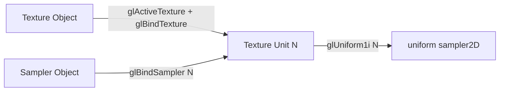
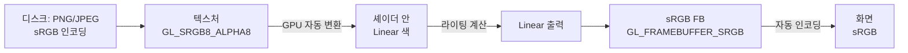

## 들어가며

> 텍스처와 샘플링의 전제는 UV 매핑, 텍셀과 정규화 좌표, 확대·축소, nearest/bilinear, 밉맵과 trilinear의 LOD 선택, 비등방 필터링, wrap 모드, sRGB/선형 색공간이다. 이 글은 그 전제를 OpenGL API로 다루는 법에 집중한다. 핵심은 텍스처/샘플러 객체 분리, 텍스처 유닛, `glTexImage2D` 대 `glTexStorage2D`, GL 필터·wrap enum, 언팩 정렬, `GL_FRAMEBUFFER_SRGB`, 압축 포맷 업로드다.

텍스처(Texture)는 GPU 메모리에 적재된 이미지 데이터다. 셰이더가 이 데이터를 읽으려면 *어떻게 읽을지* 가 함께 정해져야 한다. 같은 텍스처라도 가까운 표면에서는 부드럽게 보간해 읽고, 멀리 있는 표면에서는 미리 줄여 둔 작은 버전(mipmap)에서 읽고, 비스듬히 보는 표면에서는 한 픽셀에 여러 번 샘플링해야 한다. 이 *읽는 방법* 이 샘플러(Sampler) 상태에 모인다.

OpenGL 3.3 이전에는 텍스처 객체에 *데이터* 와 *읽는 방법* 이 한 덩어리로 묶여 있었다. 같은 이미지를 여러 방식으로 읽고 싶으면 텍스처를 통째로 복제해야 했다. OpenGL 3.3 이후 도입된 *샘플러 객체(Sampler Object)* 가 이 두 가지를 분리한다. 텍스처는 데이터만, 샘플러는 필터링·랩핑·LOD 같은 읽기 상태를 담는다.

이 글의 목표는 다음 다섯 가지다.

1. 텍스처 객체와 샘플러 객체의 분리, 텍스처 유닛(Texture Unit) 모델을 정리한다.
2. 데이터 업로드 두 경로 — `glTexImage2D`(가변)와 `glTexStorage2D`(불변, 4.2+) — 를 구분한다.
3. 밉맵의 LOD 선택 수식과 필터링 모드(Nearest, Linear, Trilinear, Anisotropic)의 차이를 본다.
4. sRGB와 Linear 색 공간이 셰이더 안팎에서 어떻게 변환되는지 정리한다.
5. 압축 포맷(BC/DXT/ASTC/ETC)이 메모리·대역폭에 주는 효과를 비교한다.

기준 컨텍스트는 OpenGL 3.3 Core이며, 더 높은 버전이나 확장이 필요한 기능(`glTexStorage2D`, `GL_TEXTURE_MAX_ANISOTROPY`, ASTC 등)은 그 자리에 요구 버전을 명시한다.


---

## 목차
1. [텍스처 객체와 샘플러 객체](#1-텍스처-객체와-샘플러-객체)
2. [텍스처 유닛과 셰이더 바인딩](#2-텍스처-유닛과-셰이더-바인딩)
3. [데이터 업로드: glTexImage2D와 glTexStorage2D](#3-데이터-업로드-gltexImage2d와-gltexstorage2d)
4. [밉맵 생성과 LOD 선택](#4-밉맵-생성과-lod-선택)
5. [필터링 모드: Nearest, Linear, Trilinear](#5-필터링-모드-nearest-linear-trilinear)
6. [Wrap 모드와 경계 처리](#6-wrap-모드와-경계-처리)
7. [이방성 필터링](#7-이방성-필터링)
8. [sRGB와 Linear 색 공간](#8-srgb와-linear-색-공간)
9. [압축 포맷: BC, DXT, ASTC, ETC](#9-압축-포맷-bc-dxt-astc-etc)
10. [통합 예제: PNG 로드부터 셰이더 페치까지](#10-통합-예제-png-로드부터-셰이더-페치까지)


---

## 1. 텍스처 객체와 샘플러 객체

OpenGL 3.3 이상에서 텍스처는 두 객체가 협력한다. *텍스처 객체* 는 픽셀 데이터를 가지고 있고, *샘플러 객체* 는 그 데이터를 어떻게 읽을지의 상태를 가진다. 한쪽이 없어도 그릴 수는 있지만(텍스처 객체에 기본 샘플링 상태를 두는 레거시 방식), 분리하면 같은 이미지를 여러 방식으로 읽을 수 있다.

### 텍스처 객체

데이터 자체와 *데이터의 형식* 을 가진다.

| 속성 | 설명 |
|---|---|
| 픽셀 데이터 | 압축/비압축 이미지 바이트 |
| 내부 포맷(Internal Format) | `GL_RGBA8`, `GL_RG16F`, `GL_R32I`, `GL_SRGB8_ALPHA8` 등 |
| 차원 | 1D / 2D / 3D / Cube / Array |
| 밉맵 레벨 수 | 1 (없음)부터 $\lfloor\log_2(\max(W,H))\rfloor+1$까지 |
| 샘플 수 | MSAA 텍스처일 때 |

```cpp
GLuint tex;
glGenTextures(1, &tex);
glBindTexture(GL_TEXTURE_2D, tex);

// 픽셀 업로드
glTexImage2D(GL_TEXTURE_2D, 0, GL_RGBA8,
             width, height, 0,
             GL_RGBA, GL_UNSIGNED_BYTE, pixels);
```

### 샘플러 객체

읽기 상태를 가진다.

| 속성 | 의미 |
|---|---|
| Min Filter | 축소 시 필터 (`GL_NEAREST`, `GL_LINEAR`, `GL_LINEAR_MIPMAP_LINEAR` 등) |
| Mag Filter | 확대 시 필터 (`GL_NEAREST`, `GL_LINEAR`) |
| Wrap S/T/R | 경계 처리 (`GL_REPEAT`, `GL_CLAMP_TO_EDGE`, `GL_MIRRORED_REPEAT`) |
| LOD bias / min / max | 밉맵 레벨 조정 |
| Compare Mode | 그림자 매핑용 비교 샘플링 |
| Anisotropy | 이방성 필터링 비율 (4.6 코어 또는 EXT 확장) |

```cpp
GLuint sampler;
glGenSamplers(1, &sampler);
glSamplerParameteri(sampler, GL_TEXTURE_MIN_FILTER,
                    GL_LINEAR_MIPMAP_LINEAR);
glSamplerParameteri(sampler, GL_TEXTURE_MAG_FILTER, GL_LINEAR);
glSamplerParameteri(sampler, GL_TEXTURE_WRAP_S, GL_REPEAT);
glSamplerParameteri(sampler, GL_TEXTURE_WRAP_T, GL_REPEAT);
```

### 무엇이 텍스처에 남고 무엇이 샘플러로 가는가

분리 모델에서 흔한 혼동은 *어느 상태가 어디 속하는지* 다. 경계가 명확하지 않으면 샘플러로 설정했다고 생각한 값이 실은 텍스처 객체에 박혀 무시되거나 그 반대가 된다.

| 상태 | 텍스처 객체 | 샘플러 객체 |
|---|---|---|
| 픽셀 데이터, 내부 포맷, 차원 | 소유 | 해당 없음 |
| `GL_TEXTURE_BASE_LEVEL` / `MAX_LEVEL` | 소유 (밉맵 범위는 데이터의 속성) | 해당 없음 |
| Min/Mag Filter, Wrap, LOD bias | 기본 상태로 보유 | 바인딩 시 텍스처 상태를 덮어씀 |
| Compare Mode/Func | 보유 | 덮어씀 |
| `GL_TEXTURE_SWIZZLE_*` (채널 재배치) | 소유 (샘플러는 못 바꿈) | 해당 없음 |
| Border color | 보유 | 덮어씀 |

`GL_TEXTURE_BASE_LEVEL`/`MAX_LEVEL`과 swizzle은 *데이터의 해석* 에 가까워 샘플러로 분리되지 않고 텍스처 객체에 남는다. 한 샘플러가 밉맵 레벨 범위를 바꿀 수 있다는 기대는 틀렸다 — 그것은 텍스처마다 고정된다.

### 분리의 효과

같은 디퓨즈 텍스처를 한 패스에서는 *부드러운 보간 + 이방성* 으로, 다른 패스(예: 그림자 가시성 디버그)에서는 *Nearest* 로 읽고 싶으면, 샘플러 두 개만 만들면 된다. 텍스처 객체는 하나로 충분하다. 샘플러 객체는 작은 상태 묶음이라 게임 시작 시 *몇 종(디퓨즈용 trilinear+aniso, UI용 nearest+clamp, 그림자용 compare 등)* 만 만들어 두고 영구 재사용하는 패턴이 일반적이다. 매 프레임 새로 만들지 않는다.

### 텍스처 객체 안의 샘플링 상태

샘플러 객체 없이도 그릴 수 있다. 이 경우 텍스처 객체 *자체* 의 샘플링 상태가 사용된다.

```cpp
glBindTexture(GL_TEXTURE_2D, tex);
glTexParameteri(GL_TEXTURE_2D, GL_TEXTURE_MIN_FILTER, GL_LINEAR);
```

이 호출은 *현재 바인딩된 텍스처* 의 상태를 바꾼다. 샘플러 객체가 같은 유닛에 묶이면, 샘플러 객체의 상태가 *텍스처 객체의 상태를 덮어쓴다*. 즉 우선순위는 항상 샘플러 객체가 위다. 유닛에 샘플러가 바인딩돼 있는 한, 그 유닛의 텍스처에 `glTexParameteri`로 필터를 바꿔도 화면 결과는 변하지 않는다 — 이 차이가 "분명히 NEAREST로 바꿨는데 여전히 흐리게 나온다" 류의 디버그를 만든다. 두 모델이 한 코드 베이스에 섞이면 추적이 어려워지므로, 가능하면 샘플러 객체로 통일한다.

### 완전성(Texture Completeness)

텍스처는 *완전(complete)* 해야 샘플링된다. 불완전한 텍스처를 샘플링하면 결과가 `(0,0,0,1)` 또는 구현 정의 값이 되어 *까만 표면* 으로 나타난다. 2D 텍스처의 완전성 조건은 다음과 같다.

- min filter가 밉맵을 쓰는 모드(`*_MIPMAP_*`)인데 밉맵 체인이 채워지지 않았다 → 불완전. 기본값인 `GL_NEAREST_MIPMAP_LINEAR`도 밉맵을 요구하므로 `glGenerateMipmap`을 빠뜨리면 정확히 이 상태가 된다.
- `GL_TEXTURE_BASE_LEVEL`부터 `MAX_LEVEL`까지 모든 레벨의 크기가 *일관된 절반 체인* 을 이뤄야 한다.
- 모든 레벨의 내부 포맷이 동일해야 한다.

까만 텍스처를 만나면 바인딩 누락 다음으로 의심할 것이 *밉맵 미완성* 이다. 빠른 진단법은 min filter를 잠시 `GL_LINEAR`(밉맵 안 씀)로 바꿔 보는 것이다. 그것으로 색이 나오면 원인은 밉맵 체인이다.

## 2. 텍스처 유닛과 셰이더 바인딩

OpenGL은 *텍스처 유닛(Texture Unit)* 이라는 슬롯을 통해 텍스처와 셰이더를 연결한다. 슬롯에 텍스처를 바인딩하고, 같은 슬롯에 샘플러를 바인딩하고, 셰이더에서 그 슬롯 번호로 참조한다.



### 활성 유닛 선택

```cpp
glActiveTexture(GL_TEXTURE0);            // 유닛 0을 활성화
glBindTexture(GL_TEXTURE_2D, diffuseTex); // 유닛 0에 디퓨즈 텍스처
glBindSampler(0, defaultSampler);         // 유닛 0에 샘플러

glActiveTexture(GL_TEXTURE1);            // 유닛 1
glBindTexture(GL_TEXTURE_2D, normalTex);  // 유닛 1에 노멀 맵
glBindSampler(1, defaultSampler);
```

`glActiveTexture`의 인자는 *enum* 이고 `glBindSampler`의 인자는 *정수 인덱스* 라는 점이 흔한 함정이다. `GL_TEXTURE0 + n`은 enum이라 `glActiveTexture(GL_TEXTURE0 + i)`처럼 더해 쓰지만, `glBindSampler`에는 그냥 `i`를 넣는다. `glBindSampler(GL_TEXTURE0,...)`처럼 enum 값(0x84C0 = 33984)을 넘기면 유효 범위를 벗어나 `GL_INVALID_VALUE`가 난다.

`GL_TEXTURE0` ~ `GL_TEXTURE15`까지는 모든 OpenGL 3.3+ 구현에서 보장된다. 더 많은 유닛이 필요하면 다음으로 조회한다.

```cpp
GLint maxUnits;
glGetIntegerv(GL_MAX_COMBINED_TEXTURE_IMAGE_UNITS, &maxUnits);
// 보통 80 이상
```

### 유닛 한도의 세 가지 종류

"몇 개까지 쓸 수 있는가"는 한 숫자가 아니다. 세 한도를 구분해야 한다.

| 한도 | 의미 | 3.3 최소 보장 |
|---|---|---:|
| `GL_MAX_TEXTURE_IMAGE_UNITS` | *프래그먼트 셰이더* 한 스테이지가 동시에 참조 가능한 sampler 수 | 16 |
| `GL_MAX_VERTEX_TEXTURE_IMAGE_UNITS` | 정점 셰이더에서 참조 가능한 수 | 16 |
| `GL_MAX_COMBINED_TEXTURE_IMAGE_UNITS` | 모든 스테이지 합산 활성 유닛 수 | 48 |

프래그먼트에서 32개 텍스처를 동시에 묶으려는 시도는 `GL_MAX_TEXTURE_IMAGE_UNITS`(최소 16)에 막힐 수 있다. combined가 80이어도 단일 스테이지 한도는 별개다. 대량 텍스처가 필요하면 텍스처 배열(`GL_TEXTURE_2D_ARRAY`)이나 지원 여부를 확인한 `GL_ARB_bindless_texture` 확장으로 우회한다.

### 셰이더에서 받기

```glsl
#version 330 core

uniform sampler2D uDiffuse;
uniform sampler2D uNormal;

in vec2 vUV;
out vec4 FragColor;

void main() {
    vec4 albedo = texture(uDiffuse, vUV);
    vec3 normal = texture(uNormal, vUV).xyz * 2.0 - 1.0;
    FragColor = albedo;
}
```

CPU에서 sampler uniform에 *유닛 번호* 를 정수로 보낸다.

```cpp
glUseProgram(program);
glUniform1i(glGetUniformLocation(program, "uDiffuse"), 0);
glUniform1i(glGetUniformLocation(program, "uNormal"),  1);
```

sampler uniform에는 `glUniform1i`(정수)만 쓴다. `glUniform1f`로 실수를 넣으면 `GL_INVALID_OPERATION`이다. sampler는 유닛 *인덱스* 이지 핸들이 아니라는 점을 기억한다. 이 매핑은 한 번만 하고, 이후 매 프레임은 `glActiveTexture` + `glBindTexture`만 부른다.

### 셰이더 측에서 유닛 고정하기 (4.2+)

매번 `glUniform1i`로 유닛을 지정하는 대신, GLSL에서 layout으로 못 박을 수 있다. OpenGL 4.2 이상에서 지원한다.

```glsl
#version 420 core
layout(binding = 0) uniform sampler2D uDiffuse;
layout(binding = 1) uniform sampler2D uNormal;
```

이러면 CPU 측 `glUniform1i` 호출이 필요 없다. 3.3 기준 컨텍스트에서는 이 문법이 없으므로 CPU에서 매핑한다. 어느 쪽이든 *셰이더의 sampler ↔ 유닛 번호* 매핑은 파이프라인 셋업 단계에서 한 번만 결정하고 매 프레임 바꾸지 않는 것이 정석이다.

### Bindless Textures (참고)

`GL_ARB_bindless_texture` 확장은 텍스처 유닛 모델을 *완전히 우회* 한다. 텍스처 객체에서 64비트 핸들을 받아 셰이더에 직접 전달한다. 드로우 콜마다 텍스처 바인딩을 다시 하지 않아도 된다. 이 확장은 OpenGL 4.5나 4.6 코어에 포함되지 않았으므로 컨텍스트 버전과 별개로 지원 여부를 질의해야 한다. 이 글의 3.3 기준 범위 밖이라, 여기서는 유닛 모델을 따른다.

## 3. 데이터 업로드: glTexImage2D와 glTexStorage2D

텍스처 데이터를 GPU에 적재하는 두 가지 경로가 있다.

### glTexImage2D — 가변 스토리지 (3.3+)

```cpp
glTexImage2D(GL_TEXTURE_2D, 0,           // 밉맵 레벨 0
             GL_RGBA8,                    // 내부 포맷
             width, height, 0,            // 크기, 테두리
             GL_RGBA, GL_UNSIGNED_BYTE,   // 입력 포맷, 타입
             pixels);                     // CPU 측 데이터
```

이 호출은 *스토리지를 매번 재할당* 한다. 같은 텍스처 객체에 대해 다음 호출에서 다른 크기·포맷을 줄 수 있다. 드라이버는 매번 새 메모리 블록을 잡거나 기존 블록을 재구성한다.

`glTexSubImage2D`로 *부분만* 갱신하면 스토리지 재할당 없이 픽셀만 덮어쓴다.

```cpp
glTexSubImage2D(GL_TEXTURE_2D, 0,
                xOffset, yOffset, w, h,
                GL_RGBA, GL_UNSIGNED_BYTE, newPixels);
```

### 내부 포맷, 포맷, 타입 — 세 인자의 역할

`glTexImage2D`에서 *세 개의 포맷 인자* 가 혼동을 부른다. 역할이 다르다.

| 인자 | 위치 | 의미 |
|---|---|---|
| internalFormat (`GL_RGBA8`) | 3번째 | GPU에 *저장* 될 포맷·정밀도 |
| format (`GL_RGBA`) | 7번째 | CPU 측 데이터의 *채널 구성* |
| type (`GL_UNSIGNED_BYTE`) | 8번째 | CPU 측 데이터의 *채널당 타입* |

internalFormat은 GPU 측이 무엇으로 저장하느냐, format/type은 지금 넘기는 CPU 바이트가 어떻게 생겼느냐다. 이 둘은 다를 수 있다 — `GL_SRGB8_ALPHA8`(GPU 저장)에 `GL_RGBA, GL_UNSIGNED_BYTE`(CPU 데이터)를 넘기면 드라이버가 적재 중 변환한다. 3.3 Core에서 internalFormat을 `GL_RGBA`처럼 *비크기(unsized)* 로 주는 것은 권장되지 않는다 — 정밀도가 구현에 맡겨진다. 항상 `GL_RGBA8`처럼 *크기 명시(sized)* 포맷을 쓴다.

### glTexStorage2D — 불변 스토리지 (4.2+, ARB_texture_storage)

```cpp
glTexStorage2D(GL_TEXTURE_2D,
               mipLevels,           // 밉맵 레벨 수
               GL_RGBA8,            // 내부 포맷
               width, height);

// 데이터 업로드는 glTexSubImage2D로
glTexSubImage2D(GL_TEXTURE_2D, 0, 0, 0, w, h,
                GL_RGBA, GL_UNSIGNED_BYTE, pixels);
```

한 번 호출되면 이 텍스처의 *크기와 포맷이 고정* 된다. 이후 변경 시도는 `GL_INVALID_OPERATION` 오류를 낸다. 드라이버 입장에서는 메모리 배치를 한 번에 결정할 수 있어 *최적화 여지가 더 많다*. 또한 `glTexStorage2D`는 필요한 mip 레벨 스토리지를 한 번에 할당해 텍스처를 *즉시 완전(complete)* 상태로 만든다. immutable allocation이 level 수를 고정하므로 그 범위를 넘는 mip 접근은 허용되지 않는다. 다만 `GL_TEXTURE_BASE_LEVEL`/`GL_TEXTURE_MAX_LEVEL` *상태값* 이 자동으로 바뀌는 것은 아니다(기본 0/1000 그대로이며 별도로 설정한다). 고정된 immutable level 수가 실제 사용 가능한 mip 범위를 제한하므로, 밉맵을 안 채워도 범위 밖으로 샘플링되어 완전성 위반으로 까맣게 나오는 사고가 줄어든다.

mipLevels는 보통 $\lfloor\log_2(\max(W,H))\rfloor + 1$로 계산한다.

```cpp
int Levels(int w, int h) {
    int levels = 1;
    int s = std::max(w, h);
    while (s > 1) { s >>= 1; ++levels; }
    return levels;
}
```

### 둘의 비교

| 항목 | glTexImage2D | glTexStorage2D |
|---|---|---|
| OpenGL 버전 | 3.3+ | 4.2+ |
| 스토리지 변경 | 가능 | 불가 (불변) |
| 드라이버 최적화 | 일반 | 더 적극적 |
| 완전성 | 모든 레벨 수동 보장 | 호출 즉시 완전 |
| 부분 갱신 | `glTexSubImage2D` | `glTexSubImage2D` |
| 사용 케이스 | 자주 크기 바뀌는 동적 텍스처 | 정적 자원, 게임 에셋 |

게임 에셋 대부분은 한 번 적재해 변경 없이 쓴다. `glTexStorage2D`를 쓸 수 있다면 그게 더 좋다. 4.2 미만 환경에서는 `glTexImage2D`로 한 번 적재한 뒤 `glTexParameteri(GL_TEXTURE_BASE_LEVEL/MAX_LEVEL)`로 밉맵 범위만 설정한다.

### 픽셀 정렬 (Unpack Alignment)

이미지 한 행의 바이트 수가 4의 배수가 아니면 업로드가 어긋나는 흔한 함정이 있다. OpenGL은 기본적으로 CPU → GPU 적재 시 *행 단위* 가 4바이트로 정렬되어 있다고 가정한다(`GL_UNPACK_ALIGNMENT`의 기본값 4). 행 바이트 수가 4의 배수가 아닌 데이터를 업로드할 때는 정렬을 변경한다.

```cpp
glPixelStorei(GL_UNPACK_ALIGNMENT, 1);  // 행 정렬 1바이트 (어떤 너비도 OK)
glTexImage2D(...);
```

대표적으로 RGB(3채널) `GL_UNSIGNED_BYTE` 이미지의 너비가 홀수면 한 행이 `width*3` 바이트라 4의 배수가 깨진다. 정렬이 4로 남아 있으면 드라이버가 매 행 끝에 패딩이 있다고 가정하고 *행마다 몇 바이트씩 밀려* 읽어, 이미지가 사선으로 비스듬히 찌그러져 보인다. RGBA8은 행 바이트가 항상 `width*4`라 4의 배수라서 이 문제가 없다 — 그래서 stb_image로 강제 4채널 적재하면 정렬 문제가 사라진다.

GPU → CPU로 픽셀을 *읽어 올* 때(`glReadPixels`, `glGetTexImage`)는 짝이 되는 `GL_PACK_ALIGNMENT`를 같은 방식으로 설정한다. 업로드는 unpack, 다운로드는 pack이다.

## 4. 밉맵 생성과 LOD 선택

밉맵(Mipmap)은 같은 이미지를 *각각 절반 해상도* 로 미리 줄여 둔 체인이다. 1024×1024 텍스처라면 1024², 512², 256², 128²,..., 1²의 11개 레벨이 만들어진다. 카메라에서 멀어진 표면이 작은 화면 영역만 차지할 때 GPU가 *적절히 작은 밉맵 레벨* 에서 샘플링하면 *aliasing(반짝임)* 을 피한다.

### LOD 계산

GPU는 한 픽셀을 그릴 때 그 픽셀이 텍스처 공간에서 *얼마나 큰 영역* 에 해당하는지를 미분으로 추정한다. 셰이더에서 다루는 UV는 정규화 좌표 $(u, v) \in [0, 1]^2$이지만, LOD 결정의 기준은 *텍셀 단위 footprint* 이므로 텍스처 크기 $W, H$를 곱해 텍셀 좌표 $(u \cdot W, v \cdot H)$의 미분을 사용한다. 화면 공간 픽셀 좌표 $(x, y)$에서의 변화율로 LOD 레벨 $\lambda$는 다음처럼 결정된다.

$$
\rho = \max\!\left(\sqrt{\left(W\frac{\partial u}{\partial x}\right)^2 + \left(H\frac{\partial v}{\partial x}\right)^2}, \; \sqrt{\left(W\frac{\partial u}{\partial y}\right)^2 + \left(H\frac{\partial v}{\partial y}\right)^2}\right)
$$

$$
\lambda = \log_2 \rho
$$

여기서 $\rho$는 *한 화면 픽셀에 대응하는 텍셀 수의 최대값* 이다. $\rho = 1$이면 한 화면 픽셀 = 한 텍셀이라 밉맵 레벨 0이 적절하다. $\rho = 4$면 한 픽셀이 4×4 텍셀에 해당하므로 레벨 2가 적절하다.

샘플러의 LOD 파라미터가 이 $\lambda$를 한 번 더 가공한다. 최종 사용 레벨은 다음 순서로 결정된다.

$$
\lambda' = \text{clamp}\big(\lambda + \text{LOD\_BIAS},\; \text{LOD\_MIN},\; \text{LOD\_MAX}\big)
$$

`GL_TEXTURE_LOD_BIAS`를 음수로 주면 더 선명한(낮은) 레벨을 강제해 디테일이 살지만 aliasing 위험이 커진다. 양수면 더 흐려진다. 셰이더에서 `textureLod(tex, uv, level)`로 레벨을 직접 지정하면 미분 기반 $\lambda$ 계산을 완전히 건너뛴다.

### 미분과 분기의 함정

GPU는 2×2 quad(쿼드) 단위로 프래그먼트를 묶어 처리하며, 인접 프래그먼트 간 UV 차이로 위 편미분을 *유한 차분* 으로 근사한다. 그래서 텍스처 페치는 *gradient에 의존* 한다. 여기서 함정이 나온다.

```glsl
if (someCondition) {
    color = texture(uTex, vUV);   // 동적 분기 안의 페치
}
```

쿼드 안 네 프래그먼트가 분기에서 갈리면(일부는 true, 일부는 false), false 쪽 프래그먼트의 UV는 평가되지 않아 미분이 *정의되지 않는다*. 명세상 이런 *non-uniform control flow* 안에서 자동 LOD를 쓰는 `texture`는 결과가 정의되지 않는다(undefined). 흐려지거나, 깜빡이거나, 드라이버마다 다르게 나온다.

해결책은 두 가지다. 페치를 분기 밖으로 빼서 항상 실행하고 결과만 분기에서 선택하거나, 분기 안이 불가피하면 미분이 필요 없는 `textureLod`나 명시적 gradient를 받는 `textureGrad`를 쓴다.

```glsl
// gradient를 분기 밖에서 계산해 넘기면 분기 안에서도 안전하다
vec2 dx = dFdx(vUV);
vec2 dy = dFdy(vUV);
if (someCondition) {
    color = textureGrad(uTex, vUV, dx, dy);
}
```

### 자동 밉맵 생성

```cpp
glBindTexture(GL_TEXTURE_2D, tex);
glTexImage2D(GL_TEXTURE_2D, 0, GL_RGBA8, w, h, 0,
             GL_RGBA, GL_UNSIGNED_BYTE, pixels);
glGenerateMipmap(GL_TEXTURE_2D);  // 레벨 1 이상을 자동 생성
```

`glGenerateMipmap`은 *드라이버가 결정한 필터링* 으로 상위 레벨을 다운샘플링해 채운다. 일반적인 박스 필터(2×2 평균) 또는 그에 가까운 필터를 쓰며 정확한 알고리즘은 구현마다 다르다. 빠르고 일반적인 게임 에셋에 적합하다. 두 가지 데이터에는 부적절하다.

- *법선 맵*: 단순 평균은 법선의 길이를 줄여(정규화 깨짐) 멀리서 라이팅이 평평해진다. 셰이더에서 다시 `normalize`하거나, 오프라인에서 길이 보존 다운샘플로 생성한다.
- *sRGB 디퓨즈*: sRGB 코드값을 그대로 평균하면 선형 광량 평균보다 어두워진다. 선형 공간으로 디코드해 필터링하고 결과를 다시 sRGB로 인코드한다.

또한 `glGenerateMipmap`은 *base level의 현재 내용* 을 읽어 하위를 채운다. 따라서 base level을 업로드한 *뒤에* 불러야 한다. `glTexStorage2D`로 스토리지만 잡고 base를 업로드하기 전에 부르면 빈 데이터로 밉맵이 채워진다.

### 수동 밉맵 업로드

품질이 중요한 텍스처는 오프라인 도구(Texconv, NVIDIA Texture Tools)에서 미리 밉맵을 생성하고, 각 레벨을 따로 업로드한다.

```cpp
glTexStorage2D(GL_TEXTURE_2D, mipCount, GL_RGBA8, w, h);
for (int level = 0; level < mipCount; ++level) {
    int lw = std::max(1, w >> level);
    int lh = std::max(1, h >> level);
    glTexSubImage2D(GL_TEXTURE_2D, level, 0, 0, lw, lh,
                    GL_RGBA, GL_UNSIGNED_BYTE, pixelsForLevel[level]);
}
```

KTX(Khronos Texture)나 DDS는 밉맵 체인과 압축 블록을 파일에 함께 담을 수 있다. OpenGL은 압축 internal format이라는 이유만으로 `glGenerateMipmap`을 일괄 금지하지 않는다. 구현이 하위 레벨을 생성할 수 있지만 필터와 재압축 품질은 에셋 제작자가 통제하기 어렵고, 런타임 비용과 플랫폼별 결과도 달라질 수 있다. BC·ETC·ASTC 배포 에셋은 각 데이터 의미에 맞는 필터로 오프라인 밉을 만들고 완성된 압축 레벨을 업로드하는 편이 재현 가능하다.

### 밉맵 메모리

밉맵 체인의 총 크기는 *최상위 레벨의 약 1.33배* 다.

$$
1 + \frac{1}{4} + \frac{1}{16} + \cdots = \frac{4}{3} \approx 1.33
$$

1024² RGBA8 텍스처는 4 MiB 본체와 약 1.33 MiB의 하위 레벨을 합쳐 약 5.33 MiB다. 블록 압축과 작은 레벨의 최소 블록 패딩에서는 정확히 $4/3$이 아닐 수 있다. 적절한 LOD는 한 화면 footprint와 비슷한 주파수의 레벨을 선택해 aliasing과 과도한 texel 접근을 줄이지만, 캐시 적중률이나 footprint 비율을 항상 특정 값으로 보장하지는 않는다.

## 5. 필터링 모드: Nearest, Linear, Trilinear

샘플러의 필터 모드는 *축소(min)* 와 *확대(mag)* 두 가지가 있다. 각각 한 픽셀이 어느 텍스처 영역에 해당할 때 어떻게 색을 결정할지를 정한다.

### Mag 필터: 한 픽셀이 텍스처보다 작을 때

확대 시에는 밉맵이 의미가 없다(이미 레벨 0보다 더 큰 레벨은 없다). 두 가지 옵션만 있다.

| 모드 | 의미 |
|---|---|
| `GL_NEAREST` | 가장 가까운 텍셀 한 개 (픽셀 아트, UI) |
| `GL_LINEAR` | 인접 4 텍셀 양선형(bilinear) 보간 |

```cpp
glSamplerParameteri(sampler, GL_TEXTURE_MAG_FILTER, GL_LINEAR);
```

mag filter에 `GL_LINEAR_MIPMAP_LINEAR` 같은 밉맵 모드를 넣으면 `GL_INVALID_ENUM`이다. mag는 위 두 값만 받는다. min filter와 헷갈려 밉맵 모드를 양쪽에 복붙하는 실수가 흔하다.

### Min 필터: 한 픽셀이 텍스처보다 클 때

축소 시에는 밉맵 사용 여부와 두 레벨 간 보간 여부의 조합이다. 이름은 `GL_{텍셀보간}_MIPMAP_{레벨보간}` 규칙으로 읽는다.

| 모드 | 밉맵 | 텍셀 보간 | 레벨 보간 |
|---|---|---|---|
| `GL_NEAREST` | 안 씀 | 없음 | (없음) |
| `GL_LINEAR` | 안 씀 | bilinear | (없음) |
| `GL_NEAREST_MIPMAP_NEAREST` | 1개 레벨 | 없음 | 없음 |
| `GL_LINEAR_MIPMAP_NEAREST` | 1개 레벨 | bilinear | 없음 |
| `GL_NEAREST_MIPMAP_LINEAR` | 2개 레벨 | 없음 | linear |
| `GL_LINEAR_MIPMAP_LINEAR` | 2개 레벨 | bilinear | linear (= **Trilinear**) |

`GL_LINEAR_MIPMAP_LINEAR`이 *trilinear filtering* 으로 불리는 가장 부드러운 모드다. 비용은 8 텍셀 페치(2 레벨 × 4 텍셀)에 두 번의 보간 계산이다. 주의할 점은 min filter의 *기본값이 `GL_NEAREST_MIPMAP_LINEAR`* 라는 것이다(mag 기본값은 `GL_LINEAR`). 즉 새 텍스처는 *기본적으로 밉맵을 요구* 하므로, 밉맵을 안 채우면 1절에서 설명한 불완전 텍스처가 되어 까맣게 나온다.

### 밉맵 단계 경계의 시각적 결함

`*_MIPMAP_NEAREST`(레벨 보간 없음) 모드는 가장 가까운 한 레벨만 고른다. 카메라가 천천히 멀어지면 어느 순간 레벨 N에서 N+1로 *툭 끊겨* 전환되며 텍스처 선명도가 계단처럼 점프한다 — 이것이 *mip banding* 또는 *mip seam* 이다. 바닥 텍스처에서 동심원 모양의 띠로 잘 보인다. `*_MIPMAP_LINEAR`(trilinear)는 두 레벨을 보간해 이 경계를 부드럽게 녹인다. trilinear의 주된 존재 이유가 이 띠 제거다.

### 비용 비교

| 모드 | 개념적 샘플/탭 수 (모형) |
|---|---:|
| Nearest | 1 |
| Bilinear | 4 |
| Trilinear | 8 |
| Anisotropic 4× | 최대 16 (2 × 8) |
| Anisotropic 16× | 최대 64 |

위 수치는 알고리즘상 탭 수를 단순화한 *개념적 비용 모형* 이며, 실제 TMU 처리량·fetch 횟수·wall time은 GPU·드라이버·포맷·캐시 상태에 따라 다르다. 8비트 포맷의 bilinear를 한 클럭에 처리한다는 식의 고정 배율은 특정 하드웨어에 한정된 설명이므로, 실제 비용은 대상 GPU에서 sampler 관련 성능 카운터로 측정한다. 특히 `GL_RGBA16F`/`GL_RGBA32F` 같은 *부동소수점 포맷의 bilinear* 는 일부 GPU에서 절반 속도이고, `GL_RGBA32F`의 하드웨어 선형 필터링은 아예 지원되지 않는 구현도 있다. HDR 텍스처를 부드럽게 읽으려면 포맷별 필터 지원을 확인한다.

### 픽셀 아트와 UI

레트로 픽셀 아트나 도트 UI는 `GL_NEAREST`로 *선명한 픽셀 경계* 를 보존한다. linear로 두면 텍셀 경계가 흐려져 의도와 어긋난다. 같은 게임 안에서도 텍스처 종류에 따라 샘플러를 분리한다. 픽셀 아트를 *확대* 하되 보간으로 인한 흐림은 피하고 싶다면, NEAREST와 LINEAR 사이의 절충으로 셰이더에서 텍셀 중심 근처만 부드럽게 만드는 기법(예: 텍셀 단위 smoothstep, 흔히 부르는 sharp bilinear)을 쓰기도 한다.

## 6. Wrap 모드와 경계 처리

UV 좌표가 $[0, 1]$ 범위를 벗어났을 때의 동작이다.

| 모드 | 동작 |
|---|---|
| `GL_REPEAT` | 정수 부분을 버리고 반복 (1.5 → 0.5) |
| `GL_MIRRORED_REPEAT` | 짝수 단위 반복 + 홀수 단위 거울 반사 |
| `GL_CLAMP_TO_EDGE` | $[0, 1]$로 클램프 (경계 텍셀이 늘어남) |
| `GL_CLAMP_TO_BORDER` | 경계 너머는 지정한 보더 색 |
| `GL_MIRROR_CLAMP_TO_EDGE` (4.4+) | 거울 후 클램프 |

```cpp
glSamplerParameteri(sampler, GL_TEXTURE_WRAP_S, GL_REPEAT);
glSamplerParameteri(sampler, GL_TEXTURE_WRAP_T, GL_REPEAT);
```

축 이름 S/T/R은 각각 텍스처 좌표의 첫째/둘째/셋째 축이다(2D는 S, T만, 3D·Cube는 R까지). 흔히 쓰는 UV에서 S가 가로(u), T가 세로(v)에 대응한다.

### Wrap과 필터링의 상호작용 — 경계 누수

bilinear/trilinear 필터는 *경계 텍셀에서 인접 4 텍셀* 을 읽는다. 그래서 wrap 모드는 단순히 범위 밖 UV뿐 아니라 *경계 안쪽 픽셀의 보간* 에도 끼어든다.

`GL_REPEAT` 텍스처는 u=0 근처 픽셀이 u=1 쪽 텍셀과 평균되어, *반대편 끝 색이 새어 든다*. 타일링 패턴이면 이어지므로 문제없지만, 한 장짜리 스프라이트라면 위 가장자리에 아래쪽 색이 비친다. 스프라이트·UI 아틀라스는 `GL_CLAMP_TO_EDGE`가 안전하다.

반대로 `GL_CLAMP_TO_EDGE`로 둔 아틀라스에서 여러 작은 이미지를 한 텍스처에 모으면, 인접 이미지의 텍셀이 밉맵 하위 레벨에서 서로 평균되며 *bleeding* 이 생긴다. 아틀라스는 각 타일 주위에 몇 텍셀의 *거터(gutter, padding)* 를 두거나, 밉맵을 제한해 이 누수를 막는다.

### 타일링과 경계 누수

`GL_REPEAT`는 *타일링되는 패턴 텍스처* (벽돌, 잔디, 바닥)에 자연스럽다. 단, 한쪽 끝과 반대 끝이 *시각적으로 이어지도록* 텍스처를 만들어야 *seam(이음새)* 이 보이지 않는다. 도구로 *seamless* 변환을 거치는 게 일반적이다.

### Skybox와 Cube Map

Cube map은 6면이 만나는 모서리에서 텍셀 보간이 자연스럽지 않을 수 있다. OpenGL 3.2+ 또는 `GL_ARB_seamless_cube_map`을 활성화하면 인접 면 사이에서 매끄럽게 보간된다.

```cpp
glEnable(GL_TEXTURE_CUBE_MAP_SEAMLESS);
```

이 활성화 전에는 각 면의 경계가 인접 면이 아니라 *자기 면의 wrap 모드* 로 처리돼, 모서리에 가는 선이 보인다. seamless는 컨텍스트 전역 상태라 한 번 켜면 모든 큐브맵에 적용된다.

### 그림자 맵의 Clamp

깊이 텍스처(그림자 맵)는 보통 `GL_CLAMP_TO_EDGE` 또는 `GL_CLAMP_TO_BORDER`로 둔다. `REPEAT`로 두면 라이트 절두체 밖이 *반복된 그림자* 로 보여 잘못된 결과가 나온다. 절두체 밖을 *완전히 비그림자(밝음)* 로 처리하려면 `GL_CLAMP_TO_BORDER`에 보더 깊이를 1.0(최대 거리)으로 둔다.

```cpp
glSamplerParameteri(sampler, GL_TEXTURE_WRAP_S, GL_CLAMP_TO_BORDER);
glSamplerParameteri(sampler, GL_TEXTURE_WRAP_T, GL_CLAMP_TO_BORDER);
GLfloat border[] = { 1.0f, 1.0f, 1.0f, 1.0f };
glSamplerParameterfv(sampler, GL_TEXTURE_BORDER_COLOR, border);
```

비교 샘플링(compare mode)과 함께 쓰면 경계 밖 비교는 항상 "가려지지 않음"으로 평가되어, 라이트 범위 밖이 어두워지는 결함을 막는다.

## 7. 이방성 필터링

비스듬히 보는 표면(예: 바닥을 멀리 내려다보는 시점)에서는 한 화면 픽셀이 텍스처 공간에서 *길쭉한 직사각형* 에 해당한다. 등방(isotropic) 밉맵 필터는 정사각형 영역을 가정하므로 *긴 축의 footprint(=$\rho_{\max}$)* 에 맞춰 LOD를 잡아 aliasing을 막는다. 그 결과 짧은 축 방향까지 *과하게 흐려져* 표면이 blur 처리된 것처럼 보인다. 이방성 필터링(Anisotropic Filtering)은 짧은 축 정밀도에 맞춰 LOD를 잡고, 긴 축을 따라 *여러 번 샘플링* 해 평균함으로써 흐림을 보상한다.

### 비등방률

비등방률 $r$은 한 픽셀의 텍스처 공간 사영의 *긴 축 / 짧은 축* 비율이다.

$$
r = \frac{\rho_{\max}}{\rho_{\min}}
$$

여기서 $\rho_{\max}, \rho_{\min}$은 화면 픽셀에 대응하는 텍셀 수의 최대/최소 방향이다. 비등방률이 크면 길쭉하다. 이방성 필터링은 긴 축을 따라 $r$개의 샘플(또는 한도 내)을 잡아 평균한다.

### 활성화 (4.6 코어 또는 EXT_texture_filter_anisotropic)

이방성 필터링은 OpenGL 4.6에서 코어로 들어왔고, 그 이전에는 `GL_EXT_texture_filter_anisotropic` 확장으로 같은 기능이 제공됐다. 이 확장은 매우 오래되고 광범위하게 지원되어 사실상 3.3 환경 어디서나 쓸 수 있다. enum 이름이 코어/확장에서 다르므로 컨텍스트 버전이나 확장 지원 여부를 확인한 뒤 분기한다.

```cpp
GLint major = 0, minor = 0;
glGetIntegerv(GL_MAJOR_VERSION, &major);
glGetIntegerv(GL_MINOR_VERSION, &minor);

bool hasAniso = (major > 4) || (major == 4 && minor >= 6);
if (!hasAniso) {
    // 확장 문자열 검색
    GLint n = 0;
    glGetIntegerv(GL_NUM_EXTENSIONS, &n);
    for (GLint i = 0; i < n && !hasAniso; ++i) {
        const char* ext = (const char*)glGetStringi(GL_EXTENSIONS, i);
        if (ext && std::strcmp(ext, "GL_EXT_texture_filter_anisotropic") == 0) {
            hasAniso = true;
        }
    }
}

if (hasAniso) {
    GLenum maxEnum = (major > 4 || (major == 4 && minor >= 6))
                     ? GL_MAX_TEXTURE_MAX_ANISOTROPY
                     : GL_MAX_TEXTURE_MAX_ANISOTROPY_EXT;
    GLenum paramEnum = (major > 4 || (major == 4 && minor >= 6))
                       ? GL_TEXTURE_MAX_ANISOTROPY
                       : GL_TEXTURE_MAX_ANISOTROPY_EXT;

    GLfloat maxAniso = 1.0f;
    glGetFloatv(maxEnum, &maxAniso);
    glSamplerParameterf(sampler, paramEnum, std::min(16.0f, maxAniso));
}
```

코어 enum과 EXT enum은 같은 기능이 승격된 경로지만, 컨텍스트 버전·확장 지원을 확인한 뒤 그 경로의 토큰과 함수를 사용한다. `GL_MAX_TEXTURE_MAX_ANISOTROPY` 또는 EXT 토큰으로 상한을 조회하고 $[1,\text{max}]$ 안으로 제한한다. 값 1은 이방성 강화를 하지 않는다는 뜻이며, 실제 baseline 필터는 `GL_TEXTURE_MIN_FILTER`가 정한다.

이방성 필터링은 축소 footprint가 길쭉할 때 여러 방향·LOD의 표본을 사용해 흐림을 줄인다. 밉맵과 함께 써야 큰 footprint의 주파수 선택까지 안정적으로 처리할 수 있지만, 명세 의미를 “밉맵 모드가 아니면 무조건 무시”로 축소해서는 안 된다.

### 비용

설정값은 품질에 사용할 수 있는 최대 비등방도이며 텍셀 fetch 횟수의 명세상 상한이 아니다. 구현은 footprint, 캐시, 압축 포맷, 필터 정밀도에 따라 서로 다른 알고리즘을 쓴다. 정면에 가까운 footprint에서는 추가 비용이 작을 수 있지만 설정값과 비용이 선형 비례한다고 가정할 수 없다. GPU 시간과 sampler 관련 성능 카운터로 재질·시점별 비용을 측정한다.

### 게임 디자인 영향

- 바닥·도로처럼 비스듬한 footprint가 큰 표면은 이방성 품질 이득이 크다.
- 캐릭터와 곡면은 카메라 거리·곡률에 따라 이득이 달라진다.
- 큐브맵과 UI도 투영·UV 변환에 따라 footprint가 달라질 수 있으므로 이름만으로 값을 고정하지 않는다.

### 모바일에서

모바일에서도 지원 상한과 비용은 기기·포맷·장면에 따라 다르다. 품질 등급별 상한을 두되 런타임 질의로 유효 범위를 제한하고, 대표 기기의 GPU 시간·전력·열 스로틀링을 함께 측정한다.

## 8. sRGB와 Linear 색 공간

물리적으로 정확한 라이팅을 하려면 *선형 색 공간(Linear)* 에서 계산해야 한다. 그러나 화면이 받아 사람 눈에 보이는 색은 *sRGB 색 공간* 으로 인코딩되어 있다. 이 둘 사이의 변환을 어디서 할지가 일관되어야 한다.

### sRGB 변환 곡선

sRGB는 *대략 감마 2.2* 의 비선형 곡선을 쓴다. 정확한 식은 다음과 같다.

$$
\text{sRGB to Linear: } L = \begin{cases}
\dfrac{c}{12.92} & c \leq 0.04045 \\[4pt]
\left(\dfrac{c + 0.055}{1.055}\right)^{2.4} & c > 0.04045
\end{cases}
$$

선형 색 $L$을 sRGB로 인코딩하는 것은 위의 역함수다. 게임에서 자주 보는 단순한 근사 $L \approx c^{2.2}$는 표시용으로는 충분하지만 셰이더 안 정확한 라이팅 계산에는 부족하다. GPU의 sRGB 하드웨어 경로는 위의 *정확한 분기 곡선* 을 쓰므로, 셰이더에서 직접 `pow`로 흉내 내면 경계 부근(어두운 톤)에서 미세한 오차가 생긴다 — 가능하면 하드웨어 sRGB 포맷에 맡기는 편이 정확하다.

### 텍스처 측 변환

OpenGL은 *내부 포맷* 에 sRGB를 명시할 수 있다.

```cpp
glTexImage2D(GL_TEXTURE_2D, 0, GL_SRGB8_ALPHA8, w, h, 0,
             GL_RGBA, GL_UNSIGNED_BYTE, pixels);
```

이렇게 만든 텍스처는 `texture` 호출 시 GPU가 *자동으로 Linear로 변환* 해 셰이더에 넘긴다. 셰이더 코드는 평범하게 `vec4 c = texture(uTex, uv)`만 하면 *이미 Linear* 인 색을 받는다. 자동 변환은 *RGB 채널에만* 적용되고, 알파 채널은 변환 없이 선형 값으로 그대로 들어온다 — 알파는 색이 아닌 *마스크/투명도* 데이터라 sRGB 곡선이 의미 없기 때문이다.

중요한 점은 *변환이 텍스처 캐시 이후, 필터링 이전* 에 일어난다는 것이다 — 명세는 이를 권고(should)하고 필터링 이후 변환도 허용하지만, 실제 데스크톱 구현은 사실상 모두 샘플 단위로 먼저 디코드한다. 즉 bilinear 4-탭 가중평균과 trilinear의 두 밉 레벨 간 보간은 *Linear 공간에서* 수행된다. 이는 색 공간 관점에서 올바른 동작이다. 다만 이 계약은 *샘플러 경로* 에 한한다 — 밉 체인을 *만드는* 축소(`glGenerateMipmap`)는 별개 연산이고 명세가 sRGB 디코드 후 평균한다는 보장을 주지 않으므로, 4절에서 말한 대로 밉 생성은 따로 디코드→필터→인코드해야 한다. 직접 sRGB 바이트를 `GL_RGBA8`로 적재하고 셰이더에서 `pow`로 디코드하면, 보간은 sRGB 공간에서 일어난 뒤에 디코드되어 어두운 톤이 잘못 섞인다. 하드웨어 sRGB가 화질에서도 유리한 이유다.

| 데이터 종류 | 내부 포맷 권장 |
|---|---|
| 디퓨즈/알베도 (눈에 보이는 색) | `GL_SRGB8_ALPHA8` |
| 노멀 맵 (법선 벡터) | `GL_RGB8` (Linear) |
| 메탈릭/러프니스 (선형 값) | `GL_R8`/`GL_RG8` (Linear) |
| 깊이 맵 | `GL_DEPTH_COMPONENT24` (Linear) |
| 라이트맵 | 데이터 따라 (HDR이면 `GL_R11F_G11F_B10F`) |

노멀 맵을 절대 sRGB로 적재하지 않는다. 법선의 XYZ는 색이 아니라 *방향 벡터의 성분* 이라 감마 곡선을 먹이면 방향이 왜곡된다. 이것이 알베도와 노멀이 다른 내부 포맷을 쓰는 이유다.

### 프레임버퍼 측 변환

셰이더 출력은 Linear 색이다. 화면이 sRGB를 기대하므로, 출력 직전에 sRGB로 인코딩해야 한다.

```cpp
glfwWindowHint(GLFW_SRGB_CAPABLE, GL_TRUE);  // 컨텍스트 생성 시
// ...
glEnable(GL_FRAMEBUFFER_SRGB);  // sRGB 변환 활성화
```

이걸 켜면 *프레임버퍼가 sRGB 포맷일 때만* 자동 변환이 적용된다. 기본 프레임버퍼의 픽셀 포맷도 GLFW 힌트만으로는 충분하지 않고 드라이버·컴포지터가 실제 sRGB 포맷을 잡아 줘야 한다. KHR_debug 콜백 안에서는 GL/window-system 함수를 호출하지 말고, 콜백 밖의 일반 코드 흐름에서 `GL_FRAMEBUFFER_ATTACHMENT_COLOR_ENCODING`을 조회해 `GL_SRGB`인지 확인하는 절차를 권한다. 콜백에는 메시지 문자열·메타데이터 복사와 스레드 안전 로그 기록만 둔다. FBO에 직접 그릴 때도 그 FBO의 첨부가 sRGB 포맷(`GL_SRGB8_ALPHA8` RT)이면 같은 변환이 일어난다.

확인 코드는 다음과 같다.

```cpp
GLint encoding = 0;
glGetFramebufferAttachmentParameteriv(
    GL_FRAMEBUFFER, GL_FRONT_LEFT,            // 기본 FB의 색 첨부
    GL_FRAMEBUFFER_ATTACHMENT_COLOR_ENCODING, &encoding);
if (encoding != GL_SRGB) {
    std::fprintf(stderr, "기본 프레임버퍼가 sRGB가 아니다\n");
}
```

### 블렌딩과 sRGB

`GL_FRAMEBUFFER_SRGB`가 켜진 sRGB 첨부에서 알파 블렌딩을 하면, 블렌딩 연산은 *Linear 공간* 에서 일어난 뒤 sRGB로 인코딩된다. 이것이 물리적으로 올바르지만, sRGB 인지를 가정하지 않고 만든 기존 UI/파티클의 블렌딩 룩과 달라질 수 있다. 반투명 결과가 예전과 다르게 보이면 이 차이를 의심한다. UI 패스만 따로 sRGB 변환을 끄거나(`glDisable(GL_FRAMEBUFFER_SRGB)`), 룩을 다시 잡는다.

### 일관성의 함정

다음 두 가지 *동시 적용* 은 흔한 실수다.

- 텍스처를 `GL_SRGB8_ALPHA8`로 적재 (자동 Linear 변환)
- 셰이더에서 `pow(albedo, vec3(2.2))`로 한 번 더 변환

둘 다 적용하면 *이중 디코드* 가 되어 결과가 *너무 어둡게* 어긋난다. 둘 중 하나만 쓴다.

마찬가지로 출력 측에서:

- `GL_FRAMEBUFFER_SRGB` + sRGB FB로 자동 인코딩
- 셰이더에서 `pow(color, vec3(1.0/2.2))`로 직접 인코딩

둘 중 하나만 쓴다. 둘 다 켜면 *이중 인코드* 가 되어 결과가 *너무 밝게/washed out* 으로 어긋난다.

### 라이팅 계산의 흐름



이 흐름이 어디서든 끊기면 색이 한 단계씩 어긋난다. PBR 렌더링 같이 정확도가 중요한 영역에서는 이 흐름을 *체크리스트로* 검증한다.

## 9. 압축 포맷: BC, DXT, ASTC, ETC

비압축 RGBA8은 픽셀당 4 바이트다. 4K(3840 × 2160) 텍스처는 비압축이 약 32 MB다. 모든 게임 텍스처를 비압축으로 두면 VRAM이 빠르게 차고, 텍스처 페치의 *대역폭* 도 비싸진다. *블록 압축* 포맷은 이를 4배~16배 줄인다.

### 왜 블록 압축인가

JPEG/PNG 같은 일반 이미지 압축은 *전체 스트림을 순차 디코드* 해야 한 픽셀을 얻는다. GPU 텍스처 페치는 임의의 (u,v)를 *랜덤 액세스* 로 즉시 읽어야 하므로 이런 압축은 부적합하다. 블록 압축은 4×4 텍셀 같은 *고정 크기 블록* 을 *고정 바이트 수* 로 독립 인코딩해, 어느 텍셀이든 그 블록만 디코드하면 읽힌다. 디코드는 TMU의 고정 함수 하드웨어가 *공짜에 가깝게* 수행한다. 즉 압축의 목적은 디스크 용량보다 *VRAM 점유와 텍스처 대역폭* 절감이다 — 그래서 런타임에 압축 해제를 하지 않고 압축 상태 그대로 VRAM에 둔다.

### 데스크톱: BC (Block Compression)

D3D 명명으로 BC1 ~ BC7. OpenGL에서는 `GL_COMPRESSED_*_S3TC_DXT*_EXT` 또는 `GL_COMPRESSED_*_BPTC_*` 등으로 노출된다. 압축률은 비교 기준에 따라 다르므로 *bpp(bits per pixel)* 로 표기한다.

| 포맷 | 채널 | bpp | RGBA8(32bpp) 대비 | 용도 |
|---|---|---:|---:|---|
| BC1 (DXT1) | RGB(+1bit A) | 4 | 8:1 | 디퓨즈 (단순) |
| BC2 (DXT3) | RGBA, 4bit A | 8 | 4:1 | 거의 안 씀 |
| BC3 (DXT5) | RGBA, 8bit A | 8 | 4:1 | 디퓨즈 + 알파 |
| BC4 | R | 4 | 8:1 | 그레이스케일, 러프니스 |
| BC5 | RG | 8 | 4:1 | 노멀 맵 (XY만, Z 재구성) |
| BC6H | RGB float | 8 | 4:1 | HDR 환경맵 |
| BC7 | RGBA | 8 | 4:1 | 고품질 디퓨즈 |

bpp 기준이 가장 직접적이다. 같은 BC4(4 bpp)라도 R8(8 bpp) 대비로는 2:1, RGBA8(32 bpp) 대비로는 8:1이다. 메모리 사용량을 계산할 때는 *해상도 × bpp / 8* 이 직접 답을 준다.

BC5 노멀 맵은 *XY 두 채널만 저장* 하고 셰이더에서 $Z = \sqrt{1 - X^2 - Y^2}$로 재구성한다. 단위 법선은 길이가 1이므로 Z의 부호(보통 양수)만 알면 복원되며, 이 방식이 RGB 3채널을 BC1으로 압축하는 것보다 훨씬 정확하다. 노멀에 BC1/BC3를 쓰면 색용으로 튜닝된 양자화가 방향을 망친다.

```glsl
vec2 xy = texture(uNormal, vUV).rg * 2.0 - 1.0;
float z = sqrt(max(0.0, 1.0 - dot(xy, xy)));
vec3 N = vec3(xy, z);
```

sRGB와 결합할 때는 `GL_COMPRESSED_SRGB_ALPHA_BPTC_UNORM`(sRGB BC7) 같은 sRGB 변종을 쓴다. 압축 + sRGB 자동 디코드가 함께 동작한다.

### 모바일: ETC, ASTC

OpenGL ES와 모바일 데스크톱은 ETC/ASTC를 사용한다.

| 포맷 | 채널 | 압축률 | 플랫폼 |
|---|---|---:|---|
| ETC1 | RGB | 6:1 | Android (오래됨) |
| ETC2 | RGBA | 4:1 | OpenGL ES 3.0+ 코어 |
| ASTC 4×4 | RGBA | 4:1 | iOS/Android (현대) |
| ASTC 8×8 | RGBA | 16:1 | 모바일 (낮은 품질) |

ASTC는 *블록 크기를 4×4부터 12×12까지 가변* 선택해 품질과 압축률의 균형을 조절한다. 현대 모바일 게임의 표준이다. 데스크톱(BC)과 모바일(ETC2/ASTC)은 *하드웨어가 네이티브로 디코드하는 포맷 집합이 다르므로*(GL 4.3+ 데스크톱이 ETC2를 받더라도 흔히 소프트웨어 디코드다), 멀티 플랫폼 게임은 같은 소스 이미지를 *플랫폼별로 다른 포맷* 으로 따로 빌드해야 한다.

### 압축 텍스처 업로드

이미 압축된 데이터(KTX/DDS 파일에서 읽은 바이트 배열)를 그대로 GPU에 보낸다. CPU에서 압축하지 않는다.

```cpp
glCompressedTexImage2D(GL_TEXTURE_2D, 0,
                       GL_COMPRESSED_RGBA_S3TC_DXT5_EXT,
                       w, h, 0, dataSize, compressedBytes);
```

`glTexImage2D`가 아니라 `glCompressedTexImage2D`를 쓴다는 점, 그리고 `dataSize`(바이트 수)를 직접 넘긴다는 점이 다르다. dataSize는 `ceil(w/4) * ceil(h/4) * blockBytes`로 계산한다(BC1/BC4는 블록당 8바이트, 나머지 BC와 ASTC 4×4는 16바이트). 각 밉맵 레벨도 따로 호출한다. KTX 파서 라이브러리(libktx)는 한 파일에서 모든 밉맵 레벨과 포맷 정보를 추출해 OpenGL 호출 시퀀스로 변환해 준다.

압축 텍스처에 `glTexStorage2D`를 쓰면 스토리지를 불변으로 잡고 `glCompressedTexSubImage2D`로 채울 수 있어, 일반 텍스처와 같은 불변 스토리지 이점을 누린다.

### 품질 손실

블록 압축은 *손실 압축* 이다. 4×4 블록 안의 16 텍셀이 *몇 개의 대표 색* 으로 양자화된다. 부드러운 그라디언트나 노멀 맵의 미세한 변화는 BC5/ASTC 같은 적합한 포맷을 골라야 품질이 유지된다. 디퓨즈에 BC1을 쓰면 알파가 1비트만 표현되어 알파 마스크가 깨지므로 BC3/BC7로 가야 한다. 블록 경계를 가로지르는 급격한 색 변화(텍스트, 날카로운 로고)는 *block artifact* 가 두드러지므로, 이런 자산은 비압축이나 고품질 BC7을 쓴다.

### CPU에서 압축

게임 빌드 파이프라인에서 *오프라인* 으로 압축한다.

| 도구 | 지원 포맷 |
|---|---|
| NVIDIA Texture Tools | BC1-7 |
| AMD Compressonator | BC1-7, ASTC, ETC |
| Intel ISPC Texture Compressor | BC1/3/4/5/6H/7, ETC1, ASTC (CPU 가속) |
| ARM ASTC Encoder | ASTC |
| Microsoft DirectXTex | BC1-7 |

빌드 시 한 번 압축한 결과(KTX/DDS)를 게임 자원으로 둔다. 런타임은 디코딩 비용 없이 GPU에 직접 적재된다. 다만 고품질 BC7/ASTC 인코딩은 *블록당 수많은 모드 조합을 탐색* 하느라 느려서, 대규모 자산은 빌드 시간이 분 단위로 늘 수 있다. 반복 빌드에서는 캐시된 압축 결과를 재사용한다.

## 10. 통합 예제: PNG 로드부터 셰이더 페치까지

stb_image로 PNG를 디코딩해 OpenGL 텍스처에 적재하고, 셰이더에서 페치하는 전체 흐름이다.

### CPU 측: 디코딩과 업로드

```cpp
#define STB_IMAGE_IMPLEMENTATION
#include "stb_image.h"

GLuint LoadTexture2D(const char* path, bool sRGB = true) {
    int w, h, channels;
    stbi_set_flip_vertically_on_load(true);  // OpenGL식 좌하단 UV convention에 맞추기 위한 선택. 에셋 파이프라인이 이미 OpenGL 방향이면 false로 둔다.
    unsigned char* pixels = stbi_load(path, &w, &h, &channels, 4);
    if (!pixels) {
        std::fprintf(stderr, "Failed to load %s\n", path);
        return 0;
    }

    GLuint tex;
    glGenTextures(1, &tex);
    glBindTexture(GL_TEXTURE_2D, tex);

    glPixelStorei(GL_UNPACK_ALIGNMENT, 1);

    GLenum internalFormat = sRGB ? GL_SRGB8_ALPHA8 : GL_RGBA8;
    glTexImage2D(GL_TEXTURE_2D, 0, internalFormat,
                 w, h, 0,
                 GL_RGBA, GL_UNSIGNED_BYTE, pixels);
    glGenerateMipmap(GL_TEXTURE_2D);

    stbi_image_free(pixels);
    return tex;
}
```

`stbi_load`의 마지막 인자에 4를 줘 *항상 RGBA 4채널* 로 강제 디코드했다. 이러면 원본이 RGB 3채널이든 그레이스케일이든 GPU 측은 일관되게 `GL_RGBA`로 받고, 행 바이트가 항상 4의 배수가 되어 unpack alignment 문제도 사라진다. `glGenerateMipmap`은 base level 업로드 *뒤* 에 부른 점에 유의한다 — 순서가 바뀌면 빈 밉맵이 생긴다. 이 예제는 `sRGB = true` 경로에도 `glGenerateMipmap`을 그대로 쓰는데 이는 흐름을 한 함수로 보이기 위한 단순화이고, 배포용 sRGB 디퓨즈의 밉은 4절·8절에서 말한 대로 선형 공간에서 디코드→필터→인코드해 오프라인으로 만든 뒤 레벨별로 업로드해야 한다.

### 샘플러 만들기

```cpp
GLuint CreateDefaultSampler() {
    GLuint sampler;
    glGenSamplers(1, &sampler);
    glSamplerParameteri(sampler, GL_TEXTURE_MIN_FILTER,
                        GL_LINEAR_MIPMAP_LINEAR);
    glSamplerParameteri(sampler, GL_TEXTURE_MAG_FILTER, GL_LINEAR);
    glSamplerParameteri(sampler, GL_TEXTURE_WRAP_S, GL_REPEAT);
    glSamplerParameteri(sampler, GL_TEXTURE_WRAP_T, GL_REPEAT);

    // 4.6 코어 또는 EXT 확장 지원 여부 확인 후 적용 (앞 절의 분기 코드 참고)
    if (HasAnisotropySupport()) {
        GLfloat maxAniso = 1.0f;
        glGetFloatv(GetMaxAnisoEnum(), &maxAniso);
        glSamplerParameterf(sampler, GetAnisoEnum(),
                            std::min(16.0f, maxAniso));
    }
    return sampler;
}
```

`GL_TEXTURE_MAX_ANISOTROPY`(4.6 코어)와 `GL_TEXTURE_MAX_ANISOTROPY_EXT`(EXT 확장)는 수치 값이 같지만 헤더 정의가 다르다. 확장 미지원 환경에서 코어 enum을 그대로 호출하면 일부 드라이버에서 silently 무시되거나 오류가 난다. 위처럼 분기해 호출한다. 이 샘플러는 게임 시작 시 한 번 만들어 두고 모든 디퓨즈 텍스처에 재사용한다.

### 바인딩과 그리기

```cpp
GLuint diffuse = LoadTexture2D("textures/wood.png", true);
GLuint normal  = LoadTexture2D("textures/wood_normal.png", false);
GLuint sampler = CreateDefaultSampler();

// 셰이더의 sampler uniform과 유닛 매핑은 한 번만
glUseProgram(program);
glUniform1i(glGetUniformLocation(program, "uDiffuse"), 0);
glUniform1i(glGetUniformLocation(program, "uNormal"),  1);

// 매 프레임
glActiveTexture(GL_TEXTURE0);
glBindTexture(GL_TEXTURE_2D, diffuse);
glBindSampler(0, sampler);

glActiveTexture(GL_TEXTURE1);
glBindTexture(GL_TEXTURE_2D, normal);
glBindSampler(1, sampler);

glBindVertexArray(vao);
glDrawElements(GL_TRIANGLES, indexCount, GL_UNSIGNED_SHORT, 0);
```

노멀 텍스처는 `sRGB = false`로 적재해 `GL_RGBA8`(Linear)로 저장한 점에 주목한다. 디퓨즈만 sRGB이고 노멀은 Linear다 — 8절의 포맷 표 그대로다.

### 셰이더

```glsl
#version 330 core

uniform sampler2D uDiffuse;
uniform sampler2D uNormal;

in vec2 vUV;
in vec3 vNormalWS;

layout(location = 0) out vec4 FragColor;

void main() {
    vec4 albedo = texture(uDiffuse, vUV);  // GPU가 sRGB → Linear 자동 변환
    vec3 nMap   = texture(uNormal, vUV).xyz * 2.0 - 1.0;

    // 라이팅 계산은 Linear 공간에서
    vec3 N = normalize(vNormalWS);
    float ndotl = max(dot(N, normalize(vec3(0, 1, 1))), 0.0);

    FragColor = vec4(albedo.rgb * ndotl, albedo.a);
    // 출력은 Linear, 프레임버퍼 sRGB가 자동 인코딩
}
```

### 자원 해제

텍스처와 샘플러는 명시적으로 해제한다. 종료 시 또는 자산 언로드 시 한 번 부른다.

```cpp
glDeleteTextures(1, &diffuse);
glDeleteTextures(1, &normal);
glDeleteSamplers(1, &sampler);
```

`glDeleteTextures`는 *현재 바인딩된* 텍스처를 삭제해도 안전하다 — 바인딩이 0으로 풀리고 GPU 메모리가 회수된다. 다만 다른 유닛에 아직 묶여 있다면 그 묶임도 끊긴다. 삭제 후 그 핸들을 다시 바인딩하면 새 빈 텍스처가 묵시 생성될 수 있으니, 삭제한 핸들 변수는 0으로 비운다.

### 검증 체크리스트

- 텍스처가 검정으로 나오면 → `glActiveTexture` + `glBindTexture` 빠짐, sampler uniform location -1, 또는 밉맵 미완성(min filter가 밉맵 모드인데 `glGenerateMipmap` 누락)
- 텍스처가 사선으로 찌그러지면 → unpack alignment 미설정(3채널 홀수 너비)
- 텍스처가 *너무 어둡게* 나오면 → 입력 측 이중 디코드 (`GL_SRGB8_ALPHA8` 자동 변환 + 셰이더 `pow(albedo, 2.2)`)
- 텍스처가 *너무 밝게/washed out* 으로 나오면 → 출력 측 이중 인코드 (`GL_FRAMEBUFFER_SRGB` + 셰이더 `pow(color, 1/2.2)`)
- 텍스처가 어두운데 다른 사람 PC에선 멀쩡하면 → 출력 단계에서 sRGB 인코딩이 누락됨 (Linear 데이터를 sRGB 디스플레이가 그대로 전송)
- 멀리서 반짝거림(aliasing) → 밉맵 미생성 또는 min filter가 `GL_LINEAR` (밉맵 안 씀)
- 멀리서 동심원 띠 → min filter가 `*_MIPMAP_NEAREST` (레벨 보간 없음). trilinear로 바꾼다
- 비스듬한 표면이 흐림 → 이방성 필터링 비활성
- 노멀 맵 표면의 디테일이 평평 → 노멀을 sRGB로 적재했거나, 밉맵 다운샘플로 법선이 정규화 깨짐


---

## 결론

텍스처는 *데이터* 와 *읽는 방법* 의 분리에서 시작해, 밉맵의 LOD 선택, 필터링 모드, sRGB와 Linear의 일관성, 압축 포맷의 메모리 효과로 이어지는 한 묶음의 시스템이다. 이 글의 결과물은 PNG 한 장을 적재해 셰이더에서 sRGB → Linear 자동 변환을 거쳐 페치하는 동작 가능한 코드다.

세 가지 트레이드오프가 이 글의 핵심이다.

1. **텍스처 객체 vs 샘플러 객체**: 같은 이미지를 여러 방식으로 읽을 수 있게 분리한 모델이다. 두 모델을 한 코드 베이스에 섞지 말고 샘플러 객체로 통일한다. 우선순위는 항상 샘플러 객체가 텍스처 객체의 상태를 덮어쓴다.
2. **sRGB 변환 위치**: 입력 디코드와 출력 인코드는 서로 다른 두 경계다. 색 입력은 필요한 sRGB 디코드를 한 번(`GL_SRGB8_ALPHA8` 자동 또는 셰이더 `pow`), 최종 표시 출력은 sRGB 인코드를 한 번(`GL_FRAMEBUFFER_SRGB` 자동 또는 셰이더 `pow`) 수행한다. 같은 경계에서 수동/자동을 중복 적용하면 색이 어긋나므로 각 경계마다 하나만 쓴다.
3. **압축 포맷 선택**: 디퓨즈에 BC7, 노멀에 BC5, HDR 환경맵에 BC6H, 모바일에 ASTC 식의 데이터별 적합한 포맷을 고른다. 잘못된 선택은 메모리·대역폭·품질 어느 한쪽을 손해 본다.

텍스처는 셰이더가 읽는 sampled image일 수도 있고 프레임버퍼가 쓰는 render target일 수도 있다. 같은 이미지의 읽기와 쓰기를 한 패스에서 무심코 겹치면 feedback loop가 되어 결과가 정의되지 않거나 API별 제약을 위반한다. Pass 경계, attachment와 barrier로 생산자·소비자 순서를 명시해야 한다.

## 더 읽을거리

- [LearnOpenGL: Textures](https://learnopengl.com/Getting-started/Textures) — 적재·필터링·밉맵 구현 예제.
- [OpenGL Wiki: Sampler Object](https://www.khronos.org/opengl/wiki/Sampler_Object) — 텍스처/샘플러 분리 모델의 명세.
- [stb_image](https://github.com/nothings/stb) — 이미지 적재의 사실상 표준 단일 헤더.
- [Khronos KTX 2.0 / Basis Universal](https://www.khronos.org/ktx/) — 압축 텍스처 컨테이너와 트랜스코딩 표준.
