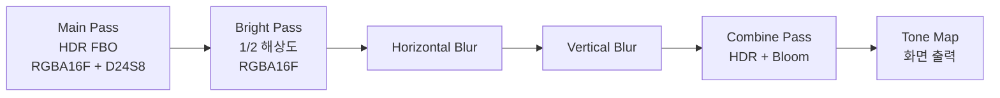

## 들어가며

기본 프레임버퍼는 화면이 받는 단 하나의 출력 표면이다. 셰이더의 색 출력은 이 표면에 직접 그려져 모니터로 향한다. 그러나 현대 그래픽스의 거의 모든 기법 — 그림자 매핑, HDR 후처리, 디퍼드 셰이딩, 블룸, SSAO, 화면 전체 효과 — 은 *화면이 아닌 텍스처에 한 번 그린 뒤 그 결과를 다시 입력으로 쓰는* 모델로 동작한다. 이 모델을 가능하게 하는 것이 *프레임버퍼 객체(Framebuffer Object, FBO)* 다.

FBO는 *어디에 그릴지* 를 추상화한다. 기본 프레임버퍼와 달리 FBO에 묶인 첨부물은 컬러 텍스처 여러 개, 깊이 텍스처, 스텐실 첨부 등으로 자유롭게 구성할 수 있다. 그린 결과는 단순한 텍스처로 남아 있어 다음 패스에서 셰이더 입력으로 다시 페치할 수 있다. 한 프레임에서 여러 FBO를 차례로 거치는 *렌더 그래프(Render Graph)* 가 현대 게임 엔진의 표준 모델이다.

여기서 한 가지 용어를 미리 정리해 둔다. OpenGL 명세는 FBO에 묶이는 컬러·깊이·스텐실 출력 표면을 *프레임버퍼 첨부 가능 이미지(framebuffer-attachable image)* 라 부르고, 그 이미지를 담는 컨테이너 객체를 *프레임버퍼 객체* 라 부른다. 즉 FBO 자체는 픽셀 데이터를 가지지 않는다. FBO는 *어떤 텍스처의 어떤 밉 레벨, 어떤 렌더버퍼* 가 어느 슬롯에 묶여 있는지를 가리키는 *포인터의 묶음* 일 뿐이다. 실제 픽셀은 텍스처 객체나 렌더버퍼 객체가 소유한다. 이 분리를 분명히 잡아 두면 첨부 교체, 자원 수명, 완전성 검사가 모두 깔끔하게 정리된다.

이 글의 목표는 다음 다섯 가지다.

1. FBO와 RBO의 역할, 첨부 가능한 자원의 종류를 정리한다.
2. 텍스처 첨부와 렌더버퍼 첨부 중 어느 쪽을 언제 쓸지 결정한다.
3. 깊이/스텐실 포맷의 비트 수와 메모리 트레이드오프를 본다.
4. 다중 렌더 타깃(Multiple Render Targets, MRT)으로 G-Buffer 같은 다중 출력을 구성한다.
5. `glBlitFramebuffer`로 FBO 사이 픽셀 복사와 MSAA resolve가 어떻게 동작하는지 한정 조건과 함께 정리한다.

기준 컨텍스트는 OpenGL 3.3 Core이며, 더 높은 버전이 필요한 기능(`glNamedFramebufferTexture` DSA, `glBlitNamedFramebuffer`, `glTexStorage2D` 불변 스토리지, sampler-less depth comparison 일부 형태)은 등장 시 요구 버전을 명시한다.


---

## 목차
1. [기본 프레임버퍼와 사용자 FBO](#1-기본-프레임버퍼와-사용자-fbo)
2. [FBO 첨부의 종류](#2-fbo-첨부의-종류)
3. [텍스처 첨부 vs 렌더버퍼 첨부](#3-텍스처-첨부-vs-렌더버퍼-첨부)
4. [깊이/스텐실 형식 선택](#4-깊이스텐실-형식-선택)
5. [다중 렌더 타깃](#5-다중-렌더-타깃)
6. [완전성 검사](#6-완전성-검사)
7. [Blit과 해상도 변환](#7-blit과-해상도-변환)
8. [MSAA Framebuffer와 Resolve](#8-msaa-framebuffer와-resolve)
9. [통합 예제: HDR 메인 + 블룸 후처리 FBO](#9-통합-예제-hdr-메인--블룸-후처리-fbo)


---

## 1. 기본 프레임버퍼와 사용자 FBO

OpenGL 컨텍스트 생성 시 *기본 프레임버퍼* 하나가 자동으로 만들어진다. 이름(ID)이 0이며, 윈도우 시스템이 직접 관리한다. 기본 프레임버퍼의 첨부는 `glfwWindowHint`로 컨텍스트 생성 시 결정된다 — 컬러 비트, 깊이 비트, 스텐실 비트, 더블 버퍼 여부, MSAA 샘플 수 등.

```cpp
glBindFramebuffer(GL_FRAMEBUFFER, 0);  // 기본 프레임버퍼로 복귀
```

기본 프레임버퍼와 사용자 FBO는 첨부 슬롯 이름부터 다르다. 기본 프레임버퍼의 컬러 슬롯은 `GL_BACK_LEFT`, `GL_FRONT_LEFT` 같은 윈도우 시스템 버퍼이고, 사용자 FBO의 컬러 슬롯은 `GL_COLOR_ATTACHMENT0` 부터다. 이 차이 때문에 `glDrawBuffer`/`glReadBuffer`에 넘기는 enum도 두 경우가 다르다. 기본 프레임버퍼에는 `GL_BACK`을, 사용자 FBO에는 `GL_COLOR_ATTACHMENT0` 류를 넘긴다. 둘을 헷갈려 넘기면 `GL_INVALID_OPERATION`이 난다.

사용자 FBO는 `glGenFramebuffers`로 만든다. 만든 직후에는 *이름만 예약된* 상태이고, `glBindFramebuffer`로 한 번 바인딩해야 비로소 실제 FBO 객체가 생성된다. 그 시점에도 *첨부가 비어 있는* 상태라 그릴 수 없다. 컬러·깊이·스텐실 첨부를 묶고 *완전성 검사* 를 통과시켜야 사용 가능하다.

```cpp
GLuint fbo;
glGenFramebuffers(1, &fbo);
glBindFramebuffer(GL_FRAMEBUFFER, fbo);
// 이 시점에서 첨부 없음 → 그릴 수 없음
```

### 바인딩 타깃의 분리

OpenGL 3.0 이후 FBO 바인딩은 *읽기용* 과 *쓰기용* 으로 분리할 수 있다.

| 타깃 | 의미 |
|---|---|
| `GL_DRAW_FRAMEBUFFER` | 그릴 때 쓰는 FBO (셰이더 출력 대상) |
| `GL_READ_FRAMEBUFFER` | 읽을 때 쓰는 FBO (`glReadPixels`, `glBlitFramebuffer` 소스) |
| `GL_FRAMEBUFFER` | 위 둘에 동시 바인딩 |

대부분의 코드는 `GL_FRAMEBUFFER`로 한 번에 바인딩한다. `glBlitFramebuffer`처럼 두 FBO를 동시에 다루는 호출에서만 분리해서 바인딩한다.

```cpp
glBindFramebuffer(GL_READ_FRAMEBUFFER, srcFbo);
glBindFramebuffer(GL_DRAW_FRAMEBUFFER, dstFbo);
glBlitFramebuffer(0, 0, w, h, 0, 0, w, h,
                  GL_COLOR_BUFFER_BIT, GL_LINEAR);
```

### 바인딩은 상태이지 자원이 아니다

`glBindFramebuffer`가 바꾸는 것은 컨텍스트의 *현재 바인딩 상태* 다. 이후의 모든 드로우 콜, `glClear`, `glViewport` 기준 출력이 그 FBO로 향한다. 바인딩을 바꿔도 이전 FBO에 그려진 픽셀은 그대로 남는다. FBO를 *바꿔 가며 그리는* 렌더 그래프가 가능한 이유다. 한 가지 흔한 실수는 FBO를 바인딩한 채 `glViewport` 갱신을 빠뜨리는 것이다. FBO의 첨부 해상도와 viewport가 다르면 그림이 잘리거나 일부만 채워진다. FBO를 바인딩할 때마다 그 FBO의 해상도로 viewport를 다시 설정하는 습관이 안전하다.

### DSA로의 단순화 (4.5+)

OpenGL 4.5의 Direct State Access는 FBO 작업도 ID를 직접 받는 형태로 간소화한다. 전통적 모델은 "객체를 바인딩한 뒤 현재 바인딩에 작업"하는 2단계라, 작업 중 다른 코드가 바인딩을 바꾸면 엉뚱한 FBO가 수정될 위험이 있다. DSA는 바인딩 없이 ID를 직접 지정한다.

```cpp
// 4.5+
glCreateFramebuffers(1, &fbo);
glNamedFramebufferTexture(fbo, GL_COLOR_ATTACHMENT0, colorTex, 0);
glNamedFramebufferRenderbuffer(fbo, GL_DEPTH_ATTACHMENT,
                                GL_RENDERBUFFER, depthRbo);
glCheckNamedFramebufferStatus(fbo, GL_FRAMEBUFFER);
```

`glCreateFramebuffers`는 `glGenFramebuffers`와 달리 *이름 예약 + 객체 생성* 을 한 번에 한다. 따라서 별도 바인딩 없이 곧바로 `glNamed*` 호출이 통한다. 이 글의 3.3 기준에서는 전통적 바인딩 모델로 진행하되, 4.5 이상 환경이라면 DSA 쪽이 바인딩 누수 버그를 구조적으로 차단한다는 점을 기억해 둔다.

## 2. FBO 첨부의 종류

FBO에는 다음 슬롯에 첨부물을 묶는다.

| 슬롯 | 의미 | 동시 첨부 가능 수 |
|---|---|---|
| `GL_COLOR_ATTACHMENT0` ~ `GL_COLOR_ATTACHMENTn` | 컬러 출력 | 보통 8개 (`GL_MAX_COLOR_ATTACHMENTS`) |
| `GL_DEPTH_ATTACHMENT` | 깊이 버퍼 | 1개 |
| `GL_STENCIL_ATTACHMENT` | 스텐실 버퍼 | 1개 |
| `GL_DEPTH_STENCIL_ATTACHMENT` | 깊이+스텐실 통합 | 1개 (위 둘 대체) |

각 슬롯에 묶을 수 있는 자원은 두 종류다.

- **텍스처(Texture)**: 다음 패스에서 *셰이더 입력으로 다시 페치 가능*
- **렌더버퍼(Renderbuffer)**: 단일 패스 출력 전용. 셰이더 입력이 *불가능*

### 동시 첨부 수의 한계

`GL_MAX_COLOR_ATTACHMENTS`는 한 FBO에 묶을 수 있는 컬러 첨부의 *상한* 이고, `GL_MAX_DRAW_BUFFERS`는 한 번의 드로우에 *동시에 출력* 할 수 있는 컬러 첨부의 상한이다. 둘은 별개의 한계이며 데스크톱 GPU에서는 보통 둘 다 8이다. 코드는 하드코딩 대신 사후 질의로 확인한다.

```cpp
GLint maxColorAtt = 0, maxDrawBuf = 0;
glGetIntegerv(GL_MAX_COLOR_ATTACHMENTS, &maxColorAtt);
glGetIntegerv(GL_MAX_DRAW_BUFFERS, &maxDrawBuf);
// 데스크톱 GPU 다수: 둘 다 8. 모바일/ES3: 4~8
```

8개를 넘는 G-Buffer 레이아웃을 설계하면 이 한계에 막힌다. 그래서 디퍼드 G-Buffer는 채널을 패킹해 첨부 개수를 줄이는 방향으로 설계된다. 예를 들어 노멀을 octahedral 인코딩으로 2채널에 담아 한 RT를 절약하는 식이다.

### 깊이 통합 vs 분리 첨부

깊이와 스텐실은 두 가지 방식으로 묶을 수 있다. `GL_DEPTH_ATTACHMENT`와 `GL_STENCIL_ATTACHMENT`에 *각각* 묶거나, `GL_DEPTH_STENCIL_ATTACHMENT` 하나에 *통합 포맷*(`GL_DEPTH24_STENCIL8`)을 묶는다. 통합 포맷을 분리 슬롯에 묶거나 분리 포맷을 통합 슬롯에 묶으면 완전성 검사에서 걸린다. 하드웨어 다수가 깊이와 스텐실을 *같은 메모리 영역에 인터리브* 해 저장하므로, 스텐실이 필요하면 통합 포맷을 쓰는 쪽이 일관적이다.

### 컬러 첨부 슬롯의 의미

`GL_COLOR_ATTACHMENT0`은 *0번 슬롯* 일 뿐 어떤 색을 의미하지 않는다. 셰이더의 `layout(location = N) out vec4...`가 N번 슬롯의 첨부에 출력된다. 슬롯과 location이 1:1 매핑된다.

```glsl
layout(location = 0) out vec4 oAlbedo;     // GL_COLOR_ATTACHMENT0
layout(location = 1) out vec4 oNormal;     // GL_COLOR_ATTACHMENT1
layout(location = 2) out vec4 oMaterial;   // GL_COLOR_ATTACHMENT2
```

여러 슬롯에 동시에 출력하려면 `glDrawBuffers`로 *어느 슬롯들을 쓸지* 선언해야 한다.

### 레이어드 첨부와 큐브맵

`glFramebufferTexture2D`는 2D 텍스처의 한 면을 묶지만, 큐브맵·텍스처 배열·3D 텍스처의 한 레이어를 묶는 변형도 있다.

```cpp
// 큐브맵의 +X 면을 첨부 (점광원 그림자 맵의 한 면)
glFramebufferTexture2D(GL_FRAMEBUFFER, GL_DEPTH_ATTACHMENT,
                       GL_TEXTURE_CUBE_MAP_POSITIVE_X, depthCube, 0);

// 텍스처 배열의 한 레이어를 첨부 (캐스케이드 섀도우의 한 캐스케이드)
glFramebufferTextureLayer(GL_FRAMEBUFFER, GL_DEPTH_ATTACHMENT,
                          depthArray, 0, /*layer=*/2);
```

`glFramebufferTexture`(2D 접미사 없음, 3.2+)로 텍스처 *전체* 를 묶으면 지오메트리 셰이더에서 `gl_Layer`로 레이어를 골라 한 번의 드로우로 여러 레이어에 그리는 *레이어드 렌더링* 이 가능하다. 점광원 큐브맵 그림자를 6면 한 번에 그리는 데 쓰인다. 이 글의 통합 예제는 단일 2D 첨부만 다루지만, 첨부 함수가 큐브맵과 배열로 일반화된다는 점을 기억해 둔다.

## 3. 텍스처 첨부 vs 렌더버퍼 첨부

같은 슬롯에 두 종류 중 어느 쪽을 묶을지의 결정이다.

### 텍스처 첨부

`glFramebufferTexture2D`로 묶는다.

```cpp
GLuint colorTex;
glGenTextures(1, &colorTex);
glBindTexture(GL_TEXTURE_2D, colorTex);
glTexImage2D(GL_TEXTURE_2D, 0, GL_RGBA8, w, h, 0,
             GL_RGBA, GL_UNSIGNED_BYTE, nullptr);  // 데이터는 비워 둠
glTexParameteri(GL_TEXTURE_2D, GL_TEXTURE_MIN_FILTER, GL_LINEAR);
glTexParameteri(GL_TEXTURE_2D, GL_TEXTURE_MAG_FILTER, GL_LINEAR);

glBindFramebuffer(GL_FRAMEBUFFER, fbo);
glFramebufferTexture2D(GL_FRAMEBUFFER, GL_COLOR_ATTACHMENT0,
                        GL_TEXTURE_2D, colorTex, 0);
```

마지막 인자 `0`은 *밉 레벨* 이다. 레벨 0(원본 해상도)에 그린다. 첨부된 텍스처가 밉맵을 가지더라도 FBO는 한 번에 한 레벨만 출력 대상으로 삼는다.

장점은 명백하다. 이 텍스처는 그린 다음에 *셰이더 입력으로 페치* 할 수 있다. 그림자 매핑은 깊이 텍스처를 다음 패스에서 셰이더로 읽고, HDR 후처리는 컬러 텍스처를 후처리 셰이더로 읽는다.

한 가지 함정은 `GL_TEXTURE_MIN_FILTER`의 기본값이다. OpenGL 텍스처의 기본 min 필터는 `GL_NEAREST_MIPMAP_LINEAR`라, 밉맵이 없는 FBO 첨부 텍스처를 그 상태로 셰이더에서 샘플링하면 *텍스처가 불완전(incomplete)* 으로 간주되어 검게 나온다. FBO 컬러 텍스처는 위 코드처럼 `GL_LINEAR` 또는 `GL_NEAREST`로 명시해 밉맵 의존을 끊어야 한다.

### 불변 스토리지: glTexStorage2D (4.2+)

`glTexImage2D`는 호출할 때마다 *크기·포맷 변경이 가능한* 가변 스토리지를 만든다. 드라이버는 이 텍스처의 포맷이 또 바뀔지 모른다고 가정해 일부 최적화를 보류한다. `glTexStorage2D`(4.2+)는 *불변 스토리지(immutable storage)* 를 한 번에 확정해 그 가정을 없앤다.

```cpp
// 4.2+: 크기·포맷 불변. 레벨 1개만 (밉 없음)
glTexStorage2D(GL_TEXTURE_2D, 1, GL_RGBA16F, w, h);
```

불변 스토리지는 FBO 첨부 텍스처에 특히 잘 맞는다. 첨부 텍스처는 해상도가 정해지면 리사이즈 외에는 포맷이 바뀌지 않기 때문이다. 3.3 기준에서는 `glTexImage2D`를 쓰되, 4.2 이상이면 `glTexStorage2D`로 바꾸는 것이 권장 경로다.

### 렌더버퍼 첨부

`glRenderbufferStorage`로 만들고 `glFramebufferRenderbuffer`로 묶는다.

```cpp
GLuint depthRbo;
glGenRenderbuffers(1, &depthRbo);
glBindRenderbuffer(GL_RENDERBUFFER, depthRbo);
glRenderbufferStorage(GL_RENDERBUFFER, GL_DEPTH_COMPONENT24, w, h);

glBindFramebuffer(GL_FRAMEBUFFER, fbo);
glFramebufferRenderbuffer(GL_FRAMEBUFFER, GL_DEPTH_ATTACHMENT,
                           GL_RENDERBUFFER, depthRbo);
```

렌더버퍼는 *그릴 수만 있고 읽을 수 없다*. 셰이더에서 페치할 수 없다. `glReadPixels`나 `glBlitFramebuffer`의 소스로 CPU 또는 다른 FBO에 옮길 수는 있지만, 셰이더 입력으로 바인딩하는 것은 불가능하다. 렌더버퍼는 밉맵도 없고 텍스처 좌표로 샘플링되지도 않는 *순수 출력 표면* 이다.

### 어느 쪽이 빠른가

이 질문이 자주 나오지만 답은 단순하지 않다. 드라이버는 렌더버퍼에 *압축, 빠른 클리어, 더 효율적인 메모리 배치* 같은 최적화를 적용할 여지가 있다. 같은 첨부 데이터에 대해 *셰이더 입력이 필요하지 않다는 정보* 가 드라이버에 추가로 주어지기 때문이다. 구체적으로, 데스크톱 GPU는 깊이 버퍼에 무손실 압축(Hi-Z, depth compression)을 걸어 대역폭을 줄이는데, 이 압축은 첨부가 나중에 임의 텍셀로 샘플링되지 않을 때 더 공격적으로 적용된다. 다만 실제 성능 차이는 GPU·드라이버·포맷·해상도·사용 패턴에 따라 다르므로, 일반화하기보다 *구체적인 케이스에서 측정* 한다.

### 결정 기준

| 조건 | 권장 |
|---|---|
| 같은 첨부를 다음 패스에서 셰이더로 읽음 | 텍스처 |
| 한 번 쓰고 버리는 깊이/스텐실 | 렌더버퍼 |
| 그림자 맵 (다음 패스에서 깊이 비교) | 텍스처 |
| 디퍼드 G-Buffer (라이팅 패스 입력) | 텍스처 |
| 메인 패스 깊이 + 후처리는 깊이 무관 | 렌더버퍼 |
| MSAA 후 화면 직접 표시만 | 렌더버퍼 |
| MSAA 후 후처리에 입력 필요 | 텍스처 + multisampled |

명확한 결정 기준은 *다음 패스에서 셰이더가 읽느냐* 다. 읽으면 텍스처, 안 읽으면 렌더버퍼.

### 첨부 재사용과 풀링

첨부 텍스처와 렌더버퍼는 GPU 메모리를 점유하므로, 한 프레임에 동시에 살아 있을 필요가 없는 중간 자원은 *재사용* 한다. 예컨대 블러의 가로 패스와 세로 패스가 같은 해상도·포맷이면 핑퐁(ping-pong) 두 장으로 돌려 쓴다. 자원 수명이 겹치지 않는 패스끼리 같은 텍스처를 공유하는 *프레임버퍼 풀* 은 고해상도 후처리 체인에서 메모리를 크게 절약한다. FBO 자체는 가볍지만, 첨부된 텍스처/렌더버퍼는 무겁다는 비대칭을 의식한 설계다.

## 4. 깊이/스텐실 형식 선택

깊이 첨부의 비트 수와 포맷이 정밀도와 메모리에 직결된다.

| 포맷 | 깊이 비트 | 스텐실 비트 | 메모리 (픽셀당) | 용도 |
|---|---:|---:|---:|---|
| `GL_DEPTH_COMPONENT16` | 16 | 0 | 2 byte | 모바일/저정밀 |
| `GL_DEPTH_COMPONENT24` | 24 | 0 | 4 byte (24+8 padding) | 일반 |
| `GL_DEPTH24_STENCIL8` | 24 | 8 | 4 byte | 스텐실 필요 시 표준 |
| `GL_DEPTH_COMPONENT32F` | 32f | 0 | 4 byte | Reverse-Z, 광역 장면 (4.5+ `glClipControl` 필요) |
| `GL_DEPTH32F_STENCIL8` | 32f | 8 | 8 byte (32f+8+24 padding) | 정밀 + 스텐실 |

### 깊이는 왜 비선형으로 양자화되는가

원근 투영(Perspective Projection)에서 깊이 값은 뷰 공간 거리에 *반비례* 하게 분포된다. NDC 깊이 $z_{ndc}$는 다음과 같이 변환된다.

$$z_{ndc} = \frac{f + n}{f - n} + \frac{2 f n}{(f - n) \, z_{view}}$$

여기서 $n$은 near plane(양수 거리), $f$는 far plane(양수 거리), $z_{view}$는 카메라 좌표계의 z 값이다. OpenGL의 오른손 좌표계 + 카메라 -Z 방향 컨벤션에서 카메라 *앞쪽 점* 의 $z_{view}$는 음수이고, $-z_{view}$가 카메라부터의 거리에 해당한다. 분모에 $z_{view}$가 들어가므로 near 근처에 정밀도가 몰린다. 깊이 버퍼에 저장되는 값은 이 $z_{ndc}$를 $[0,1]$로 매핑한 것을 다시 정수 단계로 양자화한 것이다. 24비트 unorm은 그 $[0,1]$ 구간을 16,777,216(약 $2^{24}$) 단계로 *균등 분할* 한다. 비선형 분포 + 균등 분할이 겹치면, 먼 거리의 두 표면이 같은 정수 단계로 양자화되어 *Z-fighting* 이 발생한다.

수치로 보면 차이가 분명하다. $n = 0.1$, $f = 1000$인 투영에서 24비트 깊이 버퍼의 월드 공간 깊이 간격은 카메라에서 100m 떨어진 지점에서 약 6mm이고, far plane인 1000m 부근에서는 약 0.60m까지 커진다. $n$을 1.0으로 키우면 같은 거리의 분해능이 약 10배 좋아진다. *near plane을 가능한 한 크게 잡는 것* 이 Z-fighting을 줄이는 가장 값싼 방법인 이유다.

### 24bit unorm vs 32bit float

24비트 unorm은 $[0, 1]$ 구간을 16,777,216 단계로 균등 분할한다. 32비트 부동소수점은 0 근처에서 더 미세하고 1 근처에서 거칠다. *Reverse-Z(near→1, far→0 매핑)* 는 원근 깊이의 먼 거리 정밀도 손실과 부동소수점의 0 근처 고정밀 분포를 맞물리게 한다. 가까운 곳은 원근 투영 자체가 이미 정밀하고, 먼 곳은 0 근처 float 정밀도를 받으므로 광역 야외 장면의 Z-fighting이 크게 줄어든다. 단 GL에서는 클립 깊이를 $[0,1]$로 바꾸는 `glClipControl`(4.5+)이 전제 조건이다 — 아래에서 이유를 본다.

Reverse-Z를 켜려면 네 가지를 함께 바꿔야 한다. 투영 행렬을 near↔far가 뒤집힌 형태로 구성하고, 깊이 비교 함수를 `glDepthFunc(GL_GREATER)`로 바꾸고, 깊이 클리어 값을 `glClearDepth(0.0)`으로 바꾸고, 클립 공간 깊이 범위를 $[0,1]$로 두는 `glClipControl(GL_LOWER_LEFT, GL_ZERO_TO_ONE)`(4.5+ 또는 `ARB_clip_control`)을 켠다. 앞의 셋 중 하나라도 빠지면 깊이 테스트가 전부 통과하거나 전부 실패해 화면이 비거나 깨진다. 그리고 마지막 하나는 선택이 아니다 — GL 기본 NDC $[-1,1]$을 그대로 두면 윈도 깊이가 $0.5 z_{ndc}+0.5$로 계산되면서 far 쪽 분해능이 약 $3\times10^{-8}$에서 막혀 24비트 unorm과 별 차이가 없다. 즉 32F reverse-Z의 이득은 클립 깊이를 $[0,1]$로 둘 때만 나온다. 이 글의 기준 컨텍스트인 OpenGL 3.3 Core에는 `glClipControl`이 없으므로, reverse-Z를 제대로 쓰려면 4.5 컨텍스트나 확장이 필요하다.

24+8 통합 포맷은 *4바이트 정렬* 에서 깊이와 스텐실을 함께 담는 균형점이라 가장 흔한 선택이다. 32f+8 통합은 깊이 32비트 + 스텐실 8비트를 자연스럽게 한 워드에 담지 못해 8바이트로 정렬되고, 결과적으로 메모리가 두 배가 되며 일부 GPU에서 더 비싼 경로로 처리될 수 있다.

### 메모리 정량화

깊이 포맷의 픽셀당 비용을 해상도에 곱하면 프레임버퍼 메모리가 나온다.

| 해상도 | D16 (2 byte) | D24S8 (4 byte) | D32FS8 (8 byte) |
|---|---:|---:|---:|
| 1280×720 | 1.8 MB | 3.5 MB | 7.0 MB |
| 1920×1080 | 4.0 MB | 7.9 MB | 16 MB |
| 3840×2160 (4K) | 16 MB | 32 MB | 63 MB |

깊이 버퍼 하나의 크기다. MSAA 4×를 켜면 여기에 다시 4배가 곱해진다. 4K + 4× MSAA D32FS8 깊이는 약 250 MB로, 단일 버퍼만으로도 무시할 수 없는 양이다. 정밀도 욕심으로 32f를 기본값으로 깔면 메모리 예산이 빠르게 잠식된다.

### 스텐실 사용 사례

스텐실 버퍼는 *픽셀별 마스크* 다. 8비트 정수 한 채널로 픽셀당 256가지 상태를 표현한다.

| 용도 | 스텐실 사용 |
|---|---|
| 거울/포털 | 반사 영역만 그릴 때 마스크 |
| Outline | 캐릭터 영역에 1을 쓴 뒤 외곽선만 다시 그림 |
| Decal | 특정 표면에만 데칼 적용 |
| 그림자 볼륨 | Stencil Shadow Volume (레거시) |
| UI 마스크 | 클립 영역 정의 |

스텐실이 필요 없는 패스는 `GL_DEPTH_COMPONENT24` 단독으로 두는 게 메모리 측면에서 약간 유리하지만, 게임 엔진은 일관성을 위해 보통 `GL_DEPTH24_STENCIL8`을 기본으로 둔다. D24와 D24S8은 어차피 둘 다 4바이트로 정렬되므로 스텐실 8비트를 곁들여도 메모리 비용 차이가 사실상 없다는 점도 한몫한다.

### 깊이 텍스처와 셰이더 페치

깊이 첨부를 텍스처로 두면 셰이더에서 `sampler2D` 또는 `sampler2DShadow`로 읽을 수 있다.

```glsl
uniform sampler2D uDepthTex;       // 일반 페치 (raw 깊이 값)
uniform sampler2DShadow uShadowMap; // 비교 샘플링 (그림자용)
```

`sampler2DShadow`는 PCF(Percentage Closer Filtering)와 결합한 비교 샘플링을 하드웨어가 처리한다. 비교 샘플링을 쓰려면 텍스처 측에서 `GL_TEXTURE_COMPARE_MODE`를 `GL_COMPARE_REF_TO_TEXTURE`로 켜고 `GL_TEXTURE_COMPARE_FUNC`를 설정해야 한다. 이 설정을 켠 채 일반 `sampler2D`로 바인딩하거나, 반대로 끈 채 `sampler2DShadow`로 바인딩하면 결과가 정의되지 않는다. 프레임버퍼 설계에서 중요한 점은 깊이 텍스처의 포맷·비교 모드·셰이더 sampler 타입이 하나의 계약이라는 것이다.

## 5. 다중 렌더 타깃

한 번의 셰이더 호출로 *여러 컬러 첨부에 동시 출력* 하는 모델이다. 디퍼드 셰이딩의 G-Buffer가 대표 사례다.

### 셰이더 측 다중 출력

```glsl
#version 330 core

layout(location = 0) out vec4 oAlbedo;     // GL_COLOR_ATTACHMENT0
layout(location = 1) out vec4 oNormal;     // GL_COLOR_ATTACHMENT1
layout(location = 2) out vec4 oMaterial;   // GL_COLOR_ATTACHMENT2 (metallic, roughness, ao)

in vec2 vUV;
in vec3 vNormalWS;

uniform sampler2D uDiffuse;
uniform sampler2D uMetalRough;

void main() {
    oAlbedo   = texture(uDiffuse, vUV);
    oNormal   = vec4(normalize(vNormalWS) * 0.5 + 0.5, 1.0);
    oMaterial = texture(uMetalRough, vUV);
}
```

세 출력이 셰이더 한 번 호출에 만들어진다. 정점·픽셀 셰이더 비용은 한 번이고, 픽셀당 12 byte(`RGBA8` 한 장 = 채널당 1 byte × 4 채널 = 4 byte, 3장 = 12 byte)의 컬러 출력이 발생한다. 깊이까지 합치면 픽셀당 출력 대역폭이 더 늘어난다. 출력 대역폭이 디퍼드의 주된 비용이라는 점이 곧이어 메모리 표에서 드러난다.

### CPU 측: glDrawBuffers

FBO의 어느 슬롯에 동시 출력할지 선언한다.

```cpp
glBindFramebuffer(GL_FRAMEBUFFER, gBufferFbo);

GLenum drawBuffers[] = {
    GL_COLOR_ATTACHMENT0,
    GL_COLOR_ATTACHMENT1,
    GL_COLOR_ATTACHMENT2,
};
glDrawBuffers(3, drawBuffers);
```

`glDrawBuffers`는 FBO의 *상태로 기록* 된다. 같은 FBO를 다시 바인딩하면 그 설정이 유지된다.

배열의 *인덱스* 가 셰이더 출력 `location`에 대응한다. 사용자 FBO가 바인딩된 상태에서는 `bufs[i]`에 `GL_COLOR_ATTACHMENTi` 또는 `GL_NONE`만 지정할 수 있다. 예를 들어 location 2의 출력은 `bufs[2] = GL_COLOR_ATTACHMENT2`일 때 attachment 2로 기록된다. location 0을 attachment 2로 보내는 식의 임의 재배치는 허용되지 않으며, 시도하면 `GL_INVALID_OPERATION`이 발생한다. 출력 location을 쓰지 않으려면 해당 자리에 `GL_NONE`을 넣는다.

```cpp
GLenum bufs[] = { GL_COLOR_ATTACHMENT0, GL_NONE, GL_COLOR_ATTACHMENT2 };
glDrawBuffers(3, bufs);  // location 1의 출력은 폐기
```

깊이만 쓰는 그림자 맵 패스처럼 컬러 출력이 전혀 없는 FBO는 `glDrawBuffer(GL_NONE)`과 `glReadBuffer(GL_NONE)`을 명시해야 완전성 검사를 통과한다. 컬러 첨부가 하나도 없는 FBO에 draw/read buffer가 컬러 슬롯을 가리키고 있으면 incomplete가 된다.

### G-Buffer 메모리 비용

전형적인 G-Buffer는 다음과 같다.

| 채널 | 포맷 | bpp |
|---|---|---:|
| Albedo + AO | `GL_RGBA8` | 32 |
| Normal | `GL_RGB10_A2` | 32 |
| Metallic + Roughness + (extra) | `GL_RGBA8` | 32 |
| Depth | `GL_DEPTH24_STENCIL8` | 32 |
| 합계 | | 128 bpp |

1920×1080 G-Buffer는 약 32 MB. 4K(3840×2160)는 약 130 MB. 이게 *한 프레임의 중간 자원* 만의 크기다. 디퍼드 셰이딩이 *고해상도에서 메모리 대역폭을 빠르게 소모* 하는 이유다. 픽셀당 128비트를 *쓰고*(지오메트리 패스) 다시 *읽는*(라이팅 패스) 왕복이 일어나므로, 4K에서는 G-Buffer 한 번의 쓰기-읽기만으로 수백 MB의 대역폭 트래픽이 발생한다. 모바일에서 디퍼드를 피하고 forward+ 같은 변종을 쓰는 동기다. 노멀을 `GL_RG16F` octahedral로 압축하고 깊이에서 위치를 복원해 첨부를 줄이는 *thin G-Buffer* 설계가 대역폭 절감의 핵심 기법이다.

### 출력 슬롯 분리의 한계

같은 FBO 안에서 *샘플 수* 는 모든 첨부에서 일치해야 한다(불일치 시 INCOMPLETE_MULTISAMPLE). 포맷은 첨부마다 달라도 된다(한 FBO 안에서 `RGBA8`과 `RGBA16F`를 섞을 수 있다). 해상도는 3.3 Core 명세상 첨부마다 달라도 완전성 검사는 통과하지만(EXT_framebuffer_object 시절의 동일 크기 요구가 ARB/Core에서 완화됨), 렌더링 영역이 *모든 첨부의 교집합* 으로 제한되므로 실무에서는 동일하게 맞춘다. 이 제약이 까다로우면 FBO를 분리한다. 또한 블렌딩을 켜면 모든 활성 draw buffer에 같은 블렌드 상태가 적용되는데, 첨부별로 다른 블렌드가 필요하면 `glBlendFunci`/`glEnablei`(4.0+)로 인덱스별 블렌드 상태를 지정한다.

## 6. 완전성 검사

FBO 만든 직후 또는 첨부 변경 후, *그릴 수 있는 상태인지* 확인하는 호출이다.

```cpp
glBindFramebuffer(GL_FRAMEBUFFER, fbo);
GLenum status = glCheckFramebufferStatus(GL_FRAMEBUFFER);
if (status != GL_FRAMEBUFFER_COMPLETE) {
    std::fprintf(stderr, "FBO incomplete: 0x%X\n", status);
}
```

완전성은 *바인딩된 FBO 기준* 으로 검사된다. 검사 직전에 올바른 FBO가 바인딩되어 있어야 의미 있는 결과가 나온다. 또한 완전성은 *영구 속성이 아니다*. 첨부 텍스처를 리사이즈하거나 포맷을 바꾸면 다시 불완전해질 수 있으므로, 첨부를 건드린 뒤에는 재검사한다.

### 상태 코드

| 코드 | 의미 |
|---|---|
| `GL_FRAMEBUFFER_COMPLETE` | 정상 |
| `GL_FRAMEBUFFER_UNDEFINED` | 기본 프레임버퍼인데 윈도우가 이미 파괴됨 |
| `GL_FRAMEBUFFER_INCOMPLETE_ATTACHMENT` | 첨부물이 비어 있거나 잘못됨 |
| `GL_FRAMEBUFFER_INCOMPLETE_MISSING_ATTACHMENT` | 어떤 첨부도 없음 |
| `GL_FRAMEBUFFER_INCOMPLETE_DRAW_BUFFER` | `glDrawBuffers`가 가리키는 슬롯이 비어 있음 |
| `GL_FRAMEBUFFER_INCOMPLETE_READ_BUFFER` | `glReadBuffer`가 가리키는 슬롯이 비어 있음 |
| `GL_FRAMEBUFFER_UNSUPPORTED` | 드라이버가 이 조합 미지원 |
| `GL_FRAMEBUFFER_INCOMPLETE_MULTISAMPLE` | 첨부들의 샘플 수가 일치하지 않음 |
| `GL_FRAMEBUFFER_INCOMPLETE_LAYER_TARGETS` | 레이어드 첨부와 비-레이어드 첨부가 섞임 |

`GL_FRAMEBUFFER_UNSUPPORTED`는 각 첨부가 개별적으로는 합법이지만 *그 조합* 을 드라이버가 거부할 때 나온다. 명세가 모든 포맷 조합의 완전성을 보장하지 않기 때문에, 이 코드는 "포맷을 바꿔 보라"는 신호다. 흔한 조합(`RGBA8` + `D24S8`)은 모든 드라이버가 보장하지만, 비주류 포맷 조합은 환경에 따라 거부될 수 있다.

### 흔한 함정

- 컬러 첨부와 깊이 첨부의 *해상도가 다름* → 3.3 Core에서는 완전성 위반이 아니라 렌더링 영역이 교집합으로 줄어드는 조용한 버그가 된다 (화면 일부만 그려짐)
- MSAA 컬러(샘플 4) + 비-MSAA 깊이 → INCOMPLETE_MULTISAMPLE
- `glDrawBuffers`로 ATTACHMENT2를 지정했는데 첨부가 0과 1만 있음 → INCOMPLETE_DRAW_BUFFER
- 텍스처를 첨부했지만 `glTexImage2D`로 스토리지를 할당하지 않음 (밉맵 0 레벨이 없음) → INCOMPLETE_ATTACHMENT
- 깊이 첨부에 컬러 포맷(`GL_RGBA8`)을 지정 → INCOMPLETE_ATTACHMENT
- 깊이 전용 패스인데 `glDrawBuffer(GL_NONE)`을 명시하지 않음 → 컬러 draw buffer가 빈 슬롯을 가리켜 INCOMPLETE_DRAW_BUFFER

디버그 빌드에서 매 FBO 생성 후 검사하고 실패 시 즉시 트랩하면 디버그가 빠르다. 검사 호출 자체는 드라이버 검증을 동반해 가볍지 않으므로, 매 프레임이 아니라 *FBO 생성·리사이즈 시점* 에만 호출한다.

### 상태 코드를 문자열로

콘솔에서 16진수 코드를 매번 명세와 대조하는 일을 줄이려면 변환 헬퍼를 둔다.

```cpp
const char* FboStatusStr(GLenum s) {
    switch (s) {
        case GL_FRAMEBUFFER_COMPLETE: return "COMPLETE";
        case GL_FRAMEBUFFER_INCOMPLETE_ATTACHMENT: return "INCOMPLETE_ATTACHMENT";
        case GL_FRAMEBUFFER_INCOMPLETE_MISSING_ATTACHMENT: return "MISSING_ATTACHMENT";
        case GL_FRAMEBUFFER_INCOMPLETE_DRAW_BUFFER: return "INCOMPLETE_DRAW_BUFFER";
        case GL_FRAMEBUFFER_INCOMPLETE_READ_BUFFER: return "INCOMPLETE_READ_BUFFER";
        case GL_FRAMEBUFFER_UNSUPPORTED: return "UNSUPPORTED";
        case GL_FRAMEBUFFER_INCOMPLETE_MULTISAMPLE: return "INCOMPLETE_MULTISAMPLE";
    }
    return "UNKNOWN";
}
```

## 7. Blit과 해상도 변환

`glBlitFramebuffer`는 한 FBO의 픽셀을 다른 FBO로 복사한다.

```cpp
glBindFramebuffer(GL_READ_FRAMEBUFFER, srcFbo);
glBindFramebuffer(GL_DRAW_FRAMEBUFFER, dstFbo);
glBlitFramebuffer(
    srcX0, srcY0, srcX1, srcY1,    // 소스 사각형
    dstX0, dstY0, dstX1, dstY1,    // 대상 사각형
    GL_COLOR_BUFFER_BIT,            // 어느 버퍼 (color/depth/stencil)
    GL_LINEAR);                     // 필터 (LINEAR / NEAREST)
```

소스와 대상의 사각형 크기가 다르면 자동으로 스케일링된다. 같은 호출이 *MSAA → 비-MSAA resolve* 도 처리한다. 사각형 좌표를 음수나 뒤집힌 순서로 주면 *플립* 도 가능하다. `srcY0`과 `srcY1`을 바꿔 넘기면 상하 반전 복사가 일어나는데, `glReadPixels` 결과의 좌표계가 위아래 뒤집혀 보이는 문제를 blit 한 번으로 정리하는 데 쓰인다.

### 컬러 blit

소스와 대상이 색 포맷이면 `GL_LINEAR` 또는 `GL_NEAREST` 필터를 쓸 수 있다. 해상도가 다를 때 `GL_LINEAR`로 부드럽게 보간된다. 단, 소스와 대상이 정수 포맷(`GL_RGBA8UI` 같은 integer texture)이면 보간이 정의되지 않으므로 `GL_NEAREST`만 허용된다.

`glReadBuffer`로 소스 FBO의 *어느 컬러 슬롯* 을 읽을지, draw buffer로 대상의 어느 슬롯들에 쓸지 결정된다. MRT FBO에서 특정 슬롯만 blit하려면 `glReadBuffer(GL_COLOR_ATTACHMENT1)`처럼 소스 읽기 슬롯을 명시한다.

### Depth/Stencil blit의 한정 조건

깊이/스텐실 blit은 *제한이 크다*.

- 필터는 `GL_NEAREST` 만 가능 (`GL_LINEAR` 사용 불가)
- 소스가 MSAA면 소스/대상 사각형 크기가 동일해야 한다 (단일 샘플 깊이는 `GL_NEAREST` 스케일링이 명세상 허용되지만 품질이 보장되지 않아 실무에서는 피한다)
- 소스와 대상의 포맷이 호환되어야 한다

```cpp
// OK
glBlitFramebuffer(0, 0, w, h, 0, 0, w, h,
                  GL_DEPTH_BUFFER_BIT, GL_NEAREST);

// 오류 (depth + GL_LINEAR)
glBlitFramebuffer(0, 0, w, h, 0, 0, w/2, h/2,
                  GL_DEPTH_BUFFER_BIT, GL_LINEAR);  // GL_INVALID_OPERATION
```

깊이를 다른 해상도로 옮기고 싶으면 셰이더로 직접 다운샘플링한다. 깊이/스텐실을 동시에 옮기려면 `GL_DEPTH_BUFFER_BIT | GL_STENCIL_BUFFER_BIT`를 함께 넘기고, 양쪽 첨부가 모두 `D24S8` 같은 통합 포맷이어야 한다.

깊이 blit이 자주 쓰이는 곳은 디퍼드 + forward 혼합 파이프라인이다. 디퍼드 라이팅 후 투명 물체를 forward로 그릴 때, G-Buffer FBO의 깊이를 forward FBO로 blit해 깊이 테스트를 이어가야 한다. 이때 해상도가 같으므로 `GL_NEAREST` 깊이 blit이 정확히 들어맞는다.

### MSAA Resolve와 Scaling의 조합 제한

MSAA 첨부를 비-MSAA 첨부로 옮기는 *resolve* 와 *해상도 변환* 을 *한 번의 호출에 합칠 수 없다*. 두 단계로 나눈다.

```cpp
// 1단계: MSAA → 같은 해상도 비-MSAA (resolve)
glBindFramebuffer(GL_READ_FRAMEBUFFER, msaaFbo);
glBindFramebuffer(GL_DRAW_FRAMEBUFFER, resolveFbo);
glBlitFramebuffer(0, 0, w, h, 0, 0, w, h,
                  GL_COLOR_BUFFER_BIT, GL_NEAREST);

// 2단계: 비-MSAA → 다른 해상도 (scaling)
glBindFramebuffer(GL_READ_FRAMEBUFFER, resolveFbo);
glBindFramebuffer(GL_DRAW_FRAMEBUFFER, finalFbo);
glBlitFramebuffer(0, 0, w, h, 0, 0, w/2, h/2,
                  GL_COLOR_BUFFER_BIT, GL_LINEAR);
```

한 호출에 합치려고 하면 `GL_INVALID_OPERATION`이 발생한다.

### glReadPixels와의 차이

`glReadPixels`는 GPU의 픽셀을 *CPU 메모리* 로 가져온다. GPU가 그 픽셀을 다 그릴 때까지 CPU가 기다리는 동기화 stall이 발생하므로, 매 프레임 호출하면 GPU-CPU 파이프라인이 직렬화되어 성능이 큰폭으로 떨어진다. 비동기로 받으려면 *픽셀 버퍼 객체(Pixel Buffer Object, PBO)* 에 읽어 두고 한두 프레임 뒤에 매핑해 stall을 피한다. `glBlitFramebuffer`는 GPU 안에서 끝나므로 이런 stall이 없다. 화면 캡처나 GPU picking 같은 특수 목적 외에 `glReadPixels`의 동기 호출은 피한다.

## 8. MSAA Framebuffer와 Resolve

다중 표본 안티앨리어싱(Multisample Anti-Aliasing)은 한 픽셀당 여러 샘플을 잡아 가장자리를 부드럽게 만든다. 핵심은 *커버리지(coverage)와 셰이딩(shading)을 분리* 한다는 점이다. 픽셀 셰이더는 픽셀당 한 번만 실행되지만, 깊이 테스트와 커버리지 판정은 샘플별로 일어난다. 한 삼각형이 픽셀의 4개 샘플 중 2개만 덮으면, 셰이딩된 색이 그 2개 샘플에만 기록되고 resolve 시 평균되어 가장자리가 절반 밝기로 부드러워진다. 이 덕분에 4× MSAA가 *4배 셰이딩 비용 없이* 가장자리만 골라 품질을 올린다.

FBO에서 MSAA를 활용하려면 첨부물도 *멀티샘플 버전* 이어야 한다.

### MSAA 렌더버퍼

```cpp
GLuint msaaColorRbo;
glGenRenderbuffers(1, &msaaColorRbo);
glBindRenderbuffer(GL_RENDERBUFFER, msaaColorRbo);
glRenderbufferStorageMultisample(GL_RENDERBUFFER, 4,
                                  GL_RGBA8, w, h);

GLuint msaaDepthRbo;
glGenRenderbuffers(1, &msaaDepthRbo);
glBindRenderbuffer(GL_RENDERBUFFER, msaaDepthRbo);
glRenderbufferStorageMultisample(GL_RENDERBUFFER, 4,
                                  GL_DEPTH24_STENCIL8, w, h);
```

샘플 수는 모든 첨부에서 동일해야 한다. 요청한 샘플 수가 하드웨어 한계를 넘으면 드라이버가 더 낮은 수로 클램프할 수 있다. 실제로 할당된 샘플 수는 `glGetRenderbufferParameteriv(..., GL_RENDERBUFFER_SAMPLES,...)`로 확인한다. 지원되는 최대 샘플 수는 `GL_MAX_SAMPLES`로 질의한다.

### MSAA 텍스처

`GL_TEXTURE_2D_MULTISAMPLE` 타깃을 쓴다.

```cpp
GLuint msaaColorTex;
glGenTextures(1, &msaaColorTex);
glBindTexture(GL_TEXTURE_2D_MULTISAMPLE, msaaColorTex);
glTexImage2DMultisample(GL_TEXTURE_2D_MULTISAMPLE, 4,
                        GL_RGBA8, w, h, GL_TRUE);

glFramebufferTexture2D(GL_FRAMEBUFFER, GL_COLOR_ATTACHMENT0,
                        GL_TEXTURE_2D_MULTISAMPLE, msaaColorTex, 0);
```

마지막 `GL_TRUE`는 *fixed sample locations* 다. 모든 텍셀이 같은 샘플 위치 패턴을 쓰도록 강제한다. 여러 MSAA 첨부를 한 FBO에 묶거나, MSAA 깊이와 컬러를 함께 쓸 때는 이 값을 모든 첨부에서 일치시켜야 완전성 검사를 통과한다.

멀티샘플 텍스처는 밉맵을 가질 수 없고, `GL_TEXTURE_MIN_FILTER` 같은 필터 파라미터도 받지 않는다. 셰이더에서 멀티샘플 텍스처를 *직접 페치* 하려면 `sampler2DMS`를 쓴다.

```glsl
uniform sampler2DMS uMSAATex;

vec4 sample = texelFetch(uMSAATex, ivec2(gl_FragCoord.xy), 0);  // 0번 샘플
```

`texelFetch` 호출 시 샘플 인덱스를 명시한다. 모든 샘플을 평균하려면 명시적으로 루프한다.

```glsl
vec4 sum = vec4(0.0);
for (int s = 0; s < 4; ++s) {
    sum += texelFetch(uMSAATex, ivec2(gl_FragCoord.xy), s);
}
sum *= 0.25;
```

이 수동 resolve는 HDR 컬러에서 톤 매핑 전에 평균을 내야 할 때 의미가 있다. 톤 매핑 후 평균하면 밝은 샘플의 가중이 왜곡되므로, *톤 매핑 전 선형 공간에서 평균* 하는 순서가 중요하다.

### Resolve

MSAA 결과를 화면에 표시하거나 후처리에 입력하려면 비-MSAA로 *resolve* 한다. `glBlitFramebuffer`가 처리한다.

```cpp
glBindFramebuffer(GL_READ_FRAMEBUFFER, msaaFbo);
glBindFramebuffer(GL_DRAW_FRAMEBUFFER, resolveFbo);
glBlitFramebuffer(0, 0, w, h, 0, 0, w, h,
                  GL_COLOR_BUFFER_BIT, GL_NEAREST);
```

MSAA → 비-MSAA blit은 *해상도 동일 + GL_NEAREST* 만 허용된다(7절 참고). 다른 해상도로 가려면 resolve 후 별도 blit으로 두 단계. blit resolve는 단순 평균(box filter)을 쓰므로, 더 정교한 resolve가 필요하면 위의 `sampler2DMS` 수동 경로로 가중 평균을 직접 구현한다.

### 깊이 첨부는 resolve가 까다롭다

blit resolve는 컬러를 평균하지만, *깊이는 평균이 의미 없다*. 가장자리에서 두 표면의 깊이를 평균하면 어느 표면에도 속하지 않는 깊이가 나오기 때문이다. 그래서 MSAA 깊이가 후처리(SSAO, SSR 등)에 필요하면 보통 단일 샘플(0번)을 골라 쓰거나, 깊이 기반 효과를 MSAA 이전 단계에서 처리하는 식으로 우회한다. 깊이 resolve의 의미가 컬러만큼 자명하지 않다는 점이 MSAA + 디퍼드 조합을 어렵게 만드는 한 원인이다.

### 모바일 GPU의 Lazy Resolve

타일 기반 모바일 GPU(Mali, Adreno, PowerVR)는 *MSAA 결과를 메모리에 쓰지 않고 타일 안에서 즉시 resolve* 하는 최적화를 한다. 이 경우 MSAA 컬러 첨부는 *타일 메모리(on-chip)에만 존재* 하고 시스템 메모리 사용량이 크게 줄어든다. OpenGL ES의 `glInvalidateFramebuffer`로 *MSAA 첨부 보존이 필요 없음* 을 알리면 이 최적화가 켜진다. 데스크톱에서도 `glInvalidateFramebuffer`(4.3+)로 더 이상 안 쓸 깊이 첨부를 무효화하면, 드라이버가 그 내용을 메모리에 라이트백하지 않아 대역폭을 아낀다.

## 9. 통합 예제: HDR 메인 + 블룸 후처리 FBO

전형적인 후처리 체인을 구성한다. 메인 패스가 HDR 컬러를 FBO에 그리고, 블룸 패스가 그 결과에서 밝은 영역을 추출해 흐린 뒤 더한 다음, 톤 매핑으로 화면에 출력한다.

### FBO 구조



이 체인의 핵심은 메인 패스 출력이 `RGBA8`이 아니라 `RGBA16F`라는 점이다. 1.0을 넘는 밝기 값을 보존해야 블룸이 *진짜 밝은 영역* 을 골라낼 수 있다. LDR로 적재하면 1.0 이상이 모두 1.0으로 클램프되어 블룸의 입력이 사라진다.

### HDR FBO 생성

```cpp
struct HDRFramebuffer {
    GLuint fbo = 0;
    GLuint colorTex = 0;
    GLuint depthRbo = 0;
    int w = 0, h = 0;
};

HDRFramebuffer CreateHDRFramebuffer(int w, int h) {
    HDRFramebuffer hdr;
    hdr.w = w; hdr.h = h;

    // 컬러: HDR을 위한 RGBA16F 텍스처 (셰이더 입력으로 다시 페치)
    glGenTextures(1, &hdr.colorTex);
    glBindTexture(GL_TEXTURE_2D, hdr.colorTex);
    glTexImage2D(GL_TEXTURE_2D, 0, GL_RGBA16F, w, h, 0,
                 GL_RGBA, GL_FLOAT, nullptr);
    glTexParameteri(GL_TEXTURE_2D, GL_TEXTURE_MIN_FILTER, GL_LINEAR);
    glTexParameteri(GL_TEXTURE_2D, GL_TEXTURE_MAG_FILTER, GL_LINEAR);
    glTexParameteri(GL_TEXTURE_2D, GL_TEXTURE_WRAP_S, GL_CLAMP_TO_EDGE);
    glTexParameteri(GL_TEXTURE_2D, GL_TEXTURE_WRAP_T, GL_CLAMP_TO_EDGE);

    // 깊이: 후처리에서 페치하지 않으므로 렌더버퍼
    glGenRenderbuffers(1, &hdr.depthRbo);
    glBindRenderbuffer(GL_RENDERBUFFER, hdr.depthRbo);
    glRenderbufferStorage(GL_RENDERBUFFER, GL_DEPTH24_STENCIL8, w, h);

    glGenFramebuffers(1, &hdr.fbo);
    glBindFramebuffer(GL_FRAMEBUFFER, hdr.fbo);
    glFramebufferTexture2D(GL_FRAMEBUFFER, GL_COLOR_ATTACHMENT0,
                            GL_TEXTURE_2D, hdr.colorTex, 0);
    glFramebufferRenderbuffer(GL_FRAMEBUFFER, GL_DEPTH_STENCIL_ATTACHMENT,
                               GL_RENDERBUFFER, hdr.depthRbo);

    GLenum drawBufs[] = { GL_COLOR_ATTACHMENT0 };
    glDrawBuffers(1, drawBufs);

    if (glCheckFramebufferStatus(GL_FRAMEBUFFER) != GL_FRAMEBUFFER_COMPLETE) {
        std::fprintf(stderr, "HDR FBO incomplete\n");
    }

    glBindFramebuffer(GL_FRAMEBUFFER, 0);
    return hdr;
}
```

컬러는 텍스처(다음 패스에서 셰이더 입력), 깊이는 렌더버퍼(후처리는 깊이 안 씀). 컬러 텍스처는 `GL_RGBA16F`로 1.0을 넘는 밝기를 보존한다. 깊이를 `GL_DEPTH_STENCIL_ATTACHMENT`에 통합 포맷으로 묶었으므로, 메인 패스에서 스텐실 마스킹(예: UI 클립)을 함께 쓸 여지가 남는다.

### 리사이즈 처리

윈도우 크기가 바뀌면 모든 첨부의 해상도를 다시 잡아야 한다. 단순히 `glTexImage2D`를 새 크기로 다시 호출하고 렌더버퍼 스토리지를 재할당한 뒤 완전성을 재검사한다. 매 프레임이 아니라 *리사이즈 이벤트* 에서만 한다.

```cpp
void ResizeHDRFramebuffer(HDRFramebuffer& hdr, int w, int h) {
    if (w == hdr.w && h == hdr.h) return;  // 변화 없으면 건너뜀
    hdr.w = w; hdr.h = h;

    glBindTexture(GL_TEXTURE_2D, hdr.colorTex);
    glTexImage2D(GL_TEXTURE_2D, 0, GL_RGBA16F, w, h, 0,
                 GL_RGBA, GL_FLOAT, nullptr);

    glBindRenderbuffer(GL_RENDERBUFFER, hdr.depthRbo);
    glRenderbufferStorage(GL_RENDERBUFFER, GL_DEPTH24_STENCIL8, w, h);

    glBindFramebuffer(GL_FRAMEBUFFER, hdr.fbo);
    if (glCheckFramebufferStatus(GL_FRAMEBUFFER) != GL_FRAMEBUFFER_COMPLETE) {
        std::fprintf(stderr, "HDR FBO incomplete after resize\n");
    }
    glBindFramebuffer(GL_FRAMEBUFFER, 0);
}
```

리사이즈를 빠뜨리면 FBO 첨부 해상도와 viewport가 어긋나, 윈도우를 키웠을 때 화면 일부만 그려지고 나머지가 검게 남는 흔한 버그가 생긴다.

### 블룸용 작은 FBO

블룸은 *해상도를 절반/사분의 일* 로 줄여 작업한다. 블러 결과가 큰 영역으로 퍼지고, 작은 해상도가 충분히 부드러움을 준다. 저해상도 작업은 블러 샘플 수와 처리 픽셀 수를 모두 줄여 비용을 4분의 1 이하로 떨어뜨린다.

```cpp
struct BloomChain {
    GLuint fboBright;
    GLuint texBright;
    GLuint fboBlur1, texBlur1;
    GLuint fboBlur2, texBlur2;
    int w, h;
};

// 헬퍼: 단일 컬러 텍스처 FBO
GLuint CreateColorOnlyFBO(int w, int h, GLenum internalFmt, GLuint& tex) {
    glGenTextures(1, &tex);
    glBindTexture(GL_TEXTURE_2D, tex);
    glTexImage2D(GL_TEXTURE_2D, 0, internalFmt, w, h, 0,
                 GL_RGBA, GL_FLOAT, nullptr);
    glTexParameteri(GL_TEXTURE_2D, GL_TEXTURE_MIN_FILTER, GL_LINEAR);
    glTexParameteri(GL_TEXTURE_2D, GL_TEXTURE_MAG_FILTER, GL_LINEAR);
    glTexParameteri(GL_TEXTURE_2D, GL_TEXTURE_WRAP_S, GL_CLAMP_TO_EDGE);
    glTexParameteri(GL_TEXTURE_2D, GL_TEXTURE_WRAP_T, GL_CLAMP_TO_EDGE);

    GLuint fbo;
    glGenFramebuffers(1, &fbo);
    glBindFramebuffer(GL_FRAMEBUFFER, fbo);
    glFramebufferTexture2D(GL_FRAMEBUFFER, GL_COLOR_ATTACHMENT0,
                            GL_TEXTURE_2D, tex, 0);
    GLenum bufs[] = { GL_COLOR_ATTACHMENT0 };
    glDrawBuffers(1, bufs);
    return fbo;
}

BloomChain CreateBloomChain(int w, int h) {
    BloomChain b;
    b.w = w / 2; b.h = h / 2;
    b.fboBright = CreateColorOnlyFBO(b.w, b.h, GL_RGBA16F, b.texBright);
    b.fboBlur1  = CreateColorOnlyFBO(b.w, b.h, GL_RGBA16F, b.texBlur1);
    b.fboBlur2  = CreateColorOnlyFBO(b.w, b.h, GL_RGBA16F, b.texBlur2);
    return b;
}
```

블러 텍스처의 `GL_TEXTURE_WRAP_S/T`를 `GL_CLAMP_TO_EDGE`로 둔 이유는, 가장자리 근처에서 반대편 픽셀이 감겨 들어오는(`GL_REPEAT`) 현상을 막기 위해서다. 화면 가장자리의 밝은 빛이 반대편 가장자리로 새어 나오는 버그가 이 설정 하나로 사라진다.

### 메인 루프

```cpp
HDRFramebuffer hdr = CreateHDRFramebuffer(W, H);
BloomChain bloom = CreateBloomChain(W, H);

while (!glfwWindowShouldClose(window)) {
    // 1) HDR 메인 패스
    glBindFramebuffer(GL_FRAMEBUFFER, hdr.fbo);
    glViewport(0, 0, hdr.w, hdr.h);
    glClearColor(0, 0, 0, 1);
    glClear(GL_COLOR_BUFFER_BIT | GL_DEPTH_BUFFER_BIT);
    DrawScene();  // RGBA16F에 HDR 컬러를 그린다

    // 2) Bright Pass: 임계값 넘는 픽셀만 추출
    glBindFramebuffer(GL_FRAMEBUFFER, bloom.fboBright);
    glViewport(0, 0, bloom.w, bloom.h);
    glUseProgram(brightProgram);
    BindTexture(0, hdr.colorTex);
    DrawFullscreenQuad();

    // 3) Horizontal Blur
    glBindFramebuffer(GL_FRAMEBUFFER, bloom.fboBlur1);
    glUseProgram(blurHProgram);
    BindTexture(0, bloom.texBright);
    DrawFullscreenQuad();

    // 4) Vertical Blur
    glBindFramebuffer(GL_FRAMEBUFFER, bloom.fboBlur2);
    glUseProgram(blurVProgram);
    BindTexture(0, bloom.texBlur1);
    DrawFullscreenQuad();

    // 5) Combine + Tone Map → 화면
    glBindFramebuffer(GL_FRAMEBUFFER, 0);
    glViewport(0, 0, W, H);
    glUseProgram(toneMapProgram);
    BindTexture(0, hdr.colorTex);    // HDR 메인
    BindTexture(1, bloom.texBlur2);  // 블룸 결과
    DrawFullscreenQuad();

    glfwSwapBuffers(window);
    glfwPollEvents();
}
```

각 패스마다 *FBO 바인딩 → viewport 갱신 → 그리기* 순서가 반복된다. 블룸 패스들은 저해상도(`bloom.w`, `bloom.h`)이고 최종 패스만 풀 해상도(`W`, `H`)이므로 viewport를 패스마다 다시 잡는 점이 핵심이다. 풀스크린 사각형 패스에서는 깊이 테스트가 의미 없으므로 `glDisable(GL_DEPTH_TEST)`를 한 번 걸어 두면 불필요한 깊이 비교를 건너뛴다.

### 톤 매핑 셰이더

```glsl
#version 330 core

uniform sampler2D uHDR;
uniform sampler2D uBloom;

in vec2 vUV;
layout(location = 0) out vec4 FragColor;

vec3 ACESFilm(vec3 x) {
    float a = 2.51, b = 0.03, c = 2.43, d = 0.59, e = 0.14;
    return clamp((x*(a*x+b))/(x*(c*x+d)+e), 0.0, 1.0);
}

void main() {
    vec3 hdr   = texture(uHDR,   vUV).rgb;
    vec3 bloom = texture(uBloom, vUV).rgb;
    vec3 mixed = hdr + bloom * 0.04;          // 블룸 강도 조절
    vec3 tone  = ACESFilm(mixed);
    FragColor  = vec4(tone, 1.0);
    // 출력은 Linear, GL_FRAMEBUFFER_SRGB로 자동 sRGB 인코딩
}
```

톤 매핑은 HDR(0~수십) 범위를 LDR(0~1)로 압축한다. ACES 곡선이 밝은 영역을 부드럽게 굴려 클리핑을 줄인다. 최종 출력은 선형 색이고, `glEnable(GL_FRAMEBUFFER_SRGB)`가 켜져 있으면 하드웨어가 sRGB 인코딩을 자동으로 적용한다. 셰이더에서 직접 `pow(color, 1.0/2.2)`를 또 적용하면 sRGB가 이중으로 걸려 색이 바래므로, 둘 중 하나만 쓴다.

### 디버깅 체크리스트

- 화면이 검정 → HDR FBO의 깊이 첨부 누락(완전성 검사 실패), `glDrawBuffers` 미설정, 또는 리사이즈 후 viewport 미갱신
- 블룸이 안 보임 → bright pass의 임계값이 너무 높음, 또는 메인 패스가 LDR(`RGBA8`)로 적재되어 1.0 이상 값이 클램프됨
- 블룸이 사각형 격자처럼 보임 → 블러 패스의 샘플링이 `GL_NEAREST`로 되어 있음
- 블룸 빛이 화면 반대편 가장자리로 샘 → 블러 텍스처의 wrap이 `GL_REPEAT`(→ `GL_CLAMP_TO_EDGE`로)
- 색이 너무 어두움 → 메인 패스에서 sRGB 텍스처를 Linear로 자동 변환받았는데 셰이더에서 또 `pow(2.2)`를 적용 (4절 검수 항목)
- 색이 너무 밝음 → `GL_FRAMEBUFFER_SRGB` + 셰이더의 `pow(1/2.2)` 동시 적용
- 윈도우 키웠을 때 일부만 그려짐 → FBO 첨부 해상도와 viewport 불일치 (리사이즈 핸들러 누락)


---

## 결론

FBO는 *어디에 그릴지* 의 추상화다. 텍스처 첨부는 셰이더 입력으로 다시 읽는 길을 열고, 렌더버퍼 첨부는 한 번 쓰고 버리는 자원에 더 효율적인 메모리 배치를 허용한다. MRT로 한 셰이더 호출이 여러 컬러 첨부에 동시 출력하면 디퍼드 셰이딩 같은 모델이 가능해진다. `glBlitFramebuffer`는 FBO 사이 픽셀 복사와 MSAA resolve를 한 호출에 처리하지만, 깊이/스텐실은 동일 해상도 + GL_NEAREST만 허용되고 MSAA resolve와 scaling은 한 호출에 합쳐지지 않는 한정 조건이 있다.

세 가지 트레이드오프가 이 글의 핵심이다.

1. **텍스처 첨부 vs 렌더버퍼 첨부**: 명확한 결정 기준은 *다음 패스에서 셰이더가 읽느냐* 다. 읽으면 텍스처, 안 읽으면 렌더버퍼. 성능 차이는 일반화하지 않고 구체 케이스에서 측정한다.
2. **24bit unorm vs 32f Reverse-Z**: 일반 게임은 24+8 통합 포맷이 메모리·정밀도·스텐실의 균형점. 광역 야외 장면은 32f + Reverse-Z가 Z-fighting을 거의 없앤다. Reverse-Z는 투영 행렬·깊이 함수·클리어 값을 함께 뒤집어야 동작한다.
3. **MSAA의 메모리 비용 vs 품질**: 4× MSAA는 4 배 메모리. 모바일은 lazy resolve로 비용을 줄이지만 데스크톱에선 그대로 4 배. 후처리에 입력해야 하면 MSAA 텍스처 + 별도 resolve FBO로 두 단계 비용이 추가되고, 깊이는 평균이 의미 없어 resolve가 까다롭다.

여기까지의 코드는 화면이 아닌 텍스처에 그리는 모든 기법의 토대다. 그림자 매핑은 깊이 텍스처 FBO를 쓰고, 후처리는 컬러 텍스처 FBO 체인을 쓰며, 디퍼드 셰이딩은 G-Buffer MRT를 쓴다. 이 도구들이 갖춰져야 단순한 "정점→픽셀" 한 패스를 넘어 *여러 패스로 구성된 렌더 그래프* 가 가능해진다.

## 더 읽을거리

- [LearnOpenGL: Framebuffers](https://learnopengl.com/Advanced-OpenGL/Framebuffers), [Anti Aliasing](https://learnopengl.com/Advanced-OpenGL/Anti-Aliasing) — FBO·MSAA 구현 예제.
- [OpenGL Wiki: Framebuffer Object](https://www.khronos.org/opengl/wiki/Framebuffer_Object) — 완전성 규칙과 첨부 명세.
- Nathan Reed, ["Depth Precision Visualized"](https://www.reedbeta.com/blog/depth-precision-visualized/) — 24unorm vs 32f Reverse-Z 선택의 근거. (NVIDIA 재게재판: ["Visualizing Depth Precision"](https://developer.nvidia.com/blog/visualizing-depth-precision/))
