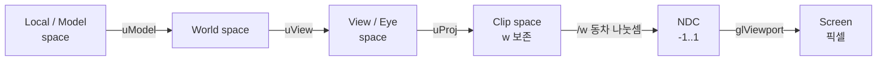
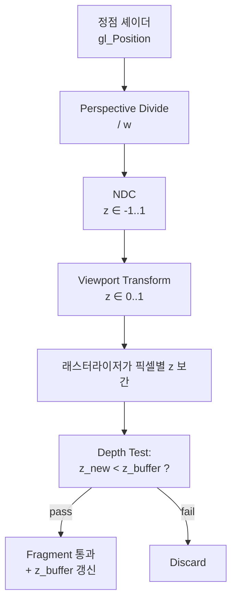

## 들어가며

OpenGL 학습의 첫 결과물은 보통 컬러 삼각형이지만, 거기서 그치면 3D 파이프라인의 핵심인 깊이 버퍼와 MVP 행렬의 의미를 체감하지 못한다. 이 글은 NDC 공간의 단일 삼각형에서 출발해 8개 정점 / 12개 삼각형으로 구성된 입체 큐브까지 한 흐름으로 쌓아 올린다. 깊이 테스트(Depth Test)가 어떻게 가려진 면을 잘라내는지, Z-fighting이 왜 일어나는지를 코드 변경의 결과로 직접 본다.

OpenGL 파이프라인은 입력 측에서 보면 *정점 배열 + 셰이더 한 쌍* 이고, 출력 측에서 보면 *프레임버퍼의 컬러·깊이 첨부* 다. 그 사이를 잇는 건 바인딩과 상태 머신이다. 정점 하나가 셰이더를 거쳐 클립 공간으로 투영되고, 동차 나눗셈으로 NDC가 되고, 뷰포트 변환으로 화면 픽셀이 되고, 래스터라이저가 그 안을 프래그먼트로 채우고, 프래그먼트 셰이더가 색을 칠한다. 이 경로를 최소 코드로 한 번 통과시키고, 그 위에 깊이 비교와 행렬 변환을 얹는다.

여기까지의 코드는 빈 윈도우와 OpenGL 3.3 Core 컨텍스트, GLAD 함수 로딩만 준비된 상태다. 셰이더는 아직 컴파일되지 않았고, 정점 데이터도 GPU에 올라가지 않았다. 이 글에서 도달할 결과물은 회전하는 컬러 큐브가 깊이 테스트를 거쳐 그려진 한 프레임이다. 다섯 단계로 나누어 쌓는다.

1. 정점 셰이더 + 프래그먼트 셰이더의 최소 쌍으로 NDC 삼각형을 그린다.
2. 정점 속성 보간을 통해 *무게중심 좌표(barycentric coordinate)* 가 자동으로 적용된다는 점을 본다.
3. GLM의 `model / view / projection` 행렬을 셰이더에 올려 임의의 카메라 시점을 만든다.
4. 8개 정점 / 36개 인덱스로 큐브를 구성하고, 시간에 따라 회전시킨다.
5. 깊이 테스트를 켜고 끄며 가려진 면이 어떻게 잘려나가는지, Z-fighting이 어떤 조건에서 일어나는지 정량화한다.


---

## 목차
1. [최소 동작 삼각형](#1-최소-동작-삼각형)
2. [정점 색상과 인터폴레이션](#2-정점-색상과-인터폴레이션)
3. [MVP 행렬 통합](#3-mvp-행렬-통합)
4. [큐브 정점 데이터 구성](#4-큐브-정점-데이터-구성)
5. [깊이 테스트 활성화](#5-깊이-테스트-활성화)
6. [Z-fighting과 깊이 정밀도](#6-z-fighting과-깊이-정밀도)


---

## 1. 최소 동작 삼각형

NDC 좌표 $(-0.5, -0.5)$, $(0.5, -0.5)$, $(0, 0.5)$의 정점 세 개로 정점 / 프래그먼트 셰이더의 가장 짧은 쌍을 통과시킨다. NDC(Normalized Device Coordinates) 공간은 $[-1, 1]^3$의 정규화된 큐브로, 정점 셰이더의 출력 `gl_Position`이 동차 나눗셈을 거쳐 이 공간에 닿으면 래스터라이저가 그대로 화면에 매핑한다. 변환 행렬 없이 NDC 좌표를 직접 넣는 것이 학습의 첫 단계다.

### 정점 데이터 + VBO + VAO

OpenGL Core Profile은 정점 데이터를 *GPU 메모리의 버퍼 객체(VBO)* 에 올리고, 그 버퍼와 셰이더 입력의 매핑을 *Vertex Array Object(VAO)* 에 묶는다. C 측 흐름은 다음 네 단계다.

1. `glGenBuffers / glGenVertexArrays` — GPU 측 핸들 할당.
2. `glBindVertexArray + glBindBuffer` — 현재 작업 대상 지정.
3. `glBufferData` — CPU 측 데이터를 GPU로 업로드.
4. `glVertexAttribPointer + glEnableVertexAttribArray` — 정점 셰이더의 location과 버퍼의 바이트 오프셋을 잇는다.

```cpp
float vertices[] = {
    -0.5f, -0.5f, 0.0f,
     0.5f, -0.5f, 0.0f,
     0.0f,  0.5f, 0.0f,
};

GLuint vao, vbo;
glGenVertexArrays(1, &vao);
glGenBuffers(1, &vbo);

glBindVertexArray(vao);
glBindBuffer(GL_ARRAY_BUFFER, vbo);
glBufferData(GL_ARRAY_BUFFER, sizeof(vertices), vertices, GL_STATIC_DRAW);

// location=0 에 vec3 가 3개의 float 으로 들어온다. stride 12B, offset 0.
glVertexAttribPointer(0, 3, GL_FLOAT, GL_FALSE, 3 * sizeof(float), (void*)0);
glEnableVertexAttribArray(0);

glBindVertexArray(0);
```

VBO는 연속된 바이트 배열이다. `glVertexAttribPointer`가 그 배열을 *어떤 모양의 정점 속성으로 해석할지* 를 정의한다. `stride`는 한 정점이 차지하는 바이트 수, `offset`은 한 정점 안에서 이 속성의 위치다. 한 정점에 위치만 있다면 stride = `3 * sizeof(float)` = 12B, offset = 0이다.

### VAO가 정확히 무엇을 기억하는가

VAO를 처음 다루면 "VAO가 VBO를 가지고 있다"고 오해하기 쉽지만 그렇지 않다. VAO가 기억하는 것은 *정점 속성의 포맷과 활성화 상태*, 그리고 각 속성이 어느 버퍼에서 데이터를 가져오는지에 대한 *바인딩 참조* 다. 구체적으로 다음 상태가 VAO에 캡처된다.

| VAO에 기억되는 상태 | VAO에 기억되지 않는 상태 |
|---|---|
| `glEnableVertexAttribArray`로 켠 속성 활성화 비트 | 현재 바인딩된 `GL_ARRAY_BUFFER` |
| `glVertexAttribPointer`의 포맷(크기, 타입, normalized, stride) | `glUseProgram`으로 바인딩한 셰이더 프로그램 |
| `glVertexAttribPointer` 호출 시점에 바인딩돼 있던 VBO (속성별로 기록) | uniform 값 |
| `GL_ELEMENT_ARRAY_BUFFER` 바인딩 (인덱스 버퍼) | `glViewport`, `glClearColor` 등 전역 상태 |

여기서 핵심은 두 가지다. 첫째, `glVertexAttribPointer`는 호출 *그 순간* 에 `GL_ARRAY_BUFFER`에 바인딩돼 있던 VBO를 해당 속성과 묶는다. 그래서 속성별로 다른 VBO를 쓸 수 있다. 둘째, `GL_ELEMENT_ARRAY_BUFFER` 바인딩은 VAO에 저장되지만 `GL_ARRAY_BUFFER` 바인딩은 저장되지 않는다. 이 비대칭이 흔한 버그의 원인이다. VAO가 바인딩된 채로 EBO를 unbind하면 *VAO의 EBO 바인딩까지 풀려* 드로우 시 인덱스가 사라진다.

```cpp
glBindVertexArray(vao);
glBindBuffer(GL_ELEMENT_ARRAY_BUFFER, ebo);  // VAO에 기록된다

glBindVertexArray(0);                         // VAO unbind 먼저
glBindBuffer(GL_ELEMENT_ARRAY_BUFFER, 0);     // 이건 안전 (VAO 밖)
// 만약 순서가 반대였다면 VAO의 EBO 바인딩이 0으로 덮어써진다
```

### 셰이더 컴파일과 링크

GLSL 셰이더는 *런타임 컴파일* 된다. 파이프라인은 (1) 소스 문자열 → (2) `glCompileShader` → (3) `glAttachShader` → (4) `glLinkProgram` → (5) `glUseProgram`이다.

```cpp
const char* vsrc = R"(
#version 330 core
layout (location = 0) in vec3 aPos;
void main() {
    gl_Position = vec4(aPos, 1.0);
}
)";

const char* fsrc = R"(
#version 330 core
out vec4 FragColor;
void main() {
    FragColor = vec4(1.0, 0.4, 0.2, 1.0);
}
)";

GLuint vs = glCreateShader(GL_VERTEX_SHADER);
glShaderSource(vs, 1, &vsrc, nullptr);
glCompileShader(vs);
CheckCompile(vs);   // 컴파일 에러 로그 출력 helper

GLuint fs = glCreateShader(GL_FRAGMENT_SHADER);
glShaderSource(fs, 1, &fsrc, nullptr);
glCompileShader(fs);
CheckCompile(fs);

GLuint prog = glCreateProgram();
glAttachShader(prog, vs);
glAttachShader(prog, fs);
glLinkProgram(prog);
CheckLink(prog);

glDeleteShader(vs);   // 링크 후 소스는 더 이상 필요 없다.
glDeleteShader(fs);
```

`CheckCompile` / `CheckLink`는 `glGetShaderiv(..., GL_COMPILE_STATUS,...)` 또는 `glGetProgramiv(..., GL_LINK_STATUS,...)`로 상태를 확인하고, 실패 시 `glGetShaderInfoLog` / `glGetProgramInfoLog`로 메시지를 읽어 출력하는 helper다. 이 두 호출이 없으면 셰이더가 컴파일 실패해도 *조용히 동작하지 않을 뿐* 화면에 아무것도 안 나타난다. 디버깅 시간의 절반이 여기서 빠진다. 로그는 컴파일 성공 시에도 경고가 담길 수 있으므로 길이가 0보다 크면 항상 출력하는 편이 낫다.

```cpp
void CheckCompile(GLuint shader) {
    GLint ok = 0;
    glGetShaderiv(shader, GL_COMPILE_STATUS, &ok);
    GLint len = 0;
    glGetShaderiv(shader, GL_INFO_LOG_LENGTH, &len);
    if (len > 1) {                       // 빈 로그는 길이 1 (널 종료)
        std::string log(len, '\0');
        glGetShaderInfoLog(shader, len, nullptr, log.data());
        std::fprintf(stderr, "[shader %s]\n%s\n",
                     ok ? "warn" : "FAIL", log.c_str());
    }
    if (!ok) std::abort();
}
```

`glDeleteShader`는 즉시 삭제하지 않는다. 셰이더 객체가 프로그램에 attach돼 있으면 *삭제 플래그만 세우고*, 마지막 detach 시점(또는 프로그램 삭제 시점)에 실제로 해제된다. 그래서 링크 직후 delete를 호출해도 링크된 프로그램은 멀쩡히 동작한다.

### 드로우 호출

```cpp
glClear(GL_COLOR_BUFFER_BIT);
glUseProgram(prog);
glBindVertexArray(vao);
glDrawArrays(GL_TRIANGLES, 0, 3);
```

`glDrawArrays(GL_TRIANGLES, first, count)`는 *현재 바인딩된 VAO* 에서 `first`부터 `count`개 정점을 *3개씩 묶어* 삼각형을 그린다. `first = 0`, `count = 3`이면 정점 0, 1, 2로 한 개의 삼각형. `count = 6`이면 (0, 1, 2)와 (3, 4, 5)로 두 개.

```mermaid
flowchart LR
    CPU[CPU 측 vertices] -->|glBufferData| VBO[GPU VBO]
    VBO -->|glVertexAttribPointer<br/>로 해석| VAO[VAO 매핑 정보]
    VAO -->|glDrawArrays| VS[Vertex Shader]
    VS -->|gl_Position clip| PD[Perspective Divide]
    PD -->|NDC| RAST[Rasterizer]
    RAST -->|Fragment 생성| FS[Fragment Shader]
    FS -->|FragColor| FB[Framebuffer]
```



이 흐름이 OpenGL의 가장 짧은 *프로그래머블 파이프라인 통과 경로* 다. 화면에 주황색 삼각형 한 개가 보이면 *VBO / VAO / 셰이더 / 드로우 호출* 의 다섯 단계가 모두 정상 동작하는 것이다.

### 검은 화면일 때의 점검 순서

삼각형이 안 보이는 경우는 거의 정해진 몇 가지다. 위에서부터 차례로 본다.

| 증상 | 흔한 원인 | 확인 방법 |
|---|---|---|
| 완전히 검은 화면 | 셰이더 컴파일/링크 실패 | `CheckCompile`/`CheckLink` 로그 |
| 검은 화면 | VAO를 unbind한 채 draw | draw 직전 `glBindVertexArray(vao)` |
| 검은 화면 | `glUseProgram` 누락 | draw 직전 프로그램 바인딩 확인 |
| 삼각형 반쪽만 | 와인딩 + 컬링 켜짐 | `glDisable(GL_CULL_FACE)` 후 비교 |
| 이상한 위치 | NDC 범위 밖 좌표 | 좌표가 $[-1,1]$ 안인지 |
| 깜빡임 | `glClear` 누락 | 루프 첫머리에 clear |

마지막 안전망으로 `glGetError`를 draw 호출 전후에 끼워 `GL_INVALID_OPERATION` 같은 코드가 뜨는지 확인한다. 디버그 컨텍스트의 `GL_KHR_debug` 콜백이 켜져 있다면 이 단계는 콜백 메시지로 대체된다.

## 2. 정점 색상과 인터폴레이션

이제 정점마다 *다른 색* 을 부여한다. 각 정점에 위치 + 색상 두 속성을 담고, 정점 셰이더가 색상을 *그대로 다음 단계로 전달* 한다. 래스터라이저가 삼각형 내부의 각 픽셀에 대해 *세 정점 색상의 무게중심 가중 평균* 을 계산해 프래그먼트 셰이더에 넘긴다.

### 인터리브 정점 데이터

```cpp
float vertices[] = {
    // position           // color
    -0.5f, -0.5f, 0.0f,   1.0f, 0.0f, 0.0f,   // 빨강
     0.5f, -0.5f, 0.0f,   0.0f, 1.0f, 0.0f,   // 초록
     0.0f,  0.5f, 0.0f,   0.0f, 0.0f, 1.0f,   // 파랑
};
```

이제 한 정점이 6 float = 24B다. `glVertexAttribPointer` 호출이 두 번 필요하다.

```cpp
// location 0: 위치 (앞 3 float)
glVertexAttribPointer(0, 3, GL_FLOAT, GL_FALSE, 6 * sizeof(float), (void*)0);
glEnableVertexAttribArray(0);
// location 1: 색상 (그 다음 3 float)
glVertexAttribPointer(1, 3, GL_FLOAT, GL_FALSE, 6 * sizeof(float),
                      (void*)(3 * sizeof(float)));
glEnableVertexAttribArray(1);
```

`offset`이 `(void*)(3 * sizeof(float))`로 들어가는 이유 — `glVertexAttribPointer`의 마지막 인자는 *바이트 단위 오프셋* 이지만 타입이 `const void*`다. 1990년대 OpenGL이 *클라이언트 측 메모리 포인터* 를 받던 시절의 잔재로, 지금은 *VBO 안의 오프셋* 으로 재해석된다. C++에선 `reinterpret_cast` 또는 위 패턴이 흔하다.

### 인터리브 vs 분리 배열

한 버퍼에 위치와 색상을 번갈아 담는 방식을 *인터리브(interleaved)* 라 한다. 반대로 위치만 모은 배열과 색상만 모은 배열을 별도 VBO(또는 같은 VBO의 다른 영역)에 두는 *분리(planar/separate)* 방식도 있다.

| 방식 | 메모리 지역성 | 부분 갱신 | 적합한 경우 |
|---|---|---|---|
| 인터리브 | 한 정점의 모든 속성이 인접 → 캐시 친화 | 한 속성만 바꿔도 stride만큼 점프 | 정적 메시, 대부분의 렌더링 |
| 분리 | 같은 속성이 연속 | 한 속성 전체를 통째로 교체 쉬움 | 위치만 매 프레임 갱신하는 파티클 |

GPU의 정점 페치(vertex fetch) 하드웨어는 한 정점을 처리할 때 그 정점의 모든 속성을 함께 읽는다. 인터리브는 이 접근이 연속 메모리에 떨어져 캐시 라인 활용이 좋다. 그래서 일반 메시는 인터리브가 기본이다. 분리 배열은 위치 스트림만 transform feedback으로 갱신하거나, 위치/색상의 갱신 빈도가 크게 다를 때 쓴다.

### out → in 흐름

```glsl
// vertex shader
#version 330 core
layout (location = 0) in vec3 aPos;
layout (location = 1) in vec3 aColor;
out vec3 vColor;

void main() {
    gl_Position = vec4(aPos, 1.0);
    vColor = aColor;
}
```

```glsl
// fragment shader
#version 330 core
in vec3 vColor;
out vec4 FragColor;

void main() {
    FragColor = vec4(vColor, 1.0);
}
```

정점 셰이더의 `out vec3 vColor`와 프래그먼트 셰이더의 `in vec3 vColor`는 *이름과 타입이 같으면 자동 연결* 된다. 그 사이에 래스터라이저가 끼어들어 *프래그먼트마다 다른 값* 으로 보간한다. 이름이 한 글자라도 다르거나 타입이 다르면 링크 시점에 연결이 끊겨, 프래그먼트 셰이더의 `in` 변수가 정의되지 않은 값을 받는다. 디버그 컨텍스트는 이를 link 단계에서 경고로 알려준다.

### 무게중심 좌표 보간

삼각형 내부의 한 픽셀이 세 정점 $P_0, P_1, P_2$의 *무게중심 좌표* $(u, v, w)$로 표현된다.

$$
P = u P_0 + v P_1 + w P_2, \quad u + v + w = 1, \quad u, v, w \geq 0
$$

래스터라이저가 각 프래그먼트마다 $(u, v, w)$를 자동으로 계산해, 정점 속성 `vColor`를

$$
\text{vColor}_{\text{frag}} = u \cdot \text{vColor}_0 + v \cdot \text{vColor}_1 + w \cdot \text{vColor}_2
$$

로 보간한다. 빨강 / 초록 / 파랑 정점이라면 화면에는 *세 꼭짓점에서 RGB가 부드럽게 섞이는 그라데이션* 이 나타난다.

### 원근 보정 보간의 수학

화면 공간에서 무게중심 좌표를 그대로 선형 보간하면 3D에서의 직선 비율이 깨진다. 카메라에서 멀어질수록 같은 화면 거리가 더 많은 월드 거리를 덮기 때문이다. *원근 보정(perspective-correct)* 보간은 속성을 정점의 클립 공간 $w$로 나눠 보간한 뒤 다시 곱해 복원한다. 속성 $A$에 대해 보간된 값은 다음과 같다.

$$
A_{\text{frag}} = \frac{\dfrac{u A_0}{w_0} + \dfrac{v A_1}{w_1} + \dfrac{w A_2}{w_2}}{\dfrac{u}{w_0} + \dfrac{v}{w_1} + \dfrac{w}{w_2}}
$$

여기서 $w_i$는 각 정점의 클립 공간 $w$ 성분(원근 투영에서 view-space 깊이에 비례)이다. 이 보정 덕분에 바닥에 깔린 체커보드 텍스처가 멀어질수록 자연스럽게 압축돼 보인다. 보정을 끄면 멀리 있는 타일이 가까운 타일과 같은 크기로 늘어나 *V자로 휘어진* 왜곡이 생긴다.

GLSL에선 `smooth` 키워드가 기본 보간이고, `noperspective`로 화면 공간 선형 보간으로 바꿀 수 있다(UI 요소 등). `flat`은 보간 없이 *프로보킹 정점(provoking vertex)* 의 값을 그대로 사용한다 — 단색 면. OpenGL의 기본 프로보킹 정점은 삼각형의 *마지막* 정점이며, `glProvokingVertex(GL_FIRST_VERTEX_CONVENTION)`로 첫 정점으로 바꿀 수 있다.

| 보간 한정자 | 의미 | 용도 |
|---|---|---|
| `smooth` (기본) | 원근 보정 무게중심 | 일반 색·법선·UV |
| `noperspective` | 화면 공간 선형 | 2D UI overlay |
| `flat` | 보간 없음 (provoking vertex) | id buffer, 단색 면 |

정수 타입(`int`, `uint`) 속성을 프래그먼트로 넘길 때는 보간이 정의되지 않으므로 반드시 `flat`을 붙여야 한다. 빠뜨리면 프래그먼트 셰이더 컴파일 에러가 난다.

## 3. MVP 행렬 통합

화면 좌표를 NDC로 직접 박는 단계에서 벗어나, *3D 월드 → 카메라 → 투영* 의 일반 변환을 도입한다. 세 단계의 행렬 곱을 *P(projection) × V(view) × M(model)* 이라 하고, 정점 셰이더에 uniform으로 올린다.

### 좌표계 변환의 전체 파이프라인

정점 하나가 거치는 좌표 공간은 다섯 단계다. 각 단계가 어떤 변환으로 다음으로 넘어가는지 본다.



`uModel`까지는 셰이더에서 곱하고, 동차 나눗셈은 GPU가 자동으로 한다. 뷰포트 변환은 `glViewport(x, y, w, h)`가 정한 사각형으로 NDC를 매핑하며, 깊이는 `glDepthRange`가 정한 $[0, 1]$ 범위로 간다. 이 다섯 공간의 구분을 잡아두면 법선 변환이나 라이팅 계산을 어느 공간에서 할지 결정할 때 혼란이 없다.

### GLM으로 행렬 만들기

GLM(OpenGL Mathematics)은 GLSL의 벡터 / 행렬 타입을 C++에 그대로 옮긴 헤더 전용 라이브러리다. *column-major* 저장에 OpenGL과 호환된다.

```cpp
#include <glm/glm.hpp>
#include <glm/gtc/matrix_transform.hpp>
#include <glm/gtc/type_ptr.hpp>

glm::mat4 model = glm::mat4(1.0f);                          // identity
model = glm::rotate(model, (float)glfwGetTime(),
                    glm::vec3(0.5f, 1.0f, 0.0f));           // 시간 회전

glm::mat4 view = glm::lookAt(
    glm::vec3(0, 0, 3),     // eye
    glm::vec3(0, 0, 0),     // target
    glm::vec3(0, 1, 0));    // up

glm::mat4 proj = glm::perspective(
    glm::radians(45.0f),                                    // FOV (y)
    (float)width / (float)height,                           // aspect
    0.1f,                                                   // near
    100.0f);                                                // far
```

세 행렬을 *각각* 셰이더에 올릴 수도, *MVP = P × V × M* 으로 미리 곱한 결과 한 개만 올릴 수도 있다. 후자가 정점 셰이더의 곱셈 연산을 줄이지만, 정점 셰이더 안의 행렬-벡터 곱은 현대 GPU에서 거의 공짜에 가깝다. 진짜 이득은 *법선 변환* 등 model 단독이 필요한 경우의 분리 보존이다. 학습용에선 세 개 분리.

`glm::perspective`의 두 번째 인자 aspect는 *프레임버퍼 가로/세로 비율* 이다. 윈도우 리사이즈 콜백에서 이 값을 다시 계산해 proj를 갱신하지 않으면 큐브가 가로로 늘어나거나 눌린다. `glm::radians`로 도를 라디안으로 바꾸는 것도 흔히 빠뜨리는 지점이다. GLM은 0.9.6부터 기본이 라디안이라 도 단위 값을 그대로 넣으면 tan의 주기 때문에 FOV가 엉뚱한 값이 된다(45를 넣으면 실효 수직 FOV가 약 58도로 오히려 넓어지고, 60을 넣으면 부호가 뒤집힌다).

### degenerate한 lookAt와 NaN

`glm::lookAt`은 eye에서 target으로의 방향과 up 벡터가 *평행* 하면 외적이 영벡터가 되어 행렬에 NaN이 섞인다. 카메라가 정확히 위를 보면서 up도 $(0,1,0)$인 경우가 그렇다. NaN이 한 번 행렬에 들어가면 모든 정점이 클립되어 화면이 검게 변하므로, up과 시선이 평행해질 수 있는 카메라(예: 1인칭 피치)는 pitch를 $\pm 89^\circ$로 클램프한다.

### 셰이더에 행렬 올리기

```cpp
GLint locM = glGetUniformLocation(prog, "uModel");
GLint locV = glGetUniformLocation(prog, "uView");
GLint locP = glGetUniformLocation(prog, "uProj");

glUseProgram(prog);
glUniformMatrix4fv(locM, 1, GL_FALSE, glm::value_ptr(model));
glUniformMatrix4fv(locV, 1, GL_FALSE, glm::value_ptr(view));
glUniformMatrix4fv(locP, 1, GL_FALSE, glm::value_ptr(proj));
```

`glGetUniformLocation`은 반환 타입이 `GLint`다. uniform이 셰이더에 없거나, 선언했지만 *어디에도 쓰이지 않아 컴파일러가 제거(active uniform이 아님)* 하면 `-1`을 반환한다. `-1`을 `glUniform*`에 넘기는 것은 에러가 아니라 *조용한 무동작* 이라, 이름 오타를 잡아내지 못한다. 디버그 빌드에선 `assert(loc != -1)`로 막는 편이 좋다.

`glUniformMatrix4fv(loc, count, transpose, ptr)`의 `transpose = GL_FALSE`가 *column-major* 입력을 뜻한다. GLM이 column-major라 일치한다. *DirectX 측에서 가져온 row-major 행렬* 은 행벡터 관례이므로, 열벡터 셰이더에 쓰려면 오히려 `GL_FALSE`(column-major 해석)가 필요한 전치를 대신 만들어 준다. `GL_TRUE`를 주면 전치가 상쇄되지 않아 결과가 깨진다. uniform 값은 *프로그램별로* 저장되며 `glUseProgram` 전환 사이에 보존되므로, 매 프레임 다시 올릴 필요는 없고 바뀐 것만 올리면 된다.

### 셰이더의 uniform

```glsl
#version 330 core
layout (location = 0) in vec3 aPos;
layout (location = 1) in vec3 aColor;

uniform mat4 uModel;
uniform mat4 uView;
uniform mat4 uProj;

out vec3 vColor;

void main() {
    gl_Position = uProj * uView * uModel * vec4(aPos, 1.0);
    vColor = aColor;
}
```

행렬 곱 순서가 *오른쪽 → 왼쪽* 으로 적용된다. 정점 위치는 (model space) → uModel → (world) → uView → (view) → uProj → (clip)을 거쳐 `gl_Position`에 닿는다. *clip space* 에서 GPU가 자동으로 *동차 나눗셈(perspective divide)* $w$를 적용해 NDC를 만든다.

곱셈 순서를 거꾸로 `uModel * uView * uProj`로 쓰면 행렬이 전치된 것과 비슷한 엉뚱한 결과가 나온다. 행렬 곱은 비가환이므로 이 순서는 컨벤션이 아니라 수학적 강제다.

### dirty flag 캐싱

매 프레임 model / view / proj 행렬을 *처음부터* 만드는 건 낭비다. 일반적인 패턴은 다음과 같다.

```cpp
class Transform {
    glm::vec3 pos_, scale_;
    glm::quat rot_;
    mutable glm::mat4 cached_;
    mutable bool dirty_ = true;

public:
    const glm::mat4& Model() const {
        if (dirty_) {
            cached_ = glm::translate(glm::mat4(1.0f), pos_)
                    * glm::mat4_cast(rot_)
                    * glm::scale(glm::mat4(1.0f), scale_);
            dirty_ = false;
        }
        return cached_;
    }
    void SetPos(glm::vec3 p) { pos_ = p; dirty_ = true; }
    void SetRot(glm::quat r) { rot_ = r; dirty_ = true; }
};
```

매 프레임 회전이 바뀌는 큐브 같은 경우엔 dirty가 *항상 true* 라 캐시 의미가 없지만, *정적 오브젝트가 수천 개* 인 경우 dirty flag가 행렬 곱셈을 99% 줄인다. $4\times4$ 행렬 곱 한 번은 스칼라 곱셈 64회를 수행하므로, 정적 오브젝트 10,000개의 행렬 곱 한 번을 건너뛰면 프레임당 64만 회, 60fps에서 초당 3,840만 회의 스칼라 곱셈을 피한다. 실제 절감량은 모델 행렬 구성에 필요한 행렬 곱 수와 컴파일러·SIMD 구현에 따라 달라진다.

## 4. 큐브 정점 데이터 구성

큐브는 정점 8개로 표현될 수 있지만, *면별로 다른 법선 / UV가 필요* 하면 정점이 24개로 늘어난다. 두 접근의 트레이드오프를 정리한다.

### 공유 정점과 인덱스

가장 메모리 효율적인 구성이다 — 정점 8개를 *모서리에서 공유* 하고, 삼각형 12개를 *인덱스 36개* 로 표현한다.

```cpp
float vertices[] = {
    // x     y     z       r     g     b
    -0.5f, -0.5f, -0.5f,   1, 0, 0,    // 0: 좌하후
     0.5f, -0.5f, -0.5f,   0, 1, 0,    // 1: 우하후
     0.5f,  0.5f, -0.5f,   0, 0, 1,    // 2: 우상후
    -0.5f,  0.5f, -0.5f,   1, 1, 0,    // 3: 좌상후
    -0.5f, -0.5f,  0.5f,   1, 0, 1,    // 4: 좌하전
     0.5f, -0.5f,  0.5f,   0, 1, 1,    // 5: 우하전
     0.5f,  0.5f,  0.5f,   1, 1, 1,    // 6: 우상전
    -0.5f,  0.5f,  0.5f,   0, 0, 0,    // 7: 좌상전
};

unsigned indices[] = {
    0, 3, 2,  2, 1, 0,    // 뒷면
    4, 5, 6,  6, 7, 4,    // 앞면
    0, 4, 7,  7, 3, 0,    // 좌면
    1, 2, 6,  6, 5, 1,    // 우면
    3, 7, 6,  6, 2, 3,    // 윗면
    0, 1, 5,  5, 4, 0,    // 아랫면
};
```

EBO(Element Buffer Object)를 추가로 만들어 인덱스를 GPU에 올린다.

```cpp
GLuint vao, vbo, ebo;
glGenVertexArrays(1, &vao);
glGenBuffers(1, &vbo);
glGenBuffers(1, &ebo);

glBindVertexArray(vao);
glBindBuffer(GL_ARRAY_BUFFER, vbo);
glBufferData(GL_ARRAY_BUFFER, sizeof(vertices), vertices, GL_STATIC_DRAW);
glBindBuffer(GL_ELEMENT_ARRAY_BUFFER, ebo);
glBufferData(GL_ELEMENT_ARRAY_BUFFER, sizeof(indices), indices, GL_STATIC_DRAW);

glVertexAttribPointer(0, 3, GL_FLOAT, GL_FALSE, 6 * sizeof(float), (void*)0);
glEnableVertexAttribArray(0);
glVertexAttribPointer(1, 3, GL_FLOAT, GL_FALSE, 6 * sizeof(float),
                      (void*)(3 * sizeof(float)));
glEnableVertexAttribArray(1);
```

드로우 호출이 `glDrawArrays` → `glDrawElements`로 바뀐다.

```cpp
glDrawElements(GL_TRIANGLES, 36, GL_UNSIGNED_INT, 0);
```

`glDrawElements(mode, count, type, offset)`의 `type`은 인덱스 버퍼의 원소 타입과 정확히 일치해야 한다. 위에서 `unsigned`(32비트) 배열을 올렸으니 `GL_UNSIGNED_INT`다. 정점이 65,536개 미만이면 `GL_UNSIGNED_SHORT`(16비트)로 인덱스 버퍼 크기를 절반으로 줄일 수 있고, 정점 페치 대역폭도 절약된다. 큐브 8정점은 `GL_UNSIGNED_BYTE`로도 충분하다. 마지막 `offset`은 *클라이언트 메모리 포인터가 아니라* 인덱스 버퍼 시작부터의 바이트 단위 오프셋을 `void*`로 캐스팅한 값이다.

VAO가 EBO 바인딩까지 *함께 기억* 한다는 점이 중요하다. `glBindVertexArray(vao)`만 호출하면 그 VAO에 묶였던 EBO도 자동으로 활성화된다.

### 인덱스로 절약되는 메모리와 페치

인덱스를 쓰면 공유 정점이 중복 저장되지 않는다. 큐브를 비인덱스 36정점으로 그리면 각 정점 24B × 36 = 864B다. 8정점 인덱스 방식은 정점 8 × 24B + 인덱스 36 × 4B = 192 + 144 = 336B로 약 39%다. 더 중요한 것은 GPU의 *post-transform 정점 캐시* 다. 같은 인덱스가 재등장하면 GPU는 그 정점의 정점 셰이더 결과를 캐시에서 꺼내 재실행을 생략한다. 인덱스 순서를 캐시 친화적으로 정렬하면(예: Forsyth, Tipsify 알고리즘) 실제 정점 셰이더 호출 수가 정점 개수에 가깝게 떨어진다.

### 면별 분리 정점

법선이나 UV가 *면마다 다르면* 정점을 공유할 수 없다. 큐브의 윗면 위쪽을 가리키는 법선 $(0, 1, 0)$과 앞면 앞쪽을 가리키는 법선 $(0, 0, 1)$이 *모서리 정점에서 충돌* 하기 때문이다. 한 정점은 위치 + 법선의 묶음이라, 같은 위치라도 법선이 다르면 다른 정점이다. 이 경우 한 모서리 점이 *3개의 정점*(윗·앞·옆면용)으로 분리되어, 큐브 전체가 24 정점이 된다.

```cpp
// 한 면당 4 정점 × 6 면 = 24 정점
// 한 면당 2 삼각형 × 3 인덱스 × 6 면 = 36 인덱스
float verticesPerFace[] = {
    // 앞면 (z = 0.5, normal (0, 0, 1))
    -0.5f, -0.5f,  0.5f,   0, 0, 1,
     0.5f, -0.5f,  0.5f,   0, 0, 1,
     0.5f,  0.5f,  0.5f,   0, 0, 1,
    -0.5f,  0.5f,  0.5f,   0, 0, 1,
    // ... 나머지 5 면
};
```

선택의 기준은 다음과 같다.

| 항목 | 8 정점 공유 | 24 정점 분리 |
|---|---|---|
| 정점 메모리 | 작음 (8 × stride) | 큼 (24 × stride) |
| 법선 / UV | 정점별 단일 값 | 면별로 다름 가능 |
| 조명 결과 | *면 경계 흐릿* | *면이 또렷* |
| 일반 메시 | 매우 드묾 | 표준 |

게임 자원의 *대부분 메시* 가 24 정점 분리에 더 가깝다. 부드러운 표면(구, 캐릭터)은 정점을 공유해 법선을 평균 내고, 큐브나 기계 부품처럼 *각진 면* 은 면별로 정점을 분리한다. 8 정점 큐브는 *학습 목적* 또는 *디버그 와이어프레임* 에 적합하다.

### 면 컬링과 와인딩

`glEnable(GL_CULL_FACE)`로 *뒷면 컬링* 을 켜면 카메라에 등을 돌린 삼각형은 *래스터라이저 전에 제거* 된다. 비용 절감이지만, *와인딩 순서(winding order)* 를 잘못 정의하면 *그려야 할 면이 사라진다*.

OpenGL은 화면 공간에서 삼각형 세 정점이 차지하는 *부호 있는 넓이* 의 부호로 앞면/뒷면을 가른다. 기본은 *CCW(반시계)* 가 앞면이다. 큐브의 각 면을 *바깥에서 봤을 때 CCW* 가 되도록 인덱스를 짜야 한다. 위 인덱스 배열은 그 기준을 따른다.

```cpp
glEnable(GL_CULL_FACE);
glCullFace(GL_BACK);       // 뒷면 제거 (기본)
glFrontFace(GL_CCW);       // CCW 가 앞면 (기본)
```

컬링은 평균적으로 닫힌 볼록 메시의 삼각형 절반을 래스터라이저 이전에 제거한다. 큐브라면 시점에 따라 보이지 않는 3~5개 면이 버려진다. 순서가 어긋난 면이 있으면 큐브 한쪽 면만 *비어 보인다*. 디버깅 시 `glDisable(GL_CULL_FACE)`로 잠깐 끄고 어느 면이 사라졌는지 확인한 뒤 그 면의 인덱스 순서를 뒤집는다. 음의 스케일(`glm::scale`에 음수)을 적용하면 와인딩이 뒤집히므로, 거울 변환을 쓰면 `glFrontFace`를 같이 바꿔야 한다.

### 회전하는 큐브

매 프레임 model 행렬을 시간에 따라 갱신한다.

```cpp
while (!glfwWindowShouldClose(window)) {
    glClearColor(0.1f, 0.1f, 0.1f, 1.0f);
    glClear(GL_COLOR_BUFFER_BIT);    // 이 최소 루프는 색 버퍼만 사용

    glm::mat4 model = glm::rotate(
        glm::mat4(1.0f),
        (float)glfwGetTime(),
        glm::vec3(0.5f, 1.0f, 0.0f));

    glUseProgram(prog);
    glUniformMatrix4fv(locM, 1, GL_FALSE, glm::value_ptr(model));
    glUniformMatrix4fv(locV, 1, GL_FALSE, glm::value_ptr(view));
    glUniformMatrix4fv(locP, 1, GL_FALSE, glm::value_ptr(proj));

    glBindVertexArray(vao);
    glDrawElements(GL_TRIANGLES, 36, GL_UNSIGNED_INT, 0);

    glfwSwapBuffers(window);
    glfwPollEvents();
}
```

`glfwGetTime`을 회전 각도로 직접 쓰면 회전 속도가 *프레임 레이트와 무관* 하게 실제 경과 시간에 묶인다. 만약 `model = glm::rotate(model, dt,...)`처럼 매 프레임 누적시키면 회전 속도가 fps에 비례해 버리므로, 시간 기반 갱신이 더 안정적이다.

이 단계에서 면 컬링을 잠시 끄고 실행하면 *큐브가 돌긴 하지만 면의 앞뒤가 뒤죽박죽* 으로 보인다. 깊이 테스트가 켜져 있지 않아 *마지막에 그린 면이 항상 위* 에 나타나기 때문이다. 볼록한 큐브 하나는 컬링만으로도 올바르게 보이지만, 여러 물체나 오목한 메시에서는 면 컬링만으로는 부족하다 — 컬링은 *자기 자신* 의 뒷면만 지우지, 한 물체가 다른 물체를 가리는 관계는 풀지 못한다.

## 5. 깊이 테스트 활성화

깊이 테스트는 *현재 그리려는 프래그먼트의 깊이 값* 과 *깊이 버퍼에 이미 저장된 값* 을 비교해, 더 가까운 쪽만 통과시킨다. *가려진 면을 자동으로 제거* 하는 표준 기법이다.

### 활성화 세 줄

```cpp
glEnable(GL_DEPTH_TEST);
glDepthFunc(GL_LESS);                                  // 작은 값이 가까움 (기본)
glClear(GL_COLOR_BUFFER_BIT | GL_DEPTH_BUFFER_BIT);   // 매 프레임 깊이도 초기화
```

`GL_LESS`는 *새 프래그먼트의 깊이가 버퍼의 값보다 작을 때* 만 통과시킨다 — 더 가까운 픽셀이 이긴다. 옵션은 `GL_LESS`(기본), `GL_LEQUAL`, `GL_EQUAL`, `GL_GREATER`, `GL_NEVER`, `GL_ALWAYS` 등이다. 대부분의 게임이 `GL_LESS`를 쓰지만 *skybox* 처럼 *깊이 1.0에 마지막으로 그리는 경우* `GL_LEQUAL`이 필요하다(정확히 1.0 == 1.0 통과).

매 프레임 `glClear`에 `GL_DEPTH_BUFFER_BIT`를 포함해야 한다. 빠뜨리면 이전 프레임의 깊이가 누적되어 *움직이는 객체의 잔상* 이 나타난다. 깊이 버퍼는 `glClearDepth`가 정한 값(기본 1.0, 가장 먼 값)으로 채워진다.

### 깊이 쓰기와 깊이 테스트는 별개

깊이 테스트 통과 여부(`glDepthFunc`)와 깊이 버퍼 갱신 여부(`glDepthMask`)는 독립된 두 스위치다. 반투명 객체를 그릴 때는 깊이 테스트는 켜되 *깊이 쓰기는 끈다*.

```cpp
glDepthMask(GL_FALSE);   // 깊이 테스트는 하되 버퍼에 기록은 안 한다
DrawTransparent();
glDepthMask(GL_TRUE);    // 다시 켠다
```

이렇게 하면 반투명 표면이 뒤에 있는 불투명 표면에 의해 올바르게 가려지지만, 자기들끼리는 깊이 버퍼를 덮어쓰지 않아 블렌딩 순서를 보존한다. `glDepthMask(GL_FALSE)` 상태에서 `glClear(GL_DEPTH_BUFFER_BIT)`를 호출하면 *클리어가 무시* 되는 함정이 있으니, 클리어 직전에는 마스크를 켜둔다.

### 깊이 버퍼의 정체

깊이 버퍼는 *컬러 버퍼와 같은 해상도의 한 채널 버퍼*(보통 24 또는 32비트)다. NDC의 $z$ 좌표를 `glDepthRange`가 정한 $[0, 1]$ 범위로 매핑한 값이 저장된다. 컨텍스트를 만들 때 *depth bits 옵션* 으로 기본 프레임버퍼의 비트 깊이를 정한다.

```cpp
glfwWindowHint(GLFW_DEPTH_BITS, 24);
```

기본 24비트면 $2^{24} \approx 16.7\text{M}$ 단계의 깊이를 구분한다. 24비트 깊이는 보통 8비트 스텐실과 합쳐 `GL_DEPTH24_STENCIL8` 한 텍스처(32비트 패킹)에 담긴다. 1280×720 화면이면 깊이 버퍼만 1280 × 720 × 4B ≈ 3.5MB를 차지한다.

### 결과

깊이 테스트를 켜기 전후를 비교한다. 켜기 전에는(면 컬링도 끈 상태에서) 큐브의 면이 그린 순서대로 겹쳐져 *불가능한 형상* 이 된다. 켜기 후에는 가까운 면이 먼 면을 자연스럽게 가려 *정상 큐브* 가 보인다.



### Early Depth Test

대부분의 현대 GPU는 *프래그먼트 셰이더를 실행하기 전* 에 깊이 테스트를 한다 — 통과 못 할 픽셀은 *셰이더 호출 자체를 생략* 한다. 이를 *Early-Z* 또는 *HiZ* 라고 부른다. 프래그먼트 셰이더 비용을 공짜로 줄여주는 최적화다.

단, 셰이더가 `gl_FragDepth`를 명시적으로 갱신하거나 `discard`를 호출하면 *Early-Z가 비활성화* 되어 모든 셰이더가 실행된 뒤에 테스트된다. 깊이 값을 셰이더가 결정하기 전까지는 하드웨어가 미리 판단할 수 없기 때문이다. 알파 컷오프 / 마스크 텍스처를 쓰는 풀잎 같은 메시가 *느려지는* 이유다. GLSL 4.2의 `layout(early_fragment_tests) in;`을 쓰면 `discard`가 있어도 테스트를 강제로 앞당길 수 있지만, 이 경우 discard된 픽셀의 깊이 쓰기는 막을 수 없다.

| 셰이더 패턴 | Early-Z |
|---|---|
| 단순 fragment shader | 활성 |
| `gl_FragDepth =...` | 비활성 |
| `discard` | 비활성 |
| `out` 변수만 갱신 | 활성 |

Early-Z가 잘 작동하려면 *불투명 객체를 앞에서 뒤 순서(front-to-back)* 로 그리는 것이 유리하다. 가까운 것을 먼저 그려 깊이 버퍼를 채워두면, 뒤에 있는 가려진 프래그먼트가 셰이더 실행 전에 버려진다. 이 정렬이 깊이 prepass의 기본 아이디어다.

## 6. Z-fighting과 깊이 정밀도

두 면이 *거의 같은 깊이* 에 있으면 깊이 비교의 결과가 *프래그먼트마다 무작위로 바뀌어* 면이 *지글거리는* 현상이 나타난다. 이것이 *Z-fighting* 이다. 깊이 버퍼의 비선형 정밀도와 near/far 평면 설정이 직접적인 원인이다.

### 깊이 정밀도의 비선형 분포

원근 투영의 NDC $z$는 *원래 view-space $z$의 역수 함수* 다.

$$
z_{\text{NDC}} = \frac{f + n}{f - n} - \frac{2 f n}{(f - n) \cdot (-z_{\text{view}})}
$$

여기서 $n$은 near plane(양수 거리), $f$는 far plane(양수 거리), $-z_{\text{view}}$가 카메라부터의 거리다. 이 식이 뜻하는 것은 *카메라에 가까운 곳은 깊이 단계가 촘촘* 하고, *먼 곳은 듬성듬성* 하다는 것이다. near = 0.1, far = 100인 경우 *0.1 ~ 1m 구간* 이 깊이 버퍼의 약 *90%* 를 차지한다. 1 ~ 100m 구간은 남은 10%만으로 표현된다.

| view-space z | 깊이 버퍼 값 $z_{\text{win}} = (z_{\text{NDC}}+1)/2$ |
|---|---|
| -0.1 (near) | 0.000 |
| -0.5 | 0.801 |
| -1.0 | 0.901 |
| -5.0 | 0.981 |
| -50.0 | 0.999 |
| -100.0 (far) | 1.000 |

far 평면 근처의 두 면이 *0.01 차이* 면, NDC z로는 *0.0000xxx 차이* 가 되어 24비트 깊이 버퍼의 한 단계도 못 채울 수 있다. 그 결과가 Z-fighting이다.

### near 평면이 작을수록 손해

near를 0.1에서 0.01로 줄이면 *카메라 코앞의 객체* 를 더 가깝게 그릴 수 있지만, 그 대가로 *멀리 있는 객체의 정밀도가 악화* 된다. $f\gg n$일 때 고정 거리 $D$에서의 월드 공간 깊이 간격은 대략 $\Delta D\propto D^2/n$이므로, near를 10분의 1로 줄이면 같은 거리에서 인접 깊이 단계가 나타내는 월드 공간 간격은 약 10배 커진다.

같은 24비트로는 *후자가 거의 동일 깊이* 로 인식된다 → Z-fighting 폭증. 정밀도를 좌우하는 것은 비트 수보다 *far/near 비율* 이다. near를 가능한 한 크게(객체가 카메라를 뚫지 않을 만큼만 작게) 잡는 것이 가장 효과적인 대책이다.

### polygon offset으로 임시 회피

데칼이나 와이어프레임 오버레이처럼 *의도적으로 같은 표면에 겹쳐 그리는* 경우의 Z-fighting은 `glPolygonOffset`으로 한쪽을 살짝 밀어 해결한다.

```cpp
glEnable(GL_POLYGON_OFFSET_FILL);
glPolygonOffset(1.0f, 1.0f);   // factor, units: 깊이를 약간 밀어낸다
DrawDecal();
glDisable(GL_POLYGON_OFFSET_FILL);
```

오프셋은 표면의 화면 공간 기울기에 비례한 양(factor)과 깊이 버퍼의 최소 분해능 단위(units)를 더해 적용된다. 근본 해결은 아니고, 두 면이 같은 평면이라는 사실이 알려진 특수 케이스용이다.

### Reverse-Z

업계의 *현대적 해법* 은 *깊이 비교 방향을 뒤집어* 가까운 곳을 $z = 1$, 먼 곳을 $z = 0$에 매핑하는 것이다. 부동소수의 정밀도가 0 근처에 집중되는 IEEE 754의 성질과, 원근 투영의 정밀도가 가까운 곳에 집중되는 성질이 *서로 상쇄* 되어, 전체 거리에 *거의 균등한 정밀도* 가 생긴다.

```cpp
// 깊이 버퍼를 0..1 대신 그대로 두고 비교 방향과 클리어 값을 뒤집는다
glClipControl(GL_LOWER_LEFT, GL_ZERO_TO_ONE);  // 4.5+ 또는 ARB_clip_control
glDepthFunc(GL_GREATER);
glClearDepth(0.0f);
// projection 행렬도 near↔far가 1↔0이 되도록 구성한다
```

`glClipControl`로 클립 공간 깊이를 $[0, 1]$로 바꾸는 것이 핵심이다. OpenGL의 전통적 $[-1, 1]$ 깊이는 $(z+1)/2$ 재매핑을 거치므로 float의 0 근처 정밀도가 Reverse-Z에 활용되지 못한다. 이 확장은 OpenGL 4.5에서 코어로 들어왔고, `ARB_clip_control`로 그 이전 버전에서도 쓸 수 있다.

| 조합 | 1km 거리에서의 깊이 단계 (개략) |
|---|---|
| GL_LESS + 24bit + near 0.1 | ~50cm |
| GL_LESS + 32bitF + near 0.1 | ~50cm (24비트와 사실상 동일) |
| GL_GREATER + 32bitF + near 0.1 (Reverse-Z) | ~0.1mm |

Reverse-Z + `GL_DEPTH_COMPONENT32F` + `GL_GREATER` 조합은 일반 `GL_LESS` 24비트 대비 먼 거리에서 수천 배의 깊이 분해능을 낸다. 모던 엔진(Unreal, Unity HDRP, Frostbite 등)이 기본으로 채택한다.

### Z-fighting 재현 실험

큐브 옆에 *살짝 떨어진 평면* 을 두고 카메라를 멀리 옮긴다. far = 1000으로 설정하고 카메라를 500m 거리에 둔 뒤, 평면과 큐브 면의 *깊이 차이를 0.01부터 0.0001* 까지 점점 줄인다. 어느 시점부터 *지글거림* 이 보이는지 확인한다.

```cpp
// 비교용 평면을 큐브 옆 z = ε 위치에 둔다
glm::mat4 modelPlane = glm::translate(glm::mat4(1.0f),
                                       glm::vec3(0, 0, epsilon));
glUniformMatrix4fv(locM, 1, GL_FALSE, glm::value_ptr(modelPlane));
glDrawElements(GL_TRIANGLES, 6, GL_UNSIGNED_INT, planeIndexOffset);
```

같은 epsilon이라도 카메라가 가까울 때는 멀쩡하다가 멀어지면 지글거리기 시작한다. 이 실험은 *깊이 정밀도가 단순한 비트 수 문제가 아니라 near / far 비율과 거리의 문제* 임을 직관적으로 보여준다. 같은 장면을 near만 0.1에서 1.0으로 키워 다시 측정하면 지글거림이 사라지는 거리가 눈에 띄게 멀어진다.


---

## 결론

여기까지의 코드는 정점 한 점이 화면 픽셀로 닿기까지의 전체 과정을 동작 가능한 형태로 묶는다. VBO / VAO / 셰이더의 최소 쌍에서 시작해 정점 색상 보간, MVP 변환, 큐브 인덱스 / 와인딩, 깊이 테스트, Z-fighting 진단까지 *3D 렌더링의 기초 통과 경로* 가 한 흐름에 들어왔다. VAO가 무엇을 기억하고 무엇을 기억하지 않는지, 깊이 테스트와 깊이 쓰기가 별개 스위치라는 점처럼, 상태 머신의 경계가 곧 디버깅의 지도가 된다.

정점 좌표를 코드에 직접 박아 넣은 큐브는 임의의 메시 자원, 재질과 텍스처 수명을 다루지 않는다. 실사용 렌더러는 OBJ/glTF 같은 입력을 검증해 vertex/index buffer로 변환하고, submesh마다 material과 texture binding을 연결해야 한다. 이 확장은 좌표 변환 자체가 아니라 자원 소유권·format·draw range 계약의 문제다.

깊이 정밀도 / Reverse-Z 같은 *수치적 함정* 은 큐브 한 개에선 잘 안 보이지만, 광활한 야외 씬을 만들면 즉시 발현한다. near / far 비율을 의식적으로 조정하는 습관과, 24비트 vs 32bitF / 일반 vs Reverse의 차이를 측정하는 습관이 이 단계의 가장 큰 수확이다.

## 더 읽을거리

- [LearnOpenGL: Coordinate Systems](https://learnopengl.com/Getting-started/Coordinate-Systems) — 같은 큐브 예제의 대표 구현 자료.
- [OpenGL Wiki: Face Culling](https://www.khronos.org/opengl/wiki/Face_Culling) — 와인딩·컬링 명세.
- [RenderDoc](https://renderdoc.org/) — 첫 드로우부터 쓰는 습관을 들일 프레임 디버거.
