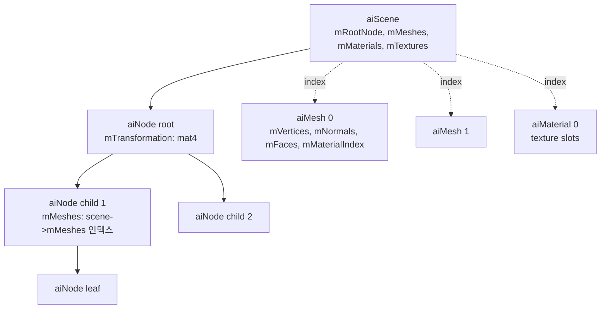
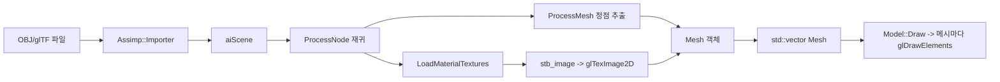

## 들어가며

정점 배열을 코드에 직접 적어 넣는 단계는 큐브에서 끝난다. 색깔 있는 삼각형 몇 개, 회전하는 큐브 한 개는 좌표 24개와 인덱스 36개를 손으로 박아 넣으면 그릴 수 있지만, 실제 게임 자원은 수만에서 수백만 개의 정점을 가지고 OBJ, glTF, FBX 같은 포맷으로 저장된다. 이런 파일을 읽으려면 파서가 필요한데, 포맷마다 바이너리 레이아웃과 좌표계 컨벤션이 다르므로 포맷별 파서를 직접 작성하는 일은 현실적이지 않다. Assimp(Open Asset Import Library)는 30종이 넘는 포맷을 하나의 노드 트리 자료구조로 통합해 주는 표준적인 선택지다. 이 글은 Assimp 노드 트리를 순회해 메시 계층을 만들고, 각 메시에 텍스처를 바인딩해 그리는 구조를 정리한다.

핵심 관찰은 *모델 파일이 거의 모두 같은 추상 구조를 공유한다*는 점이다. 어떤 포맷이든 결국 "씬 그래프 + 메시 + 재질 + 텍스처"라는 동일한 골격을 가진다. 포맷 사이의 차이는 바이너리냐 텍스트냐, PBR 재질을 지원하느냐, 애니메이션 데이터를 포함하느냐 같은 표면적 차이일 뿐이다. Assimp가 이 모든 포맷을 자기 자료구조 하나로 변환해 주므로, 임포터를 통과한 뒤에는 `aiScene` / `aiNode` / `aiMesh` / `aiMaterial`이라는 한 종류의 자료구조만 다루면 된다. 포맷의 다양성은 임포터 안쪽에 숨고, 엔진 코드는 단일한 트리만 본다.

여기까지의 코드는 정점 배열을 코드에 직접 박아 넣은 큐브 한 개를 그릴 수 있다. VAO 하나, VBO 하나, 인덱스 버퍼 하나에 정적인 데이터를 올리고 셰이더로 변환해 화면에 띄우는 흐름은 갖춰져 있지만, 디스크에 있는 임의의 외부 자원은 아직 다루지 못한다. 이 글에서 도달할 결과물은 OBJ 또는 glTF 파일에서 메시 계층을 읽어, 디퓨즈 텍스처가 입혀진 모델을 한 줄의 `Draw` 호출로 그리는 구조다. 다섯 단계로 쌓는다.

1. Assimp를 프로젝트에 통합하고 후처리 플래그(post-process flag)의 의미를 정리한다.
2. `aiScene → aiNode → aiMesh`의 위계와 노드 변환 행렬의 누적을 본다.
3. 위치/법선/UV/탄젠트를 하나의 GPU 정점 구조체로 패킹하는 인터리브 패턴을 다룬다.
4. `aiMaterial`의 텍스처 슬롯을 읽어 디스크에서 텍스처를 로드하고, GPU 텍스처 핸들과 메시를 연결한다.
5. `Mesh`와 `Model` 클래스로 드로우 한 번에 모델 전체가 그려지는 인터페이스를 설계한다.


---

## 목차
1. [Assimp 통합과 빌드](#1-assimp-통합과-빌드)
2. [씬, 노드, 메시의 관계](#2-씬-노드-메시의-관계)
3. [정점 속성 추출](#3-정점-속성-추출)
4. [재질과 텍스처 경로 해석](#4-재질과-텍스처-경로-해석)
5. [glTF 2.0과 OBJ 비교](#5-gltf-20과-obj-비교)
6. [Mesh와 Model 클래스 구성](#6-mesh와-model-클래스-구성)


---

## 1. Assimp 통합과 빌드

Assimp는 C++ 헤더와 라이브러리로 제공되며, 런타임에 모델 파일을 읽어 자기 자료구조로 변환하는 단방향 임포터다. 내보내기(export) 기능도 일부 포함하지만 게임 런타임에서는 거의 쓰지 않는다. 게임 빌드 파이프라인에서는 보통 오프라인 단계에서 한 번 임포트해 엔진 전용 바이너리 포맷으로 굽고(bake), 런타임에는 그 구운 포맷만 읽는 방식이 일반적이다. 학습 단계에서는 런타임 임포트로 충분하므로 이 글은 런타임에서 `ReadFile`을 직접 호출하는 흐름을 다룬다.

### 의존성 설치

Assimp를 프로젝트에 들이는 방법은 크게 세 가지다.

```bash
# 1) vcpkg
vcpkg install assimp

# 2) CMake FetchContent (서브빌드)
FetchContent_Declare(assimp
    GIT_REPOSITORY https://github.com/assimp/assimp.git
    GIT_TAG v5.4.0)
FetchContent_MakeAvailable(assimp)

# 3) 시스템 패키지
sudo apt install libassimp-dev    # Ubuntu
brew install assimp                # macOS
```

vcpkg는 바이너리 캐시가 있어 두 번째 빌드부터는 빠르지만, 처음에는 zlib·minizip·draco 같은 의존성 풀을 함께 받느라 시간이 걸린다. FetchContent는 프로젝트 안에 소스를 두고 같이 빌드하므로 버전 고정이 명확하고 CI 환경에서 재현성이 높다. 다만 Assimp 본체를 매번 빌드하므로 클린 빌드 시간이 늘어난다. 시스템 패키지는 가장 간단하지만 배포판이 고정한 버전이 무엇이냐가 골치다. Assimp는 빠르게 진화해 4 메이저와 5 메이저 사이에 `aiTextureType` 열거형 확장, PBR 슬롯 추가 같은 API 변경이 있었고, 우분투 LTS가 들고 있는 버전이 수 년 전 것일 수 있다. 어느 방식이든 빌드 후에는 헤더가 보고하는 버전을 한 번 확인해 두는 편이 안전하다.

```cmake
find_package(assimp CONFIG REQUIRED)
target_link_libraries(my_app PRIVATE assimp::assimp)
```

### 후처리 플래그

`Assimp::Importer::ReadFile(path, flags)`의 두 번째 인자가 후처리 비트마스크다. Assimp가 파일을 파싱한 직후, 데이터를 GPU에 올리기 좋은 형태로 자동 변환하는 단계들을 켜고 끄는 스위치다. 이 플래그를 어떻게 조합하느냐가 임포트 결과의 절반을 결정하므로 의미를 정확히 알아야 한다.

| 플래그 | 효과 | 언제 켜는가 |
|---|---|---|
| `aiProcess_Triangulate` | 사각형/다각형 면을 삼각형으로 분할 | 거의 항상 켠다 |
| `aiProcess_FlipUVs` | UV의 V 좌표를 `1 - v`로 뒤집음 | DirectX 원점 기준 텍스처를 OpenGL에서 쓸 때 |
| `aiProcess_GenSmoothNormals` | 법선이 없는 메시에 부드러운 법선 생성 | OBJ에 법선이 빠진 경우 |
| `aiProcess_CalcTangentSpace` | 탄젠트/비탄젠트 벡터 계산 | 노멀 맵을 쓸 메시 |
| `aiProcess_JoinIdenticalVertices` | 중복 정점 병합 후 인덱스 압축 | 메모리 절약 |
| `aiProcess_OptimizeMeshes` | 작은 메시를 하나로 병합 | 드로우 콜 감소 |
| `aiProcess_FixInfacingNormals` | 안쪽으로 향한 법선 뒤집기 | 손상된 메시 복구 |

```cpp
Assimp::Importer imp;
const aiScene* scene = imp.ReadFile(path,
      aiProcess_Triangulate
    | aiProcess_FlipUVs
    | aiProcess_GenSmoothNormals
    | aiProcess_CalcTangentSpace
    | aiProcess_JoinIdenticalVertices);

if (!scene
    || (scene->mFlags & AI_SCENE_FLAGS_INCOMPLETE)
    || !scene->mRootNode) {
    fprintf(stderr, "Assimp 실패: %s\n", imp.GetErrorString());
    return false;
}
```

플래그 사이에는 미묘한 상호작용이 있다. `aiProcess_GenSmoothNormals`는 메시에 법선이 *전혀 없을 때만* 동작하고, 이미 법선이 있으면 무시된다. 반대로 강제로 다시 계산하고 싶으면 `aiProcess_ForceGenNormals`와 함께 기존 법선을 지우는 처리가 필요하다. `aiProcess_CalcTangentSpace`는 메시에 법선과 UV가 모두 있어야 의미가 있다. 탄젠트 공간은 표면의 UV 미분으로 정의되므로 UV가 없으면 계산할 수 없고, `aiProcess_GenSmoothNormals`보다 뒤에 적용되도록 플래그 순서가 내부적으로 정렬된다. 한편 `aiProcess_JoinIdenticalVertices`는 위치·법선·UV가 *모두* 같은 정점만 병합하므로, 같은 위치라도 UV 솔기(seam)에서 갈라진 정점은 그대로 둔다. 큐브의 경우 8개 꼭짓점이 각 면마다 다른 법선과 UV를 가지므로 병합 후에도 24개로 남는 식이다.

`aiProcessPreset_TargetRealtime_Quality` 같은 프리셋도 있다. 이 프리셋은 Triangulate, GenSmoothNormals, JoinIdenticalVertices, CalcTangentSpace, 그리고 메시 검증과 인덱스 개선 같은 여러 플래그를 묶은 것이다. 무엇이 켜지는지 모르고 쓰면 디버깅이 어려워지므로, 학습 단계에서는 필요한 플래그를 명시적으로 OR 하는 편이 낫다.

### 임포터와 씬의 수명

`scene`의 수명은 *importer 객체가 소유*한다. `Assimp::Importer`가 파괴되면 그 importer가 반환한 `aiScene`도 함께 해제된다. 즉 scene 포인터를 importer보다 오래 들고 있으면 댕글링 포인터가 된다. 이 규칙을 어기면 임포트 직후에는 멀쩡히 보이다가 importer가 스코프를 벗어난 뒤 메시를 그리려는 순간 크래시가 난다. 안전한 패턴은 임포트 시점에 scene 전체를 순회해 엔진 쪽 자료구조(`Mesh` / `Model`)로 복사한 뒤, importer를 즉시 해제하는 것이다.

```cpp
std::vector<Mesh> LoadModel(const std::string& path) {
    Assimp::Importer imp;  // 지역 변수 — 함수가 끝나면 scene도 해제된다
    const aiScene* scene = imp.ReadFile(path, /* flags */);
    // scene을 순회해 Mesh 벡터로 복사한다
    std::vector<Mesh> meshes = /* 순회 결과 */;
    return meshes;  // importer가 파괴되어도 meshes는 GPU 핸들만 들고 있어 안전
}
```

`aiString`이나 `aiVector3D` 같은 Assimp 타입의 포인터를 엔진 자료구조가 직접 들고 있으면 같은 댕글링 문제가 생긴다. 추출 과정에서 값(value)으로 복사해 `glm::vec3`나 `std::string`으로 바꿔 담는 것이 원칙이다.

### 좌표계 변환 후처리

Assimp가 보고하는 좌표계는 포맷에 따라 다르다. OBJ는 OpenGL 식으로 Y가 위, -Z가 앞, 오른손 좌표계다. FBX는 종종 Z가 위인 3ds Max/Maya 컨벤션으로 저장되고, glTF는 Y가 위, -Z가 앞인 오른손 좌표계를 표준으로 명시한다. 모델 파일에 up axis 메타데이터가 들어 있으면 Assimp가 이를 읽고, `aiProcess_ConvertToLeftHanded`(DirectX용)나 별도 후처리로 일관된 좌표계로 맞출 수 있다.

좌표계 문제의 핵심은 임포트 시점이 아니라 엔진 전체에 있다. 엔진의 내부 좌표계 컨벤션을 먼저 한 가지로 못 박고, 모든 임포트가 그 컨벤션으로 들어오도록 변환을 거는 흐름이 표준이다. 컨벤션을 정하지 않고 모델마다 다른 좌표계로 들어오게 두면, 어떤 모델은 누워서 들어오고 어떤 모델은 뒤집혀 들어온다. OpenGL 학습용으로는 Y가 위, -Z가 앞, 오른손 좌표계를 내부 컨벤션으로 두는 방식이 흔하다.

## 2. 씬, 노드, 메시의 관계

`aiScene`은 한 모델 파일 전체를 표현하는 최상위 객체다. 그 아래로 노드 트리, 평탄화된 메시 배열, 재질 배열, 임베드 텍스처 배열이 매달린다.



구조의 핵심은 세 가지다. 첫째, `aiScene::mRootNode`가 씬 그래프의 루트다. 둘째, 각 `aiNode`는 부모 좌표계 기준의 변환 행렬, 자식 노드 배열, 그리고 이 노드에 속하는 메시 인덱스 배열을 가진다. 셋째, `aiMesh` 자체는 `scene->mMeshes` 배열에 평탄화되어 있고 노드는 이를 인덱스로만 참조한다. 노드가 메시를 인덱스로 참조한다는 사실이 중요한데, 같은 메시를 여러 노드가 서로 다른 변환으로 참조할 수 있어 자연스러운 인스턴싱의 토대가 되기 때문이다.

### 노드 변환 누적

각 노드의 `mTransformation`은 부모 좌표계 기준의 4×4 행렬이다. 한 노드의 월드 변환은 루트부터 그 노드까지 거치는 모든 행렬을 위에서 아래로 곱한 결과다. 부모의 회전과 이동이 자식에게 누적되어 전달되는 전형적인 계층 변환(hierarchical transform)이다. 트리를 깊이 우선으로 순회하면서 부모의 누적 행렬에 자기 지역 행렬을 곱해 자식으로 내려보내면 된다.

```cpp
glm::mat4 ToGlm(const aiMatrix4x4& m) {
    // Assimp는 행 우선(row-major), GLM은 열 우선(column-major)이라 전치한다
    return glm::transpose(glm::make_mat4(&m.a1));
}

void ProcessNode(const aiNode* node, const aiScene* scene,
                 const glm::mat4& parentXform) {
    glm::mat4 local = ToGlm(node->mTransformation);
    glm::mat4 world = parentXform * local;          // 부모 변환을 누적한다

    for (unsigned i = 0; i < node->mNumMeshes; ++i) {
        aiMesh* mesh = scene->mMeshes[node->mMeshes[i]];
        ProcessMesh(mesh, scene, world);            // 메시에 월드 변환을 부여한다
    }
    for (unsigned i = 0; i < node->mNumChildren; ++i) {
        ProcessNode(node->mChildren[i], scene, world);
    }
}

ProcessNode(scene->mRootNode, scene, glm::mat4(1.0f));
```

가장 흔한 함정이 행렬 메모리 레이아웃의 불일치다. Assimp의 `aiMatrix4x4`는 행 우선으로 저장되어 메모리상 첫 네 원소가 첫 번째 *행*이다. 반면 GLM은 OpenGL과 동일하게 열 우선이라 첫 네 원소가 첫 번째 *열*이다. `glm::make_mat4`는 메모리를 그대로 읽어 열 우선으로 해석하므로, Assimp 행렬을 그대로 넘기면 전치된 행렬이 만들어진다. `glm::transpose`로 한 번 뒤집어 줘야 의도한 변환이 된다. 이 전치를 빠뜨리면 회전 부분이 전치되고 이동 성분이 엉뚱한 자리에 들어가, 모델이 회전이 어긋난 채로 화면 밖 어딘가로 날아가는 증상이 나타난다. 디버깅할 때 회전·이동이 동시에 이상하면 이 전치를 먼저 의심한다.

루트 노드 자체의 변환도 무시하면 안 된다. glTF나 FBX는 루트에 단위로 변환(예: 미터/센티미터 스케일 보정, Z-up → Y-up 회전)을 실어 두는 경우가 많다. `ProcessNode`를 단위 행렬이 아니라 루트 변환부터 시작하도록 한 위 코드가 이 변환을 자연스럽게 포함한다.

### 정적 베이크 vs 런타임 계층

여기서 한 가지 설계 선택이 갈린다. 노드 변환을 *임포트 시점에 정점 위치에 구워 넣을* 것인가, 아니면 *런타임에 노드 계층을 유지하며 매 프레임 곱할* 것인가다. 정적 메시라면 임포트 시점에 각 정점에 월드 변환을 곱해 구워 넣는 편이 단순하고 빠르다. 드로우 시점에 노드 행렬을 다시 곱할 필요가 없다. 반면 관절이 움직이는 캐릭터나 부품이 따로 도는 기계처럼 노드별로 변환이 동적으로 바뀌어야 한다면, 노드 계층을 그대로 유지해야 한다. 이 글의 학습용 구현은 정적 메시를 가정하고, 노드를 평탄화해 `(메시, 월드 변환)` 쌍을 배열에 담는 단순한 경로를 택한다.

### 메시 인스턴싱

여러 노드가 같은 메시 인덱스를 참조할 수 있다는 점을 다시 짚는다. 캐릭터의 좌우 팔이 대칭 모델이라면, 한 팔의 메시 한 개를 두 노드가 서로 다른 변환으로 그릴 수 있다. 가로수 100그루가 같은 나무 메시를 100개 노드에서 참조하는 경우도 마찬가지다. 임포트 시 이 구조가 보존되면, 같은 VAO를 한 번 바인딩하고 변환만 바꿔 `glDrawElementsInstanced`로 한 번에 그릴 수 있다. 이렇게 하면 100번의 드로우 콜이 1번으로 줄어 CPU 측 드라이버 오버헤드가 크게 떨어진다. 이 구현은 모든 노드를 `(메시, 월드 변환)` 쌍으로 평탄화한다. 인스턴싱을 적용할 때는 이 배열을 같은 메시 인덱스끼리 묶어 한 드로우의 instance 집합으로 바꾼다.

## 3. 정점 속성 추출

`aiMesh`의 정점 데이터는 분리된 평행 배열(parallel array)로 저장된다. `mVertices`가 위치, `mNormals`가 법선, `mTextureCoords[0..7]`가 UV 채널, `mTangents`와 `mBitangents`가 탄젠트 공간, `mColors[0..7]`가 정점 색이다. 같은 인덱스 `i`가 모든 배열에서 한 정점을 가리키는 구조다. 그런데 GPU에 올릴 때는 한 정점의 모든 속성을 하나의 구조체로 묶는 인터리브(interleaved) 레이아웃이 일반적이다. 한 정점을 그릴 때 필요한 모든 속성이 메모리상 연속으로 놓여 캐시 적중률이 높고, 정점 버퍼 하나에 stride 하나로 모든 속성을 매핑할 수 있어 단순하기 때문이다. 따라서 Assimp의 평행 배열을 인터리브 구조체 배열로 재배치하는 추출 단계가 필요하다.

### 정점 구조체

```cpp
struct Vertex {
    glm::vec3 pos;        // 12 B, offset 0
    glm::vec3 normal;     // 12 B, offset 12
    glm::vec2 uv;         //  8 B, offset 24
    glm::vec3 tangent;    // 12 B, offset 32
    glm::vec3 bitangent;  // 12 B, offset 44
};
```

float 개수로는 `3 + 3 + 2 + 3 + 3 = 14`개, 바이트로는 `14 * 4 = 56B`다. 모든 멤버가 4바이트 정렬을 요구하는 float이고 구조체 시작이 4의 배수이므로 컴파일러가 끼워 넣는 패딩 없이 정확히 56B가 된다. 만약 멤버 사이에 `bool`이나 `char` 같은 작은 타입을 섞으면 정렬 패딩이 들어가 stride가 예상과 달라지고, `glVertexAttribPointer`의 오프셋이 어긋난다. 정점 구조체는 가능한 한 4바이트 단위로 떨어지는 타입만 모으는 것이 안전하다.

56B라는 크기는 메모리 예산을 가늠하는 데 쓰인다. 정점 100만 개 메시라면 정점 버퍼만 56MB다. 위치만 필요한 그림자 패스(shadow pass)에서는 56B 전부를 읽을 이유가 없으므로, 위치만 담은 별도의 슬림 정점 버퍼를 두거나 속성을 별도 버퍼로 분리(de-interleave)하는 최적화가 등장한다. 학습 단계에서는 한 구조체로 단순하게 가고, 이 숫자만 기억해 둔다.

### 추출 함수

```cpp
struct MeshData {
    std::vector<Vertex> vertices;
    std::vector<unsigned> indices;
    unsigned materialIndex;
};

MeshData ProcessMesh(const aiMesh* mesh, const aiScene* scene) {
    MeshData out;
    out.materialIndex = mesh->mMaterialIndex;
    out.vertices.reserve(mesh->mNumVertices);

    for (unsigned i = 0; i < mesh->mNumVertices; ++i) {
        Vertex v{};
        v.pos = {mesh->mVertices[i].x, mesh->mVertices[i].y, mesh->mVertices[i].z};
        if (mesh->HasNormals()) {
            v.normal = {mesh->mNormals[i].x, mesh->mNormals[i].y, mesh->mNormals[i].z};
        }
        if (mesh->mTextureCoords[0]) {   // 채널 0이 nullptr일 수 있다
            v.uv = {mesh->mTextureCoords[0][i].x, mesh->mTextureCoords[0][i].y};
        }
        if (mesh->HasTangentsAndBitangents()) {
            v.tangent   = {mesh->mTangents[i].x, mesh->mTangents[i].y, mesh->mTangents[i].z};
            v.bitangent = {mesh->mBitangents[i].x, mesh->mBitangents[i].y, mesh->mBitangents[i].z};
        }
        out.vertices.push_back(v);
    }
    // 인덱스는 다음 블록에서 채운다
    return out;
}
```

여기서 `mTextureCoords[0]`가 `nullptr`일 수 있다는 점이 segfault를 부르는 함정이다. UV 채널이 전혀 없는 메시는 `mTextureCoords[0]`이 널 포인터이므로, 검사 없이 `mTextureCoords[0][i]`로 접근하면 곧장 크래시다. 위 코드처럼 채널 포인터가 널이 아닌지 먼저 확인하고, 없으면 `Vertex{}`로 영초기화된 기본값 `{0, 0}`을 그대로 둔다. `HasNormals`와 `HasTangentsAndBitangents`는 Assimp가 제공하는 헬퍼로 같은 널 검사를 안전하게 감싸 준다.

`mTextureCoords`가 8채널까지 있는 이유는 라이트맵 UV, 디테일 텍스처 UV, 멀티 텍스처용 보조 UV 세트가 필요한 경우 때문이다. 대부분의 게임 메시는 채널 0 하나만 쓰고, 라이트맵을 베이크하는 엔진이 채널 1을 추가로 쓰는 정도다. 학습용 구현은 채널 0만 다룬다.

인덱스 추출은 면(face)을 펼치는 단계다. `aiProcess_Triangulate`를 켰으므로 모든 면은 정확히 3개의 정점 인덱스를 가진다.

```cpp
out.indices.reserve(static_cast<size_t>(mesh->mNumFaces) * 3);
for (unsigned f = 0; f < mesh->mNumFaces; ++f) {
    const aiFace& face = mesh->mFaces[f];
    if (face.mNumIndices != 3) continue;
    for (unsigned j = 0; j < face.mNumIndices; ++j) {
        out.indices.push_back(face.mIndices[j]);
    }
}
```

Triangulate를 켰더라도 `face.mNumIndices`로 다시 확인하는 편이 방어적이다. 점(point)이나 선(line) 프리미티브가 섞인 파일이면 면이 1개나 2개 인덱스를 가질 수 있고, 그런 면을 삼각형 인덱스 버퍼에 섞으면 그리기가 깨진다. `aiProcess_SortByPType`로 프리미티브 종류를 분리하거나, 위처럼 인덱스 수를 확인하며 삼각형 면만 골라 담는다.

### VAO / VBO / EBO 생성

추출한 `MeshData`를 GPU에 올린다. VAO/VBO/EBO를 생성하고, 정점 속성 포인터를 등록하고, 인덱스 버퍼를 업로드하는 표준 패턴이다. 큐브 단계와 달라진 점은 `Vertex` 구조체가 다섯 속성을 담아 stride가 56B로 커졌다는 것뿐이다.

```cpp
void UploadMesh(const MeshData& data, GLuint& vao, GLuint& vbo, GLuint& ebo) {
    glGenVertexArrays(1, &vao);
    glGenBuffers(1, &vbo);
    glGenBuffers(1, &ebo);

    glBindVertexArray(vao);
    glBindBuffer(GL_ARRAY_BUFFER, vbo);
    glBufferData(GL_ARRAY_BUFFER,
                 static_cast<GLsizeiptr>(data.vertices.size() * sizeof(Vertex)),
                 data.vertices.data(), GL_STATIC_DRAW);

    glBindBuffer(GL_ELEMENT_ARRAY_BUFFER, ebo);
    glBufferData(GL_ELEMENT_ARRAY_BUFFER,
                 static_cast<GLsizeiptr>(data.indices.size() * sizeof(unsigned)),
                 data.indices.data(), GL_STATIC_DRAW);

    auto Attrib = [](GLuint loc, int n, size_t off) {
        glEnableVertexAttribArray(loc);
        glVertexAttribPointer(loc, n, GL_FLOAT, GL_FALSE,
                              sizeof(Vertex),
                              reinterpret_cast<void*>(off));
    };
    Attrib(0, 3, offsetof(Vertex, pos));
    Attrib(1, 3, offsetof(Vertex, normal));
    Attrib(2, 2, offsetof(Vertex, uv));
    Attrib(3, 3, offsetof(Vertex, tangent));
    Attrib(4, 3, offsetof(Vertex, bitangent));

    glBindVertexArray(0);
}
```

`offsetof(Vertex, normal)`은 컴파일 시점 상수라 stride와 함께 `0 / 12 / 24 / 32 / 44`라는 바이트 오프셋이 그대로 들어간다. `offsetof`를 쓰는 이유는 정점 구조체의 멤버 순서를 바꾸더라도 오프셋이 자동으로 따라오기 때문이다. 손으로 `(void*)24` 같은 매직 넘버를 박으면 멤버 순서를 바꾸는 순간 조용히 어긋난다.

VAO가 EBO 바인딩을 기억한다는 점도 함정이다. `GL_ELEMENT_ARRAY_BUFFER` 바인딩은 현재 바인딩된 VAO의 상태에 저장된다. 따라서 위 코드처럼 VAO를 먼저 바인딩한 뒤 EBO를 바인딩해야 하고, 끝에서 VAO를 언바인딩하기 *전에* EBO를 언바인딩하면 VAO에 기록된 EBO 연결이 풀려 버린다. VBO 바인딩은 VAO 상태에 들어가지 않고 `glVertexAttribPointer` 호출 시점에 속성별로 캡처되므로 규칙이 다르다. 이 비대칭이 모델 로딩에서 인덱스가 그려지지 않는 흔한 원인이다.

## 4. 재질과 텍스처 경로 해석

`aiMaterial`은 디퓨즈/노멀/스페큘러/메탈릭/러프니스 같은 텍스처 슬롯과, 알파나 광택 지수(shininess) 같은 수치 파라미터를 담는다. 각 메시의 `mMaterialIndex`가 `scene->mMaterials` 배열의 인덱스이므로, 메시에서 재질로 한 단계 더 들어가 텍스처를 찾는다.

### 텍스처 슬롯 종류

| Assimp 상수 | 의미 | 셰이더 샘플러 이름 |
|---|---|---|
| `aiTextureType_DIFFUSE` | 알베도 / 베이스 컬러 (Phong) | `texture_diffuse1` |
| `aiTextureType_SPECULAR` | 스페큘러 마스크 (Phong) | `texture_specular1` |
| `aiTextureType_NORMALS` | 노멀 맵 | `texture_normal1` |
| `aiTextureType_HEIGHT` | 변위 / 시차 매핑 | `texture_height1` |
| `aiTextureType_BASE_COLOR` | PBR 알베도 | (PBR 경로) |
| `aiTextureType_METALNESS` | PBR 메탈릭 | (PBR 경로) |
| `aiTextureType_DIFFUSE_ROUGHNESS` | PBR 러프니스 | (PBR 경로) |
| `aiTextureType_AMBIENT_OCCLUSION` | AO 맵 | (확장 셰이딩) |

OBJ 같은 옛 포맷은 `DIFFUSE`, `SPECULAR`, `NORMALS` 정도만 채우고, glTF 2.0은 `BASE_COLOR`, `METALNESS`, `DIFFUSE_ROUGHNESS`, `AMBIENT_OCCLUSION`, 이미시브 같은 PBR 표준 슬롯을 채운다. 한 가지 흔한 혼란이 OBJ의 노멀 맵이 `aiTextureType_NORMALS`가 아니라 `aiTextureType_HEIGHT`로 들어오는 경우다. OBJ의 `.mtl` 파일은 노멀 맵을 위한 정식 키워드가 없어 `bump`나 `map_Bump`로 적는데, Assimp가 이를 높이맵 슬롯으로 해석하기 때문이다. OBJ 모델의 노멀 맵이 비어 보이면 `HEIGHT` 슬롯을 확인한다.

### 경로 추출과 텍스처 로드

```cpp
struct Texture {
    GLuint id;
    std::string type;   // "texture_diffuse" / "texture_normal" / ...
    std::string path;
};

std::vector<Texture> LoadMaterialTextures(const aiMaterial* mat,
                                          aiTextureType type,
                                          const std::string& typeName,
                                          const std::string& modelDir,
                                          TextureCache& cache) {
    std::vector<Texture> out;
    unsigned n = mat->GetTextureCount(type);
    for (unsigned i = 0; i < n; ++i) {
        aiString relPath;
        mat->GetTexture(type, i, &relPath);
        std::string full = modelDir + "/" + relPath.C_Str();

        auto it = cache.find(full);
        if (it != cache.end()) {                 // 이미 로드한 텍스처면 재사용
            out.push_back({it->second, typeName, full});
            continue;
        }
        GLuint id = LoadTextureFromDisk(full);    // stb_image + glTexImage2D
        cache[full] = id;
        out.push_back({id, typeName, full});
    }
    return out;
}
```

`TextureCache`는 같은 경로의 텍스처를 두 번 로드하지 않도록 막는 `std::unordered_map<std::string, GLuint>`다. 한 모델의 여러 메시가 같은 텍스처를 공유하는 경우가 흔하고, 캐시 없이 메시마다 다시 로드하면 디스크 I/O와 VRAM이 그만큼 낭비된다. 4K RGBA8 디퓨즈 텍스처 한 장은 기본 레벨만 64MiB(`4096 × 4096 × 4B`), 전체 밉 체인까지 약 85MiB를 차지하므로 중복 로드를 막는 dedup은 단순하지만 효과가 크다.

`modelDir`은 모델 파일이 있는 디렉토리다. Assimp가 반환하는 텍스처 경로는 모델 파일 기준 상대 경로이거나, 때로는 디자이너의 작업 머신 절대 경로가 그대로 박혀 있기도 하다. 후자라면 경로의 파일명만 떼어 `modelDir`과 결합하는 보정이 필요하다. 윈도우에서 만든 모델은 경로 구분자가 백슬래시일 수 있어 정방향 슬래시로 정규화하는 처리도 흔히 들어간다.

glTF의 `.glb`처럼 텍스처가 파일 안에 임베드된 경우도 있다. 이때 `relPath`는 디스크 경로가 아니라 `*0`, `*1` 같은 인덱스 형태로 오고, `scene->mTextures[index]`에서 raw 바이트를 꺼내 메모리에서 디코딩해야 한다. 디스크 로드와 임베드 로드의 분기를 한 군데에서 처리해 두면 OBJ와 glTF를 같은 경로로 다룰 수 있다.

### stb_image로 텍스처 로드

```cpp
GLuint LoadTextureFromDisk(const std::string& path) {
    int w, h, ch;
    unsigned char* data = stbi_load(path.c_str(), &w, &h, &ch, 0);
    if (!data) {
        fprintf(stderr, "텍스처 로드 실패: %s\n", path.c_str());
        return 0;
    }
    GLenum fmt = (ch == 4) ? GL_RGBA : (ch == 3) ? GL_RGB : GL_RED;

    GLuint tex;
    glGenTextures(1, &tex);
    glBindTexture(GL_TEXTURE_2D, tex);
    glTexImage2D(GL_TEXTURE_2D, 0, fmt, w, h, 0, fmt, GL_UNSIGNED_BYTE, data);
    glGenerateMipmap(GL_TEXTURE_2D);
    glTexParameteri(GL_TEXTURE_2D, GL_TEXTURE_WRAP_S, GL_REPEAT);
    glTexParameteri(GL_TEXTURE_2D, GL_TEXTURE_WRAP_T, GL_REPEAT);
    glTexParameteri(GL_TEXTURE_2D, GL_TEXTURE_MIN_FILTER, GL_LINEAR_MIPMAP_LINEAR);
    glTexParameteri(GL_TEXTURE_2D, GL_TEXTURE_MAG_FILTER, GL_LINEAR);

    stbi_image_free(data);
    return tex;
}
```

stb_image는 단일 헤더 라이브러리로 PNG, JPG, TGA, BMP 같은 일반 포맷을 외부 의존성 없이 읽는다. 게임 전용 압축 포맷인 KTX2, DDS, Basis Universal은 별도 라이브러리(libktx 등)가 필요하다.

세 가지 함정이 있다. 첫째, 행 정렬이다. OpenGL의 기본 `GL_UNPACK_ALIGNMENT`는 4라서, 폭이 4의 배수가 아닌 `GL_RGB`(3바이트) 텍스처는 행마다 어긋나 비스듬히 일그러진다. 폭이 임의인 텍스처를 다룰 때는 `glPixelStorei(GL_UNPACK_ALIGNMENT, 1)`을 호출하거나 4채널로 강제 로드한다. 둘째, 상하 반전이다. stb_image는 이미지의 첫 행을 위쪽으로 읽지만 OpenGL 텍스처 좌표의 원점은 아래쪽이라, 텍스처가 위아래로 뒤집혀 보일 수 있다. `stbi_set_flip_vertically_on_load(true)`로 로드 시 뒤집거나, 앞에서 본 `aiProcess_FlipUVs`로 UV 쪽을 뒤집는다. 두 가지를 동시에 켜면 두 번 뒤집혀 원래대로 돌아오므로 하나만 켠다. 셋째, 채널 수다. 회색조 PNG는 `ch == 1`이라 `GL_RED`로 들어가는데, 이를 디퓨즈 셰이더에서 `.rgb`로 샘플하면 빨강 채널만 읽혀 빨간 끼가 도는 결과가 나온다.

`glTexImage2D`의 세 번째 인자(internalFormat)와 일곱 번째 인자(format)가 위 코드에서는 같은 `fmt`다. 두 값이 같으면 디스크의 바이트를 그대로 저장한다는 뜻이다. 하지만 알베도/디퓨즈 텍스처는 보통 sRGB 공간으로 저장되어 있어, 셰이딩 계산을 선형 공간에서 하려면 internalFormat을 `GL_SRGB8` 또는 `GL_SRGB8_ALPHA8`로 지정해 GPU가 샘플 시 자동으로 선형으로 변환하도록 해야 한다. 반대로 노멀 맵·러프니스·메탈릭 같은 데이터 텍스처는 색이 아니라 수치이므로 선형(`GL_RGB8`, `GL_RGBA8`)으로 둬야 한다. 색 텍스처에 노멀 맵을 sRGB로 잘못 넣으면 라이팅이 미묘하게 틀어진다. 감마와 sRGB의 정확한 처리는 셰이딩 단계에서 본격적으로 다루므로, 지금은 텍스처 종류에 따라 internalFormat이 달라진다는 점만 토대로 깔아 둔다.

### 셰이더 측 샘플러 바인딩

```cpp
void DrawMesh(const Mesh& mesh, GLuint program) {
    unsigned diffuseN = 1, specularN = 1, normalN = 1;
    for (size_t i = 0; i < mesh.textures.size(); ++i) {
        glActiveTexture(GL_TEXTURE0 + static_cast<GLenum>(i));
        std::string number;
        const std::string& name = mesh.textures[i].type;
        if      (name == "texture_diffuse")  number = std::to_string(diffuseN++);
        else if (name == "texture_specular") number = std::to_string(specularN++);
        else if (name == "texture_normal")   number = std::to_string(normalN++);

        GLint loc = glGetUniformLocation(program, (name + number).c_str());
        glUniform1i(loc, static_cast<GLint>(i));
        glBindTexture(GL_TEXTURE_2D, mesh.textures[i].id);
    }
    glBindVertexArray(mesh.vao);
    glDrawElements(GL_TRIANGLES, static_cast<GLsizei>(mesh.indexCount),
                   GL_UNSIGNED_INT, 0);
}
```

`GL_TEXTURE0 + i`가 텍스처 유닛(샘플러 슬롯)이다. OpenGL 4.x 하드웨어는 프래그먼트 셰이더당 최소 16개 유닛을 보장하며, 실제 한도는 `glGetIntegerv(GL_MAX_TEXTURE_IMAGE_UNITS,...)`로 조회한다. 흐름은 셰이더의 샘플러 유니폼마다 `glUniform1i`로 "너는 몇 번 유닛을 봐라"라고 알려 주고, `glActiveTexture`로 그 유닛을 활성화한 뒤 `glBindTexture`로 텍스처를 그 유닛에 묶는 것이다. `glUniform1i`에 넘기는 값은 텍스처 핸들이 아니라 *유닛 번호*라는 점에 주의한다. 여기에 텍스처 ID를 넣는 실수가 흔하다.

`glGetUniformLocation`을 드로우마다 호출하는 위 코드는 학습용으로는 명료하지만 비효율적이다. 유니폼 위치는 프로그램 링크 후 고정이므로, 실전에서는 초기화 시점에 한 번 조회해 캐시한다. 또 샘플러가 없는 슬롯에 대해 `glGetUniformLocation`이 -1을 반환할 수 있고, -1로 `glUniform1i`를 호출하면 조용히 무시되므로 디버깅 시 혼란을 준다.

셰이더 쪽은 같은 이름 규약을 따른다.

```glsl
uniform sampler2D texture_diffuse1;
uniform sampler2D texture_specular1;
uniform sampler2D texture_normal1;

void main() {
    vec3 diffuse  = texture(texture_diffuse1,  vUv).rgb;
    vec3 specular = texture(texture_specular1, vUv).rgb;
    vec3 normal   = texture(texture_normal1,   vUv).xyz * 2.0 - 1.0;
    // ... 셰이딩
}
```

노멀 맵에서 `* 2.0 - 1.0`을 거는 이유는, 텍스처에 저장된 0~1 범위의 색을 -1~1 범위의 방향 벡터로 펴기 위해서다. RGB의 0.5가 0에 해당하는 평평한 표면이다.

## 5. glTF 2.0과 OBJ 비교

게임에서 가장 흔히 마주치는 두 포맷의 데이터 표현 차이를 정리한다. Assimp가 둘 다 같은 `aiScene`으로 변환해 주지만, 원본 데이터가 담은 정보의 풍부함이 달라 최종 렌더링 품질에 차이가 난다. 포맷 선택이 곧 어떤 데이터를 받을 수 있느냐를 결정한다.

### 포맷 자체의 차이

| 항목 | OBJ | glTF 2.0 |
|---|---|---|
| 형식 | 텍스트 (`.obj` + `.mtl`) | JSON (`.gltf`) 또는 바이너리 (`.glb`) |
| 정점 데이터 | 텍스트 부동소수 라인 | 외부 `.bin`의 packed binary |
| 텍스처 | 별도 파일 참조 | 외부 파일 또는 `.glb` 내 임베드 |
| PBR 재질 | 약함 (Phong 기반 `.mtl`) | 표준 지원 (BaseColor / Metallic / Roughness / Normal / AO / Emissive) |
| 노드 계층 | 없음 (단일 그룹) | 씬 그래프 + 변환 + 인스턴싱 |
| 스킨 애니메이션 | 없음 | 있음 (joint + skin) |
| 모프 타깃 | 없음 | 있음 |
| 카메라 / 라이트 | 없음 | 메타데이터로 포함 |
| 압축 | 없음 | KTX2 / Basis Universal / Draco |

OBJ는 1992년에 등장한 포맷으로, 정적 메시와 단순 텍스처 정도의 표현만 가진다. 정점이 텍스트 라인으로 저장되므로 파싱이 느리고 파일이 크다. 게임 자원으로는 프로토타이핑이나 학습용 정도이며, 모바일·웹 게임에서도 실배포 포맷은 glTF가 표준이다. glTF는 처음부터 런타임 전송을 염두에 두고 설계되어, 정점 데이터를 GPU 버퍼 레이아웃에 가까운 바이너리로 담고 PBR 재질을 표준으로 명시한다.

### 임포트 결과의 차이

같은 캐릭터를 OBJ와 glTF로 각각 임포트하면, Assimp를 통과한 뒤의 `aiScene` 내용이 눈에 띄게 다르다. OBJ는 정점·면·정점 그룹별 디퓨즈 텍스처 정도만 들고 들어오고, 노드 트리는 루트 하나에 모든 메시가 평탄화된 얕은 구조다. 애니메이션, PBR, 스킨 정보가 모두 비어 있다. 반면 glTF는 노드 트리를 그대로 보존하고, 메시마다 PBR 텍스처 다섯 종(베이스컬러·메탈릭·러프니스·노멀·이미시브)에 스킨과 애니메이션 트랙까지 채워 들어온다. glTF는 임포트한 그대로 PBR 셰이딩으로 그릴 수 있다.

| Assimp 변환 후 데이터 | OBJ | glTF |
|---|---|---|
| `aiMesh::mNumVertices` | 적절 (Triangulate 후) | 적절 |
| `aiNode` 깊이 | 1~2 단계 | 깊은 트리 |
| `aiMaterial` 텍스처 슬롯 | DIFFUSE / SPECULAR / NORMALS | + BASE_COLOR / METALNESS / ROUGHNESS / AO / EMISSIVE |
| `aiAnimation` | 없음 | 있음 |
| `aiBone` / `aiSkeleton` | 없음 | 있음 |

### 압축 텍스처

glTF의 KTX2와 Basis Universal은 GPU 네이티브 블록 압축 포맷으로 전송하거나 런타임에 변환할 수 있는 컨테이너·중간 표현이다. PNG나 JPG를 CPU에서 디코딩해 비압축 RGBA8로 GPU에 올리면 4K 기본 레벨만 64MiB를 쓰지만, 4K BC7은 기본 레벨 약 16MiB, ETC2 RGB는 약 8MiB다. 밉 체인은 각 값에 약 1/3을 더한다. 텍스처가 수백 장 들어가는 게임에서 이 차이는 결정적이다.

다만 Assimp 자체는 KTX2를 디코딩하지 않는다. `aiTexture`의 raw 바이트를 받아 libktx 같은 전용 디코더에 넘기는 별도 처리가 필요하다. 학습 단계에서는 PNG와 JPG로 충분하므로 압축 텍스처는 시야 밖에 둔다.

### 권장 선택

| 시나리오 | 권장 포맷 |
|---|---|
| 학습 / 프로토타입 | OBJ (단순) |
| 일반 게임 자원 | glTF 2.0 (`.glb`) |
| 영화 / 시네마틱 | FBX (애니메이션 풍부) |
| 모바일 / 웹 배포 | glTF + KTX2 |
| 옛 엔진 호환 | OBJ 또는 FBX |

이 글의 예제는 텍스처가 입혀진 정적 메시를 다루므로 OBJ로 시작하기 좋다. 노드 계층과 PBR을 확인하고 싶으면 같은 코드로 `.glb`를 열어 `aiNode` 깊이와 텍스처 슬롯이 어떻게 달라지는지 비교해 보면 두 포맷의 차이가 코드 수준에서 드러난다.

## 6. Mesh와 Model 클래스 구성

위에서 만든 데이터 흐름을 재사용 가능한 클래스로 묶는다. 책임을 두 계층으로 나눈다. `Mesh`는 한 메시 단위로 VAO/VBO/EBO와 텍스처 슬롯 묶음을 소유하고 `Draw(program)`으로 자기 자신을 그린다. `Model`은 한 모델 파일 전체를 표현하며, 노드를 평탄화한 `std::vector<Mesh>`를 들고 `Draw(program)`이 모든 메시를 순회한다.

### Mesh 클래스

```cpp
class Mesh {
public:
    Mesh(std::vector<Vertex> verts, std::vector<unsigned> indices,
         std::vector<Texture> textures);
    ~Mesh();
    Mesh(const Mesh&)            = delete;
    Mesh& operator=(const Mesh&) = delete;
    Mesh(Mesh&& o) noexcept;
    Mesh& operator=(Mesh&& o) noexcept;

    void Draw(GLuint program) const;

private:
    GLuint vao_ = 0, vbo_ = 0, ebo_ = 0;
    std::vector<Texture> textures_;
    size_t indexCount_ = 0;

    void Setup(const std::vector<Vertex>& v, const std::vector<unsigned>& i);
};
```

복사를 금지하고 이동만 허용하는 설계가 핵심이다. `vao_`, `vbo_`, `ebo_`는 GPU가 소유한 자원을 가리키는 정수 핸들이고, 소멸자가 `glDeleteVertexArrays` 등으로 이를 반납한다. 복사를 허용하면 VAO 핸들 하나를 두 객체가 함께 들게 되어, 한쪽이 소멸하면서 핸들을 삭제한 뒤 다른 쪽이 같은 핸들을 다시 삭제하는 이중 해제(double free)가 일어난다. 복사를 명시적으로 `delete`하고 이동 생성자만 두면, 핸들의 소유권이 항상 한 객체에만 있는 RAII가 성립한다. 컨테이너에 담을 때 이동만으로 충분하므로 실용성도 잃지 않는다.

```cpp
Mesh::Mesh(std::vector<Vertex> v, std::vector<unsigned> i,
           std::vector<Texture> t)
    : textures_(std::move(t)), indexCount_(i.size()) {
    Setup(v, i);   // 이 안에서 VAO/VBO/EBO를 만들고 업로드한다
}

Mesh::~Mesh() {
    if (vao_) glDeleteVertexArrays(1, &vao_);
    if (vbo_) glDeleteBuffers(1, &vbo_);
    if (ebo_) glDeleteBuffers(1, &ebo_);
}

Mesh::Mesh(Mesh&& o) noexcept
    : vao_(o.vao_), vbo_(o.vbo_), ebo_(o.ebo_),
      textures_(std::move(o.textures_)), indexCount_(o.indexCount_) {
    o.vao_ = o.vbo_ = o.ebo_ = 0;   // 원본 핸들을 0으로 비운다
}
```

이동 생성자가 원본의 핸들을 0으로 비우는 것이 안전성의 마지막 조각이다. 이동된 원본은 곧 소멸하면서 소멸자가 `glDelete*`를 호출하는데, OpenGL은 핸들 0에 대한 삭제 호출을 명세상 아무 일도 하지 않고 무시하도록 정의한다. 따라서 핸들을 옮긴 뒤 0으로 비워 두면 원본의 소멸자가 살아 있는 새 객체의 자원을 건드리지 않는다. 이동 대입 연산자도 같은 원리로, 자기 자원을 먼저 삭제하고 상대 핸들을 옮긴 뒤 상대를 0으로 비운다.

### Model 클래스

```cpp
class Model {
public:
    explicit Model(const std::string& path);
    void Draw(GLuint program) const;

private:
    std::vector<Mesh> meshes_;
    std::string directory_;
    TextureCache textureCache_;

    void LoadModel(const std::string& path);
    void ProcessNode(const aiNode* node, const aiScene* scene);
    Mesh ProcessMesh(const aiMesh* mesh, const aiScene* scene);
    std::vector<Texture> LoadMaterialTextures(const aiMaterial* mat,
                                              aiTextureType type,
                                              const std::string& typeName);
};

void Model::Draw(GLuint program) const {
    for (const auto& m : meshes_) m.Draw(program);
}
```

`directory_`는 생성자에서 경로의 디렉토리 부분을 떼어 저장해 두고, 텍스처 경로를 절대 경로로 만들 때 재사용한다. `textureCache_`가 모델 내부에 있으므로 한 모델 안에서 공유되는 텍스처는 한 번만 로드된다. 게임 코드가 보는 인터페이스는 다음 세 줄로 끝난다.

```cpp
Model backpack("assets/backpack/backpack.obj");
// ... 매 프레임:
shader.Use();
shader.SetMat4("uModel", modelXform);
shader.SetMat4("uView",  view);
shader.SetMat4("uProj",  proj);
backpack.Draw(shader.id);
```

`Draw` 한 번으로 모델의 모든 메시와 모든 텍스처가 자동으로 바인딩되어 그려진다. 게임 로직 쪽에서는 VAO나 `glActiveTexture` 같은 OpenGL API를 거의 보지 않는다. 모델 로딩의 복잡함이 두 클래스 안쪽에 갇히고, 바깥은 변환 행렬 세 개와 `Draw` 한 줄만 다룬다.

### 추가 고려 사항

기본 동작이 잡히면 다음 항목들이 자연스럽게 따라온다. 모두 학습 단계에서는 일부러 미뤄 둔 것들이다.

드로우 콜 수가 첫 번째 비용이다. `Model::Draw`가 메시마다 `glDrawElements`를 호출하므로 메시 수가 곧 드로우 콜 수다. 메시 100개짜리 모델은 프레임마다 100번의 드로우 콜을 내고, 드로우 콜 하나당 드라이버 측 검증과 상태 적용 비용이 붙는다. `aiProcess_OptimizeMeshes`로 임포트 시 메시를 병합하거나, `glMultiDrawElementsIndirect`로 여러 드로우를 한 호출에 묶거나, 같은 메시는 인스턴싱으로 합쳐 이 수를 줄인다.

머티리얼 정렬이 두 번째다. 텍스처 바인딩을 바꾸는 일은 GPU 파이프라인의 상태 변경(state change)을 유발해 비용이 있다. 메시 배열을 머티리얼 인덱스로 정렬해 같은 텍스처를 쓰는 메시끼리 모아 그리면, 텍스처 바인딩 횟수가 메시 수가 아니라 머티리얼 종류 수로 줄어든다.

바운딩 볼륨이 세 번째다. 임포트 시점에 각 메시와 모델 전체의 AABB(축 정렬 경계 상자)나 바운딩 스피어를 계산해 두면, 카메라 절두체 밖의 모델을 그리기 전에 걸러 내는 절두체 컬링(frustum culling)이 가능해진다. 같은 AABB는 그림자 매핑에서 라이트 공간 절두체를 잡을 때도 재활용된다.

전체 데이터 흐름을 한 장으로 정리하면 다음과 같다.



파일 한 개가 임포터를 통과해 `aiScene`이 되고, 노드 재귀가 정점과 텍스처를 나란히 뽑아 `Mesh` 객체로 합쳐지며, 그 묶음이 `Model::Draw` 한 호출로 화면에 나간다는 한 방향 흐름이 이 구조의 전부다.


---

## 결론

여기까지의 코드는 외부 모델 자원을 읽어 그리는 일반적인 패턴을 마무리한다. Assimp의 후처리 플래그가 데이터를 GPU 친화적인 형태로 정리하고, 노드 트리 순회가 계층 변환을 누적하며, 정점 추출이 평행 배열을 인터리브 구조체로 재배치하고, 재질·텍스처 해석이 디스크의 이미지를 GPU 텍스처 유닛에 연결한다. 이 네 흐름이 `Mesh`와 `Model` 두 클래스 안에 갇혀, 바깥에서는 `Draw` 한 줄로 모델 전체가 그려진다.

이 글에서 부딪힌 함정들은 대부분 데이터 표현의 불일치에서 나온다. Assimp 행렬의 행 우선과 GLM의 열 우선, stb_image의 위쪽 원점과 OpenGL 텍스처의 아래쪽 원점, sRGB 색 텍스처와 선형 데이터 텍스처의 구분, VAO에 기록되는 EBO 바인딩과 그렇지 않은 VBO 바인딩이 그 예다. 모델 로딩 디버깅의 절반은 이 불일치들을 하나씩 맞추는 일이다.

결과물은 텍스처가 입혀진 정적 메시이며 빛의 방향과 표면 법선은 색에 반영되지 않는다. 입체적인 재질에는 일관된 좌표계의 normal·light·view vector, 선형 색 공간의 BRDF 계산과 올바른 출력 인코딩이 필요하다. 인스턴싱, 압축 텍스처, 머티리얼 정렬과 절두체 컬링은 같은 결과를 유지한 채 CPU·GPU·메모리 비용을 줄이는 최적화이므로 기준 이미지와 프레임 계측을 먼저 고정한다.

## 더 읽을거리

- [Assimp 공식 문서](https://the-asset-importer-lib-documentation.readthedocs.io/en/latest/) — 후처리 플래그·임포트 파이프라인.
- [LearnOpenGL: Model Loading](https://learnopengl.com/Model-Loading/Assimp) — 같은 Mesh/Model 패턴의 구현 예제.
- [glTF 2.0 Specification](https://registry.khronos.org/glTF/specs/2.0/glTF-2.0.html) — 런타임 친화 모델 포맷의 표준(OBJ 다음 단계).
