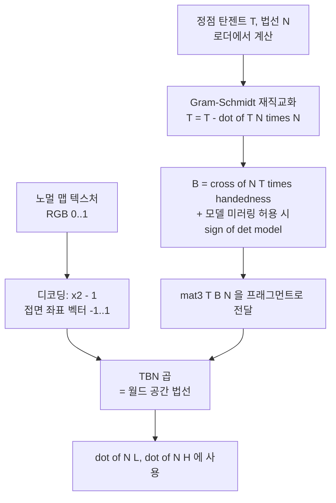
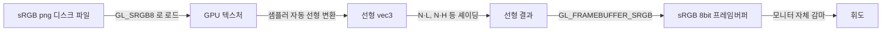

## 들어가며

> 이 글의 전제는 Lambert 디퓨즈, Phong/Blinn-Phong 스페큘러, 하프 벡터, 방향광·점광·스폿의 광원 모델과 거리 감쇠, 접선 공간과 TBN 기저, sRGB/선형 공간 파이프라인, forward/deferred/Forward+ 같은 셰이딩 구조다. 여기서는 그 전제를 OpenGL 셰이더로 구현하는 데 집중한다. 핵심은 GLSL Phong/Blinn-Phong 코드, 광원별 uniform과 UBO(std140) 패킹, 노멀 맵 디코딩·Gram-Schmidt·handedness(glTF `vec4` 탄젠트)·MikkTSpace, `GL_SRGB8`/`GL_FRAMEBUFFER_SRGB` 감마 경로다.

Phong 셰이딩은 Bui Tuong Phong이 1973년 박사 학위 논문에서 제안하고 1975년 논문 "Illumination for Computer Generated Pictures"로 발표한 모델이지만, 반세기가 지난 지금도 게임 프로그래밍 입문의 기준점이다. 물리적으로 엄밀하지 않은 경험적(empirical) 모델임에도 살아남은 이유는 단순하다. 표면이 빛을 받았을 때 사람 눈이 기대하는 세 가지 효과 — 전체적인 밝기, 면을 향한 정도에 따른 명암, 반짝이는 하이라이트 — 를 세 항의 덧셈으로 그럴듯하게 재현하기 때문이다. 그 후속인 Blinn-Phong은 하프 벡터(half vector) 하나를 도입해 하이라이트를 다른 각도 함수로 근사한다. 비용 이득은 광원·시선 방향을 미리 계산할 수 있는지와 구현에 달려 있다. 한 단계 더 나아가면 표면의 미세한 굴곡을 정점이 아닌 텍스처 한 장으로 표현하는 노멀 매핑(Normal Mapping)에 닿는다. 이 글은 셰이딩 모델의 진화 단계를 코드로 따라가며, 다중 광원의 셰이더 구조와 탄젠트 공간(tangent space) 변환의 수학을 정리한다.

여기까지의 코드는 텍스처가 적용된 정적 메시를 그린다. 그러나 빛이 어느 방향에서 오는지, 표면이 어느 방향을 향하는지가 결과 색에 반영되지 않아 입체감이 없다. 텍스처만 입힌 구는 색이 칠해진 원판처럼 보일 뿐, 그것이 둥글다는 사실이 화면에 드러나지 않는다. 이 글의 모든 식은 "표면의 한 점이 카메라로 얼마만큼의 빛을 보내는가"를 법선·빛 방향·시점 방향이라는 세 벡터의 함수로 모델링한다. 그 함수가 면의 곡률을 명암으로 번역해 입체감을 만든다.

다섯 단계로 쌓는다. 먼저 Phong의 ambient·diffuse·specular 세 항이 각각 무엇을 모델링하는지와 그 코드 구현을 본다. 다음으로 Blinn-Phong의 하프 벡터가 어떻게 Phong의 반사 벡터 계산을 대체하며 왜 더 안정적인지 살핀다. 셋째로 방향광·점광·스폿라이트 세 종류의 광원이 감쇠(attenuation)와 원뿔 falloff에서 어떻게 갈라지는지 정리한다. 넷째로 노멀 맵을 RGB로 인코딩하고 디코딩한 뒤 탄젠트 공간에서 월드 공간으로 변환하는 흐름을 따라간다. 마지막으로 선형 공간에서 셰이딩하고 sRGB 공간으로 출력하는 감마 처리의 원칙을 짚는다.

도달할 결과물은 시간에 따라 움직이는 광원 아래, 디퓨즈 텍스처와 노멀 맵이 함께 입혀진 모델이다. 입체감이 사실적이고, 카메라가 움직이면 하이라이트가 표면을 따라 흐른다.


---

## 목차
1. [Phong 반사 모델](#1-phong-반사-모델)
2. [Blinn-Phong과 하프 벡터](#2-blinn-phong과-하프-벡터)
3. [방향광/점광/스폿라이트](#3-방향광점광스폿라이트)
4. [다중 광원의 셰이더 패턴](#4-다중-광원의-셰이더-패턴)
5. [노멀 맵의 원리](#5-노멀-맵의-원리)
6. [탄젠트 공간 변환](#6-탄젠트-공간-변환)
7. [감마 공간 처리](#7-감마-공간-처리)


---

## 1. Phong 반사 모델

Phong 모델은 한 표면 점이 카메라로 돌려보내는 빛의 세기 $I$를 세 항의 합으로 정의한다.

$$
I = k_a I_a + k_d I_d \max(0, \hat{N} \cdot \hat{L}) + k_s I_s \max(0, \hat{R} \cdot \hat{V})^n
$$

여기서 모든 모자 기호($\hat{N}$, $\hat{L}$, $\hat{R}$, $\hat{V}$)는 단위 벡터다. $\hat{N}$은 표면 법선, $\hat{L}$은 표면에서 광원을 향하는 방향, $\hat{R}$은 빛이 표면에서 거울 반사한 방향, $\hat{V}$는 표면에서 카메라를 향하는 방향이다. $k_a$, $k_d$, $k_s$는 각각 주변광·디퓨즈·스페큘러 반사 계수이고, $I_a$, $I_d$, $I_s$는 대응하는 광원의 세기다.

### 세 항의 물리적 의미

세 항은 각각 다른 빛의 경로를 근사한다.

첫째 항 $k_a I_a$는 주변광(ambient)이다. 현실에서 한 점에는 광원에서 직접 오는 빛뿐 아니라 벽·바닥·다른 물체에서 여러 번 튕긴 빛도 도달한다. 이 간접광(indirect light)을 정확히 계산하려면 전역 조명(global illumination)이 필요한데, 비용이 크다. 주변광 항은 그 복잡한 산란을 상수 하나로 뭉뚱그린다. 이 항이 없으면 빛이 직접 닿지 않는 면이 완전히 검게 나와 디테일이 사라진다. 주변광은 그 영역에 바닥 밝기를 깔아 형태를 보이게 한다.

둘째 항은 디퓨즈(diffuse) 반사이고, 람베르트(Lambert) 법칙을 따른다. 거친 표면은 들어온 빛을 모든 방향으로 고르게 흩어 보내므로, 카메라 위치와 무관하게 표면이 얼마나 빛을 향하고 있는지에만 밝기가 달린다. 그 정도가 법선과 빛 방향의 사잇각 코사인, 즉 $\hat{N} \cdot \hat{L}$이다. 빛이 면에 정면으로 들어오면 두 벡터가 평행해 1, 면을 스치듯 들어오면 0에 가까워진다. $\max(0, \cdot)$로 음수를 잘라내는 이유는, 빛이 표면 뒤쪽에서 올 때($\hat{N} \cdot \hat{L} < 0$) 그 면은 광원을 보지 못하므로 기여가 0이어야 하기 때문이다. 이 클램프를 빠뜨리면 뒷면이 음의 밝기를 더해 결과가 어두워지거나, sRGB 변환 단계에서 NaN을 유발한다.

셋째 항은 스페큘러(specular) 반사다. 매끄러운 표면은 빛을 거울처럼 한 방향 $\hat{R}$로 강하게 반사하고, 그 방향이 카메라 $\hat{V}$와 일치할 때만 밝은 하이라이트가 보인다. $\hat{R} \cdot \hat{V}$가 그 일치도이고, 지수 $n$(shininess)이 하이라이트의 좁기를 결정한다. $n$이 크면 코사인의 거듭제곱이 1 근처에서만 살아남아 작고 날카로운 하이라이트가, $n$이 작으면 넓고 흐릿한 하이라이트가 생긴다.

### 반사 벡터

스페큘러 항의 $\hat{R}$은 빛 방향 $\hat{L}$을 법선 $\hat{N}$에 대해 거울 대칭으로 뒤집은 벡터다.

$$
\hat{R} = 2 (\hat{N} \cdot \hat{L}) \hat{N} - \hat{L}
$$

기하학적으로는 $\hat{L}$을 법선 방향 성분과 접면 방향 성분으로 분해한 뒤, 접면 성분의 부호만 뒤집는 연산이다. GLSL에는 이 계산을 해 주는 내장 함수 `reflect(I, N)`이 있다. 주의할 점은 `reflect`가 받는 첫 인자 `I`가 입사 벡터(incident vector), 즉 빛이 표면을 향해 들어오는 방향이라는 것이다. 위 식의 $\hat{L}$은 표면에서 광원을 향하는 방향이므로 둘은 부호가 반대다. 따라서 `reflect(-L, N)`으로 호출해야 한다.

```glsl
vec3 reflectDir = reflect(-L, N);
float specFactor = pow(max(dot(reflectDir, V), 0.0), uShininess);
```

`pow`의 밑이 0이 될 수 있으므로 `max`로 먼저 클램프한 뒤 거듭제곱한다. GLSL의 `pow(x, y)`는 $x < 0$에서 정의되지 않고 드라이버에 따라 NaN을 반환하므로, 음수가 들어가지 않도록 클램프가 거듭제곱보다 먼저 와야 한다.

### 정점 셰이더: 무엇을 보간해 넘기는가

셰이딩에 필요한 입력은 표면 점의 월드 공간 위치와 월드 공간 법선이다. 정점 셰이더가 이 둘을 계산해 프래그먼트 셰이더로 보간 전달한다.

```glsl
// vertex shader
#version 330 core
layout (location = 0) in vec3 aPos;
layout (location = 1) in vec3 aNormal;
layout (location = 2) in vec2 aUv;

uniform mat4 uModel;
uniform mat4 uView;
uniform mat4 uProj;

out vec3 vFragPos;
out vec3 vNormal;
out vec2 vUv;

void main() {
    vFragPos = vec3(uModel * vec4(aPos, 1.0));
    vNormal  = mat3(transpose(inverse(uModel))) * aNormal;
    vUv      = aUv;
    gl_Position = uProj * uView * vec4(vFragPos, 1.0);
}
```

`mat3(transpose(inverse(uModel)))`는 법선 변환 행렬(normal matrix)이다. 위치 벡터는 모델 행렬을 그대로 곱하면 되지만, 법선은 그러면 안 된다. 모델 행렬에 비균등 스케일(non-uniform scale)이 들어가면 면을 그 비율대로 늘리는데, 면에 수직이던 법선을 같은 행렬로 변환하면 더 이상 수직이 아니게 된다. 예를 들어 x축으로 2배 늘린 면에서 법선을 그대로 변환하면 법선이 면 쪽으로 기운다. 이 왜곡을 바로잡는 것이 모델 행렬의 역행렬의 전치(inverse transpose)다. 균등 스케일과 회전·이동만 쓴다면 `mat3(uModel)`로 충분하지만, 어떤 변환이 들어올지 모르는 일반 코드에서는 위 형태가 안전하다.

다만 `inverse`를 정점 셰이더에서 정점마다 계산하는 것은 낭비다. 한 드로우 콜 안에서 모델 행렬은 고정이므로, 법선 행렬은 CPU에서 한 번 계산해 별도 uniform으로 올리는 편이 GPU 비용을 아낀다. 학습 코드에서는 가독성을 위해 셰이더 안에 두지만, 정점이 많은 메시에서는 CPU 계산을 권한다.

### 프래그먼트 셰이더: 픽셀마다 조명을 푼다

```glsl
// fragment shader (Phong)
#version 330 core
in vec3 vFragPos;
in vec3 vNormal;
in vec2 vUv;
out vec4 FragColor;

uniform vec3 uLightPos;
uniform vec3 uLightColor;
uniform vec3 uViewPos;
uniform sampler2D texture_diffuse1;
uniform float uShininess;

void main() {
    vec3 N = normalize(vNormal);
    vec3 L = normalize(uLightPos - vFragPos);
    vec3 V = normalize(uViewPos - vFragPos);
    vec3 R = reflect(-L, N);

    vec3 albedo = texture(texture_diffuse1, vUv).rgb;

    vec3 ambient  = 0.1 * albedo;
    vec3 diffuse  = max(dot(N, L), 0.0) * albedo * uLightColor;
    vec3 specular = (dot(N, L) > 0.0 ? pow(max(dot(R, V), 0.0), uShininess) : 0.0) * uLightColor;

    FragColor = vec4(ambient + diffuse + specular, 1.0);
}
```

`vNormal`을 다시 `normalize`하는 이유는, 정점에서 단위 길이였던 법선이 래스터라이저의 선형 보간을 거치며 길이가 흐트러지기 때문이다. 삼각형 내부 픽셀의 법선은 세 정점 법선의 가중 평균인데, 단위 벡터 셋의 평균은 일반적으로 단위 길이가 아니다. 정규화하지 않으면 디퓨즈 항의 $\hat{N} \cdot \hat{L}$이 코사인이 아니게 되어 명암이 어긋난다.

위 직접광 코드는 광원이 표면 뒤에 있으면 스페큘러도 0으로 둔다. 디퓨즈만 클램프하면 뒷쪽 광원의 하이라이트가 새어 들어올 수 있다. `uShininess > 0`이며 광원·시점이 표면 점과 겹치지 않는 유효한 방향을 전제로 한다.

shininess는 표면의 광택을 결정하는 가장 직관적인 손잡이다. 32 정도면 살짝 광택이 있는 플라스틱, 256이면 유리나 잘 닦인 금속처럼 강하고 좁은 하이라이트가 나온다. 8 이하로 내리면 거의 무광에 가까운 흐릿한 반사가 된다.

### 왜 디퓨즈에는 albedo를 곱하고 스페큘러에는 곱하지 않는가

위 코드에서 디퓨즈 항에는 `albedo`(표면 고유색)를 곱했지만 스페큘러 항에는 곱하지 않았다. 이는 물리적 근거가 있다. 디퓨즈 반사는 빛이 표면 안쪽으로 들어갔다 다시 나오면서 물체의 색소에 물들어 나오는 빛이라, 표면색을 띤다. 반면 스페큘러는 표면에서 곧장 튕겨 나온 빛이라 표면 안쪽 색소를 거치지 않고 광원의 색을 그대로 유지한다. 그래서 빨간 플라스틱 구의 하이라이트가 빨갛지 않고 흰색(광원색)으로 보인다. 금속(conductor)은 예외로 스페큘러도 표면색을 띠는데, 이 구분은 물리 기반 렌더링의 핵심 분기점이 된다.

### 셰이딩의 위치: 정점이 아닌 프래그먼트

Phong 셰이딩은 픽셀(프래그먼트)마다 위 계산을 수행한다. 조명 계산을 정점에서만 하고 색을 보간하는 Gouraud 셰이딩은 더 싸지만, 삼각형 내부의 좁은 스페큘러 봉우리를 놓칠 수 있다. Blinn-Phong은 프래그먼트 단위 계산을 유지하면서 반사 벡터 대신 광원과 시선의 half vector를 사용해 정반사 축을 근사한다. `pow` 비용은 남고 지수의 시각적 의미도 Phong과 같지 않으므로 품질과 비용을 같은 조건에서 비교한다.

## 2. Blinn-Phong과 하프 벡터

Blinn-Phong은 1977년 James Blinn이 제안한 Phong의 변형으로, 스페큘러 항의 반사 벡터 계산을 우회한다. 빛 방향 $\hat{L}$과 시점 방향 $\hat{V}$의 중간(half) 벡터를 정의하고, 반사 벡터와 시점의 각도 대신 법선과 하프 벡터의 각도를 쓴다.

$$
\hat{H} = \frac{\hat{L} + \hat{V}}{|\hat{L} + \hat{V}|}, \qquad I_{\text{spec}} = k_s I_s \max(0, \hat{N} \cdot \hat{H})^{n'}
$$

하프 벡터 $\hat{H}$는 "이 표면이 빛을 정확히 카메라로 반사하려면 법선이 어느 방향이어야 하는가"를 가리킨다. 표면 법선이 정확히 그 방향이면 거울 반사가 카메라로 들어오므로 $\hat{N} \cdot \hat{H}$가 1이 되어 하이라이트가 최대다. 실제 법선이 그 이상으로 기울수록 코사인이 작아지며 하이라이트가 약해진다.

### 왜 더 자연스러운가

두 내적은 하이라이트 중심에서 모두 1이지만 중심을 벗어난 감소율은 다르므로, 같은 지수를 사용하면 하이라이트 폭도 다르다. 차이는 카메라와 광원이 표면을 스치듯 보는 각도(grazing angle)에서 드러난다. Phong에서는 반사 벡터 $\hat{R}$과 시점 $\hat{V}$의 사잇각이 90도를 넘어가는 순간 $\hat{R} \cdot \hat{V}$가 음수가 되어 하이라이트가 갑자기 잘려나간다. 매끄러운 바닥을 비스듬히 볼 때 멀리 뻗어야 할 하이라이트의 꼬리가 부자연스럽게 끊기는 현상이다. Blinn-Phong은 $\hat{N}$과 $\hat{H}$ 모두 표면 위쪽 반구에 머물러 이 급격한 절단이 없고, 지수가 커도 falloff가 부드럽게 이어진다. 1977년 이후 이 모델이 사실상의 표준이 된 것은 이 안정성 때문이다.

또 하나의 실용적 이점은 보간 친화성이다. 하프 벡터는 반사 벡터보다 정점 셰이더에서 계산해 보간했을 때 오차가 작다. 광원과 카메라가 둘 다 충분히 멀다고 가정할 수 있는 장면에서는 $\hat{L}$과 $\hat{V}$를 정점에서 구해 $\hat{H}$까지 계산하고, 프래그먼트에서는 보간된 하프 벡터를 다시 정규화해 쓸 수 있다. 방향이 위치에 따라 달라지는 가까운 점광·시점에서는 오차를 비교해야 한다. 모바일이나 구형 GPU에서 프래그먼트 부하를 정점으로 옮기는 최적화에 유리하다.

### 셰이더 코드

Phong 셰이더에서 바뀌는 부분은 스페큘러 한 줄뿐이다.

```glsl
vec3 N = normalize(vNormal);
vec3 L = normalize(uLightPos - vFragPos);
vec3 V = normalize(uViewPos - vFragPos);
vec3 H = normalize(L + V);

vec3 diffuse  = max(dot(N, L), 0.0) * albedo * uLightColor;
vec3 specular = (dot(N, L) > 0.0 ? pow(max(dot(N, H), 0.0), uShininess) : 0.0) * uLightColor;
```

`reflect(-L, N)` 한 줄이 `normalize(L + V)` 한 줄로 바뀌었다. 명령어 수로는 거의 같지만, 결과의 하이라이트가 더 부드럽고 grazing angle에서 끊기지 않는다.

### 지수 보정

Phong과 Blinn-Phong은 같은 shininess 값이라도 하이라이트 크기가 다르다. 같은 시각적 크기를 얻으려면 Blinn-Phong의 지수를 Phong의 약 4배로 잡아야 한다.

| Phong shininess | 대응하는 Blinn-Phong shininess |
|---:|---:|
| 8 | 32 |
| 16 | 64 |
| 32 | 128 |
| 64 | 256 |

이유는 각도 관계에 있다. 반사 벡터 $\hat{R}$과 시점 $\hat{V}$ 사이의 각을 $\theta$라 할 때, 같은 기하에서 법선 $\hat{N}$과 하프 벡터 $\hat{H}$ 사이의 각은 약 $\theta/2$다. 따라서 $\hat{N} \cdot \hat{H} \approx \cos(\theta/2)$이고, $\cos(\theta/2)$를 $n'$제곱한 것이 $\cos(\theta)$를 $n$제곱한 것과 같은 모양이 되려면 지수가 대략 4배여야 한다(작은 각에서 $\log\cos\theta \approx -\theta^2/2$이므로 각도를 절반으로 줄이면 같은 감소율에 약 4배 지수가 필요하다). 정확히 4배는 근사이고 각도에 따라 어긋나지만, 재질 자산을 Phong에서 Blinn-Phong으로 옮길 때 shininess에 4를 곱하는 것이 출발점으로 널리 쓰인다.

### 어느 것을 쓸까

| 항목 | Phong | Blinn-Phong |
|---|---|---|
| 스페큘러 계산 | `reflect` + dot + pow | dot + pow (half는 정점 가능) |
| 하이라이트 모양 | grazing angle에서 급격히 절단 | 부드러운 falloff |
| 보간 친화 | 약함 | 강함 |
| 산업 사용 | 1975년 원형, 교과서·오프라인 렌더러 | OpenGL 1.x 고정 파이프라인을 포함해 1977년 이후 사실상 표준 |

학습 코드는 Blinn-Phong으로 통일한다. 이후 절의 모든 셰이더는 하프 벡터를 쓴다.

## 3. 방향광/점광/스폿라이트

세 종류의 광원은 빛이 어디에서 오고 거리에 따라 어떻게 줄어드는가에서 갈라진다. 셰이딩의 핵심인 디퓨즈·스페큘러 계산은 동일하고, 달라지는 것은 빛 방향 $\hat{L}$을 구하는 방식과 감쇠·원뿔 항이다.

### 방향광 (Directional Light)

태양이나 달처럼 광원이 무한히 멀어 모든 광선이 평행하다고 볼 수 있는 광원이다. 위치 개념이 없고 방향만 정의된다. 표면 어디에서나 $\hat{L}$이 같고, 거리에 따른 감쇠가 없다.

```glsl
uniform vec3 uDirLightDir;     // 빛이 진행하는 방향 (예: 해가 비추는 방향)
uniform vec3 uDirLightColor;

vec3 L = normalize(-uDirLightDir);   // 표면에서 광원을 향하는 방향
// 이후 diffuse / specular 계산은 동일
```

uniform으로 받는 `uDirLightDir`은 빛이 진행하는 방향이고, 셰이딩에 필요한 $\hat{L}$은 표면에서 광원을 향하는 방향이므로 부호를 뒤집는다. 야외 장면의 태양광 표준이며, 그림자 매핑에서 직교 투영(orthographic projection)을 쓰는 광원이 바로 이것이다.

### 점광 (Point Light)

전구나 횃불처럼 한 점에서 모든 방향으로 빛을 방사하고, 거리에 따라 세기가 줄어드는 광원이다. 빛 방향은 표면 점에서 광원 위치로의 벡터이고, 감쇠는 거리의 함수다.

$$
\text{attenuation} = \frac{1}{k_c + k_l d + k_q d^2}
$$

세 계수의 역할은 다음과 같다. $k_c$는 상수항(constant)으로 보통 1.0이며, 광원에 매우 가까울 때 분모가 0이 되어 밝기가 발산하는 것을 막는다. $k_l$은 선형항(linear)으로 거리에 비례한 감쇠를, $k_q$는 이차항(quadratic)으로 거리 제곱에 비례한 감쇠를 준다.

물리적으로 정확한 점광은 역제곱 법칙(inverse-square law)을 따르므로 $k_q d^2$ 항 하나면 충분하다. 상수항과 선형항은 물리가 아니라 두 가지 실무 요구에서 온다. 첫째, 순수 $1/d^2$는 $d$가 작을 때 값이 폭발해 광원 근처가 새하얗게 타버린다(clipping). 상수항이 이 폭발을 막는다. 둘째, 순수 역제곱은 이론상 영원히 0이 되지 않아 먼 표면까지 계산이 남는다. 선형·이차 계수를 조절하면 원하는 거리에서 밝기를 무시할 수 있는 수준까지 떨어뜨릴 수 있다.

다음은 특정 도달 거리에서 빛이 거의 0으로 떨어지도록 조정한 계수의 통상값이다.

| 도달 거리 (대략) | $k_c$ | $k_l$ | $k_q$ |
|---:|---:|---:|---:|
| 7 | 1.0 | 0.7 | 1.8 |
| 13 | 1.0 | 0.35 | 0.44 |
| 32 | 1.0 | 0.14 | 0.07 |
| 50 | 1.0 | 0.09 | 0.032 |
| 100 | 1.0 | 0.045 | 0.0075 |
| 600 | 1.0 | 0.007 | 0.0002 |

이 계수들은 명시된 거리에서 attenuation이 약 $0.01$이 되도록 푼 값이다. 도달 거리 32의 행을 넣어 보면 $1 + 0.14 \times 32 + 0.07 \times 32^2 = 77.16$이라 attenuation이 $0.013$이다. 0이 아니라 1% 언저리라는 점이 중요하다. 그 거리 밖의 광원을 실제로 건너뛰려면 셰이더나 컬링 단계에서 따로 잘라야 하고, 자른 자리에는 밝기 계단이 남는다. 광원이 한 자릿수인 학습 코드에서는 드러나지 않지만, 광원이 많아지면 반경에서 값과 기울기가 함께 0이 되는 감쇠식으로 바꾸는 편이 이 계단을 없앤다.

```glsl
uniform vec3  uPointPos;
uniform vec3  uPointColor;
uniform float uKc, uKl, uKq;

vec3  toLight = uPointPos - vFragPos;
float d = length(toLight);
vec3  L = toLight / d;                     // normalize를 length 재사용으로
float att = 1.0 / (uKc + uKl * d + uKq * d * d);
vec3  H = normalize(L + V);

vec3 diffuse  = max(dot(N, L), 0.0) * albedo * uPointColor * att;
vec3 specular = (dot(N, L) > 0.0 ? pow(max(dot(N, H), 0.0), uShininess) : 0.0) * uPointColor * att;
```

`length`로 거리 $d$를 구한 뒤 그 값으로 직접 나누어 정규화하면, `normalize`가 내부에서 다시 거리를 계산하는 중복을 피한다. 점광이 많은 장면에서 누적되는 작은 절약이다.

### 스폿라이트 (Spot Light)

손전등이나 무대 조명처럼 한 방향을 중심으로 좁은 원뿔 안에서만 빛이 나오는 광원이다. 점광에 원뿔 제한을 더한 것으로 볼 수 있다. 빛이 광원의 중심축에서 얼마나 벗어났는지를 각도로 재고, 안쪽 원뿔(inner cone)과 바깥쪽 원뿔(outer cone) 사이에서 부드럽게 어두워지게 한다.

$$
\text{spot factor} = \text{clamp}\!\left(\frac{\cos\theta - \cos\theta_{\text{outer}}}{\cos\theta_{\text{inner}} - \cos\theta_{\text{outer}}},\, 0,\, 1\right)
$$

여기서 $\theta$는 광원에서 표면 점으로 향하는 방향과 스폿 중심축이 이루는 각이다. $\theta$가 안쪽 원뿔보다 작으면 factor가 1로 완전히 밝고, 바깥쪽 원뿔을 넘으면 0으로 꺼지며, 그 사이에서 선형으로 변한다.

```glsl
uniform vec3  uSpotPos;
uniform vec3  uSpotDir;     // 스폿이 향하는 중심축 방향
uniform float uCosInner;    // cos(theta_inner)  미리 계산해 업로드
uniform float uCosOuter;    // cos(theta_outer)

vec3  toLight = uSpotPos - vFragPos;
float d = length(toLight);
vec3  L = toLight / d;

float theta = dot(-L, normalize(uSpotDir));   // 광원→표면 방향과 중심축의 cos
float eps   = uCosInner - uCosOuter;
// inner == outer이면 eps가 0이 되므로 step형 hard cone으로 분기한다.
float intensity = (eps > 1e-6)
    ? clamp((theta - uCosOuter) / eps, 0.0, 1.0)
    : (theta >= uCosOuter ? 1.0 : 0.0);

float att = 1.0 / (uKc + uKl * d + uKq * d * d);
vec3 diffuse = max(dot(N, L), 0.0) * albedo * uSpotColor * att * intensity;
```

각도를 코사인 값으로 저장해 uniform으로 올리는 것이 핵심 최적화다. 셰이더 안에서 `acos`로 실제 각도를 복원해 비교하면 역삼각함수 호출 비용이 픽셀마다 든다. 대신 표면 방향과 중심축의 내적($\theta$의 코사인)을 미리 계산해 둔 두 코사인 경계와 직접 비교하면 곱셈과 뺄셈만으로 끝난다. 다만 코사인은 각도에 대해 단조감소하므로, 각이 클수록 코사인이 작아진다는 점에 주의해 비교 방향을 잡아야 한다. 위 식에서 `theta`가 `uCosInner`(작은 각, 큰 코사인) 쪽일수록 1에 가깝다. `inner`와 `outer`가 같으면 `eps = 0`이 되어 나눗셈이 무효가 되므로, 호출자가 `0 ≤ inner < outer`를 보장하거나 위 코드처럼 같은 각도를 step형 hard cone으로 분기한다. 광속(flux)을 일정 intensity로 환산하는 식을 쓸 때는 균일 cone 가정이 아니라 각도별 falloff 적분을 포함한다.

원뿔 경계에서 선형 보간 대신 `smoothstep`을 쓰면 가장자리가 더 부드러워진다. `smoothstep(uCosOuter, uCosInner, theta)`는 같은 구간을 3차 곡선으로 보간해 경계의 미분 불연속을 없앤다.

### 세 광원의 공통 구조

세 광원은 같은 디퓨즈·스페큘러 식에 감쇠와 원뿔 intensity라는 두 스칼라 가중치를 곱하는 형태로 통일된다. 방향광은 둘 다 1, 점광은 감쇠만, 스폿라이트는 둘 다 적용한다. 공통 BRDF 계산과 광원별 방향·가중치 계산을 함수 경계로 분리하면 중복 없이 이 구조를 표현할 수 있다.

## 4. 다중 광원의 셰이더 패턴

광원이 여러 개인 장면에서는 셰이더가 모든 광원의 기여를 합산해야 한다. 광원 수와 셰이더 구조의 관계가 렌더링 아키텍처를 가르는 분기점이 되므로, 네 가지 접근을 비교한다.

### A. 셰이더 배열과 루프

가장 단순한 방식은 셰이더 안에 광원 배열을 두고 루프로 합산하는 것이다.

```glsl
#define MAX_POINT_LIGHTS 4

struct PointLight {
    vec3  pos;
    vec3  color;
    float kc, kl, kq;
};

uniform PointLight uPointLights[MAX_POINT_LIGHTS];
uniform int        uNumPointLights;

vec3 CalcPointLight(PointLight light, vec3 N, vec3 V, vec3 fragPos, vec3 albedo) {
    vec3  toLight = light.pos - fragPos;
    float d = length(toLight);
    vec3  L = toLight / d;
    vec3  H = normalize(L + V);
    float att = 1.0 / (light.kc + light.kl * d + light.kq * d * d);
    vec3 diffuse  = max(dot(N, L), 0.0) * albedo * light.color * att;
    vec3 specular = (dot(N, L) > 0.0 ? pow(max(dot(N, H), 0.0), uShininess) : 0.0) * light.color * att;
    return diffuse + specular;
}

void main() {
    vec3 albedo = texture(texture_diffuse1, vUv).rgb;
    vec3 N = normalize(vNormal);
    vec3 V = normalize(uViewPos - vFragPos);
    vec3 result = 0.1 * albedo;   // ambient
    for (int i = 0; i < uNumPointLights; ++i) {
        result += CalcPointLight(uPointLights[i], N, V, vFragPos, albedo);
    }
    FragColor = vec4(result, 1.0);
}
```

장점은 구현이 단순하고 투명 객체와도 자연스럽게 어울린다는 것이다. 단점이 둘 있다. 첫째, `MAX_POINT_LIGHTS`가 컴파일 시 상수라, 더 많은 광원을 쓰려면 셰이더를 재컴파일해야 한다. 둘째, GPU의 워프(warp)는 같은 셰이더를 32~64개 픽셀에 동시에 실행하는데, 루프 경계가 uniform이라 워프 안의 모든 픽셀이 같은 횟수를 돌고 광원별 조기 탈출이 없다. 화면 대부분이 영향받지 않는 광원까지 픽셀마다 계산해 비용이 광원 수에 선형으로 늘어난다. 광원이 한 자릿수일 때만 실용적이다.

### B. UBO를 쓴 광원 블록

광원이 수십 개로 늘면 uniform을 하나씩 올리는 비용이 커진다. Uniform Buffer Object(UBO)는 큰 데이터 블록을 한 번에 GPU로 올리고 여러 셰이더가 공유하게 한다. 장면의 광원 목록을 UBO에 한 번 올리면 모든 메시 셰이더가 같은 데이터를 본다.

UBO를 쓸 때 가장 흔한 버그는 std140 레이아웃의 정렬 규칙이다. std140에서 `vec3`는 16바이트 경계에 정렬되지만 *데이터 크기는 12바이트* 라, 바로 뒤에 오는 scalar는 offset 12에 놓일 수 있다(예: `vec3 position; float radius;` → 0, 12). 반면 `vec3` 배열이나 다음 멤버가 `vec4`처럼 더 높은 정렬을 요구하면 원소 stride가 16바이트로 늘어나고 4바이트 패딩이 생긴다. C++ 쪽에서 `glm::vec3`만 나열한 배열 구조체를 GLSL의 16바이트 stride와 맞추지 않으면 두 번째 원소부터 데이터가 밀린다. 이 어긋남은 컴파일러가 잡아 주지 않아 화면에서 조명이 이상해진 뒤에야 발견된다.

안전한 방법은 멤버를 직접 `vec4`로 패킹해 위치와 부가 값을 한 벡터에 묶는 것이다.

```glsl
struct PointLight {
    vec4 posRadius;       // xyz = position, w = radius
    vec4 colorIntensity;  // rgb = color,    a = intensity
};

layout (std140) uniform LightBlock {
    PointLight lights[64];
    ivec4      lightCount;   // x = numLights, 나머지는 패딩
};
```

```cpp
struct PointLightGPU {
    glm::vec4 posRadius;
    glm::vec4 colorIntensity;
};
struct LightBlockCPU {
    PointLightGPU lights[64];
    glm::ivec4    lightCount;
};
static_assert(sizeof(PointLightGPU) == 32, "std140 layout mismatch");
```

이 방식은 C++ 쪽 stride와 GLSL 쪽 stride가 둘 다 32바이트로 자명하게 일치한다. `static_assert`가 컴파일 시점에 어긋남을 잡는다. `numLights`도 `int` 하나만 단독으로 두지 않고 `ivec4`로 올려 16바이트 정렬을 명시한다. CPU에서는 `glBufferSubData`로 한 번에 갱신하고, 셰이더는 인덱스로 광원을 읽는다.

### C. Deferred Shading

광원이 수백 개를 넘으면 forward 방식의 비용이 감당하기 어렵다. Deferred Shading은 셰이딩을 두 패스로 나눈다. 첫 패스(geometry pass)에서 장면을 한 번 그리되 색을 계산하지 않고 위치·법선·albedo·재질 파라미터를 여러 텍스처(G-buffer)에 기록한다. 둘째 패스(lighting pass)에서 G-buffer만 읽어 화면 픽셀마다 조명을 푼다.

핵심 이점은 조명 계산 횟수가 화면 픽셀 수에만 비례하고 메시 복잡도와 무관해진다는 것이다. 가려진 픽셀은 G-buffer에 덮어쓰기되어 조명 계산을 한 번만 받는다. 단점은 G-buffer의 메모리·대역폭 비용이다. 1920×1080에서 위치(RGBA16F, 8바이트), 법선(RGBA16F, 8바이트), albedo+spec(RGBA8, 4바이트)만 잡아도 픽셀당 20바이트, 전체로 약 40MB이고, 매 프레임 이를 쓰고 다시 읽는 대역폭이 든다. 또한 G-buffer는 표면당 하나의 재질만 담으므로 반투명 객체를 표현하지 못해, 투명 객체는 별도 forward 패스로 따로 그려야 한다. MSAA도 G-buffer에 그대로 적용하기 어렵다.

### D. Forward+ (Tiled Forward Shading)

A와 C의 절충이다. 화면을 16×16 픽셀 같은 타일로 나누고, 각 타일과 겹치는 광원의 목록을 미리 계산한다(light culling). 이후 forward 셰이딩은 자기 타일의 광원 목록만 순회하므로, 화면 전체 광원 수가 아무리 많아도 각 픽셀은 자기 근처 광원만 계산한다. Deferred의 메모리 부담 없이 수십~수백 광원을 다루고, forward이므로 투명 객체와 MSAA도 자연스럽다. 모바일과 VR 렌더러에서 널리 쓰인다.

| 패스 종류 | 광원 수 | 셰이더 복잡도 | 메모리 | 투명 객체 |
|---|---:|---|---|---|
| Forward + 배열 루프 | 1~8 | 단순 | 적음 | 자연스러움 |
| Forward + UBO | 1~64 | 약간 복잡 | 적음 | 자연스러움 |
| Forward+ (Tiled) | 1~1000 | 복잡 (light grid) | 중간 | 자연스러움 |
| Deferred | 1~10000 | 단순 (lighting pass) | 큼 (G-buffer) | 별도 forward 패스 |

학습 단계에서는 A 패턴으로 충분하다. 광원 수가 한 자릿수인 장면에서 가장 적은 코드로 동작하고, 다른 세 방식도 결국 디퓨즈·스페큘러 식 자체는 동일하다. 본 글의 코드도 A를 따른다.

## 5. 노멀 맵의 원리

지금까지의 셰이딩은 정점 법선을 보간해 표면 법선을 구했다. 매끈한 면은 잘 표현하지만, 벽돌의 줄눈이나 금속의 긁힌 자국 같은 미세 굴곡은 정점을 그만큼 잘게 쪼개야 표현된다. 노멀 매핑은 이 굴곡을 정점이 아닌 텍스처 한 장으로 표현한다. 텍스처의 각 픽셀에 그 지점의 표면 법선 벡터를 담아 두고, 셰이딩 때 보간된 정점 법선 대신 이 텍스처에서 읽은 법선을 쓴다. 기하는 평면이지만 조명이 굴곡진 표면처럼 반응한다.

### RGB와 법선의 인코딩

법선은 각 성분이 $[-1, 1]$인 단위 벡터다. 텍스처의 픽셀은 각 채널이 $[0, 255]$의 부호 없는 값이다. 둘을 잇는 매핑은 선형 변환이다.

$$
\text{RGB} = \frac{n + 1}{2} \times 255
$$

셰이더에서 디코딩할 때는 sampler가 픽셀 값을 이미 $[0, 1]$로 정규화해 반환하므로, 거기에 2를 곱하고 1을 빼면 $[-1, 1]$이 복원된다.

```glsl
vec3 tangentNormal = texture(texture_normal1, vUv).xyz * 2.0 - 1.0;
```

노멀 맵이 전체적으로 푸르스름하게 보이는 이유가 여기 있다. 굴곡이 없는 평평한 표면의 법선은 표면에 수직인 $(0, 0, 1)$인데, 이를 위 식으로 인코딩하면 RGB $(128, 128, 255)$가 되어 파란 채널이 가장 강하기 때문이다.

### 노멀 맵의 두 종류

노멀 맵은 법선을 어느 좌표계 기준으로 저장하느냐에 따라 두 종류로 갈린다.

오브젝트 공간(object-space) 노멀 맵은 법선을 모델의 로컬 좌표 그대로 인코딩한다. 디코딩이 단순하지만, 메시가 변형되면(스킨 애니메이션 등) 저장된 법선과 실제 표면 방향이 어긋난다. 강체 회전은 저장한 법선을 해당 normal matrix로 함께 변환하면 같은 맵을 재사용할 수 있지만, 변형·다른 topology·좌표계 정의가 바뀌면 맵을 다시 구워야 한다.

탄젠트 공간(tangent-space) 노멀 맵은 법선을 각 표면 점의 접면(tangent plane)을 기준으로 인코딩한다. "표면에서 살짝 어느 쪽으로 기울었는가"만 담으므로, 표면이 회전하거나 변형되어도 접면이 함께 따라 변해 법선이 일관되게 유지된다. 그래서 같은 맵을 변형되는 캐릭터나 회전하는 부품 어디에나 붙일 수 있다. 게임에서 쓰이는 노멀 맵은 거의 전부 이쪽이다.

### 그대로 쓰면 안 되는 이유

탄젠트 공간 노멀 맵에서 읽은 값을 디퓨즈 텍스처처럼 그대로 법선 $\hat{N}$으로 쓰면 조명이 틀어진다.

```glsl
// 잘못된 사용
vec3 N = normalize(texture(texture_normal1, vUv).xyz * 2.0 - 1.0);
// 이 N을 그대로 dot(N, L)에 넣으면 안 된다
```

이 값은 접면 기준의 법선이다. 즉 표면이 어디를 향하든 항상 "위쪽이 +Z"인 좌표계에서 표현되어 있다. 이를 월드 공간의 빛 방향 $\hat{L}$과 곧장 내적하면, 모델이 회전해도 노멀이 회전하지 않아 조명이 표면을 따라가지 않는다. 마치 굴곡 무늬가 표면에 입체로 새겨진 게 아니라 평면에 인쇄된 사진처럼 보인다. 모델을 돌리면 빛도 같이 돌아야 하는데 무늬의 명암이 그대로 머문다.

해결책은 정점의 tangent·bitangent·normal로 TBN 기저를 만들고, 텍스처에서 복원한 접선 공간 법선을 월드 또는 뷰 공간으로 변환해 조명 벡터와 같은 좌표계에서 비교하는 것이다.

## 6. 탄젠트 공간 변환

각 표면 점에는 서로 수직인 세 벡터를 세울 수 있다. 표면 법선 N, 그리고 표면에 접하는 두 방향 — 탄젠트 T와 비탄젠트 B(bitangent) — 다. 이 세 벡터를 컬럼으로 묶은 행렬을 TBN 행렬이라 부르고, 노멀 맵에서 읽은 접면 기준 법선을 이 행렬로 곱하면 월드 공간 법선으로 변환된다.

### TBN 행렬

$$
\text{TBN} = \begin{pmatrix} T_x & B_x & N_x \\ T_y & B_y & N_y \\ T_z & B_z & N_z \end{pmatrix}
$$

세 컬럼이 각각 T, B, N의 월드 좌표다. 노멀 맵의 raw 값 $(x, y, z)$는 "탄젠트 방향으로 $x$, 비탄젠트 방향으로 $y$, 법선 방향으로 $z$"라는 접면 좌표의 표현이므로, 이 행렬을 곱하면 $x \cdot T + y \cdot B + z \cdot N$이 되어 월드 공간 벡터가 된다. 탄젠트 방향이 텍스처의 U축, 비탄젠트가 V축에 대응하도록 베이커가 맞춰 두므로, UV 좌표계와 노멀 맵의 좌표계가 정렬된다.

### 탄젠트는 어디서 오는가

T와 B는 메시의 UV 매핑으로부터 계산된다. 삼각형 세 정점의 위치 차이와 UV 차이를 연립하면, U가 증가하는 방향(탄젠트)과 V가 증가하는 방향(비탄젠트)이 월드 공간에서 어느 쪽인지 풀린다. 이 계산은 보통 모델 로더가 미리 해 둔다. Assimp는 `aiProcess_CalcTangentSpace` 후처리 플래그를 켜면 각 정점의 탄젠트를 채워 주고, glTF 같은 포맷은 파일 자체에 탄젠트를 담고 있다. 정점 구조체는 위치·법선·UV에 더해 탄젠트를 함께 담는다.

### 비탄젠트 부호(handedness) 함정

캐릭터 얼굴이나 좌우 대칭 모델은 텍스처 메모리를 아끼려고 UV를 좌우에서 거울처럼 미러링해 같은 텍스처 영역을 양쪽이 공유하는 일이 흔하다. 이때 미러링된 면에서는 V축이 뒤집히므로 비탄젠트 B의 부호가 반대가 되어야 한다. 만약 셰이더에서 `B = cross(N, T)`로만 비탄젠트를 재계산하면, 이 미러 면에서 B의 부호를 놓쳐 노멀의 V축 기울기가 좌우로 뒤집힌다. 증상은 대칭 모델에서 한쪽 절반만 조명이 반대로 들어가 어색하게 어두워지는 것으로 나타나, 원인을 찾기 까다롭다.

해결은 비탄젠트의 부호 정보(handedness)를 정점에 함께 실어 보내는 것이다. 두 방법이 있다. 하나는 Assimp가 계산한 비탄젠트를 통째로 정점 속성으로 보내는 것인데, 정점마다 12바이트가 추가된다. 다른 하나는 탄젠트를 `vec4`로 잡아 w 성분에 비탄젠트 부호 $\pm 1$을 담는 것이다. 이쪽은 정점당 4바이트만 늘고 미러링을 정확히 보존하며, glTF 2.0의 공식 정점 포맷이기도 하다. 셰이더에서 `B = cross(N, T.xyz) * T.w * sign(det(mat3(uModel)))`로 부호를 복원한다(`sign(det)` 항은 모델 변환이 반사일 때 B를 추가로 뒤집는다).

### 정점 셰이더

본 글의 셰이더는 glTF 표준 포맷을 따라 탄젠트를 `vec4`로 받는다. 앞 모델 로더의 vec3 tangent/bitangent 레이아웃을 그대로 연결하면 w가 없으므로, 로더와 VAO도 함께 변경한다. Assimp의 T·B·N이 주어졌다면 `w = dot(cross(N,T),B) < 0 ? -1 : 1`로 부호를 구해 T.xyz와 묶는다. 이 예제는 가역 모델 변환과 유효한 비영 탄젠트·법선을 전제로 한다.

```glsl
// vertex shader
#version 330 core
layout(location = 0) in vec3 aPos;
layout(location = 1) in vec3 aNormal;
layout(location = 2) in vec2 aUv;
layout(location = 3) in vec4 aTangent;   // w = handedness (+1 또는 -1)

uniform mat4 uModel;
uniform mat4 uView;
uniform mat4 uProj;

out mat3 vTBN;
out vec3 vFragPos;
out vec2 vUv;

void main() {
    mat3 normalMat = mat3(transpose(inverse(uModel)));
    vec3 N = normalize(normalMat * aNormal);
    vec3 T = normalize(mat3(uModel) * aTangent.xyz);   // 탄젠트는 표면 방향이라 모델 행렬로 변환
    T = normalize(T - dot(T, N) * N);          // Gram-Schmidt 재직교화
    // 모델 변환이 반사를 포함하면(det<0) B의 부호를 추가로 뒤집는다.
    vec3 B = cross(N, T) * aTangent.w * sign(determinant(mat3(uModel)));

    vTBN = mat3(T, B, N);
    vFragPos = vec3(uModel * vec4(aPos, 1.0));
    vUv = aUv;
    gl_Position = uProj * uView * vec4(vFragPos, 1.0);
}
```

`T = normalize(T - dot(T, N) * N)` 한 줄은 그람-슈미트(Gram-Schmidt) 직교화로, T에서 N 방향 성분을 빼 T를 N에 정확히 수직하게 만든다. 로더가 인접 면의 탄젠트를 평균하거나 비균등 스케일이 섞이면 정점 법선과 탄젠트가 완전히 수직이 아니게 되는데, 이 보정이 정점 단계에서 직교성을 회복한다. 이어 `cross(N, T)`로 B를 구하고 UV handedness(`w`)와 모델 변환의 방향 부호(`sign(det)`)로 부호를 맞춘다. `mat3(T, B, N)`은 GLSL에서 세 벡터를 컬럼으로 쌓아 행렬을 만드는 생성자라, 위 TBN 정의의 컬럼 배치와 정확히 일치한다.

미러링이 전혀 없는 환경 메시만 다룬다면 `B = cross(N, T)`만으로 충분하지만, 캐릭터를 포함하는 일반 코드에서는 handedness를 실어 보내는 위 패턴이 안전하다. 음의 scale(반사)을 지원하지 않는 파이프라인이라면 그 제약을 명시적으로 두고, 지원한다면 위처럼 `det(mat3(uModel))`의 부호를 반영한다. 뒤에서 다룰 MikkTSpace 규격을 따르는 베이커(Substance Painter, Marmoset 등)가 만드는 노멀 맵은 모두 $\pm 1$ handedness를 가진 정점 탄젠트를 전제한다.

### 프래그먼트 셰이더

```glsl
// fragment shader
#version 330 core
in mat3 vTBN;
in vec3 vFragPos;
in vec2 vUv;
out vec4 FragColor;

uniform vec3 uLightPos;
uniform vec3 uLightColor;
uniform vec3 uViewPos;
uniform float uShininess;
uniform sampler2D texture_diffuse1;
uniform sampler2D texture_normal1;

void main() {
    vec3 tangentNormal = texture(texture_normal1, vUv).xyz * 2.0 - 1.0;
    vec3 N = normalize(vTBN * tangentNormal);

    vec3 L = normalize(uLightPos - vFragPos);
    vec3 V = normalize(uViewPos - vFragPos);
    vec3 H = normalize(L + V);

    vec3 albedo = texture(texture_diffuse1, vUv).rgb;
    vec3 ambient  = 0.1 * albedo;
    vec3 diffuse  = max(dot(N, L), 0.0) * albedo * uLightColor;
    vec3 specular = (dot(N, L) > 0.0 ? pow(max(dot(N, H), 0.0), uShininess) : 0.0) * uLightColor;
    FragColor = vec4(ambient + diffuse + specular, 1.0);
}
```

`vTBN * tangentNormal` 한 줄이 접면 기준 법선을 월드 공간 법선으로 바꾼다. 정점 단계의 TBN 컬럼이 직교 단위 벡터라도, 벡터 성분의 선형·원근 보간은 단위 길이와 직교성을 일반적으로 보존하지 않는다. 또한 노멀 맵 텍스처 필터링도 법선의 길이를 바꾼다. 그러므로 `normalize(vTBN * tangentNormal)`로 결과를 다시 정규화해야 하며, 정밀도가 필요하면 프래그먼트에서 T의 N 성분을 제거하는 Gram-Schmidt 재직교화까지 수행한다. 보간 후 재정규화는 '안전 마진'이 아니라 기본 단계다.

여기서 한 가지 대안이 있다. TBN을 정점에서 프래그먼트로 넘겨 프래그먼트에서 노멀을 월드 공간으로 올리는 위 방식 대신, 빛·시점 벡터를 TBN의 역행렬(직교 행렬이므로 전치)로 탄젠트 공간으로 내려 셰이딩을 탄젠트 공간에서 하는 방법이다. 후자는 점광이 여러 개일 때 광원 벡터 변환을 정점에서 처리할 수 있어 프래그먼트 부하가 줄지만, TBN을 행렬째 보간하는 대신 변환된 벡터들을 보간하므로 보간기(interpolator) 슬롯을 더 쓴다. 학습 코드에서는 흐름이 직관적인 전자를 택한다.

### MikkTSpace

탄젠트를 어느 알고리즘으로 계산했는지가 노멀 맵의 정확도를 좌우한다. 노멀 맵을 굽는(bake) 도구와 런타임에서 탄젠트를 계산하는 코드가 같은 규약을 따르지 않으면, 면 사이 경계에서 미세한 음영 차이가 남는다. 산업 표준은 Morten Mikkelsen이 정의한 MikkTSpace로, Blender·Substance Painter·Unreal·Unity가 모두 이 알고리즘을 쓴다. Assimp의 기본 탄젠트 계산은 MikkTSpace와 미묘하게 달라, 외부에서 구운 노멀 맵과 결합하면 불일치가 생길 수 있다. 정밀한 매칭이 필요하면 mikktspace.com에서 배포하는 표준 구현을 직접 써서 탄젠트를 계산한다.

노멀 맵이 디스크의 텍스처에서 화면의 음영까지 흐르는 전체 경로는 다음과 같다.



기하는 손대지 않은 채 노멀 한 채널의 변환만으로 입체감이 더해지는 흐름이다.

## 7. 감마 공간 처리

조명 계산은 선형 공간에서 해야 정확하다. 그러나 디스플레이는 비선형으로 빛을 내고, 텍스처도 보통 비선형으로 저장된다. 이 비선형성을 무시하면 색의 곱과 합이 물리적으로 틀린 값을 내, 어두운 영역이 과하게 어둡거나 색이 칙칙해진다. 감마 처리는 입력에서 선형으로 들이고 출력에서 다시 비선형으로 내보내는 두 변환의 관리다.

### 감마의 정의

감마 인코딩은 CRT의 응답 특성과 한정된 8비트를 지각적으로 균등하게 쓰려는 목적에서 나온 비선형 저장 방식이다. 여기서 필요한 사실은 하나다. 디퓨즈/albedo 텍스처에 저장된 8비트 값은 선형 휘도가 아니라 sRGB로 인코딩된 코드값이므로(픽셀 값 128은 선형 채널값 0.5가 아니라 약 0.216), 곧바로 곱하고 더하면 빛의 산술이 틀어진다.

### 선형에서 셰이딩, sRGB로 출력

색의 모든 산술 — 텍스처 색과 빛 색의 곱, 여러 광원 기여의 합, 보간 — 은 선형 공간에서 이뤄져야 물리적으로 맞다. sRGB 코드값을 선형 광량처럼 곱하고 더하면 광량의 산술과 다른 결과가 나온다. 표준 흐름은 다음과 같다.

| 단계 | 처리 |
|---|---|
| 디퓨즈/albedo 텍스처 | sRGB로 저장, 읽을 때 선형으로 변환 |
| 노멀/데이터 텍스처 | 선형으로 저장, 변환 없음 |
| 셰이딩 계산 | 선형 공간에서 수행 |
| 최종 출력 | 선형 결과를 sRGB로 변환해 기록 |

노멀 맵은 색이 아니라 벡터 데이터를 담으므로 절대 sRGB로 다루면 안 된다. sRGB 변환을 거치면 인코딩된 법선 성분이 휘어 표면 방향이 틀어진다.

### sRGB 텍스처 로드

디퓨즈 텍스처를 sRGB로 명시하면, 셰이더가 `texture`로 읽는 순간 하드웨어가 자동으로 선형으로 변환해 준다. 셰이더 코드는 변환을 신경 쓰지 않아도 된다.

```cpp
GLuint LoadTexture(const std::string& path, bool srgb) {
    // ... 이미지 디코드: 이 예제는 3채널 RGB 또는 4채널 RGBA만 받는다 ...
    glPixelStorei(GL_UNPACK_ALIGNMENT, 1);
    GLenum internal = srgb ? (ch == 4 ? GL_SRGB8_ALPHA8 : GL_SRGB8)
                           : (ch == 4 ? GL_RGBA8 : GL_RGB8);
    GLenum fmt = (ch == 4) ? GL_RGBA : GL_RGB;
    glTexImage2D(GL_TEXTURE_2D, 0, internal, w, h, 0,
                 fmt, GL_UNSIGNED_BYTE, data);
    // ... 밉맵, 샘플러 설정 ...
    return tex;
}
// 디퓨즈는 srgb=true, 노멀 맵은 srgb=false로 호출한다
```

핵심은 `internalFormat`(세 번째 인자)만 sRGB 계열로 바꾸고, 데이터 자체와 `format`(외부 포맷)은 그대로 둔다는 것이다. 하드웨어 sRGB 변환은 텍스처를 읽을 때 일어나며, 같은 디스크 데이터를 어떤 internalFormat으로 선언했느냐가 변환 여부를 가른다. 같은 텍스처를 두 용도로 쓰려면 두 텍스처 객체로 따로 로드해야 한다.

### 프레임버퍼 출력 변환

셰이딩이 끝나면 선형 결과를 sRGB로 되돌려 프레임버퍼에 써야 한다. 두 가지 방법이 있다.

첫째는 `GL_FRAMEBUFFER_SRGB`를 켜는 것이다. 이 모드에서 OpenGL은 셰이더가 출력한 선형 값을 프레임버퍼에 쓰기 직전 자동으로 sRGB로 변환한다.

```cpp
glEnable(GL_FRAMEBUFFER_SRGB);
```

이 변환은 프레임버퍼가 sRGB 호환으로 만들어진 경우에 동작하며, 데스크톱 GLFW 컨텍스트는 대개 호환이다. 컨텍스트 생성 시 `GLFW_SRGB_CAPABLE` 힌트로 sRGB 호환 프레임버퍼를 요청할 수 있지만 힌트는 강제가 아니므로, `GL_FRAMEBUFFER_ATTACHMENT_COLOR_ENCODING`을 조회해 실제로 `GL_SRGB`인지 확인해야 한다. 이 방식에서 셰이더는 순수 선형 값만 출력하면 된다.

둘째는 셰이더가 마지막에 직접 감마 곡선을 적용하는 것이다.

```glsl
void main() {
    vec3 linearColor = /* ... 셰이딩 결과 ... */;
    vec3 srgb = pow(linearColor, vec3(1.0 / 2.2));
    FragColor = vec4(srgb, 1.0);
}
```

이때는 `GL_FRAMEBUFFER_SRGB`를 꺼야 한다. `pow(x, 1/2.2)`는 실제 sRGB 곡선의 근사이며, 정확한 sRGB는 어두운 구간에 선형 부분이 있는 조각별 함수다. 시각적 차이는 작지만, 정확성이 필요하면 조각별 변환을 셰이더에 직접 적는다.

### 이중 감마 보정이라는 흔한 사고

두 방법을 동시에 적용하면 sRGB 변환이 두 번 일어나 화면이 지나치게 밝고 누렇게 뜬다. 셰이더에 `pow(..., 1/2.2)`를 넣은 상태에서 `glEnable(GL_FRAMEBUFFER_SRGB)`까지 켜진 경우가 전형적이다. 반대로 둘 다 빠뜨리면 선형 값이 그대로 화면에 나가 너무 어둡다. 이 두 증상은 감마 파이프라인을 점검하는 첫 단서가 된다. 본 글의 권장은 첫째 방법으로, 드라이버에 변환을 위임하고 셰이더는 순수 선형 작업만 하게 두는 것이 코드가 단순하고 일관된다.

### 감마 처리의 효과

감마를 올바로 처리한 장면과 무시한 장면은 특히 색을 곱하는 곳에서 갈린다. 디퓨즈 항은 텍스처 색과 빛 색과 $\hat{N} \cdot \hat{L}$을 모두 곱하는데, 이 곱이 선형 공간에서 이뤄져야 어두운 영역의 밝기가 맞다. 예를 들어 sRGB 코드값 0.5에 선형 조명 계수 0.5를 바로 곱해 표시하면 코드값 0.25가 된다. 먼저 선형화한 뒤 계수를 곱하고 sRGB로 되돌린 올바른 결과는 약 0.361이다. 이 경우 잘못된 계산이 더 어두우며, 오류 방향과 룩은 입력·출력 변환 중 무엇이 빠졌는지에 달려 있다.

디스크의 텍스처가 화면의 휘도까지 흐르는 전체 경로는 다음과 같다.



입력의 한 번 변환과 출력의 한 번 변환이 짝을 이뤄야 색이 맞는다는 것이 이 경로의 핵심이다.


---

## 결론

이 글에서 표면의 색상은 단순한 텍스처 페치를 넘어 빛·법선·카메라 관계의 함수가 된다. Phong에서 Blinn-Phong으로, 단일 광원에서 다중 광원으로, 보간된 정점 법선에서 노멀 맵으로, 그리고 선형 셰이딩과 sRGB 출력의 감마 처리까지의 흐름이 동작하는 코드 한 벌로 묶였다. 세 가지 트레이드오프가 이 글의 축이다. 첫째, Phong과 Blinn-Phong은 명령어 수가 비슷하지만 Blinn-Phong이 grazing angle에서 끊기지 않아 표준이 된다. 둘째, 다중 광원은 광원 수에 따라 배열 루프·UBO·Forward+·Deferred로 아키텍처가 갈리며, 광원 수와 투명 객체 요구가 선택을 가른다. 셋째, 감마 변환은 입력과 출력에서 정확히 한 번씩만 일어나야 하고, 어느 쪽을 드라이버에 맡길지가 코드 단순성을 좌우한다.

다만 광원에서 출발한 빛이 다른 물체에 가려지는 효과는 아직 표현되지 않아 공간감이 부족하다. 책상 위의 컵이 책상에 그림자를 드리우지 않으면 컵이 책상에 놓였는지 떠 있는지 알 수 없다. 그림자 매핑(shadow mapping)이 그 효과를 더한다.

물리 기반 렌더링(Physically Based Rendering)은 Phong과 Blinn-Phong의 경험적 스페큘러를 에너지 보존과 미세면 분포에 기반한 Cook-Torrance BRDF로 대치하는 자연스러운 확장이다. 그러나 여기까지 정리한 구조 — 입력으로 법선·UV·탄젠트를 받아 선형 공간에서 셰이딩하고 sRGB로 출력하는 골격 — 는 PBR에서도 그대로 살아남는다. 셰이딩 식만 더 정교해질 뿐, 노멀 매핑과 감마 처리의 토대는 동일하다.

## 더 읽을거리

- [LearnOpenGL: Lighting 챕터](https://learnopengl.com/Lighting/Basic-Lighting) 와 [Normal Mapping](https://learnopengl.com/Advanced-Lighting/Normal-Mapping), [Gamma Correction](https://learnopengl.com/Advanced-Lighting/Gamma-Correction) — 본문 흐름과 1:1 대응하는 구현 예제.
- James F. Blinn, "Models of Light Reflection for Computer Synthesized Pictures" (SIGGRAPH 1977) — Blinn-Phong 의 원전.
- *Real-Time Rendering, 4th Edition*, Ch.9 (Physically Based Shading) — 경험적 모델에서 PBR 로 가는 다리.
