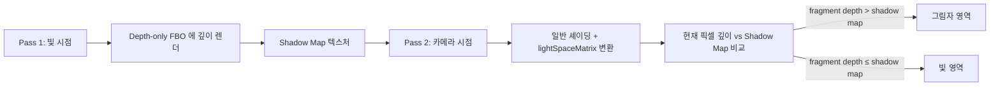
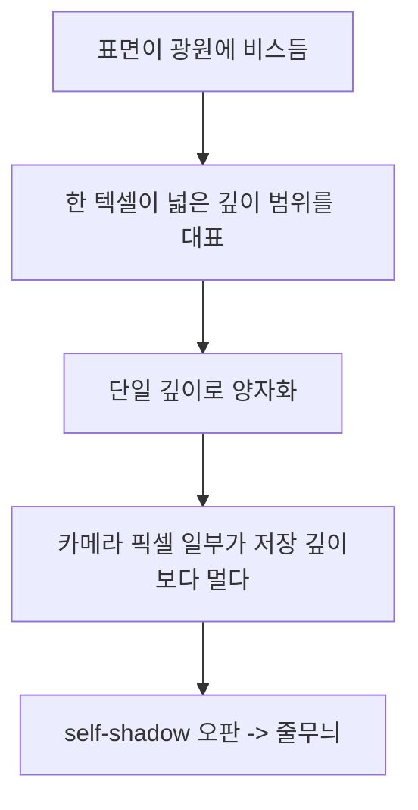
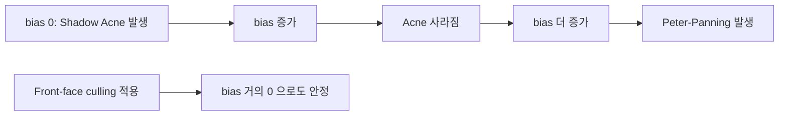

## 들어가며

> 그림자 매핑은 빛 시점 깊이 패스와 카메라 시점 깊이 비교로 이루어진 멀티패스 렌더링이다. 이 글은 그 골격을 OpenGL에서 방향광 기준으로 구현하며, 라이트 공간 행렬, 깊이 전용 FBO, Shadow Acne·Peter-Panning의 bias 전략, PCF를 다룬다.

그림자는 공간감을 만드는 가장 강한 시각 단서다. 사람의 시각 시스템은 두 물체의 상대 위치를 그림자의 부착점으로 판단하기 때문에, 그림자가 없으면 바닥에 놓인 물체와 공중에 떠 있는 물체를 구별하지 못한다. 그런데 실시간 렌더링에서 그림자를 만드는 일은 본질적으로 가시성(Visibility) 문제다. 어떤 표면 위의 한 점이 광원에서 본 직선 경로상 다른 물체에 가려지는지를 픽셀 단위로 판정해야 한다. 이 가시성 판정을 매 프레임, 화면의 모든 픽셀에 대해 수행하는 것이 부담이다.

실시간에서 가장 널리 쓰이는 해법은 그림자 매핑(Shadow Mapping)이다. 1978년 Lance Williams가 제안한 이 기법의 발상은 단순하다. 광원의 시점에서 씬을 한 번 렌더해 깊이만 기록해 두면, 그 깊이 버퍼는 *광원에서 본 각 방향으로 가장 가까운 표면까지의 거리* 를 담는다. 이후 카메라 시점에서 어떤 점을 셰이딩할 때, 그 점을 광원 공간으로 변환해 깊이를 구하고, 같은 방향에 대해 저장해 둔 가장 가까운 깊이와 비교한다. 현재 점이 더 멀면 그 앞에 다른 표면이 있다는 뜻이므로 그림자, 같거나 가까우면 광원이 직접 닿는 표면이다.

핵심 직관은 이렇게 요약된다. 광원의 시점에서 어떤 방향으로 *처음 닿는 표면* 이 그 방향에서 빛을 받는 유일한 표면이고, 그보다 멀리 있는 표면은 모두 앞의 표면에 가려진다. 가시성이라는 기하 문제를 *깊이 비교 한 번* 으로 환원하는 것이 그림자 매핑의 전부다. 비싼 광선 추적 없이 래스터라이저가 자연히 만들어 주는 깊이 버퍼를 재활용한다는 점에서 GPU 친화적이다.

여기까지의 코드는 Phong / Blinn-Phong 셰이딩과 노멀 매핑까지 마쳐 표면의 입체감이 살아 있지만, 광원에서 출발한 빛이 다른 객체에 가려지는 효과가 빠져 공간감이 부족하다. 이 글은 방향광(Directional Light)을 기준으로 다섯 단계에 걸쳐 그림자 매핑의 핵심을 쌓는다.

1. 빛 시점 깊이 패스와 카메라 시점 메인 패스로 이루어지는 *두 패스* 의 데이터 흐름.
2. 방향광 기준 *라이트 공간 행렬* 을 직교 투영과 LookAt으로 구성하는 방법.
3. 컬러 첨부 없이 깊이 텍스처만 가지는 *깊이 전용 FBO* 패턴.
4. 그림자 매핑의 양대 아티팩트인 *Shadow Acne와 Peter-Panning* 의 원인과 대응.
5. *PCF(Percentage-Closer Filtering)* 로 그림자 경계를 부드럽게 만드는 필터링.

셰이딩에 가려짐 한 단계만 추가해도 공간감은 즉시 살아난다. 점광 큐브맵 그림자나 CSM(Cascaded Shadow Maps) 같은 확장은 동일한 원리 위에 광원 종류와 거리별 해상도 분할이 더해질 뿐이다.


---

## 목차
1. [그림자 매핑의 두 패스](#1-그림자-매핑의-두-패스)
2. [라이트 공간 행렬](#2-라이트-공간-행렬)
3. [깊이 전용 FBO 구성](#3-깊이-전용-fbo-구성)
4. [그림자 비교 셰이더](#4-그림자-비교-셰이더)
5. [Shadow Acne와 깊이 바이어스](#5-shadow-acne와-깊이-바이어스)
6. [Peter-Panning 트레이드오프](#6-peter-panning-트레이드오프)
7. [PCF로 부드러운 경계](#7-pcf로-부드러운-경계)


---

## 1. 그림자 매핑의 두 패스

그림자 매핑은 한 프레임에 씬을 두 번 렌더한다. 첫 패스는 광원 시점에서 깊이만 기록하고, 둘째 패스는 카메라 시점에서 일반 셰이딩을 하면서 첫 패스의 깊이 텍스처를 참조해 가려짐을 판정한다. 두 패스 사이를 잇는 매개체가 *섀도 맵(Shadow Map)* 이라 부르는 깊이 텍스처와, 월드 공간 점을 광원 클립 공간으로 보내는 라이트 공간 행렬이다.



이 흐름에서 첫 패스가 만든 텍스처가 둘째 패스의 입력이 된다는 점이 핵심이다. 두 패스는 데이터 의존이 있으므로 순서를 바꿀 수 없다.

### Pass 1: 깊이 전용

광원의 시점에 가상 카메라를 두고 씬을 한 번 더 렌더한다. 이때 컬러는 전혀 필요 없다. 깊이 첨부만 가진 FBO를 바인딩하고, 정점 위치를 광원 클립 공간으로 변환해 깊이 버퍼에만 기록한다. 뷰포트는 섀도 맵 해상도에 맞춰 따로 설정해야 한다. 이를 잊으면 깊이가 화면 해상도 기준으로 래스터화되어 섀도 맵의 일부만 채워진다.

```cpp
glViewport(0, 0, kShadowW, kShadowH);
glBindFramebuffer(GL_FRAMEBUFFER, depthFBO);
glEnable(GL_DEPTH_TEST);
glDepthMask(GL_TRUE);
glDepthFunc(GL_LESS);
glClearDepth(1.0);
glClear(GL_DEPTH_BUFFER_BIT);

depthShader.Use();
depthShader.SetMat4("uLightSpace", lightSpaceMatrix);
for (auto& obj : sceneObjects) {
    depthShader.SetMat4("uModel", obj.transform);
    obj.mesh.Draw();
}
```

깊이 전용 셰이더는 극도로 단순하다. 정점 위치를 라이트 공간으로 보내는 곱 하나가 전부다.

```glsl
// vertex shader
#version 330 core
layout (location = 0) in vec3 aPos;
uniform mat4 uLightSpace;
uniform mat4 uModel;
void main() {
    gl_Position = uLightSpace * uModel * vec4(aPos, 1.0);
}
```

프래그먼트 셰이더는 비워 둘 수 있다. 래스터라이저가 보간한 `gl_FragCoord.z`를 깊이 버퍼에 자동으로 쓰기 때문이다. 다만 프래그먼트 셰이더가 아예 없으면 일부 드라이버에서 검증 경고가 나므로, 빈 본문이라도 명시하는 편이 안전하다.

```glsl
// fragment shader (깊이는 자동 기록되므로 본문이 비어도 된다)
#version 330 core
void main() {
    // gl_FragDepth를 쓰지 않으면 래스터라이저가 계산한 깊이를 사용한다
}
```

알파 클리핑이 있는 잎사귀나 펜스 텍스처라면 이 패스에서도 디스카드를 해야 한다. 그렇지 않으면 투명한 사각형 전체가 깊이를 기록해 실제 모양과 다른 그림자를 만든다. 그 경우에만 프래그먼트 셰이더에서 디퓨즈 알파를 읽어 `if (alpha < 0.5) discard;`를 둔다.

### Pass 2: 메인

기본 프레임버퍼로 돌아와 카메라 시점에서 씬을 일반 셰이딩한다. 뷰포트를 화면 해상도로 되돌리고, 컬러와 깊이를 모두 클리어한다. 첫 패스가 만든 섀도 맵 텍스처를 샘플러 슬롯에 바인딩하고, 라이트 공간 행렬을 uniform으로 넘긴다.

```cpp
glViewport(0, 0, kScreenW, kScreenH);
glBindFramebuffer(GL_FRAMEBUFFER, 0);
glClear(GL_COLOR_BUFFER_BIT | GL_DEPTH_BUFFER_BIT);

mainShader.Use();
mainShader.SetMat4("uView", view);
mainShader.SetMat4("uProj", proj);
mainShader.SetMat4("uLightSpace", lightSpaceMatrix);
mainShader.SetVec3("uLightDir", lightDir);
mainShader.SetVec3("uViewPos", camPos);

glActiveTexture(GL_TEXTURE5);
glBindTexture(GL_TEXTURE_2D, depthMap);
mainShader.SetInt("uShadowMap", 5);

for (auto& obj : sceneObjects) {
    mainShader.SetMat4("uModel", obj.transform);
    obj.mesh.Draw(mainShader);
}
```

`GL_TEXTURE5`처럼 디퓨즈와 노멀 텍스처 슬롯(보통 0~4)과 겹치지 않는 번호를 섀도 맵에 할당한다. 메시 셰이더가 디퓨즈, 노멀, 섀도 맵을 동시에 본다. 텍스처 유닛 번호와 셰이더에 넘기는 정수가 일치해야 한다는 점에 주의한다. `glActiveTexture(GL_TEXTURE5)`로 활성화한 슬롯에 바인딩했으니 `SetInt("uShadowMap", 5)`로 5를 넘긴다. 이 둘이 어긋나면 셰이더가 엉뚱한 텍스처를 읽어 그림자가 통째로 사라지거나 노이즈가 낀다.

### 두 패스의 비용 구조

Pass 1은 컬러 출력과 셰이딩 계산이 없으므로 정점 처리와 깊이 래스터화가 비용의 대부분이다. 같은 씬을 두 번 그리지만, 깊이 패스는 프래그먼트당 비용이 거의 없어 메인 패스보다 훨씬 가볍다. 대신 드로우 콜은 그대로 두 배가 되므로, 드로우 콜이 많은 씬에서는 CPU 측 오버헤드가 두드러진다. 정적 지오메트리의 섀도 맵은 광원·caster·light-space 투영이 변하지 않으면 재사용할 수 있다. 카메라를 따라 투영 범위가 바뀌는 CSM은 광원이 정적이어도 갱신이 필요하다.

## 2. 라이트 공간 행렬

방향광은 태양처럼 무한히 먼 광원이라 모든 광선이 평행하다. 평행한 광선을 깊이 패스로 옮기려면 원근 투영이 아니라 직교 투영(Orthographic Projection)을 써야 한다. 원근 투영을 쓰면 멀리 있는 물체가 작아지는 왜곡이 생겨 평행광의 가시성을 잘못 기록한다. 점광은 모든 방향으로 빛이 퍼지므로 큐브맵 6면에 원근 투영을 쓰지만, 이 글은 방향광에 집중한다.

### 직교 절두체

방향광의 절두체는 깊이 방향으로 늘어난 직육면체 박스다. `glm::ortho`로 그 박스의 여섯 면을 정한다.

```cpp
glm::vec3 lightDir   = glm::normalize(glm::vec3(-2, -4, -1));
glm::vec3 lightPos   = -lightDir * 20.0f;  // 씬 중심에서 충분히 떨어진 위치
glm::mat4 lightProj  = glm::ortho(-10.0f, 10.0f, -10.0f, 10.0f, 1.0f, 50.0f);
glm::mat4 lightView  = glm::lookAt(lightPos, glm::vec3(0), glm::vec3(0, 1, 0));
glm::mat4 lightSpace = lightProj * lightView;
```

`glm::ortho(left, right, bottom, top, near, far)`의 여섯 파라미터가 빛 절두체 박스를 정의한다. 이 박스가 그림자를 만들 씬 전체를 감싸야 한다. 일부만 감싸면 박스 바깥의 객체는 깊이 패스에 기록되지 않아 그림자를 던지지 못한다. 동시에 박스를 필요 이상으로 크게 잡으면 같은 섀도 맵 해상도가 더 넓은 영역에 분산되어 텍셀 밀도가 낮아지고 그림자 경계가 거칠어진다. 박스를 씬에 *딱 맞게* 잡는 것이 해상도 활용의 핵심이다.

방향광의 위치는 본질적으로 의미가 없다. 광선이 평행하므로 어디에 두든 같은 방향을 본다. 다만 `lookAt`이 시점을 요구하므로, 씬 중심에서 광선 반대 방향으로 충분히 떨어진 가상 위치를 잡는다. 이 위치는 near/far 평면 안에 씬이 들어오게 하는 역할만 한다.

### 씬 AABB로부터 자동 계산

박스 크기를 손으로 정하는 대신, 씬의 경계 상자(Axis-Aligned Bounding Box)를 빛 공간으로 변환해 자동 계산하는 것이 표준이다. 씬이 바뀌거나 광원 방향이 변해도 박스가 자동으로 따라간다.

```cpp
// 씬 AABB 의 8 꼭짓점을 lightView 로 변환
glm::vec3 corners[8] = { /* 씬 AABB 8 꼭짓점 */ };
glm::vec3 mn(FLT_MAX), mx(-FLT_MAX);
for (int i = 0; i < 8; ++i) {
    glm::vec3 c = glm::vec3(lightView * glm::vec4(corners[i], 1.0));
    mn = glm::min(mn, c);
    mx = glm::max(mx, c);
}
glm::mat4 lightProj = glm::ortho(mn.x, mx.x, mn.y, mx.y, -mx.z, -mn.z);
```

빛 공간에서 -z가 카메라 정면 방향이다. OpenGL은 오른손 좌표계에 카메라가 -Z를 바라보는 컨벤션을 쓰므로, 빛 공간 좌표의 z는 정면 점일수록 음수다. 여기서는 씬이 가상 광원 카메라 앞쪽에 있으므로 near/far에 양수 거리를 넣고, `-mx.z`가 가까운 평면, `-mn.z`가 먼 평면으로 들어간다. 부호를 헷갈리면 near/far가 뒤집혀 절두체가 비고, 섀도 맵 전체가 1.0으로 클리어된 그대로 남는다.

큰 야외 씬에서는 씬 전체를 한 박스로 감싸면 텍셀 밀도가 턱없이 부족하다. 그 경우 카메라 절두체 안에 들어오는 부분만으로 박스를 좁히고, 깊이 구간을 여러 단계로 쪼개 각 단계에 별도 섀도 맵을 두는 CSM으로 확장한다.

### lightSpaceMatrix의 의미

`lightSpace = lightProj * lightView`는 월드 공간 점을 빛의 클립 공간으로 변환한다. 클립 공간에서 perspective divide(w로 나누기)를 거치면 NDC(Normalized Device Coordinates)인 $[-1, 1]^3$ 공간이 되고, 여기에 $0.5$를 곱하고 더하면 $[0, 1]^3$이 된다. 이 $[0, 1]^2$가 섀도 맵 텍스처를 읽을 UV 좌표이고, $z$가 섀도 맵에 저장된 깊이와 비교할 현재 깊이다.

셰이더에서 이 변환을 직접 수행한다.

```glsl
vec4 lightClip = uLightSpace * vec4(vFragPos, 1.0);
vec3 ndc = lightClip.xyz / lightClip.w;       // perspective divide
vec3 uvDepth = ndc * 0.5 + 0.5;               // [-1,1] -> [0,1]
// uvDepth.xy 가 shadow map UV, uvDepth.z 가 비교 깊이
```

방향광은 직교 투영이라 `lightClip.w`가 항상 1이다. 따라서 perspective divide가 사실상 항등 연산이다. 그래도 위 식을 그대로 두면 점광이나 스폿라이트의 원근 투영으로 확장할 때 같은 코드가 통일되게 동작한다. `w`로 나누는 한 줄을 미리 제거하지 않는 이유가 여기 있다.

## 3. 깊이 전용 FBO 구성

OpenGL의 프레임버퍼 객체(FBO)는 컬러, 깊이, 스텐실 첨부를 가질 수 있다. 섀도 맵은 깊이만 필요하므로 컬러 첨부 없이 깊이 텍스처 하나만 붙인 FBO를 만든다.

```cpp
constexpr int kShadowW = 1024;
constexpr int kShadowH = 1024;

GLuint depthMap, depthFBO;
glGenTextures(1, &depthMap);
glBindTexture(GL_TEXTURE_2D, depthMap);
glTexImage2D(GL_TEXTURE_2D, 0, GL_DEPTH_COMPONENT24,
             kShadowW, kShadowH, 0,
             GL_DEPTH_COMPONENT, GL_FLOAT, nullptr);
glTexParameteri(GL_TEXTURE_2D, GL_TEXTURE_MIN_FILTER, GL_NEAREST);
glTexParameteri(GL_TEXTURE_2D, GL_TEXTURE_MAG_FILTER, GL_NEAREST);
glTexParameteri(GL_TEXTURE_2D, GL_TEXTURE_WRAP_S, GL_CLAMP_TO_BORDER);
glTexParameteri(GL_TEXTURE_2D, GL_TEXTURE_WRAP_T, GL_CLAMP_TO_BORDER);
float borderColor[] = {1.0f, 1.0f, 1.0f, 1.0f};
glTexParameterfv(GL_TEXTURE_2D, GL_TEXTURE_BORDER_COLOR, borderColor);

glGenFramebuffers(1, &depthFBO);
glBindFramebuffer(GL_FRAMEBUFFER, depthFBO);
glFramebufferTexture2D(GL_FRAMEBUFFER, GL_DEPTH_ATTACHMENT,
                       GL_TEXTURE_2D, depthMap, 0);
glDrawBuffer(GL_NONE);    // 컬러 출력 없음
glReadBuffer(GL_NONE);    // 컬러 읽기 없음
glBindFramebuffer(GL_FRAMEBUFFER, 0);
```

각 설정의 의미를 짚는다.

`GL_DEPTH_COMPONENT24`는 24비트 정규화 깊이 포맷이다. 텍셀당 24비트, 즉 16,777,216 단계로 깊이를 양자화한다. `GL_DEPTH_COMPONENT32F`로 바꾸면 32비트 부동소수점이 된다. 정밀도 이득은 저장 깊이의 분포에 달려 있고, 실제 VRAM 크기도 구현에 따라 달라진다. $1024 \times 1024$ 기준 24비트는 약 4MB(드라이버는 32비트 정렬로 잡는 경우가 많다), 32비트 float도 4MB로 큰 차이가 없으나 $4096 \times 4096$이면 한 장에 64MB로 무시하기 어려운 크기가 된다.

`GL_NEAREST` 필터를 쓰는 이유는 깊이값을 선형 보간하면 안 되기 때문이다. 두 텍셀의 깊이를 평균낸 값은 어떤 실제 표면의 깊이도 아닐 수 있다. PCF는 이 깊이들을 먼저 섞지 않고 주변 텍셀마다 현재 깊이와 비교한 이진 결과를 평균해 가시성 비율을 근사한다.

`GL_CLAMP_TO_BORDER`에 흰색 테두리를 주는 설정이 중요하다. 섀도 맵 바깥의 UV를 샘플하면 테두리 색인 깊이 1.0을 돌려준다. 깊이 1.0은 가장 먼 깊이이므로, 현재 깊이가 [0,1] 안이면 그림자가 아닌 빛 영역으로 판정된다. S/T 보더는 near/far 밖의 깊이를 처리하지 않으므로 아래 셰이더에서 별도로 검사한다. `GL_REPEAT`나 `GL_CLAMP_TO_EDGE`를 쓰면 절두체 경계의 깊이가 바깥으로 새어 들어가 엉뚱한 줄무늬 그림자가 생긴다.

`glDrawBuffer(GL_NONE)`과 `glReadBuffer(GL_NONE)`은 이 FBO에 컬러 첨부가 없음을 명시한다. 이 호출이 없으면 기본 draw/read buffer가 존재하지 않는 컬러 첨부 0번을 가리켜 각각 `GL_FRAMEBUFFER_INCOMPLETE_DRAW_BUFFER` 또는 `GL_FRAMEBUFFER_INCOMPLETE_READ_BUFFER`가 될 수 있다. 깊이 이미지가 이미 붙어 있으므로 `GL_FRAMEBUFFER_INCOMPLETE_MISSING_ATTACHMENT`는 아니다. FBO 생성 직후 `glCheckFramebufferStatus(GL_FRAMEBUFFER) == GL_FRAMEBUFFER_COMPLETE`를 확인하는 습관이 디버깅 시간을 줄인다.

### 해상도 트레이드오프

섀도 맵 해상도는 그림자 품질을 가장 직접적으로 좌우한다. $1024^2$가 입문, $2048^2$가 일반, $4096^2$가 고화질의 기준이다. 해상도가 높을수록 텍셀 풋프린트가 작아져 경계가 또렷해지지만, VRAM과 Pass 1의 래스터화 비용이 함께 늘어난다.

| 해상도 | VRAM (24bit) | 텍셀 풋프린트 (20×20 박스) | 용도 |
|---|---:|---|---|
| 512² | 1 MB | 약 39mm | 저사양, 프로토타입 |
| 1024² | 4 MB | 약 20mm | 입문 기본값 |
| 2048² | 16 MB | 약 10mm | 일반 게임 |
| 4096² | 64 MB | 약 5mm | 고화질, 좁은 절두체 |

텍셀 풋프린트는 직교 박스의 한 변 길이를 해상도로 나눈 값이다. 박스 한 변이 20m이고 해상도가 $1024$면 한 텍셀이 월드 공간에서 약 20mm를 대표한다. 이 풋프린트가 그림자 경계의 최소 두께를 결정한다. 해상도를 못 올린다면 박스를 좁혀 풋프린트를 줄이는 것이 같은 효과를 낸다.

## 4. 그림자 비교 셰이더

메인 셰이더에 그림자 판정 함수를 추가한다. 정점 셰이더는 라이트 공간 좌표를 프래그먼트로 전달하고, 프래그먼트 셰이더가 그 좌표로 섀도 맵을 읽어 비교한다.

### 정점 셰이더

```glsl
#version 330 core
layout (location = 0) in vec3 aPos;
layout (location = 1) in vec3 aNormal;
layout (location = 2) in vec2 aUv;

uniform mat4 uModel;
uniform mat4 uView;
uniform mat4 uProj;
uniform mat4 uLightSpace;

out vec3 vFragPos;
out vec3 vNormal;
out vec2 vUv;
out vec4 vLightSpacePos;

void main() {
    vFragPos = vec3(uModel * vec4(aPos, 1.0));
    vNormal  = mat3(transpose(inverse(uModel))) * aNormal;
    vUv      = aUv;
    vLightSpacePos = uLightSpace * vec4(vFragPos, 1.0);
    gl_Position = uProj * uView * vec4(vFragPos, 1.0);
}
```

라이트 공간 좌표를 정점 셰이더에서 계산해 `vLightSpacePos`로 보낸다. 이 값을 프래그먼트에서 다시 계산하지 않고 보간된 값을 쓰는 이유는, 클립 공간 좌표는 perspective divide 전이라 월드 위치의 아핀 함수이고, 기본 `smooth`(원근 보정) 보간이 아핀 값을 정확히 복원하기 때문이다. divide를 정점에서 미리 하면 보간이 비선형이 되어 어긋난다. 그래서 `vec4` 상태로 넘기고 프래그먼트에서 나눈다.

법선은 `transpose(inverse(uModel))`의 상위 3×3으로 변환한다. 비균일 스케일이 있는 모델 행렬에서 법선이 표면에 수직을 유지하려면 역전치 행렬이 필요하다. 균일 스케일만 쓴다면 모델 행렬의 3×3으로 충분하지만, 일반화를 위해 역전치를 둔다.

### 프래그먼트 셰이더 (1-tap)

가장 단순한 형태는 섀도 맵을 한 번만 읽어 비교하는 1-tap 방식이다.

```glsl
#version 330 core
in vec3 vFragPos;
in vec3 vNormal;
in vec2 vUv;
in vec4 vLightSpacePos;

out vec4 FragColor;

uniform sampler2D texture_diffuse1;
uniform sampler2D uShadowMap;
uniform vec3 uLightDir;
uniform vec3 uLightColor;
uniform vec3 uViewPos;

float ShadowCalc(vec4 lightSpacePos, vec3 N, vec3 L) {
    // perspective divide (방향광은 w == 1)
    vec3 proj = lightSpacePos.xyz / lightSpacePos.w;
    proj = proj * 0.5 + 0.5;                    // [-1,1] -> [0,1]
    if (proj.z < 0.0 || proj.z > 1.0) return 0.0;               // 절두체 far 바깥은 빛 영역

    float closestDepth = texture(uShadowMap, proj.xy).r;
    float currentDepth = proj.z;
    return currentDepth > closestDepth ? 1.0 : 0.0;
}
```

`closestDepth`는 섀도 맵에 저장된, 광원에서 그 방향으로 가장 가까운 표면의 깊이다. `currentDepth`는 지금 셰이딩 중인 점의 광원 기준 깊이다. 현재 점이 더 멀면(`currentDepth > closestDepth`) 그 앞에 다른 표면이 있다는 뜻이므로 그림자다.

`proj.z > 1.0` 분기는 절두체의 far 평면 바깥을 처리한다. 광원 절두체보다 멀리 있는 점은 섀도 맵에 깊이가 정의되지 않으므로, 그림자가 아닌 빛 영역(`0.0`)으로 간주해 갑작스러운 검은 영역을 피한다.

메인 함수는 Blinn-Phong 셰이딩에 그림자 마스크를 곱한다.

```glsl
void main() {
    vec3 N = normalize(vNormal);
    vec3 L = normalize(-uLightDir);
    vec3 V = normalize(uViewPos - vFragPos);
    vec3 H = normalize(L + V);

    vec3 albedo = texture(texture_diffuse1, vUv).rgb;
    vec3 ambient  = 0.15 * albedo;
    vec3 diffuse  = max(dot(N, L), 0.0) * albedo * uLightColor;
    vec3 specular = (dot(N, L) > 0.0 ? pow(max(dot(N, H), 0.0), 32.0) : 0.0) * uLightColor;

    float shadow = ShadowCalc(vLightSpacePos, N, L);
    vec3 lit     = ambient + (1.0 - shadow) * (diffuse + specular);
    FragColor    = vec4(lit, 1.0);
}
```

`shadow`가 1.0이면 그림자 안이라 diffuse와 specular를 배제하고, 0.0이면 빛 영역이라 모두 더한다. ambient는 그림자에서도 살아남는다. 완전히 검은 그림자는 부자연스럽고, 실제로는 간접광이 그림자 영역도 어느 정도 밝히기 때문이다. ambient 항이 그 간접광의 거친 근사다.

### sampler2DShadow와 하드웨어 PCF

OpenGL은 깊이 텍스처에 대해 비교 샘플링을 하드웨어로 지원한다. 텍스처를 비교 모드로 설정하면 샘플러가 깊이값을 돌려주는 대신 *비교 결과* 를 돌려주고, 선형 필터를 사용하면 비교 결과들을 결합한다. 흔한 구현은 2×2 bilinear PCF이며 실제 비용과 정확한 필터는 구현에 달려 있다.

```cpp
glTexParameteri(GL_TEXTURE_2D, GL_TEXTURE_COMPARE_MODE, GL_COMPARE_REF_TO_TEXTURE);
glTexParameteri(GL_TEXTURE_2D, GL_TEXTURE_COMPARE_FUNC, GL_LEQUAL);
glTexParameteri(GL_TEXTURE_2D, GL_TEXTURE_MIN_FILTER, GL_LINEAR);
glTexParameteri(GL_TEXTURE_2D, GL_TEXTURE_MAG_FILTER, GL_LINEAR);
```

셰이더에서는 `sampler2DShadow` 타입을 쓰고 `texture(map, vec3(uv, depth))`로 호출한다. 세 번째 성분이 비교할 참조 깊이다. 반환값은 0~1 사이의 부드러운 비교 결과로, 2×2 텍셀 중 비교를 통과한 비율을 bilinear로 가중한 값이다.

```glsl
uniform sampler2DShadow uShadowMap;
float lit = texture(uShadowMap, vec3(proj.xy, proj.z - bias));
// lit == 1.0 이면 빛, 0.0 이면 그림자
```

부호 규약이 1-tap과 반대라는 점에 주의한다. `sampler2DShadow`는 비교를 *통과* 한 비율, 즉 빛을 받는 비율을 돌려주므로 1.0이 빛이다. 앞의 `ShadowCalc`는 그림자 비율을 돌려주므로 1.0이 그림자였다. 한쪽 규약으로 통일하려면 `1.0 - lit` 같은 변환을 둔다. 비교 모드 텍스처는 `GL_NEAREST`에서도 한 깊이 비교를 수행한다. 부드러운 PCF에는 `GL_LINEAR`를 결합한다. `GL_NEAREST`로 두면 하드웨어 PCF의 bilinear 가중이 사라진다.

## 5. Shadow Acne와 깊이 바이어스

그림자 매핑의 첫 번째 고질적 아티팩트가 Shadow Acne다. 빛을 받아야 할 표면 전체에 무수한 어두운 줄무늬가 끼는 현상이다. 표면이 자기 자신에게 그림자를 던지는 것처럼 보인다.

### 원인

섀도 맵의 한 텍셀은 유한한 면적의 표면을 대표한다. 3절에서 본 텍셀 풋프린트다. 그 면적 안의 깊이는 하나의 값으로 양자화되어 저장되는데, 표면이 광원에 비스듬할수록 그 면적 안에서 실제 깊이가 크게 변한다. 카메라 시점에서 같은 표면의 각 픽셀은 그 면적 안의 서로 다른 점이라, 저장된 단일 깊이보다 가깝기도 멀기도 하다. 저장된 깊이보다 *조금 먼* 픽셀이 자기 자신에 가려진 것으로 오판되어 어두워지고, 이 오판이 텍셀 경계를 따라 줄무늬로 나타난다.



핵심은 표면이 비스듬할수록 한 텍셀 안의 깊이 변화 폭이 커진다는 점이다. 정면을 보는 표면은 텍셀 안에서 깊이가 거의 일정해 acne가 약하다.

### 상수 바이어스

가장 단순한 대응은 비교 시 일정한 여유값(bias)을 빼서 통과 기준을 넉넉하게 만드는 것이다.

```glsl
float bias = 0.005;
float shadow = currentDepth - bias > closestDepth ? 1.0 : 0.0;
```

현재 깊이에서 bias만큼 빼면, 저장 깊이보다 조금 먼 픽셀도 통과해 그림자로 오판되지 않는다. 적정 bias는 표면 기울기에 따라 다르다. 광원에 거의 평행한 표면은 텍셀 안 깊이 변화가 커서 작은 bias로는 부족하고, 큰 bias는 실제 접촉부까지 밝게 만들어 그림자가 물체에서 떨어져 보이는 Peter-Panning을 만든다.

### 경사 기반 바이어스

표면이 광원에 수직일수록 bias를 작게, 평행할수록 크게 주면 양쪽을 동시에 만족시킨다. 표면 법선과 광선 방향의 내적이 그 기울기를 정량화한다.

```glsl
float bias = max(0.05 * (1.0 - dot(N, L)), 0.005);
float shadow = currentDepth - bias > closestDepth ? 1.0 : 0.0;
```

`dot(N, L)`이 1이면(정면) bias가 하한인 0.005, 0이면(평행) 0.05가 된다. `max`로 하한을 두는 이유는 정면 표면도 깊이 양자화 오차가 약간은 있어 최소한의 여유가 필요하기 때문이다.

### 셰이더 코드 적용

`ShadowCalc`에 경사 기반 bias를 통합한 최종 형태다.

```glsl
float ShadowCalc(vec4 lightSpacePos, vec3 N, vec3 L) {
    vec3 proj = lightSpacePos.xyz / lightSpacePos.w;
    proj = proj * 0.5 + 0.5;
    if (proj.z < 0.0 || proj.z > 1.0) return 0.0;

    float closestDepth = texture(uShadowMap, proj.xy).r;
    float currentDepth = proj.z;
    float bias = max(0.05 * (1.0 - dot(N, L)), 0.005);
    return (currentDepth - bias) > closestDepth ? 1.0 : 0.0;
}
```

### 적절한 bias 값 찾기

bias의 수치 의미는 섀도 맵 해상도, 절두체 깊이 범위, 깊이 비트에 따라 달라진다. bias는 $[0, 1]$로 정규화된 깊이 공간에서의 값이라, 같은 0.005라도 절두체 깊이 범위가 넓으면 월드 공간에서 더 큰 거리에 해당한다.

| 섀도 맵 | 깊이 범위 (far − near) | 정규화 깊이 1 LSB | 직교 투영의 월드 거리 근사 | 튜닝 예시 bias (범용 권장값 아님) |
|---|---|---|---|---|
| 1024², 24bit | 50 | $2^{-24}\approx5.96\times10^{-8}$ | $50/2^{24}\approx3\times10^{-6}$ | 0.005 ~ 0.01 |
| 2048², 24bit | 100 | $2^{-24}\approx5.96\times10^{-8}$ | $100/2^{24}\approx6\times10^{-6}$ | 0.005 |
| 4096², 32F | 200 | 값에 따른 부동소수점 간격 | 투영·저장값에 따라 달라짐 | 0.001 ~ 0.005 |

24비트 정규화 깊이의 1 LSB는 정확히 $1/(2^{24}-1)$, 근사적으로 $2^{-24}$이고, 표의 월드 거리 값은 선형 직교 섀도 투영에서 여기에 깊이 범위를 곱한 근사다. 셰이더의 normalized-depth bias는 같은 정규화 단위에서 비교해야 한다. 예를 들어 직교 깊이 범위 50에서 bias 0.005는 월드 거리 0.25에 해당하므로 작은 물체에는 이미 과할 수 있다. bias는 양자화·보간·slope 오차를 덮으면서 Peter-Panning이 보이지 않을 만큼 작아야 하므로, 0부터 키우며 acne가 사라지는 지점과 분리 현상이 시작되는 지점을 함께 측정한다.

또 하나의 함정은 절두체 far를 과하게 크게 잡으면 깊이 정밀도가 분산되어 acne가 심해진다는 점이다. near/far를 씬에 맞게 좁히는 것 자체가 bias 튜닝만큼 중요하다.

## 6. Peter-Panning 트레이드오프

bias를 너무 크게 잡으면 그림자가 객체에서 떨어져 둥둥 떠 보인다. 디즈니 애니메이션 피터팬에서 그림자가 몸과 분리되는 장면에서 이름을 따왔다. bias가 그림자의 시작점을 표면 안쪽으로 밀어내, 객체와 바닥이 닿는 지점의 그림자가 사라지기 때문이다.

### 진단

- 캐릭터의 발 바로 아래에 닿아 있어야 할 그림자가 2~3 픽셀 떨어진 곳에서 시작한다.
- 키 작은 박스를 바닥에 놓으면 박스와 바닥 사이로 빛이 새어 들어와 떠 있는 것처럼 보인다.
- bias를 줄이면 이 현상이 줄지만 대신 5절의 Shadow Acne가 다시 나타난다.

Shadow Acne와 Peter-Panning은 bias 하나를 사이에 둔 반대편 극단이다. bias가 작으면 acne, 크면 Peter-Panning이다. 둘 다 피하는 좁은 구간을 찾는 게 단순 bias의 한계다.



### 대응책 1: 깊이 패스 front-face culling

깊이 패스에서 앞면 대신 뒷면만 그리는 트릭이다. 평소 렌더링은 뒷면을 컬링하지만, 깊이 패스에서만 앞면을 컬링한다. 그러면 섀도 맵에 메시의 뒷면 깊이가 기록된다. 뒷면은 앞면보다 광원에서 멀므로, 저장 깊이가 자연히 안쪽으로 밀려 acne를 만드는 깊이 차이가 메시 두께만큼 흡수된다. 결과적으로 bias가 거의 필요 없어진다.

```cpp
// shadow pass 시작
glEnable(GL_CULL_FACE);
glCullFace(GL_FRONT);
// ... depth FBO 에 씬 렌더 ...
glCullFace(GL_BACK);    // 메인 패스로 복원
```

장점은 닫힌 메시의 앞면 self-shadow에 필요한 bias를 줄일 수 있다는 것이다. 두께에 따른 그림자 축소·접촉부 분리는 여전히 확인해야 한다. 단점이 둘 있다. 잎사귀나 종이처럼 얇은 객체는 앞뒤 면이 너무 가까워 깊이 차이가 사실상 없으므로 효과가 없고 그림자가 거의 사라진다. 또 한쪽 면만 있는 열린 메시(open mesh)는 컬링하면 그릴 면이 남지 않아 그림자 자체가 없어진다. 닫힌 단단한 메시에만 안전하게 쓸 수 있다.

### 대응책 2: 법선 방향 오프셋

bias를 깊이값에 적용하는 대신, 섀도 맵을 샘플할 위치를 표면 법선 방향으로 살짝 밀어내는 방법이다. 깊이 공간이 아니라 월드 공간에서 보정하므로 비스듬한 표면에서 더 자연스럽다.

```glsl
vec4 lightSpacePosBiased = uLightSpace * vec4(vFragPos + N * 0.05, 1.0);
```

법선 방향으로 0.05만큼 이동한 위치를 기준으로 라이트 공간 좌표를 다시 만든다. 여기서 결과를 `vec4`로 그대로 두는 것이 중요하다. 이후 perspective divide(`xyz / w`)가 필요한 점광 큐브맵이나 스폿라이트로 확장할 때 `w`를 미리 버리면 좌표가 어긋난다. 방향광과 직교 투영에서는 `w`가 1이라 결과가 같지만, 코드의 원근 일반화 호환성을 위해 `vec4`로 유지한다.

법선 오프셋의 크기는 텍셀 풋프린트와 같은 단위로 잡는 것이 이상적이다. 풋프린트보다 작으면 acne가 남고, 너무 크면 다시 Peter-Panning이 생긴다. 풋프린트가 20mm면 오프셋도 그 근처에서 시작해 조정한다.

### 종합 권장

실전의 균형점은 깊이 패스 front-face culling과 작은 경사 기반 bias를 함께 쓰는 것이다. 닫힌 메시는 culling이 acne를 거의 없애고, 얇은 객체나 열린 메시는 culling을 끄고 bias로 처리하는 식으로 객체 종류에 따라 분기한다. 단일 bias 하나로 모든 표면을 만족시키려는 시도보다 이쪽이 훨씬 안정적이다.

## 7. PCF로 부드러운 경계

1-tap 비교는 섀도 맵 한 텍셀당 그림자/빛을 이분법으로 가른다. 그 결과 그림자 경계가 텍셀 단위로 계단처럼 끊긴 톱니(jagged) 모양이 된다. 경계 픽셀이 0 아니면 1만 가지므로 중간 단계가 없다.

PCF(Percentage-Closer Filtering)는 한 점의 그림자 여부를 주변 여러 텍셀과 비교한 뒤 그 결과를 평균낸다. 9개 중 4개가 그림자면 0.44가 되어, 경계에 부드러운 회색 그라데이션이 생긴다. 깊이를 보간하는 게 아니라 *비교 결과* 를 보간한다는 점이 핵심이다. 깊이 자체를 평균내면 의미 없는 값이 나오지만, 비교 결과(0 또는 1)의 평균은 선택한 필터 footprint 안의 가시성 비율을 근사한다. 고정 PCF 커널이 실제 면광원의 크기·blocker 거리로 정해지는 물리적 반그림자를 재현하는 것은 아니다.

### 3x3 PCF

```glsl
float ShadowPCF(vec4 lightSpacePos, vec3 N, vec3 L) {
    vec3 proj = lightSpacePos.xyz / lightSpacePos.w;
    proj = proj * 0.5 + 0.5;
    if (proj.z < 0.0 || proj.z > 1.0) return 0.0;

    float bias = max(0.05 * (1.0 - dot(N, L)), 0.005);
    float currentDepth = proj.z;

    float shadow = 0.0;
    vec2 texelSize = 1.0 / vec2(textureSize(uShadowMap, 0));
    for (int x = -1; x <= 1; ++x) {
        for (int y = -1; y <= 1; ++y) {
            float pcfDepth = texture(uShadowMap,
                                     proj.xy + vec2(x, y) * texelSize).r;
            shadow += (currentDepth - bias) > pcfDepth ? 1.0 : 0.0;
        }
    }
    shadow /= 9.0;
    return shadow;
}
```

`textureSize(sampler, lod)`가 섀도 맵의 픽셀 크기를 `ivec2`로 반환한다. `vec2(...)`로 캐스팅한 뒤 `1.0 /`을 취하면 한 텍셀이 UV 공간에서 차지하는 크기를 얻는다. 이 값을 오프셋 단위로 써서 주변 3×3 텍셀을 샘플한다. 9개 비교 결과의 평균이 0~1 사이의 부드러운 그림자 마스크가 된다.

`texelSize`를 정확히 계산하는 것이 중요하다. 상수로 박아 넣으면 해상도가 바뀔 때 오프셋이 어긋나 PCF가 깨진다. `textureSize`로 런타임에 구해야 해상도 독립적이다.

### 5x5 PCF

같은 패턴으로 범위를 -2부터 2까지 넓히면 5×5 = 25 샘플이 된다. 경계가 더 넓고 부드러워지지만 개념적 탭 수가 9에서 25로 약 2.8배 늘어난다. 실제 비용은 하드웨어·드라이버와 샘플 배치에 따라 다르므로 대상 GPU에서 측정한다. 고해상도 섀도 맵에서 일부러 큰 penumbra(반그림자)를 만들고 싶을 때 쓴다.

### 비교

| 방식 | 개념적 비교 표본 수 | 경계 | 비용 결정 요인 |
|---|---:|---|---:|
| 1-tap (단순) | 1 | jagged | 한 번의 깊이 fetch·비교 |
| 2×2 hardware PCF | 보통 4 | 약간 부드러움 | 한 번의 비교 샘플러 호출, 구현 의존 |
| 3×3 manual PCF | 9 | 부드러움 | 9번의 fetch·비교와 캐시 |
| 5×5 manual PCF | 25 | 매우 부드러움 | 25번의 fetch·비교와 캐시 |
| Poisson Disk 16 | 16 | 자연스러움, banding 적음 | 표본 배치·캐시·패턴 회전 |

표본 수가 실행 시간 배율을 직접 정하지는 않는다. 실제 비용은 대상 GPU에서 같은 장면과 품질 조건으로 측정한다.

하드웨어 PCF는 비교 모드 텍스처에 선형 필터를 설정해 이용한다. 4절의 `sampler2DShadow`가 이것이다. 이를 3×3 매뉴얼 PCF의 각 탭에 결합하면 적은 샘플로 더 부드러운 결과를 얻는다. 탭 간격이 1텍셀이라 인접 탭의 2×2 풋프린트가 겹치므로, 9탭이 실질적으로 4×4 = 16개 텍셀의 가중 평균이 되는 셈이다.

Poisson Disk 샘플링은 격자 대신 원판에 분산된 고정 패턴으로 샘플해 규칙적인 격자 무늬(banding)를 줄인다. 같은 탭 수로 더 자연스러운 경계를 얻지만 패턴이 회전 없이 고정되면 다른 종류의 잡음이 보이므로, 화면 위치 기반 회전을 추가하기도 한다.

### 고급 옵션

- **VSM(Variance Shadow Maps)**: 섀도 맵에 깊이와 깊이 제곱 두 채널을 저장하고 Chebyshev 부등식으로 가려질 확률을 추정한다. 깊이가 아니라 통계량을 저장하므로 일반 블러를 자유롭게 걸 수 있어 일반 필터를 이용해 넓은 커널을 구현하기 쉽지만, 모멘트 렌더링·블러·저장 비용은 든다. 단점은 두 표면의 깊이 차가 클 때 빛이 새는 light bleeding이다.
- **PCSS(Percentage-Closer Soft Shadows)**: 먼저 blocker search로 가린 표면의 평균 깊이를 찾고, 그 깊이와 광원 크기로 penumbra 폭을 추정해 PCF 커널 크기를 동적으로 조절한다. 접촉부는 날카롭고 멀어질수록 부드러운, 물리적으로 그럴듯한 그림자를 만든다. blocker search 비용이 크다.
- **CSM(Cascaded Shadow Maps)**: 카메라 절두체를 깊이 방향으로 3~4단계로 분할하고 각 단계에 별도 섀도 맵을 둔다. 가까운 단계는 좁은 절두체에 높은 텍셀 밀도, 먼 단계는 넓은 절두체에 낮은 밀도를 배정해 화면 전체에서 균일한 그림자 품질을 얻는다.

이 글은 3×3 PCF, 경사 기반 bias, front-face culling까지의 베이스라인으로 마무리한다. 위 고급 기법들은 모두 이 베이스라인의 비교 함수를 확장하거나 섀도 맵 구성을 늘린 것이라, 같은 두 패스 골격 위에서 동작한다.


---

## 결론

여기까지의 코드는 그림자가 있는 첫 장면을 만든다. 광원 시점 깊이 패스와 카메라 시점 메인 패스라는 두 패스, 월드 점을 광원 클립 공간으로 보내는 라이트 공간 행렬, 컬러 첨부 없는 깊이 전용 FBO, acne와 Peter-Panning을 다루는 bias 전략, 경계를 부드럽게 하는 PCF까지 그림자 매핑의 핵심이 한 흐름에 모였다. 단일 방향광에 섀도 맵 한 장이라는 한계가 있지만, 점광 큐브맵이든 CSM이든 VSM이든 모두 이 골격 위에서 자란다.

이 글의 트레이드오프는 세 축으로 정리된다. 첫째, 섀도 맵 해상도와 절두체 크기는 텍셀 풋프린트를 통해 그림자 품질을 결정하며, 해상도를 올리거나 절두체를 좁혀 풋프린트를 줄인다. 둘째, bias는 Shadow Acne와 Peter-Panning 사이의 좁은 구간을 겨냥하고, front-face culling과 법선 오프셋이 그 구간을 넓혀 준다. 셋째, PCF의 탭 수는 경계의 부드러움과 프래그먼트 비용을 직접 맞바꾼다.

광역 장면을 한 섀도 맵으로 감싸면 가까운 곳의 텍셀 밀도가 부족해진다. CSM은 카메라 거리 구간마다 light-space 투영과 depth map을 따로 두어 가까운 구간에 해상도를 집중한다. 구간 경계의 안정화와 blending, caster 범위, draw 수 증가가 추가 비용이다. 그림자가 적용된 HDR 장면을 후처리 입력으로 사용할 때는 shadow visibility가 선형 조명 계산에 들어간 뒤 tone mapping과 출력 인코딩이 한 번씩만 적용되어야 한다.

## 더 읽을거리

- Lance Williams, "Casting Curved Shadows on Curved Surfaces" (SIGGRAPH 1978) — 섀도 매핑 원전.
- [LearnOpenGL: Shadow Mapping](https://learnopengl.com/Advanced-Lighting/Shadows/Shadow-Mapping) — acne/bias/PCF 구현 예제.
- Rouslan Dimitrov, ["Cascaded Shadow Maps"](https://developer.download.nvidia.com/SDK/10.5/opengl/src/cascaded_shadow_maps/doc/cascaded_shadow_maps.pdf) (NVIDIA 2007) — CSM 의 표준 정리.
- *Real-Time Rendering, 4th Edition*, Ch.7 (Shadows) — 그림자 기법 전체 지형도.
