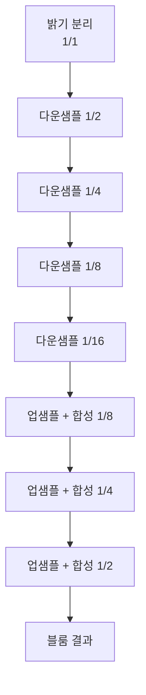
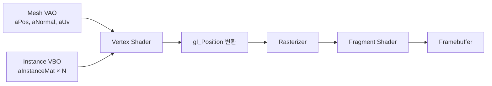

## 들어가며

> HDR·톤 매핑·감마의 전제는 선형 빛의 양과 감마 인코딩 코드값의 구분, sRGB 전달 함수, "디코딩 → 선형 계산 → 인코딩" 파이프라인, 톤 매핑이 HDR을 디스플레이 범위에 압축하는 원리다. 이 글은 그 전제를 OpenGL 후처리 파이프라인으로 구현한다. 핵심은 `GL_RGBA16F` HDR 렌더 타깃, 블룸의 밝기 분리·합성, 분리 가능 가우시안 블러와 ping-pong FBO, 톤 매핑 함수들의 GLSL 구현(Reinhard·Exposure·Uncharted 2·ACES), `GL_FRAMEBUFFER_SRGB` 이중 감마 함정, 인스턴스 렌더링이다.

LDR(Low Dynamic Range) 8비트 컬러는 0에서 1까지의 정규화된 밝기만 표현한다. 채널당 256단계이고, 그보다 밝은 빛은 표현할 자리가 없다. 그런데 실제 장면의 밝기는 한낮의 태양이 약 1,600,000,000 nits, 흐린 하늘이 수천 nits, 실내 형광등이 수백 nits, 밤하늘의 별빛이 0.001 nits 수준으로 열 자릿수 이상 벌어진다. 8비트 정규화 버퍼에 이 범위를 그대로 담으려는 시도는 1.0을 넘는 모든 값을 1.0으로 잘라내는 것과 같다. 밝은 광원 주변의 디테일은 흰색 덩어리로 뭉개지고, 어두운 영역은 검은색으로 묻힌다.

HDR(High Dynamic Range) 파이프라인은 이 문제를 두 단계로 분리해 해결한다. 먼저 장면을 부동소수 텍스처에 *잘라내지 않고 그대로 누적*한다. 셰이더가 계산한 5.0이든 50.0이든 그 값이 버퍼에 보존된다. 그리고 화면에 출력하기 직전, 한 번의 *톤 매핑(Tone Mapping)* 패스에서 이 넓은 범위를 디스플레이가 표현 가능한 0에서 1로 압축한다. 압축 함수의 모양이 최종 화면의 룩을 결정한다.

여기까지의 코드는 그림자까지 더한 메인 패스를 가지지만, 셰이딩 결과가 1.0에서 잘리고 색이 디스플레이 공간으로 직접 표시된다. 밝은 부분의 디테일이 사라지고, 어두운 부분이 묻힌다. 이 글은 다섯 단계로 후처리 체인을 쌓아 이 한계를 걷어낸다.

1. `GL_RGBA16F` HDR 컬러 버퍼로 1.0 이상의 밝기를 손실 없이 누적한다.
2. 블룸(Bloom)을 밝기 분리와 블러 합성의 두 단계로 구현하고, ping-pong FBO 패턴을 정리한다.
3. 분리 가능 필터(Separable Filter)로 가우시안 블러 비용을 $O(k^2)$에서 $O(2k)$로 줄이는 표준을 본다.
4. Reinhard, Exposure, Uncharted 2, ACES 톤 매핑 함수를 비교한다.
5. 인스턴스 렌더링(Instanced Rendering)으로 같은 메시를 드로우 한 번에 N개 그린다.

그림자가 공간감을 만들었다면, 후처리는 시각적 완성도를 만든다. 밝은 부분이 번지고, 색이 시네마틱하게 압축되고, 풀잎이 수천 개의 인스턴스로 한 번에 그려진다. 이 글의 결과물은 픽셀이 화면에 도달하기 직전의 마무리 단계 전체다.


---

## 목차
1. [HDR 컬러 버퍼](#1-hdr-컬러-버퍼)
2. [블룸의 두 단계](#2-블룸의-두-단계)
3. [가우시안 블러와 분리 가능 필터](#3-가우시안-블러와-분리-가능-필터)
4. [톤 매핑 함수 비교](#4-톤-매핑-함수-비교)
5. [ACES Filmic 곡선](#5-aces-filmic-곡선)
6. [감마 보정 출력](#6-감마-보정-출력)
7. [인스턴스 렌더링](#7-인스턴스-렌더링)


---

## 1. HDR 컬러 버퍼

### LDR 버퍼의 clamp 문제

기본 프레임버퍼는 채널당 8비트 정규화 정수, 곧 RGBA8이다. 한 채널은 0에서 255까지의 정수를 가지고, 셰이더에서 출력하는 부동소수 값은 화면에 기록될 때 [0, 1]로 clamp된 뒤 255를 곱해 양자화된다. 이 모델에서 1.0을 넘는 밝기는 표현할 방법이 없다. 강한 광원에 정면으로 노출된 표면이 셰이더에서 `vec3(5.0, 4.5, 3.0)`을 계산해도, 프레임버퍼에 들어가는 순간 `vec3(1.0, 1.0, 1.0)`이 되어 흰색으로 뭉개진다.

이 손실이 치명적인 이유는 *밝기 비율 정보가 사라지기* 때문이다. 톤 매핑이나 블룸 같은 후처리는 1.0을 넘는 값들 사이의 차이를 이용해 동작하는데, 메인 패스가 이미 잘라버린 값에서는 그 차이를 복원할 수 없다. 후처리를 적용하려면 셰이딩 결과를 *잘라내지 않고 보존하는* 렌더 타깃이 먼저 필요하다.

### 부동소수 렌더 타깃

해결책은 부동소수 텍스처를 메인 렌더 타깃으로 사용하는 것이다. OpenGL은 여러 부동소수 컬러 포맷을 제공한다.

| 포맷 | 채널당 비트 | 픽셀당 byte | 표현 범위 | 비고 |
|---|---|---|---|---|
| `GL_RGBA8` | 8 (정수) | 4 | [0, 1] | 기본, clamp됨 |
| `GL_RGBA16F` | 16 (half) | 8 | 약 ±65,504 | HDR 표준 |
| `GL_R11F_G11F_B10F` | 11/11/10 | 4 | 양수만, 알파 없음 | 대역폭 절약 |
| `GL_RGBA32F` | 32 (float) | 16 | 약 ±3.4×10^38 | 정밀도 과잉 |
| `GL_RGB10_A2` | 10/10/10/2 | 4 | [0, 1] 정수 | HDR 아님, 색 단계만 ↑ |

게임 HDR의 사실상 표준은 `GL_RGBA16F`다. 반정밀도(half-precision) float은 부호 1비트, 지수 5비트, 가수 10비트로 약 65,504까지를 표현하고, 작은 값 근처에서는 가수 10비트의 상대 정밀도를 유지한다. 장면 휘도가 65,504를 넘는 경우는 사실상 없으므로 표현 범위는 충분하고, 메모리는 32비트 float의 절반이다.

`GL_R11F_G11F_B10F`는 픽셀당 4 byte로 RGBA16F의 절반이라 대역폭에 민감한 환경에서 쓰지만, 알파 채널이 없고 부호 비트가 없어 음수를 표현하지 못한다는 제약이 있다. `GL_RGB10_A2`는 부동소수가 아니라 정수 포맷이라 여전히 [0, 1]로 clamp되므로 HDR 누적에는 쓸 수 없다. 단지 색 밴딩(banding)을 줄이는 용도다.

### HDR FBO 만들기

`GL_RGBA16F` 컬러 첨부와 24비트 깊이 renderbuffer를 가진 FBO를 만든다.

```cpp
GLuint hdrFBO, hdrColor, hdrDepth;
glGenFramebuffers(1, &hdrFBO);
glBindFramebuffer(GL_FRAMEBUFFER, hdrFBO);

// 컬러: RGBA16F
glGenTextures(1, &hdrColor);
glBindTexture(GL_TEXTURE_2D, hdrColor);
glTexImage2D(GL_TEXTURE_2D, 0, GL_RGBA16F, width, height, 0,
             GL_RGBA, GL_FLOAT, nullptr);
glTexParameteri(GL_TEXTURE_2D, GL_TEXTURE_MIN_FILTER, GL_LINEAR);
glTexParameteri(GL_TEXTURE_2D, GL_TEXTURE_MAG_FILTER, GL_LINEAR);
glTexParameteri(GL_TEXTURE_2D, GL_TEXTURE_WRAP_S, GL_CLAMP_TO_EDGE);
glTexParameteri(GL_TEXTURE_2D, GL_TEXTURE_WRAP_T, GL_CLAMP_TO_EDGE);
glFramebufferTexture2D(GL_FRAMEBUFFER, GL_COLOR_ATTACHMENT0,
                       GL_TEXTURE_2D, hdrColor, 0);

// 깊이: 동일 해상도 renderbuffer
glGenRenderbuffers(1, &hdrDepth);
glBindRenderbuffer(GL_RENDERBUFFER, hdrDepth);
glRenderbufferStorage(GL_RENDERBUFFER, GL_DEPTH_COMPONENT24, width, height);
glFramebufferRenderbuffer(GL_FRAMEBUFFER, GL_DEPTH_ATTACHMENT,
                          GL_RENDERBUFFER, hdrDepth);

if (glCheckFramebufferStatus(GL_FRAMEBUFFER) != GL_FRAMEBUFFER_COMPLETE) {
    fprintf(stderr, "HDR FBO incomplete\n");
}
glBindFramebuffer(GL_FRAMEBUFFER, 0);
```

`GL_TEXTURE_MIN_FILTER`와 `GL_TEXTURE_MAG_FILTER`를 `GL_LINEAR`로 두는 이유는 이후 후처리 패스가 이 텍스처를 화면 크기와 다른 해상도로 샘플링하거나, 블러에서 텍셀 사이를 보간해 읽기 때문이다. 부동소수 텍스처에 대한 bilinear 필터링은 데스크톱 GPU에서 기본 지원되지만, 일부 OpenGL ES 환경에서는 half-float용 `GL_OES_texture_half_float_linear` 확장이 있어야 한다(`GL_OES_texture_float_linear`는 32비트 float 전용이다).

깊이는 텍스처가 아니라 renderbuffer로 잡았다. 깊이 버퍼를 셰이더에서 다시 읽을 필요가 없다면 renderbuffer가 더 가볍다. 깊이를 후처리 단계(예: SSAO, depth of field)에서 샘플링하려면 `GL_DEPTH_COMPONENT24` 텍스처로 바꿔 첨부한다.

### 메모리 산정

`GL_RGBA16F`는 픽셀당 8 byte다. 1920×1080 해상도에서 메인 HDR 컬러 텍스처 하나가 1920 × 1080 × 8 byte = 약 16MB다. 후처리 체인은 보조 텍스처를 더 요구한다.

| 텍스처 | 해상도 | 포맷 | 메모리 |
|---|---|---|---|
| HDR 메인 컬러 | 1920×1080 | RGBA16F | 16MB |
| 깊이 renderbuffer | 1920×1080 | D24 | 논리 6.2MB, 구현 패딩 시 더 큼 |
| 밝기 분리 | 1920×1080 | RGBA16F | 16MB |
| ping-pong 0 | 1920×1080 | RGBA16F | 16MB |
| ping-pong 1 | 1920×1080 | RGBA16F | 16MB |

표의 색 attachment 논리 크기와 깊이 패딩을 합치면 대략 수십 MiB의 작업 집합이 된다. 실제 할당은 타일링·정렬·압축 메타데이터 때문에 달라진다. 블룸의 밝기 분리와 ping-pong을 가로·세로 절반으로 만들면 각 색 텍스처의 논리 픽셀 수는 1/4이 된다. 블룸은 저주파로 설계하는 경우가 많아 다운샘플이 유리하지만 작은 고휘도 특징의 소실, firefly, 업샘플 ringing을 장면별로 비교해야 한다.

### 셰이더 출력은 바꾸지 않는다

메인 패스의 프래그먼트 셰이더는 변경할 필요가 없다. 출력 타깃이 부동소수 텍스처이므로, 셰이더가 0에서 1을 벗어나는 결과를 출력하면 그 값이 그대로 저장된다.

```glsl
// fragment shader 마지막
FragColor = vec4(linearShadedColor, 1.0);    // 0~1 제한 없음
```

여기서 `linearShadedColor`는 *선형 공간(linear space)*의 색이어야 한다. 조명 계산은 선형 공간에서 해야 물리적으로 정확하고, sRGB 변환은 후처리 맨 끝에서 한 번만 한다. 조명과 출력 인코딩을 분리해야 감마 변환을 정확히 한 번 적용할 수 있다.

### 메인 패스 흐름

전체 후처리 체인은 다음 순서로 동작한다. HDR FBO에 씬을 그리고, 그 결과를 입력으로 블룸과 톤 매핑 패스가 이어진다.

```cpp
// 1) HDR FBO 에 씬 렌더
glBindFramebuffer(GL_FRAMEBUFFER, hdrFBO);
glViewport(0, 0, width, height);
glClear(GL_COLOR_BUFFER_BIT | GL_DEPTH_BUFFER_BIT);
DrawScene();   // shadow map + 셰이딩

// 2) 블룸과 톤 매핑 후처리 패스
DoBloom(hdrColor);
DoToneMapping(hdrColor);    // 기본 프레임버퍼에 최종 출력
```

후처리 패스들은 모두 *화면 전체를 덮는 사각형(fullscreen quad)*에 프래그먼트 셰이더를 적용하는 방식으로 동작한다. 정점 데이터는 화면을 덮는 사각형 두 삼각형뿐이고, 실제 작업은 전부 프래그먼트 셰이더가 텍스처를 읽어 처리한다. 화면 사각형을 그리는 헬퍼는 다음과 같다.

```cpp
void DrawScreenQuad() {
    // NDC 전체를 덮는 두 삼각형. VAO는 한 번만 만들어 둔다.
    static GLuint quadVAO = 0;
    if (quadVAO == 0) {
        float verts[] = {
            -1, 1, 0, 1,  -1,-1, 0, 0,  1,-1, 1, 0,
            -1, 1, 0, 1,   1,-1, 1, 0,  1, 1, 1, 1,
        };
        GLuint vbo;
        glGenVertexArrays(1, &quadVAO);
        glGenBuffers(1, &vbo);
        glBindVertexArray(quadVAO);
        glBindBuffer(GL_ARRAY_BUFFER, vbo);
        glBufferData(GL_ARRAY_BUFFER, sizeof(verts), verts, GL_STATIC_DRAW);
        glEnableVertexAttribArray(0);
        glVertexAttribPointer(0, 2, GL_FLOAT, GL_FALSE, 4*sizeof(float), 0);
        glEnableVertexAttribArray(1);
        glVertexAttribPointer(1, 2, GL_FLOAT, GL_FALSE, 4*sizeof(float),
                              (void*)(2*sizeof(float)));
    }
    glBindVertexArray(quadVAO);
    glDrawArrays(GL_TRIANGLES, 0, 6);
}
```

후처리 패스는 깊이 테스트가 필요 없다. 화면 사각형을 그리기 전에 `glDisable(GL_DEPTH_TEST)`를 호출하지 않으면 이전 패스의 깊이 값이 남아 사각형이 깊이 테스트에서 버려질 수 있다.

## 2. 블룸의 두 단계

블룸은 밝은 픽셀 주변으로 빛이 번지는 효과다. 강한 광원, 형광 물체, 폭발의 잔광 같은 대상을 과장해 눈이 부신 듯한 인상을 만든다. 물리적으로는 렌즈와 안구 안에서 일어나는 *빛의 산란*을 흉내 내는 것이고, 구현은 밝은 부분만 추출해 흐리게 번지게 한 뒤 원본에 더하는 두 단계로 이루어진다.

### Stage A: 밝기 분리

HDR 컬러에서 임계값을 넘는 픽셀만 별도 텍스처로 추출한다.

```glsl
// brightness_extract.frag
#version 330 core
in vec2 vUv;
out vec4 FragColor;
uniform sampler2D uHdrColor;
uniform float uThreshold;

void main() {
    vec3 color = texture(uHdrColor, vUv).rgb;
    float brightness = dot(color, vec3(0.2126, 0.7152, 0.0722));   // 휘도
    if (brightness > uThreshold) {
        FragColor = vec4(color, 1.0);
    } else {
        FragColor = vec4(0.0);
    }
}
```

`vec3(0.2126, 0.7152, 0.0722)`은 Rec. 709(BT.709) 휘도 가중치다. 사람 눈은 녹색에 가장 민감하고 청색에 둔감하므로, 단순히 세 채널을 평균하지 않고 녹색에 큰 가중치를 둔다. 이 내적은 RGB를 단일 밝기 값으로 환산한다.

`uThreshold`가 블룸 강도를 제어한다. 0.7에서 1.0 사이가 일반적이다. 임계값이 작으면 장면 전체가 번져 꿈같은 분위기가 되고, 크면 강한 광원만 번져 사실적이 된다.

### 하드 임계의 함정과 소프트 knee

위의 `if` 분기는 임계값에서 밝기를 칼같이 잘라낸다. 이 *하드 임계(hard threshold)*는 임계 근처에서 밝기가 흔들리는 픽셀들이 프레임마다 켜졌다 꺼졌다 하면서 *깜빡임(flickering)*을 만든다. 특히 작은 밝은 점(스펙큘러 하이라이트)이 카메라가 움직일 때 어른거린다.

실무에서는 임계 근처를 부드럽게 넘기는 *소프트 knee*를 쓴다. 임계값 아래에서 0, 임계값 위에서 초과분(`brightness - uThreshold`)만 통과시키는 두 구간 사이를 2차 곡선으로 잇는다.

```glsl
// 소프트 knee 버전
float soft = brightness - uThreshold + uKnee;
soft = clamp(soft, 0.0, 2.0 * uKnee);
soft = soft * soft / (4.0 * uKnee + 1e-5);
float contribution = max(soft, brightness - uThreshold) / max(brightness, 1e-5);
FragColor = vec4(color * contribution, 1.0);
```

`uKnee`가 전이 구간의 폭이다. 이 방식은 임계 근처의 픽셀이 부분적으로만 기여하므로 깜빡임이 크게 줄어든다.

### Stage B: 블러와 합성

추출한 밝기 텍스처에 가우시안 블러를 여러 번 적용해 넓게 번지게 한다. 그 결과를 원본 HDR에 더해 합성한다.

```glsl
// bloom_composite.frag
in vec2 vUv;
out vec4 FragColor;
uniform sampler2D uHdrColor;
uniform sampler2D uBloomBlur;
uniform float uBloomIntensity;

void main() {
    vec3 hdr   = texture(uHdrColor, vUv).rgb;
    vec3 bloom = texture(uBloomBlur, vUv).rgb;
    FragColor  = vec4(hdr + bloom * uBloomIntensity, 1.0);
}
```

합성은 더하기이지 섞기가 아니다. 블룸은 빛이 *추가되는* 효과이므로 `mix`가 아니라 `+`를 쓴다. 합성 결과는 여전히 HDR이라(원본과 번진 밝기가 더해져 값이 더 커진다) 톤 매핑 패스로 전달해야 한다.

### 다단계 블룸

진짜 부드러운 블룸은 여러 해상도의 블러를 합성한다. 풀해상도에서 1/2, 1/4, 1/8, 1/16으로 단계적으로 다운샘플하면서 각 단계에 가벼운 가우시안 블러를 적용하고, 역순으로 업샘플하며 누적 합성한다. 작은 해상도에서의 블러가 넓은 번짐을, 큰 해상도에서의 블러가 광원 가까운 디테일을 담당한다. Unreal Engine을 비롯한 모던 엔진의 표준 블룸이 이 *다운샘플-업샘플 피라미드* 구조다.



여기서는 단일 해상도에서 블러를 여러 번 반복하는 단순 버전을 쓴다. 시각적으로 충분히 부드럽고, ping-pong FBO 패턴 하나로 구현이 끝난다.

## 3. 가우시안 블러와 분리 가능 필터

### 2D 가우시안과 분리성

2D 가우시안 커널은 다음과 같다.

$$
G(x, y) = \frac{1}{2\pi\sigma^2} e^{-(x^2 + y^2) / (2\sigma^2)}
$$

지수의 $-(x^2 + y^2)$가 $-x^2$과 $-y^2$의 합이고 지수함수가 곱으로 분해되므로, 이 2D 함수는 두 1D 가우시안의 외적으로 분리된다.

$$
G(x, y) = G(x) \cdot G(y), \quad G(t) = \frac{1}{\sqrt{2\pi\sigma^2}} e^{-t^2 / (2\sigma^2)}
$$

이 *분리성(separability)*은 가우시안의 특별한 성질이다. 임의의 2D 필터가 분리되는 것은 아니지만, 가우시안과 박스 필터는 분리된다. 분리되면 2D 컨볼루션 한 번을 두 번의 1D 컨볼루션으로 바꿀 수 있다.

### 직접 컨볼루션 vs 분리 패스

커널 한 변의 크기가 $k$일 때 비용을 비교한다.

- 직접 2D 컨볼루션: 출력 픽셀 하나당 $k \times k = k^2$번의 텍스처 페치.
- 1D 가로 블러 후 1D 세로 블러 두 패스: 픽셀당 $k + k = 2k$번의 페치.

| 커널 $k$ | 2D 페치 ($k^2$) | 분리 페치 ($2k$) | 배수 |
|---:|---:|---:|---:|
| 5 | 25 | 10 | 2.5× |
| 9 | 81 | 18 | 4.5× |
| 15 | 225 | 30 | 7.5× |
| 25 | 625 | 50 | 12.5× |

커널이 클수록 분리의 이득이 커진다. 텍스처 페치가 후처리 패스의 지배적인 비용이므로, 거의 모든 게임이 분리 패스로 블러를 구현한다.

### Ping-Pong FBO 패턴

분리 블러는 가로 패스의 출력을 세로 패스의 입력으로 써야 한다. 한 텍스처를 읽으면서 동시에 쓸 수는 없으므로(읽기-쓰기 위험), 두 FBO를 번갈아 쓰는 *ping-pong* 패턴을 쓴다. 가로 블러는 FBO0에 쓰고, 세로 블러는 FBO0을 읽어 FBO1에 쓰고, 다시 가로 블러가 FBO1을 읽어 FBO0에 쓰는 식으로 핑퐁처럼 오간다.

```cpp
GLuint pingFBO[2], pingColor[2];
glGenFramebuffers(2, pingFBO);
glGenTextures(2, pingColor);
for (int i = 0; i < 2; ++i) {
    glBindTexture(GL_TEXTURE_2D, pingColor[i]);
    glTexImage2D(GL_TEXTURE_2D, 0, GL_RGBA16F, width, height, 0,
                 GL_RGBA, GL_FLOAT, nullptr);
    glTexParameteri(GL_TEXTURE_2D, GL_TEXTURE_MIN_FILTER, GL_LINEAR);
    glTexParameteri(GL_TEXTURE_2D, GL_TEXTURE_MAG_FILTER, GL_LINEAR);
    glTexParameteri(GL_TEXTURE_2D, GL_TEXTURE_WRAP_S, GL_CLAMP_TO_EDGE);
    glTexParameteri(GL_TEXTURE_2D, GL_TEXTURE_WRAP_T, GL_CLAMP_TO_EDGE);
    glBindFramebuffer(GL_FRAMEBUFFER, pingFBO[i]);
    glFramebufferTexture2D(GL_FRAMEBUFFER, GL_COLOR_ATTACHMENT0,
                           GL_TEXTURE_2D, pingColor[i], 0);
}
```

`GL_CLAMP_TO_EDGE`가 중요하다. 블러는 화면 가장자리 바깥의 텍셀을 샘플링하려 하는데, `GL_REPEAT`이면 반대편 가장자리 색이 새어 들어와 테두리에 이상한 띠가 생긴다. 가장자리 값을 그대로 늘리는 `GL_CLAMP_TO_EDGE`가 올바른 선택이다.

블러 패스는 다음과 같이 핑퐁한다.

```cpp
bool horizontal = true, firstIter = true;
const int blurPasses = 10;   // 가로/세로 5쌍

blurShader.Use();
for (int i = 0; i < blurPasses; ++i) {
    glBindFramebuffer(GL_FRAMEBUFFER, pingFBO[horizontal ? 0 : 1]);
    blurShader.SetInt("uHorizontal", horizontal ? 1 : 0);
    glBindTexture(GL_TEXTURE_2D, firstIter ? brightnessExtract
                                           : pingColor[horizontal ? 1 : 0]);
    DrawScreenQuad();
    horizontal = !horizontal;
    firstIter = false;
}
```

첫 패스만 밝기 분리 텍스처를 입력으로 받고, 이후로는 직전 패스가 쓴 ping 텍스처를 읽는다. 가로와 세로를 다섯 번씩 번갈아 총 10패스를 돌리면 부드러운 글로우가 나온다. 패스 수를 늘리면 더 넓게 번지지만, 다단계 블룸과 달리 단일 해상도 반복은 패스 수에 비례해 비용이 선형으로 늘어난다.

### 블러 셰이더

```glsl
#version 330 core
in vec2 vUv;
out vec4 FragColor;
uniform sampler2D uImage;
uniform int  uHorizontal;
const float weights[5] = float[](0.227027, 0.1945946, 0.1216216, 0.054054, 0.016216);

void main() {
    vec2 tex = 1.0 / vec2(textureSize(uImage, 0));    // texel size
    vec3 result = texture(uImage, vUv).rgb * weights[0];
    for (int i = 1; i < 5; ++i) {
        vec2 offset = (uHorizontal == 1)
                      ? vec2(tex.x * i, 0.0)
                      : vec2(0.0, tex.y * i);
        result += texture(uImage, vUv + offset).rgb * weights[i];
        result += texture(uImage, vUv - offset).rgb * weights[i];
    }
    FragColor = vec4(result, 1.0);
}
```

`weights`는 표준편차 $\sigma \approx 2$인 가우시안을 5개 탭으로 샘플링해 정규화한 값이다. 중앙 탭 1개와 양옆 4개씩, 합쳐서 9탭의 대칭 커널이다. 가중치의 합이 1.0이 되도록 정규화해야 블러 후 전체 밝기가 보존된다. 가중치 합이 1보다 크면 블러를 거칠수록 밝아지고, 작으면 어두워진다. 커널을 키우려면 `weights` 배열과 루프 범위를 함께 늘린다.

`textureSize(uImage, 0)`은 0번 밉맵 레벨의 텍스처 크기를 정수로 반환한다. 그 역수가 한 텍셀의 UV 폭이고, 이 값에 정수 $i$를 곱해 이웃 텍셀로 이동한다.

### 선형 샘플링 트릭

GPU의 하드웨어 bilinear 샘플링을 이용하면 5탭 가우시안을 3탭으로 줄일 수 있다. bilinear 필터는 인접한 두 텍셀의 가중 평균을 한 번의 페치로 반환하는데, UV offset을 정확히 두 텍셀 사이의 적절한 위치로 잡으면 그 가중 평균이 곧 두 탭의 가우시안 합이 되도록 만들 수 있다. 두 텍셀당 한 번의 페치로 줄어 페치 횟수가 거의 절반이 된다. 이 트릭의 원리(두 텍셀의 선형 결합을 bilinear 페치 한 번으로 얻기)는 Sigg와 Hadwiger의 GPU Gems 2 20장에서 정리되었고, 가우시안 블러에 적용한 형태는 게임 엔진 블룸 코드의 표준 최적화다. offset과 가중치를 다시 계산해야 하므로 구현이 조금 까다롭지만, 화면 전체를 여러 번 블러하는 비용을 줄이는 효과가 크다.

## 4. 톤 매핑 함수 비교

톤 매핑은 0에서 무한대까지 분포하는 HDR 값을 디스플레이가 표현 가능한 0에서 1로 압축하는 단조 증가 함수다. 단조 증가여야 밝은 것이 어두워지는 역전이 일어나지 않는다. 압축 곡선의 모양이 어두운 영역의 대비, 중간 톤의 느낌, 하이라이트의 부드러움을 모두 결정한다.

### Reinhard

가장 단순한 함수다.

$$
L_{out} = \frac{L_{in}}{1 + L_{in}}
$$

```glsl
vec3 Reinhard(vec3 c) {
    return c / (vec3(1.0) + c);
}
```

입력이 0이면 0, 무한대로 가면 1에 점근한다. 어떤 큰 값도 1을 넘지 않으므로 clamp가 필요 없다. 장점은 코드가 한 줄이고 어떤 입력에도 안정적이라는 것이다. 단점은 중간 휘도 영역의 대비가 약해 어두운 부분이 전반적으로 회색으로 떠 보인다는 것이다. $L_{in} = 1$에서 출력이 0.5이므로, 밝은 영역이 빠르게 0.5 근처로 몰린다.

### Reinhard Extended

흰점(white point)을 명시해 그 이상을 완전한 흰색으로 보내는 변형이다.

$$
L_{out} = \frac{L_{in} (1 + L_{in} / L_{white}^2)}{1 + L_{in}}
$$

```glsl
vec3 ReinhardExt(vec3 c, float lWhite) {
    vec3 num = c * (vec3(1.0) + c / (lWhite * lWhite));
    return clamp(num / (vec3(1.0) + c), 0.0, 1.0);
}
```

`lWhite`는 완전한 흰색으로 매핑하고 싶은 입력 휘도다. 입력이 정확히 `lWhite`일 때 출력이 1.0이 되고, 그보다 큰 입력에서는 1을 넘어 계속 증가하므로 `ACESFilm`처럼 마지막에 `clamp(..., 0.0, 1.0)`가 필요하다(LDR 프레임버퍼에 쓰면 하드웨어가 잘라 주지만, HDR 중간 버퍼로 넘길 때는 명시적으로 잘라야 한다). 흰점을 잡아 하이라이트가 무한히 회색으로 머무는 기본 Reinhard의 약점을 보완한다. 어두운 영역의 대비는 여전히 약한 편이다.

### Exposure

지수 함수로 노출을 제어하는 변형이다.

$$
L_{out} = 1 - e^{-L_{in} \cdot E}
$$

```glsl
vec3 Exposure(vec3 c, float exposure) {
    return vec3(1.0) - exp(-c * exposure);
}
```

`exposure`가 카메라의 노출 시간이나 조리개처럼 동작한다. 값을 키우면 어두운 장면이 밝게 드러나고, 줄이면 밝은 장면의 하이라이트가 살아난다. 장면의 평균 휘도를 측정해 `exposure`를 자동 조정하면(auto-exposure) 카메라가 어두운 실내에서 밝은 야외로 이동할 때 눈이 적응하는 효과를 낼 수 있다.

### Uncharted 2 (Hable)

John Hable이 Uncharted 2(2009)를 위해 제시한 영화적 곡선이다.

```glsl
vec3 Uncharted2Tonemap(vec3 x) {
    float A = 0.15, B = 0.50, C = 0.10, D = 0.20, E = 0.02, F = 0.30;
    return ((x*(A*x+C*B)+D*E) / (x*(A*x+B)+D*F)) - E/F;
}
vec3 Uncharted2(vec3 c, float exposure, float W) {
    vec3 cur  = Uncharted2Tonemap(c * exposure);
    vec3 whiteScale = vec3(1.0) / Uncharted2Tonemap(vec3(W));
    return cur * whiteScale;
}
```

여섯 개의 상수가 곡선의 어깨(shoulder, 하이라이트가 완만히 휘는 부분)와 발(toe, 어두운 영역이 검정으로 떨어지는 부분)을 따로 제어한다. `whiteScale`로 흰점 `W`를 정규화한다. 어두운 영역의 대비를 살리면서 하이라이트를 부드럽게 굴리는 필름 룩이 특징이다.

### 비교

| 함수 | 어두운 영역 | 중간 톤 | 하이라이트 | 컴퓨팅 |
|---|---|---|---|---|
| Reinhard | 회색 (대비 낮음) | 평이 | 부드러움 | 매우 가벼움 |
| Reinhard Ext | 양호 | 평이 | 흰점 제어 | 가벼움 |
| Exposure | 양호 | 노출 의존 | 부드러움 | 가벼움 |
| Uncharted 2 | 대비 높음 | 영화적 | 부드러움 | 중간 |
| ACES | 대비 높음 | 풍부 | 자연스러움 | 가벼움 (다항식) |

학습용이나 인디 게임에서는 Reinhard Extended가 구현 단순성과 룩의 균형이 좋다. AAA 수준의 시네마틱 톤이 필요하면 ACES가 사실상 기본 선택이다.

### 채널별 톤 매핑의 색 변형

위 함수들은 모두 RGB 세 채널에 *독립적으로* 적용된다. 이 방식은 채도가 높은 밝은 색에서 색조가 변하는 부작용이 있다. 예를 들어 `vec3(8.0, 1.0, 0.5)` 같은 강렬한 주황색은 R 채널이 빠르게 1.0에 가까워지면서 세 채널이 모두 1에 수렴해 흰색으로 바래진다. 이 *hue shift*는 ACES 같은 곡선에서 오히려 자연스러운 필름 룩으로 받아들여지지만, 정확한 색 재현이 필요하면 휘도에만 톤 매핑을 적용하고 색상은 보존하는 별도 기법을 쓴다. 학습 코드에서는 채널별 적용으로 충분하다.

## 5. ACES Filmic 곡선

ACES(Academy Color Encoding System)는 영화와 방송 산업의 컬러 파이프라인 표준이다. 카메라 입력은 IDT(Input Device Transform)로 ACES 장면 색공간에 들어오고, RRT(Reference Rendering Transform)와 ODT(Output Device Transform)를 거쳐 디스플레이 출력으로 변환된다. 실제 ACES는 여러 색공간 행렬과 곡선이 얽힌 무거운 변환이지만, Krzysztof Narkowicz가 RRT와 sRGB Output ODT의 조합을 유리함수 한 줄로 근사해 게임에서 널리 쓰인다.

```glsl
vec3 ACESFilm(vec3 x) {
    float a = 2.51;
    float b = 0.03;
    float c = 2.43;
    float d = 0.59;
    float e = 0.14;
    return clamp((x * (a * x + b)) / (x * (c * x + d) + e), 0.0, 1.0);
}
```

이 한 줄의 동작을 분해하면 다음과 같다.

- 분자 `x(ax+b)`와 분모 `x(cx+d)+e`가 모두 2차 다항식이고, 그 비가 유리함수의 S-curve를 만든다.
- 어두운 영역에서는 분모의 상수항 `e`가 작아 결과가 빠르게 올라가 대비가 살아난다(toe).
- 밝은 영역에서는 분자와 분모의 2차항 비 `a/c ≈ 1.03`에 수렴하며 완만한 shoulder를 만든다. 따라서 clamp 전 함수는 큰 양수 입력에서 1을 조금 넘는다.
- 중간 영역에서 두 다항식의 비가 부드럽게 변해 풍부한 중간 톤을 만든다.

`clamp`가 마지막에 붙는 주된 이유는 정상적인 큰 HDR 입력에서도 함수가 $a/c\approx1.03$으로 수렴해 1을 넘기 때문이다. 음수 입력을 허용하는 파이프라인이라면 그 구간의 출력도 함께 제한한다.

```glsl
// 사용
vec3 hdr = texture(uHdr, vUv).rgb;
vec3 mapped = ACESFilm(hdr * uExposure);
```

`uExposure`는 작업 색의 광도 단위와 아트 기준에 맞춰 정한다. 고정된 보편 범위는 없다. auto-exposure는 평균 하나보다 로그 휘도 히스토그램·백분위와 시간 방향별 적응 속도를 사용해 극단적인 밝은 픽셀과 화면 전환에 덜 흔들리게 만들 수 있다.

### ACES Fitted

Narkowicz의 식은 ACES의 전체 색 관리 파이프라인이 아니라 RRT+ODT의 모양을 스칼라 유리함수로 근사해 작업 선형 RGB 각 채널에 적용하는 곡선이다. ACES AP0/AP1 변환, 색도 보존, 실제 디스플레이 ODT를 수행하지 않으므로 “ACES를 구현했다”고 보면 안 된다. 곡선 뒤의 값도 디스플레이 transfer function으로 인코딩하기 전의 출력으로 다룬다. Stephen Hill 계열 fit은 입력·출력 색 행렬과 색도 처리를 더하지만 여전히 목표 색공간과 기준 구현을 비교해야 한다.

```glsl
const mat3 ACESInputMat = mat3(
    0.59719, 0.07600, 0.02840,
    0.35458, 0.90834, 0.13383,
    0.04823, 0.01566, 0.83777
);
const mat3 ACESOutputMat = mat3(
     1.60475, -0.10208, -0.00327,
    -0.53108,  1.10813, -0.07276,
    -0.07367, -0.00605,  1.07602
);

vec3 RRTAndODTFit(vec3 v) {
    vec3 a = v * (v + 0.0245786) - 0.000090537;
    vec3 b = v * (0.983729 * v + 0.4329510) + 0.238081;
    return a / b;
}

vec3 ACESFitted(vec3 color) {
    color = ACESInputMat * color;
    color = RRTAndODTFit(color);
    color = ACESOutputMat * color;
    return clamp(color, 0.0, 1.0);
}
```

입력 행렬이 sRGB 색을 ACES 작업 색공간으로 옮기고, `RRTAndODTFit`이 그 공간에서 톤 곡선을 적용하고, 출력 행렬이 다시 sRGB로 되돌린다. GLSL `mat3`는 *열 우선(column-major)*이므로 위 행렬 리터럴의 첫 세 숫자가 첫 번째 열이라는 점에 주의한다. 학습 코드는 Narkowicz의 간단 버전으로 충분하고, 영화나 AAA 게임에서는 Fitted를 쓴다.

## 6. 감마 보정 출력

### 선형 작업 공간과 sRGB 출력

감마 인코딩과 sRGB 전달 함수 때문에 조명·후처리 파이프라인은 "디코딩 → 선형 계산 → 인코딩" 순서를 지켜야 한다. 빛의 합은 선형 공간에서만 물리적으로 맞고, sRGB 인코딩은 한 번만 적용되어야 한다. 따라서 조명과 후처리는 선형 공간에서 수행하고, sRGB 인코딩은 화면 출력 직전에 한 번만 적용한다.

이 글의 메인 패스는 선형 HDR로 그렸으므로, 감마 처리는 최종 출력 한 곳에서만 sRGB 변환을 적용하는 일로 끝난다. 아래는 그 한 번의 인코딩을 OpenGL에서 다루는 두 경로(`pow`로 직접 변환 vs `GL_FRAMEBUFFER_SRGB` 하드웨어 인코딩)와 둘을 동시에 켰을 때의 이중 감마 함정에 집중한다.

### 권장 흐름

1. 씬을 HDR FBO에 선형 공간으로 렌더한다.
2. 블룸 추출, 블러, 합성을 선형 공간 그대로 수행한다.
3. 톤 매핑(ACES 등)으로 선형 HDR을 선형 LDR(0에서 1)로 압축한다.
4. sRGB 변환을 한 번 적용한다.
5. 기본 프레임버퍼에 기록한다.

톤 매핑이 sRGB 변환보다 먼저 와야 한다. 톤 매핑은 선형 휘도를 압축하는 연산이고, sRGB는 그 결과를 디스플레이용으로 인코딩하는 연산이다. 순서가 바뀌면 압축 곡선이 비선형으로 인코딩된 값에 적용되어 의도와 다른 룩이 나온다.

### 셰이더 통합

블룸 합성, 톤 매핑, 감마를 한 패스에서 모두 처리한다.

```glsl
// final_composite.frag
#version 330 core
in vec2 vUv;
out vec4 FragColor;

uniform sampler2D uHdr;
uniform sampler2D uBloom;
uniform float uExposure;
uniform float uBloomIntensity;

vec3 ACESFilm(vec3 x) {
    float a = 2.51, b = 0.03, c = 2.43, d = 0.59, e = 0.14;
    return clamp((x*(a*x+b))/(x*(c*x+d)+e), 0.0, 1.0);
}

void main() {
    vec3 hdr   = texture(uHdr,   vUv).rgb;
    vec3 bloom = texture(uBloom, vUv).rgb;
    vec3 combined = hdr + bloom * uBloomIntensity;

    vec3 mapped = ACESFilm(combined * uExposure);
    vec3 gamma  = pow(mapped, vec3(1.0 / 2.2));   // 직접 변환

    FragColor = vec4(gamma, 1.0);
}
```

`pow(mapped, vec3(1.0 / 2.2))`가 선형 값을 sRGB로 인코딩하는 근사다. 정확한 sRGB 곡선은 작은 값 구간에 선형 세그먼트가 붙은 조각별 함수이지만, 단순 2.2 거듭제곱이 시각적으로 충분히 가깝다. 이 한 패스가 기본 프레임버퍼에 최종 출력하기 직전의 마지막 단계다.

### 이중 감마 보정 함정

OpenGL은 `glEnable(GL_FRAMEBUFFER_SRGB)`로 *하드웨어 sRGB 변환*을 켤 수 있다. 이 모드에서는 프레임버퍼에 기록하는 선형 값이 자동으로 sRGB로 인코딩된다. 문제는 이것이 켜진 채로 셰이더가 `pow(c, 1/2.2)`까지 하면 감마가 *두 번* 적용된다는 것이다. 결과는 색이 지나치게 밝고 씻긴 듯이 떠 보인다.

선택은 둘 중 하나다. 기본 프레임버퍼가 일반 LDR이라고 보고 셰이더에서 `pow`로 직접 변환하거나(`GL_FRAMEBUFFER_SRGB` 비활성), 아니면 `GL_FRAMEBUFFER_SRGB`를 켜고 셰이더의 `pow`를 제거한다. 단 후자는 그리는 첨부의 color encoding이 실제로 `GL_SRGB`일 때만 동작한다 — 기본 프레임버퍼가 sRGB-capable 픽셀 포맷으로 잡혔음을 `GL_FRAMEBUFFER_ATTACHMENT_COLOR_ENCODING` 조회로 확인한 경우에 한해 두 경로가 sRGB 변환을 정확히 한 번만 적용하는 동일한 결과를 낸다. 확인 없이 켜기만 하면 인코딩이 통째로 빠져 화면이 어두워진다. 위 셰이더는 전자를 전제로 작성되었다. 화면이 전반적으로 너무 밝거나 너무 어둡게 나오면, 가장 먼저 이 감마가 두 번 적용되었거나 빠졌는지 의심한다.

## 7. 인스턴스 렌더링

### 드로우 호출 병목

같은 메시를 서로 다른 위치와 회전으로 수천 개 그리는 시나리오가 있다. 풀잎, 군중, 파티클, 별 같은 것들이다. 각 개체를 `glDrawElements`로 한 번씩, N번 호출하면 *CPU 병목*에 걸린다. 드로우 호출 하나는 셰이더 바인딩, uniform 갱신, 상태 검증, 드라이버의 명령 버퍼 기록을 동반하므로, 호출당 수 마이크로초의 CPU 오버헤드가 쌓인다. 정점 처리 자체는 GPU에 여유가 있는데도 CPU가 명령을 다 보내지 못해 프레임이 늦어진다.

해결책은 드로우 한 번으로 같은 메시를 N개 그리는 *인스턴싱*이다. 공유 정점 데이터는 한 번만 바인딩하고, 개체별로 다른 데이터만 별도 버퍼에서 인스턴스마다 읽는다.

### 정점 데이터와 인스턴스 데이터

기본 정점 데이터(위치, 법선, UV)는 모든 인스턴스가 공유한다. 인스턴스마다 다른 데이터(변환 행렬 등)는 별도 VBO에 담아, 정점마다가 아니라 인스턴스마다 한 번씩 읽도록 설정한다.

```cpp
// 인스턴스 변환 행렬 N 개 준비
std::vector<glm::mat4> instanceMats;
for (int i = 0; i < kInstanceCount; ++i) {
    glm::mat4 m(1.0f);
    m = glm::translate(m, glm::vec3(/* random */));
    m = glm::rotate(m, glm::radians(/* angle */), glm::vec3(0, 1, 0));
    instanceMats.push_back(m);
}

// 인스턴스 VBO
GLuint instanceVBO;
glGenBuffers(1, &instanceVBO);
glBindBuffer(GL_ARRAY_BUFFER, instanceVBO);
glBufferData(GL_ARRAY_BUFFER,
             instanceMats.size() * sizeof(glm::mat4),
             instanceMats.data(), GL_STATIC_DRAW);

// 메시 VAO 에 인스턴스 속성 등록
glBindVertexArray(meshVAO);
glBindBuffer(GL_ARRAY_BUFFER, instanceVBO);

// mat4 는 4 개의 vec4 attribute 로 분해됨 (location 5~8)
for (int i = 0; i < 4; ++i) {
    glEnableVertexAttribArray(5 + i);
    glVertexAttribPointer(5 + i, 4, GL_FLOAT, GL_FALSE,
                          sizeof(glm::mat4),
                          reinterpret_cast<void*>(i * sizeof(glm::vec4)));
    glVertexAttribDivisor(5 + i, 1);    // 인스턴스마다 한 번 읽음
}
```

한 정점 속성 슬롯은 최대 `vec4` 크기다. `mat4`는 `vec4` 네 개이므로 연속한 네 개의 속성 location(5, 6, 7, 8)을 차지하고, 루프로 각 열을 별도 속성으로 등록한다. `stride`는 `sizeof(glm::mat4)`이고 각 열의 offset이 `i * sizeof(glm::vec4)`다.

### glVertexAttribDivisor

`glVertexAttribDivisor(loc, divisor)`가 인스턴스 속성의 핵심이다. divisor가 그 속성을 *몇 인스턴스마다 한 번* 진행시킬지 결정한다.

| divisor | 동작 |
|---|---|
| 0 | 정점마다 한 번 진행 (일반 정점 속성, 기본값) |
| 1 | 인스턴스마다 한 번 진행 |
| N | N개 인스턴스마다 한 번 진행 |

divisor 0인 속성(위치, 법선)은 한 인스턴스를 그리는 동안 정점마다 다음 데이터로 넘어가고, divisor 1인 속성(변환 행렬)은 한 인스턴스 전체에 같은 값이 유지되다가 다음 인스턴스에서 한 칸 넘어간다. 이것이 인스턴싱의 메커니즘 전부다.

### 셰이더 측

```glsl
layout (location = 0) in vec3 aPos;
layout (location = 1) in vec3 aNormal;
layout (location = 2) in vec2 aUv;
layout (location = 5) in mat4 aInstanceMat;   // 5,6,7,8 차지

uniform mat4 uView;
uniform mat4 uProj;

void main() {
    gl_Position = uProj * uView * aInstanceMat * vec4(aPos, 1.0);
    // ...
}
```

`mat4` 입력 하나가 location 5부터 8까지 네 슬롯을 차지하므로, 다음에 쓸 수 있는 location은 9다. 다른 정점 속성을 추가한다면 그 이후 번호에 배치한다.

### 드로우 호출

```cpp
glBindVertexArray(meshVAO);
glDrawElementsInstanced(GL_TRIANGLES, indexCount, GL_UNSIGNED_INT, 0,
                        kInstanceCount);
```

`glDrawElementsInstanced(mode, count, type, offset, primcount)`는 한 메시를 `primcount`번 인스턴스 그린다. GPU는 각 인스턴스에 0부터 `primcount - 1`까지의 인스턴스 ID를 자동으로 부여하고, 셰이더에서 `gl_InstanceID`로 읽을 수 있다.

### 성능 비교

한 잎이 80정점인 풀밭 $N$개를 그린다고 하자. 두 방식 모두 GPU에서 처리하는 정점과 프래그먼트 수는 대략 $N$에 비례한다. 인스턴싱이 없애는 주 비용은 같은 pipeline·mesh에 대한 **CPU draw submission과 반복 상태 검증**이다.

| 방식 | draw 수 | CPU 제출 경로 | GPU 데이터 경로 |
|---|---:|---|---|
| 개별 draw | $N$ | draw마다 호출·검증·명령 기록 | object별 uniform 또는 buffer binding |
| instanced draw | batch당 1 | batch 수에 비례 | instance attribute/SSBO fetch, 전체 geometry는 여전히 $N$회 |

따라서 CPU 측 draw-call overhead가 병목이고 인스턴스들이 같은 mesh·material·render state를 공유할 때 큰 이득이 난다. 반대로 fragment shader나 overdraw가 지배하면 draw 수를 줄여도 GPU 시간은 거의 줄지 않을 수 있고, 큰 `mat4` instance buffer 업로드가 새 bandwidth 비용이 될 수 있다. 개별 object의 material·LOD·visibility가 다르면 한 batch로 묶기 위해 sorting, culling, 여러 indirect draw가 필요하다.

`1,000 draw = 8ms`, `1 instanced draw = 0.02ms` 같은 숫자는 CPU, driver, debug layer, state change와 측정 범위 없이는 재사용할 수 없다. 같은 frame에서 다음 항목을 GPU timer query와 CPU profiler로 분리해 측정한다.

- draw submission CPU 시간과 driver thread 시간
- instance buffer 갱신 바이트와 stall 여부
- vertex/fragment GPU 시간과 rendered primitive 수
- visible instance 비율과 overdraw

인스턴싱의 본질은 총 작업을 상수로 만드는 것이 아니라, $N$번의 거의 동일한 제출을 적은 수의 batch로 상각하는 것이다.

### gl_InstanceID 활용

인스턴스마다 약간씩 다른 변형을 주려면 `gl_InstanceID`를 해시 함수의 시드로 써서 프로시저럴하게 생성한다.

```glsl
float Hash(uint n) {
    n = (n << 13U) ^ n;
    n = n * (n * n * 15731U + 789221U) + 1376312589U;
    return float(n & 0x7fffffffU) / float(0x7fffffff);
}

void main() {
    float seed = Hash(uint(gl_InstanceID));
    float scale = mix(0.8, 1.2, seed);
    vec3 scaled = aPos * scale;
    gl_Position = uProj * uView * aInstanceMat * vec4(scaled, 1.0);
}
```

CPU에서 인스턴스마다 다른 행렬을 만들어 보내는 대신, 셰이더가 인스턴스 ID로부터 결정론적인 난수를 뽑아 크기나 회전에 변화를 준다. 인스턴스 데이터의 메모리를 줄이고, 모든 인스턴스가 같은 정적 데이터를 공유하면서도 시각적으로 다양해진다.

전체 데이터 흐름은 다음과 같다.



공유 정점 데이터는 정점마다, 인스턴스 데이터는 `glVertexAttribDivisor(loc, 1)` 덕에 인스턴스마다 읽힌다는 점이 한 드로우 호출로 N개를 그리는 비결이다.


---

## 결론

후처리 체인은 HDR 작업 버퍼, 블룸, 톤 매핑, 출력 transfer encoding의 색 계약을 연결한다. 인스턴싱은 같은 상태의 여러 인스턴스를 적은 draw 명령으로 제출해 명령 호출 비용을 줄이지만, instance 데이터 생성·컬링과 GPU의 정점·프래그먼트 작업은 여전히 $N$에 따라 증가한다.

`GL_RGBA16F`는 RGBA8과 비교하면 픽셀당 저장 바이트가 두 배이고 표현 범위가 넓지만, 실제 대역폭은 압축·캐시·blend 경로에 의존한다. 2D 커널이 수학적으로 separable할 때만 두 1D 패스로 $O(k^2)$ 표본을 $O(2k)$로 줄일 수 있다. 톤 매핑은 곡선 이름이 아니라 작업 색공간, 노출 단위, 목표 디스플레이, reference image 오차로 선택한다.

OpenGL의 상태·드라이버 관리 비용이 목표 프레임과 제작 환경에 맞는지는 규모 이름으로 결정할 수 없다. CPU driver time, draw·state-change 수, shader hitch, GPU 메모리 예산을 측정하고, 병목이 API 책임 경계에서 발생할 때만 명시적 API 전환 비용과 비교한다.

## 더 읽을거리

- [LearnOpenGL: HDR](https://learnopengl.com/Advanced-Lighting/HDR), [Bloom](https://learnopengl.com/Advanced-Lighting/Bloom), [Instancing](https://learnopengl.com/Advanced-OpenGL/Instancing) — 본문과 1:1 대응하는 구현 예제.
- Jorge Jimenez, "Next Generation Post Processing in Call of Duty: Advanced Warfare" (SIGGRAPH 2014) — 프로덕션 블룸/후처리 체인의 표준 레퍼런스.
- Krzysztof Narkowicz, ["ACES Filmic Tone Mapping Curve"](https://knarkowicz.wordpress.com/2016/01/06/aces-filmic-tone-mapping-curve/) — 본문 ACES 근사식의 출처.
