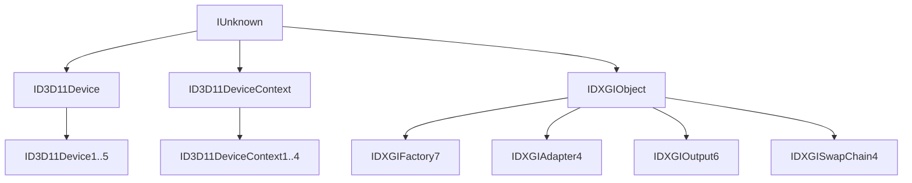
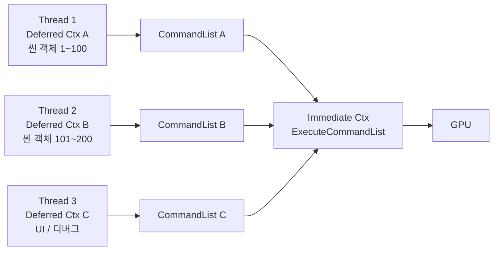

## 들어가며

DirectX는 처음부터 COM(Component Object Model) 기반으로 설계됐다. OpenGL이 *전역 컨텍스트 하나에 모든 상태를 매단 거대한 상태 머신*이라면, DirectX는 그 반대편 끝에 있다. 모든 객체는 인터페이스 포인터로 표현되고, 수명은 참조 카운팅으로 관리되며, 전역 상태라는 개념 자체가 거의 없다. 객체를 명시적으로 만들고 명시적으로 해제하는 이 분리가 DirectX 코드의 모든 패턴을 결정한다. `glGenBuffers`처럼 전역 컨텍스트에 자원이 등록되는 모델 대신, `device->CreateBuffer`가 인터페이스 포인터를 돌려주고 그 포인터의 참조 카운트가 0이 될 때 자원이 사라진다.

이 모델의 진입점에는 DXGI(DirectX Graphics Infrastructure)가 있다. DXGI는 그래픽스 API의 버전과 무관하게 어댑터(GPU) 열거, 출력 장치(모니터) 정보, 화면 표시를 담당하는 스왑체인을 제공한다. Direct3D 11, Direct3D 12, DXR(레이트레이싱)이 모두 같은 DXGI 위에 얹히기 때문에, DXGI를 이해하면 어느 버전으로 넘어가도 윈도우와 GPU를 연결하는 뼈대는 동일하게 보인다. 이 글은 그 뼈대 — COM의 기본 규약, DXGI를 통한 어댑터 선택, Device와 Context의 분리 모델, 그리고 백 버퍼를 화면에 내보내는 스왑체인 — 을 정리한다.

출발 상태는 `RegisterClassEx`와 `CreateWindowEx`로 `HWND`를 얻은 빈 Win32 윈도우다. 이 글의 완성 상태는 어댑터를 고르고 Device와 Immediate Context를 생성한 뒤, 스왑체인과 백 버퍼 렌더 타깃을 연결해 화면을 지우고 표시할 수 있는 최소 Direct3D 실행 경계다. 구성 순서는 아래 일곱 항목이다.

1. COM 인터페이스 모델의 세 메서드 — `AddRef`, `Release`, `QueryInterface` — 와 `HRESULT` 반환 규약.
2. `QueryInterface`의 GUID 기반 인터페이스 디스패치와 의미론적 규약.
3. `Microsoft::WRL::ComPtr<T>`로 참조 카운팅을 RAII로 자동화하는 패턴.
4. DXGI Factory를 통한 Adapter 열거와 디스크리트 GPU 선택.
5. Output 열거와 디스플레이 모드, HDR 메타데이터.
6. Device와 Immediate Context의 분리, Deferred Context의 멀티스레드 모델.
7. 스왑체인의 `FLIP_DISCARD` 모델과 sRGB 출력 포맷.


---

## 목차
1. [COM 인터페이스 모델](#1-com-인터페이스-모델)
2. [QueryInterface와 GUID 디스패치](#2-queryinterface와-guid-디스패치)
3. [참조 카운팅과 ComPtr](#3-참조-카운팅과-comptr)
4. [DXGI Factory와 Adapter](#4-dxgi-factory와-adapter)
5. [Output과 디스플레이 모드](#5-output과-디스플레이-모드)
6. [Device와 Immediate Context](#6-device와-immediate-context)
7. [DXGI Swap Chain](#7-dxgi-swap-chain)


---

## 1. COM 인터페이스 모델

DirectX의 모든 객체는 `IUnknown`을 상속한 순수 가상 인터페이스(pure virtual interface)다. `IUnknown`이 강제하는 세 메서드가 사실상 COM의 전부이며, 이 세 메서드만 이해하면 DirectX의 객체 수명과 인터페이스 모델 전체를 따라갈 수 있다.

```cpp
class IUnknown {
public:
    virtual HRESULT QueryInterface(REFIID riid, void** ppv) = 0;
    virtual ULONG AddRef() = 0;
    virtual ULONG Release() = 0;
};
```

`AddRef`는 객체 내부의 참조 카운터를 하나 늘리고, `Release`는 하나 줄인다. 카운트가 0이 되는 순간 객체는 스스로 `delete this`에 해당하는 정리를 수행한다. 호출하는 쪽은 객체가 언제 실제로 파괴되는지 알 필요가 없고, 자기가 들고 있던 포인터에 대해 `Release`만 정확히 한 번 부르면 된다. `QueryInterface`는 같은 객체가 자기 자신을 다른 인터페이스로 노출하게 하는 메서드로, C++의 `dynamic_cast`와 역할이 비슷하지만 타입이 아니라 GUID를 키로 디스패치한다는 점이 다르다.

### v-table 레이아웃과 언어 중립 ABI

COM 인터페이스가 C++ 가상 함수의 v-table 레이아웃과 정확히 호환되도록 설계됐다는 점이 중요하다. 인터페이스 포인터는 첫 워드가 v-table 포인터를 가리키고, v-table은 함수 포인터의 배열이다. 이 구조는 컴파일러나 언어에 종속되지 않으므로, C++로 만든 객체를 C 코드가 그대로 호출할 수 있다.

```cpp
// C에서 COM 객체를 호출하는 형태 — this를 첫 인자로 명시적으로 넘긴다
pUnk->lpVtbl->QueryInterface(pUnk, riid, ppv);
pUnk->lpVtbl->Release(pUnk);
```

이 언어 중립 ABI(Application Binary Interface)가 1990년대 COM의 본래 목표였다. Visual Basic, C, C++, 나중에는.NET까지 같은 바이너리 인터페이스 위에서 객체를 주고받을 수 있게 하려는 것이었다. DirectX는 이 인프라를 그대로 물려받았고, 그래서 D3D11 헤더의 인터페이스들은 전부 `IUnknown` 위계에 들어간다.

### DirectX의 인터페이스 위계



`ID3D11Device5`, `IDXGIFactory7`처럼 뒤에 붙은 숫자는 나중에 추가된 메서드까지 포함한 확장 인터페이스를 가리킨다. 새 Windows 10/11 빌드나 새 SDK가 기능을 추가할 때, 기존 `ID3D11Device` 인터페이스의 v-table을 건드리지 않고 그 위에 새 인터페이스를 얹는 방식이다. 이미 컴파일된 코드의 v-table 오프셋이 절대 바뀌지 않으므로 ABI 호환성이 깨지지 않는다. 이것이 COM의 핵심 규칙인 인터페이스 불변성(immutable interface)이며, 한번 공개된 인터페이스는 메서드를 추가하거나 시그니처를 바꾸지 않고, 변경이 필요하면 항상 새 번호의 인터페이스를 만든다.

### HRESULT 반환 규약

거의 모든 COM 메서드는 `HRESULT`를 반환한다. `HRESULT`는 32비트 정수에 성공/실패 여부와 함께 자세한 결과 코드를 담은 값이다. 최상위 비트가 0이면 성공, 1이면 실패다. 자주 쓰는 값은 다음과 같다.

| 값 | 숫자 | 의미 |
|---|---|---|
| `S_OK` | `0x00000000` | 성공 |
| `S_FALSE` | `0x00000001` | 성공이지만 작업이 일어나지 않음 (예: 이미 같은 상태) |
| `E_INVALIDARG` | `0x80070057` | 잘못된 인자 |
| `E_OUTOFMEMORY` | `0x8007000E` | 메모리 부족 |
| `DXGI_ERROR_DEVICE_REMOVED` | `0x887A0005` | GPU가 제거되거나 드라이버가 리셋됨 |
| `DXGI_ERROR_INVALID_CALL` | `0x887A0001` | 잘못된 사용 (선결 조건 위반) |

성공과 실패를 가르는 코드는 직접 비교하지 않고 `SUCCEEDED(hr)` / `FAILED(hr)` 매크로로 검사한다. 이 매크로는 최상위 비트만 본다. `S_FALSE`도 `SUCCEEDED`에서는 참이므로, "성공인데 아무 일도 안 일어남"을 구별해야 한다면 `hr == S_OK`로 직접 비교해야 한다.

```cpp
HRESULT hr = device->CreateBuffer(&desc, &data, &buffer);
if (FAILED(hr)) {
    // hr의 하위 16비트가 구체적 오류 코드다 (DXGI_ERROR_DEVICE_REMOVED 등)
    LogHR(hr);
    return false;
}
```

`HRESULT`가 예외가 아니라 반환 값이라는 사실이 모든 DirectX 코드의 사용감을 결정한다. 매 호출마다 `FAILED`를 검사하거나, 실패 시 예외를 던지는 얇은 래퍼를 두는 두 갈래로 갈린다. Microsoft 샘플이 즐겨 쓰는 `ThrowIfFailed`는 후자다.

```cpp
inline void ThrowIfFailed(HRESULT hr) {
    if (FAILED(hr)) {
        // _com_error로 시스템 메시지를 얻거나 커스텀 예외를 던진다
        throw std::runtime_error("HRESULT failed: " + std::to_string(hr));
    }
}

ThrowIfFailed(device->CreateBuffer(&desc, &data, &buffer));
```

초기화 경로처럼 실패가 곧 프로그램 종료를 의미하는 곳에서는 예외 래퍼가 코드를 깔끔하게 만든다. 반면 프레임마다 호출되며 실패를 우아하게 흡수해야 하는 경로 — `Present`가 `DXGI_ERROR_DEVICE_REMOVED`를 돌려주는 경우처럼 — 에서는 예외 대신 직접 분기로 다뤄야 한다. 이 글의 예제는 초기화에 `ThrowIfFailed`를, 런타임 경로에 직접 검사를 섞어 쓴다.

## 2. QueryInterface와 GUID 디스패치

같은 객체가 노출하는 여러 인터페이스 사이를 오가는 일은 DirectX에서 흔하다. `D3D11CreateDevice`는 기본 `ID3D11Device`를 돌려주지만, `ID3D11Device1`에 추가된 메서드가 필요할 때가 있다. 이때 C++의 `static_cast`는 쓸 수 없다. 두 인터페이스는 상속 관계로 정의돼 있긴 해도, 실제 객체가 `ID3D11Device1`을 구현하고 있는지는 런타임에만 알 수 있기 때문이다. 그래서 동적 디스패치인 `QueryInterface`를 거친다.

```cpp
ID3D11Device* device = /* D3D11CreateDevice로 얻은 포인터 */;
ID3D11Device1* device1 = nullptr;
HRESULT hr = device->QueryInterface(__uuidof(ID3D11Device1),
                                    reinterpret_cast<void**>(&device1));
if (SUCCEEDED(hr)) {
    // device1은 같은 객체를 가리키되 참조 카운트가 +1 된 상태다
    ID3D11DeviceContext1* context1 = nullptr;
    device1->GetImmediateContext1(&context1);
    context1->ClearState();
    context1->Release();
    device1->Release();   // 사용이 끝나면 반드시 Release
}
```

`QueryInterface`가 성공하면 반환되는 포인터는 이미 `AddRef`가 한 번 적용된 상태다. COM 규약상 "포인터를 돌려주는 함수는 호출자에게 참조 소유권을 넘긴다". 따라서 `device1` 사용이 끝나면 `Release`를 정확히 한 번 불러야 한다. 이 규칙을 사람이 손으로 지키는 것이 누수와 이중 해제의 가장 흔한 원인이며, 3절의 `ComPtr`이 바로 이 책임을 자동화한다.

### __uuidof와 GUID

`__uuidof(T)`는 Microsoft 컴파일러 확장으로, 인터페이스 헤더에 `__declspec(uuid("..."))`로 박혀 있는 GUID를 추출한다. GUID(Globally Unique Identifier)는 128비트 식별자로, 사실상 무작위에 가깝게 생성되어 전 세계적으로 충돌하지 않는다. `ID3D11Device`의 GUID는 `db6f6ddb-ac77-4e88-8253-819df9bbf140` 같은 형태로 헤더에 고정돼 있다.

GUID로 디스패치하는 이유는 v-table 호환과 같은 맥락이다. 인터페이스를 이름이 아니라 전 세계적으로 고유한 숫자로 식별하면, 서로 다른 DLL과 언어가 같은 인터페이스를 가리킬 때 이름 충돌이나 타입 시스템 차이를 신경 쓰지 않아도 된다. 호출하는 쪽은 "이 GUID에 해당하는 인터페이스가 있느냐"고 묻고, 객체는 자기가 그 인터페이스를 구현하면 포인터를 채워 준다.

### QueryInterface의 의미론적 규약

`QueryInterface`는 단순한 캐스트가 아니라 세 가지 수학적 성질 — 반사성(reflexivity), 대칭성(symmetry), 추이성(transitivity) — 을 만족해야 한다.

- 반사성: 인터페이스 A의 포인터에서 같은 IID_A로 질의하면 항상 성공해야 한다. 여기에 별도의 객체 동일성(identity) 규칙이 더해져, 어느 인터페이스에서든 `QueryInterface(IID_IUnknown)`은 항상 성공하고 같은 객체에 대해 늘 동일한 `IUnknown*`를 돌려준다. 이 성질 덕분에 두 인터페이스 포인터가 같은 객체를 가리키는지는 각각을 `IUnknown`으로 질의해 비교하면 된다.
- 대칭성: 인터페이스 A에서 B로 질의가 성공하면, B에서 A로 질의도 성공해야 한다.
- 추이성: A에서 B로, B에서 C로 질의가 성공하면, A에서 C로 질의도 성공해야 한다.

COM의 정적 인터페이스 집합 규약은 같은 객체와 IID에 대한 `QueryInterface` 결과가 객체 수명 중 바뀌지 않아야 한다는 뜻이다. 객체를 만든 뒤 외부 상태에 따라 같은 IID가 성공했다 실패해서는 안 된다. DirectX의 버전 접미사 인터페이스 — `ID3D11Device1`, `ID3D11Device5` — 도 생성된 객체가 해당 인터페이스를 노출하는지를 질의하는 것이다.

다만 `QueryInterface` 실패를 “드라이버나 하드웨어가 그 기능을 지원하지 않는다”와 동일시하면 안 된다. 이는 우선 **그 객체가 그 IID의 COM 계약을 노출하지 않는다**는 뜻이다. Direct3D의 상위 device 인터페이스는 주로 설치된 Windows 런타임 버전과 객체 구현에 좌우되고, 실제 GPU 기능은 feature level, `CheckFeatureSupport`, format support 질의처럼 API가 정한 별도 기능 탐지로 확인한다. SDK 헤더는 IID를 컴파일할 수 있게 할 뿐 런타임 구현을 추가하지 않는다.

## 3. 참조 카운팅과 ComPtr

`AddRef`와 `Release`를 사람이 직접 짝 맞춰 호출하는 코드는 누수, 이중 해제, 댕글링 포인터를 끊임없이 만든다. 함수가 중간에 일찍 `return`하거나 예외로 빠져나가면 그 시점까지 잡아 둔 참조를 풀어 줄 곳을 잃기 쉽다. 이 문제는 RAII로 해결한다. C++ 표준 라이브러리에는 COM 전용 스마트 포인터가 없지만, Windows SDK가 제공하는 `Microsoft::WRL::ComPtr<T>`가 사실상 표준 역할을 한다.

```cpp
#include <wrl/client.h>
using Microsoft::WRL::ComPtr;

ComPtr<ID3D11Device> device;
ComPtr<ID3D11DeviceContext> context;

HRESULT hr = D3D11CreateDevice(
    nullptr, D3D_DRIVER_TYPE_HARDWARE, nullptr,
    D3D11_CREATE_DEVICE_DEBUG, nullptr, 0,
    D3D11_SDK_VERSION,
    device.GetAddressOf(),   // ID3D11Device** 출력 인자
    nullptr,
    context.GetAddressOf());

// 스코프를 벗어나면 device, context 모두 자동으로 Release된다
```

`ComPtr`은 복사 시 `AddRef`, 소멸 시 `Release`를 자동으로 부른다. `std::shared_ptr`과 비슷하지만, 카운터를 별도로 관리하지 않고 COM 객체 내부의 참조 카운트를 그대로 사용한다는 점이 다르다. 이 덕분에 같은 객체를 가리키는 `ComPtr`과 원시 포인터, 다른 모듈의 `ComPtr`이 모두 하나의 카운터를 공유한다.

### 주요 메서드

`ComPtr`의 메서드는 "참조 카운트를 어떻게 건드리느냐"로 구분하면 헷갈리지 않는다.

| 메서드 | 반환 | 카운트 변화 | 용도 |
|---|---|---|---|
| `Get` | `T*` | 변화 없음 | 원시 포인터를 함수 인자로 잠깐 빌려줄 때 |
| `GetAddressOf` | `T**` | 변화 없음 | 출력 인자 — 기존 값이 있으면 덮어쓰며 누수 |
| `ReleaseAndGetAddressOf` | `T**` | 기존 값 Release | 출력 인자 — 재사용 시 안전 |
| `As(&ComPtr<U>)` | `HRESULT` | 대상 +1 | `QueryInterface`의 타입 안전 래퍼 |
| `Reset` | `unsigned long` | -1 | 명시적으로 참조를 끊음 (해제 후 남은 카운트를 돌려줌) |
| `Detach` | `T*` | 변화 없음 | 소유권을 외부로 양도 (카운트 그대로 포인터만 분리) |
| `Attach(T*)` | `void` | 받지 않음 | 이미 AddRef된 포인터의 소유권을 인수 |

`Detach`와 `Attach`는 짝이다. 어떤 API가 "참조 소유권을 넘긴 원시 포인터"를 주거나 받을 때, 추가 `AddRef`/`Release` 없이 소유권만 이동시킨다. 예를 들어 `Detach`로 `ComPtr`에서 원시 포인터를 빼내면, 그 `ComPtr`은 더 이상 `Release`를 부르지 않고 책임이 호출자에게 넘어간다. 잘못 쓰면 누수의 원인이 되므로, 직접 다룰 일은 드물고 대개 라이브러리 경계에서만 등장한다.

### As 사용 패턴

2절에서 손으로 작성한 `QueryInterface` 호출은 `As`로 깔끔해진다. `As`는 내부에서 `__uuidof`를 알아서 채우고, 성공 시 대상 `ComPtr`이 참조를 소유하며, 실패 시 대상은 비어 있다.

```cpp
ComPtr<ID3D11Device> device = /* ... */;
ComPtr<ID3D11Device1> device1;
HRESULT hr = device.As(&device1);
if (SUCCEEDED(hr)) {
    ComPtr<ID3D11DeviceContext1> context1;
    device1->GetImmediateContext1(&context1);
    context1->ClearState();
}
// device1은 스코프 종료 시 자동 Release — 수동 Release 불필요
```

### 출력 인자의 함정 — GetAddressOf vs ReleaseAndGetAddressOf

`ComPtr`을 처음 쓸 때 가장 자주 만나는 누수는 같은 변수를 두 번 출력 인자로 넘기는 경우다. `GetAddressOf`는 내부 포인터의 주소를 그대로 돌려줄 뿐, 기존에 들고 있던 객체를 풀어 주지 않는다.

```cpp
ComPtr<ID3D11Buffer> buffer;
device->CreateBuffer(&desc1, &data1, buffer.GetAddressOf());  // 첫 객체 생성, OK

// 같은 변수를 재사용
device->CreateBuffer(&desc2, &data2, buffer.GetAddressOf());  // 첫 객체 누수!
```

두 번째 `CreateBuffer`는 첫 객체의 포인터를 두 번째 객체 포인터로 덮어쓰는데, 그 직전에 첫 객체에 대한 `Release`가 일어나지 않는다. 첫 객체는 아무도 가리키지 않는 채 카운트가 1로 남아 영원히 살아 있게 된다. 해법은 `ReleaseAndGetAddressOf` 또는 `Reset` 후 `GetAddressOf`다.

```cpp
device->CreateBuffer(&desc2, &data2, buffer.ReleaseAndGetAddressOf());  // 첫 객체 먼저 Release
```

`EnumAdapters1` 같은 열거 루프에서 같은 `ComPtr`을 매 반복마다 재사용하는 코드가 대표적인 사례다. 그래서 4절과 5절의 열거 루프는 모두 `ReleaseAndGetAddressOf`를 쓴다.

## 4. DXGI Factory와 Adapter

DXGI Factory는 모든 DXGI 기능의 진입점이다. 어댑터(GPU) 열거, 스왑체인 생성, 출력 정보 질의가 전부 Factory에서 시작한다. 디버그 레이어까지 켜려면 `CreateDXGIFactory2`에 디버그 플래그를 넘긴다.

```cpp
UINT factoryFlags = 0;
#ifdef _DEBUG
    factoryFlags |= DXGI_CREATE_FACTORY_DEBUG;
#endif

ComPtr<IDXGIFactory7> factory;
ThrowIfFailed(CreateDXGIFactory2(factoryFlags, IID_PPV_ARGS(&factory)));
```

`IID_PPV_ARGS(&ptr)` 매크로는 `__uuidof(T)`와 `reinterpret_cast<void**>(&ptr)`을 한 번에 만들어 준다. GUID와 출력 포인터의 타입이 어긋나는 실수를 막아 주므로, `void**`를 직접 넘기는 호출에는 거의 항상 이 매크로를 쓴다.

### Adapter 열거

어댑터 열거는 인덱스를 0부터 늘려 가며 `EnumAdapters1`이 `DXGI_ERROR_NOT_FOUND`를 돌려줄 때까지 반복한다. 각 어댑터의 `DXGI_ADAPTER_DESC1`을 읽어 VRAM이 가장 큰 하드웨어 어댑터를 고르는 것이 흔한 전략이다.

```cpp
ComPtr<IDXGIAdapter4> bestAdapter;
SIZE_T maxVRAM = 0;

ComPtr<IDXGIAdapter1> adapter;
for (UINT i = 0;
     factory->EnumAdapters1(i, adapter.ReleaseAndGetAddressOf()) != DXGI_ERROR_NOT_FOUND;
     ++i)
{
    DXGI_ADAPTER_DESC1 desc;
    adapter->GetDesc1(&desc);

    // 소프트웨어 어댑터(WARP)는 건너뛴다
    if (desc.Flags & DXGI_ADAPTER_FLAG_SOFTWARE) continue;

    if (!bestAdapter || desc.DedicatedVideoMemory > maxVRAM) {
        maxVRAM = desc.DedicatedVideoMemory;
        adapter.As(&bestAdapter);   // IDXGIAdapter1 → IDXGIAdapter4
    }
}
```

`IDXGIFactory6`부터는 `EnumAdapterByGpuPreference`가 추가되어, VRAM을 직접 비교하지 않고 `DXGI_GPU_PREFERENCE_HIGH_PERFORMANCE`를 넘기면 드라이버가 고성능 GPU를 먼저 돌려준다. 노트북의 하이브리드 그래픽스 환경에서 가장 견고한 선택 방법이다.

```cpp
ComPtr<IDXGIAdapter4> adapter;
factory->EnumAdapterByGpuPreference(
    0, DXGI_GPU_PREFERENCE_HIGH_PERFORMANCE, IID_PPV_ARGS(&adapter));
```

### Vendor ID

`DXGI_ADAPTER_DESC1::VendorId`는 PCI-SIG가 할당한 제조사 식별 번호다. 어댑터별 분기나 드라이버 버그 회피 코드에서 제조사를 가릴 때 쓴다.

| 제조사 | VendorId | 비고 |
|---|---|---|
| NVIDIA | `0x10DE` | GeForce / Quadro / Tesla |
| AMD | `0x1002` | Radeon / FirePro |
| Intel | `0x8086` | Iris / Arc — 내장과 디스크리트 혼재 |
| Microsoft WARP | `0x1414` | 소프트웨어 래스터라이저 |
| Qualcomm | `0x5143` | Adreno (모바일) |
| ARM | `0x13B5` | Mali (모바일) |

`DeviceId`까지 함께 보면 정확한 모델을 식별할 수 있지만, 게임 코드에서 그 수준의 구분이 필요한 경우는 드물다.

### 디스크리트 GPU와 통합 GPU

디스크리트 GPU는 `DedicatedVideoMemory`가 수 GB로 크게 잡히고, 통합 GPU는 전용 VRAM이 0이거나 매우 작은 대신 `DedicatedSystemMemory`와 `SharedSystemMemory`로 시스템 RAM의 일부를 점유한다. VRAM 비교 전략이 통합 GPU를 자연스럽게 걸러 내는 이유다.

문제는 노트북이다. NVIDIA Optimus나 AMD Switchable Graphics 환경에서는 OS가 기본 어댑터로 통합 GPU를 노출하는 경우가 많아, 명시적으로 고르지 않으면 약한 GPU 위에서 게임이 돌아간다. 가장 확실한 방법은 위의 `EnumAdapterByGpuPreference`지만, 그조차 통하지 않는 구형 드라이버를 위해 드라이버에 직접 힌트를 주는 관용구가 있다. 실행 파일이 다음 전역 심볼을 내보내면 드라이버가 이를 읽고 디스크리트 GPU를 선택한다.

```cpp
extern "C" {
    __declspec(dllexport) DWORD NvOptimusEnablement = 0x00000001;
    __declspec(dllexport) int AmdPowerXpressRequestHighPerformance = 1;
}
```

이 두 줄은 어느 소스 파일이든 한 군데에만 두면 되고, 링커가 심볼을 내보내는 한 동작한다. 드라이버가 실행 파일 로드 시점에 이 심볼을 조회하므로, 코드 흐름과 무관하게 켜진다.

## 5. Output과 디스플레이 모드

각 어댑터는 하나 이상의 Output을 가진다. Output은 그 GPU에 연결된 모니터에 대응한다. `IDXGIAdapter::EnumOutputs`로 인덱스를 늘려 가며 열거한다.

```cpp
ComPtr<IDXGIOutput> output;
for (UINT i = 0;
     bestAdapter->EnumOutputs(i, output.ReleaseAndGetAddressOf()) != DXGI_ERROR_NOT_FOUND;
     ++i)
{
    DXGI_OUTPUT_DESC desc;
    output->GetDesc(&desc);
    // desc.DeviceName       : "\\.\DISPLAY1" 형태의 OS 디스플레이 이름
    // desc.DesktopCoordinates: 가상 데스크톱 내 이 모니터의 사각형
    // desc.AttachedToDesktop : TRUE면 현재 활성 모니터
    // desc.Rotation          : 화면 회전 상태
}
```

통합 GPU와 디스크리트 GPU가 함께 있는 노트북에서는, 내장 디스플레이가 통합 GPU의 Output으로 잡히고 외부 모니터가 디스크리트 GPU의 Output으로 잡히는 식으로 어댑터마다 Output 구성이 다를 수 있다. 그래서 "어느 어댑터로 그릴지"와 "어느 Output에 표시할지"는 별개의 결정이다.

### 지원 디스플레이 모드 열거

`GetDisplayModeList`는 해상도, 주사율, 픽셀 포맷의 조합 전체를 돌려준다. DXGI의 흔한 두 번 호출 패턴 — 먼저 개수를 받고, 그 크기로 버퍼를 잡아 다시 호출 — 을 따른다.

```cpp
UINT modeCount = 0;
output->GetDisplayModeList(DXGI_FORMAT_R8G8B8A8_UNORM,
                           DXGI_ENUM_MODES_INTERLACED,
                           &modeCount, nullptr);          // 개수만 받음

std::vector<DXGI_MODE_DESC> modes(modeCount);
output->GetDisplayModeList(DXGI_FORMAT_R8G8B8A8_UNORM,
                           DXGI_ENUM_MODES_INTERLACED,
                           &modeCount, modes.data());     // 실제 채움

// modes[i].Width / Height
// modes[i].RefreshRate.Numerator / .Denominator  (예: 60000 / 1000 = 60Hz)
```

주사율이 `RefreshRate.Numerator / Denominator` 형태의 유리수로 표현되는 점이 눈에 띈다. NTSC 계열의 59.94Hz처럼 정수로 떨어지지 않는 주사율을 정확히 표현하기 위한 것이다. 전체화면 모드에서 정확한 모드를 지정하려면 이 분수를 그대로 넘겨야 하고, 임의로 반올림한 값을 넣으면 모드 전환이 거부될 수 있다.

### HDR 지원 확인

`IDXGIOutput6::GetDesc1`은 HDR과 색 공간 메타데이터를 제공한다. 기존 `IDXGIOutput`에서 `As`로 승격해 얻는다.

```cpp
ComPtr<IDXGIOutput6> output6;
if (SUCCEEDED(output.As(&output6))) {
    DXGI_OUTPUT_DESC1 desc1;
    output6->GetDesc1(&desc1);

    bool hdr = (desc1.ColorSpace ==
                DXGI_COLOR_SPACE_RGB_FULL_G2084_NONE_P2020);
    float maxLuminance = desc1.MaxLuminance;             // nits
    float minLuminance = desc1.MinLuminance;             // nits
    UINT  bitsPerColor = desc1.BitsPerColor;             // 8 / 10 / 12
}
```

HDR10 디스플레이는 최대 휘도 1,000 nits 이상을 표준으로 삼는다. SDR 모니터의 기준 휘도가 대략 80~120 nits인 것과 비교하면 한 자릿수 차이다. 게임의 톤 매핑 곡선은 이 `MaxLuminance`를 런타임에 읽어 모니터마다 다르게 조정해야 한다. 동일한 장면을 200 nits 모니터와 1,000 nits 모니터에 같은 곡선으로 내보내면 어느 한쪽이 뭉개지거나 과포화된다. `ColorSpace`가 ST.2084(PQ) 색 공간을 가리키는지 확인하는 것이 HDR 경로 진입의 첫 관문이다.

## 6. Device와 Immediate Context

Direct3D 11에서 가장 중요한 구조적 결정은 Device와 Immediate Context를 별도 객체로 나눈 것이다. Device는 자원을 생성하고, Context는 그 자원을 묶어 그리기 명령을 낸다. 이 분리가 멀티스레드 렌더링의 토대가 된다.

```cpp
ComPtr<ID3D11Device> device;
ComPtr<ID3D11DeviceContext> context;
D3D_FEATURE_LEVEL featureLevel = {};

D3D_FEATURE_LEVEL requested[] = {
    D3D_FEATURE_LEVEL_11_1,
    D3D_FEATURE_LEVEL_11_0,
};

UINT flags = 0;
#ifdef _DEBUG
    flags |= D3D11_CREATE_DEVICE_DEBUG;
#endif

HRESULT hr = D3D11CreateDevice(
    bestAdapter.Get(),
    D3D_DRIVER_TYPE_UNKNOWN,    // 어댑터를 명시했으므로 UNKNOWN
    nullptr, flags,
    requested, _countof(requested),
    D3D11_SDK_VERSION,
    device.GetAddressOf(),
    &featureLevel,
    context.GetAddressOf());
```

어댑터를 명시적으로 넘길 때는 드라이버 타입을 반드시 `D3D_DRIVER_TYPE_UNKNOWN`으로 둬야 한다. 어댑터와 드라이버 타입을 둘 다 지정하면 `E_INVALIDARG`로 실패한다. `requested` 배열은 시도할 기능 수준(feature level)을 높은 것부터 나열한 것이며, 생성에 성공한 실제 수준이 `featureLevel`에 담겨 돌아온다. 기능 수준은 GPU가 어느 세대의 기능 집합을 지원하는지를 단계로 나눈 값으로, 11_1과 11_0의 차이가 일부 셰이더 기능과 자원 한도에서 나타난다.

### Device의 역할

Device는 자원 생성을 담당한다. `CreateBuffer`, `CreateTexture2D`, `CreateShaderResourceView`, `CreateVertexShader`, `CreatePixelShader` 등이 모두 Device의 메서드다. Device의 자원 생성 메서드는 스레드 안전하게 설계돼 있어, 여러 스레드에서 동시에 텍스처나 버퍼를 만들어도 된다. 로딩 스레드가 백그라운드에서 자원을 만드는 동안 렌더 스레드가 그리기를 계속할 수 있는 이유다. 단, 이 일반론에는 예외가 있다. `D3D11_CREATE_DEVICE_SINGLETHREADED` 플래그로 만든 device는 동시 호출이 금지되므로, 애플리케이션이 접근을 직접 직렬화해야 한다.

### Immediate Context의 역할

Immediate Context는 기본 명령 스트림(command stream)에 명령을 기록하고 제출하는 통로다. `IASetVertexBuffers`, `VSSetShader`, `PSSetShaderResources`, `Draw`, `DrawIndexed`, `Dispatch` 등 파이프라인 상태를 묶고 그리기를 거는 모든 메서드가 여기에 속한다. 여기서 "즉시"는 deferred command list를 거치지 않고 기본 스트림에 명령을 쌓는다는 뜻이지, API 호출이 반환되는 순간 GPU가 그 명령을 실행·완료한다는 뜻이 아니다. 기록·제출·실행·완료는 서로 다른 단계이며, 명령은 runtime/driver 버퍼링을 거쳐 GPU에 제출되므로 CPU 호출 반환과 GPU 실행 완료 시점도 별개다. Immediate Context는 스레드 안전하지 않다. 두 스레드가 동시에 호출하면 경쟁 상태(race condition)에 빠진다. 그래서 보통 렌더 스레드 하나가 Immediate Context를 독점한다.

이 분리의 핵심은 "상태가 어디에 사는가"다. OpenGL은 바인딩이 전역 컨텍스트에 쌓이지만, Direct3D 11은 파이프라인 상태가 Context 객체에 산다. 자원 자체(Device가 만든 것)와 그 자원을 어떻게 묶었는지(Context가 추적하는 것)가 분리돼 있어, 자원 생성과 그리기를 다른 스레드가 맡을 수 있다.

### Deferred Context

`CreateDeferredContext`는 명령을 즉시 실행하지 않고 명령 리스트(command list)에 기록만 하는 별도 컨텍스트를 만든다. 여러 스레드가 각자의 Deferred Context에 명령을 채운 뒤, 완성된 명령 리스트를 Immediate Context가 한 번에 실행한다.



코드 형태는 다음과 같다. 각 스레드가 자기 Deferred Context에 그리기를 기록하고 `FinishCommandList`로 명령 리스트를 봉인하면, 렌더 스레드가 그 리스트들을 순서대로 실행한다.

```cpp
// 워커 스레드에서
ComPtr<ID3D11DeviceContext> deferred;
device->CreateDeferredContext(0, deferred.GetAddressOf());
deferred->DrawIndexed(/* ... */);

ComPtr<ID3D11CommandList> cmdList;
deferred->FinishCommandList(FALSE, cmdList.GetAddressOf());

// 렌더 스레드에서
context->ExecuteCommandList(cmdList.Get(), FALSE);
```

이것이 DX11 시대 멀티스레드 렌더링의 표준 패턴이었다. 다만 효과는 드라이버 구현 품질에 크게 좌우됐다. 일부 드라이버는 Deferred Context를 진정한 병렬 기록으로 처리했지만, 다른 드라이버는 내부적으로 직렬화해 이득이 작았다. Direct3D 12의 Command List와 Bundle은 이 모델을 드라이버 재량에 맡기지 않고 명시적이고 표준화된 형태로 다시 설계한 결과물이며, 그래서 DX12에서는 멀티스레드 명령 기록의 이득이 훨씬 예측 가능하다.

### 디버그 레이어 활성화

`D3D11_CREATE_DEVICE_DEBUG` 플래그는 드라이버와 런타임 사이에 검증 레이어를 끼운다. 모든 DirectX 호출의 인자, 상태, 사용 규약 위반을 검사해 Visual Studio의 Output 창에 메시지로 출력한다. 이 레이어는 호출마다 검증 비용이 붙으므로 개발 빌드 전용이며, 릴리스에서는 끈다. 또한 디버그 레이어가 동작하려면 "Graphics Tools" 선택적 기능이 OS에 설치돼 있어야 한다. 설치돼 있지 않으면 `D3D11CreateDevice`가 `DXGI_ERROR_SDK_COMPONENT_MISSING`으로 실패하므로, 디버그 플래그 생성이 실패하면 플래그 없이 한 번 더 시도하는 폴백을 두는 편이 안전하다.

검증 레이어를 켰다면 `ID3D11InfoQueue`로 메시지를 더 적극적으로 다룰 수 있다. 특정 심각도의 메시지가 나올 때 디버거를 자동으로 멈추게 설정하면, 위반이 일어난 바로 그 호출의 콜 스택을 즉시 확인할 수 있다.

```cpp
ComPtr<ID3D11Debug> debug;
if (SUCCEEDED(device.As(&debug))) {
    ComPtr<ID3D11InfoQueue> infoQueue;
    if (SUCCEEDED(debug.As(&infoQueue))) {
        infoQueue->SetBreakOnSeverity(D3D11_MESSAGE_SEVERITY_ERROR, TRUE);
        infoQueue->SetBreakOnSeverity(D3D11_MESSAGE_SEVERITY_CORRUPTION, TRUE);

        // 무해하지만 시끄러운 메시지는 필터로 걸러낸다
        D3D11_MESSAGE_ID hide[] = {
            D3D11_MESSAGE_ID_SETPRIVATEDATA_CHANGINGPARAMS,
        };
        D3D11_INFO_QUEUE_FILTER filter{};
        filter.DenyList.NumIDs = _countof(hide);
        filter.DenyList.pIDList = hide;
        infoQueue->AddStorageFilterEntries(&filter);
    }
}
```

`SetBreakOnSeverity`가 `ERROR`와 `CORRUPTION`에 대해 디버거 중단을 걸어 두면, 잘못된 바인딩이나 해제된 자원 사용 같은 실수가 발생한 순간 디버거가 멈춘다. OpenGL의 `GL_KHR_debug` 콜백과 같은 역할을 하되, DirectX는 이를 별도 인터페이스로 노출한다는 점이 다르다.

## 7. DXGI Swap Chain

스왑체인은 GPU가 그린 백 버퍼와 화면이 표시하는 버퍼를 회전시키는 메커니즘이다. Direct3D가 그린 결과를 윈도우에 보여 주는 유일한 통로이며, 백 버퍼의 개수·포맷·교환 방식·동기화 정책을 한 곳에서 결정한다.

### 생성

현대 코드는 `CreateSwapChainForHwnd`에 `DXGI_SWAP_CHAIN_DESC1`을 넘겨 생성한다.

```cpp
DXGI_SWAP_CHAIN_DESC1 desc{};
desc.Width  = 1920;
desc.Height = 1080;
desc.Format = DXGI_FORMAT_R8G8B8A8_UNORM;          // sRGB 변환은 RTV에서 처리
desc.Stereo = FALSE;
desc.SampleDesc.Count   = 1;                        // FLIP 모델은 MSAA 백버퍼 불가
desc.SampleDesc.Quality = 0;
desc.BufferUsage = DXGI_USAGE_RENDER_TARGET_OUTPUT;
desc.BufferCount = 2;                               // 최소 2 (FLIP 모델 요구)
desc.Scaling     = DXGI_SCALING_NONE;
desc.SwapEffect  = DXGI_SWAP_EFFECT_FLIP_DISCARD;   // 권장
desc.AlphaMode   = DXGI_ALPHA_MODE_IGNORE;
desc.Flags       = DXGI_SWAP_CHAIN_FLAG_ALLOW_TEARING;

ComPtr<IDXGISwapChain1> swapChain;
factory->CreateSwapChainForHwnd(
    device.Get(),      // DX11은 Device, DX12는 CommandQueue를 넘긴다
    hwnd,
    &desc, nullptr, nullptr,
    swapChain.GetAddressOf());
```

`SampleDesc.Count`를 1로 두는 것이 FLIP 모델의 제약이다. FLIP 계열 스왑 효과는 백 버퍼 자체에 MSAA를 걸 수 없으므로, 멀티샘플링은 별도의 MSAA 텍스처에 그린 뒤 `ResolveSubresource`로 백 버퍼에 해소해야 한다. `BufferCount`도 FLIP 모델에서는 최소 2여야 하며, 1을 넣으면 생성이 실패한다.

### SwapEffect 비교

스왑 효과는 백 버퍼를 화면으로 옮기는 방식을 결정한다.

| 옵션 | 사용 시기 | 동작 |
|---|---|---|
| `DISCARD` (레거시) | Windows 7 이하 | BLT — 백 버퍼를 데스크톱 표면으로 복사 |
| `SEQUENTIAL` (레거시) | Windows 7 이하 | BLT + 내용 보존 |
| `FLIP_SEQUENTIAL` | Windows 8 이상 | Flip + 내용 보존 |
| `FLIP_DISCARD` (권장) | Windows 10 이상 | Flip — Present 후 내용 보존 불필요 |

BLT(Bit Block Transfer) 모델은 swap chain 내용을 DWM redirection surface로 복사한다. FLIP 모델은 swap chain buffer를 DWM에 공유해 그 복사를 줄일 수 있지만, 항상 합성을 우회하거나 곧바로 scanout된다는 뜻은 아니다. 창 크기·overlay 지원·다른 창의 겹침 같은 조건을 만족하면 DirectFlip·Independent Flip 경로로 승격될 수 있다. Windows 8/8.1까지 지원하면 `FLIP_SEQUENTIAL`, Windows 10 이상만 지원하면 일반적으로 `FLIP_DISCARD`를 우선하고, 실제 표시 경로는 PresentMon과 DXGI 통계로 확인한다.

`FLIP_DISCARD`와 `FLIP_SEQUENTIAL`의 차이는 Present 후 백 버퍼의 내용 보존 여부다. `DISCARD`는 Present 직후 백 버퍼 내용이 정의되지 않으므로 매 프레임 전체를 다시 그려야 하고, `SEQUENTIAL`은 이전 내용을 보존한다. 매 프레임 전체 화면을 다시 그리는 일반적인 게임에서는 `FLIP_DISCARD`가 드라이버에 더 많은 최적화 여지를 준다.

### 동기화와 V-Sync

`Present(SyncInterval, Flags)`가 백 버퍼를 화면에 내보낸다. 첫 인자가 동기화 간격이다.

```cpp
swapChain->Present(1, 0);                            // V-Sync 켬 — vsync 1회마다 표시
swapChain->Present(0, DXGI_PRESENT_ALLOW_TEARING);   // V-Sync 끔 — 즉시 표시, 티어링 허용
```

`SyncInterval=1`은 각 프레임을 최소 한 번의 수직 갱신 동안 표시하도록 요청하므로 60Hz 고정 주사율 경로에서 새 이미지의 표시율은 최대 약 60회/초다. `2`는 최소 두 갱신 동안 유지하는 요청이다. 응용과 GPU는 큐 깊이만큼 앞서갈 수 있어 렌더 계산률이나 입력 지연이 그 숫자로 자동 고정되지는 않는다. `0`도 즉시 scanout과 최소 지연을 보장하지 않으며, compositor·큐·VRR 경로가 남는다. 티어링 허용 여부는 swap chain 플래그, Present 플래그, 창 모드, 시스템 지원을 함께 만족해야 한다.

가변 주사율(VRR) 디스플레이 — NVIDIA G-Sync, AMD FreeSync, VESA Adaptive-Sync — 는 티어링 없이 낮은 지연을 얻는 길을 연다. 단, 이를 쓰려면 스왑체인 생성 시 `DXGI_SWAP_CHAIN_FLAG_ALLOW_TEARING` 플래그를 켜고, Present 시 `SyncInterval` 0과 `DXGI_PRESENT_ALLOW_TEARING` 플래그를 함께 넘겨야 한다. 두 가지가 모두 갖춰져야 DXGI가 티어링을 허용하는 경로로 들어간다. `ALLOW_TEARING` 자체는 OS와 어댑터가 지원할 때만 유효하므로, `IDXGIFactory5::CheckFeatureSupport`로 `DXGI_FEATURE_PRESENT_ALLOW_TEARING`을 먼저 질의하는 것이 정석이다.

```cpp
BOOL allowTearing = FALSE;
factory->CheckFeatureSupport(DXGI_FEATURE_PRESENT_ALLOW_TEARING,
                             &allowTearing, sizeof(allowTearing));
```

### Present의 실패 처리

`Present`는 프레임마다 호출되는 만큼, 실패를 우아하게 다뤄야 하는 대표적인 런타임 경로다. GPU가 과열로 리셋되거나 드라이버가 갱신되거나 외부 GPU가 분리되면 `DXGI_ERROR_DEVICE_REMOVED` 또는 `DXGI_ERROR_DEVICE_RESET`이 돌아온다. 이때는 Device를 포함한 모든 자원을 폐기하고 처음부터 다시 만드는 디바이스 로스트(device lost) 복구 경로가 필요하다.

```cpp
HRESULT hr = swapChain->Present(1, 0);
if (hr == DXGI_ERROR_DEVICE_REMOVED || hr == DXGI_ERROR_DEVICE_RESET) {
    HRESULT reason = device->GetDeviceRemovedReason();
    LogHR(reason);          // 무엇 때문에 제거됐는지 기록
    RecreateDeviceAndResources();
}
```

`GetDeviceRemovedReason`은 제거의 구체적 원인 — 드라이버 내부 오류, 잘못된 명령, 타임아웃 등 — 을 알려 준다. 초기화 단계의 실패와 달리 이 경로는 예외로 던져 프로그램을 끝내기보다 복구를 시도하는 쪽이 사용자 경험에 낫다.

### sRGB Render Target View

스왑체인의 백 버퍼는 `DXGI_FORMAT_R8G8B8A8_UNORM`, 즉 선형으로 해석되는 8비트 포맷으로 만들었다. 셰이더는 물리적으로 올바른 조명 계산을 위해 선형 색 공간에서 작업하지만, 화면에 표시될 때는 sRGB 감마 곡선으로 인코딩돼야 한다. 이 변환을 렌더 타깃 뷰(Render Target View, RTV)가 담당하게 한다.

```cpp
ComPtr<ID3D11Texture2D> backBuffer;
swapChain->GetBuffer(0, IID_PPV_ARGS(&backBuffer));

D3D11_RENDER_TARGET_VIEW_DESC rtvDesc{};
rtvDesc.Format = DXGI_FORMAT_R8G8B8A8_UNORM_SRGB;   // 출력 시 자동 sRGB 인코딩
rtvDesc.ViewDimension = D3D11_RTV_DIMENSION_TEXTURE2D;

ComPtr<ID3D11RenderTargetView> rtv;
device->CreateRenderTargetView(backBuffer.Get(), &rtvDesc, rtv.GetAddressOf());
```

스왑체인의 포맷은 `UNORM`, RTV의 포맷은 `UNORM_SRGB`로 둔 것이 핵심이다. 같은 텍셀 메모리를 RTV가 sRGB로 해석하므로, 셰이더가 선형 색을 출력하면 RTV가 기록 시점에 자동으로 sRGB 감마 보정을 적용한다. OpenGL에서 `glEnable(GL_FRAMEBUFFER_SRGB)`가 하던 역할을, Direct3D 11은 RTV의 포맷 선택으로 표현한다. 스왑체인 자체를 sRGB 포맷으로 만들지 않고 RTV에서 분리하는 이유는, FLIP 모델 스왑체인이 `_SRGB` 포맷을 직접 받지 않기 때문이며, 이렇게 분리하면 같은 백 버퍼를 sRGB 쓰기와 선형 읽기 두 용도로 유연하게 다룰 수 있다.

### Resize 처리

윈도우 크기가 바뀌면 백 버퍼도 새 크기로 다시 만들어야 한다. `ResizeBuffers`가 이를 처리하지만, 호출 전에 백 버퍼를 참조하는 모든 객체를 먼저 풀어 줘야 한다.

```cpp
void OnResize(UINT w, UINT h) {
    if (w == 0 || h == 0) return;   // 최소화 시 크기가 0이 될 수 있다

    context->OMSetRenderTargets(0, nullptr, nullptr);  // 파이프라인에서 RTV 해제
    rtv.Reset();                                       // RTV의 백버퍼 참조 해제
    backBuffer.Reset();                                // 백버퍼 ComPtr 해제

    ThrowIfFailed(swapChain->ResizeBuffers(
        0, w, h, DXGI_FORMAT_UNKNOWN,
        DXGI_SWAP_CHAIN_FLAG_ALLOW_TEARING));          // 0/UNKNOWN = 기존 값 유지

    // RTV 재생성
    swapChain->GetBuffer(0, IID_PPV_ARGS(&backBuffer));
    device->CreateRenderTargetView(backBuffer.Get(), &rtvDesc,
                                   rtv.GetAddressOf());
}
```

RTV가 백 버퍼를 참조하는 동안 `ResizeBuffers`를 부르면 `DXGI_ERROR_INVALID_CALL`로 실패한다. 백 버퍼를 가리키는 모든 참조 — RTV, 파이프라인에 바인딩된 렌더 타깃 슬롯, 직접 들고 있는 `backBuffer` ComPtr — 를 빠짐없이 해제하는 것이 선결 조건이다. 그래서 `OMSetRenderTargets`로 파이프라인의 렌더 타깃을 먼저 풀고, `Reset`으로 ComPtr들을 정리한 뒤에야 `ResizeBuffers`를 부른다. `ResizeBuffers`에 `BufferCount` 0과 `Format` `DXGI_FORMAT_UNKNOWN`을 넘기면 기존 스왑체인 생성 값을 그대로 유지하면서 크기만 바꾼다. 또한 생성 시 `ALLOW_TEARING`을 켰다면 `ResizeBuffers`에도 같은 플래그를 다시 넘겨야 일관성이 유지된다.


---

## 결론

여기까지의 코드는 DirectX 객체 모델의 토대인 COM과 DXGI를 정리한다. `IUnknown`의 세 메서드와 `HRESULT` 규약, `ComPtr`을 통한 참조 카운팅의 RAII화, DXGI Factory로 어댑터를 골라 Device와 Immediate Context를 만드는 흐름, 그리고 스왑체인이 백 버퍼를 화면으로 회전시키는 메커니즘과 sRGB 출력 변환까지가 Direct3D 프로그램의 공통 진입점이다.

세 가지 트레이드오프가 이 글의 핵심이다. 첫째, Device와 Context의 분리는 멀티스레드 자원 로딩과 명령 기록을 가능케 하지만, 어느 객체가 스레드 안전한지를 코드 전반에서 의식해야 하는 부담을 남긴다. 둘째, FLIP 모델 스왑체인은 BLT 대비 지연과 전력에서 분명히 유리하지만, MSAA 백 버퍼 불가와 최소 버퍼 2개 같은 제약을 받아들여야 한다. 셋째, 디버그 레이어는 잘못된 호출을 즉시 잡아 주지만 검증 비용이 붙어 개발 빌드 전용으로 분기해야 한다.

COM과 DXGI만으로는 그릴 데이터가 생기지 않는다. Direct3D 자원 모델은 buffer·texture의 storage와 SRV/RTV/DSV/UAV 같은 view를 분리하고, shader signature와 pipeline binding이 view의 해석을 결정한다. `ComPtr`, `IID_PPV_ARGS`, `__uuidof`는 이 객체들의 interface 질의와 참조 수명을 타입에 연결하는 반복 규약이며, raw pointer와 수동 `Release`를 섞지 않는 것이 자원 코드의 기본 불변식이다.

## 더 읽을거리

- Microsoft Learn, [Direct3D 11 Graphics](https://learn.microsoft.com/en-us/windows/win32/direct3d11/atoc-dx-graphics-direct3d-11) — 공식 프로그래밍 가이드.
- Microsoft Learn, [DXGI Overview](https://learn.microsoft.com/en-us/windows/win32/direct3ddxgi/d3d10-graphics-programming-guide-dxgi) 와 [DirectX Graphics Samples](https://github.com/microsoft/DirectX-Graphics-Samples) — 스왑체인 모델·공식 예제.
- Raymond Chen, [The Old New Thing](https://devblogs.microsoft.com/oldnewthing/) — 블로그 전체를 가리키는 시리즈 홈이므로 COM 규약의 직접 근거로는 쓰지 않고, 역사·설계 배경을 찾아보는 추가 읽을거리로만 둔다.
- Frank Luna, *Introduction to 3D Game Programming with DirectX 11* — 표준 입문서.
