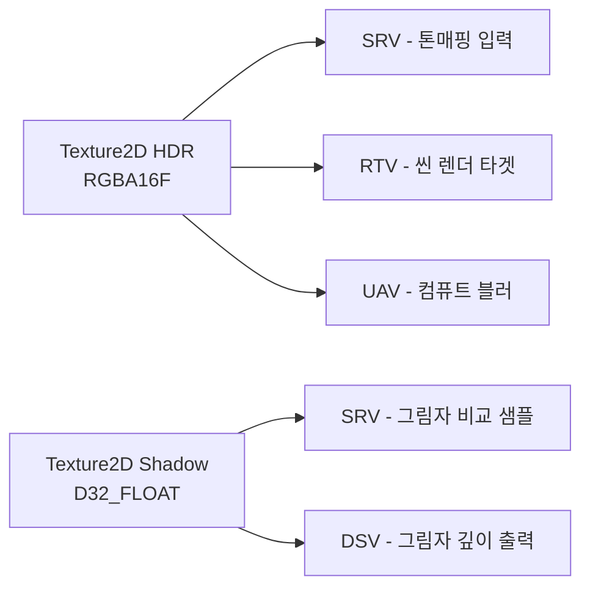

## 들어가며

DirectX의 자원 모델은 두 단계로 분리돼 있다. 자원(Resource)은 GPU가 접근할 수 있는 메모리에 적재된 실제 바이트 묶음이고, 뷰(View)는 그 바이트를 *어떤 의미로 읽거나 쓸지* 결정하는 메타데이터다. 자원 자체는 "여기 1MB짜리 바이트 덩어리가 있다"는 사실만 알고, 그 덩어리가 1024×1024 RGBA8 텍스처인지, 16바이트 정렬된 상수 버퍼인지, 정점 배열인지는 뷰가 결정한다. 같은 텍스처를 셰이더 입력(SRV)으로도, 렌더 타겟(RTV)으로도, 컴퓨트 출력(UAV)으로도 쓸 수 있는 유연성이 여기서 나온다.

DX12로 가면 힙(Heap) 개념이 한 층 더 추가된다. 자원이 어디에 살지(VRAM인지 시스템 RAM인지)와 어떻게 접근될지(GPU 전용인지, CPU가 쓰기만 하는지, CPU가 읽기만 하는지)를 프로그래머가 명시적으로 고른다. DX11의 `D3D11_USAGE_*`가 드라이버에게 건네는 힌트라면, DX12의 힙은 프로그래머가 직접 메모리 풀을 선택하는 한 단계 더 명시적인 모델이다. 이 차이는 단순한 API 표면의 변화가 아니라, 메모리 배치와 동기화의 책임이 드라이버에서 애플리케이션으로 넘어왔다는 패러다임 전환이다.

여기까지의 코드는 디바이스(Device), 즉시 컨텍스트(Immediate Context), 스왑 체인(Swap Chain)까지 준비된 상태다. 백 버퍼는 확보됐지만 그 위에 그릴 정점도, 인덱스도, 텍스처도 아직 없다. 이 글은 그 빈 자리를 채우는 자원 모델을 일곱 단계로 쌓는다.

1. 버퍼와 텍스처 — 1D 바이트 배열과 2D/3D 픽셀 격자의 분리.
2. 네 가지 뷰 — RTV / DSV / SRV / UAV, 그리고 CBV.
3. DX11의 `D3D11_USAGE_*` 네 종과 CPU 접근 모델.
4. DX12의 힙 타입과 디스크리트 GPU 대 UMA의 차이.
5. 자원과 뷰의 다대다 관계, Typeless 패턴.
6. Residency와 Eviction, VRAM 예산 관리.
7. Upload Heap을 거치는 업로드 패턴과 정렬 제약.


---

## 목차
1. [Buffer와 Texture](#1-buffer와-texture)
2. [네 가지 View 타입](#2-네-가지-view-타입)
3. [DX11의 Usage 플래그](#3-dx11의-usage-플래그)
4. [DX12의 Heap Type](#4-dx12의-heap-type)
5. [Resource와 View의 관계](#5-resource와-view의-관계)
6. [Residency와 Eviction](#6-residency와-eviction)
7. [업로드 패턴](#7-업로드-패턴)


---

## 1. Buffer와 Texture

GPU 자원은 근본적으로 두 부류로 나뉜다. 메모리를 *선형 바이트 배열* 로 다루느냐, *다차원 픽셀 격자* 로 다루느냐의 차이다. 이 구분은 단순히 데이터 형태의 차이가 아니라, GPU 하드웨어가 메모리를 *어떻게 물리적으로 배치하고 캐시하느냐* 의 차이로 이어진다.

DX12에서는 모든 자원이 `ID3D12Resource` 하나의 인터페이스로 통일돼 있고, `D3D12_RESOURCE_DIMENSION` 필드로 종류를 구분한다.

| Dimension | 형태 | 대표 용도 |
|---|---|---|
| `BUFFER` | 1D 바이트 배열 | 정점 / 인덱스 / 상수 버퍼 / 구조화 버퍼 |
| `TEXTURE1D` | 1D 픽셀 줄 | 함수 LUT, 그래디언트 램프 |
| `TEXTURE2D` | 2D 픽셀 격자 | 디퓨즈 / 노멀 / 그림자 맵 / 렌더 타겟 |
| `TEXTURE3D` | 3D 픽셀 큐브 | 볼륨 데이터, 3D 컬러 그레이딩 LUT |

DX11은 `ID3D11Buffer`와 `ID3D11Texture1D/2D/3D`가 별도 인터페이스로 분리돼 있다. 같은 자원 개념이지만 API 표면이 나뉘어, 버퍼 생성과 텍스처 생성이 서로 다른 함수와 서로 다른 desc 구조체를 쓴다. DX12가 인터페이스를 하나로 합친 것은 자원을 추상적인 메모리 객체로 일반화하려는 설계 의도다.

### 버퍼의 선형 메모리

버퍼는 물리적으로 단순하다. 연속된 바이트가 메모리에 그대로 깔린다. GPU가 버퍼를 읽을 때는 정점 셰이더가 정점 스트라이드(stride)만큼 건너뛰며 순차 접근하거나, 셰이더가 인덱스로 임의 접근한다. 정점 버퍼, 인덱스 버퍼, 상수 버퍼, 구조화 버퍼(structured buffer)가 모두 버퍼다.

DX11에서 정점 버퍼를 만드는 코드는 다음과 같다.

```cpp
D3D11_BUFFER_DESC desc{};
desc.ByteWidth = sizeof(Vertex) * numVertices;
desc.Usage = D3D11_USAGE_IMMUTABLE;            // 한 번 만들고 변하지 않는다
desc.BindFlags = D3D11_BIND_VERTEX_BUFFER;
desc.CPUAccessFlags = 0;
desc.MiscFlags = 0;
desc.StructureByteStride = sizeof(Vertex);

D3D11_SUBRESOURCE_DATA init{};
init.pSysMem = vertices.data();

ComPtr<ID3D11Buffer> vb;
device->CreateBuffer(&desc, &init, vb.GetAddressOf());
```

`BindFlags`가 핵심이다. 한 버퍼를 정점 버퍼이자 동시에 셰이더 자원으로 쓰고 싶다면 `D3D11_BIND_VERTEX_BUFFER | D3D11_BIND_SHADER_RESOURCE`처럼 비트 OR로 묶는다. 다만 바인드 플래그를 늘릴수록 드라이버가 자원을 배치할 수 있는 자유도가 줄어든다. 드라이버는 모든 용도를 동시에 만족하는 메모리 레이아웃을 골라야 하므로, 단일 용도 자원보다 최적 배치를 잡기 어렵다. 실제로 쓰는 용도만 명시하는 편이 좋다.

상수 버퍼(constant buffer)에는 추가 제약이 있다. 크기가 16바이트(float4 한 개) 단위로 정렬돼야 하고, DX12에서는 256바이트 정렬이 요구된다. HLSL의 `cbuffer`는 멤버를 float4 경계에 맞춰 패킹하므로, C++ 쪽 구조체 정의도 같은 패킹을 따르도록 `float3` 뒤에 패딩을 넣는 일이 흔하다.

### 텍스처의 타일드 메모리

텍스처는 버퍼와 물리 배치가 다르다. 이미지 처리에서 한 픽셀에 접근하면 인접한 픽셀(위/아래/좌/우)에도 곧 접근할 확률이 높다. 텍스처를 행 우선(row-major) 선형으로 깔면 위아래 픽셀이 메모리상 한 행 너비만큼 떨어져 캐시 지역성이 깨진다. 그래서 GPU는 텍스처를 *스위즐드(swizzled)* 또는 *타일드(tiled)* 레이아웃으로 저장한다. 8×8이나 4×4 같은 작은 블록을 메모리상 연속으로 묶어, 2D 근방 접근이 같은 캐시 라인에 떨어지게 만든다. 이 레이아웃은 드라이버와 GPU 세대마다 달라 프로그래머에게 불투명하다. DX12에서 `D3D12_TEXTURE_LAYOUT_UNKNOWN`을 쓰면 드라이버가 최적 타일링을 고르고, `ROW_MAJOR`를 쓰면 선형으로 강제된다.

DX11에서 2D 텍스처를 만드는 코드는 다음과 같다.

```cpp
D3D11_TEXTURE2D_DESC tex{};
tex.Width  = 1024;
tex.Height = 1024;
tex.MipLevels = 1;
tex.ArraySize = 1;
tex.Format = DXGI_FORMAT_R8G8B8A8_UNORM_SRGB;  // sRGB 컬러 텍스처
tex.SampleDesc.Count = 1;
tex.Usage = D3D11_USAGE_DEFAULT;
tex.BindFlags = D3D11_BIND_SHADER_RESOURCE;

D3D11_SUBRESOURCE_DATA init{};
init.pSysMem = pixels;
init.SysMemPitch = 1024 * 4;                   // CPU 쪽 한 행의 바이트 수

ComPtr<ID3D11Texture2D> texture;
device->CreateTexture2D(&tex, &init, texture.GetAddressOf());
```

`SysMemPitch`는 CPU 쪽 소스 데이터에서 한 행이 차지하는 바이트 수다. 1024폭 RGBA8이면 `1024 × 4 = 4096`바이트지만, 외부 이미지 라이브러리가 한 행을 4바이트나 8바이트 경계로 패딩하면 폭×bpp와 달라진다. 이 값을 잘못 주면 텍스처가 한 행씩 어긋나며 대각선으로 밀려 보이는 전형적 버그가 난다. CPU 소스의 행 피치는 항상 명시하고, GPU 내부 피치(타일드 레이아웃)와 혼동하지 않아야 한다.

### 포맷과 비트 폭

같은 텍스처라도 포맷에 따라 픽셀당 바이트 수와 정밀도가 크게 달라진다. 1024×1024 텍스처를 기준으로 mip 없이 한 장만 따졌을 때의 메모리 소비를 정리하면 다음과 같다.

| 포맷 | 픽셀당 비트 | 1024² 메모리 | 대표 용도 |
|---|---:|---:|---|
| `R8G8B8A8_UNORM` | 32 | 4 MB | 일반 컬러 / 알베도 |
| `R16G16B16A16_FLOAT` | 64 | 8 MB | HDR 렌더 타겟 |
| `R32G32B32A32_FLOAT` | 128 | 16 MB | 고정밀 누적 버퍼 |
| `R11G11B10_FLOAT` | 32 | 4 MB | HDR (알파 불필요 시) |
| `BC1` (DXT1) | 4 | 0.5 MB | 압축 컬러 (1:8) |
| `BC7` | 8 | 1 MB | 고품질 압축 컬러 |

BC(Block Compression) 계열은 4×4 픽셀 블록을 고정 크기로 압축한다. BC1은 블록당 8바이트, BC7은 16바이트다. 디스크 용량뿐 아니라 GPU에서 *실시간 디코딩* 되므로 텍스처 캐시 대역폭도 절약한다. 압축 텍스처는 폭과 높이가 4의 배수여야 하고, mip 체인의 마지막 1×1, 2×2 레벨은 블록 하나로 패딩된다. 게임 에셋의 컬러 텍스처는 대부분 BC7, 노멀 맵은 BC5(2채널)를 쓰는 것이 표준이다.

### Mip 체인

`MipLevels = 0`으로 두면 DX가 1×1까지 풀 mip 체인을 자동 생성한다. 1024×1024 텍스처는 1024, 512, 256,... 1까지 11개의 mip 레벨을 가진다. 풀 mip 체인의 메모리는 원본의 약 1.333배다. 등비급수 $1 + 1/4 + 1/16 + \dots \to 4/3$로 수렴하기 때문이다. 4MB짜리 RGBA8 텍스처는 mip 포함 약 5.33MB가 된다.

mip의 실제 픽셀 데이터는 `GenerateMips`(DX11) 또는 컴퓨트 셰이더 다운샘플(DX12)로 채운다. 단순 자동 생성은 박스 필터로 2×2를 평균하는데, sRGB 텍스처를 선형 변환 없이 평균하면 밝기가 어긋난다. 정확한 mip 생성은 sRGB를 선형으로 풀고 평균한 뒤 다시 sRGB로 인코딩해야 한다. 2의 거듭제곱이 아닌 텍스처(NPOT)도 만들 수 있지만, 일부 압축 포맷과 일부 구형 하드웨어에서 제약이 따른다.

## 2. 네 가지 View 타입

자원이 메모리 바이트라면, 뷰는 그 바이트를 파이프라인에 묶는 핸들이다. 같은 자원이라도 파이프라인의 어느 단계에 어떤 권한으로 붙느냐에 따라 뷰의 종류가 달라진다. 크게 네 가지에 상수 버퍼 뷰를 더해 다섯 종류가 있다.

| View | 용도 | DX11 인터페이스 | DX12 디스크립터 힙 |
|---|---|---|---|
| RTV | 렌더 타겟 (픽셀 출력) | `ID3D11RenderTargetView` | RTV Heap |
| DSV | 깊이 / 스텐실 | `ID3D11DepthStencilView` | DSV Heap |
| SRV | 셰이더 입력 (읽기) | `ID3D11ShaderResourceView` | CBV/SRV/UAV Heap |
| UAV | 셰이더 무순서 읽기/쓰기 | `ID3D11UnorderedAccessView` | CBV/SRV/UAV Heap |
| CBV | 상수 버퍼 | (DX11은 버퍼를 직접 바인딩) | CBV/SRV/UAV Heap |

DX12의 디스크립터 힙(Descriptor Heap)은 뷰들을 담는 GPU 가시 배열이다. RTV와 DSV는 별도 힙에 모이고, SRV/UAV/CBV는 같은 힙(CBV_SRV_UAV)을 공유한다. 셰이더가 인덱스로 디스크립터에 접근하므로, 셰이더 가시 힙은 보통 하나의 큰 배열로 만들고 그 안에 수천 개의 뷰를 배치한다. DX11은 디스크립터 힙 개념을 노출하지 않고, 뷰 객체를 슬롯에 직접 바인딩한다.

### SRV — 가장 자주 쓰이는 View

텍스처나 버퍼를 셰이더에서 *읽기* 위한 메타데이터다. HLSL의 `Texture2D`, `StructuredBuffer`, `Buffer`가 모두 SRV에 묶인다.

```cpp
D3D11_SHADER_RESOURCE_VIEW_DESC srvDesc{};
srvDesc.Format = DXGI_FORMAT_R8G8B8A8_UNORM_SRGB;
srvDesc.ViewDimension = D3D11_SRV_DIMENSION_TEXTURE2D;
srvDesc.Texture2D.MipLevels = -1;              // 전체 mip 사용
srvDesc.Texture2D.MostDetailedMip = 0;

ComPtr<ID3D11ShaderResourceView> srv;
device->CreateShaderResourceView(texture.Get(), &srvDesc, srv.GetAddressOf());
```

`MipLevels = -1`은 "이 자원의 모든 mip을 다 쓴다"는 뜻이다. `MostDetailedMip`은 SRV가 보는 가장 높은 해상도 mip의 인덱스다. 텍스처 스트리밍에서 아직 고해상도 mip을 로드하지 못했다면 `MostDetailedMip`을 2나 3으로 올려, 셰이더가 흐릿한 저해상도부터 보게 만들 수 있다.

### RTV / DSV — 출력 첨부

RTV는 픽셀 셰이더의 출력이 기록될 색상 버퍼를, DSV는 깊이/스텐실 테스트가 일어날 버퍼를 가리킨다.

```cpp
D3D11_RENDER_TARGET_VIEW_DESC rtv{};
rtv.Format = DXGI_FORMAT_R8G8B8A8_UNORM_SRGB;
rtv.ViewDimension = D3D11_RTV_DIMENSION_TEXTURE2D;
device->CreateRenderTargetView(colorTex.Get(), &rtv, &rtvObj);
```

```cpp
D3D11_DEPTH_STENCIL_VIEW_DESC dsv{};
dsv.Format = DXGI_FORMAT_D24_UNORM_S8_UINT;
dsv.ViewDimension = D3D11_DSV_DIMENSION_TEXTURE2D;
device->CreateDepthStencilView(depthTex.Get(), &dsv, &dsvObj);
```

RTV는 한 번에 mip 한 장만 가리키므로 SRV처럼 여러 mip을 한 뷰에 묶을 수 없다. 반면 `D3D11_TEX2D_ARRAY_RTV`의 `ArraySize`나 `D3D11_TEX3D_RTV`의 `WSize`로 여러 배열·깊이 슬라이스를 한 뷰에 묶을 수 있고, 셰이더가 `SV_RenderTargetArrayIndex`로 출력 슬라이스를 선택할 수 있다. DSV의 포맷은 깊이 전용(`D32_FLOAT`)이거나 깊이+스텐실 결합(`D24_UNORM_S8_UINT`)이다. 같은 깊이 버퍼를 깊이 테스트용 DSV로 묶으면서 동시에 셰이더에서 읽는 SRV로도 묶으려면, DSV를 읽기 전용(`D3D11_DSV_READ_ONLY_DEPTH`)으로 만들어 쓰기 충돌을 피해야 한다.

### UAV — 무순서 읽기/쓰기

UAV는 셰이더가 임의 위치에 *순서 보장 없이 읽고 쓰는* 자원의 뷰다. HLSL의 `RWTexture2D<float4>`, `RWStructuredBuffer`가 여기에 묶인다. 컴퓨트 셰이더의 주 출력 경로이자, 픽셀 셰이더에서 원자적 카운터나 OIT(Order-Independent Transparency) 리스트를 쓸 때도 사용된다.

```cpp
D3D11_UNORDERED_ACCESS_VIEW_DESC uav{};
uav.Format = DXGI_FORMAT_R16G16B16A16_FLOAT;
uav.ViewDimension = D3D11_UAV_DIMENSION_TEXTURE2D;
device->CreateUnorderedAccessView(hdrTex.Get(), &uav, &uavObj);
```

"무순서"라는 이름은 여러 스레드의 쓰기 순서가 보장되지 않는다는 뜻이다. 두 스레드가 같은 픽셀에 쓰면 결과가 비결정적이다. 누적이 필요하면 `InterlockedAdd` 같은 원자적 연산을 쓴다. UAV에 쓴 결과를 같은 패스의 다른 디스패치가 읽으려면 UAV 배리어로 쓰기 완료를 보장해야 한다.

### CBV와 상수 버퍼 바인딩

상수 버퍼는 셰이더에 매 드로우콜마다 바뀌는 작은 균일 데이터(변환 행렬, 색상, 시간 등)를 넘기는 통로다. DX11은 `VSSetConstantBuffers`로 버퍼를 슬롯에 직접 묶고 별도 뷰를 만들지 않는다. DX12는 CBV 디스크립터를 만들어 디스크립터 힙에 배치하거나, 작은 상수는 루트 상수(root constant)로 명령 리스트에 직접 박는다. 상수 버퍼는 256바이트 정렬이 강제되므로, 16바이트짜리 데이터라도 GPU 측에서는 256바이트 슬롯을 차지한다.

## 3. DX11의 Usage 플래그

`D3D11_USAGE_*`는 자원이 어디에 살고 CPU와 GPU가 각각 어떻게 접근하는지를 결정한다. 이 플래그는 드라이버에게 주는 *힌트* 다. 드라이버는 이 힌트를 보고 자원을 VRAM에 둘지, 시스템 RAM에 둘지, 어떤 캐싱 모드를 쓸지 스스로 정한다.

| Usage | GPU 읽기 | GPU 쓰기 | CPU 읽기 | CPU 쓰기 | 위치 (일반) | 용도 |
|---|---|---|---|---|---|---|
| `DEFAULT` | O | O | X | X | VRAM | 정적 자원, 렌더 타겟 |
| `IMMUTABLE` | O | X | X | X | VRAM | 생성 후 불변 (텍스처 / 메시) |
| `DYNAMIC` | O | X | X | `Map` | 시스템 RAM 또는 Write-Combined | 매 프레임 갱신 (상수 버퍼) |
| `STAGING` | X | X | O | O | 시스템 RAM | GPU → CPU 데이터 회수 |

`IMMUTABLE`은 생성 시점에 데이터를 한 번 넣고 영원히 바뀌지 않는 자원이다. 드라이버는 이 자원을 가장 빠른 VRAM에 자유롭게 배치할 수 있고, 어떤 동기화도 걱정하지 않는다. 정적 메시와 텍스처의 기본 선택이다. `DEFAULT`는 GPU가 읽고 쓸 수 있어 렌더 타겟이나 컴퓨트 출력에 쓰지만, CPU가 직접 손댈 수 없어 갱신은 `UpdateSubresource`를 거친다.

### Map / Unmap과 CPU 접근

`DYNAMIC`과 `STAGING` 자원은 CPU가 `Map`으로 포인터를 얻어 직접 메모리를 만진다.

```cpp
D3D11_MAPPED_SUBRESOURCE map;
context->Map(cb.Get(), 0, D3D11_MAP_WRITE_DISCARD, 0, &map);
memcpy(map.pData, &cbData, sizeof(cbData));
context->Unmap(cb.Get(), 0);
```

여기서 `D3D11_MAP_WRITE_DISCARD`가 성능의 핵심이다. 이 플래그는 기존 내용이 더는 필요 없다고 선언한다. 드라이버는 GPU가 아직 이전 내용을 읽고 있으면 다른 백킹 영역을 돌려주는 *버퍼 리네이밍*으로 대기를 피할 수 있다. 새 물리 페이지가 매번 할당된다고 API가 보장하는 것은 아니며, 내부 사본이 고갈되면 결국 대기할 수 있다. 매 프레임 전체를 다시 쓰는 동적 상수·정점 버퍼에 적합하다.

`D3D11_MAP_WRITE_NO_OVERWRITE`는 다른 시나리오를 위한 것이다. 이미 GPU가 읽고 있는 영역은 건드리지 않고, *아직 GPU가 보지 않은 빈 영역* 에만 추가로 쓴다고 드라이버에게 약속한다. 동적 정점 버퍼를 링 버퍼처럼 운영하며 파티클이나 UI 정점을 매 프레임 누적할 때, head 포인터 이후의 미사용 영역에만 쓰는 패턴이 전형적이다. 약속을 어기고 GPU가 보는 영역을 덮어쓰면 렌더링 결과가 깨진다.

### Map이 막는 것 — 스톨

`Map`의 허용 모드와 대기 조건은 자원의 Usage·CPUAccessFlags·MapType에 달려 있다. 특히 GPU 결과를 복사한 `STAGING` 자원을 CPU 읽기로 매핑할 때 복사가 끝나지 않았다면 호출이 블로킹될 수 있고, `D3D11_MAP_FLAG_DO_NOT_WAIT`를 쓰면 `DXGI_ERROR_WAS_STILL_DRAWING`으로 즉시 돌아오게 할 수 있다. 동적 쓰기에서도 DISCARD/NO_OVERWRITE 계약과 내부 리네이밍 여유가 없으면 대기가 나타날 수 있다. 리드백은 여러 staging 슬롯을 링으로 두고 오래된 복사만 폴링·매핑해 CPU-GPU 동기화를 프레임 경로에서 분리한다.

### UpdateSubresource — 한 호출 갱신

`DEFAULT` 자원은 CPU가 직접 못 쓰지만 `UpdateSubresource`로 데이터를 밀어 넣을 수 있다.

```cpp
context->UpdateSubresource(buffer.Get(), 0, nullptr, &data, 0, 0);
```

이 호출은 내부적으로 임시 스테이징 사본을 만들고 명령 큐에 복사 명령을 넣는다. 작은 상수 버퍼 정도라면 부담이 없지만, 큰 자원에 매 프레임 쓰면 임시 사본 할당과 복사 비용이 누적되고 스톨 위험이 생긴다. 자주 바뀌는 큰 데이터는 `DYNAMIC` + `MAP_WRITE_DISCARD`가, 한 번만 올리는 정적 데이터는 `IMMUTABLE` 초기화가 낫다.

## 4. DX12의 Heap Type

DX12는 드라이버 힌트를 버리고 프로그래머가 직접 메모리 풀을 고른다. 힙 타입(Heap Type)이 자원이 살 메모리의 물리적 성격을 결정한다. 다음은 디스크리트(외장) GPU의 일반적 케이스다.

| Heap Type | 일반 위치 (디스크리트) | CPU 접근 | 용도 |
|---|---|---|---|
| `DEFAULT` | VRAM | 불가 | 정적 자원, 렌더 타겟 |
| `UPLOAD` | CPU write에 최적화된 heap | 순차 쓰기 권장 | CPU → GPU 전송 |
| `READBACK` | 시스템 RAM, Write-Back 캐시 | 읽기 전용 | GPU → CPU 회수 |
| `CUSTOM` | `D3D12_HEAP_PROPERTIES`로 직접 | 설정에 따라 | UMA / ReBAR / 특수 풀 |

`DEFAULT` heap은 GPU 접근에 최적화되고 일반적으로 CPU에 직접 매핑하지 않는다. `UPLOAD`는 CPU 쓰기와 GPU 읽기, `READBACK`은 GPU 쓰기와 CPU 읽기에 맞춘다. UMA와 discrete GPU에서 물리적 메모리 위치·전송 경로가 다를 수 있으므로 “항상 VRAM/시스템 RAM”으로 동일시하지 않는다.

### Write-Combined 메모리의 함정

`UPLOAD` heap은 CPU write-combine 성격의 접근을 전제로 한다. 프로세서는 연속 쓰기를 결합할 수 있고 discrete GPU에서는 그 데이터가 GPU가 읽을 수 있는 경로를 거친다. UMA에는 PCIe 복사라는 설명이 그대로 적용되지 않지만 순차 쓰기와 읽기 회피라는 계약은 여전히 중요하다.

첫째, *순차 쓰기* 가 권장된다. 주소를 건너뛰며 무작위로 쓰거나 역방향으로 쓰면 WC 버퍼가 채 차기 전에 비워져 버려, 작은 단위 전송이 반복된다. `memcpy`처럼 앞에서 뒤로 순차 복사하는 패턴이 이상적이다.

둘째, CPU 읽기와 read-modify-write는 이 heap의 의도된 빠른 경로가 아니다. 컴파일러가 단순 대입을 읽기-수정-쓰기로 바꾸지 않게 하고, 누적 계산은 일반 캐시 메모리에서 끝낸 뒤 `memcpy`로 순차 기록한다. 느려지는 배율은 아키텍처와 매핑에 따라 다르므로 고정 수치 대신 CPU 프로파일러와 hardware counter로 확인한다.

```cpp
D3D12_HEAP_PROPERTIES upload{};
upload.Type = D3D12_HEAP_TYPE_UPLOAD;

D3D12_RESOURCE_DESC desc{};
desc.Dimension = D3D12_RESOURCE_DIMENSION_BUFFER;
desc.Width = 64 * 1024;        // 64 KB
desc.Height = 1;
desc.DepthOrArraySize = 1;
desc.MipLevels = 1;
desc.Layout = D3D12_TEXTURE_LAYOUT_ROW_MAJOR;  // 버퍼는 항상 row-major
desc.SampleDesc.Count = 1;

ComPtr<ID3D12Resource> uploadBuf;
device->CreateCommittedResource(
    &upload, D3D12_HEAP_FLAG_NONE, &desc,
    D3D12_RESOURCE_STATE_GENERIC_READ,   // UPLOAD 자원의 시작 상태
    nullptr, IID_PPV_ARGS(&uploadBuf));
```

`UPLOAD` 힙 자원은 생성 시 `D3D12_RESOURCE_STATE_GENERIC_READ` 상태여야 하고, 그 상태에서 변하지 않는다. CPU가 쓰고 GPU가 복사 소스로 읽는 두 역할만 하기 때문이다.

### UMA와 Resizable BAR

위 표는 디스크리트 GPU 기준이다. *UMA(Unified Memory Architecture)* 환경, 즉 통합 GPU(노트북 Intel/AMD 내장, Apple Silicon, 콘솔)에서는 VRAM 자체가 시스템 RAM의 일부다. 이 환경에서 `DEFAULT`와 `UPLOAD`는 같은 물리 메모리 풀을 가리키므로, Upload에서 Default로의 복사가 사실상 무의미하다. CPU가 쓴 데이터를 GPU가 그대로 읽을 수 있다.

```cpp
D3D12_FEATURE_DATA_ARCHITECTURE arch{};
arch.NodeIndex = 0;
device->CheckFeatureSupport(D3D12_FEATURE_ARCHITECTURE, &arch, sizeof(arch));

if (arch.UMA) {
    // Upload와 Default가 같은 메모리 — 복사 단계를 건너뛸 수 있다
}
```

`UMA`가 참이면 업로드 경로를 단순화해 복사 명령과 추가 메모리를 절약할 수 있다. 엔진은 보통 시작 시 이 플래그를 조회해 디스크리트 경로와 UMA 경로를 분기한다.

*Resizable BAR(ReBAR)* 는 디스크리트 GPU에서도 비슷한 효과를 낸다. 원래 CPU는 PCIe의 BAR(Base Address Register) 윈도우를 통해 VRAM의 256MB 정도만 직접 접근할 수 있었다. ReBAR는 이 윈도우를 VRAM 전체로 확장해, CPU가 VRAM에 직접 쓸 수 있게 한다. 그러면 Upload 힙을 거치지 않고 `DEFAULT` 자원에 가까운 메모리에 바로 쓰는 최적화가 가능해진다. NVIDIA의 Resizable BAR, AMD의 Smart Access Memory, Intel의 ReBAR가 모두 같은 PCIe 표준 기능의 다른 이름이다.

### Custom Heap

`CUSTOM` 힙은 메모리 풀(CPU 측 L0인지 GPU 측 L1인지)과 CPU 페이지 속성(Write-Combined인지 Write-Back인지)을 직접 지정한다. UMA에서 읽기와 쓰기를 모두 캐시하는 Write-Back 통합 메모리를 잡거나, ReBAR가 켜진 디스크리트 GPU에서 L1 풀에 CPU 접근을 붙이는 조합이 가능하다. 일반 게임 코드에서는 거의 쓰지 않지만, 엔진의 메모리 관리자나 드라이버 특화 최적화에서 등장한다. 잘못된 풀/속성 조합은 디바이스 생성 실패를 부르므로, `D3D12_FEATURE_DATA_ARCHITECTURE`로 환경을 확인한 뒤에 쓴다.

## 5. Resource와 View의 관계

자원과 뷰는 다대다(N:M) 관계다. 하나의 자원에 여러 뷰가 붙고, 그 뷰들이 파이프라인의 서로 다른 단계에 묶인다. 이 다대다 구조가 메모리를 절약하면서 한 자원을 여러 패스에서 재활용하게 만드는 핵심이다.

HDR 렌더링과 그림자 패스에서 한 자원이 어떻게 여러 뷰를 갖는지 보면 다음과 같다.



핵심은 같은 메모리 블록이 패스마다 다른 의미로 해석된다는 점이다. HDR 텍스처는 씬을 그릴 때 RTV로 쓰이고, 톤매핑 단계에서 SRV로 읽히며, 블룸 블러에서 UAV로 갱신된다. 메모리는 하나지만 뷰가 셋이다.

### 동시 사용 충돌과 동기화

한 가지 제약이 있다. 같은 자원이 *동시에* RTV로 쓰기와 SRV로 읽기에 묶일 수는 없다. 픽셀 셰이더가 출력하는 텍스처를 같은 드로우콜에서 입력으로 샘플링하면, 읽는 값이 쓰기 전인지 후인지 정의되지 않는다. 이 충돌을 두 API가 다르게 처리한다.

DX11은 드라이버가 충돌을 감지해 자동으로 한쪽을 unbind하고 디버그 레이어에 경고를 남긴다. 안전하지만 어느 슬롯이 풀렸는지 추적하기 어렵고, 경고를 무시하면 의도와 다른 결과가 나온다. DX12는 자동 처리가 없다. 프로그래머가 `D3D12_RESOURCE_BARRIER`로 자원의 상태를 `RENDER_TARGET`에서 `PIXEL_SHADER_RESOURCE`로 명시적으로 전환해야 한다. 배리어는 단순한 플래그 변경이 아니라, 이전 쓰기의 캐시 플러시와 이후 읽기의 캐시 무효화, 파이프라인 단계 간 대기를 GPU에 지시한다. 배리어를 빠뜨리면 화면이 깜빡이거나 한 프레임 전 데이터가 보이는 미묘한 버그가 난다.

### View의 추가 메타데이터

같은 자원이라도 뷰가 자원을 다르게 해석할 수 있다. 뷰는 자원 위에 세 가지 추가 정보를 얹는다.

- `Format` — 같은 32비트 픽셀을 `R8G8B8A8_UNORM`(선형)으로 볼지 `R8G8B8A8_UNORM_SRGB`(감마)로 볼지. RTV는 sRGB로 인코딩해 출력하고, 같은 자원의 UAV는 선형 raw 비트로 읽는 조합도 가능하다.
- `MipLevels` — SRV는 전체 mip 범위를 묶지만, RTV는 특정 mip 한 장만 가리킨다.
- `ArraySlice` — 큐브맵의 한 면, 또는 텍스처 배열의 한 슬라이스만 뷰로 잘라낸다. 그림자 큐브맵의 여섯 면을 각각 별도 RTV로 만들어 한 면씩 그리는 식이다.

### Typeless 자원 패턴

뷰마다 포맷을 자유롭게 바꾸려면 자원을 `_TYPELESS` 포맷으로 만든다. Typeless 자원은 비트 폭만 정해두고 해석을 비워둔다. 그러면 뷰를 만들 때 호환되는 구체 포맷을 골라 붙일 수 있다.

```cpp
desc.Format = DXGI_FORMAT_R8G8B8A8_TYPELESS;
// RTV / SRV 는 _UNORM_SRGB 로, UAV 는 _UNORM(선형) 으로 뷰를 만든다
```

대표 사례는 sRGB와 선형을 함께 다루는 경우다. 색상 텍스처를 화면 출력 시에는 sRGB로 감마 보정하고 싶지만, 컴퓨트 셰이더에서 후처리할 때는 선형 또는 raw 비트로 읽고 싶다. Typeless로 만들고 RTV에는 `_UNORM_SRGB`, UAV에는 `_UNORM`을 주면 한 메모리를 두 해석으로 쓴다. 깊이 버퍼도 마찬가지로 `R24G8_TYPELESS`로 만들어 DSV는 `D24_UNORM_S8_UINT`, SRV는 `R24_UNORM_X8_TYPELESS`로 묶어 깊이 값을 셰이더에서 읽는다. 포맷 폭이 맞지 않으면(예: `R8G8B8A8_TYPELESS`에 16비트 포맷 뷰) 뷰 생성이 실패한다.

## 6. Residency와 Eviction

VRAM은 유한하다. 게임이 요구하는 텍스처와 버퍼 총량이 VRAM 용량을 넘으면, 드라이버는 당장 쓰지 않는 자원을 시스템 RAM으로 강등(eviction)한다. 강등된 자원을 다시 쓰는 순간 드라이버가 자동으로 VRAM에 복귀(paging)시키는데, 이 복귀는 PCIe를 거치는 복사라 *예측할 수 없는 GPU 스톨* 을 만든다. 한 프레임에서 갑자기 텍스처 여러 장이 복귀해야 하면 프레임 타임이 크게 튄다.

### DX12의 명시적 Residency

DX11은 residency를 전적으로 드라이버에 맡긴다. DX12는 프로그래머가 직접 제어할 수 있다.

```cpp
ID3D12Pageable* resources[] = { tex.Get(), buffer.Get() };

// VRAM에 머무르도록 강제한다
device->MakeResident(_countof(resources), resources);

// 명시적 강등 — VRAM 압박을 줄인다
device->Evict(_countof(resources), resources);
```

큰 자원을 프레임 시작 시 `MakeResident`로 끌어올리고 더 이상 필요 없을 때 `Evict`로 내리는 *스트리밍 패턴* 이 일반적이다. 오픈 월드 게임은 플레이어 주변 영역의 텍스처만 resident로 유지하고, 멀어진 영역은 강등한다. 한 발 더 나아가 *Sampler Feedback* 은 셰이더가 실제로 샘플링한 mip 레벨을 기록해, 화면에 실제로 보이는 해상도의 mip만 resident시킨다. 화면에서 멀어 1/8 크기로 보이는 텍스처의 풀 해상도 mip을 VRAM에 둘 이유가 없기 때문이다.

`MakeResident`는 비동기 변형(`EnqueueMakeResident`)도 있어, 복귀가 끝났을 때 시그널받는 펜스를 함께 넘긴다. 자원이 아직 resident가 아닐 때 그것을 참조하는 명령 리스트를 실행하면 디바이스가 제거(device removed)될 수 있으므로, 복귀 완료를 기다린 뒤 GPU에 제출한다.

### VRAM 예산 조회

드라이버가 권장하는 가용 메모리 상한은 DXGI 어댑터로 조회한다.

```cpp
DXGI_QUERY_VIDEO_MEMORY_INFO info{};
adapter4->QueryVideoMemoryInfo(0, DXGI_MEMORY_SEGMENT_GROUP_LOCAL, &info);

// info.Budget        — 사용 권장 상한 (드라이버가 동적으로 조정)
// info.CurrentUsage  — 현재 이 프로세스가 쓰는 양
// info.AvailableForReservation — 예약 가능량
```

`DXGI_MEMORY_SEGMENT_GROUP_LOCAL`은 VRAM(디스크리트의 비디오 메모리)이고, `NON_LOCAL`은 GPU가 접근하는 시스템 RAM이다. `Budget`은 고정값이 아니라 다른 앱이나 OS UI의 VRAM 수요에 따라 드라이버가 매 순간 조정한다. 다른 앱이 갑자기 VRAM을 많이 쓰면 이 프로세스의 `Budget`이 줄어든다.

`CurrentUsage`가 `Budget`을 넘으면 드라이버가 강제 eviction을 시작하고 스톨이 잦아진다. 엔진은 보통 사용량을 `Budget`의 90% 이하로 유지하도록 텍스처 스트리밍 품질을 동적으로 낮춘다. 이렇게 하면 OS UI나 다른 앱이 쓸 여유를 남기면서, 갑작스러운 예산 축소에도 곧바로 초과하지 않는다.

## 7. 업로드 패턴

DX12의 `DEFAULT` 힙 자원은 CPU가 직접 쓸 수 없다. 데이터를 넣으려면 CPU가 쓸 수 있는 `UPLOAD` 힙 자원에 먼저 채운 뒤, GPU의 복사 명령으로 `DEFAULT` 자원에 옮긴다. 이 두 단계 업로드가 DX12 자원 초기화의 기본 형태다.

### 표준 정점 버퍼 업로드

정점 버퍼를 올리는 전체 흐름은 다섯 단계다.

```cpp
// 1. Upload Heap 버퍼 생성 (CPU가 쓸 수 있는 메모리)
ComPtr<ID3D12Resource> uploadBuf;
CreateBufferInHeap(D3D12_HEAP_TYPE_UPLOAD,
                   D3D12_RESOURCE_STATE_GENERIC_READ,
                   bufferSize, &uploadBuf);

// 2. Map + memcpy + Unmap (오직 쓰기만)
void* mapped = nullptr;
uploadBuf->Map(0, nullptr, &mapped);
memcpy(mapped, vertexData, bufferSize);
uploadBuf->Unmap(0, nullptr);

// 3. Default Heap 버퍼 생성 (GPU 전용, 복사 대상 상태)
ComPtr<ID3D12Resource> defaultBuf;
CreateBufferInHeap(D3D12_HEAP_TYPE_DEFAULT,
                   D3D12_RESOURCE_STATE_COPY_DEST,
                   bufferSize, &defaultBuf);
```

3단계까지는 메모리 두 개를 만들고 CPU 데이터를 Upload에 채운 상태다. 이제 GPU 복사 명령과 상태 전환을 명령 리스트에 기록한다.

```cpp
// 4. GPU 복사 명령 기록
cmdList->CopyBufferRegion(defaultBuf.Get(), 0,
                          uploadBuf.Get(), 0, bufferSize);

// 5. 상태 전환: COPY_DEST → 정점/상수 버퍼로 사용 가능
D3D12_RESOURCE_BARRIER barrier{};
barrier.Type = D3D12_RESOURCE_BARRIER_TYPE_TRANSITION;
barrier.Transition.pResource   = defaultBuf.Get();
barrier.Transition.StateBefore = D3D12_RESOURCE_STATE_COPY_DEST;
barrier.Transition.StateAfter  = D3D12_RESOURCE_STATE_VERTEX_AND_CONSTANT_BUFFER;
barrier.Transition.Subresource = D3D12_RESOURCE_BARRIER_ALL_SUBRESOURCES;
cmdList->ResourceBarrier(1, &barrier);
```

복사와 배리어는 *명령 리스트에 기록만* 될 뿐, 명령 리스트를 큐에 제출해 GPU가 실행하기 전까지 실제로 일어나지 않는다. 배리어는 복사 쓰기가 끝난 뒤에야 정점 읽기가 시작되도록 GPU에 순서를 강제한다.

### Upload Heap의 수명 관리

이 패턴의 함정은 *수명* 이다. `CopyBufferRegion`은 명령 큐에 들어갈 뿐, GPU가 그 복사를 실제로 끝내는 시점은 한참 뒤다. 그때까지 Upload Heap 자원이 살아 있어야 한다. 복사가 끝나기 전에 `uploadBuf`를 해제하면 GPU가 이미 사라진 메모리에서 복사를 시도해 화면이 깨지거나 디바이스가 제거된다. 따라서 펜스(Fence)로 GPU의 복사 완료를 확인한 뒤에 해제한다.

매 프레임 작은 데이터를 올린다면 Upload Heap을 매번 만들고 버리는 대신 *링 버퍼* 로 재사용한다.

```cpp
class UploadRing {
    ComPtr<ID3D12Resource> heap_;     // 하나의 큰 Upload Heap
    uint64_t totalSize_;
    uint64_t head_ = 0;               // 다음 할당 위치
    std::vector<uint64_t> frameFences_;
public:
    void* Allocate(uint64_t size, uint64_t& gpuVA);
    void  FreeUpTo(uint64_t fenceValue);  // 완료된 프레임의 영역 회수
};
```

`Allocate`는 head를 앞으로 밀며 새 영역을 떼어 주고, head가 끝에 닿으면 처음으로 감는다. 한 바퀴 돌아 아직 GPU가 읽는 중인 영역에 닿으려 하면, 그 영역을 마지막으로 쓴 프레임의 펜스가 시그널될 때까지 기다린다. `FreeUpTo`는 완료된 펜스 값까지의 영역을 회수 가능으로 표시한다. 큰 힙 하나를 돌려 쓰므로 매 프레임 할당/해제 비용이 사라진다.

### Subresource(텍스처) 업로드의 정렬 제약

버퍼 업로드는 단순한 바이트 복사지만, 텍스처는 행 정렬 제약이 붙는다. DX12는 Upload Heap에 텍스처 데이터를 담을 때 각 행을 256바이트(`D3D12_TEXTURE_DATA_PITCH_ALIGNMENT`)로 정렬하고, 각 서브리소스(mip 또는 배열 슬라이스)를 512바이트(`D3D12_TEXTURE_DATA_PLACEMENT_ALIGNMENT`)로 정렬할 것을 요구한다. 예컨대 폭 100픽셀 RGBA8 텍스처는 한 행이 400바이트지만, Upload Heap에서는 512바이트(256의 배수 중 400 이상)로 패딩된 행으로 깔아야 한다. CPU 소스의 빽빽한 400바이트 행을 그대로 `memcpy`하면 GPU가 정렬을 기대하고 잘못된 위치를 읽는다.

이 정확한 레이아웃은 직접 계산하지 않고 `GetCopyableFootprints`로 받는다.

```cpp
D3D12_PLACED_SUBRESOURCE_FOOTPRINT layouts[MAX_SUBRESOURCES];
UINT   numRows[MAX_SUBRESOURCES];
UINT64 rowSizes[MAX_SUBRESOURCES];
UINT64 totalBytes;

device->GetCopyableFootprints(&desc, 0, numSubresources, 0,
                              layouts, numRows, rowSizes, &totalBytes);

// totalBytes 만큼 Upload Heap을 잡고, layouts[i].Footprint.RowPitch 간격으로
// 행을 채운다. rowSizes[i]는 패딩을 뺀 실제 한 행의 바이트 수다.
// 그 뒤 서브리소스마다 CopyTextureRegion을 호출한다.
```

`layouts[i].Footprint.RowPitch`가 정렬된 행 간격이고, `rowSizes[i]`가 패딩을 뺀 실제 데이터 폭이다. CPU 소스의 한 행(`rowSizes[i]`)을 Upload Heap의 한 행(`RowPitch`) 시작 위치에 복사하고, 다음 행으로 `RowPitch`만큼 건너뛰는 식으로 채운다. 그 다음 `CopyTextureRegion`을 서브리소스마다 호출해 `DEFAULT` 텍스처로 옮긴다.

### DX11의 단순화와 두 모델 비교

DX11의 `UpdateSubresource` 한 호출은 위 모든 단계를 추상화한다. 드라이버가 내부적으로 스테이징 사본을 만들고, 정렬을 맞추고, 복사 명령과 배리어를 넣는다. 편하지만 스톨 가능성과 비용이 불투명하다. DX12는 같은 일을 모든 단계로 펼쳐 보임으로써 정렬, 수명, 동기화를 프로그래머가 정확히 제어하게 한다.

CPU에서 GPU로 데이터가 흐르는 네 가지 경로를 정리하면 다음과 같다.

| API / 경로 | CPU가 쓰는 곳 | GPU가 읽는 곳 | 동기화 책임 |
|---|---|---|---|
| DX11 `UpdateSubresource` | 임시 스테이징 | DEFAULT 자원 | 드라이버 자동 |
| DX11 `Map(DYNAMIC)` | DYNAMIC 자원 직접 | 같은 자원 | `DISCARD` / `NO_OVERWRITE` |
| DX12 Upload→Default 복사 | Upload Heap | Default Heap | 프로그래머 (Barrier + Fence) |
| DX12 UMA Custom Heap | Custom Heap | 같은 자원 | UMA 메모리 가시성 |

위 두 행은 DX11이 동기화를 드라이버에 맡기는 모델이고, 아래 두 행은 DX12가 프로그래머에게 책임을 넘기는 모델이다. UMA Custom Heap은 복사 자체를 없애 가장 단순하지만, 통합 GPU에서만 유효하다.


---

## 결론

여기까지의 코드는 자원이 GPU 메모리의 어디에 어떻게 자리 잡는지를 정리한다. 자원, 뷰, 힙의 세 층이 분리되면서, 같은 메모리 블록이 여러 셰이더 시점에서 다르게 해석되는 구조가 만들어진다. 뷰의 포맷, mip, 슬라이스 선택이 자원 한 개로 여러 패스를 갈음하는 유연성의 원천이고, Typeless 자원은 그 유연성을 sRGB와 선형, 깊이와 raw 비트 사이까지 넓힌다.

세 가지 트레이드오프가 이 글의 핵심이다. 첫째, DX11의 `D3D11_USAGE_*`는 드라이버 힌트라 직관적이지만 내부 배치와 스톨 시점이 불투명하다. DX12의 힙 타입은 프로그래머가 직접 메모리 풀을 고르므로 책임은 커지지만 성능이 예측 가능하다. 둘째, Upload를 거치는 복사는 디스크리트 GPU에서 필수지만 UMA나 ReBAR 환경에서는 생략할 여지가 있어, 같은 코드라도 환경 조회 후 경로를 분기하는 편이 빠르다. 셋째, residency는 드라이버에 맡기면 편하지만 갑작스러운 스톨을 부르고, 직접 제어하면 스트리밍을 매끄럽게 만들 수 있다.

그 자원을 실제로 읽고 쓰는 셰이더 코드와 컴파일러 도구가 그 위에 얹힌다. HLSL의 `cbuffer`, `Texture2D`, `SamplerState`가 프로그래머 측에서 본 자원의 모양이라면, 위에서 정리한 자원과 뷰는 드라이버 측에서 본 자원의 모양이다. 두 시점은 셰이더 컴파일과 바인딩 단계에서 맞물린다.

## 더 읽을거리

- Microsoft Learn, [Introduction to a Resource in Direct3D 11](https://learn.microsoft.com/en-us/windows/win32/direct3d11/overviews-direct3d-11-resources-intro) — 자원·뷰 모델 공식 문서.
- Microsoft Learn, [D3D12 Memory Management / Heaps](https://learn.microsoft.com/en-us/windows/win32/direct3d12/memory-management) — 힙 타입·residency 의 명시적 모델.
- [D3D12 Memory Allocator (AMD)](https://gpuopen.com/d3d12-memory-allocator/) — 실전 GPU 메모리 할당 라이브러리.
- Adam Sawicki, ["Untangling Direct3D 12 Memory Heap Types and Pools"](https://asawicki.info/news_1755_untangling_direct3d_12_memory_heap_types_and_pools) — UMA/ReBAR 까지 포함한 메모리 풀 해설.
