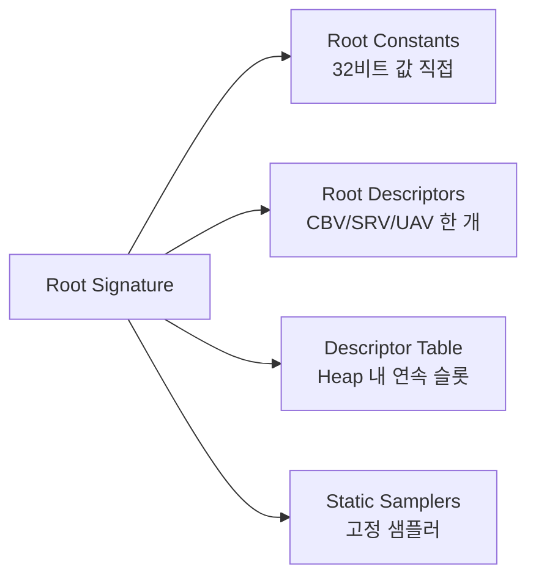

## 들어가며

HLSL(High-Level Shading Language)은 본래 DirectX의 셰이더 언어로 출발했지만, 오늘날에는 그 역할이 한 API에 묶이지 않는다. DXC 컴파일러가 SPIR-V를 출력하면서 같은 HLSL 코드가 DX12와 Vulkan 양쪽의 백엔드를 가질 수 있게 됐다. 단일 셰이더 소스가 두 그래픽스 API로 동시에 컴파일되는 이 구조는 현대 게임 엔진이 공통 셰이더 인프라를 한 벌의 코드로 유지하는 토대가 된다.

셰이더 컴파일러는 두 세대로 나뉜다. FXC는 Shader Model 5.x까지를 다루는 레거시 컴파일러이고, DXC는 SM 6.0 이후를 담당하는 LLVM 기반의 신세대 컴파일러다. 컴파일러가 내놓는 중간 표현도 함께 진화했다. 옛 바이트코드인 DXBC는 LLVM IR을 기반으로 한 DXIL로 교체됐다. 이 차이는 단순한 출력 포맷의 문제가 아니라 Wave Intrinsics, 16비트 타입, 레이 트레이싱 같은 셰이더 기능의 가용 여부 전체를 가른다.

여기까지의 코드는 Device와 자원, View까지 갖췄지만 셰이더 코드 자체는 비어 있는 상태다. 이 글에서는 셰이더 작성에서 컴파일, 바인딩에 이르는 체인 전체를 일곱 단계로 정리한다.

1. HLSL과 GLSL의 핵심 차이 — 행렬 컨벤션, 타입 표기, 자원 선언, 진입점 모델.
2. Semantic 시스템 — `: POSITION`, `: SV_Target` 같은 입출력 식별.
3. cbuffer의 16바이트 정렬과 `packoffset`.
4. FXC와 DXC, DXBC와 DXIL의 차이.
5. Shader Model 5.0부터 6.8까지의 진화.
6. SPIR-V 백엔드를 통한 Vulkan 호환.
7. Root Signature를 셰이더에 직접 박는 패턴.

이 글의 결과물은 컴파일 가능한 셰이더 한 쌍과, 그것을 DX12·Vulkan 양쪽에 바인딩하는 데 필요한 데이터 모델의 정합성이다. 실제 드로우 콜은 Command List와 PSO가 갖춰진 뒤의 몫이다.


---

## 목차
1. [HLSL과 GLSL의 차이](#1-hlsl과-glsl의-차이)
2. [Semantic 시스템](#2-semantic-시스템)
3. [Constant Buffer와 packoffset](#3-constant-buffer와-packoffset)
4. [FXC와 DXC](#4-fxc와-dxc)
5. [Shader Model 진화](#5-shader-model-진화)
6. [SPIR-V 백엔드](#6-spir-v-백엔드)
7. [Root Signature in Shader](#7-root-signature-in-shader)


---

## 1. HLSL과 GLSL의 차이

HLSL과 GLSL은 둘 다 C에서 갈라져 나온 문법을 가져 표면적으로는 비슷해 보인다. 함수, 구조체, 산술 연산자, 스위즐링(`v.xyz`) 같은 기본기는 거의 동일하다. 차이는 GPU의 데이터 모델을 언어가 어떻게 노출하느냐에서 드러난다. 행렬을 메모리에 어떻게 쌓는지, 자원을 어떻게 선언하고 바인딩 슬롯에 묶는지, 셰이더의 입출력을 어디에 적는지가 두 언어를 가른다. 이 절은 그 차이를 하나씩 짚는다.

### 타입 표기

벡터와 행렬의 표기부터 다르다. HLSL은 스칼라 타입에 차원을 붙이는 방식이고, GLSL은 별도 키워드를 쓴다.

| 의미 | HLSL | GLSL |
|---|---|---|
| 4-vector | `float4` | `vec4` |
| 3×3 행렬 | `float3x3` | `mat3` |
| 4×4 행렬 | `float4x4` | `mat4` |
| 텍스처 | `Texture2D<float4>` | `sampler2D`에 결합 |
| 샘플러 | `SamplerState` | `sampler2D`에 결합 |
| 정수 | `int`, `uint` | `int`, `uint` |
| 16비트 부동소수 | `float16_t` (SM 6.2+) | `float16_t`, `mediump` |

가장 구조적인 차이는 텍스처와 샘플러의 관계다. GLSL에서 `sampler2D`는 텍스처 이미지와 샘플링 상태(필터링, 래핑)를 한 객체로 묶는다. HLSL은 `Texture2D`(이미지 데이터)와 `SamplerState`(어떻게 읽을지)를 분리한다. 이 분리는 하나의 텍스처를 여러 샘플러로 읽거나, 하나의 샘플러를 여러 텍스처에 공유하는 조합을 자연스럽게 표현한다. DX10 이후의 분리 모델이 그대로 언어에 반영된 것이고, Vulkan도 `texture2D` + `sampler`로 같은 분리를 따른다.

### 행렬 곱 순서와 메모리 packing

HLSL에서 가장 흔히 혼동되는 지점이 행렬 곱의 순서다. 이 혼동은 두 개의 서로 다른 개념이 섞이기 때문에 생긴다. 하나는 행렬을 메모리에 어떤 순서로 저장하는가(메모리 packing)이고, 다른 하나는 수학적으로 벡터를 행렬의 어느 쪽에 곱하는가(곱 컨벤션)다.

HLSL은 상수 데이터를 행렬에 채울 때 기본으로 column-major packing을 쓴다. 즉 `float4x4`의 첫 16바이트(첫 `float4` 레지스터)가 행렬의 첫 열에 해당한다. 이것은 메모리 레이아웃의 문제이며, 셰이더 코드에서 행렬을 어떻게 곱하는지와는 직접 관계가 없다.

곱 컨벤션은 별개다. DirectXMath나 옛 D3DX 수학 라이브러리가 따르는 관례는 행 벡터(row vector) 컨벤션이다. 벡터를 행렬의 왼쪽에 두고 `mul(v, M)`로 곱한다. GLSL의 표준 관례는 열 벡터(column vector) 컨벤션으로, 벡터를 오른쪽에 두고 `M * v`로 곱한다.

```hlsl
// HLSL — 행 벡터 컨벤션, 벡터가 왼쪽
float4 worldPos = mul(float4(localPos, 1.0), modelMatrix);
float4 clipPos  = mul(worldPos, mul(viewMatrix, projMatrix));
```

```glsl
// GLSL — 열 벡터 컨벤션, 벡터가 오른쪽
vec4 worldPos = modelMatrix * vec4(localPos, 1.0);
vec4 clipPos  = projMatrix * viewMatrix * worldPos;
```

두 코드는 같은 변환을 표현하지만 곱하는 순서가 정확히 뒤집혀 있다. 행 벡터 컨벤션에서 행렬을 `model → view → proj` 순으로 왼쪽에서 오른쪽으로 쌓는 반면, 열 벡터 컨벤션에서는 같은 합성을 `proj * view * model`로 오른쪽에서 왼쪽으로 쌓는다. 수학적으로 두 표현은 서로의 전치 관계에 있다.

### packing과 컨벤션이 맞물리는 함정

문제는 메모리 packing과 곱 컨벤션이 독립적으로 어긋날 수 있다는 점이다. C++ 측에서 행렬을 만들어 cbuffer로 넘길 때, C++ 라이브러리의 저장 순서와 HLSL의 해석이 일치해야 한다. DirectXMath는 행 우선(row-major) 메모리로 행렬을 저장한다. 그런데 HLSL은 기본적으로 그 16바이트 블록을 열로 해석한다. 둘을 그대로 연결하면 행렬이 전치된 채 GPU에 도착한다.

해결 방법은 두 가지다. C++ 측에서 전치해 넘기거나, HLSL 측에서 packing을 명시적으로 행 우선으로 지정해 일치시킨다.

```hlsl
#pragma pack_matrix(row_major)     // 파일 전체에 적용

row_major float4x4 modelMatrix;    // 변수 단위로도 지정 가능
```

`row_major`를 지정하면 HLSL이 16바이트 블록을 행으로 해석하므로, DirectXMath의 행 우선 저장과 그대로 일치한다. 이 일치가 깨지면 화면의 객체가 무작위로 회전하거나 스케일이 어긋나는 형태로 나타난다. 디버깅하기 까다로운 종류의 버그인데, 셰이더 컴파일은 정상적으로 끝나고 오류 메시지도 없이 결과만 틀어지기 때문이다. cbuffer를 처음 연결할 때 단위 행렬을 하나 넘겨 보고 객체가 제자리에 있는지 확인하는 것이 가장 빠른 검증이다.

### 자원 선언과 바인딩 슬롯

자원을 선언하는 방식과 그것을 파이프라인 슬롯에 묶는 방식도 다르다. HLSL은 `register` 키워드로 슬롯을 직접 지정한다.

```hlsl
// HLSL
cbuffer SceneCB : register(b0) {
    float4x4 viewProj;
    float3   cameraPos;
    float    time;
};

Texture2D<float4>  diffuseMap    : register(t0);
SamplerState       linearSampler : register(s0);

struct VSOutput {
    float4 pos : SV_Position;
    float2 uv  : TEXCOORD0;
};
```

```glsl
// GLSL (Vulkan 환경)
layout(set = 0, binding = 0) uniform SceneUBO {
    mat4  viewProj;
    vec3  cameraPos;
    float time;
};
layout(set = 0, binding = 1) uniform texture2D diffuseMap;
layout(set = 0, binding = 2) uniform sampler   linearSampler;
```

HLSL의 `register`는 자원 종류별로 별도의 슬롯 공간을 가진다. `b`는 상수 버퍼(constant buffer), `t`는 셰이더 자원 뷰(texture/SRV), `u`는 순서 없는 접근 뷰(UAV), `s`는 샘플러다. `register(b0)`과 `register(t0)`은 숫자가 같아도 충돌하지 않는다. 종류가 다른 슬롯 공간이기 때문이다. 이 네 개의 분리된 슬롯 공간이 DX의 디스크립터 모델과 1:1로 대응한다.

GLSL의 Vulkan 바인딩은 `set`과 `binding` 두 축을 쓴다. `set`은 디스크립터 세트를, `binding`은 그 세트 안의 슬롯을 가리킨다. 두 모델은 표현이 다를 뿐 같은 일을 한다. 셰이더가 사용할 자원이 어느 위치에 묶이는지를 코드에 명시하는 것이다. SPIR-V를 다루는 6절에서 HLSL의 `register`가 어떻게 Vulkan의 `set`/`binding`으로 매핑되는지 다시 본다.

### 진입점 — 매개변수가 곧 입력이다

셰이더의 입출력을 적는 위치도 다르다. GLSL은 전역 `in`/`out` 변수로 입출력을 선언하고, 진입점 함수 `main`은 반환값이 없다. 출력은 `gl_Position` 같은 내장 변수나 전역 `out` 변수에 대입한다.

HLSL은 함수형 모델에 가깝다. 진입점 함수의 매개변수가 입력이고 반환값이 출력이다. 입력과 출력은 보통 구조체로 묶는다.

```hlsl
struct VSInput {
    float3 pos    : POSITION;
    float3 normal : NORMAL;
    float2 uv     : TEXCOORD0;
};

VSOutput VSMain(VSInput input) {
    VSOutput o;
    o.pos = mul(float4(input.pos, 1.0), worldViewProj);
    o.uv  = input.uv;
    return o;
}
```

```glsl
layout(location = 0) in  vec3 aPos;
layout(location = 1) in  vec3 aNormal;
layout(location = 2) in  vec2 aUv;
layout(location = 0) out vec2 vUv;

void main() {
    gl_Position = worldViewProj * vec4(aPos, 1.0);
    vUv = aUv;
}
```

HLSL의 구조체 기반 진입점은 입출력의 묶음을 하나의 타입으로 다루게 해 준다. 정점 셰이더의 출력 구조체를 픽셀 셰이더의 입력 구조체로 그대로 재사용하면, 두 단계 사이를 흐르는 데이터의 형태가 한 곳에 정의되어 불일치가 줄어든다. 반면 GLSL은 두 셰이더 파일에서 `location` 번호를 각각 맞춰야 하므로, 출력과 입력의 번호가 어긋나면 조용히 잘못된 보간 결과가 나온다.

## 2. Semantic 시스템

GLSL이 `layout(location = N)`이라는 숫자로 입출력 채널을 식별하는 자리에, HLSL은 Semantic이라는 문자열 기반 식별자를 쓴다. Semantic은 각 변수가 파이프라인에서 어떤 의미를 가지는지를 이름으로 선언한다. 이 차이는 단순한 표기 취향이 아니라 정점 입력이 CPU 측 정점 버퍼와 연결되는 방식, 그리고 파이프라인 단계가 자동으로 제공하는 값을 받는 방식을 결정한다.

### 사용자 Semantic과 정점 입력 매칭

정점 셰이더의 입력 구조체에는 사용자가 정한 Semantic을 붙인다.

```hlsl
struct VSInput {
    float3 pos    : POSITION;     // 정점 버퍼의 POSITION 필드와 매칭
    float3 normal : NORMAL;
    float2 uv     : TEXCOORD0;
    float4 color  : COLOR0;
};
```

CPU 측에서는 입력 레이아웃(input layout)을 정의해 정점 버퍼의 바이트 배치와 Semantic을 연결한다. DX11의 경우 `D3D11_INPUT_ELEMENT_DESC` 배열로 기술한다.

```cpp
D3D11_INPUT_ELEMENT_DESC layout[] = {
    { "POSITION", 0, DXGI_FORMAT_R32G32B32_FLOAT, 0,  0, D3D11_INPUT_PER_VERTEX_DATA, 0 },
    { "NORMAL",   0, DXGI_FORMAT_R32G32B32_FLOAT, 0, 12, D3D11_INPUT_PER_VERTEX_DATA, 0 },
    { "TEXCOORD", 0, DXGI_FORMAT_R32G32_FLOAT,    0, 24, D3D11_INPUT_PER_VERTEX_DATA, 0 },
    { "COLOR",    0, DXGI_FORMAT_R8G8B8A8_UNORM,  0, 32, D3D11_INPUT_PER_VERTEX_DATA, 0 },
};
```

각 항목의 두 번째 인자는 Semantic 인덱스다. `TEXCOORD0`, `TEXCOORD1`처럼 같은 이름을 여러 번 쓸 때 이 인덱스로 구분한다. 위 레이아웃은 정점 하나가 36바이트임을 정의한다. POSITION 12바이트, NORMAL 12바이트, TEXCOORD 8바이트, 그리고 COLOR가 `R8G8B8A8_UNORM`이라 4바이트다. COLOR를 `float4`로 받아도 입력 어셈블러가 `UNORM` 4바이트를 0~1 범위의 `float4`로 자동 확장하므로, 정점 버퍼에서 16바이트가 아닌 4바이트만 차지한다. 색상처럼 정밀도가 덜 중요한 속성을 8비트로 저장하면 정점당 12바이트를 절약한다.

문자열 매칭의 이점은 정점 포맷을 바꿀 때 드러난다. 속성의 순서를 바꾸거나 중간에 새 속성을 끼워 넣어도, Semantic 이름만 같으면 셰이더 코드를 고칠 필요가 없다. `location` 번호 기반에서는 번호 자체에 의미가 없어, 새 속성에 붙인 번호를 셰이더 소스와 CPU 측 속성 인덱스 양쪽에서 따로 맞춰야 한다.

### 시스템 Semantic

`SV_` 접두사가 붙은 Semantic은 시스템 값(System Value)으로, 파이프라인이 의미를 고정한다. 일부는 파이프라인이 값을 자동으로 채워 주고(입력), 일부는 셰이더가 그 위치에 결과를 써야 한다(출력).

| 시맨틱 | 단계 | 의미 |
|---|---|---|
| `SV_Position` | VS 출력 / PS 입력 | 클립 공간 위치, PS에서는 화면 픽셀 좌표 |
| `SV_VertexID` | VS 입력 | 정점 인덱스 |
| `SV_InstanceID` | VS 입력 | 인스턴스 인덱스 |
| `SV_PrimitiveID` | GS/PS 입력 | 프리미티브 인덱스 |
| `SV_Target0..7` | PS 출력 | 렌더 타겟 0~7 |
| `SV_Depth` | PS 출력 | 깊이 직접 출력 |
| `SV_DispatchThreadID` | CS 입력 | 디스패치 전역 스레드 ID |
| `SV_GroupThreadID` | CS 입력 | 그룹 내 스레드 ID |
| `SV_GroupID` | CS 입력 | 그룹 ID |

`SV_Position`은 정점 셰이더에서 클립 공간 좌표를 의미하지만, 같은 이름이 픽셀 셰이더 입력으로 넘어오면 화면 픽셀 좌표(`x`, `y`는 픽셀 단위, `z`는 깊이, `w`는 clip 공간의 w — 원근 투영에서 뷰 공간 깊이에 해당하며, OpenGL의 `gl_FragCoord.w` = 1/w 와는 반대 규약)로 바뀐다. 같은 Semantic이 단계에 따라 다른 의미를 가지는 드문 경우다.

`SV_Depth`를 픽셀 셰이더에서 직접 쓰면 한 가지 비용이 따른다. GPU는 보통 픽셀 셰이더 실행 전에 깊이 테스트를 먼저 수행해(early-Z) 가려진 픽셀의 셰이더 실행을 건너뛴다. 그러나 셰이더가 깊이를 직접 계산해 출력하면 깊이 값이 셰이더 실행 후에야 정해지므로, 하드웨어가 early-Z를 끄고 셰이더를 모두 돌린 뒤에 깊이 테스트를 한다. 깊이를 꼭 써야 하는 경우가 아니면 `SV_Depth` 출력은 피하는 편이 낫다.

### Compute Shader의 스레드 ID

컴퓨트 셰이더에서는 스레드의 위치를 시스템 Semantic으로 받는다.

```hlsl
RWTexture2D<float4> output : register(u0);

[numthreads(8, 8, 1)]
void CSMain(uint3 gid : SV_DispatchThreadID) {
    uint w, h;
    output.GetDimensions(w, h);
    if (gid.x >= w || gid.y >= h) return;
    output[gid.xy] = float4(gid.x / (float)w, gid.y / (float)h, 0, 1);
}
```

`[numthreads(8, 8, 1)]`는 한 스레드 그룹이 8×8×1 = 64개의 스레드로 구성됨을 선언한다. `SV_DispatchThreadID`는 디스패치 전체에서 이 스레드의 전역 좌표이며, 각 축에서 `SV_GroupID * numthreads + SV_GroupThreadID`로 계산된다. 그룹 크기와 `Dispatch` 인자를 곱한 값은 개별 ID가 아니라 전체 ID 공간의 크기다. GLSL에서 같은 값은 `gl_GlobalInvocationID`다. HLSL의 진입점 시그니처에 Semantic으로 명시하면, 이 매개변수가 어떤 종류의 ID인지가 선언 위치에서 바로 드러난다. 디스패치 경계를 넘는 스레드가 텍스처 밖을 쓰지 않도록 `GetDimensions`로 크기를 확인하고 일찍 반환하는 패턴이 표준이다.

## 3. Constant Buffer와 packoffset

상수 버퍼(cbuffer)는 셰이더가 매 드로우마다 읽는 작은 상수 데이터의 묶음이다. 행렬, 카메라 위치, 시간, 라이트 파라미터 같은 값이 여기 들어간다. cbuffer를 다룰 때 가장 빈번한 버그는 정렬 규칙에서 나온다. GPU의 상수 버퍼는 16바이트 단위로 정렬되며, 이 규칙이 C++ 구조체의 기본 정렬과 다르기 때문에 양쪽 메모리 레이아웃이 어긋나기 쉽다.

### 16바이트 정렬 규칙

HLSL cbuffer의 핵심 규칙은 하나다. 어떤 멤버도 16바이트 경계를 가로질러 걸치지 않는다. 4-component 벡터(`float4`)는 항상 16바이트 경계에서 시작하고, 더 작은 타입은 16바이트 블록 안에 들어맞으면 같은 블록을 채우지만 블록을 넘으면 다음 경계로 밀린다.

```hlsl
cbuffer Bad : register(b0) {
    float  a;      // offset 0,  4바이트
    float3 b;      // offset 4, c0.yzw를 채워 정확히 16B 경계에서 끝남
    float  c;      // offset 16, 다음 16바이트 레지스터의 첫 성분
    float4 d;      // offset 32, 16바이트
};
// 총 48바이트
```

`a`는 offset 0에서 4바이트를 차지한다. `b`의 12바이트는 offset 4~15, 즉 같은 `c0.yzw`에 정확히 들어가므로 다음 레지스터로 밀리지 않는다. `c`는 offset 16에서 시작한다. 이어지는 `d`는 16바이트라 offset 20에서 시작하면 레지스터 경계를 넘으므로 offset 32로 이동한다. 합치면 48바이트다. HLSL cbuffer의 핵심 규칙은 모든 `float3`를 16바이트 정렬하는 것이 아니라, 한 변수가 16바이트 레지스터 경계를 가로지르지 못한다는 것이다.

문제는 C++ 측이 같은 구조체를 단순하게 정의했을 때다.

```cpp
struct BadCB {
    float     a;   // offset 0
    glm::vec3 b;   // offset 4 — C++ 컴파일러는 16바이트 경계를 강제하지 않는다
    float     c;   // offset 16
    glm::vec4 d;   // offset 16에 vec4 정렬이면 offset 32, 보통은 offset 20
};
// C++ 레이아웃이 HLSL의 48바이트와 일치하지 않는다
```

C++ 컴파일러는 기본 `glm::vec3`를 16바이트 경계로 밀지 않으므로 `a@0`, `b@4`, `c@16`까지는 HLSL과 일치한다. 차이는 C++의 기본 정렬에서 `d`가 보통 offset 20에 놓이지만 HLSL은 offset 32에 놓인다는 점과 전체 크기다. 이 상태로 구조체 전체를 `memcpy`하면 `d`부터 GPU가 엉뚱한 위치에서 읽는다.

### 안전한 패킹 패턴

가장 견고한 방법은 cbuffer 멤버를 `float4` 단위로 묶어, 정렬 규칙이 끼어들 여지를 없애는 것이다. 스칼라나 `float3`를 `float4`의 컴포넌트에 담고, 의미를 주석으로 명시한다.

```hlsl
cbuffer Light : register(b1) {
    float4 posRadius;        // xyz = 위치, w = 반경
    float4 colorIntensity;   // rgb = 색상, a = 세기
};
```

C++ 측은 `glm::vec4` 두 개로 정의하면 양쪽이 자명하게 일치한다. 컴파일 시점에 크기를 단언해 두면 누군가 구조체를 잘못 고쳤을 때 빌드가 막힌다.

```cpp
struct LightCB {
    glm::vec4 posRadius;
    glm::vec4 colorIntensity;
};
static_assert(sizeof(LightCB) == 32, "LightCB layout mismatch");
```

`static_assert`는 이 종류의 버그를 막는 값싼 보험이다. 정렬이 어긋나면 컴파일 단계에서 멈추므로, 화면이 깨진 뒤 원인을 역추적하는 시간이 사라진다.

한 가지 더 주의할 점은 cbuffer 자체의 전체 크기다. 상수 버퍼를 GPU에 올릴 때 크기를 16바이트의 배수로, DX12의 경우 256바이트 정렬로 올려야 하는 제약이 따른다. 그래서 cbuffer는 항목이 적어도 256바이트 단위로 자리를 잡는 경우가 많다.

### packoffset으로 위치 명시

각 멤버의 위치를 직접 지정해야 할 때는 `packoffset`을 쓴다. `c0`는 첫 번째 16바이트 레지스터, `c1.x`는 두 번째 레지스터의 첫 컴포넌트를 가리킨다.

```hlsl
cbuffer Explicit : register(b0) {
    float4 a : packoffset(c0);     // c0.xyzw
    float  b : packoffset(c1.x);   // c1.x
    float3 c : packoffset(c1.y);   // c1.yzw — 같은 레지스터의 남은 자리에 채움
};
```

`packoffset`은 C++ 측의 기존 메모리 레이아웃에 셰이더를 맞춰야 할 때, 혹은 같은 cbuffer를 여러 셰이더가 서로 다른 멤버 부분 집합으로 공유할 때 유용하다. 명시하지 않으면 컴파일러가 선언 순서대로 16바이트 규칙에 따라 자동 배치한다.

### GLSL std140과의 차이

GLSL의 유니폼 블록에 쓰는 `std140`도 16바이트 단위를 자주 만들지만 HLSL cbuffer와 동일한 규칙은 아니다. `std140`의 `vec3` base alignment는 16바이트이므로 `float a; vec3 b;`에서 `b`는 offset 16으로 이동한다. HLSL cbuffer의 `float3 b`는 앞의 4바이트 뒤에 들어맞으면 offset 4에서 `c0.yzw`를 채울 수 있다. 배열 stride와 구조체 정렬에서도 차이가 있으므로 HLSL과 GLSL 사이에 원시 바이트를 공유할 때는 컴파일러 reflection 결과나 명시적 레이아웃 옵션을 기준으로 검증한다.

두 규칙 모두 GPU가 효율적으로 읽을 수 있는 정렬을 목표로 하므로 `float4` 단위로 명시적으로 묶는 패턴은 양쪽에서 견고하다. 다만 목표가 비슷하다는 사실이 멤버별 offset의 동일성을 보장하지는 않는다. DXC로 SPIR-V를 만들 때도 `-fvk-use-dx-layout`과 기본 Vulkan 레이아웃 선택에 따라 계약이 달라진다.

## 4. FXC와 DXC

HLSL 소스는 그대로 GPU에서 돌지 않는다. 컴파일러가 중간 표현으로 번역하고, 런타임에 드라이버가 그 중간 표현을 실제 GPU 명령어로 다시 컴파일한다. 이 첫 단계 컴파일러가 FXC에서 DXC로 세대 교체됐고, 두 컴파일러는 출력 포맷부터 지원하는 셰이더 기능까지 갈린다.

| 항목 | FXC | DXC |
|---|---|---|
| 백엔드 | 자체 컴파일러 | LLVM/Clang 기반 |
| 출력 | DXBC (D3D Bytecode) | DXIL (DirectX Intermediate Language) |
| Shader Model | 5.x까지 | 6.0 이상 |
| SPIR-V 출력 | 미지원 | `-spirv` 플래그로 지원 |
| 16비트 타입 | 미지원 | `float16_t`, `int16_t` |
| Wave Intrinsics | 미지원 | SM 6.0+ |
| 컴파일 속도 | 빠름 | 상대적으로 느림 (LLVM 패스) |
| 배포 | d3dcompiler DLL | 독립 `dxc.exe` + `dxcompiler.dll` |

### FXC 호출

FXC는 명령행에서 타겟 프로파일, 진입점, 출력 파일을 지정해 호출한다.

```bash
fxc /T vs_5_0 /E VSMain /Fo vertex.cso shader.hlsl
fxc /T ps_5_0 /E PSMain /Fo pixel.cso  shader.hlsl
```

`/T <profile>`은 타겟 셰이더 모델과 단계를 함께 지정한다. `vs_5_0`은 Shader Model 5.0의 정점 셰이더다. `/E <entry>`는 진입점 함수명, `/Fo`는 출력 파일이다. 한 `.hlsl` 파일에 여러 진입점을 두고 단계별로 따로 컴파일하는 방식이 일반적이다.

### DXC 호출

DXC는 플래그 표기가 유닉스 스타일로 바뀌었고, SPIR-V 출력 옵션이 추가됐다.

```bash
dxc -T vs_6_6 -E VSMain -Fo vertex.dxil shader.hlsl
dxc -T ps_6_6 -E PSMain -Fo pixel.dxil  shader.hlsl

# Vulkan용 SPIR-V 출력
dxc -T vs_6_0 -E VSMain -Fo vertex.spv -spirv shader.hlsl
```

DXC는 디버깅을 위한 옵션도 풍부하다. `-Zi`로 디버그 정보를 박고, `-Fd`로 PDB를 분리하며, `-Qstrip_debug`로 출하용 바이너리에서 디버그 정보를 떼어 낸다. 셰이더 캐시를 운영할 때는 컴파일 결과의 해시를 키로 쓰는데, DXIL은 안정적인 컨테이너 해시를 제공해 캐시 무효화를 신뢰할 수 있게 만든다.

### DXBC와 DXIL의 차이

두 중간 표현의 본질적 차이는 누가 컴파일러 인프라를 소유하느냐다. DXBC는 마이크로소프트의 자체 바이트코드였다. 각 GPU 벤더의 드라이버는 DXBC를 직접 파싱하고 최적화하는 코드를 따로 작성해야 했다. DXIL은 LLVM IR을 기반으로 한다. 마이크로소프트와 벤더가 LLVM이라는 공통 인프라 위에서 최적화 패스와 디버깅 도구를 공유한다.

이 변화의 실질적 결과는 신기능의 가용성이다. SM 6.x 이후에 추가된 기능 — Wave Intrinsics, 16비트 타입, 메시 셰이더, DXR 레이 트레이싱 — 은 모두 DXIL을 전제로 한다. DXBC와 FXC로는 이 기능들을 쓸 수 없다. 새 하드웨어 기능을 쓰려면 DXC로의 전환이 선택이 아니라 전제가 된다.

### 셰이더 코드에서 드러나는 차이

같은 텍스처 샘플링도 셰이더 모델에 따라 작성 방식이 달라진다. SM 5.x에서는 자원을 `register`로 고정 바인딩한다.

```hlsl
// SM 5.x — FXC
Texture2D<float4> diffuseMap    : register(t0);
SamplerState      linearSampler : register(s0);

float4 PSMain(VSOutput input) : SV_Target {
    return diffuseMap.Sample(linearSampler, input.uv);
}
```

SM 6.6에서는 디스크립터 힙을 셰이더에서 직접 인덱싱할 수 있다. 자원을 미리 바인딩하지 않고, 런타임에 받은 인덱스로 힙에서 자원을 끌어온다.

```hlsl
// SM 6.6 — DXC, Bindless
struct PSInput { float2 uv : TEXCOORD0; uint texIdx : TEXIDX; };

float4 PSMain(PSInput input) : SV_Target {
    Texture2D<float4> tex = ResourceDescriptorHeap[NonUniformResourceIndex(input.texIdx)]; // 인덱스가 드로우 안에서 달라지므로 필수
    SamplerState      s   = SamplerDescriptorHeap[0];
    return tex.Sample(s, input.uv);
}
```

`ResourceDescriptorHeap`과 `SamplerDescriptorHeap`은 SM 6.6에서 추가된 전역 배열로, 바인딩된 디스크립터 힙 전체를 인덱스로 접근하게 해 준다. 이런 바인드리스(bindless) 자원 인덱싱은 DXIL과 SM 6.6 이상에서만 가능하다. 머티리얼마다 텍스처를 따로 바인딩하지 않고 인덱스만 바꿔 수천 개의 텍스처를 한 번의 바인딩으로 다루는 패턴의 기반이 된다.

## 5. Shader Model 진화

Shader Model은 셰이더가 쓸 수 있는 기능의 버전 표시다. 하드웨어 세대와 함께 올라가며, 각 버전이 새로운 GPU 기능을 셰이더 언어로 노출한다.

| SM | 도입 시점 | 주요 기능 |
|---|---|---|
| 5.0 | DX11 (2009) | VS / HS / DS / GS / PS / CS 표준 파이프라인 |
| 5.1 | DX11.3 | 자원 배열 동적 인덱싱, 디스크립터 모델 확장 |
| 6.0 | DXC 도입 | Wave Intrinsics, 16비트 타입 기반 |
| 6.1 | | Barycentric, ViewInstancing |
| 6.2 | | `float16_t`, `int16_t` 명시적 16비트 타입 |
| 6.3 | | DXR 1.0 (Ray Tracing) |
| 6.4 | | int8 packed dot product(`dot4add_*8packed`) · half `dot2add` — ML 가속 명령, Variable Rate Shading |
| 6.5 | | DXR 1.1 (Inline RT), Mesh Shader, Sampler Feedback |
| 6.6 | | 64비트 Atomic, ResourceDescriptorHeap, 동적 자원 |
| 6.7 | | 고급 텍스처 연산, Quad 통신 확장 |
| 6.8 | 2024 | Work Graphs |

SM 5.x에서 6.0으로의 도약은 컴파일러 교체(FXC → DXC)와 맞물려 있어 가장 큰 분기점이다. 그 이후의 6.x 마이너 버전은 점진적으로 하드웨어 기능을 추가한다. 게임이 타겟하는 최소 SM은 지원할 GPU의 범위가 결정한다. 폭넓은 하드웨어를 지원하려면 SM 6.0~6.2 정도를 기준으로 잡고, 레이 트레이싱이나 메시 셰이더 같은 신기능은 런타임에 지원 여부를 질의해 분기한다.

### Wave Intrinsics

GPU는 스레드를 하나씩 실행하지 않는다. 32개 또는 64개의 스레드를 한 묶음으로 묶어 같은 명령을 동시에 실행한다. 이 묶음을 NVIDIA는 Warp, AMD는 Wavefront, 표준 용어로는 Wave라 부른다. SM 6.0의 Wave Intrinsics는 같은 Wave 안의 스레드들이 공유 메모리(LDS)를 거치지 않고 직접 값을 주고받게 해 준다.

```hlsl
StructuredBuffer<float>   input  : register(t0);
RWStructuredBuffer<float> output : register(u0);

[numthreads(128, 1, 1)]   // 128 은 4~128 인 모든 wave 폭의 배수라 wave 마다 출력 슬롯이 겹치지 않는다
void CSMain(uint tid : SV_DispatchThreadID) {
    float v = input[tid];

    // Wave 안의 모든 활성 레인의 합
    float sum = WaveActiveSum(v);

    // Wave의 첫 레인만 결과를 기록
    if (WaveIsFirstLane()) {
        output[tid / WaveGetLaneCount()] = sum;
    }
}
```

`WaveActiveSum`은 Wave 안의 활성 스레드 값을 한 번에 합산한다. 같은 작업을 공유 메모리와 동기화 배리어로 구현하면 여러 단계의 메모리 왕복이 필요하지만, Wave Intrinsic은 하드웨어의 레인 간 통신 경로를 직접 쓴다. 리덕션(reduction), 스캔(scan), 비트 패킹 같은 알고리즘에서 성능이 크게 개선된다.

Wave 크기는 벤더와 아키텍처마다 다르다. NVIDIA는 32, AMD의 GCN은 64, RDNA는 32 또는 64를 상황에 따라 쓰고, Intel Xe는 8/16/32 중 하나를 택한다. 이 차이 때문에 Wave 크기를 코드에 상수로 박으면 이식성이 깨진다. `WaveGetLaneCount`로 런타임에 조회해 그 값으로 인덱스를 계산해야 한다.

### Mesh Shader

전통적인 지오메트리 파이프라인은 VS → HS → DS → GS → 래스터라이저로 이어진다. 이 고정된 단계 구성은 유연성이 떨어지고, 특히 지오메트리 셰이더는 출력량을 미리 알 수 없어 성능 함정이 잦았다. SM 6.5의 메시 셰이더는 이 앞단을 증폭 셰이더(Amplification Shader) → 메시 셰이더 → 래스터라이저로 대체한다.

메시 셰이더는 컴퓨트 셰이더처럼 스레드 그룹 단위로 동작하며, 한 그룹이 작은 메시 조각(meshlet)을 직접 생성해 래스터라이저로 넘긴다. 증폭 셰이더는 그 앞에서 어떤 meshlet을 그릴지 결정하고 메시 셰이더 그룹의 수를 조절한다. 이 구조는 화면 밖이나 가려진 meshlet을 GPU에서 직접 걸러내는 클러스터 컬링(cluster culling)의 표준 백엔드가 된다. 정점을 일일이 입력 어셈블러로 흘려보내는 대신, GPU가 그릴 단위를 스스로 추려 내는 모델이다.

## 6. SPIR-V 백엔드

Vulkan 드라이버는 HLSL이나 GLSL 텍스트를 직접 받지 않는다. SPIR-V라는 바이너리 중간 표현만 입력으로 받는다. DXC의 `-spirv` 플래그는 HLSL을 이 SPIR-V로 번역한다. 이 한 줄 덕분에 DX12용으로 작성한 HLSL을 거의 그대로 Vulkan에서도 쓸 수 있다.

```bash
dxc -spirv -T vs_6_0 -E VSMain -Fo vertex.spv shader.hlsl
```

### 자원 바인딩의 매핑

HLSL의 `register`는 자원 종류별 슬롯 번호이고, Vulkan의 바인딩은 `set`과 `binding`의 두 축이다. 두 모델의 매핑이 SPIR-V 변환의 핵심이다. 기본적으로 DXC는 `register(b0)`, `register(t0)` 같은 슬롯을 규칙에 따라 자동으로 `set`/`binding`에 배정하지만, 그 규칙이 의도와 다를 수 있다. Vulkan 측 디스크립터 세트 레이아웃과 정확히 맞추려면 `[[vk::binding]]` 어트리뷰트로 명시한다.

```hlsl
[[vk::binding(0, 0)]]                  // binding = 0, set = 0
cbuffer SceneCB : register(b0) {
    float4x4 viewProj;
};

[[vk::binding(1, 0)]]                  // binding = 1, set = 0
Texture2D<float4> diffuseMap : register(t0);

[[vk::binding(0, 1)]]                  // binding = 0, set = 1
SamplerState linearSampler : register(s0);
```

푸시 상수(push constant)는 Vulkan 고유의 작은 상수 전달 경로로, DX12의 루트 상수에 대응한다. `[[vk::push_constant]]`로 표현한다.

```hlsl
struct PushConstants {
    float4x4 worldMatrix;
};
[[vk::push_constant]] PushConstants pc;
```

`register`와 `[[vk::binding]]`을 함께 적으면 같은 선언이 DX12로 컴파일될 때는 `register`를, SPIR-V로 컴파일될 때는 `vk::binding`을 따른다. 한 줄의 선언이 두 백엔드의 바인딩 정보를 동시에 들고 있는 셈이다.

### 한 소스를 두 백엔드로

DX12와 Vulkan을 함께 지원하려면 같은 HLSL 파일이 양쪽으로 컴파일되어야 한다. DXC는 SPIR-V 출력 시 `__spirv__` 매크로를 정의하므로, 전처리기로 분기해 백엔드별 표기를 갈라낼 수 있다.

```hlsl
#ifdef __spirv__
    #define VK_BINDING(b, s) [[vk::binding(b, s)]]
    #define DX_REGISTER(r)
#else
    #define VK_BINDING(b, s)
    #define DX_REGISTER(r) : register(r)
#endif

VK_BINDING(0, 0)
cbuffer SceneCB DX_REGISTER(b0) {
    float4x4 viewProj;
};
```

SPIR-V로 컴파일하면 `VK_BINDING`만 살아남고 `DX_REGISTER`는 사라진다. DXIL로 컴파일하면 그 반대다. 셰이더 본문의 산술과 자원 접근 코드는 양쪽에서 동일하므로, 분기되는 부분은 바인딩 선언에 한정된다. 이 패턴이 게임 엔진의 공통 셰이더 인프라가 한 벌의 소스로 두 API를 동시에 지원하는 표준 방식이다.

### DXIL과 SPIR-V 도구 체인

두 중간 표현은 각자의 검증·최적화·디스어셈블 도구를 가진다.

| 항목 | DXIL | SPIR-V |
|---|---|---|
| IR 기반 | LLVM | 자체 SSA 형식 |
| 검증 | 드라이버 / DXC 내장 | Khronos `spirv-val` |
| 최적화 | LLVM 패스 | `spirv-opt` |
| 디스어셈블 | `dxc -dumpbin` | `spirv-dis` |
| 캐시 키 | DXIL 컨테이너 해시 | SPIR-V 해시 |

SPIR-V 쪽은 Khronos가 제공하는 도구가 표준화되어 있어, `spirv-val`로 검증하고 `spirv-opt`로 최적화한 뒤 `spirv-dis`로 사람이 읽을 수 있는 형태로 풀어 볼 수 있다. DXC가 내놓은 SPIR-V가 의심스러울 때 `spirv-dis`로 디스어셈블해 바인딩이 의도대로 배정됐는지 직접 확인하는 것이 가장 확실한 디버깅 경로다.

## 7. Root Signature in Shader

DX12에서 Root Signature는 셰이더가 어떤 자원 슬롯을 어떤 방식으로 쓰는지를 기술하는 서명이다. 셰이더 코드에는 `register(b0)`, `register(t0)` 같은 슬롯 사용이 적혀 있고, Root Signature는 그 슬롯들을 GPU의 루트 인자(root argument)에 어떻게 연결할지를 정의한다. 둘은 정확히 맞아야 한다. C++ 측에서 Root Signature를 따로 정의하면 셰이더의 변경과 동기화가 어긋나기 쉽다. 셰이더에 슬롯을 하나 추가했는데 Root Signature를 안 고치면, 컴파일은 통과하고 런타임에 자원이 잘못 묶인다.

### 셰이더에 직접 박는 패턴

해결책은 Root Signature를 셰이더 코드 안에 직접 정의하는 것이다. 문자열로 서명을 기술하고, 진입점에 `[RootSignature]` 어트리뷰트로 붙인다.

```hlsl
#define ROOT_SIG \
    "RootFlags(ALLOW_INPUT_ASSEMBLER_INPUT_LAYOUT), " \
    "RootConstants(num32BitConstants=4, b0), " \
    "CBV(b1), " \
    "DescriptorTable(SRV(t0, numDescriptors=4), visibility=SHADER_VISIBILITY_PIXEL), " \
    "StaticSampler(s0, filter=FILTER_MIN_MAG_MIP_LINEAR)"

[RootSignature(ROOT_SIG)]
VSOutput VSMain(VSInput input) {
    /* ... */
}
```

`[RootSignature(...)]`가 진입점에 붙으면 DXC가 컴파일된 DXIL 안에 Root Signature 정보를 함께 박는다. C++ 측은 별도로 서명을 만들지 않고, 컴파일된 셰이더 블롭에서 그대로 추출한다.

```cpp
ComPtr<ID3D12RootSignature> rootSig;
device->CreateRootSignature(
    0,                              // node mask
    vsShaderBlob->GetBufferPointer(),
    vsShaderBlob->GetBufferSize(),
    IID_PPV_ARGS(&rootSig));
```

셰이더 코드를 바꾸면 서명도 같은 파일에서 함께 바뀌므로, 수동 동기화가 사라진다. 작은 데모에서 Root Signature와 셰이더의 불일치는 가장 흔한 디버깅 시간 낭비인데, 이 패턴 하나로 그 부류의 버그가 구조적으로 제거된다.

### Root Signature의 구성 요소

Root Signature는 네 종류의 항목으로 채워진다.



네 종류는 비용과 인덱싱 단계가 다르다. Root Constants는 32비트 값 여러 개를 루트에 직접 박는다. Vulkan의 푸시 상수와 같은 역할로, 인덱싱 없이 셰이더가 바로 읽으므로 가장 빠르다. Root Descriptor는 CBV/SRV/UAV 한 개의 GPU 주소를 루트에 직접 담아 한 단계 인덱싱으로 접근한다. Descriptor Table은 디스크립터 힙의 연속된 슬롯 묶음을 가리키며, 루트에는 힙 시작 위치만 두고 실제 자원은 힙을 거쳐 찾으므로 두 단계 인덱싱이 든다. Static Sampler는 컴파일 시점에 값이 정해지는 샘플러로, 디스크립터 슬롯을 전혀 차지하지 않는다.

### 비용 트레이드오프

각 종류가 Root Signature에서 차지하는 공간과 접근 비용을 정리하면 설계 기준이 보인다.

| 종류 | Root Sig 비용 | 인덱싱 단계 | 적합한 용도 |
|---|---|---|---|
| Root Constants | N DWORD (값을 직접) | 0 | 매 드로우 바뀌는 작은 값 (인덱스, 소규모 상수) |
| Root Descriptor | 2 DWORD | 1 | per-draw 상수 버퍼 |
| Descriptor Table | 1 DWORD | 2 | per-material 텍스처 묶음 |
| Static Sampler | 0 | 0 (컴파일 시 결정) | 공통 linear/point/anisotropic 샘플러 |

Root Signature 전체는 64 DWORD(256바이트)의 크기 제한을 가진다. 이 한계를 넘으면 컴파일 자체가 실패한다. 그래서 무엇을 루트에 직접 박고 무엇을 디스크립터 테이블 뒤로 미룰지가 설계의 핵심이 된다. 자주 바뀌는 작은 데이터일수록 빠른 슬롯(Root Constants, Root Descriptor)에 두고, 자주 바뀌지 않는 큰 자원 묶음일수록 느리지만 공간을 적게 먹는 슬롯(Descriptor Table)에 둔다. 64 DWORD라는 예산을 의식하며 배치하는 비용 인식 설계가 DX12 자원 바인딩의 기본기다.


---

## 결론

이 글은 셰이더 작성에서 컴파일, 바인딩까지의 체인 전체를 정리했다. HLSL의 구조체 기반 진입점, Semantic, cbuffer, `register`는 DX의 데이터 모델과 1:1로 대응한다. 입력 레이아웃이 Semantic 이름으로 정점 버퍼와 연결되고, cbuffer가 16바이트 정렬 규칙으로 GPU에 올라가며, `register`가 자원을 슬롯에 묶는다. 이 대응 관계를 이해하면 셰이더 측에서 본 자원 슬롯과 C++ 측에서 정의한 데이터가 한 그림 안에 들어온다.

세 가지가 이 글의 실전 핵심이다. 첫째, 행렬의 메모리 packing과 곱 컨벤션은 별개의 문제이며, C++ 측 저장 순서와 HLSL 측 해석을 명시적으로 일치시켜야 한다. 둘째, cbuffer의 16바이트 레지스터 경계 규칙은 C++ 구조체와 어긋나기 쉬우므로 `float4` 단위 패킹과 `static_assert`로 방어한다. GLSL std140은 `vec3`에 16바이트 base alignment를 적용하지만 HLSL cbuffer는 레지스터 경계를 넘지 않는 `float3`를 남은 성분에 채울 수 있으므로 둘을 같은 레이아웃으로 가정하지 않는다. 셋째, Root Signature in Shader 패턴은 셰이더와 서명의 동기화 버그를 구조적으로 없앤다.

DXC의 DXIL과 SPIR-V 이중 백엔드는 한 벌의 HLSL 소스를 DX12와 Vulkan이 공유하게 만든다. 공유의 조건은 행렬·상수 버퍼·descriptor binding의 레이아웃을 백엔드별 컴파일 옵션과 reflection 결과로 고정하는 것이다. 소스가 같다는 사실만으로 두 API의 메모리 계약까지 같아지지는 않는다.

## 더 읽을거리

- Microsoft Learn, [HLSL 언어 레퍼런스](https://learn.microsoft.com/en-us/windows/win32/direct3dhlsl/dx-graphics-hlsl) — Semantic·cbuffer·register 의 공식 명세.
- Microsoft Learn, [Packing Rules for Constant Variables](https://learn.microsoft.com/en-us/windows/win32/direct3dhlsl/dx-graphics-hlsl-packing-rules) — 16바이트 정렬 규칙의 원전.
- [DirectX Shader Compiler (DXC)](https://github.com/microsoft/DirectXShaderCompiler) — DXIL/SPIR-V 이중 백엔드 문서와 릴리스.
- [HLSL Specifications](https://microsoft.github.io/hlsl-specs/) — 진행 중인 언어 명세 공개 저장소.
