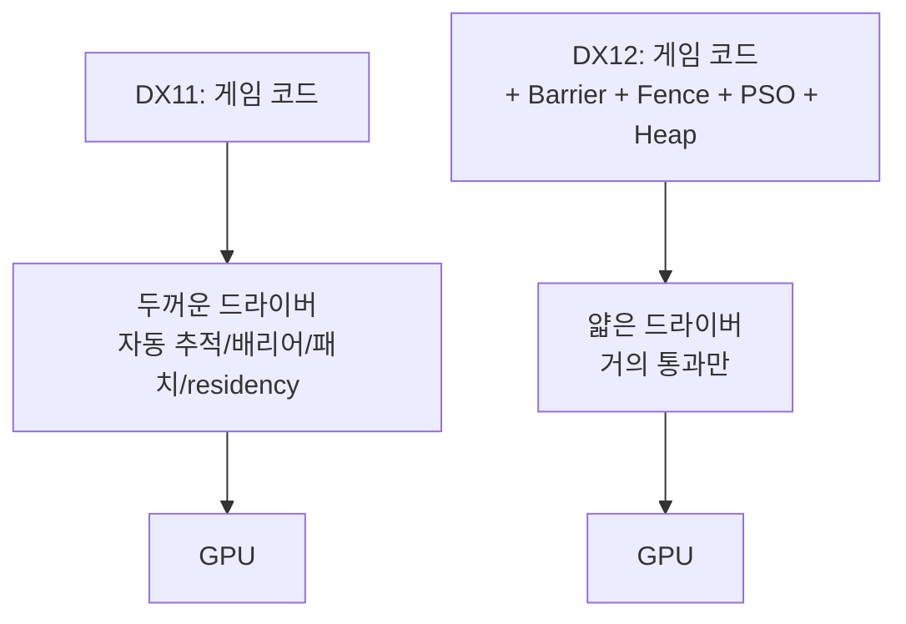
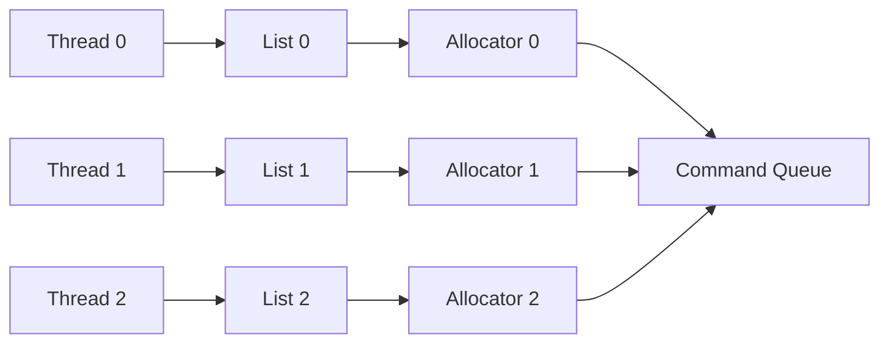
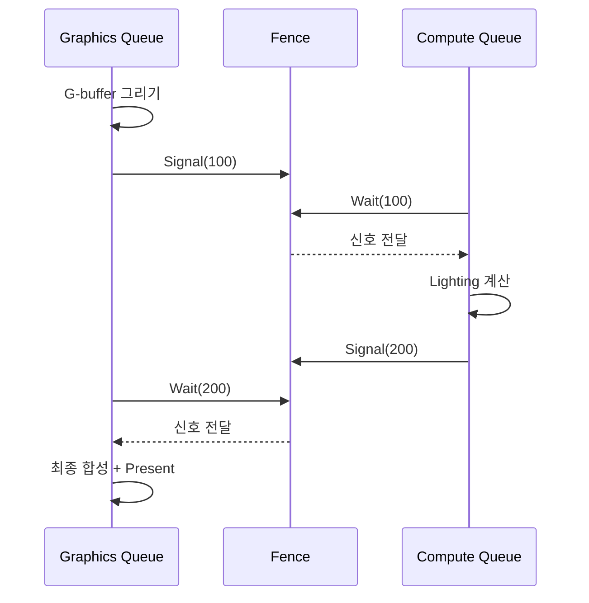

## 들어가며

DX11과 DX12를 가르는 단 하나의 축을 고른다면 *GPU 동기화의 책임을 누가 지느냐* 다. DX11은 드라이버가 자원의 의존 관계를 자동으로 추적해, 같은 텍스처를 렌더 타깃으로 쓰다가 다음 패스에서 셰이더 리소스로 읽으려 하면 그 사이에 필요한 캐시 플러시와 레이아웃 전환을 드라이버가 알아서 끼워 넣는다. DX12는 이 작업을 모두 애플리케이션이 명시한다. 자원의 현재 용도를 추적하는 상태 머신도, 그 상태를 바꾸는 배리어도, GPU가 어디까지 실행했는지를 아는 펜스도 전부 코드가 직접 다룬다. 그 대가로 드라이버 레이어의 두꺼운 추적 오버헤드가 사라지고, 여러 스레드에서 명령을 동시에 기록하는 길이 열린다.

DX12가 등장한 동기는 드로우 콜의 폭증이다. AAA 게임의 한 프레임이 수만에서 수십만 개의 드로우 콜을 발행하기 시작하면서, 그 모든 호출을 단일 스레드에서 처리하는 드라이버의 검증·상태 추적 비용이 프레임 시간의 큰 비중을 차지하게 됐다. CPU가 병목이면 GPU가 아무리 빨라도 프레임 레이트가 오르지 않는다. 명령 기록을 여러 코어로 병렬화하지 않고서는 이 벽을 넘을 수 없는 단계에 이르렀고, DX12는 그 병렬화를 가능하게 하는 대신 Resource Barrier, Fence, PSO, Root Signature, Descriptor Heap 같은 전에 없던 추상화를 프로그래머의 책임으로 끌어왔다.

여기까지의 코드는 정점·인덱스·텍스처 같은 자원 모델과 HLSL 셰이더를 모두 갖췄지만, 그것을 GPU에 실어 보내는 DX12의 명령 시스템이 비어 있다. 이 글에서는 그 명령 시스템을 일곱 단계로 채운다. DX11에서 DX12로 넘어오며 무엇이 명시화됐는지(1절), 자원의 현재 용도를 추적하는 상태 머신(2절), 그 상태를 바꾸는 세 종류의 배리어(3절), 명령을 담는 메모리 풀과 시퀀스(4절), GPU 큐와 그 진행을 추적하는 펜스(5절), 셰이더가 보는 자원 슬롯의 메모리 풀(6절), 그리고 그릴 때 필요한 모든 상태를 한 객체로 묶는 파이프라인 상태 객체(7절)까지 차례로 다룬다.


---

## 목차
1. [DX11과 DX12의 책임 분담](#1-dx11과-dx12의-책임-분담)
2. [Resource State 머신](#2-resource-state-머신)
3. [Resource Barrier 종류](#3-resource-barrier-종류)
4. [Command Allocator와 Command List](#4-command-allocator와-command-list)
5. [Command Queue와 Fence](#5-command-queue와-fence)
6. [Descriptor Heap](#6-descriptor-heap)
7. [Pipeline State Object](#7-pipeline-state-object)


---

## 1. DX11과 DX12의 책임 분담

DX11의 Immediate Context가 호출 한 줄 뒤에서 자동으로 처리하던 일들을 DX12는 프로그래머에게 그대로 떠넘긴다. 같은 결과를 내기 위해 코드가 해야 할 일이 늘어났다는 뜻이고, 그만큼 드라이버가 매 호출마다 하던 검증과 추적이 사라졌다는 뜻이기도 하다.

| 항목 | DX11 | DX12 |
|---|---|---|
| 자원 상태 추적 | 드라이버 자동 | 앱이 명시 (Barrier) |
| 메모리 residency | 드라이버 자동 | 앱이 `MakeResident`/`Evict` |
| 셰이더 상수 패치 | `XXSetConstantBuffers` | Root Signature + Heap |
| 파이프라인 상태 | 분산된 set 호출 N개 | PSO 한 객체 |
| 명령 기록 | 단일 Immediate Context (Deferred Context 는 드라이버 의존) | N개 Command List 병렬 |
| 멀티 큐 | 없음 (제출은 Immediate Context 하나) | Direct / Compute / Copy 큐 명시 |
| 동기화 | 드라이버 자동 | Fence 명시 |

### 사라진 추상화: 자동 상태 추적과 residency

DX11에서 가장 크게 사라진 것은 *상태 추적(State Tracking)* 이다. DX11 런타임은 어떤 자원이 어느 슬롯에 묶여 있는지 항상 추적하다가, 같은 텍스처가 렌더 타깃과 셰이더 리소스 양쪽에 동시에 묶이는 위험한 상황을 감지하면 한쪽 바인딩을 자동으로 풀고 디버그 레이어에 경고를 남긴다. DX12에는 이런 안전망이 없다. 자원을 쓰기 전에 올바른 상태로 전환하는 배리어를 프로그래머가 발급하지 않으면 그 자체로 미정의 동작이며, 드라이버는 경고 한 줄 없이 깨진 픽셀을 토해내거나 디바이스를 잃는다.

두 번째로 사라진 것은 *메모리 residency* 관리다. DX11에서는 VRAM이 부족해지면 드라이버가 당장 쓰지 않는 자원을 시스템 메모리로 내쫓았다가(eviction) 필요할 때 다시 끌어올린다. DX12에서는 이 판단을 애플리케이션이 한다. `IDXGIAdapter3::QueryVideoMemoryInfo`로 현재 예산을 조회하고, 예산을 넘기 전에 `Evict`로 자원을 내보내거나 `MakeResident`로 다시 올리는 결정을 직접 내려야 한다. 이 부분을 방치하면 드라이버가 페이징을 떠맡긴 하지만, 명시적으로 관리할 때보다 예측 불가능한 스톨이 생긴다.

### 추가된 추상화

대신 DX12는 Resource Barrier, Fence, Pipeline State Object, Root Signature, Descriptor Heap이라는 다섯 가지 명시적 추상화를 추가했다. 이들은 새로운 기능이 아니라, DX11 시절 드라이버 내부에서 묵시적으로 처리하던 동작을 표면으로 끌어낸 인터페이스다. 드라이버가 추측으로 끼워 넣던 배리어를 프로그래머가 정확한 위치에 발급하고, 드라이버가 드로우 콜 직전에 부랴부랴 컴파일하던 상태 조합을 PSO로 미리 굳혀 둔다.



드라이버가 얇아진 만큼 게임 코드가 두꺼워진다. CPU 오버헤드 감소와 멀티스레드 활용 가능성이 그 교환비다.

### 교환비의 정량화

이 교환이 의미를 가지는지는 CPU 기록 비용과 GPU 병목을 나눠 측정해야 한다. DX11도 Deferred Context로 병렬 기록할 수 있지만 실행은 Immediate Context로 모인다. DX12의 독립 Command List는 병렬 기록을 명시적으로 지원하되, 코어 수에 선형 비례하는 처리량을 보장하지 않는다. 작업 분할·상태 준비·드라이버·메모리 경합에 따라 이득이 달라진다. 드로우 수만으로 전환 기준을 정하지 말고 같은 장면의 CPU 제출 시간, GPU 시간과 관리 비용을 비교한다.

## 2. Resource State 머신

DX12의 모든 자원은 지금 자신이 어떤 용도로 쓰이는 중인지를 나타내는 *State* 를 하나 가진다. GPU의 캐시 계층과 압축 포맷 때문에, 같은 메모리라도 렌더 타깃으로 쓸 때와 셰이더에서 읽을 때의 내부 표현이 다를 수 있다. State는 그 표현이 지금 어느 쪽으로 맞춰져 있는지를 추적하는 논리적 표식이다.

### 주요 State

| State | 의미 |
|---|---|
| `COMMON` | 초기 상태, 큐 간 공유 가능 |
| `RENDER_TARGET` | RTV로 쓰는 중 |
| `DEPTH_WRITE` | DSV로 쓰는 중 |
| `DEPTH_READ` | DSV로 읽기만 (early-Z) |
| `PIXEL_SHADER_RESOURCE` | 픽셀 셰이더에서 SRV |
| `NON_PIXEL_SHADER_RESOURCE` | VS / CS / GS에서 SRV |
| `UNORDERED_ACCESS` | UAV R/W |
| `COPY_SOURCE` | 복사 명령의 소스 |
| `COPY_DEST` | 복사 명령의 목적지 |
| `PRESENT` | Swap Chain Present 직전 |
| `VERTEX_AND_CONSTANT_BUFFER` | VB / CB 바인딩 |
| `INDEX_BUFFER` | IB 바인딩 |

### 상태 전이 규칙

자원이 어떤 명령에 쓰이려면 그 명령에 맞는 State에 있어야 한다. 렌더 타깃으로 쓰려면 `RENDER_TARGET`, 셰이더에서 읽으려면 `PIXEL_SHADER_RESOURCE`로 전환해 둔 뒤에 해당 명령을 기록한다. 잘못된 State에서 자원을 사용하면 미정의 동작이고, 그 결과는 드라이버마다 다르다. 어떤 드라이버는 압축이 풀리지 않은 데이터를 그대로 읽어 깨진 화면을 내고, 어떤 드라이버는 디바이스 리셋으로 떨어진다. GPU 기반 검증(GBV, GPU-Based Validation)을 켜면 이런 잘못된 전이를 디버그 레이어가 잡아 주지만, 검증이 켜진 상태는 성능이 크게 떨어지므로 개발 중에만 쓴다.

State는 두 종류로 나뉜다. 읽기 전용 State끼리는 비트로 결합해 동시에 가질 수 있다. `PIXEL_SHADER_RESOURCE | NON_PIXEL_SHADER_RESOURCE`처럼 묶으면 정점 셰이더와 픽셀 셰이더가 같은 텍스처를 동시에 읽을 수 있고, `DEPTH_READ | PIXEL_SHADER_RESOURCE`는 깊이 버퍼를 early-Z 테스트에 쓰면서 동시에 셰이더에서 샘플링하는 패턴을 허용한다. 반면 쓰기 State는 다른 어떤 State와도 결합되지 않는다. 같은 자원을 `RENDER_TARGET`이면서 동시에 SRV로 두는 것은 읽기와 쓰기가 충돌하므로 불가능하다.

### 묵시적 전이와 Promotion / Decay

모든 전이를 배리어로 명시해야 하는 것은 아니다. `COMMON` 상태의 자원은 일부 State로 *묵시적 승격(Promotion)* 이 일어난다. 버퍼나 `SIMULTANEOUS_ACCESS` 플래그를 가진 텍스처는 `COMMON`에서 곧바로 적절한 읽기/쓰기 State로 자동 승격되고, 해당 `ExecuteCommandLists` 작업이 GPU에서 완료되면 규칙에 따라 `COMMON`으로 *쇠퇴(Decay)* 한다. CPU의 제출 호출이 반환된 때나 같은 호출 안의 list 경계가 아니다. 이 규칙 덕분에 매 프레임 업로드하는 정점 버퍼처럼 단순한 자원은 배리어를 일일이 발급하지 않아도 된다. 일반 텍스처는 `RENDER_TARGET`으로 승격되지 않지만 `ALLOW_SIMULTANEOUS_ACCESS` 텍스처는 가능하다. 깊이/스텐실 자원은 묵시적 승격 대상이 아니다. 일반 텍스처도 허용된 SRV·복사 상태로 승격될 수 있으므로 자원 종류별 표를 구분해야 한다. 이 경계가 헷갈려 불필요한 배리어를 남발하거나, 반대로 필요한 배리어를 빠뜨리는 일이 흔하다.

### Subresource State

mip 체인이나 텍스처 배열 같은 큰 자원은 자원 전체가 아니라 *Subresource* 단위로 상태를 추적할 수 있다. Subresource 인덱스는 `mipSlice + arraySlice * MipLevels + planeSlice * MipLevels * ArraySize`로 계산되며, 전체를 한꺼번에 전환할 때는 별도의 상수를 쓴다.

```cpp
barrier.Transition.Subresource = D3D12_RESOURCE_BARRIER_ALL_SUBRESOURCES;
// 또는 0 .. (MipLevels * ArraySize * PlaneCount - 1) 중 한 인덱스
```

Subresource 단위 추적이 의미를 가지는 대표 사례가 셰이더로 mip을 생성하는 패스다. 0번 mip을 셰이더 리소스로 읽어 1번 mip을 UAV로 쓰고, 다시 1번을 읽어 2번을 쓰는 식으로 진행할 때, mip마다 State가 다른 시점이 존재한다. 이때 자원 전체를 한 State로 묶으면 표현할 수 없고, Subresource별로 읽는 셰이더 단계에 맞는 SRV 상태와 `UNORDERED_ACCESS`를 따로 지정해야 한다(컴퓨트로 mip을 만들면 SRV 쪽은 `NON_PIXEL_SHADER_RESOURCE`).

## 3. Resource Barrier 종류

State를 바꾸는 행위가 *배리어(Barrier)* 다. 배리어는 단순히 표식만 바꾸는 게 아니라, GPU에게 캐시를 플러시하고 압축을 풀거나 다시 걸고, 이전 명령이 끝날 때까지 다음 명령을 기다리게 하는 실제 동기화 지점이다. 배리어는 세 종류로 나뉜다. Transition, Aliasing, UAV다.

### Transition Barrier

가장 흔하게 쓰는 종류로, 자원의 State를 *Before에서 After로* 전환한다. 한 프레임의 가장 전형적인 사용은 백 버퍼를 `PRESENT`에서 `RENDER_TARGET`으로 바꿔 그린 뒤 다시 `PRESENT`로 돌려놓는 흐름이다.

```cpp
D3D12_RESOURCE_BARRIER barrier{};
barrier.Type  = D3D12_RESOURCE_BARRIER_TYPE_TRANSITION;
barrier.Flags = D3D12_RESOURCE_BARRIER_FLAG_NONE;
barrier.Transition.pResource   = renderTarget.Get();
barrier.Transition.StateBefore = D3D12_RESOURCE_STATE_PRESENT;
barrier.Transition.StateAfter  = D3D12_RESOURCE_STATE_RENDER_TARGET;
barrier.Transition.Subresource = D3D12_RESOURCE_BARRIER_ALL_SUBRESOURCES;

cmdList->ResourceBarrier(1, &barrier);
// ... 렌더링 ...
// 끝나면 RENDER_TARGET → PRESENT 로 되돌린 뒤 Swap Chain Present
```

`StateBefore`에 적은 값이 실제 현재 상태와 다르면 미정의 동작이다. 즉 프로그래머가 자원의 현재 State를 항상 정확히 기억하고 있어야 한다. 대형 엔진들은 이 부담을 줄이려고 자원마다 현재 State를 저장해 두고, 전환 요청이 들어오면 저장된 State를 `StateBefore`에 자동으로 채워 넣는 *State Tracker* 를 직접 구현한다. DX11이 내부에서 하던 일을 엔진 코드가 다시 만드는 셈이다.

### 배리어를 일괄 발급해야 하는 이유

배리어는 가능한 한 한 번의 `ResourceBarrier` 호출에 배열로 묶어 발급한다. 배리어 하나하나가 GPU 파이프라인을 비우는 동기화 지점이 될 수 있어, 여러 자원을 각각 따로 전환하면 그만큼 파이프라인이 여러 번 멈춘다. 같은 시점에 전환할 자원이 여럿이면 배열로 모아 한 번에 넘기는 편이 드라이버가 동기화를 묶어 처리할 여지를 준다.

```cpp
D3D12_RESOURCE_BARRIER barriers[3] = { /* gbuffer0, gbuffer1, depth */ };
cmdList->ResourceBarrier(3, barriers);   // 세 번이 아니라 한 번
```

### Aliasing Barrier

같은 물리 메모리를 서로 다른 자원이 시간을 나눠 재사용할 때 쓴다. 한 힙(heap) 안에 G-buffer와 후처리용 임시 버퍼를 겹쳐 배치해 두고, G-buffer를 다 쓴 뒤 같은 메모리를 임시 버퍼로 다시 활용하는 식이다. 이때 두 자원의 수명이 겹치지 않음을 GPU에 알려 줘야 한다.

```cpp
barrier.Type = D3D12_RESOURCE_BARRIER_TYPE_ALIASING;
barrier.Aliasing.pResourceBefore = oldUse.Get();   // 메모리를 비우는 자원
barrier.Aliasing.pResourceAfter  = newUse.Get();   // 같은 메모리를 받는 자원
```

이 배리어는 GPU가 이전 자원에 대한 모든 작업을 끝낼 때까지 새 자원의 접근을 미루도록 강제한다. 이렇게 메모리를 시간 분할로 재활용하면 VRAM을 절약할 수 있지만, 두 자원의 작업이 겹칠 수 없으므로 병렬성을 일부 포기하는 트레이드오프가 따른다.

### UAV Barrier

같은 UAV 자원에 연속으로 쓰는 명령들 사이에서, 뒤 명령이 앞 명령의 결과를 읽어야 할 때 발급한다. State는 양쪽 다 `UNORDERED_ACCESS`로 같으므로 Transition Barrier로는 표현할 수 없고, 전용 종류가 따로 있다.

```cpp
barrier.Type = D3D12_RESOURCE_BARRIER_TYPE_UAV;
barrier.UAV.pResource = scratchBuffer.Get();
```

핵심은 이 배리어가 *순서 의존이 있을 때만* 필요하다는 점이다. 두 컴퓨트 패스가 같은 UAV의 서로 다른 영역에 독립적으로 쓰고 서로의 결과를 읽지 않는다면, UAV Barrier 없이 두 패스를 겹쳐 실행해도 된다. 불필요한 UAV Barrier는 겹칠 수 있는 작업을 직렬화시켜 성능을 깎는다. 반대로 의존이 있는데 빠뜨리면 읽는 쪽이 쓰기 완료 전의 값을 읽어 결과가 비결정적으로 깨진다.

### Split Barrier

큰 자원의 State 전환은 비용이 크다. 압축을 풀거나 캐시를 비우는 동안 GPU가 멈출 수 있다. *Split Barrier* 는 이 전환을 *Begin* 과 *End* 두 시점으로 쪼개, 그 사이에 무관한 다른 GPU 작업을 흘려보내 스톨을 숨긴다.

```cpp
// 자원을 곧 쓸 것을 미리 알리는 시점에 Begin
beginBarrier.Flags = D3D12_RESOURCE_BARRIER_FLAG_BEGIN_ONLY;
cmdList->ResourceBarrier(1, &beginBarrier);

// 이 사이에 그 자원과 무관한 다른 작업을 기록한다

// 자원을 실제로 쓰기 직전에 End
endBarrier.Flags = D3D12_RESOURCE_BARRIER_FLAG_END_ONLY;
cmdList->ResourceBarrier(1, &endBarrier);
```

Begin과 End 사이에 다른 작업이 진행되는 동안 전환이 백그라운드로 진행되므로, 배리어의 stall 비용이 가려진다. 디퍼드 렌더링의 G-buffer 전환처럼 전환 대상이 크고 그 사이에 채울 일거리가 있는 경우에 의미가 있다.

### Enhanced Barrier

Agility SDK가 도입한 신모델이 *Enhanced Barrier* 다. 기존 배리어가 sync(언제)·access(읽기/쓰기)·layout(메모리 레이아웃)을 하나의 State 값에 뭉뚱그려 표현했다면, Enhanced Barrier는 이 세 축을 명시적으로 분리한다. 이는 Vulkan의 pipeline barrier 모델과 거의 같은 구조이며, 두 API를 함께 다루는 엔진에서 동기화 로직을 통일하기 좋다.

```cpp
D3D12_BUFFER_BARRIER bufferBarrier{};
bufferBarrier.SyncBefore   = D3D12_BARRIER_SYNC_COPY;
bufferBarrier.SyncAfter    = D3D12_BARRIER_SYNC_VERTEX_SHADING;
bufferBarrier.AccessBefore = D3D12_BARRIER_ACCESS_COPY_DEST;
bufferBarrier.AccessAfter  = D3D12_BARRIER_ACCESS_VERTEX_BUFFER;
```

세 축을 분리하면 동기화 범위를 더 좁게 잡을 수 있다. 기존 모델에서는 레이아웃 전환과 캐시 동기화가 한 묶음으로 일어나 과도하게 보수적으로 멈추는 경우가 있었는데, Enhanced Barrier는 실제로 충돌하는 단계 사이에서만 멈추게 해 불필요한 동기화를 줄인다. 다만 기존 모델보다 인자가 많아 정확히 채우기가 까다롭고, 런타임과 드라이버가 이 모델을 지원하는지 확인하는 절차가 필요하다.

## 4. Command Allocator와 Command List

DX12의 명령 기록은 두 객체의 협력으로 이뤄진다. 명령이 실제로 저장되는 메모리 풀인 *Command Allocator* 와, 그 풀에 명령을 직렬화해 써 넣는 인터페이스인 *Command List* 다.

### Allocator — 명령 메모리 풀

Allocator는 명령 데이터를 담는 메모리 블록을 소유한다. List가 `DrawIndexedInstanced`나 `SetPipelineState` 같은 명령을 호출하면, 그 명령이 Allocator의 메모리에 GPU가 읽을 수 있는 형태로 직렬화된다. 타입은 그 풀에 담을 명령의 종류를 결정한다.

```cpp
ComPtr<ID3D12CommandAllocator> allocator;
device->CreateCommandAllocator(
    D3D12_COMMAND_LIST_TYPE_DIRECT,
    IID_PPV_ARGS(&allocator));
```

### List — 명령 시퀀스

List는 Allocator를 가리키며 그 풀에 명령을 쌓는다. 생성 시 초기 PSO를 함께 넘길 수 있고, 기록을 마치면 `Close`로 닫는다.

```cpp
ComPtr<ID3D12GraphicsCommandList> cmdList;
device->CreateCommandList(
    0,                                        // node mask (멀티 GPU 어댑터 선택)
    D3D12_COMMAND_LIST_TYPE_DIRECT,
    allocator.Get(),                          // 어느 풀에 기록할지
    nullptr,                                  // 초기 PSO
    IID_PPV_ARGS(&cmdList));

cmdList->ResourceBarrier(1, &toRenderTarget);
cmdList->SetPipelineState(pso.Get());
cmdList->IASetVertexBuffers(0, 1, &vbView);
cmdList->DrawIndexedInstanced(indexCount, 1, 0, 0, 0);

cmdList->Close();    // 기록 완료, 실행 준비
```

`Close`는 List를 immutable 상태로 만든다. 닫지 않은 List는 Queue에 제출할 수 없고, 닫힌 뒤에는 더 이상 명령을 추가할 수 없다. `CreateCommandList`로 만든 List는 *열린 상태로 시작* 하지만, 뒤에서 볼 `Reset`으로 재사용할 때도 열린 상태가 되므로 기록 후 반드시 다시 닫아야 한다.

### Allocator와 List의 일대다 관계

Allocator 하나에 여러 List를 번갈아 기록할 수도 있지만, 한 시점에 한 Allocator에 동시에 기록하는 List는 하나여야 한다. 반대로 List 하나는 `Reset`을 통해 여러 Allocator를 갈아 끼우며 재사용할 수 있다. 멀티스레드 기록에서는 *스레드마다 별도 Allocator + List 쌍* 을 두는 것이 정석이다. 같은 Allocator를 두 스레드가 동시에 건드리면 메모리 풀이 깨진다.



### Reset 규칙

명령을 다 실행한 뒤 Allocator와 List를 재사용하려면 `Reset`을 호출한다. 순서가 중요하다.

```cpp
// GPU 가 이 Allocator 의 명령을 전부 실행했음을 Fence 로 확인한 후에만
allocator->Reset();                          // 메모리 풀을 통째로 비운다
cmdList->Reset(allocator.Get(), nullptr);    // List 를 다시 열린 상태로
```

`allocator->Reset`은 풀에 쌓인 명령 메모리를 한 번에 회수한다. 따라서 GPU가 그 명령들을 아직 실행 중일 때 호출하면 미정의 동작이며, 실행 완료를 펜스로 확인한 뒤에만 안전하다. 반면 `cmdList->Reset`은 넘기는 Allocator가 다른 기록 중인 List에 묶여 있지만 않다면 GPU가 그 List의 명령을 실행 중이어도 호출할 수 있다. List 자체는 명령을 보관하지 않고 Allocator에 흘려보내기만 하기 때문이다.

### Frame in Flight 패턴

CPU가 다음 프레임의 명령을 기록하는 동안 GPU가 현재 프레임을 그리게 하려면, 프레임마다 별도의 Allocator가 필요하다(List는 `Reset`으로 Allocator를 갈아 끼우며 하나를 재사용해도 되지만, 아래 예제는 슬롯마다 하나씩 둔다). GPU가 N번 프레임을 그리는 사이 CPU가 N+1번 프레임을 기록하려면, N번 프레임이 쓰던 Allocator를 건드리지 않아야 하기 때문이다.

```cpp
constexpr UINT FRAMES_IN_FLIGHT = 3;
ComPtr<ID3D12CommandAllocator>    allocators[FRAMES_IN_FLIGHT];
ComPtr<ID3D12GraphicsCommandList> cmdLists[FRAMES_IN_FLIGHT];
UINT64 frameFences[FRAMES_IN_FLIGHT] = {};
UINT   frameIdx = 0;

void BeginFrame() {
    // 이 슬롯을 마지막으로 쓴 GPU 작업이 끝났는지 확인하고 대기
    if (fence->GetCompletedValue() < frameFences[frameIdx]) {
        fence->SetEventOnCompletion(frameFences[frameIdx], fenceEvent);
        WaitForSingleObject(fenceEvent, INFINITE);
    }
    allocators[frameIdx]->Reset();
    cmdLists[frameIdx]->Reset(allocators[frameIdx].Get(), nullptr);
    // 이제 이 슬롯에 새 프레임을 기록한다
}
```

슬롯 수가 곧 *최대 in-flight 프레임 수* 다. 2개면 CPU와 GPU가 한 프레임씩 어긋나 동작하고, 3개면 한 프레임 더 여유가 생겨 한쪽이 잠깐 느려져도 다른 쪽이 멈추지 않는다. 다만 슬롯을 늘리면 그만큼 입력 지연이 늘어난다. CPU가 그린 프레임이 화면에 나오기까지 더 많은 프레임이 큐에 쌓이기 때문이다. 2개는 지연이 짧지만 한쪽이 느려지면 곧장 다른 쪽이 멈추고, 3개는 지연이 한 프레임 늘지만 진동을 흡수한다. 대부분의 엔진이 2 또는 3을 쓰며, 그 이상은 지연만 늘 뿐 이득이 거의 없다.

## 5. Command Queue와 Fence

기록을 마친 Command List는 *Command Queue* 에 제출돼야 GPU에서 실행된다. 그리고 그 실행이 어디까지 진행됐는지를 CPU가 알아내는 수단이 *Fence* 다.

### 세 가지 Queue 타입

| Queue | 지원 명령 | 용도 |
|---|---|---|
| `DIRECT` | 그래픽스 + 컴퓨트 + 복사 | 메인 렌더링 |
| `COMPUTE` | 컴퓨트 + 복사 | 비동기 컴퓨트 |
| `COPY` | 복사 전용 | DMA, 비동기 자원 업로드 |

이 셋은 명령의 지원 범위가 다른 논리적 큐다. 실제 하드웨어 엔진과 반드시 1:1로 대응하는 것은 아니며 구현이 지원하면 서로 겹쳐 실행할 수 있다. 그래픽스 엔진이 디퍼드 렌더링의 라이팅을 그리는 동안 컴퓨트 엔진이 다음 프레임의 파티클 시뮬레이션을 돌리고, 복사 엔진(DMA)이 다음 레벨의 텍스처를 PCIe 너머로 업로드하는 식의 병렬이 가능하다. 그래픽스 큐 하나, 컴퓨트 큐 하나, 복사 큐 하나가 일반적인 구성이다.

### 벤더별 큐 토폴로지

세 큐를 만들 수 있다는 것과 그 셋이 실제로 동시에 돌아간다는 것은 다른 문제다. 동시 실행 능력은 GPU 세대와 벤더마다 차이가 크다.

벤더 이름이나 아키텍처 세대만으로 이득을 정할 수는 없다. 큐를 스케줄링하는 하드웨어, 그래픽스·컴퓨트의 공용 실행 자원, 레지스터·LDS·메모리 대역폭의 여유에 따라 실제 중첩 폭이 달라진다. 별도 큐를 만들었어도 GPU가 이미 포화 상태라면 이득이 없거나 경합이 늘 수 있다.

따라서 비동기 컴퓨트를 적용했다고 무조건 빨라진다고 가정하면 안 된다. PIX on Windows, AMD의 RGP(Radeon GPU Profiler), NVIDIA Nsight 같은 도구로 실제 GPU 타임라인을 확인해, 두 엔진이 정말 겹쳐서 돌고 있는지 측정한 뒤에 판단한다.

### Command Queue 사용

```cpp
ComPtr<ID3D12CommandQueue> queue;
D3D12_COMMAND_QUEUE_DESC qdesc{};
qdesc.Type     = D3D12_COMMAND_LIST_TYPE_DIRECT;
qdesc.Priority = D3D12_COMMAND_QUEUE_PRIORITY_NORMAL;
device->CreateCommandQueue(&qdesc, IID_PPV_ARGS(&queue));

ID3D12CommandList* lists[] = { cmdList.Get() };
queue->ExecuteCommandLists(_countof(lists), lists);
```

`ExecuteCommandLists`는 비동기 호출이다. 함수가 돌아왔다고 명령이 끝난 것이 아니라, GPU 큐에 제출만 된 상태다. 여러 List를 한 번에 넘기면 드라이버가 합쳐 최적화할 수 있으며, 뒤 List의 작업이 앞 List 전체 완료 전에 시작할 수 있다. List 경계 자체를 자원 의존성 배리어로 사용하면 안 된다. 반면 별도의 연속 `ExecuteCommandLists` 호출 사이에는 앞 workload 완료 순서가 보장된다. 가능한 제출을 묶으면 고정 호출 비용을 줄일 수 있다.

### Fence — GPU 진행 추적

Fence는 GPU 측에 사는 64비트 카운터다. API가 값의 단조 증가를 보장하는 것이 아니라, 이 예제가 제출마다 `++fenceValue`로 증가 값을 발급해 단조 증가 타임라인을 유지한다. 여러 큐나 CPU가 같은 fence를 signal하면 signal 순서와 값 역행을 애플리케이션이 설계해야 하므로, 그런 경우에는 큐별 fence를 두거나 명시적 handoff 계약을 붙인다. CPU는 `GetCompletedValue`로 현재 값을 읽거나, 특정 값에 도달했을 때 Win32 이벤트가 시그널되도록 등록해 둘 수 있다. GPU는 큐에 제출된 `Signal` 명령에 도달하면 펜스 값을 지정한 값으로 올린다.

```cpp
ComPtr<ID3D12Fence> fence;
device->CreateFence(0, D3D12_FENCE_FLAG_NONE, IID_PPV_ARGS(&fence));
HANDLE fenceEvent = CreateEvent(nullptr, FALSE, FALSE, nullptr);
UINT64 fenceValue = 0;

// GPU 가 큐의 명령을 모두 실행한 뒤 fence 를 ++fenceValue 로 올리도록 예약
queue->Signal(fence.Get(), ++fenceValue);

// CPU 가 그 값에 도달할 때까지 대기
if (fence->GetCompletedValue() < fenceValue) {
    fence->SetEventOnCompletion(fenceValue, fenceEvent);
    WaitForSingleObject(fenceEvent, INFINITE);
}
```

핵심은 `Signal`이 큐에 *명령으로* 들어간다는 점이다. CPU가 `Signal`을 호출하는 순간 값이 오르는 게 아니라, GPU가 그 앞에 쌓인 명령을 다 처리하고 `Signal` 차례에 이르렀을 때 비로소 값이 오른다. 그래서 펜스 값 하나가 "여기까지의 명령이 GPU에서 끝났다"는 표식이 된다. 4절의 Frame in Flight 패턴에서 슬롯마다 펜스 값을 저장해 두고 그 값 도달을 기다린 것이 바로 이 메커니즘이다.

### Queue 간 동기화

펜스는 CPU-GPU 동기화뿐 아니라 GPU 큐끼리의 동기화에도 쓰인다. 한 큐가 `Signal`로 펜스를 올리고, 다른 큐가 `Wait`로 그 값에 도달하길 기다린다. 이 대기는 CPU를 거치지 않고 GPU 안에서 일어난다.

```cpp
// 그래픽스 큐가 G-buffer 작성을 마친 뒤 펜스를 100 으로 올린다
graphicsQueue->Signal(fence.Get(), 100);

// 컴퓨트 큐는 펜스가 100 에 도달할 때까지 GPU 안에서 기다린 뒤 라이팅 계산
computeQueue->Wait(fence.Get(), 100);
computeQueue->ExecuteCommandLists(_countof(lightLists), lightLists);
```

Fence는 큐 사이 실행 순서를 연결하며 자원 상태 전환을 대신하지 않는다. G-buffer를 compute SRV로 읽기 전에 알맞은 상태 전환도 기록한다.

이렇게 하면 디퍼드 렌더링에서 그래픽스 큐가 G-buffer를 다 그릴 때까지 컴퓨트 큐의 라이팅이 기다렸다가, 라이팅이 끝나면 다시 그래픽스 큐의 최종 합성이 기다리는 핑퐁 구조를 CPU 개입 없이 GPU 안에서 구성할 수 있다.



이 GPU 측 동기화가 비동기 컴퓨트와 멀티 엔진 워크로드의 핵심 패턴이다. 단, `Wait`가 너무 자주 걸리면 두 엔진이 서로를 기다리느라 직렬화되어, 비동기 컴퓨트를 켠 의미가 사라진다. 의존이 정말 필요한 경계에서만 펜스를 거는 것이 중요하다.

## 6. Descriptor Heap

셰이더가 텍스처나 버퍼를 읽으려면 그 자원의 주소와 해석 방법을 알아야 한다. 그 정보를 담은 작은 구조체가 *Descriptor* 이고, 디스크립터를 모아 두는 메모리 풀이 *Descriptor Heap* 이다. 디스크립터는 자원의 GPU 가상 주소에 더해 포맷(`DXGI_FORMAT`), 차원(Texture2D인지 배열인지), mip 범위, 채널 매핑 같은 메타데이터를 담는다.

### 두 종류 Heap

| Heap 타입 | Shader Visible | 용도 |
|---|---|---|
| `CBV_SRV_UAV` | 가능 | 셰이더가 읽는 상수/리소스/UAV 디스크립터 |
| `SAMPLER` | 가능 | 샘플러 디스크립터 |
| `RTV` | 불가 | 렌더 타깃 — Output Merger가 CPU 측에서 참조 |
| `DSV` | 불가 | 깊이 스텐실 — Output Merger가 CPU 측에서 참조 |

Shader Visible Heap은 GPU 메모리에 살고 셰이더가 실행 중에 직접 인덱싱한다. 반면 RTV·DSV Heap은 Shader Visible일 수 없다. 렌더 타깃과 깊이 버퍼는 셰이더가 인덱싱하는 대상이 아니라 Output Merger 단계가 고정 위치로 참조하는 대상이기 때문이다. 또 한 시점에 GPU에 바인딩할 수 있는 Shader Visible Heap은 `CBV_SRV_UAV` 하나와 `SAMPLER` 하나로 제한되므로, 모든 자원 디스크립터를 한두 개의 큰 Heap에 모으는 설계가 자연스럽다.

### 생성

```cpp
D3D12_DESCRIPTOR_HEAP_DESC desc{};
desc.Type           = D3D12_DESCRIPTOR_HEAP_TYPE_CBV_SRV_UAV;
desc.NumDescriptors = 1000000;     // Shader Visible 은 Tier 1 부터 1M 까지 (Tier 3 는 그 이상)
desc.Flags          = D3D12_DESCRIPTOR_HEAP_FLAG_SHADER_VISIBLE;

ComPtr<ID3D12DescriptorHeap> heap;
device->CreateDescriptorHeap(&desc, IID_PPV_ARGS(&heap));
```

Shader Visible CBV_SRV_UAV Heap 하나에는 약 100만 개까지 디스크립터를 담을 수 있다(Tier 3는 그 이상 허용). Resource Binding Tier가 가르는 것은 힙 크기보다는 셰이더 스테이지별 동시 바인딩 한도(CBV 14개, SRV 128개 등 Tier 1의 레거시 한도)다. 이 1백만이라는 상한은 Shader Model 6.6의 `ResourceDescriptorHeap[]` 직접 인덱싱이 다룰 수 있는 슬롯 범위와 맞물린다. 즉 큰 Heap 하나에 모든 자원을 담아 두고 셰이더가 정수 인덱스로 곧장 접근하는 Bindless 모델의 토대가 된다.

### Descriptor 작성

디스크립터는 CPU 핸들 위치에 기록한다. 핸들은 Heap 시작 주소에 *증분 크기(increment size) × 슬롯 인덱스* 를 더해 계산한다. 증분 크기는 하드웨어마다 다르므로 하드코딩하지 않고 반드시 디바이스에 질의한다.

```cpp
UINT incrementSize = device->GetDescriptorHandleIncrementSize(
    D3D12_DESCRIPTOR_HEAP_TYPE_CBV_SRV_UAV);

D3D12_CPU_DESCRIPTOR_HANDLE cpuHandle =
    heap->GetCPUDescriptorHandleForHeapStart();
cpuHandle.ptr += SIZE_T(slotIndex) * incrementSize;

D3D12_SHADER_RESOURCE_VIEW_DESC srvDesc{};
srvDesc.Format                  = DXGI_FORMAT_R8G8B8A8_UNORM_SRGB;
srvDesc.ViewDimension           = D3D12_SRV_DIMENSION_TEXTURE2D;
srvDesc.Texture2D.MipLevels     = UINT(-1);   // 전체 mip
srvDesc.Shader4ComponentMapping = D3D12_DEFAULT_SHADER_4_COMPONENT_MAPPING;

device->CreateShaderResourceView(texture.Get(), &srvDesc, cpuHandle);
```

`CreateShaderResourceView`는 자원과 뷰 설명을 받아 디스크립터를 해당 위치에 직접 써 넣는다. 디스크립터는 자원이 아니라 자원을 *바라보는 방식* 이므로, 같은 텍스처를 sRGB로 읽는 뷰와 선형으로 읽는 뷰처럼 서로 다른 디스크립터를 여러 개 만들 수 있다.

### GPU 핸들로 바인딩

셰이더가 실제로 인덱싱할 때는 GPU 핸들을 쓴다. CPU 핸들로 디스크립터를 써 두고, 같은 슬롯의 GPU 핸들을 root parameter의 디스크립터 테이블에 묶는다.

```cpp
D3D12_GPU_DESCRIPTOR_HANDLE gpuHandle =
    heap->GetGPUDescriptorHandleForHeapStart();
gpuHandle.ptr += UINT64(slotIndex) * incrementSize;

cmdList->SetDescriptorHeaps(1, heap.GetAddressOf());   // 먼저 Heap 바인딩
cmdList->SetGraphicsRootDescriptorTable(rootParamIdx, gpuHandle);
```

`SetDescriptorHeaps`로 Heap을 명령 리스트에 바인딩하는 단계를 빠뜨리면 GPU 핸들이 가리키는 곳이 무효가 된다. 디스크립터 작성은 CPU가 미리 해 두고, 드로우 시점에는 GPU 핸들 오프셋을 root parameter 슬롯에 묶는 가벼운 작업만 남는 것이 이 모델의 장점이다.

### 페이지네이션과 Bindless

큰 게임은 수만에서 수십만 개의 자원을 다루므로 디스크립터 관리 전략이 필요하다. 크게 두 가지 패턴이 있다.

- **Global Heap**: 모든 자원의 디스크립터를 하나의 큰 Heap에 영구히 담아 두고, 셰이더는 정수 인덱스로 직접 접근한다. SM 6.6의 Bindless와 자연스럽게 맞물려, 드로우마다 디스크립터 테이블을 다시 묶을 필요가 줄어든다.
- **Per-Frame Allocator**: 프레임마다 필요한 임시 디스크립터를 작은 페이지에 선형으로 패킹하고, 프레임이 끝나면 통째로 회수한다. 링 버퍼 구조로 in-flight 프레임 수만큼의 페이지를 돌려 쓴다.

```cpp
class DescriptorAllocator {
    ComPtr<ID3D12DescriptorHeap> heap_;
    UINT capacity_ = 0;
    UINT head_     = 0;     // 선형 할당 커서
    UINT increment_ = 0;
public:
    // n 개의 연속 슬롯을 잡아 시작 GPU 핸들을 돌려준다
    D3D12_GPU_DESCRIPTOR_HANDLE Allocate(UINT n);
    void Reset();           // 프레임 끝에서 커서를 0 으로
};
```

선형 할당기는 `head_`를 앞으로 밀기만 하므로 할당이 포인터 증가 한 번으로 끝나고, `Reset`이 커서를 0으로 되돌리는 것으로 전체 회수가 끝난다. 단 `Reset`은 그 페이지를 쓴 프레임의 GPU 작업이 끝난 뒤에 호출해야 하므로, 5절의 펜스 동기화가 여기서도 전제가 된다.

## 7. Pipeline State Object

DX11에서는 셰이더·입력 레이아웃·래스터라이저·블렌드·깊이 상태를 각각 따로 set 호출로 설정했다. DX12의 *Pipeline State Object(PSO)* 는 그릴 때 필요한 이 모든 상태를 하나의 불변 객체로 묶는다.

### 구성 요소

```cpp
// d3dx12.h의 기본 서술자로 유효한 enum 기본값도 채운다.
D3D12_GRAPHICS_PIPELINE_STATE_DESC psoDesc{};
psoDesc.RasterizerState = CD3DX12_RASTERIZER_DESC(D3D12_DEFAULT);
psoDesc.BlendState = CD3DX12_BLEND_DESC(D3D12_DEFAULT);
psoDesc.DepthStencilState = CD3DX12_DEPTH_STENCIL_DESC(D3D12_DEFAULT);

// 1. 셰이더 바이트코드
psoDesc.VS = { vsBlob->GetBufferPointer(), vsBlob->GetBufferSize() };
psoDesc.PS = { psBlob->GetBufferPointer(), psBlob->GetBufferSize() };

// 2. Root Signature — 셰이더가 자원에 닿는 통로의 레이아웃
psoDesc.pRootSignature = rootSig.Get();

// 3. 정점 입력 레이아웃
D3D12_INPUT_ELEMENT_DESC inputLayout[] = {
    { "POSITION", 0, DXGI_FORMAT_R32G32B32_FLOAT, 0,  0, D3D12_INPUT_CLASSIFICATION_PER_VERTEX_DATA, 0 },
    { "NORMAL",   0, DXGI_FORMAT_R32G32B32_FLOAT, 0, 12, D3D12_INPUT_CLASSIFICATION_PER_VERTEX_DATA, 0 },
    { "TEXCOORD", 0, DXGI_FORMAT_R32G32_FLOAT,    0, 24, D3D12_INPUT_CLASSIFICATION_PER_VERTEX_DATA, 0 },
};
psoDesc.InputLayout = { inputLayout, _countof(inputLayout) };
```

입력 레이아웃의 오프셋(0, 12, 24)은 정점 구조체의 바이트 배치와 정확히 일치해야 한다. `POSITION`이 float3로 12바이트를 차지하므로 `NORMAL`이 12에서, 다시 float3 뒤의 `TEXCOORD`가 24에서 시작한다. 이 값이 어긋나면 셰이더가 엉뚱한 바이트를 정점 속성으로 읽어 형태가 깨진다. 나머지 상태들은 한 desc 구조체에 이어서 채운다.

```cpp
// 4. 래스터라이저
psoDesc.RasterizerState.FillMode = D3D12_FILL_MODE_SOLID;
psoDesc.RasterizerState.CullMode = D3D12_CULL_MODE_BACK;
psoDesc.RasterizerState.FrontCounterClockwise = TRUE;

// 5. 블렌드
psoDesc.BlendState.RenderTarget[0].BlendEnable = FALSE;
psoDesc.BlendState.RenderTarget[0].RenderTargetWriteMask =
    D3D12_COLOR_WRITE_ENABLE_ALL;

// 6. 깊이 스텐실
psoDesc.DepthStencilState.DepthEnable    = TRUE;
psoDesc.DepthStencilState.DepthWriteMask = D3D12_DEPTH_WRITE_MASK_ALL;
psoDesc.DepthStencilState.DepthFunc      = D3D12_COMPARISON_FUNC_LESS;

// 7. 프리미티브 타입과 렌더 타깃 포맷
psoDesc.PrimitiveTopologyType = D3D12_PRIMITIVE_TOPOLOGY_TYPE_TRIANGLE;
psoDesc.NumRenderTargets = 1;
psoDesc.RTVFormats[0]    = DXGI_FORMAT_R8G8B8A8_UNORM_SRGB;
psoDesc.DSVFormat        = DXGI_FORMAT_D32_FLOAT;
psoDesc.SampleMask       = UINT_MAX;
psoDesc.SampleDesc.Count = 1;

ComPtr<ID3D12PipelineState> pso;
device->CreateGraphicsPipelineState(&psoDesc, IID_PPV_ARGS(&pso));
```

`RTVFormats`와 `DSVFormat`은 이 PSO가 그려질 렌더 타깃·깊이 버퍼의 포맷과 일치해야 한다. 드라이버가 PSO 생성 시점에 출력 포맷까지 알고 셰이더 출력 코드를 컴파일하기 때문이다. 같은 셰이더라도 출력 포맷이 다르면 별도의 PSO가 필요하다.

### DX11의 분산 vs DX12의 통합

| DX11 호출 | DX12 PSO 멤버 |
|---|---|
| `VSSetShader` | `VS` |
| `PSSetShader` | `PS` |
| `IASetInputLayout` | `InputLayout` |
| `RSSetState` | `RasterizerState` |
| `OMSetBlendState` | `BlendState` |
| `OMSetDepthStencilState` | `DepthStencilState` |
| `IASetPrimitiveTopology` (타입 부분) | `PrimitiveTopologyType` |

DX11의 여러 상태 설정 중 큰 묶음이 DX12에서는 PSO로 합쳐진다. DX11 드라이버는 최종 상태 조합에 따른 검증과 내부 shader variant 선택을 draw 근처에서 수행할 수 있어 비용 시점이 불투명하다. PSO는 호환 상태를 생성 시점에 제시해 그 비용을 더 예측 가능한 위치로 옮긴다. 그렇다고 모든 드라이버 작업이 생성 호출 한 번에 끝나거나 이후 바인딩이 무비용이라는 보장은 없다.

다만 `PrimitiveTopologyType`은 삼각형·선·점 같은 *대분류* 만 PSO에 들어가고, 삼각형 리스트인지 스트립인지 같은 *세부 토폴로지* 는 PSO가 아니라 `cmdList->IASetPrimitiveTopology`로 드로우 시점에 따로 지정한다. 이 분리를 놓치면 PSO만 설정하고 토폴로지를 빠뜨려 아무것도 그려지지 않는 일이 생긴다.

### PSO 폭발과 캐싱

PSO를 상태 조합마다 만들어야 한다는 점은 *PSO 폭발(PSO explosion)* 을 낳는다. 셰이더 변형 수에 렌더 타깃 포맷·블렌드 모드·컬링 모드의 조합을 곱하면 필요한 PSO 수가 빠르게 증가한다. 생성 지연은 드라이버·셰이더·캐시 적중에 따라 달라지고 API가 상한을 보장하지 않는다. 런타임 첫 draw 경로에서 생성하면 hitch가 될 수 있으므로 변형별 생성 시간 분포를 계측한다.

해법은 두 가지다. 첫째, 게임 로딩 시점에 자주 쓰는 PSO를 미리 만들어 둔다(precompile). 둘째, 컴파일 결과를 디스크에 캐시해 다음 실행에서 재활용한다.

```cpp
// 생성한 PSO 의 컴파일 결과를 추출해 디스크에 저장
ComPtr<ID3DBlob> cachedBlob;
pso->GetCachedBlob(cachedBlob.GetAddressOf());
// cachedBlob 의 내용을 파일로 기록

// 다음 실행에서 호환 캐시를 힌트로 제공한다.
psoDesc.CachedPSO.pCachedBlob           = cachedData;
psoDesc.CachedPSO.CachedBlobSizeInBytes = cachedSize;
device->CreateGraphicsPipelineState(&psoDesc, IID_PPV_ARGS(&pso));
```

cached blob은 구현 전용 데이터다. 같은 adapter·driver 조건에서 재사용하고 `CreateGraphicsPipelineState` 실패 시 캐시 없이 재시도할 경로를 둔다. 캐시 제공이 모든 컴파일과 검증 생략을 보장하지 않는다.

캐시는 드라이버 버전·GPU 모델·셰이더 코드에 묶인다. 이 중 하나라도 바뀌면 캐시가 무효가 된다. 무효 캐시를 넘긴 `CreateGraphicsPipelineState`가 실패했을 때 API가 알아서 재컴파일하는 것이 아니라, 애플리케이션이 HRESULT를 확인해 `CachedPSO`를 비우고 캐시 없이 다시 생성해야 한다. 그래픽 드라이버를 업데이트한 직후 게임 첫 실행에서 셰이더 컴파일 진행 막대가 다시 뜨는 것이 바로 이 캐시 무효화 때문이다.


---

## 결론

여기까지의 코드는 DX12의 명령 시스템 전체를 한 흐름으로 정리했다. 자원의 현재 용도를 추적하는 State 머신, 그 상태를 바꾸는 세 종류의 Barrier, 명령을 담는 Allocator와 기록하는 List, 그것을 GPU에 실어 보내는 Queue와 진행을 추적하는 Fence, 셰이더가 보는 자원 슬롯의 Descriptor Heap, 그리고 모든 상태를 하나로 굳히는 PSO가 서로 맞물린다. DX11이 드라이버 내부에서 묵시적으로 처리하던 항목 하나하나가 DX12에서 어떤 명시적 추상화로 표면에 드러나는지가 이로써 짝지어졌다.

세 가지 트레이드오프가 이 글의 핵심이다. 첫째, 자동 상태 추적을 버린 대가로 배리어를 직접 발급해야 하지만, 드라이버의 추적 오버헤드가 사라지고 멀티스레드 기록이 가능해졌다. 둘째, in-flight 프레임 수를 늘리면 CPU와 GPU의 진동을 흡수하지만 그만큼 입력 지연이 늘어, 대부분의 엔진이 2나 3에서 균형을 잡는다. 셋째, PSO는 상태 조합 준비 비용을 생성 시점으로 옮겨 드로우 타임 스톨을 줄이지만 조합마다 객체가 불어나는 PSO 폭발을 부르고, 이는 사전 컴파일과 디스크 캐시로 다스린다.

이 모든 복잡도는 멀티스레드 명령 기록과 명시적 GPU 동기화를 가능하게 만들기 위한 것이다. 드로우 콜이 수백 개뿐인 작은 데모에서는 과한 장치처럼 보이지만, 수만 단위의 드로우 콜과 여러 컴퓨트 큐, 비동기 자원 업로드가 동시에 도는 워크로드에서는 DX11의 묵시적 모델로는 닿을 수 없는 처리량을 만든다. 같은 결과를 다른 추상화로 표현하는 재학습 과정이며, 같은 장면을 두 API로 작성해 보는 것이 두 모델의 차이를 가장 빠르게 체감하는 길이다.

## 더 읽을거리

- Microsoft Learn, [Direct3D 12 Programming Guide](https://learn.microsoft.com/en-us/windows/win32/direct3d12/directx-12-programming-guide) — 명령 리스트·배리어·디스크립터 힙의 공식 가이드.
- [DirectX-Specs](https://microsoft.github.io/DirectX-Specs/) — Enhanced Barriers 등 최신 기능의 명세 원문.
- [DirectX Graphics Samples: D3D12HelloWorld](https://github.com/microsoft/DirectX-Graphics-Samples) — 본문 구조와 같은 최소 예제들.
- MJP(Matt Pettineo) 의 D3D12 시리즈 — <https://therealmjp.github.io/posts/> — 시리즈 홈이므로 특정 게시물을 지정하지 않은 채 바인딩·배리어의 직접 근거로 삼지 않고, 실무 해설을 찾아보는 추가 읽을거리로만 둔다.
