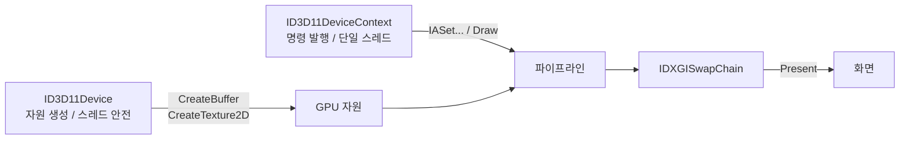
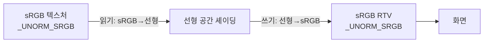
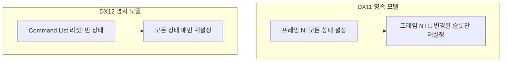

## 들어가며

DX12의 명시적 모델로 곧장 들어가기 전에, DX11의 묵시적 모델로 한 번 같은 결과를 만든다. 같은 회전하는 텍스처 큐브라도 DX11은 Constant Buffer 업데이트, Input Layout 검증, RS/OM 같은 파이프라인 단계 설정의 개념을 사용한다. 드라이버가 상태를 추적해 주는 만큼 코드는 짧지만, 어떤 상태가 언제 활성인지에 대한 직관이 DX12의 Pipeline State Object(PSO)를 이해할 토대가 된다. DX11은 *상태가 영속(sticky)* 하는 모델이고, DX12는 그 영속성을 명시적 객체로 굳힌 모델이다. 둘의 차이를 몸으로 알려면 먼저 영속 모델 안에서 한 프레임을 완성해 봐야 한다.

DX11은 2009년 Windows 7과 함께 등장했고, 그 핵심 추상은 Direct3D 10이 도입한 *상태 객체(State Object)* 와 *분리된 셰이더 자원 바인딩* 을 그대로 계승한다. Device가 자원을 만들고, Immediate Context가 상태를 설정하고 드로우 콜을 발행한다. 이 둘의 역할 분리 — *생성은 Device, 명령은 Context* — 가 DX11 코드 전체를 관통하는 규칙이다. Device 호출은 스레드 안전하지만 Immediate Context 호출은 단일 스레드에서만 안전하다는 점도 이 분리에서 나온다.

여기까지의 코드 상태는 Device와 DXGI Swap Chain, sRGB RTV까지 갖춰져 있고, 셰이더 컴파일 도구(FXC/DXC)와 자원 모델의 개념이 정리됐다. 이 글에서 도달할 결과물은 디스크 텍스처가 입혀진 컬러 큐브가 화면에서 회전하는 한 프레임이다. 여섯 단계로 쌓는다.

1. `D3D11CreateDeviceAndSwapChain` 단일 호출과 디버그 레이어 활성화.
2. Input Layout의 셰이더 시그니처 검증 모델.
3. Constant Buffer의 `Map(DISCARD)` 패턴과 16바이트 정렬 규칙.
4. Texture2D, SRV, SamplerState의 분리와 sRGB 색공간 변환.
5. Rasterizer, Blend, DepthStencil 세 상태 객체.
6. Output Merger의 `OMSetRenderTargets`와 한 프레임의 전체 흐름.


---

## 목차
1. [DX11 디바이스/스왑체인 초기화](#1-dx11-디바이스스왑체인-초기화)
2. [Input Layout과 정점 셰이더 시그니처](#2-input-layout과-정점-셰이더-시그니처)
3. [Constant Buffer로 MVP 업로드](#3-constant-buffer로-mvp-업로드)
4. [텍스처 SRV와 Sampler State](#4-텍스처-srv와-sampler-state)
5. [Rasterizer / Blend / DepthStencil State](#5-rasterizer--blend--depthstencil-state)
6. [Output Merger와 한 프레임의 흐름](#6-output-merger와-한-프레임의-흐름)


---

## 1. DX11 디바이스/스왑체인 초기화

DX11의 진입점은 `D3D11CreateDeviceAndSwapChain` 한 번의 호출이다. 이 호출이 *Device, Immediate Context, Swap Chain* 트리오를 동시에 생성한다. 코드가 짧다는 점이 DX11의 특징이고, 그 짧음은 드라이버가 픽셀 포맷 협상, 어댑터 선택, 큐 관리 같은 결정을 대신 내려 주기 때문이다.

### Device, Context, Swap Chain의 역할 분리

세 객체는 생명주기와 역할이 다르다. *Device* 는 자원(버퍼, 텍스처, 셰이더, 상태 객체)을 만드는 팩토리다. `CreateBuffer`, `CreateTexture2D` 같은 호출의 주체이며, 여러 스레드에서 동시에 호출해도 안전하다. *Immediate Context* 는 파이프라인에 상태를 설정하고 드로우 콜을 발행하는 명령 발행자다. `IASetVertexBuffers`, `Draw`, `Map` 같은 호출의 주체이며 단일 스레드 전용이다. *Swap Chain* 은 DXGI가 관리하는 화면 출력 버퍼의 회전 목록이고, `Present`로 그린 결과를 화면에 내보낸다.



이 분리는 DX12에서 *Device + Command Queue + Command List* 로 더 세분화되지만, 큰 그림은 같다. 자원을 만드는 주체와 명령을 발행하는 주체가 다르다는 점이다.

### 생성 호출

스왑 체인 서술자를 먼저 채운다. `DXGI_SWAP_EFFECT_FLIP_DISCARD`는 Windows 10 이후 권장되는 플립 모델로, 데스크톱 합성기(DWM)와 협력해 추가 복사 없이 버퍼를 교환한다. 구형 `DXGI_SWAP_EFFECT_DISCARD`(BitBlt 모델)는 한 번 더 복사가 일어나 지연이 늘어난다.

```cpp
DXGI_SWAP_CHAIN_DESC scd{};
scd.BufferCount = 2;                                  // 플립 모델은 최소 2
scd.BufferDesc.Width  = 1280;
scd.BufferDesc.Height = 720;
scd.BufferDesc.Format = DXGI_FORMAT_R8G8B8A8_UNORM;   // 백 버퍼는 비-sRGB
scd.BufferDesc.RefreshRate = { 60, 1 };
scd.BufferUsage = DXGI_USAGE_RENDER_TARGET_OUTPUT;
scd.OutputWindow = hwnd;
scd.SampleDesc.Count = 1;                             // 플립 모델은 MSAA 불가
scd.Windowed = TRUE;
scd.SwapEffect = DXGI_SWAP_EFFECT_FLIP_DISCARD;
```

여기서 백 버퍼 포맷을 `R8G8B8A8_UNORM`(sRGB 아님)으로 두는 점이 중요하다. 플립 모델 스왑 체인은 버퍼 자체를 `_SRGB` 포맷으로 만들 수 없다. 대신 RTV를 `_SRGB`로 만들어 색공간 변환을 그 뷰에 위임한다. 이 트릭은 뒤의 RTV 생성에서 다시 나온다.

```cpp
D3D_FEATURE_LEVEL features[] = {
    D3D_FEATURE_LEVEL_11_1, D3D_FEATURE_LEVEL_11_0
};
D3D_FEATURE_LEVEL gotFeature;

UINT flags = 0;
#ifdef _DEBUG
    flags |= D3D11_CREATE_DEVICE_DEBUG;               // 디버그 레이어
#endif

ComPtr<ID3D11Device> device;
ComPtr<ID3D11DeviceContext> context;
ComPtr<IDXGISwapChain> swap;

HRESULT hr = D3D11CreateDeviceAndSwapChain(
    nullptr, D3D_DRIVER_TYPE_HARDWARE, nullptr, flags,
    features, _countof(features), D3D11_SDK_VERSION,
    &scd, swap.GetAddressOf(),
    device.GetAddressOf(), &gotFeature,
    context.GetAddressOf());
```

Feature Level 배열은 *시도 순서* 다. 드라이버가 11.1을 지원하면 11.1을, 아니면 11.0을 만든다. `gotFeature`로 실제 협상 결과를 받는다. 첫 어댑터 인자를 `nullptr`로 두면 OS 기본 어댑터를 쓴다. 멀티 GPU 환경에서 특정 GPU를 고르려면 `IDXGIFactory::EnumAdapters`로 어댑터를 열거해 명시한다.

### ComPtr와 COM 수명 관리

DX11의 모든 객체는 COM 인터페이스다. 참조 카운트로 수명이 관리되며, `Release` 호출이 카운트를 줄이고 0이 되면 파괴된다. 직접 `Release`를 부르는 대신 `Microsoft::WRL::ComPtr`을 쓴다. 소멸자가 `Release`를 자동으로 부르고, `GetAddressOf`는 출력 인자용 `T**`를, `Get`은 읽기용 `T*`를 돌려준다.

`IID_PPV_ARGS(&ptr)` 매크로는 인터페이스 ID와 `void**` 출력 인자를 한 번에 채워, 타입 불일치 실수를 컴파일 타임에 막는다. ComPtr의 대입은 참조 카운트를 올리고, `Reset`은 명시적으로 내린다. 순환 참조(서로를 ComPtr로 들고 있는 경우)는 누수를 만들 수 있어 한쪽을 raw 포인터나 weak 핸들로 끊어야 한다.

### 백 버퍼에서 RTV 만들기

스왑 체인이 내부에 만든 백 버퍼 텍스처를 꺼내 렌더 타겟 뷰(Render Target View)로 감싼다. 백 버퍼 텍스처는 `R8G8B8A8_UNORM`이지만, RTV의 포맷을 `_UNORM_SRGB`로 지정하면 셰이더가 출력한 선형 색상이 이 뷰를 통해 자동으로 sRGB로 인코딩되어 저장된다.

```cpp
ComPtr<ID3D11Texture2D> backBuffer;
swap->GetBuffer(0, IID_PPV_ARGS(&backBuffer));

D3D11_RENDER_TARGET_VIEW_DESC rtvDesc{};
rtvDesc.Format = DXGI_FORMAT_R8G8B8A8_UNORM_SRGB;   // RTV에서 sRGB 변환
rtvDesc.ViewDimension = D3D11_RTV_DIMENSION_TEXTURE2D;

ComPtr<ID3D11RenderTargetView> rtv;
device->CreateRenderTargetView(backBuffer.Get(), &rtvDesc, rtv.GetAddressOf());
```

같은 텍스처 메모리를 비-sRGB와 sRGB 두 시각으로 동시에 볼 수 있다는 점이 *뷰(View)* 의 본질이다(완전 타입 `_UNORM` 백 버퍼에 `_SRGB` RTV를 붙이는 것은 스왑 체인 한정 특례이고, 일반 자원은 typeless 포맷으로 만들어야 한다). 텍스처는 비트의 집합일 뿐이고, 그 비트를 어떻게 해석할지는 뷰가 결정한다. 이 분리가 DX의 자원 모델 전체를 떠받친다.

### 깊이 스텐실 텍스처와 DSV

깊이 버퍼는 스왑 체인이 만들어 주지 않으므로 직접 만든다. `D24_UNORM_S8_UINT`는 24비트 깊이와 8비트 스텐실을 한 텍셀에 담는다. 24비트 깊이는 16,777,216단계의 분해능을 가진다.

```cpp
D3D11_TEXTURE2D_DESC dsd{};
dsd.Width  = 1280;
dsd.Height = 720;
dsd.MipLevels = 1;
dsd.ArraySize = 1;
dsd.Format = DXGI_FORMAT_D24_UNORM_S8_UINT;
dsd.SampleDesc.Count = 1;                           // RTV와 샘플 수 일치 필수
dsd.Usage = D3D11_USAGE_DEFAULT;                     // GPU 전용
dsd.BindFlags = D3D11_BIND_DEPTH_STENCIL;

ComPtr<ID3D11Texture2D> depthTex;
device->CreateTexture2D(&dsd, nullptr, depthTex.GetAddressOf());

ComPtr<ID3D11DepthStencilView> dsv;
device->CreateDepthStencilView(depthTex.Get(), nullptr, dsv.GetAddressOf());
```

깊이 텍스처의 `SampleDesc.Count`는 컬러 렌더 타겟의 샘플 수와 반드시 일치해야 한다. 둘이 다르면 `OMSetRenderTargets`가 디버그 레이어 오류를 낸다. MSAA를 켜고 싶으면 컬러와 깊이 양쪽 모두 같은 샘플 수로 만들어야 한다.

### Viewport와 NDC 깊이 범위

뷰포트는 NDC 좌표를 화면 픽셀로 매핑하는 변환의 파라미터다.

```cpp
D3D11_VIEWPORT vp{};
vp.TopLeftX = 0; vp.TopLeftY = 0;
vp.Width  = 1280.0f;
vp.Height = 720.0f;
vp.MinDepth = 0.0f;
vp.MaxDepth = 1.0f;
context->RSSetViewports(1, &vp);
```

DX의 NDC 깊이 범위는 *[0, 1]* 로, OpenGL의 *[-1, 1]* 과 다르다. 이 차이는 투영 행렬에 직접 영향을 준다. 같은 카메라라도 DX용 투영 행렬과 GL용 투영 행렬의 세 번째 행이 다르다. `DirectX::XMMatrixPerspectiveFovLH`는 [0,1] 범위를 전제로 행렬을 만들고, GLM의 기본 `glm::perspective`는 [-1,1]을 전제로 만든다. GL 코드를 DX로 가져올 때 큐브의 깊이가 뒤집히거나 클리핑되는 버그는 대부분 이 범위 불일치에서 나온다. `MinDepth`/`MaxDepth`는 이 [0,1] 안의 하위 구간을 가리키며, 깊이를 특정 구간에 압축할 때(예: 스카이박스를 항상 1.0으로) 쓴다.

### 디버그 레이어 출력 확인

`D3D11_CREATE_DEVICE_DEBUG`가 활성이면 잘못된 호출, 일치하지 않는 포맷, 파괴된 자원 사용 같은 거의 모든 함정이 Visual Studio Output 창에 출력된다. 처음에는 잡음처럼 보이지만 대부분의 메시지가 실제 문제이므로 무시하지 않는다.

```text
D3D11 ERROR: ID3D11DeviceContext::PSSetShaderResources:
The 1th Shader Resource is set to a destroyed resource ...
```

이런 메시지가 런타임 크래시 직전의 유일한 단서인 경우가 많다. 더 강하게 잡으려면 `ID3D11InfoQueue`를 꺼내 특정 severity에서 디버거를 멈추게 할 수 있다.

```cpp
#ifdef _DEBUG
    ComPtr<ID3D11InfoQueue> infoQueue;
    if (SUCCEEDED(device.As(&infoQueue))) {
        infoQueue->SetBreakOnSeverity(D3D11_MESSAGE_SEVERITY_ERROR, TRUE);
        infoQueue->SetBreakOnSeverity(D3D11_MESSAGE_SEVERITY_CORRUPTION, TRUE);
    }
#endif
```

이렇게 두면 ERROR 메시지가 출력되는 그 순간 디버거가 멈춰, 어떤 드로우 콜이 원인인지 콜 스택에서 즉시 확인할 수 있다.

## 2. Input Layout과 정점 셰이더 시그니처

DX의 Input Layout은 *셰이더 시그니처와 짝을 이룬다*. CPU 측 정점 메모리의 바이트 배치를, 정점 셰이더가 기대하는 입력 구조로 어떻게 연결할지를 기술하는 객체다. 핵심은 이 객체를 만들 때 *정점 셰이더 바이트코드* 를 함께 넘긴다는 점이다. 바이트코드의 입력 시그니처와 레이아웃이 맞지 않으면 `CreateInputLayout`이 실패한다.

### 정점 구조체와 메모리 배치

큐브의 정점은 위치, 법선, UV를 가진다. `XMFLOAT3`는 12바이트, `XMFLOAT2`는 8바이트이므로 정점 하나는 32바이트다.

```cpp
struct Vertex {
    DirectX::XMFLOAT3 pos;      // offset 0,  12 bytes
    DirectX::XMFLOAT3 normal;   // offset 12, 12 bytes
    DirectX::XMFLOAT2 uv;       // offset 24, 8 bytes
};

static_assert(sizeof(Vertex) == 32, "Vertex layout");
```

`static_assert`로 크기를 못 박는 이유는, 구조체에 멤버를 추가하거나 컴파일러가 패딩을 넣으면 Input Layout의 오프셋 계산이 조용히 어긋나기 때문이다. 정점 데이터는 GPU가 바이트 오프셋으로 직접 읽으므로, C++ 측 `sizeof`와 레이아웃 서술이 어긋나면 정점이 통째로 깨진다.

### Input Layout 정의

레이아웃은 정점 버퍼의 각 바이트 구간에 시맨틱 이름을 붙인다.

```cpp
D3D11_INPUT_ELEMENT_DESC layout[] = {
    { "POSITION", 0, DXGI_FORMAT_R32G32B32_FLOAT, 0,  0,
      D3D11_INPUT_PER_VERTEX_DATA, 0 },
    { "NORMAL",   0, DXGI_FORMAT_R32G32B32_FLOAT, 0, 12,
      D3D11_INPUT_PER_VERTEX_DATA, 0 },
    { "TEXCOORD", 0, DXGI_FORMAT_R32G32_FLOAT,    0, 24,
      D3D11_INPUT_PER_VERTEX_DATA, 0 },
};
```

각 요소는 `(SemanticName, SemanticIndex, Format, InputSlot, AlignedByteOffset, InputClass, InstanceDataStepRate)` 순서다.

- `SemanticName`은 HLSL의 `: POSITION` 같은 시맨틱과 매칭된다. DX는 입력을 *이름* 으로 연결하므로, OpenGL의 `layout(location = 0)` 같은 숫자 위치보다 의미가 명확하다.
- `SemanticIndex`는 같은 이름이 여러 개일 때 구분한다. `TEXCOORD0`, `TEXCOORD1`처럼 UV 세트가 둘이면 인덱스 0과 1로 나눈다.
- `Format`은 그 필드의 비트 폭과 채널 수다. `R32G32B32_FLOAT`는 3개의 32비트 float, 즉 12바이트다.
- `InputSlot`은 0~15의 정점 버퍼 슬롯 번호다. 같은 슬롯의 모든 요소는 한 정점 버퍼에서 읽힌다.
- `AlignedByteOffset`은 정점 구조체 안의 바이트 오프셋이다. `D3D11_APPEND_ALIGNED_ELEMENT`를 쓰면 직전 요소의 끝에서 자동으로 누적한다.
- `InputClass`는 정점별(`PER_VERTEX_DATA`)인지 인스턴스별(`PER_INSTANCE_DATA`)인지를 구분한다. 인스턴싱에서 인스턴스 변환 행렬을 정점 버퍼로 넘길 때 후자를 쓴다.

### 인터리브드 vs 분리 버퍼

위 레이아웃은 위치/법선/UV를 한 버퍼에 *인터리브드(interleaved)* 로 묶는다(모두 InputSlot 0). 한 정점의 모든 속성이 메모리에서 인접하므로 캐시 지역성이 좋고, 모든 속성을 함께 읽는 일반 렌더링에 유리하다.

반대로 속성마다 별도 버퍼를 두는 *분리(planar)* 배치도 가능하다. 위치를 슬롯 0, 법선을 슬롯 1에 두면, 깊이 프리패스처럼 위치만 필요한 패스에서 위치 버퍼만 바인딩해 대역폭을 아낀다. 이 경우 각 요소의 `InputSlot`을 다르게 지정하고 `IASetVertexBuffers`에 여러 버퍼를 넘긴다.

### 정점 셰이더 컴파일

Input Layout 검증에 필요한 바이트코드를 먼저 컴파일한다.

```cpp
ComPtr<ID3DBlob> vsBlob;
ComPtr<ID3DBlob> errBlob;
HRESULT hr = D3DCompileFromFile(
    L"cube.hlsl", nullptr, D3D_COMPILE_STANDARD_FILE_INCLUDE,
    "VSMain", "vs_5_0",
    D3DCOMPILE_ENABLE_STRICTNESS,
    0,
    vsBlob.GetAddressOf(),
    errBlob.GetAddressOf());

if (errBlob) {
    OutputDebugStringA((const char*)errBlob->GetBufferPointer());
}

ComPtr<ID3D11VertexShader> vs;
device->CreateVertexShader(
    vsBlob->GetBufferPointer(), vsBlob->GetBufferSize(),
    nullptr, vs.GetAddressOf());
```

`D3DCompileFromFile`은 런타임 컴파일이다. 출시 빌드에서는 오프라인 컴파일러 `fxc.exe`로 미리 `.cso`(컴파일된 셰이더 오브젝트)를 만들어 두고 파일로 읽는 편이 시작 시간과 배포 의존성 면에서 낫다. `D3DCOMPILE_ENABLE_STRICTNESS`는 deprecated 문법을 오류로 승격해 잠재적 호환성 문제를 컴파일 타임에 드러낸다.

### Input Layout 생성과 검증

```cpp
ComPtr<ID3D11InputLayout> inputLayout;
hr = device->CreateInputLayout(
    layout, _countof(layout),
    vsBlob->GetBufferPointer(), vsBlob->GetBufferSize(),
    inputLayout.GetAddressOf());
```

VS 바이트코드의 입력 시그니처와 레이아웃 시그니처가 일치하지 않으면 `E_INVALIDARG`를 반환한다. 검증은 *이름과 인덱스* 기준으로 이뤄진다. 흔한 함정은 다음과 같다.

- HLSL에 `: TEXCOORD`가 없는데 레이아웃에는 `TEXCOORD`가 있다. 이 경우는 사실 허용되는데, 셰이더가 그 입력을 안 쓰면 무시되기 때문이다. 반대로 셰이더가 요구하는 시맨틱이 레이아웃에 없으면 실패한다.
- `Format`이 셰이더 측 타입과 폭이 안 맞는다. UV를 `float2`로 받는데 레이아웃에 `R32G32B32_FLOAT`(3채널)를 쓰면 요소 끝(24+12=36바이트)이 정점 stride 32를 넘어 이웃 정점의 바이트까지 읽게 된다.
- 시맨틱 인덱스 불일치. 셰이더가 `TEXCOORD1`을 요구하는데 레이아웃에 `TEXCOORD0`만 있으면 매칭되지 않는다.

검증을 통과한 Input Layout은 *같은 입력 시그니처를 가진 모든 정점 셰이더* 와 호환된다. 시그니처가 같으면 셰이더 본문이 달라도 같은 레이아웃을 재사용할 수 있어, 레이아웃을 셰이더마다 새로 만들 필요는 없다.

## 3. Constant Buffer로 MVP 업로드

Constant Buffer(상수 버퍼)는 드로우 콜 동안 모든 정점/픽셀이 공유하는 *균일(uniform)* 데이터를 담는다. MVP 행렬, 색 틴트, 시간 같은 값이다. 정점 버퍼가 정점마다 다른 데이터라면, 상수 버퍼는 한 드로우 안에서 변하지 않는 데이터다.

### HLSL 셰이더 전문

```hlsl
// cube.hlsl
cbuffer Frame : register(b0) {
    row_major float4x4 model;
    row_major float4x4 view;
    row_major float4x4 proj;
    float4   tint;
};

struct VSInput {
    float3 pos    : POSITION;
    float3 normal : NORMAL;
    float2 uv     : TEXCOORD0;
};

struct VSOutput {
    float4 pos    : SV_Position;
    float3 normal : NORMAL;
    float2 uv     : TEXCOORD0;
};

VSOutput VSMain(VSInput input) {
    VSOutput o;
    float4 worldPos = mul(float4(input.pos, 1.0), model);
    float4 viewPos  = mul(worldPos, view);
    o.pos    = mul(viewPos, proj);
    o.normal = mul(float4(input.normal, 0.0), model).xyz;
    o.uv     = input.uv;
    return o;
}

Texture2D    diffuseMap : register(t0);
SamplerState linearWrap : register(s0);

float4 PSMain(VSOutput input) : SV_Target {
    float4 albedo = diffuseMap.Sample(linearWrap, input.uv);
    return albedo * tint;
}
```

`SV_Position`은 시스템 값(System Value) 시맨틱으로, 래스터라이저에 넘기는 클립 공간 좌표다. `SV_Target`은 픽셀 셰이더의 출력이 렌더 타겟 0번으로 간다는 뜻이다. `: register(b0)`, `(t0)`, `(s0)`는 각각 상수 버퍼 슬롯 0, 텍스처 슬롯 0, 샘플러 슬롯 0에 바인딩됨을 명시한다. CPU 측 `VSSetConstantBuffers(0,...)`의 0과 이 `b0`이 짝을 이룬다.

### row_major와 행렬 곱 순서

`row_major` 한정자가 C++ 측 행렬 메모리 레이아웃과 셰이더 측 해석을 일치시킨다. HLSL의 기본은 column-major 저장이라, 한정자 없이 `XMFLOAT4X4`(행 우선 저장)를 그대로 올리면 행렬이 전치되어 큐브가 깨진다.

이 선택은 곱셈 순서와도 묶인다. 위 셰이더는 `mul(vector, matrix)` 순서, 즉 행 벡터를 왼쪽에 두는 관례를 쓴다. 이 관례에서 변환 합성은 `model * view * proj` 순서로 읽힌다. 만약 `mul(matrix, vector)`(열 벡터, 오른쪽)로 쓰면 행렬을 전치하고 곱 순서도 뒤집어야 한다. 둘을 섞으면 회전과 이동이 뒤죽박죽이 되므로, 코드베이스 전체에서 한 관례만 고른다. DirectXMath는 행 벡터 관례를 기본으로 설계됐으므로 `row_major` + `mul(v, M)` 조합이 자연스럽다.

### C++ 측 cbuffer 구조체

CPU 구조체는 HLSL의 `cbuffer` 레이아웃과 바이트 단위로 일치해야 한다.

```cpp
struct FrameCB {
    DirectX::XMFLOAT4X4 model;   // 64 bytes
    DirectX::XMFLOAT4X4 view;    // 64 bytes
    DirectX::XMFLOAT4X4 proj;    // 64 bytes
    DirectX::XMFLOAT4   tint;    // 16 bytes
};

static_assert(sizeof(FrameCB) % 16 == 0, "cbuffer alignment");
```

`XMFLOAT4X4`는 row-major 16바이트 4행, 총 64바이트다. cbuffer의 `float4x4`도 64바이트라 일치한다. 전체는 208바이트인데, 상수 버퍼 크기는 16바이트 배수여야 하므로 `static_assert`로 확인한다. 208은 16의 배수라 통과한다.

### HLSL 패킹 규칙의 함정

cbuffer 멤버 배치에는 함정이 있다. HLSL은 *4-컴포넌트(16바이트) 경계를 넘는 멤버를 다음 16바이트 경계로 밀어낸다*. 예를 들어 `float3` 다음에 `float`을 두면 둘이 한 16바이트에 들어가지만, `float2` 다음에 `float3`을 두면 `float3`이 16바이트 경계를 넘으므로 패딩이 끼어든다.

| C++ 순서 | 점유 | 비고 |
|---|---|---|
| `float a; float3 b;` | 16바이트 | `a`가 `b`의 앞 슬롯 채움, 패딩 없음 |
| `float3 a; float b;` | 16바이트 | `b`가 `a`의 남은 슬롯에 들어감 |
| `float2 a; float3 b;` | 32바이트 | `b`가 경계를 넘어 다음 줄로, 8바이트 패딩 |
| `float4x4 m; float4 v;` | 80바이트 | 정렬된 행렬 + 벡터, 패딩 없음 |

CPU 구조체에서 이 규칙을 무시하고 멤버를 나열하면, 같은 바이트가 셰이더에서 다른 멤버로 해석되어 디버깅이 어려운 시각 버그가 난다. 안전한 습관은 cbuffer를 `float4`/`float4x4` 단위로 정렬되게 설계하고, 작은 스칼라는 `float4`의 채널에 명시적으로 묶는 것이다.

### Buffer 생성 — DYNAMIC

매 프레임 CPU가 새 값을 쓰는 버퍼이므로 `D3D11_USAGE_DYNAMIC`과 CPU 쓰기 접근을 준다.

```cpp
D3D11_BUFFER_DESC cbd{};
cbd.ByteWidth = sizeof(FrameCB);
cbd.Usage = D3D11_USAGE_DYNAMIC;
cbd.BindFlags = D3D11_BIND_CONSTANT_BUFFER;
cbd.CPUAccessFlags = D3D11_CPU_ACCESS_WRITE;

ComPtr<ID3D11Buffer> frameCB;
device->CreateBuffer(&cbd, nullptr, frameCB.GetAddressOf());
```

DX11의 `Usage`는 누가 읽고 쓰는지에 따라 메모리 위치와 접근 권한을 정한다.

| Usage | GPU 읽기 | GPU 쓰기 | CPU 접근 | 용도 |
|---|---|---|---|---|
| `DEFAULT` | 가능 | 가능 | 불가 (UpdateSubresource) | 렌더 타겟, GPU 전용 버퍼 |
| `IMMUTABLE` | 가능 | 불가 | 불가 | 생성 시 한 번 채우고 안 바뀌는 데이터 |
| `DYNAMIC` | 가능 | 불가 | Map 쓰기 | 매 프레임 갱신되는 cbuffer |
| `STAGING` | 복사만 | 복사만 | Map 읽기/쓰기 | GPU→CPU 복사 중계 |

### 매 프레임 업데이트 — Map with DISCARD

```cpp
void UpdateFrameCB(const FrameCB& cb) {
    D3D11_MAPPED_SUBRESOURCE map;
    context->Map(frameCB.Get(), 0, D3D11_MAP_WRITE_DISCARD, 0, &map);
    memcpy(map.pData, &cb, sizeof(cb));
    context->Unmap(frameCB.Get(), 0);
}
```

`D3D11_MAP_WRITE_DISCARD`는 현재 백킹 메모리를 버리고 새 페이지를 할당받게 한다. GPU가 아직 이전 프레임의 상수 버퍼를 읽는 중이어도 CPU는 새 페이지에 쓰므로 충돌이 없다. 드라이버는 내부적으로 같은 버퍼에 대한 여러 페이지를 *링 버퍼* 처럼 돌려쓰며, GPU가 다 읽은 페이지를 재활용한다. 이 *DYNAMIC + DISCARD* 조합이 매 프레임 갱신되는 작은 버퍼의 표준 패턴이다.

대안인 `D3D11_MAP_WRITE_NO_OVERWRITE`는 페이지를 새로 잡지 않고, 이미 쓴 영역과 겹치지 않는 부분만 추가로 쓴다. 한 프레임에 여러 객체의 데이터를 큰 버퍼에 차곡차곡 쌓는 *서브 할당(sub-allocation)* 패턴에 쓴다. 잘못 쓰면 GPU가 읽는 중인 영역을 덮어쓰므로 NO_OVERWRITE는 약속(겹치지 않음)을 지킬 때만 안전하다.

`DEFAULT` 버퍼를 갱신할 때 쓰는 `UpdateSubresource`도 있지만, 매 프레임 갱신에는 Map/DISCARD가 더 적합하다. `UpdateSubresource`는 내부 임시 복사가 한 번 더 일어날 수 있어 자주 갱신하는 작은 버퍼에는 비효율적이다.

### 슬롯 바인딩

```cpp
context->VSSetConstantBuffers(0, 1, frameCB.GetAddressOf());
context->PSSetConstantBuffers(0, 1, frameCB.GetAddressOf());
```

같은 cbuffer를 VS와 PS 두 단계에 묶는다. DX11은 단계별 자원 바인딩이 명시적이라, VS와 PS가 같은 버퍼를 쓰더라도 각각 호출해야 한다. 이 설계는 단계마다 다른 자원을 바인딩하는 유연함을 주지만, 호출 수가 늘어난다. DX12의 Root Signature는 기본적으로 모든 단계가 공유하는 모델이라 이런 중복 호출이 줄어든다.

## 4. 텍스처 SRV와 Sampler State

DX11에서 셰이더가 텍스처를 읽으려면 두 객체가 필요하다. 텍스처 데이터를 셰이더 입력으로 노출하는 *Shader Resource View(SRV)* 와, 그 데이터를 어떤 필터로 어떤 주소 모드로 읽을지 정하는 *Sampler State* 다. 이 둘의 분리가 DX11 텍스처 모델의 핵심이다.

### 텍스처 데이터 로드

DirectXTK의 `CreateWICTextureFromFile`이 가장 간편하지만, 픽셀 배치를 명시적으로 보이기 위해 stb_image로 로드해 직접 `CreateTexture2D`를 쓴다.

```cpp
int w, h, ch;
stbi_uc* pixels = stbi_load("brick.png", &w, &h, &ch, 4);   // 강제 RGBA

D3D11_TEXTURE2D_DESC td{};
td.Width  = w;
td.Height = h;
td.MipLevels = 1;
td.ArraySize = 1;
td.Format = DXGI_FORMAT_R8G8B8A8_UNORM_SRGB;    // sRGB 텍스처
td.SampleDesc.Count = 1;
td.Usage = D3D11_USAGE_IMMUTABLE;                // 한 번 채우고 불변
td.BindFlags = D3D11_BIND_SHADER_RESOURCE;

D3D11_SUBRESOURCE_DATA init{};
init.pSysMem = pixels;
init.SysMemPitch = w * 4;                         // 한 행의 바이트 수

ComPtr<ID3D11Texture2D> diffuseTex;
device->CreateTexture2D(&td, &init, diffuseTex.GetAddressOf());
stbi_image_free(pixels);
```

`SysMemPitch`는 한 행의 바이트 수다. RGBA8이면 `폭 × 4`다. 이 값을 틀리면 텍스처가 사선으로 밀려 보이는 전형적인 버그가 난다. `IMMUTABLE`은 GPU 전용 메모리에 올리고 이후 수정 불가라, 한 번 로드하면 안 바뀌는 디퓨즈 맵에 적합하다.

### sRGB 색공간과 자동 변환

`_UNORM_SRGB` 포맷은 텍셀을 읽을 때 sRGB → 선형 변환을 자동으로 한다. 디퓨즈 텍스처(알베도)는 보통 sRGB 공간에 저장되므로, 셰이더에서 라이팅 계산을 선형 공간에서 하려면 읽는 순간 선형으로 풀어야 한다. `_SRGB` 포맷이 그 변환을 GPU 텍스처 유닛에서 공짜로 해 준다.

여기서 *어떤 텍스처가 sRGB이고 어떤 것이 아닌지* 의 구분이 중요하다. 알베도/디퓨즈는 sRGB지만, 법선 맵(normal map), 러프니스 맵, 메탈릭 맵 같은 *데이터 텍스처* 는 선형 데이터라 비-sRGB 포맷(`_UNORM`)으로 읽어야 한다. 법선 맵을 `_SRGB`로 읽으면 색공간 변환이 법선 벡터를 왜곡해 라이팅이 미묘하게 틀어진다.



이 흐름의 양 끝(텍스처 읽기, RTV 쓰기)에서 자동 변환이 일어나므로, 셰이더 본문은 항상 *선형 공간* 만 다루면 된다.

### SRV 생성

```cpp
ComPtr<ID3D11ShaderResourceView> diffuseSRV;
device->CreateShaderResourceView(diffuseTex.Get(), nullptr, diffuseSRV.GetAddressOf());
```

`SRV_DESC`를 `nullptr`로 두면 텍스처의 모든 mip과 모든 배열 슬라이스가 자동으로 노출된다. 특정 mip 한 장이나 텍스처 배열의 한 슬라이스만 보고 싶을 때만 서술자를 명시한다. 같은 비트를 sRGB와 선형 두 시각으로 보려면 자원을 `DXGI_FORMAT_R8G8B8A8_TYPELESS` 같은 typeless 포맷으로 만들고, 호환되는 `_UNORM`·`_UNORM_SRGB` 포맷을 각 SRV에 지정해야 한다. 완전 타입 자원은 단순히 비트 폭이 같다는 이유만으로 다른 포맷의 뷰를 만들 수 없다.

### Sampler State

샘플러는 텍스처를 *어떻게* 읽을지를 정한다. 데이터(텍스처)와 읽기 방법(샘플러)을 분리하는 것이 DX의 설계다.

```cpp
D3D11_SAMPLER_DESC sd{};
sd.Filter = D3D11_FILTER_MIN_MAG_MIP_LINEAR;     // 삼선형 필터
sd.AddressU = D3D11_TEXTURE_ADDRESS_WRAP;
sd.AddressV = D3D11_TEXTURE_ADDRESS_WRAP;
sd.AddressW = D3D11_TEXTURE_ADDRESS_WRAP;
sd.MaxAnisotropy = 1;
sd.ComparisonFunc = D3D11_COMPARISON_NEVER;
sd.MinLOD = 0;
sd.MaxLOD = D3D11_FLOAT32_MAX;

ComPtr<ID3D11SamplerState> linearWrap;
device->CreateSamplerState(&sd, linearWrap.GetAddressOf());
```

`Filter`는 확대(MAG), 축소(MIN), mip 간 보간(MIP)을 각각 점/선형 중 무엇으로 할지 묶어 정한다. `MIN_MAG_MIP_LINEAR`는 삼선형(trilinear)이다. 이방성 필터링을 쓰려면 `Filter`를 `D3D11_FILTER_ANISOTROPIC`으로 바꾸고 `MaxAnisotropy`를 2~16으로 올린다. 이방성은 비스듬히 보이는 바닥 텍스처의 선명도를 크게 개선하지만 대역폭을 더 쓴다.

`AddressU/V/W`는 [0,1] 밖의 UV를 어떻게 처리할지다. `WRAP`은 반복(타일링), `CLAMP`는 가장자리 텍셀 유지, `MIRROR`는 거울 반복, `BORDER`는 지정한 테두리 색이다. 타일링 텍스처는 WRAP, UI 아틀라스나 그림자 맵은 CLAMP가 보통이다.

### Sampler와 Texture 분리의 의미

샘플러와 텍스처가 분리되어 있어, 한 텍스처를 여러 샘플러로 다르게 샘플링할 수 있다. 같은 벽돌 텍스처를 *bilinear + wrap* 으로도, *point + clamp* 로도 읽을 수 있다. 반대로 한 샘플러를 여러 텍스처에 공유할 수도 있다. 게임 엔진은 보통 자주 쓰는 샘플러(선형 wrap, 점 clamp, 이방성 wrap 등)를 시작 시 몇 개 만들어 두고 전역으로 돌려 쓴다.

OpenGL의 구형 모델은 텍스처 유닛에 필터 상태가 텍스처와 함께 묶여 있어, 같은 텍스처를 다른 필터로 쓰려면 상태를 바꿔야 했다(GL 3.3의 Sampler Object가 이를 해결한다). DX는 처음부터 분리되어 더 유연하지만, 슬롯 관리가 늘어난다. 텍스처 슬롯(`t#`)과 샘플러 슬롯(`s#`)이 별개의 번호 공간이라, 셰이더의 `register(t0)`/`register(s0)`와 CPU의 바인딩 인덱스를 따로 맞춰야 한다.

### 바인딩

```cpp
context->PSSetShaderResources(0, 1, diffuseSRV.GetAddressOf());
context->PSSetSamplers(0, 1, linearWrap.GetAddressOf());
```

`PSSetShaderResources`의 첫 인자 0이 셰이더의 `register(t0)`와, `PSSetSamplers`의 0이 `register(s0)`와 짝을 이룬다. 텍스처를 바인딩 해제하지 않고 그대로 둔 채 그 텍스처를 다음 패스에서 렌더 타겟으로 쓰려 하면, 디버그 레이어가 *읽기/쓰기 동시 바인딩* 경고를 낸다. 이때 `PSSetShaderResources(0, 1, &nullSRV)`로 명시적으로 해제해야 한다.

## 5. Rasterizer / Blend / DepthStencil State

DX11은 세 상태 객체가 래스터라이저(RS)와 출력 병합기(OM) 단계의 행동을 결정한다. 이 객체들은 *불변(immutable)* 이다. 한 번 만들면 내부 값을 바꿀 수 없고, 다른 설정이 필요하면 새 객체를 만든다. 미리 필요한 조합을 만들어 두고 드로우 콜 시점에 통째로 교체하는 패턴을 쓴다.

### Rasterizer State

래스터라이저는 삼각형을 픽셀로 변환하는 단계의 규칙을 정한다.

```cpp
D3D11_RASTERIZER_DESC rs{};
rs.FillMode = D3D11_FILL_SOLID;          // 와이어프레임은 D3D11_FILL_WIREFRAME
rs.CullMode = D3D11_CULL_BACK;           // 뒷면 제거
rs.FrontCounterClockwise = TRUE;         // CCW가 앞면
rs.DepthClipEnable = TRUE;
rs.MultisampleEnable = FALSE;
rs.ScissorEnable = FALSE;

ComPtr<ID3D11RasterizerState> rsState;
device->CreateRasterizerState(&rs, rsState.GetAddressOf());
```

`CullMode`는 어느 면을 버릴지다. `BACK`은 카메라 반대를 향한 뒷면을 제거해, 닫힌 메시에서 드로우할 픽셀을 절반으로 줄인다. 어느 쪽이 앞면인지는 `FrontCounterClockwise`가 정한다. `TRUE`면 화면에서 반시계 방향으로 감긴 삼각형이 앞면이다. 이것이 OpenGL의 기본 컨벤션과 일치한다. DX의 기본은 `FALSE`(시계 방향이 앞면)이므로, OpenGL용 메시 데이터를 가져올 때 큐브의 면이 통째로 사라지는 버그는 대부분 이 와인딩 불일치에서 온다. 면이 안 보이면 `CullMode`를 `NONE`으로 잠깐 바꿔 와인딩 문제인지 먼저 확인한다.

`DepthClipEnable`은 near/far 평면 밖의 깊이를 잘라낼지다. 그림자 맵 렌더링에서는 이를 끄고 깊이를 [0,1]로 클램프(`DepthClampEnable` 역할)하는 변형을 쓰기도 한다.

### Blend State

블렌드는 픽셀 셰이더가 출력한 색을 기존 렌더 타겟 색과 어떻게 섞을지를 정한다. 불투명 큐브는 블렌딩이 필요 없다.

```cpp
D3D11_BLEND_DESC bd{};
bd.RenderTarget[0].BlendEnable = FALSE;
bd.RenderTarget[0].RenderTargetWriteMask = D3D11_COLOR_WRITE_ENABLE_ALL;

// 알파 블렌딩 활성화 (투명 객체용)
// bd.RenderTarget[0].BlendEnable = TRUE;
// bd.RenderTarget[0].SrcBlend  = D3D11_BLEND_SRC_ALPHA;
// bd.RenderTarget[0].DestBlend = D3D11_BLEND_INV_SRC_ALPHA;
// bd.RenderTarget[0].BlendOp   = D3D11_BLEND_OP_ADD;

ComPtr<ID3D11BlendState> blendState;
device->CreateBlendState(&bd, blendState.GetAddressOf());
```

주석의 알파 블렌딩 조합은 표준 *over* 연산이다. 결과는 `src.rgb × src.a + dst.rgb × (1 - src.a)`로, 반투명 객체를 뒤 배경 위에 얹는다. 이 공식이 올바르려면 투명 객체를 *뒤에서 앞 순서로 정렬* 해 그려야 하고, 깊이 쓰기를 꺼야 한다. 그렇지 않으면 가까운 투명 면이 깊이 버퍼를 막아 뒤 면이 사라진다.

`RenderTargetWriteMask`는 RGBA 중 어느 채널에 쓸지를 비트로 정한다. 알파만 쓰거나 RGB만 쓰는 패스(예: 일부 후처리)에서 채널을 골라 막는다. 프리멀티플라이드 알파(premultiplied alpha)를 쓰면 `SrcBlend`를 `ONE`으로 두는데, 텍스처 아틀라스의 가장자리 블리딩을 줄이는 장점이 있다.

### Depth Stencil State

깊이 테스트는 가까운 표면이 먼 표면을 가리도록 한다.

```cpp
D3D11_DEPTH_STENCIL_DESC dsd{};
dsd.DepthEnable = TRUE;
dsd.DepthWriteMask = D3D11_DEPTH_WRITE_MASK_ALL;
dsd.DepthFunc = D3D11_COMPARISON_LESS;     // 더 작은 깊이가 통과
dsd.StencilEnable = FALSE;

ComPtr<ID3D11DepthStencilState> dsState;
device->CreateDepthStencilState(&dsd, dsState.GetAddressOf());
```

`DepthFunc = LESS`는 새 픽셀의 깊이가 기존 값보다 작을 때(더 가까울 때) 통과시킨다. DX의 NDC 깊이는 [0,1]이라 0이 near, 1이 far다. `DepthWriteMask = ALL`은 통과한 픽셀의 깊이를 버퍼에 쓴다.

투명 객체를 그릴 때는 같은 깊이 상태를 재사용하되 `DepthWriteMask`만 `ZERO`로 바꾼 별도 객체를 만든다. 깊이 테스트(가려짐 판정)는 하되 깊이 쓰기는 안 해, 여러 투명 면이 서로의 깊이를 막지 않게 한다. 상태 객체가 불변이므로 이런 변형마다 새 객체가 필요하고, 엔진은 흔히 쓰는 조합 몇 개(불투명, 투명, UI, 스카이박스)를 시작 시 캐시한다.

스텐실을 켜면 마스킹, 윤곽선, 포털 같은 기법에 쓸 수 있다. 큐브 한 개에는 불필요하므로 끈다.

### 세 상태의 바인딩

```cpp
context->RSSetState(rsState.Get());
context->OMSetBlendState(blendState.Get(), nullptr, 0xFFFFFFFF);
context->OMSetDepthStencilState(dsState.Get(), 0);
```

`OMSetBlendState`의 둘째 인자는 블렌드 팩터(`SrcBlend`가 `BLEND_FACTOR`일 때 쓰는 상수 색), 셋째는 멀티샘플 커버리지 마스크다. `0xFFFFFFFF`는 모든 샘플을 쓴다는 뜻이다. `OMSetDepthStencilState`의 둘째 인자는 스텐실 참조 값으로, 스텐실을 켤 때 비교 기준이 된다.

이 세 호출이 DX12에서는 PSO 안의 멤버로 통합된다. DX11의 분산된 상태 설정이 PSO의 `RasterizerState`, `BlendState`, `DepthStencilState` 필드로 합쳐지고, 거기에 셰이더와 Input Layout, 렌더 타겟 포맷까지 한 객체로 묶인다. PSO를 만드는 순간 드라이버가 모든 상태 조합을 한 번에 컴파일하므로, 드로우 시점의 검증과 셰이더 재컴파일 비용이 사라진다. DX11에서 이 비용은 매 상태 변경마다 드라이버 안에서 조금씩 발생한다.

## 6. Output Merger와 한 프레임의 흐름

출력 병합기(Output Merger, OM)는 파이프라인의 마지막 단계로, 픽셀 셰이더 출력을 깊이/스텐실 테스트와 블렌딩을 거쳐 렌더 타겟에 기록한다. 이 단계의 핵심 설정이 *어떤 렌더 타겟과 깊이 버퍼에 쓸지* 다.

### 렌더 타겟 바인딩

```cpp
context->OMSetRenderTargets(1, rtv.GetAddressOf(), dsv.Get());
```

RTV 배열과 DSV 하나를 묶는다. 여러 렌더 타겟에 동시에 쓰는 Multiple Render Targets(MRT)는 RTV 배열을 N개로 확장하고, 픽셀 셰이더가 `SV_Target0`, `SV_Target1`처럼 여러 출력을 낸다. 디퍼드 렌더링의 G-buffer가 이 방식으로 위치/법선/알베도를 한 패스에 기록한다. 깊이 버퍼는 항상 하나만 묶이고, 모든 RTV와 같은 해상도/샘플 수여야 한다.

### 한 프레임의 전체 흐름

지금까지의 모든 조각을 한 함수에 모은다. DX11에서 한 드로우는 *상태 설정 → 자원 바인딩 → 드로우 → Present* 의 순서로 흐른다.

```cpp
void RenderFrame(const FrameCB& cb) {
    // 1. cbuffer 업데이트
    UpdateFrameCB(cb);

    // 2. 출력 대상과 뷰포트
    context->OMSetRenderTargets(1, rtv.GetAddressOf(), dsv.Get());
    context->RSSetViewports(1, &viewport);

    // 3. 클리어
    const float clearColor[] = { 0.05f, 0.05f, 0.10f, 1.0f };
    context->ClearRenderTargetView(rtv.Get(), clearColor);
    context->ClearDepthStencilView(dsv.Get(),
        D3D11_CLEAR_DEPTH | D3D11_CLEAR_STENCIL, 1.0f, 0);
```

클리어 깊이를 1.0으로 두는 이유는 `DepthFunc = LESS`에서 far가 1.0이기 때문이다. 모든 픽셀이 far로 초기화되어 있어야 첫 드로우의 표면이 무조건 통과한다.

```cpp
    // 4. 파이프라인 상태 (RS / OM)
    context->RSSetState(rsState.Get());
    context->OMSetBlendState(blendState.Get(), nullptr, 0xFFFFFFFF);
    context->OMSetDepthStencilState(dsState.Get(), 0);

    // 5. 입력 어셈블리 (IA)
    context->IASetInputLayout(inputLayout.Get());
    context->IASetPrimitiveTopology(D3D11_PRIMITIVE_TOPOLOGY_TRIANGLELIST);

    UINT stride = sizeof(Vertex);
    UINT offset = 0;
    context->IASetVertexBuffers(0, 1, vb.GetAddressOf(), &stride, &offset);
    context->IASetIndexBuffer(ib.Get(), DXGI_FORMAT_R32_UINT, 0);
```

`IASetPrimitiveTopology`는 정점을 어떻게 묶어 도형을 만들지다. `TRIANGLELIST`는 인덱스 3개마다 한 삼각형이다. 큐브는 6면 × 2삼각형 × 3인덱스 = 36인덱스다. 인덱스 포맷 `R32_UINT`는 32비트 인덱스로 최대 약 43억 정점을 다룬다. 정점이 65,536개 미만이면 `R16_UINT`(16비트)로 바꿔 인덱스 버퍼 대역폭을 절반으로 줄일 수 있다.

```cpp
    // 6. 셰이더
    context->VSSetShader(vs.Get(), nullptr, 0);
    context->PSSetShader(ps.Get(), nullptr, 0);

    // 7. 자원 바인딩
    context->VSSetConstantBuffers(0, 1, frameCB.GetAddressOf());
    context->PSSetConstantBuffers(0, 1, frameCB.GetAddressOf());
    context->PSSetShaderResources(0, 1, diffuseSRV.GetAddressOf());
    context->PSSetSamplers(0, 1, linearWrap.GetAddressOf());

    // 8. 드로우
    context->DrawIndexed(36, 0, 0);    // 큐브 = 36 인덱스

    // 9. Present
    swap->Present(1, 0);
}
```

`DrawIndexed(36, 0, 0)`의 인자는 (인덱스 수, 인덱스 버퍼 시작 위치, 정점 버퍼 베이스 오프셋)이다. `Present(1, 0)`의 첫 인자 1은 V-Sync 간격으로, 다음 수직 동기 신호까지 대기한다. 0으로 두면 즉시 표시(티어링 가능)다.

### 상태의 영속성



DX11과 DX12의 결정적 차이는 *상태가 영속(sticky)* 하느냐다. DX11은 이전 프레임에 설정한 바인딩이 그대로 유지되므로, 다음 프레임에 변하지 않는 상태는 다시 호출할 필요가 없다. 위 `RenderFrame`은 명료함을 위해 모든 상태를 매번 설정하지만, 실전에서는 *바뀐 슬롯만* 다시 호출해 드라이버 호출 수를 줄인다. 반면 DX12의 Command List는 리셋되면 빈 상태에서 시작하므로 모든 상태를 매번 다시 기록해야 한다. 이 차이가 DX11 코드를 짧게, DX12 코드를 명시적으로 만든다.

영속성에는 함정도 있다. 한 객체를 그린 뒤 다른 객체용으로 일부 상태만 바꾸면, 깜빡한 상태가 이전 값으로 남아 의도치 않은 결과가 난다. 예를 들어 투명 객체 뒤 불투명 객체를 그릴 때 블렌드 상태를 되돌리지 않으면 불투명 객체가 반투명하게 보인다. 영속 모델에서는 *각 드로우가 자신이 의존하는 모든 상태를 책임지고 설정* 하는 규율이 안전하다.

### sRGB 백 버퍼와 더블 감마 함정

RTV에 `_UNORM_SRGB` 포맷을 쓰면 셰이더가 출력한 선형 값이 자동으로 감마 보정되어 저장된다. 만약 셰이더에서 `pow(c, 1/2.2)`를 한 번 더 하면 이중 감마가 되어 결과가 너무 밝아진다. DX11 셰이더는 항상 선형 공간에서 계산하고 sRGB RTV에 출력만 하는 패턴이 표준이다.

```hlsl
float4 PSMain(VSOutput input) : SV_Target {
    float4 albedo = diffuseMap.Sample(linearWrap, input.uv);
    // diffuseMap이 _UNORM_SRGB면 읽을 때 자동 선형 변환
    // RTV가 _UNORM_SRGB면 출력 시 자동 감마 변환 후 저장
    return albedo;
}
```

텍스처의 sRGB → 선형 자동 변환과 RTV의 선형 → sRGB 자동 변환, 이 두 자동 변환이 셰이더가 선형 공간만 다루도록 만든다. 라이팅이 추가되어도 같은 원리다. 모든 조명 계산은 선형 알베도와 선형 광량으로 하고, 최종 결과를 sRGB RTV에 던지면 화면 표시용 감마는 GPU가 처리한다.

### 디버그 도구 — RenderDoc / PIX

DirectX 디버깅의 표준 도구다. 한 프레임의 GPU 명령을 캡처해 각 드로우 콜의 입력/출력/상태를 시각화한다. CPU 디버거로는 보이지 않는 GPU 상태 — 바인딩된 텍스처의 실제 픽셀, 정점 버퍼의 내용, 깊이 버퍼의 단계별 변화 — 가 한눈에 드러난다.

- *RenderDoc* 은 무료 오픈소스로 DX11/DX12/Vulkan을 모두 지원한다. 가장 일반적이다.
- *PIX on Windows* 는 Microsoft 제품으로 DX12와 Xbox에 특화되어 GPU 타임라인 분석이 강점이다.

큐브가 화면에 안 보일 때 디버깅 순서는 이렇다. 먼저 디버그 레이어 메시지를 본다. 메시지가 없으면 RenderDoc으로 프레임을 캡처해 드로우 콜이 발행됐는지 확인한다. 발행됐다면 입력 정점이 올바른지, VS 출력이 클립 공간 안에 있는지, 래스터라이즈된 픽셀이 있는지, 픽셀 셰이더 출력이 깊이 테스트를 통과했는지를 단계별로 좁혀 간다. 대부분의 "검은 화면" 버그는 와인딩(컬링), 깊이 함수, 투영 행렬의 손좌표/깊이 범위 중 하나로 수렴한다.

마커를 박아 두면 캡처 가독성이 올라간다. `ID3DUserDefinedAnnotation`을 꺼내 `BeginEvent`/`EndEvent`로 패스를 묶으면, RenderDoc의 호출 트리가 "Shadow Pass", "Main Pass"처럼 그룹화되어 보인다.


---

## 결론

여기까지의 코드는 텍스처가 적용된 회전하는 큐브 한 프레임을 만든다. DX11의 묵시적 상태 머신, COM 핸들 관리, Input Layout의 셰이더 시그니처 검증, cbuffer의 16바이트 정렬과 Map/DISCARD, Texture/Sampler 분리, 세 상태 객체와 Output Merger까지, DirectX의 기본 감각이 한 흐름에 모였다. 그 바탕에는 *생성은 Device, 명령은 Context, 뷰가 자원의 해석을 결정한다* 는 세 규칙이 깔려 있다.

이 글의 트레이드오프는 영속성에서 나온다. DX11은 상태가 영속하므로 코드가 짧지만, 깜빡한 상태가 이전 드로우의 값으로 남는 함정을 안는다. 매 드로우가 자신의 모든 의존 상태를 책임지는 규율로 이를 막는다. sRGB 색공간은 텍스처 읽기와 RTV 쓰기 양 끝의 자동 변환에 맡겨, 셰이더 본문이 선형 공간만 다루게 하는 것이 정답이다. 더블 감마는 이 분담을 어겼을 때 생긴다.

단일 텍스처·단일 메시는 다중 submesh와 material binding을 표현하지 못한다. 실사용 모델은 importer가 만든 submesh draw range, vertex/index format과 material별 SRV·sampler 묶음을 명시적으로 소유해야 한다. DX11의 분산된 상태 설정 비용은 큐브 하나가 아니라 수천 draw의 capture에서 측정하며, 상태 정렬·인스턴싱·deferred context를 적용해도 driver submission이 병목으로 남는지가 명시적 PSO·command list 모델을 선택할 근거가 된다.

## 더 읽을거리

- Microsoft Learn, [Direct3D 11 튜토리얼 시리즈](https://learn.microsoft.com/en-us/windows/win32/direct3dgetstarted/building-your-first-directx-app) — 공식 첫 드로우 가이드.
- Frank Luna, *Introduction to 3D Game Programming with DirectX 11*, Ch.6-8 — 같은 큐브→텍스처 경로의 교과서.
- [RenderDoc](https://renderdoc.org/) / Visual Studio Graphics Debugger — 상태 머신 함정을 잡는 표준 도구.
