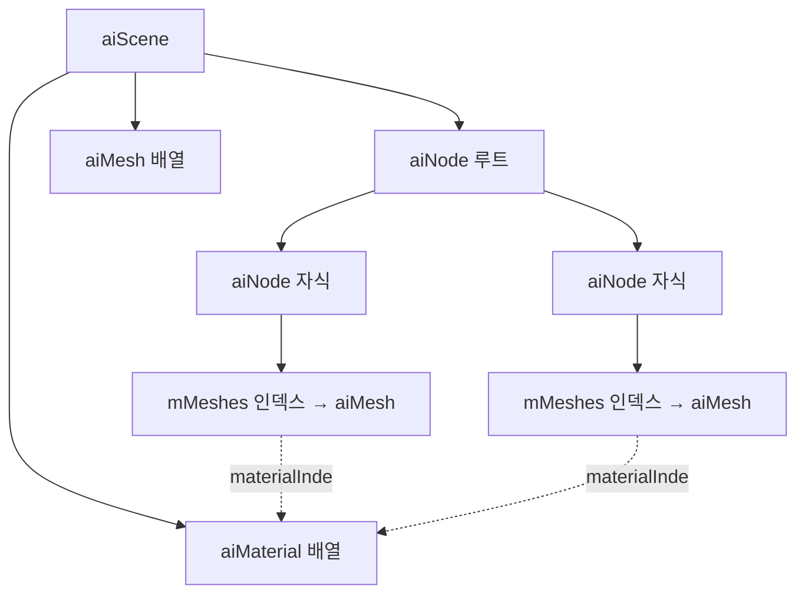

## 들어가며

큐브 한 개의 단일 메시에서는 더 나아갈 수 없다. 실제 게임 모델은 메시 여러 개로 나뉘어 있고, 각 메시는 디퓨즈(diffuse)·노멀(normal)·스페큘러(specular)·이미시브(emissive) 텍스처 세트를 별도로 가진다. 캐릭터 하나가 머리·몸통·갑옷·무기로 나뉘고, 건축물 하나가 벽·바닥·창틀·장식으로 나뉜다. 각 부분은 자기만의 정점 버퍼와 자기만의 재질을 들고 있으며, 한 프레임에 그려지는 모든 부분이 모여 하나의 모델이 된다.

이런 구조를 코드로 옮기려면 세 가지 변환을 거쳐야 한다. 첫째, 디스크의 모델 파일(FBX, glTF, OBJ)을 메모리의 트리 구조로 읽는다. 이 일은 Assimp(Open Asset Import Library)가 맡는다. 둘째, 그 트리를 DX11이 이해하는 자원으로 바꾼다. 정점 배열은 `ID3D11Buffer`가 되고, 텍스처 이미지는 `ID3D11ShaderResourceView`가 되며, 노드 변환은 행렬이 된다. 셋째, 메시 배열을 순회하며 메시마다 드로우 콜을 발급하되, 재질이 바뀔 때만 텍스처 슬롯을 다시 묶어 상태 변경 비용을 줄인다.

여기까지의 코드 상태는 큐브 한 개의 정점·인덱스·텍스처·셰이더·깊이·Present 흐름이 동작한다. 정점 버퍼 하나, 인덱스 버퍼 하나, 픽셀 셰이더 텍스처 한 장을 바인딩하고 `DrawIndexed`를 한 번 부르면 화면에 큐브가 뜬다. 이 글에서 도달할 결과물은 디퓨즈·노멀·스페큘러가 있는 외부 모델(예: Sponza, Damaged Helmet)이 DX11 파이프라인에서 자연스럽게 그려지는 상태다. 여섯 단계로 쌓는다.

1. Assimp의 정점 데이터를 DX11 정점 구조체로 패킹한다.
2. Mesh / Material 클래스의 핸들 묶음을 설계한다.
3. 텍스처 슬롯 `t0`~`t4`의 재질 표준 규약을 정한다.
4. DDS(BC 압축)와 WIC(PNG/JPG) 로더를 구분해 쓴다.
5. 메시 배열을 순회하며 드로우 콜을 발급한다.
6. DirectXTK의 SimpleMath, GeometricPrimitive를 활용한다.


---

## 목차
1. [Assimp → DX11 정점 패킹](#1-assimp--dx11-정점-패킹)
2. [Mesh 클래스의 핸들 묶음](#2-mesh-클래스의-핸들-묶음)
3. [재질별 텍스처 슬롯 규약](#3-재질별-텍스처-슬롯-규약)
4. [DDS와 WIC 텍스처 로더](#4-dds와-wic-텍스처-로더)
5. [메시별 드로우 콜](#5-메시별-드로우-콜)
6. [DirectXTK 활용](#6-directxtk-활용)


---

## 1. Assimp → DX11 정점 패킹

### Assimp가 만드는 트리 구조

Assimp는 수십 종의 모델 포맷을 하나의 공통 메모리 구조로 읽어 들인다. `ReadFile`이 반환하는 `aiScene`은 다음과 같은 트리다.



핵심은 두 가지 분리다. 첫째, `aiNode` 트리는 *변환 계층(scene graph)* 을 나타내고, 실제 정점은 가지지 않는다. 노드는 자기 변환 행렬과 자식 노드, 그리고 `aiMesh` 배열로의 인덱스만 들고 있다. 둘째, `aiMesh`와 `aiMaterial`은 `aiScene`이 평평한 배열로 따로 보관하고, 노드와 메시는 인덱스로 참조한다. 한 메시를 여러 노드가 인스턴싱하듯 참조할 수 있고, 한 재질을 여러 메시가 공유할 수 있다. 이 인덱스 참조 구조를 그대로 DX11 자원 구조로 옮기는 것이 이 절의 목표다.

### 정점 구조체

GPU 입력 어셈블러(Input Assembler)에 넘길 정점 한 개의 메모리 배치를 먼저 정한다.

```cpp
struct Vertex {
    DirectX::XMFLOAT3 pos;       // 12 B
    DirectX::XMFLOAT3 normal;    // 12 B
    DirectX::XMFLOAT2 uv;        //  8 B
    DirectX::XMFLOAT4 tangent;   // 16 B — w = handedness
};
static_assert(sizeof(Vertex) == 48, "Vertex layout");
```

탄젠트(tangent)를 `float4`로 저장하고 `w`에 비탄젠트(bitangent)의 부호 `±1`을 넣는다. MikkTSpace와 glTF 2.0이 채택한 표준 포맷이다. 좌우 대칭 UV를 쓰는 모델(캐릭터 얼굴, 좌우 대칭 텍스처 패킹)에서는 한쪽 절반의 UV가 뒤집혀 들어가는데, 이때 픽셀 셰이더가 비탄젠트를 `cross(N, T)`로만 재구성하면 절반의 법선이 반대로 향한다. `w` 부호를 저장해 두면 셰이더에서 `bitangent = cross(N, T.xyz) * T.w`로 복원해 이 함정을 막는다.

이 48바이트 배치에는 한 가지 더 따져 둘 점이 있다. 정점 구조체의 크기는 GPU의 정점 캐시 효율과 직결된다. 정점이 48바이트면 64바이트 캐시 라인 하나에 정점 하나가 들어가고 16바이트가 남는다. PBR에 필요한 최소 속성(위치·법선·UV·탄젠트)만 담아 48바이트로 맞춘 것은 의도된 선택이다. 정점 색상이나 두 번째 UV 세트, 스키닝 가중치를 추가하면 구조체가 커지고 대역폭이 늘어난다. 필요할 때만 추가한다.

### 입력 레이아웃

위 구조체를 GPU에 알려 주는 것이 입력 레이아웃(`ID3D11InputLayout`)이다. 셰이더의 정점 입력 시그니처와 정점 버퍼의 바이트 배치를 짝지어 준다.

```cpp
D3D11_INPUT_ELEMENT_DESC layout[] = {
    { "POSITION", 0, DXGI_FORMAT_R32G32B32_FLOAT,    0,  0, D3D11_INPUT_PER_VERTEX_DATA, 0 },
    { "NORMAL",   0, DXGI_FORMAT_R32G32B32_FLOAT,    0, 12, D3D11_INPUT_PER_VERTEX_DATA, 0 },
    { "TEXCOORD", 0, DXGI_FORMAT_R32G32_FLOAT,       0, 24, D3D11_INPUT_PER_VERTEX_DATA, 0 },
    { "TANGENT",  0, DXGI_FORMAT_R32G32B32A32_FLOAT, 0, 32, D3D11_INPUT_PER_VERTEX_DATA, 0 },
};
device->CreateInputLayout(layout, 4, vsBytecode, vsSize, inputLayout.GetAddressOf());
```

다섯 번째 인자(`AlignedByteOffset`)가 0, 12, 24, 32로 누적되는데, 이는 `Vertex` 구조체 안의 각 멤버 오프셋과 정확히 일치해야 한다. 어긋나면 셰이더가 엉뚱한 바이트를 법선이나 UV로 읽어 깨진 결과가 나온다. `D3D11_APPEND_ALIGNED_ELEMENT`를 오프셋 자리에 넣으면 드라이버가 직전 원소 크기로 자동 누적해 주므로, 손으로 오프셋을 적다 실수하는 일을 막는다.

### Assimp 호출과 후처리 플래그

`ReadFile`에 넘기는 후처리 플래그가 모델의 품질과 좌표계를 결정한다.

```cpp
unsigned flags =
    aiProcess_Triangulate |
    aiProcess_GenSmoothNormals |
    aiProcess_CalcTangentSpace |
    aiProcess_ConvertToLeftHanded |     // DX 좌표계
    aiProcess_JoinIdenticalVertices |
    aiProcess_ImproveCacheLocality;

Assimp::Importer importer;
const aiScene* scene = importer.ReadFile(path, flags);
if (!scene || (scene->mFlags & AI_SCENE_FLAGS_INCOMPLETE) || !scene->mRootNode) {
    std::fprintf(stderr, "Assimp: %s\n", importer.GetErrorString());
    return false;
}
```

각 플래그의 역할은 다음과 같다.

| 플래그 | 역할 | 빠뜨리면 |
|---|---|---|
| `aiProcess_Triangulate` | 사각형·다각형 면을 삼각형으로 분해 | GPU가 삼각형만 받으므로 그릴 수 없음 |
| `aiProcess_GenSmoothNormals` | 법선이 없는 메시에 부드러운 법선 생성 | 라이팅 계산 불가 |
| `aiProcess_CalcTangentSpace` | UV 기반 탄젠트·비탄젠트 계산 | 노멀 매핑 불가 |
| `aiProcess_ConvertToLeftHanded` | 좌표계·면 감김(winding)·UV를 DX 규약으로 변환 | 모델이 안팎으로 뒤집힘 |
| `aiProcess_JoinIdenticalVertices` | 중복 정점 병합, 인덱스 버퍼 생성 | 정점 수 폭증 |
| `aiProcess_ImproveCacheLocality` | 정점 캐시(ACMR) 최적화 순서로 재배열 | 정점 셰이더 재실행 증가 |

`aiProcess_ConvertToLeftHanded`는 한 플래그처럼 보이지만 실제로는 세 가지를 한꺼번에 처리한다. Z축을 뒤집어 왼손 좌표계로 만들고(`MakeLeftHanded`), 면의 정점 감김 순서를 시계방향으로 바꾸며(`FlipWindingOrder`), UV의 V축을 뒤집는다(`FlipUVs`). DX는 화면 안쪽이 +Z인 왼손 좌표계를 쓰고, 텍스처 좌표의 원점이 좌상단이다. OpenGL은 화면 바깥쪽이 +Z인 오른손 좌표계에 텍스처 원점이 좌하단이다. 이 세 가지가 어긋나면 모델이 거울상으로 뒤집히거나, 컬링이 반대로 동작해 앞면이 사라지거나, 텍스처가 위아래로 뒤집힌다. 셋을 따로 디버깅하다 시간을 버리는 대신 이 플래그 하나로 일괄 처리한다.

`aiProcess_JoinIdenticalVertices`는 인덱스 버퍼의 존재 이유다. 큐브 한 면은 정점 네 개로 충분하지만, 면마다 법선이 다르면 정점이 분리되어 24개가 된다. 위치·법선·UV가 모두 같은 정점만 병합되므로, 이 플래그를 켜면 면 경계에서 법선이 꺾이는 정점은 그대로 두고 평평한 면 안쪽의 공유 정점만 합친다.

### 정점 추출과 인터리브

`aiMesh` 하나에서 정점과 인덱스를 뽑아 `Vertex` 배열로 인터리브한다.

```cpp
void ExtractMesh(const aiMesh* m,
                  std::vector<Vertex>& vertices,
                  std::vector<uint32_t>& indices)
{
    vertices.reserve(m->mNumVertices);
    for (unsigned i = 0; i < m->mNumVertices; ++i) {
        Vertex v;
        v.pos    = { m->mVertices[i].x, m->mVertices[i].y, m->mVertices[i].z };
        v.normal = { m->mNormals [i].x, m->mNormals [i].y, m->mNormals [i].z };
        v.uv     = m->mTextureCoords[0]
                   ? DirectX::XMFLOAT2{ m->mTextureCoords[0][i].x,
                                         m->mTextureCoords[0][i].y }
                   : DirectX::XMFLOAT2{ 0.0f, 0.0f };

        // 탄젠트 + handedness 계산
        DirectX::XMFLOAT3 T = { m->mTangents  [i].x, m->mTangents  [i].y, m->mTangents  [i].z };
        DirectX::XMFLOAT3 B = { m->mBitangents[i].x, m->mBitangents[i].y, m->mBitangents[i].z };
        DirectX::XMFLOAT3 N = v.normal;
        // handedness = sign( dot( cross(N, T), B ) )
        DirectX::XMVECTOR vN = DirectX::XMLoadFloat3(&N);
        DirectX::XMVECTOR vT = DirectX::XMLoadFloat3(&T);
        DirectX::XMVECTOR vB = DirectX::XMLoadFloat3(&B);
        DirectX::XMVECTOR vC = DirectX::XMVector3Cross(vN, vT);
        float h = DirectX::XMVectorGetX(DirectX::XMVector3Dot(vC, vB)) < 0 ? -1.f : 1.f;
        v.tangent = { T.x, T.y, T.z, h };

        vertices.push_back(v);
    }

    indices.reserve(m->mNumFaces * 3);
    for (unsigned f = 0; f < m->mNumFaces; ++f) {
        const aiFace& face = m->mFaces[f];
        indices.push_back(face.mIndices[0]);
        indices.push_back(face.mIndices[1]);
        indices.push_back(face.mIndices[2]);
    }
}
```

UV를 읽을 때 `m->mTextureCoords[0]`가 null인지 먼저 검사한다. Assimp는 메시당 최대 8세트의 UV를 지원하고, UV가 없는 메시는 0번 포인터가 null이다. 검사 없이 역참조하면 크래시한다. UV가 없으면 0으로 채워 두고, 텍스처 슬롯에는 뒤에서 다룰 기본 텍스처를 묶어 흰색으로 처리한다.

`aiProcess_Triangulate`를 켰으므로 모든 `aiFace`의 `mNumIndices`는 3이다. 그래도 방어적으로 작성한다면 `if (face.mNumIndices != 3) continue;`를 한 줄 넣어 점·선 프리미티브가 섞여 들어온 경우를 걸러낸다. Assimp는 선분이나 점도 면으로 표현하므로, 삼각형만 그리는 파이프라인에서는 이 검사가 안전하다.

### Vertex Buffer / Index Buffer 생성

추출한 배열을 GPU 메모리로 올린다.

```cpp
ComPtr<ID3D11Buffer> CreateVB(ID3D11Device* device,
                                const std::vector<Vertex>& verts)
{
    D3D11_BUFFER_DESC bd{};
    bd.ByteWidth = (UINT)(sizeof(Vertex) * verts.size());
    bd.Usage = D3D11_USAGE_IMMUTABLE;
    bd.BindFlags = D3D11_BIND_VERTEX_BUFFER;

    D3D11_SUBRESOURCE_DATA init{};
    init.pSysMem = verts.data();

    ComPtr<ID3D11Buffer> buf;
    HRESULT hr = device->CreateBuffer(&bd, &init, buf.GetAddressOf());
    if (FAILED(hr)) return nullptr;
    return buf;
}
```

정점·인덱스 버퍼는 모델 로딩 시 한 번 채워진 뒤 프레임 중에 바뀌지 않는다. 그래서 `D3D11_USAGE_IMMUTABLE`을 쓴다. 이 사용 방식의 의미는 다음과 같다.

| Usage | CPU 접근 | GPU 접근 | 용도 |
|---|---|---|---|
| `IMMUTABLE` | 없음 (생성 시 1회) | 읽기 | 정적 정점/인덱스, 룩업 테이블 |
| `DEFAULT` | 없음 (`UpdateSubresource`만) | 읽기/쓰기 | 렌더 타깃, 가끔 갱신되는 자원 |
| `DYNAMIC` | 쓰기 (`Map`/`Unmap`) | 읽기 | 매 프레임 갱신되는 상수 버퍼 |
| `STAGING` | 읽기/쓰기 | 복사만 | GPU→CPU 리드백 |

`IMMUTABLE`은 생성 뒤 CPU와 GPU 어느 쪽에서도 내용을 바꾸지 않겠다는 사용 계약이다. 런타임과 드라이버는 이 정보를 배치·동기화 최적화에 활용할 수 있지만, API가 특정 VRAM 풀의 영구 상주나 정확한 물리 위치를 보장하는 것은 아니다. 생성 시 초기 데이터를 반드시 제공해야 하고 이후 `Map`·`UpdateSubresource` 대상으로 사용할 수 없다. 정점·인덱스처럼 수명 동안 읽기 전용인 자원에 이 계약이 정확히 맞는다.

## 2. Mesh 클래스의 핸들 묶음

### 자원을 묶는 세 구조체

Assimp의 인덱스 참조 구조를 DX11 자원 핸들로 옮긴다. 세 구조체로 나눈다.

```cpp
struct Material {
    ComPtr<ID3D11ShaderResourceView> diffuse;
    ComPtr<ID3D11ShaderResourceView> normal;
    ComPtr<ID3D11ShaderResourceView> specular;
    ComPtr<ID3D11ShaderResourceView> emissive;
    ComPtr<ID3D11ShaderResourceView> ao;
    ComPtr<ID3D11Buffer> materialCB;     // per-material 상수
};

struct Mesh {
    ComPtr<ID3D11Buffer> vb;
    ComPtr<ID3D11Buffer> ib;
    UINT indexCount;
    DXGI_FORMAT indexFormat;             // R16 또는 R32
    UINT materialIndex;                  // model.materials 인덱스
    DirectX::XMFLOAT4X4 localMatrix;     // node 누적 변환
};

struct Model {
    std::vector<Mesh> meshes;
    std::vector<Material> materials;
};
```

`Material`을 `Mesh`에서 분리한 이유는 공유다. 캐릭터의 몸 부위 메시 다섯 개가 같은 피부 재질을 쓰는 경우, 재질을 메시마다 복제하면 같은 텍스처 SRV가 다섯 벌 생기고 VRAM과 바인딩이 낭비된다. 대신 `Model::materials`에 재질을 한 벌만 두고 각 메시가 `materialIndex`로 가리킨다. 이는 Assimp가 `aiScene::mMaterials`를 배열로 두고 `aiMesh::mMaterialIndex`로 참조하는 구조를 그대로 옮긴 것이다.

`ComPtr`는 `Microsoft::WRL::ComPtr`로, COM 객체의 참조 카운트를 자동 관리하는 스마트 포인터다. `Mesh`나 `Material`이 소멸하면 들고 있던 SRV·버퍼의 `Release`가 자동으로 호출된다. 여러 `Material`이 같은 SRV를 공유하면 참조 카운트가 그만큼 올라가고, 마지막 소유자가 사라질 때 실제로 해제된다. 수작업으로 `Release`를 부르다 누락하거나 이중 해제하는 실수를 막는다.

### Assimp 노드 트리를 평탄화한다

`aiNode` 트리의 각 노드는 부모에 대한 상대 변환을 들고 있다. 한 메시의 최종 월드 변환은 루트에서 그 메시까지의 모든 노드 변환을 곱한 값이다. 매 프레임 트리를 재귀로 순회하며 곱을 누적할 수도 있지만, 트리가 정적이라면 로딩 시점에 한 번 평탄화해 각 메시에 누적 변환을 직접 박아 두는 편이 단순하다.

```cpp
void ProcessNode(const aiNode* node,
                  const DirectX::XMMATRIX& parentTransform,
                  const aiScene* scene,
                  ID3D11Device* device,
                  Model& model)
{
    DirectX::XMMATRIX local;
    std::memcpy(&local, &node->mTransformation, sizeof(local));
    // Assimp 행렬은 열 벡터 규약이므로 전치해 행 벡터 규약(v * M)으로 맞춘다.
    // 행 벡터 규약에서는 먼저 적용할 변환(로컬)이 곱셈의 왼쪽에 온다.
    DirectX::XMMATRIX accum =
        DirectX::XMMatrixTranspose(local) * parentTransform;

    for (unsigned i = 0; i < node->mNumMeshes; ++i) {
        const aiMesh* aim = scene->mMeshes[node->mMeshes[i]];
        Mesh m;
        BuildMesh(aim, device, m);
        m.materialIndex = aim->mMaterialIndex;
        DirectX::XMStoreFloat4x4(&m.localMatrix, accum);
        model.meshes.push_back(std::move(m));
    }

    for (unsigned i = 0; i < node->mNumChildren; ++i) {
        ProcessNode(node->mChildren[i], accum, scene, device, model);
    }
}
```

여기서 가장 흔한 함정이 행렬 순서다. Assimp의 `aiMatrix4x4`는 행 우선(row-major) 저장이다. DirectXMath의 `XMMATRIX`도 메모리상으로는 행 우선이지만, HLSL 셰이더는 기본적으로 열 우선(column-major)으로 행렬을 해석한다. 또 Assimp는 변환을 `M * v`(열 벡터) 규약으로 정의하는 반면 DirectXMath의 곱셈 헬퍼는 `v * M`(행 벡터) 규약을 전제한다. 이 규약 차이를 맞추려면 Assimp 행렬을 전치해 곱한 뒤, 최종적으로 상수 버퍼에 넣을 때 한 번 더 전치해 HLSL에 보낸다. 이 두 번의 전치 중 하나를 빠뜨리면 모델이 엉뚱하게 회전하거나 찌그러진다. `aiProcess_PreTransformVertices` 플래그로 Assimp가 노드 변환을 정점에 미리 적용하게 만들면 이 행렬 처리를 통째로 생략할 수 있지만, 그러면 모든 메시가 하나로 병합되어 메시별 변환을 잃는다. 애니메이션이나 부분 토글이 필요하면 노드 트리를 유지한 채 평탄화하는 위 방식을 쓴다.

`BuildMesh`는 `ExtractMesh`로 정점·인덱스를 뽑고 `CreateVB`/`CreateIB`로 버퍼를 만든 뒤 `Mesh`에 채워 넣는 래퍼다. 최대 인덱스가 `UINT16_MAX` 이하일 때만 16비트 포맷을 사용하고, 그보다 크면 32비트 포맷과 `DXGI_FORMAT_R32_UINT`를 선택한다.

## 3. 재질별 텍스처 슬롯 규약

### 슬롯 번호를 약속으로 고정한다

픽셀 셰이더는 텍스처를 레지스터 슬롯(`t0`, `t1`, …)으로 받는다. 모든 재질이 같은 슬롯 번호에 같은 종류의 텍스처를 묶기로 약속하면, 픽셀 셰이더 한 벌로 모든 메시를 그릴 수 있다. 메시마다 바뀌는 것은 슬롯에 묶이는 텍스처뿐이고 셰이더 코드는 그대로다.

| 슬롯 | 용도 | 일반 포맷 | 색 공간 |
|---|---|---|---|
| `t0` | Diffuse / BaseColor | `BC7_UNORM_SRGB` | sRGB |
| `t1` | Normal | `BC5_UNORM` (2채널 + 재구성) | 선형 |
| `t2` | Specular / Metallic-Roughness | `BC1_UNORM` 또는 `BC7_UNORM` | 선형 |
| `t3` | Emissive | `BC1_UNORM_SRGB` | sRGB |
| `t4` | AO | `BC4_UNORM` | 선형 |

색 공간 열이 중요하다. 디퓨즈와 이미시브는 사람 눈에 보이는 색이므로 sRGB로 저장하고 GPU가 샘플링 시 자동으로 선형 공간으로 풀어 준다. 노멀·스페큘러·AO는 색이 아니라 수치 데이터(방향, 반사율, 가림 정도)이므로 절대 sRGB로 해석하면 안 된다. sRGB 디코딩을 잘못 걸면 노멀 벡터가 비선형으로 일그러져 라이팅이 미묘하게 틀어진다. 이 규약을 SRV 포맷 단계에서 못 박아 두면 셰이더에서 따로 보정할 필요가 없다.

HLSL 쪽에서는 슬롯을 다음처럼 선언한다.

```cpp
Texture2D    g_diffuse  : register(t0);
Texture2D    g_normal   : register(t1);
Texture2D    g_specular : register(t2);
Texture2D    g_emissive : register(t3);
Texture2D    g_ao       : register(t4);
SamplerState g_sampler  : register(s0);
```

레지스터 번호가 C++ 쪽 `PSSetShaderResources`의 시작 슬롯과 정확히 맞아야 한다. 이 대응이 어긋나면 노멀 맵 자리에 디퓨즈가 들어가 화면이 깨진다.

### 슬롯 헬퍼

다섯 슬롯을 한 번의 호출로 묶는다.

```cpp
void BindMaterial(ID3D11DeviceContext* ctx, const Material& m) {
    ID3D11ShaderResourceView* srvs[5] = {
        m.diffuse.Get(),
        m.normal.Get(),
        m.specular.Get(),
        m.emissive.Get(),
        m.ao.Get(),
    };
    ctx->PSSetShaderResources(0, 5, srvs);   // t0~t4 한 번에

    if (m.materialCB) {
        ctx->PSSetConstantBuffers(1, 1, m.materialCB.GetAddressOf());
    }
}
```

`PSSetShaderResources(0, 5, srvs)`는 슬롯 다섯 개를 한 호출로 묶는다. 슬롯마다 따로 호출하면 다섯 번의 API 진입이 발생하지만, 배열로 묶으면 한 번이다. DX11에서 API 호출 한 번은 드라이버 내부에서 명령 버퍼에 기록되는 작업이라, 묶을 수 있으면 묶는 것이 드로우 콜 오버헤드를 줄인다.

`materialCB`는 텍스처로 표현되지 않는 스칼라 재질 파라미터를 담는다. 금속성·거칠기 배율, 이미시브 세기, 알파 컷오프 임계값 같은 값이다. 텍스처가 없는 재질은 이 상수만으로 단색을 표현하고, 텍스처가 있으면 텍스처 값에 이 배율을 곱한다.

### 누락 텍스처를 기본 텍스처로 메운다

실제 게임 모델은 모든 슬롯의 텍스처를 다 갖추지 않는다. AO가 없거나 이미시브가 없는 재질이 흔하다. 슬롯이 비어 있으면(`nullptr`을 묶으면) 셰이더가 그 텍스처를 샘플링할 때 0을 읽고, AO가 0이면 화면이 새까매진다. 이를 막으려면 비어 있는 슬롯에 의미상 중립인 기본 텍스처를 묶는다.

```cpp
ComPtr<ID3D11ShaderResourceView> g_defaultWhite;
ComPtr<ID3D11ShaderResourceView> g_defaultBlack;
ComPtr<ID3D11ShaderResourceView> g_defaultFlatNormal;   // (0.5, 0.5, 1.0)

void InitDefaultTextures(ID3D11Device* device) {
    uint32_t whitePixel = 0xFFFFFFFF;   // RGBA = 255,255,255,255
    uint32_t blackPixel = 0xFF000000;   // RGBA =   0,  0,  0,255
    uint32_t flatNormal = 0xFFFF8080;   // RGBA = 128,128,255,255 (리틀엔디언)

    CreateTexture1x1(device, whitePixel, g_defaultWhite.GetAddressOf());
    CreateTexture1x1(device, blackPixel, g_defaultBlack.GetAddressOf());
    CreateTexture1x1(device, flatNormal, g_defaultFlatNormal.GetAddressOf());
}
```

기본 텍스처는 1×1 픽셀 한 장이면 충분하다. GPU는 1×1 텍스처를 샘플링하면 항상 그 한 픽셀을 반환하므로, 흰색 텍스처는 "이 채널은 영향 없음"을 뜻한다. 디퓨즈가 흰색이면 재질 상수의 색이 그대로 통과하고, AO가 흰색이면 가림이 없으며, 평평한 노멀 `(0.5, 0.5, 1.0)`은 탄젠트 공간에서 `(0, 0, 1)` 즉 표면에 수직인 법선으로 디코딩되어 노멀 매핑이 표면 법선을 그대로 쓰게 만든다. `flatNormal`의 바이트 값 `0xFFFF8080`은 리틀엔디언 메모리에서 R=0x80, G=0x80, B=0xFF, A=0xFF로 읽히고, `0x80/255 ≈ 0.502`이므로 의도한 `(0.5, 0.5, 1.0)`이 된다.

재질을 로딩할 때 fallback 규약은 다음과 같다. 디퓨즈 누락이면 `defaultWhite`, 노멀 누락이면 `defaultFlatNormal`, AO 누락이면 `defaultWhite`, 이미시브 누락이면 `defaultBlack`을 묶는다. 이미시브만 검은색인 이유는 이미시브가 스스로 내는 빛이라 없으면 0이어야 하기 때문이다.

```cpp
auto pick = [&](ComPtr<ID3D11ShaderResourceView>& slot,
                ID3D11ShaderResourceView* fallback) {
    if (!slot) slot = fallback;   // 누락이면 기본 텍스처로 대체
};
pick(mat.diffuse,  g_defaultWhite.Get());
pick(mat.normal,   g_defaultFlatNormal.Get());
pick(mat.specular, g_defaultWhite.Get());
pick(mat.emissive, g_defaultBlack.Get());
pick(mat.ao,       g_defaultWhite.Get());
```

이 규약 덕분에 픽셀 셰이더는 슬롯이 비었는지 검사할 필요가 없다. 항상 다섯 텍스처를 샘플링하되, 비어 있던 슬롯은 중립 값을 반환하므로 결과가 자연스럽다.

## 4. DDS와 WIC 텍스처 로더

### DDS는 압축 데이터를 그대로 담는 컨테이너

DDS(DirectDraw Surface)는 BC1·BC3·BC5·BC7 같은 블록 압축(Block Compression) 데이터를 디코딩 없이 그대로 담는다. GPU는 이 압축 포맷을 하드웨어로 직접 샘플링하므로, DDS는 파일에서 읽은 바이트를 거의 그대로 VRAM에 올리면 된다. 미리 생성된 밉맵(mip) 체인도 함께 담겨 런타임 생성이 필요 없다.

| 압축 | 채널 | 크기 비율 | 블록당 비트 | 용도 |
|---|---|---|---|---|
| `BC1` | RGB(+1bit A) | 1/6~1/8 | 64 | 디퓨즈(낮은 품질), 마스크 |
| `BC3` | RGBA | 1/4 | 128 | 디퓨즈 + 알파 (옛 표준) |
| `BC4` | R | 1/8 | 64 | AO, 회색조, 높이 |
| `BC5` | RG | 1/4 | 128 | 노멀 맵 (XY + Z 재구성) |
| `BC6H` | RGB HDR | 1/4 | 128 | HDR 큐브맵, 환경 맵 |
| `BC7` | RGBA | 1/4 | 128 | 고품질 디퓨즈 + 알파 (현재 표준) |

블록 압축은 4×4 픽셀 블록을 고정 크기로 인코딩한다. BC1은 한 블록을 64비트(8바이트)로, 즉 16픽셀을 8바이트로 압축해 픽셀당 0.5바이트다. 비압축 RGBA8이 픽셀당 4바이트이므로 1/8이다. BC7은 한 블록을 128비트로 픽셀당 1바이트, 비압축 대비 1/4이다.

압축 텍스처가 단지 디스크 용량만 줄이는 것이 아니라는 점이 핵심이다. GPU가 텍스처를 샘플링할 때 읽는 메모리 대역폭도 그대로 줄어든다. 2048×2048 디퓨즈 텍스처는 RGBA8로 16MB지만 BC7로는 4MB다. 대역폭이 4분의 1이면 텍스처 페치가 메모리 대기에 막히는 시간이 줄어, 텍스처가 많은 장면에서 실제 프레임 시간이 짧아진다.

노멀 맵에 BC5를 쓰는 데도 이유가 있다. 노멀 벡터는 단위 벡터라 Z를 `z = sqrt(1 - x² - y²)`로 재구성할 수 있다. 그래서 XY 두 채널만 저장하면 되고, BC5는 두 채널을 각각 8비트 정밀도로 압축한다. RGB 세 채널을 통째로 압축하는 BC1을 노멀에 쓰면 색 좌표를 함께 양자화해 법선이 거칠어진다. 채널을 분리해 압축하는 BC5가 노멀에 적합하다.

### DirectXTK의 DDS 로더

```cpp
#include <DDSTextureLoader.h>

ComPtr<ID3D11Resource> texture;
ComPtr<ID3D11ShaderResourceView> srv;
HRESULT hr = DirectX::CreateDDSTextureFromFile(
    device, L"brick_diffuse.dds",
    texture.GetAddressOf(),
    srv.GetAddressOf());
```

DDS 파일 헤더의 포맷 플래그가 `_SRGB`로 끝나면 로더가 자동으로 sRGB SRV를 만든다. 따라서 콘텐츠 파이프라인에서 텍스처를 DDS로 변환할 때 sRGB 플래그를 정확히 박는 것이 중요하다. 디퓨즈를 `BC7_UNORM`(선형)으로 변환하면 화면이 어둡고 칙칙해지고, 노멀을 `BC7_UNORM_SRGB` 같은 sRGB 포맷으로 변환하면 법선이 일그러진다. BC5에는 sRGB 변종이 없으므로 노멀 맵은 `BC5_UNORM`으로 저장한다. 변환 시점에 색 공간을 못 박아 두면 런타임에서 보정할 일이 없다.

### WIC는 디코딩이 필요한 일반 이미지 포맷

WIC(Windows Imaging Component)는 PNG·JPG·TIFF·BMP 같은 일반 이미지 포맷을 읽는다. 이들은 압축 방식이 GPU가 직접 샘플링할 수 없는 형태(PNG의 DEFLATE, JPG의 DCT)라, CPU가 디코딩해 비압축 픽셀로 풀어야 한다. 디코딩 비용 때문에 로딩이 느리고, 디코딩 결과는 비압축이라 VRAM도 더 먹는다. 개발 단계에서는 변환 없이 바로 쓸 수 있어 편하지만, 프로덕션은 DDS를 권장한다.

```cpp
#include <WICTextureLoader.h>

HRESULT hr = DirectX::CreateWICTextureFromFileEx(
    device, context, L"asset.png",
    0,                                          // maxSize (0 = 제한 없음)
    D3D11_USAGE_DEFAULT,
    D3D11_BIND_SHADER_RESOURCE,
    0, 0,
    DirectX::WIC_LOADER_FORCE_SRGB |            // 강제 sRGB 해석
    DirectX::WIC_LOADER_MIP_AUTOGEN,            // 런타임 밉 생성
    texture.GetAddressOf(),
    srv.GetAddressOf());
```

`device`만 넘기는 단순 버전 대신 `context`까지 넘기는 `Ex` 버전을 쓴 이유는 밉맵 자동 생성 때문이다. `WIC_LOADER_MIP_AUTOGEN`은 GPU의 `GenerateMips`를 호출해 런타임에 밉 체인을 만드는데, 이 호출은 디바이스 컨텍스트를 필요로 한다. DDS와 달리 PNG/JPG에는 밉이 들어 있지 않으므로, 밉을 쓰려면 런타임에 생성하거나 콘텐츠 파이프라인에서 미리 DDS로 구워야 한다. 밉 없는 텍스처를 멀리서 보면 픽셀이 지글거리는 앨리어싱이 생긴다.

색 공간 플래그는 슬롯 규약과 짝지어 쓴다. 디퓨즈·이미시브에는 `WIC_LOADER_FORCE_SRGB`, 노멀·AO·스페큘러에는 `WIC_LOADER_IGNORE_SRGB`(선형 강제)를 준다. PNG 헤더의 색 공간 메타데이터를 신뢰하지 않고 명시적으로 강제하는 편이 안전하다. 메타데이터가 빠진 PNG도 흔하기 때문이다.

### 콘텐츠 파이프라인 — texconv

DirectXTex가 제공하는 `texconv.exe`는 PNG/TGA를 DDS로 변환하면서 BC 압축과 밉 생성을 한 번에 처리한다.

```bash
texconv.exe -m 0 -f BC7_UNORM_SRGB -srgb brick_diffuse.png
texconv.exe -m 0 -f BC5_UNORM            brick_normal.png
texconv.exe -m 0 -f BC4_UNORM            brick_ao.png
```

`-m 0`은 전체 밉 체인을 생성한다(0은 최대 단계까지). `-f`는 출력 압축 포맷, `-srgb`는 sRGB 플래그다. 노멀과 AO 명령에 `-srgb`가 없는 것이 핵심이다. 노멀에 sRGB를 박으면 법선이 비선형으로 일그러져 라이팅이 틀어진다.

BC7 압축은 품질이 BC3 대비 눈에 띄게 좋고 크기는 같지만, 인코딩 시간이 BC3 대비 대략 10배다. 한 텍스처를 압축하는 데 수 초가 걸릴 수 있어, 빌드 시점에 한 번 변환해 DDS를 저장소에 두거나 캐시한다. 매 실행마다 변환하는 것은 비현실적이다. 이것이 DDS를 "콘텐츠 파이프라인의 산출물"로 두는 이유다. 압축은 빌드 때 한 번, 로딩은 런타임에 빠르게.

## 5. 메시별 드로우 콜

### 모델 전체를 그리는 루프

`Model::meshes`를 순회하며 메시마다 정점·인덱스 버퍼를 묶고, 재질 텍스처를 바인딩하고, `DrawIndexed`를 부른다.

```cpp
void DrawModel(ID3D11DeviceContext* ctx,
                const Model& model,
                const DirectX::XMMATRIX& worldMatrix,
                FrameCB& frameCB)
{
    UINT stride = sizeof(Vertex);
    UINT offset = 0;

    for (const auto& mesh : model.meshes) {
        // 메시별 누적 변환을 월드에 합성
        DirectX::XMMATRIX local = DirectX::XMLoadFloat4x4(&mesh.localMatrix);
        // 행 벡터 규약: 메시 로컬 변환이 먼저, 모델의 월드 배치가 나중 (왼쪽부터 적용)
        DirectX::XMMATRIX wm = local * worldMatrix;
        // HLSL 은 column-major 로 해석하므로 전치해 보낸다
        DirectX::XMStoreFloat4x4(&frameCB.model, DirectX::XMMatrixTranspose(wm));
        UpdateFrameCB(ctx, frameCB);

        ctx->IASetVertexBuffers(0, 1, mesh.vb.GetAddressOf(), &stride, &offset);
        ctx->IASetIndexBuffer(mesh.ib.Get(), mesh.indexFormat, 0);

        BindMaterial(ctx, model.materials[mesh.materialIndex]);

        ctx->DrawIndexed(mesh.indexCount, 0, 0);
    }
}
```

이 흐름은 어떤 그래픽스 API에서나 같다. 정점·인덱스 버퍼를 입력 어셈블러에 묶고, 재질 텍스처를 셰이더 스테이지에 묶고, 드로우 콜을 발급한다. DX11의 특징은 슬롯이 스테이지별로 명시적이라는 점이다. `IASetVertexBuffers`는 입력 어셈블러, `PSSetShaderResources`는 픽셀 셰이더로 바인딩 대상이 함수 이름에 박혀 있다. 본질은 다른 API와 동일하다.

행렬을 상수 버퍼에 넣기 직전 `XMMatrixTranspose`를 거치는 것이 2절에서 예고한 두 번째 전치다. DirectXMath는 행 우선으로 행렬을 곱하지만 HLSL은 기본 열 우선이라, GPU로 보낼 때 한 번 전치해 맞춘다. 셰이더에 `row_major` 키워드를 붙여 이 전치를 생략하는 방법도 있지만, 관례적으로 C++ 쪽에서 전치해 보내는 편이 일반적이다.

### 매 메시 상수 버퍼 갱신의 비용

위 루프는 메시마다 `UpdateFrameCB`로 상수 버퍼를 갱신한다. 메시가 수백 개면 프레임당 수백 번의 상수 버퍼 갱신이 일어난다. `DYNAMIC` 상수 버퍼를 `Map(D3D11_MAP_WRITE_DISCARD)`로 갱신하면 드라이버가 매번 새 메모리 영역을 할당하는 버퍼 리네이밍(buffer renaming)을 수행하므로 안전하지만, 호출 횟수 자체가 드로우 콜 오버헤드를 만든다.

```cpp
void UpdateFrameCB(ID3D11DeviceContext* ctx, const FrameCB& cb) {
    D3D11_MAPPED_SUBRESOURCE mapped{};
    ctx->Map(g_frameCB, 0, D3D11_MAP_WRITE_DISCARD, 0, &mapped);
    std::memcpy(mapped.pData, &cb, sizeof(FrameCB));
    ctx->Unmap(g_frameCB, 0);
    ctx->VSSetConstantBuffers(0, 1, &g_frameCB);
}
```

상수 버퍼는 16바이트 정렬을 따라야 한다. `FrameCB`에 `float4x4` 두 개와 `float3` 하나를 넣으면 `float3` 뒤에 4바이트 패딩이 들어가야 256바이트 경계나 16바이트 경계가 맞는다. HLSL의 `cbuffer`는 멤버를 16바이트 경계로 정렬하므로, C++ 구조체도 같은 패딩을 명시해야 GPU가 읽는 오프셋과 일치한다. 어긋나면 행렬 뒤 멤버가 밀려 엉뚱한 값이 들어간다.

### 머티리얼 정렬로 상태 변경을 줄인다

같은 재질을 가진 메시들을 연속으로 그리면, 재질이 바뀔 때만 `BindMaterial`을 부르면 된다. 텍스처 바인딩 갱신은 드라이버 내부에서 비용이 드는 상태 변경이므로, 같은 재질이 연속이면 그 비용을 한 번으로 줄인다.

```cpp
// model.meshes 를 materialIndex 로 정렬해 둔다
std::sort(model.meshes.begin(), model.meshes.end(),
    [](const Mesh& a, const Mesh& b) {
        return a.materialIndex < b.materialIndex;
    });

// 드로우 루프에서 이전 materialIndex 와 같으면 BindMaterial 생략
UINT lastMaterial = UINT_MAX;
for (const auto& mesh : model.meshes) {
    if (mesh.materialIndex != lastMaterial) {
        BindMaterial(ctx, model.materials[mesh.materialIndex]);
        lastMaterial = mesh.materialIndex;
    }
    // ... 정점/인덱스 묶고 DrawIndexed ...
}
```

수백에서 수천 메시 규모의 큰 모델에서, 재질이 수십 종이라면 정렬 후 재질 바인딩 횟수가 메시 수에서 재질 수로 줄어든다. 메시 1,000개가 재질 20종을 공유하면 바인딩이 1,000회에서 20회로 떨어진다. CPU의 드로우 콜 준비 시간이 대략 30~50% 줄어드는 것이 일반적이다. 단, 정렬은 트레이드오프를 동반한다. 메시를 재질 순으로 묶으면 공간상 인접한 메시들이 흩어져 GPU의 컬링이나 깊이 정렬과 충돌할 수 있다. 깊이 정렬이 중요한 반투명 패스에서는 재질 정렬 대신 거리 정렬을 써야 한다. 불투명 패스에서만 재질 정렬을 적용하는 것이 안전하다.

### 인덱스 포맷 — 16비트 대 32비트

인덱스 버퍼의 원소 크기는 정점 수에 따라 고른다. 정점 수가 65,536 미만이면 16비트 인덱스(`DXGI_FORMAT_R16_UINT`)로 충분하다. 16비트면 인덱스 버퍼 메모리가 절반이고, GPU의 포스트 트랜스폼 정점 캐시(post-transform vertex cache)에 더 많은 인덱스가 들어가 캐시 효율이 올라간다.

```cpp
DXGI_FORMAT indexFormat = (vertices.size() <= 65536)
    ? DXGI_FORMAT_R16_UINT
    : DXGI_FORMAT_R32_UINT;
```

`aiProcess_JoinIdenticalVertices`가 중복 정점을 병합한 뒤라, 대부분의 단일 메시는 65k 정점 이하다. 모델 전체로는 65k를 넘더라도 메시별로 나뉘어 있으므로 메시마다 16/32비트를 독립적으로 고른다. 인덱스 버퍼를 만들 때 16비트로 결정했다면 인덱스 배열도 `uint16_t`로 변환해 담아야 한다. `uint32_t` 배열을 그대로 16비트 포맷으로 묶으면 GPU가 바이트를 잘못 읽어 메시가 깨진다.

```cpp
if (indexFormat == DXGI_FORMAT_R16_UINT) {
    std::vector<uint16_t> small(indices.begin(), indices.end());
    mesh.ib = CreateIB(device, small.data(), small.size() * sizeof(uint16_t));
} else {
    mesh.ib = CreateIB(device, indices.data(), indices.size() * sizeof(uint32_t));
}
mesh.indexFormat = indexFormat;
mesh.indexCount  = (UINT)indices.size();
```

## 6. DirectXTK 활용

DirectXTK11은 Microsoft가 제공하는 DX11 헬퍼 라이브러리다. 게임 보일러플레이트, 수학, 입력, 텍스처, 폰트를 한데 묶어 둔다. 앞 절들에서 DDS·WIC 로더를 이미 썼는데, 그 로더가 DirectXTK의 일부다. 나머지 유용한 모듈을 정리한다.

### 주요 헤더

| 헤더 | 기능 |
|---|---|
| `SimpleMath.h` | `XMFLOAT`/`XMMATRIX` 래퍼 + 연산자 오버로딩 |
| `GeometricPrimitive.h` | Box / Sphere / Cylinder / Teapot 즉시 메시 생성 |
| `Effects.h` | BasicEffect / SkinnedEffect 셰이더 보일러플레이트 |
| `Mouse.h` / `Keyboard.h` | 입력 추상 |
| `SpriteBatch.h` / `SpriteFont.h` | 2D 텍스트 / UI |
| `DDSTextureLoader.h` / `WICTextureLoader.h` | 텍스처 로더 |
| `CommonStates.h` | 자주 쓰는 블렌드 / 깊이 / 래스터 상태 |

### SimpleMath로 수학 코드를 읽기 쉽게

DirectXMath의 `XMVECTOR`/`XMMATRIX`는 SIMD 레지스터에 직접 대응하는 타입이라 빠르지만, 연산자 오버로딩이 없어 `XMVectorAdd`, `XMMatrixMultiply` 같은 함수 호출이 코드를 장황하게 만든다. SimpleMath는 그 위에 얇은 래퍼를 씌워 연산자를 쓸 수 있게 한다.

```cpp
using namespace DirectX::SimpleMath;

Vector3 pos(1, 2, 3);
Quaternion rot = Quaternion::CreateFromYawPitchRoll(0.5f, 0.0f, 0.0f);
Matrix world = Matrix::CreateScale(2.0f)
              * Matrix::CreateFromQuaternion(rot)
              * Matrix::CreateTranslation(pos);

Matrix view(XMMatrixLookAtLH(Vector3(0, 5, -10), Vector3::Zero, Vector3::Up));
Matrix proj(XMMatrixPerspectiveFovLH(XM_PIDIV4, 16.0f/9, 0.1f, 1000.0f));
```

`Matrix`는 `XMFLOAT4X4`를 상속하므로 메모리 배치가 동일하고, 상수 버퍼에 그대로 `memcpy`할 수 있다. 연산자가 호출될 때만 내부에서 `XMVECTOR`로 로드해 SIMD 연산을 하고 결과를 다시 저장하므로, 결과 행렬을 여러 번 곱하는 경우 로드/저장이 반복되어 직접 `XMMATRIX`를 쓰는 것보다 약간 느릴 수 있다. 매 프레임 수만 번 곱하는 핫 루프에서는 `XMMATRIX`로, 일반 게임 로직 코드에서는 가독성을 위해 `Matrix`로 쓰는 절충이 일반적이다.

좌표계 주의도 잊지 않는다. SimpleMath의 `Matrix::CreateLookAt`과 `CreatePerspectiveFieldOfView`는 XNA 호환 오른손 좌표계를 사용한다. 이 문서처럼 `aiProcess_ConvertToLeftHanded`로 모델을 왼손 좌표계로 변환했다면 위 코드처럼 DirectXMath의 `XMMatrixLookAtLH`와 `XMMatrixPerspectiveFovLH` 결과로 `Matrix`를 구성해야 한다. 또는 모델을 오른손 좌표계로 유지하고 SimpleMath의 기본 헬퍼를 쓰되, 한 파이프라인 안에서 두 계약을 섞지 않는다.

### GeometricPrimitive — 즉시 메시

외부 모델 없이 박스·구·실린더를 즉시 만든다.

```cpp
auto box      = DirectX::GeometricPrimitive::CreateBox     (context, {2, 1, 3});
auto sphere   = DirectX::GeometricPrimitive::CreateSphere  (context, 1.0f, 32);
auto cylinder = DirectX::GeometricPrimitive::CreateCylinder(context, 2.0f, 0.5f);

box->Draw(world, view, proj, Colors::CornflowerBlue);
sphere->Draw(world2, view, proj, Colors::Red, texture.Get(), false);
```

`Draw`는 내부적으로 정점·인덱스 버퍼를 만들고 BasicEffect로 그린다. 디버그 시각화나 학습용 데모에서 외부 모델을 불러오지 않고 형태를 띄울 때 편하다. 충돌체 시각화, 광원 위치 표시, 본 디버그 그리기에 자주 쓴다. 프로덕션 메시는 이 절의 앞에서 만든 직접 정점 버퍼 관리를 쓴다. `GeometricPrimitive`는 매 `Draw`마다 상태를 다시 설정하므로 대량 렌더링에는 부적합하다.

### BasicEffect — 셰이더 보일러플레이트 제거

HLSL을 직접 작성하지 않고 표준 라이팅·텍스처 셰이더를 객체로 위임한다.

```cpp
auto effect = std::make_unique<DirectX::BasicEffect>(device);
effect->SetTextureEnabled(true);
effect->SetLightingEnabled(true);
effect->EnableDefaultLighting();
effect->SetTexture(diffuseSRV.Get());

effect->SetWorld(worldMatrix);
effect->SetView(viewMatrix);
effect->SetProjection(projMatrix);

effect->Apply(context);   // 셰이더 + 상수 버퍼 바인딩
// effect 가 요구하는 입력 레이아웃을 받아 IA 에 묶는다
context->IASetInputLayout(inputLayout.Get());
context->DrawIndexed(indexCount, 0, 0);
```

`Apply`가 정점·픽셀 셰이더를 묶고 행렬·라이트·텍스처 상수를 갱신한다. 학습 단계나 프로토타입에서 수십 줄의 셰이더 코드를 한 객체에 위임할 수 있다. 다만 BasicEffect의 입력 레이아웃은 정해져 있어, `effect->GetVertexShaderBytecode`로 바이트코드를 받아 그 시그니처에 맞는 입력 레이아웃을 만들어야 한다. 이 글의 48바이트 `Vertex`와 BasicEffect가 기대하는 정점 포맷이 다르면 따로 입력 레이아웃을 만들어 줘야 한다. 프로덕션에서는 PBR 같은 커스텀 셰이딩이 필요해 직접 HLSL을 작성하는 것이 일반적이지만, 에디터 UI나 디버그 그리드 같은 곳에는 BasicEffect가 빠르다.

### CommonStates — 표준 파이프라인 상태

블렌드·깊이·래스터라이저 상태를 매번 `D3D11_BLEND_DESC` 등으로 채우는 대신, 자주 쓰는 조합을 미리 만들어 둔다.

```cpp
DirectX::CommonStates states(device);

ctx->OMSetBlendState(states.Opaque(), nullptr, 0xFFFFFFFF);
ctx->OMSetDepthStencilState(states.DepthDefault(), 0);
ctx->RSSetState(states.CullCounterClockwise());

ID3D11SamplerState* samp = states.LinearWrap();
ctx->PSSetSamplers(0, 1, &samp);
```

`CullCounterClockwise`가 1절의 좌표계 선택과 짝지어진다. `aiProcess_ConvertToLeftHanded`가 면 감김을 시계방향으로 바꿨으므로, 반시계방향 면을 뒷면으로 보고 컬링하는 이 상태와 일관된다. 컬링 방향이 모델의 감김과 어긋나면 앞면이 잘려 모델이 뒤집힌 듯 비어 보인다. `LinearWrap`은 선형 필터링에 UV 래핑(반복)을 쓰는 샘플러로, 3절에서 HLSL의 `s0`에 묶은 `g_sampler`에 대응한다.


---

## 결론

여기까지의 코드는 다중 메시로 구성된 모델이 DX11 파이프라인에서 자연스럽게 그려지는 상태다. Assimp가 모델 파일을 노드 트리로 읽고, 노드 트리를 평탄화해 메시별 누적 변환을 박고, 정점을 48바이트 구조체로 패킹해 `IMMUTABLE` 버퍼에 올린다. 재질은 메시에서 분리해 공유하고, 텍스처는 `t0`~`t4` 슬롯 규약으로 묶어 픽셀 셰이더 한 벌이 모든 메시를 그린다. 누락 슬롯은 기본 텍스처로 메우고, 텍스처는 DDS BC 압축으로 디코딩 없이 올린다. 메시별 드로우 콜은 재질 정렬로 상태 변경을 줄이고, 인덱스 포맷은 정점 수에 따라 16/32비트를 자동으로 고른다. DX11의 현실적인 자원 구성의 핵심이 한 흐름에 모였다.

이 글의 트레이드오프는 세 가지다. 첫째, 노드 트리를 평탄화하면 매 프레임 트리 순회를 생략해 단순해지지만, 메시별 변환을 정적으로 굳혀 런타임 부분 토글이나 애니메이션이 어려워진다. 둘째, DDS 압축은 로딩과 대역폭을 줄이지만 인코딩 시간을 빌드로 옮겨 콘텐츠 파이프라인을 요구한다. 셋째, 머티리얼 정렬은 상태 변경을 줄이지만 공간 정렬과 충돌하므로 불투명 패스에만 안전하게 적용된다.

셰이딩은 디퓨즈·노멀·스페큘러를 단순히 합치는 모델이다. 서로 다른 광원 환경에서 재질 파라미터의 의미를 유지하려면 Cook-Torrance BRDF와 이미지 기반 라이팅(IBL) 같은 일관된 조명 모델이 필요하다. 드로우 제출이 CPU 병목이 되는 규모에서는 머티리얼 정렬, 상태 변경 축소, 인스턴싱과 command generation 비용을 함께 측정한다. DX11 deferred context의 병렬 기록은 driver와 workload에 따라 이득이 달라지며, DX12식 명시적 command list 모델과 동일한 확장성을 자동 보장하지 않는다.

## 더 읽을거리

- [Assimp 공식 문서](https://the-asset-importer-lib-documentation.readthedocs.io/en/latest/) — 임포트 파이프라인과 후처리 플래그.
- Microsoft, [DirectXTex / DDS 문서](https://github.com/microsoft/DirectXTex) — DDS 컨테이너·BC 압축 도구의 표준.
- Microsoft Learn, [Block Compression (BCn)](https://learn.microsoft.com/en-us/windows/win32/direct3d11/texture-block-compression-in-direct3d-11) — BC1~BC7 포맷별 용도.
