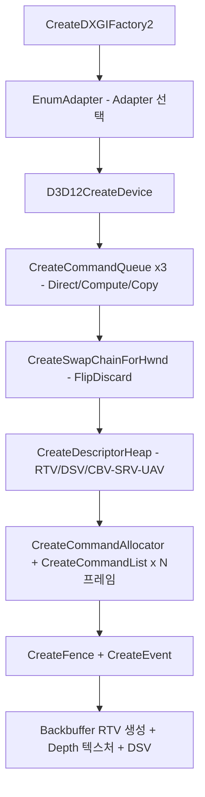
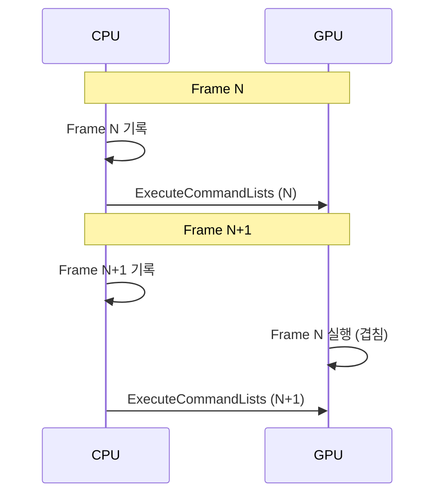
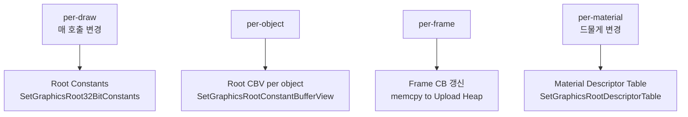

## 들어가며

같은 화면을 그리는 코드가 Direct3D 11과 Direct3D 12 사이에서 분량으로는 세 배, 개념으로는 한 차원 늘어난다. DX11에서는 한 줄의 `D3D11CreateDeviceAndSwapChain` 호출과 몇 개의 상태 설정 함수만으로 삼각형이 화면에 떴지만, DX12는 파이프라인 상태 객체(Pipeline State Object), 루트 시그니처(Root Signature), 디스크립터 힙(Descriptor Heap), 리소스 배리어(Resource Barrier)라는 네 가지 새 추상이 기존에 드라이버가 자동으로 처리하던 모든 것을 표면 위로 끌어올린다.

DX11과 DX12의 본질적 차이는 책임의 이전이다. DX11에서는 드라이버가 자원의 상태 전환, 메모리 거주성(residency), 명령 버퍼의 동기화를 묵시적으로 끼워 넣었다. 어느 텍스처를 렌더 타깃으로 쓰다가 셰이더 입력으로 바꿀 때 필요한 캐시 플러시와 레이아웃 전환을 드라이버가 알아서 발급했다. DX12는 이 모든 일을 명시적 API 호출로 바꾼다. 드라이버는 더 이상 추측하지 않고, 프로그래머가 정확히 무엇을 언제 하라고 지시한 대로만 동작한다.

여기까지의 코드는 DX11으로 PBR 셰이딩과 이미지 기반 조명(Image-Based Lighting, IBL)이 입혀진 모델을 그릴 수 있는 상태다. 이 글에서 도달할 결과물은 동일한 시각 결과를 DX12의 명시적 모델로 재구성한 코드다. 옮기는 과정은 일곱 단계로 나뉜다.

1. DX12 초기화 시퀀스 — DXGI Factory → Adapter → Device → Queue → Swap Chain → Heap → Allocator → List → Fence.
2. 분산된 상태 호출이 PSO 하나로 통합되는 과정.
3. Root Signature의 64 DWORD 예산을 어떻게 분배하는가.
4. Descriptor Heap의 두 종류(Shader Visible / CPU Only)와 그 제약.
5. Resource Barrier의 명시적 발급과 상태 추적.
6. CPU와 GPU를 겹쳐 돌리는 Frame in Flight 패턴.
7. DX11과 DX12의 1:1 매핑 표.

이 글의 결과물은 새로운 픽셀을 만들지 않는다. 같은 PBR + IBL 화면을 그리되, 그 뒤에서 일어나는 모든 일을 드라이버가 아니라 코드가 책임진다. 이 명시화가 끝나야 GPU 컴퓨트나 광선 추적 같은 DX12 고유 기능을 일관된 추상 위에 얹을 수 있다.


---

## 목차
1. [DX12 초기화 시퀀스](#1-dx12-초기화-시퀀스)
2. [PSO로 통합되는 상태](#2-pso로-통합되는-상태)
3. [Root Signature 설계](#3-root-signature-설계)
4. [Descriptor Heap 재구성](#4-descriptor-heap-재구성)
5. [Resource Barrier 명시](#5-resource-barrier-명시)
6. [Frame in Flight 패턴](#6-frame-in-flight-패턴)
7. [DX11과의 1:1 매핑 표](#7-dx11과의-11-매핑-표)


---

## 1. DX12 초기화 시퀀스

DX11에서 디바이스와 스왑 체인을 만드는 일은 `D3D11CreateDeviceAndSwapChain` 한 호출로 끝났다. 이 함수 내부에서 드라이버는 어댑터를 고르고, 디바이스를 만들고, 백 버퍼를 할당하고, 즉시 컨텍스트(immediate context)를 묶는 일을 모두 처리했다. DX12에서는 이 한 호출이 아홉에서 열 단계로 분해된다. 각 단계는 드라이버가 자동으로 하던 일을 하나씩 명시화한 것이다.

전체 시퀀스는 다음과 같다.



이 흐름의 핵심은 모든 객체가 별개로 생성되고, 그 수명을 코드가 직접 관리한다는 점이다. DX11처럼 디바이스 하나가 모든 것을 품지 않는다.

### Adapter 선택

DXGI(DirectX Graphics Infrastructure) 팩토리는 시스템의 그래픽 어댑터를 열거하는 진입점이다. 노트북처럼 통합 GPU와 디스크리트 GPU가 공존하는 환경에서는 어느 어댑터를 고를지가 성능을 좌우한다.

```cpp
ComPtr<IDXGIFactory7> factory;
CreateDXGIFactory2(DXGI_CREATE_FACTORY_DEBUG, IID_PPV_ARGS(&factory));

ComPtr<IDXGIAdapter4> adapter;
factory->EnumAdapterByGpuPreference(0,
    DXGI_GPU_PREFERENCE_HIGH_PERFORMANCE,
    IID_PPV_ARGS(&adapter));
```

`EnumAdapterByGpuPreference`는 NVIDIA Optimus나 AMD switchable graphics 환경에서 고성능 디스크리트 GPU를 자동으로 우선한다. 예전에는 어댑터를 직접 열거해 전용 비디오 메모리(`DedicatedVideoMemory`)가 가장 큰 것을 고르는 휴리스틱을 썼지만, DX12 환경에서는 이 함수가 표준 방식이다. 첫 인자 `0`은 선호도 순으로 정렬된 목록의 첫 어댑터를 의미한다.

`DXGI_CREATE_FACTORY_DEBUG` 플래그는 DXGI 레벨의 검증 메시지를 활성화한다. 스왑 체인 생성 실패나 잘못된 포맷 같은 오류가 디버그 출력에 찍힌다.

### Device 생성

디바이스는 모든 GPU 자원의 생성자(factory) 역할을 한다. 버퍼, 텍스처, 파이프라인 상태, 디스크립터 힙이 전부 디바이스에서 만들어진다.

```cpp
// 디버그 레이어는 반드시 디바이스 생성 *전에* 켠다
ComPtr<ID3D12Debug1> debug;
if (SUCCEEDED(D3D12GetDebugInterface(IID_PPV_ARGS(&debug)))) {
    debug->EnableDebugLayer();
    debug->SetEnableGPUBasedValidation(TRUE);    // 더 엄격
}

ComPtr<ID3D12Device8> device;
D3D12CreateDevice(adapter.Get(),
    D3D_FEATURE_LEVEL_12_1,
    IID_PPV_ARGS(&device));
```

`D3D_FEATURE_LEVEL_12_1`은 요구하는 최소 기능 수준(Feature Level)이다. 어댑터가 이 수준을 만족하지 못하면 생성이 실패하므로, 실무에서는 12_1 → 12_0 → 11_1 순으로 폴백을 건다. 기능 수준은 하드웨어가 보장하는 기능 집합을 정의하며, 12_0 이상이면 타일 자원(tiled resource)과 바인딩리스에 가까운 디스크립터 모델이 보장된다.

`EnableDebugLayer`는 모든 API 호출을 검증해 잘못된 인자, 누락된 배리어, 객체 수명 오류를 디버그 출력에 보고한다. 디버그 레이어는 반드시 디바이스 생성 *이전*에 활성화해야 한다. 디바이스가 만들어진 뒤에 켜면 그 디바이스에는 적용되지 않는다.

`SetEnableGPUBasedValidation`은 한 단계 더 깊은 검증이다. CPU 측 검증이 잡지 못하는 GPU 실행 시점 오류 — 배리어 누락, 잘못된 자원 상태에서의 접근, 셰이더의 경계 밖 디스크립터 인덱싱 — 를 GPU에서 직접 검사한다. 셰이더 코드를 계측(instrumentation)하므로 프레임 시간이 수십 배 느려지지만, 화면이 깨지는 원인을 추적할 때는 다른 도구로 대체하기 어렵다.

### Command Queue × 3

DX11의 즉시 컨텍스트는 GPU에 명령을 보내는 유일한 통로였다. DX12는 명령을 큐(Command Queue)에 제출하고, GPU가 그 큐를 비동기로 소비한다. 큐는 GPU의 물리적 엔진에 대응하며, 세 종류가 있다.

```cpp
auto MakeQueue = [&](D3D12_COMMAND_LIST_TYPE type) {
    D3D12_COMMAND_QUEUE_DESC desc{};
    desc.Type = type;
    desc.Priority = D3D12_COMMAND_QUEUE_PRIORITY_NORMAL;
    ComPtr<ID3D12CommandQueue> q;
    device->CreateCommandQueue(&desc, IID_PPV_ARGS(&q));
    return q;
};

auto directQueue  = MakeQueue(D3D12_COMMAND_LIST_TYPE_DIRECT);
auto computeQueue = MakeQueue(D3D12_COMMAND_LIST_TYPE_COMPUTE);
auto copyQueue    = MakeQueue(D3D12_COMMAND_LIST_TYPE_COPY);
```

Direct 큐는 그래픽스·컴퓨트·복사를 모두 처리하는 만능 엔진이다. Compute 큐는 그래픽스 파이프라인 없이 컴퓨트 디스패치만, Copy 큐는 자원 전송만 담당한다. 세 엔진은 물리적으로 분리되어 있어 병렬로 실행된다. 예를 들어 Copy 큐가 다음 프레임의 텍스처를 비디오 메모리로 업로드하는 동안 Direct 큐는 현재 프레임을 그릴 수 있다.

학습 단계에서는 Direct 큐 하나면 충분하다. 비동기 컴퓨트나 비동기 자원 업로드를 도입하는 시점에 Compute·Copy 큐를 활용한다. 다만 여러 큐를 동시에 쓰면 큐 사이의 동기화를 펜스(Fence)로 직접 다뤄야 하므로 복잡도가 한 단계 더 오른다.

### Swap Chain — DX12는 Queue를 받는다

스왑 체인은 백 버퍼와 화면 표시를 잇는 객체다. `CreateSwapChainForHwnd`의 첫 인자에는 DX11에서 `ID3D11Device`, DX12에서 direct command queue를 넘긴다. DX12에서는 화면에 제출되는 작업 순서를 특정 큐와 연결해야 하기 때문이다.

```cpp
DXGI_SWAP_CHAIN_DESC1 scd{};
scd.Width = 1280; scd.Height = 720;
scd.Format = DXGI_FORMAT_R8G8B8A8_UNORM;
scd.BufferUsage = DXGI_USAGE_RENDER_TARGET_OUTPUT;
scd.BufferCount = FRAMES_IN_FLIGHT;          // 보통 2 또는 3
scd.SwapEffect = DXGI_SWAP_EFFECT_FLIP_DISCARD;
scd.SampleDesc.Count = 1;                    // 스왑 체인은 MSAA 불가
scd.Flags = DXGI_SWAP_CHAIN_FLAG_ALLOW_TEARING;

ComPtr<IDXGISwapChain1> swap1;
factory->CreateSwapChainForHwnd(
    directQueue.Get(),     // DX11은 Device, DX12는 direct CommandQueue
    hwnd, &scd, nullptr, nullptr,
    swap1.GetAddressOf());

ComPtr<IDXGISwapChain4> swap;
swap1.As(&swap);
```

`DXGI_SWAP_EFFECT_FLIP_DISCARD`는 현대 Windows에서 필수에 가까운 선택이다. 예전의 `DISCARD` 방식은 데스크톱 윈도우 매니저(DWM)가 백 버퍼 내용을 한 번 복사했지만, FLIP 모델은 백 버퍼 포인터를 그대로 화면 컨트롤러에 넘겨 복사를 없앤다. 이를 플립 모델 프레젠테이션이라 하며, 낮은 지연과 화면 모드에서의 page flip을 가능케 한다.

`DXGI_SWAP_CHAIN_FLAG_ALLOW_TEARING`은 가변 리프레시 레이트(VRR) 모니터에서 티어링을 허용하는 옵션이다. 이 플래그가 있어야 `Present(0, DXGI_PRESENT_ALLOW_TEARING)`로 V-Sync를 끄고 모니터 갱신 주기와 무관하게 즉시 표시할 수 있다. 이 플래그를 켜려면 시스템이 테어링을 지원하는지 `CheckFeatureSupport`로 먼저 확인해야 한다.

스왑 체인은 자체적으로 MSAA를 지원하지 않는다(`SampleDesc.Count`는 반드시 1). 안티앨리어싱이 필요하면 별도의 멀티샘플 렌더 타깃에 그린 뒤 백 버퍼로 리졸브(resolve)한다.

### Backbuffer RTV와 Depth Stencil

스왑 체인 생성 이후, 각 백 버퍼에 대한 렌더 타깃 뷰(RTV)와 깊이 버퍼·깊이 스텐실 뷰(DSV)를 만들어야 한다. DX11에서는 `GetBuffer` 한 번과 `CreateRenderTargetView` 한 번이면 됐지만, DX12에서는 프레임 수만큼 RTV를 만들고 디스크립터 힙에 배치한다.

```cpp
D3D12_CPU_DESCRIPTOR_HANDLE rtvHandle =
    rtvHeap->GetCPUDescriptorHandleForHeapStart();
UINT rtvStride = device->GetDescriptorHandleIncrementSize(
    D3D12_DESCRIPTOR_HEAP_TYPE_RTV);

for (UINT i = 0; i < FRAMES_IN_FLIGHT; ++i) {
    swap->GetBuffer(i, IID_PPV_ARGS(&backBuffers[i]));
    D3D12_RENDER_TARGET_VIEW_DESC rtvDesc{};
    rtvDesc.Format = DXGI_FORMAT_R8G8B8A8_UNORM_SRGB;
    rtvDesc.ViewDimension = D3D12_RTV_DIMENSION_TEXTURE2D;
    rtvDesc.Texture2D.MipSlice = 0;
    rtvDesc.Texture2D.PlaneSlice = 0;
    device->CreateRenderTargetView(backBuffers[i].Get(), &rtvDesc, rtvHandle);
    rtvHandle.ptr += rtvStride;
}
```

`GetDescriptorHandleIncrementSize`가 반환하는 보폭은 벤더와 디스크립터 종류마다 다르다. 핸들을 직접 더해 다음 슬롯으로 이동할 때 이 값을 곱해야 한다. 이 보폭을 하드코딩하면 다른 GPU에서 깨진다.

## 2. PSO로 통합되는 상태

DX11의 렌더링 파이프라인은 여러 상태 객체를 단계별로 바인딩하는 모델이었다. 입력 레이아웃은 `IASetInputLayout`, 셰이더는 `VSSetShader`·`PSSetShader`, 래스터라이저는 `RSSetState`, 블렌드는 `OMSetBlendState`, 깊이 스텐실은 `OMSetDepthStencilState`로 각각 설정했다. 드라이버는 이 분산된 상태들을 드로우 콜 직전에 모아 GPU가 이해하는 하나의 파이프라인 구성으로 컴파일했다. 이 과정이 드로우마다 일어나면서 예측 불가능한 끊김(hitch)을 만들었다.

DX12는 이 모든 상태를 파이프라인 상태 객체(PSO) 하나로 통합한다. PSO는 생성 시점에 한 번 컴파일되고, 드로우 시점에는 단순히 바인딩만 한다.

```cpp
D3D12_GRAPHICS_PIPELINE_STATE_DESC psoDesc{};

// Root Signature
psoDesc.pRootSignature = rootSig.Get();

// 셰이더 — DX11의 VSSetShader / PSSetShader
psoDesc.VS = { vsBlob->GetBufferPointer(), vsBlob->GetBufferSize() };
psoDesc.PS = { psBlob->GetBufferPointer(), psBlob->GetBufferSize() };

// Input Layout — DX11의 IASetInputLayout
D3D12_INPUT_ELEMENT_DESC il[] = {
    { "POSITION", 0, DXGI_FORMAT_R32G32B32_FLOAT,    0,  0, D3D12_INPUT_CLASSIFICATION_PER_VERTEX_DATA, 0 },
    { "NORMAL",   0, DXGI_FORMAT_R32G32B32_FLOAT,    0, 12, D3D12_INPUT_CLASSIFICATION_PER_VERTEX_DATA, 0 },
    { "TEXCOORD", 0, DXGI_FORMAT_R32G32_FLOAT,       0, 24, D3D12_INPUT_CLASSIFICATION_PER_VERTEX_DATA, 0 },
    { "TANGENT",  0, DXGI_FORMAT_R32G32B32A32_FLOAT, 0, 32, D3D12_INPUT_CLASSIFICATION_PER_VERTEX_DATA, 0 },
};
psoDesc.InputLayout = { il, _countof(il) };
```

입력 레이아웃의 오프셋(0, 12, 24, 32)은 정점 구조체의 바이트 위치다. POSITION이 12바이트(`float3`), NORMAL이 또 12바이트, TEXCOORD가 8바이트(`float2`)이므로 TANGENT는 32바이트 지점에서 시작한다. 이 숫자가 정점 버퍼의 실제 메모리 배치와 어긋나면 정점이 엉뚱한 위치로 변형된다.

```cpp
// Rasterizer — DX11의 RSSetState
psoDesc.RasterizerState.FillMode = D3D12_FILL_MODE_SOLID;
psoDesc.RasterizerState.CullMode = D3D12_CULL_MODE_BACK;
psoDesc.RasterizerState.FrontCounterClockwise = TRUE;
psoDesc.RasterizerState.DepthClipEnable = TRUE;

// Blend — DX11의 OMSetBlendState
psoDesc.BlendState.RenderTarget[0].BlendEnable = FALSE;
psoDesc.BlendState.RenderTarget[0].RenderTargetWriteMask =
    D3D12_COLOR_WRITE_ENABLE_ALL;

// Depth Stencil — DX11의 OMSetDepthStencilState
psoDesc.DepthStencilState.DepthEnable = TRUE;
psoDesc.DepthStencilState.DepthWriteMask = D3D12_DEPTH_WRITE_MASK_ALL;
psoDesc.DepthStencilState.DepthFunc = D3D12_COMPARISON_FUNC_LESS;

// 출력 포맷 — RTV / DSV 포맷이 PSO에 박힌다
psoDesc.PrimitiveTopologyType = D3D12_PRIMITIVE_TOPOLOGY_TYPE_TRIANGLE;
psoDesc.NumRenderTargets = 1;
psoDesc.RTVFormats[0] = DXGI_FORMAT_R8G8B8A8_UNORM_SRGB;
psoDesc.DSVFormat     = DXGI_FORMAT_D32_FLOAT;
psoDesc.SampleMask    = UINT_MAX;
psoDesc.SampleDesc.Count = 1;

ComPtr<ID3D12PipelineState> pso;
device->CreateGraphicsPipelineState(&psoDesc, IID_PPV_ARGS(&pso));
```

출력 포맷이 PSO에 박힌다는 점이 DX11과 결정적으로 다르다. 렌더 타깃의 포맷(`RTVFormats`)과 깊이 버퍼의 포맷(`DSVFormat`)이 PSO 생성 시점에 고정된다. 드로우 시점에 바인딩하는 실제 RTV·DSV의 포맷이 PSO에 박힌 포맷과 다르면 디버그 레이어가 즉시 오류를 낸다. 여기서 백 버퍼는 `R8G8B8A8_UNORM`이지만 RTV 포맷은 `_SRGB`로 지정했다. 이는 sRGB 캐스트 트릭으로, 셰이더가 출력한 선형 색상을 출력 단계에서 자동으로 sRGB 공간으로 인코딩한다.

`FrontCounterClockwise = TRUE`는 반시계 방향 정점 순서를 앞면으로 본다는 뜻이다. 모델 데이터의 와인딩 순서와 이 설정이 어긋나면 정상 면이 컬링되어 사라진다.

### Primitive Topology의 분리

`PrimitiveTopologyType`은 PSO에 들어가는 큰 분류다. POINT, LINE, TRIANGLE, PATCH 중 하나만 지정한다. 실제 토폴로지 — 삼각형을 리스트로 보낼지 스트립으로 보낼지 — 는 드로우 콜 직전에 따로 설정한다.

```cpp
cmdList->SetPipelineState(pso.Get());
cmdList->IASetPrimitiveTopology(D3D_PRIMITIVE_TOPOLOGY_TRIANGLELIST);
```

이 분리에는 이유가 있다. PSO에 박힌 TRIANGLE이라는 카테고리 안에 리스트, 스트립, 인접성 포함 스트립이 모두 들어간다. 같은 PSO를 쓰면서 드로우마다 스트립과 리스트를 전환할 수 있으므로, 토폴로지가 다르다는 이유만으로 새 PSO를 만들 필요가 없다. 다만 TRIANGLE 카테고리의 PSO에 LINE 토폴로지를 바인딩하면 동작이 정의되지 않는다.

### PSO 변종 관리

PSO의 가장 큰 비용은 생성 시 일어나는 셰이더 컴파일과 상태 조합 검증이다. 셰이더 한 비트, 블렌드 모드 한 비트라도 바뀌면 별개의 PSO가 된다. 머티리얼 수가 많은 게임은 수백에서 수천 개의 PSO를 갖는다.

이 비용을 드로우 도중에 치르면 프레임이 끊긴다. 표준 해법은 시작 시점이나 로딩 화면에서 필요한 모든 PSO를 미리 생성하는 것이다. 나아가 한 번 컴파일한 PSO를 `GetCachedBlob`으로 직렬화해 디스크에 저장하고, 다음 실행 시 이 캐시를 `CachedPSO`로 넘기면 컴파일을 건너뛴다. 다만 캐시는 드라이버 버전과 하드웨어에 종속되므로, 검증에 실패하면 자동으로 재컴파일된다.

| 변종을 만드는 요인 | 예시 |
|---|---|
| 셰이더 바이트코드 | VS / PS / GS / HS / DS 변경 |
| 블렌드 모드 | 불투명 vs 알파 블렌딩 vs 가산 |
| 깊이 상태 | 깊이 쓰기 on/off, 비교 함수 |
| 래스터라이저 | 컬 모드, 와이어프레임 |
| 출력 포맷 | RTV/DSV 포맷, MSAA 샘플 수 |

이 다섯 축의 조합이 PSO 변종의 수를 결정한다. 엔진은 이 조합을 해시 키로 만들어 PSO 캐시 맵을 관리한다.

## 3. Root Signature 설계

루트 시그니처는 셰이더가 어떤 자원을 어느 슬롯에서 읽을지를 정의하는 인터페이스다. C 함수의 매개변수 목록에 비유할 수 있다. 셰이더가 함수 본체라면, 루트 시그니처는 그 함수가 받는 인자의 형태를 선언한다.

루트 시그니처에는 64 DWORD(256바이트)라는 크기 예산이 있다. 이 예산 안에서 어떤 자원을 어떤 방식으로 노출할지 분배하는 것이 설계의 핵심이다. 각 슬롯 종류마다 차지하는 DWORD 수와 바인딩 비용, 변경 빈도가 다르다.

### 비용 트레이드오프

| 슬롯 종류 | 비용 (DWORD) | 변경 비용 | 적합 데이터 |
|---|---|---|---|
| Root Constants | N (값을 직접 담음) | 매우 낮음 | per-draw 작은 값 (인덱스, 행렬 1개) |
| Root CBV | 2 | 낮음 | per-frame / per-draw 상수 버퍼 |
| Root SRV/UAV | 2 | 낮음 | 큰 자원 하나 |
| Descriptor Table | 1 | 중간 | 자주 바뀌지 않는 텍스처 묶음 |
| Static Sampler | 0 | 0 | 공통 샘플러 |

루트 상수(Root Constants)는 값 자체를 루트 시그니처에 직접 담으므로 GPU 가상 주소를 거치는 간접 참조가 없다. 가장 빠르지만 담는 값마다 DWORD를 소비한다. 루트 CBV는 상수 버퍼의 GPU 가상 주소(8바이트 = 2 DWORD)만 담아 한 단계 간접 참조를 거친다. 디스크립터 테이블은 디스크립터 힙 안의 위치(1 DWORD)만 담아 두 단계 간접 참조를 거치므로 가장 느리지만, 수십 개의 디스크립터를 1 DWORD로 묶을 수 있어 공간 효율이 가장 높다.

### 일반적 설계

PBR + IBL 셰이더가 필요로 하는 자원을 위 비용 모델에 따라 분배한다. 변경 빈도가 높은 것은 빠른 슬롯에, 낮은 것은 디스크립터 테이블에 둔다.

```cpp
D3D12_ROOT_PARAMETER1 params[5];

// 0: Root Constants (draw 마다 변경) — 4 DWORD
params[0].ParameterType = D3D12_ROOT_PARAMETER_TYPE_32BIT_CONSTANTS;
params[0].Constants.ShaderRegister = 0;       // b0
params[0].Constants.RegisterSpace = 0;
params[0].Constants.Num32BitValues = 4;
params[0].ShaderVisibility = D3D12_SHADER_VISIBILITY_ALL;

// 1: Root CBV — Frame CB (per-frame) — 2 DWORD
params[1].ParameterType = D3D12_ROOT_PARAMETER_TYPE_CBV;
params[1].Descriptor.ShaderRegister = 1;       // b1
params[1].ShaderVisibility = D3D12_SHADER_VISIBILITY_ALL;

// 2: Root CBV — Material CB — 2 DWORD
params[2].ParameterType = D3D12_ROOT_PARAMETER_TYPE_CBV;
params[2].Descriptor.ShaderRegister = 2;       // b2
params[2].ShaderVisibility = D3D12_SHADER_VISIBILITY_PIXEL;
```

처음 세 슬롯은 변경이 잦은 데이터다. 슬롯 0의 루트 상수에는 오브젝트 인덱스나 드로우별 작은 플래그를, 슬롯 1의 Frame CB에는 카메라 행렬과 조명 파라미터를, 슬롯 2의 Material CB에는 거칠기·금속성 같은 머티리얼 스칼라를 담는다.

`ShaderVisibility`는 이 슬롯이 어느 셰이더 단계에서 보이는지를 제한한다. Material CB는 픽셀 셰이더에서만 읽으므로 `VISIBILITY_PIXEL`로 좁혀, 정점 셰이더 단계에서 이 자원을 바인딩하는 드라이버 작업을 줄인다. `VISIBILITY_ALL`은 모든 단계에 노출하므로 가장 비싸다.

```cpp
// 3: Descriptor Table — 머티리얼 텍스처 5개 — 1 DWORD
D3D12_DESCRIPTOR_RANGE1 srvRange{};
srvRange.RangeType = D3D12_DESCRIPTOR_RANGE_TYPE_SRV;
srvRange.NumDescriptors = 5;                   // t0~t4
srvRange.BaseShaderRegister = 0;
params[3].ParameterType = D3D12_ROOT_PARAMETER_TYPE_DESCRIPTOR_TABLE;
params[3].DescriptorTable.NumDescriptorRanges = 1;
params[3].DescriptorTable.pDescriptorRanges = &srvRange;
params[3].ShaderVisibility = D3D12_SHADER_VISIBILITY_PIXEL;

// 4: Descriptor Table — IBL 텍스처 3개 — 1 DWORD
D3D12_DESCRIPTOR_RANGE1 iblRange{};
iblRange.RangeType = D3D12_DESCRIPTOR_RANGE_TYPE_SRV;
iblRange.NumDescriptors = 3;
iblRange.BaseShaderRegister = 10;              // t10~t12
params[4].ParameterType = D3D12_ROOT_PARAMETER_TYPE_DESCRIPTOR_TABLE;
params[4].DescriptorTable.NumDescriptorRanges = 1;
params[4].DescriptorTable.pDescriptorRanges = &iblRange;
params[4].ShaderVisibility = D3D12_SHADER_VISIBILITY_PIXEL;

// 총 4 + 2 + 2 + 1 + 1 = 10 DWORD (64 예산 안)
```

머티리얼 텍스처 다섯 장(알베도·노멀·메탈릭·러프니스·AO)을 `t0`부터 `t4`에 묶어 슬롯 3의 디스크립터 테이블에 둔다. IBL 텍스처 세 장(조도 큐브맵·프리필터 큐브맵·BRDF LUT)을 `t10`부터 `t12`에 묶어 슬롯 4에 둔다. 텍스처 여덟 장을 디스크립터 테이블 두 개, 즉 2 DWORD로 노출한 셈이다. 만약 이 여덟 장을 전부 루트 SRV로 노출했다면 16 DWORD를 소비했을 것이다.

전체 합은 10 DWORD다. 64 예산의 6분의 1만 사용했으므로 여유가 충분하다. 예산이 빠듯해지면 변경이 가장 잦은 슬롯을 우선 유지하고, 정적인 것을 디스크립터 테이블로 합친다.

### Static Sampler

샘플러는 필터링 모드와 주소 지정 방식을 정의하는 작은 상태다. 대부분의 셰이더는 몇 개의 고정된 샘플러만 쓴다. 정적 샘플러(Static Sampler)는 이런 공통 샘플러를 루트 시그니처에 직접 박아 슬롯 예산을 전혀 소비하지 않는다.

```cpp
D3D12_STATIC_SAMPLER_DESC sampler{};
sampler.Filter = D3D12_FILTER_MIN_MAG_MIP_LINEAR;
sampler.AddressU = sampler.AddressV = sampler.AddressW =
    D3D12_TEXTURE_ADDRESS_MODE_WRAP;
sampler.MaxLOD = D3D12_FLOAT32_MAX;
sampler.ShaderRegister = 0;                    // s0
sampler.ShaderVisibility = D3D12_SHADER_VISIBILITY_PIXEL;

D3D12_VERSIONED_ROOT_SIGNATURE_DESC rsDesc{};
rsDesc.Version = D3D_ROOT_SIGNATURE_VERSION_1_1;
rsDesc.Desc_1_1.NumParameters = _countof(params);
rsDesc.Desc_1_1.pParameters = params;
rsDesc.Desc_1_1.NumStaticSamplers = 1;
rsDesc.Desc_1_1.pStaticSamplers = &sampler;
rsDesc.Desc_1_1.Flags =
    D3D12_ROOT_SIGNATURE_FLAG_ALLOW_INPUT_ASSEMBLER_INPUT_LAYOUT;

ComPtr<ID3DBlob> rsBlob;
D3D12SerializeVersionedRootSignature(&rsDesc, rsBlob.GetAddressOf(), nullptr);

ComPtr<ID3D12RootSignature> rootSig;
device->CreateRootSignature(0,
    rsBlob->GetBufferPointer(), rsBlob->GetBufferSize(),
    IID_PPV_ARGS(&rootSig));
```

루트 시그니처 버전 1.1을 쓰는 이유는 디스크립터 가시성(volatility) 플래그 때문이다. 1.1은 디스크립터가 드로우 도중 변하지 않는다는 약속을 드라이버에 전달해 추가 최적화를 가능케 한다. `ALLOW_INPUT_ASSEMBLER_INPUT_LAYOUT` 플래그는 입력 어셈블러 단계를 쓴다는 표시로, 정점 버퍼를 입력 레이아웃으로 읽는 일반적인 그래픽스 PSO에 필요하다. 컴퓨트 전용 루트 시그니처는 이 플래그를 빼서 미세하게 비용을 줄인다.

루트 시그니처는 직렬화된 블롭(blob)을 거쳐 생성된다. 이 블롭은 HLSL 셰이더에 `[RootSignature(...)]` 속성으로 임베드할 수도 있어, 셰이더와 루트 시그니처를 한 곳에서 관리하는 패턴이 가능하다.

## 4. Descriptor Heap 재구성

디스크립터(descriptor)는 자원을 셰이더가 읽을 수 있는 형태로 기술하는 작은 데이터 구조다. SRV(Shader Resource View), CBV(Constant Buffer View), UAV(Unordered Access View), RTV, DSV, 샘플러가 모두 디스크립터다. DX11에서는 이 뷰 객체들을 디바이스가 관리했지만, DX12에서는 디스크립터를 디스크립터 힙이라는 연속된 메모리 배열에 직접 배치한다.

### 두 카테고리

디스크립터 힙은 셰이더에서 보이느냐 아니냐로 두 부류로 나뉜다.

| Heap | Shader Visible | 위치 | 용도 |
|---|---|---|---|
| CBV/SRV/UAV | Yes | GPU 메모리 | 셰이더에서 페치 |
| Sampler | Yes | GPU 메모리 | 샘플러 |
| RTV | No (CPU Only) | CPU 메모리 | Output Merger |
| DSV | No (CPU Only) | CPU 메모리 | Depth Stencil 단계 |

셰이더가 실행 중에 읽는 디스크립터(CBV/SRV/UAV, 샘플러)는 GPU가 접근 가능한 메모리에 있어야 하므로 Shader Visible 힙에 둔다. RTV와 DSV는 출력 병합 단계의 고정 함수가 쓰며 셰이더 코드가 직접 페치하지 않으므로, CPU 메모리에만 있는 CPU Only 힙에 둔다. 이 구분을 어기면 — 예를 들어 RTV 힙을 Shader Visible로 만들면 — 생성 자체가 실패한다.

### Shader Visible Heap의 동시 바인딩 제한

여기에 DX12 초보가 자주 걸리는 함정이 있다. 한 명령 리스트(Command List)에 동시에 활성화할 수 있는 Shader Visible 힙은 CBV/SRV/UAV 힙 하나와 샘플러 힙 하나뿐이다. 즉 셰이더가 읽는 모든 텍스처와 상수 버퍼의 디스크립터가 단 하나의 힙 안에 모여 있어야 한다.

```cpp
ID3D12DescriptorHeap* heaps[] = { cbvSrvHeap.Get(), samplerHeap.Get() };
cmdList->SetDescriptorHeaps(_countof(heaps), heaps);   // 종류당 하나씩만
```

프레임 도중 다른 힙으로 전환하는 것은 가능하지만 비용이 크다. GPU가 캐시를 플러시하고 새 힙 베이스를 다시 잡아야 하기 때문이다. 표준 패턴은 충분히 큰 힙 하나를 만들어 모든 디스크립터를 그 안에 집중시키는 것이다. 기능 수준 11_1 하드웨어는 CBV/SRV/UAV 힙에 최대 1,000,000개의 디스크립터를 둘 수 있으므로, 십만 개 규모의 힙은 부담이 아니다.

### Heap 생성

```cpp
D3D12_DESCRIPTOR_HEAP_DESC heapDesc{};
heapDesc.Type = D3D12_DESCRIPTOR_HEAP_TYPE_CBV_SRV_UAV;
heapDesc.NumDescriptors = 100000;     // 충분히 큰 풀
heapDesc.Flags = D3D12_DESCRIPTOR_HEAP_FLAG_SHADER_VISIBLE;

ComPtr<ID3D12DescriptorHeap> cbvSrvHeap;
device->CreateDescriptorHeap(&heapDesc, IID_PPV_ARGS(&cbvSrvHeap));

heapDesc.Type = D3D12_DESCRIPTOR_HEAP_TYPE_RTV;
heapDesc.NumDescriptors = FRAMES_IN_FLIGHT;
heapDesc.Flags = D3D12_DESCRIPTOR_HEAP_FLAG_NONE;  // CPU Only
device->CreateDescriptorHeap(&heapDesc, IID_PPV_ARGS(&rtvHeap));
```

큰 Shader Visible 힙은 일종의 디스크립터 할당자(allocator)처럼 쓴다. 힙 안을 정적 영역(시작 시 한 번 채우는 텍스처)과 동적 영역(프레임마다 갱신하는 슬롯)으로 나누고, 동적 영역은 링 버퍼로 운영해 frame in flight 수만큼 돌려쓴다.

### CPU 핸들과 GPU 핸들

디스크립터 힙의 위치는 두 종류의 핸들로 가리킨다. CPU 디스크립터 핸들은 디스크립터를 힙에 *쓸 때* 쓰고, GPU 디스크립터 핸들은 드로우 시점에 셰이더에 *바인딩할 때* 쓴다.

```cpp
// 텍스처 SRV를 힙의 i번째 슬롯에 쓴다 (CPU 핸들)
D3D12_CPU_DESCRIPTOR_HANDLE cpu =
    cbvSrvHeap->GetCPUDescriptorHandleForHeapStart();
cpu.ptr += i * cbvSrvStride;
device->CreateShaderResourceView(texture.Get(), &srvDesc, cpu);

// 같은 슬롯을 드로우 때 바인딩한다 (GPU 핸들)
D3D12_GPU_DESCRIPTOR_HANDLE gpu =
    cbvSrvHeap->GetGPUDescriptorHandleForHeapStart();
gpu.ptr += i * cbvSrvStride;
```

CPU Only 힙은 GPU 핸들을 발급하지 않는다. `GetGPUDescriptorHandleForHeapStart`를 CPU Only 힙에 부르면 동작이 정의되지 않는다.

### 바인딩

루트 시그니처에 설계한 슬롯과 디스크립터 힙의 핸들을 명령 리스트에서 연결한다.

```cpp
ID3D12DescriptorHeap* heaps[] = { cbvSrvHeap.Get(), samplerHeap.Get() };
cmdList->SetDescriptorHeaps(_countof(heaps), heaps);

cmdList->SetGraphicsRootSignature(rootSig.Get());
cmdList->SetGraphicsRoot32BitConstants(0, 4, &drawData, 0);          // 슬롯 0
cmdList->SetGraphicsRootConstantBufferView(1, frameCB->GetGPUVirtualAddress());
cmdList->SetGraphicsRootConstantBufferView(2, materialCB->GetGPUVirtualAddress());
cmdList->SetGraphicsRootDescriptorTable(3, materialSrvHandle);       // 슬롯 3
cmdList->SetGraphicsRootDescriptorTable(4, iblSrvHandle);            // 슬롯 4
```

슬롯 번호(0, 1, 2, 3, 4)는 루트 시그니처에서 정의한 `params` 배열의 인덱스와 정확히 대응한다. 디스크립터 테이블은 힙 안의 GPU 핸들을 받고, 루트 CBV는 상수 버퍼의 GPU 가상 주소를 직접 받는다. 이 대응이 어긋나면 셰이더가 엉뚱한 자원을 읽거나 디버그 레이어가 오류를 낸다.

## 5. Resource Barrier 명시

DX11에서 드라이버가 끼워 넣던 동기화의 정체는 자원 상태 전환이다. 한 텍스처를 렌더 타깃으로 쓰다가 셰이더 입력으로 바꾸려면, GPU 내부적으로 캐시를 플러시하고 메모리 레이아웃을 압축 해제하고 파이프라인 단계 사이의 의존성을 보장해야 한다. DX11은 이를 자동으로 했고, DX12는 `ResourceBarrier`로 직접 발급하게 한다.

배리어는 두 가지를 동시에 한다. 하나는 자원의 상태를 이전 상태(before)에서 다음 상태(after)로 전환하는 것이고, 다른 하나는 그 전환 시점을 기준으로 GPU 작업의 순서를 보장하는 것이다.

### 백 버퍼 PRESENT ↔ RENDER_TARGET

가장 기본적인 배리어는 매 프레임 백 버퍼의 상태를 두 번 바꾸는 것이다. 프레임 시작 시 화면 표시 상태(PRESENT)에서 렌더 타깃 상태(RENDER_TARGET)로, 프레임 끝에 다시 반대로 전환한다.

```cpp
auto Barrier = [](ID3D12Resource* res,
                   D3D12_RESOURCE_STATES before,
                   D3D12_RESOURCE_STATES after) {
    D3D12_RESOURCE_BARRIER b{};
    b.Type = D3D12_RESOURCE_BARRIER_TYPE_TRANSITION;
    b.Transition.pResource = res;
    b.Transition.StateBefore = before;
    b.Transition.StateAfter  = after;
    b.Transition.Subresource = D3D12_RESOURCE_BARRIER_ALL_SUBRESOURCES;
    return b;
};

// 프레임 시작 — 백 버퍼를 RT로
auto b1 = Barrier(backBuffer.Get(),
                   D3D12_RESOURCE_STATE_PRESENT,
                   D3D12_RESOURCE_STATE_RENDER_TARGET);
cmdList->ResourceBarrier(1, &b1);

// 렌더링 ...

// 프레임 끝 — RT를 PRESENT로
auto b2 = Barrier(backBuffer.Get(),
                   D3D12_RESOURCE_STATE_RENDER_TARGET,
                   D3D12_RESOURCE_STATE_PRESENT);
cmdList->ResourceBarrier(1, &b2);
```

`StateBefore`에 적은 상태가 GPU가 실제로 추적하는 자원의 현재 상태와 어긋나면, GPU 기반 검증이 즉시 오류를 낸다. 검증을 끈 릴리스 빌드에서는 이런 불일치가 조용히 화면 깨짐이나 GPU 행(hang)으로 나타나므로 추적이 어렵다. 그래서 상태 추적이 DX12 디버깅의 큰 비중을 차지한다.

### 배리어의 세 종류

전환 배리어 외에 두 종류가 더 있다.

| 종류 | 용도 |
|---|---|
| Transition | 자원 상태를 before에서 after로 전환 |
| UAV | 같은 UAV에 대한 읽기/쓰기 사이의 순서 보장 |
| Aliasing | 같은 힙 메모리를 공유하는 두 자원의 전환 |

UAV 배리어는 컴퓨트 셰이더가 같은 UAV에 연속으로 쓸 때, 앞 디스패치의 쓰기가 끝난 뒤 뒤 디스패치가 읽도록 보장한다. 상태 전환이 없으므로 `StateBefore`/`StateAfter`가 없고 자원 포인터만 넘긴다. Aliasing 배리어는 같은 물리 메모리를 시간차로 공유하는 자원(예: 프레임 일부에서만 쓰는 임시 버퍼)을 다룰 때 쓴다.

### 다중 Barrier 통합

서로 같은 지점에서 필요한 배리어는 한 `ResourceBarrier` 호출의 배열로 묶어 CPU 호출 비용을 줄이는 것이 권장된다. API는 배열 원소를 주어진 순서대로 개별 호출한 것처럼 해석하며, 캐시 플러시가 반드시 한 번으로 합쳐진다고 보장하지 않는다. 더 중요한 최적화는 배리어를 무조건 앞당겨 한곳에 모으는 것이 아니라, 각 자원의 마지막 생산자와 첫 소비자 사이에서 필요한 범위만 전환하고 불필요한 왕복 상태 전환을 제거하는 것이다.

```cpp
D3D12_RESOURCE_BARRIER barriers[3] = {
    Barrier(rt1.Get(),     STATE_RT,          STATE_PIXEL_SR),
    Barrier(rt2.Get(),     STATE_RT,          STATE_PIXEL_SR),
    Barrier(depthTex.Get(), STATE_DEPTH_WRITE, STATE_PIXEL_SR),
};
cmdList->ResourceBarrier(_countof(barriers), barriers);
```

이 예는 디퍼드 렌더링에서 G-버퍼를 라이팅 패스의 셰이더 입력으로 바꾸는 전형적인 상황이다. 두 렌더 타깃과 깊이 버퍼를 한꺼번에 셰이더 자원 상태로 전환한다. 세 개를 따로 발급하면 드라이버가 각각을 별도 동기화 지점으로 처리할 수 있고, 한 호출로 묶으면 드라이버가 이를 합쳐 처리할 여지가 생긴다.

### State Tracking 추상화

자원이 수백 개로 늘면 각 자원의 현재 상태를 손으로 추적하기는 비현실적이다. 자원 자신이 상태를 기억하게 하는 작은 래퍼가 출발점이다.

```cpp
class TrackedResource {
    ComPtr<ID3D12Resource> resource_;
    D3D12_RESOURCE_STATES currentState_;
public:
    void Transition(ID3D12GraphicsCommandList* cmd,
                     D3D12_RESOURCE_STATES newState) {
        if (currentState_ == newState) return;   // 불필요한 배리어 생략
        D3D12_RESOURCE_BARRIER b = Barrier(resource_.Get(),
                                            currentState_, newState);
        cmd->ResourceBarrier(1, &b);
        currentState_ = newState;
    }
};
```

같은 상태로의 전환을 생략하는 한 줄이 의외로 중요하다. 중복 배리어는 불필요한 동기화 비용을 만들고, 디버그 레이어가 경고를 낸다.

이 단순한 추적기에는 한계가 있다. 배리어를 발급하는 순간 명령 리스트에 즉시 기록되므로, 여러 명령 리스트를 병렬로 기록하거나 자원의 상태가 명령 리스트 경계를 넘나들 때 추적이 깨진다. 그래서 대형 엔진은 상태 추적을 렌더 그래프(Render Graph) 안에 통합한다. 한 프레임의 모든 패스가 어떤 자원을 어떤 상태로 읽고 쓰는지를 그래프로 먼저 분석한 뒤, 패스 사이에 필요한 배리어를 자동으로 삽입하고 묶는다. 이렇게 하면 배리어 누락과 중복을 컴파일 단계에서 제거할 수 있다.

## 6. Frame in Flight 패턴

DX12 성능의 또 다른 축은 CPU와 GPU를 겹쳐 돌리는 것이다. CPU가 Frame N+1의 명령을 기록하는 동안 GPU는 Frame N을 실행한다. 두 측이 겹쳐 동작하면 한쪽이 다른 쪽을 기다리는 빈 시간이 줄어 처리량이 오른다.



겹쳐 돌리려면 한 가지 조건이 있다. GPU가 아직 Frame N의 명령 할당자(Command Allocator)와 상수 버퍼를 읽고 있는데 CPU가 같은 객체를 Frame N+1용으로 덮어쓰면 안 된다. 해결책은 이런 프레임별 자원을 여러 벌 준비해 돌려쓰는 것이다.

### 자원 N벌

```cpp
constexpr UINT FRAMES_IN_FLIGHT = 3;

struct FrameResources {
    ComPtr<ID3D12CommandAllocator> alloc;
    ComPtr<ID3D12Resource> frameCB;          // Upload Heap
    void* frameCBMapped;
    UINT64 fenceValue;
};

FrameResources frames[FRAMES_IN_FLIGHT];
UINT frameIdx = 0;

ComPtr<ID3D12GraphicsCommandList> cmdList;   // 리스트는 하나로 충분
ComPtr<ID3D12Fence> fence;
HANDLE fenceEvent;
UINT64 currentFence = 0;
```

명령 할당자는 프레임 수만큼 둔다. 할당자는 명령 리스트가 기록한 명령의 실제 메모리 백킹이며, GPU가 그 명령을 다 실행하기 전에는 `Reset`할 수 없다. 반면 명령 리스트 자체는 `Reset` 시점에 어느 할당자에 묶을지 지정하므로 하나만 있으면 된다. 상수 버퍼도 프레임마다 갱신되므로 N벌을 둔다.

세 벌(triple buffering)이 흔한 선택이다. 두 벌이면 CPU가 한 프레임 앞서 있을 때 곧바로 GPU를 기다리지만, 세 벌이면 CPU가 잠시 빨라지거나 느려지는 변동을 흡수할 여유가 생긴다. 대신 입력 지연이 한 프레임 늘고 메모리 사용이 늘어난다.

### 펜스를 통한 동기화

CPU와 GPU의 진행 상황을 맞추는 도구가 펜스(Fence)다. 펜스는 단조 증가하는 64비트 정수 값을 갖는다. GPU가 큐에 제출된 작업을 끝낼 때마다 `Signal`로 이 값을 올리고, CPU는 `GetCompletedValue`로 어디까지 끝났는지 읽는다.

### 한 프레임의 흐름

```cpp
void RenderFrame() {
    FrameResources& f = frames[frameIdx];

    // 1. 이 슬롯의 GPU 작업이 끝났는지 확인하고 안 끝났으면 대기
    if (fence->GetCompletedValue() < f.fenceValue) {
        fence->SetEventOnCompletion(f.fenceValue, fenceEvent);
        WaitForSingleObject(fenceEvent, INFINITE);
    }

    // 2. 이제 안전하므로 Allocator와 List를 Reset
    f.alloc->Reset();
    cmdList->Reset(f.alloc.Get(), nullptr);

    // 3. Frame CB 갱신 (Upload Heap의 영구 Map에 memcpy)
    memcpy(f.frameCBMapped, &frameCBData, sizeof(frameCBData));

    // 4. 렌더링 명령 기록
    /* ... 배리어, PSO, Root Sig, Descriptor Heap, DrawIndexed ... */

    // 5. Close + Execute
    cmdList->Close();
    ID3D12CommandList* lists[] = { cmdList.Get() };
    directQueue->ExecuteCommandLists(_countof(lists), lists);

    // 6. Present + Signal
    swap->Present(1, 0);
    directQueue->Signal(fence.Get(), ++currentFence);
    f.fenceValue = currentFence;

    // 7. 다음 슬롯으로
    frameIdx = (frameIdx + 1) % FRAMES_IN_FLIGHT;
}
```

1단계의 대기가 이 패턴의 안전장치다. 슬롯을 돌려쓰다 N개 프레임 앞서 나가면, 그 슬롯의 직전 사용분이 GPU에서 끝났는지 펜스로 확인한다. 끝나지 않았으면 이벤트로 블록한다. 이 대기가 거의 발생하지 않는다면 CPU와 GPU가 잘 겹쳐 돌고 있다는 뜻이고, 매 프레임 길게 대기한다면 GPU가 병목이라는 신호다.

명령 할당자를 `Reset`하기 전에 반드시 펜스로 GPU 완료를 확인해야 한다는 점이 핵심 함정이다. GPU가 아직 읽고 있는 할당자를 리셋하면 GPU가 읽는 명령 메모리가 그 자리에서 덮어써져 정의되지 않은 동작이 된다. 디버그 레이어는 이 오류를 잡지만, 릴리스에서는 무작위 크래시로 나타난다.

### Upload Heap의 영구 Map

상수 버퍼는 CPU가 매 프레임 쓰고 GPU가 읽는다. DX12의 업로드 힙(Upload Heap)은 CPU와 GPU가 모두 접근 가능한 메모리에 자원을 두며, `Map`을 영구히 유지할 수 있다.

```cpp
D3D12_HEAP_PROPERTIES upload{};
upload.Type = D3D12_HEAP_TYPE_UPLOAD;

D3D12_RESOURCE_DESC desc{};
desc.Dimension = D3D12_RESOURCE_DIMENSION_BUFFER;
desc.Width = (sizeof(FrameCB) + 255) & ~255;   // 256바이트 정렬
desc.Height = 1;
desc.DepthOrArraySize = 1;
desc.MipLevels = 1;
desc.Layout = D3D12_TEXTURE_LAYOUT_ROW_MAJOR;
desc.SampleDesc.Count = 1;

device->CreateCommittedResource(
    &upload, D3D12_HEAP_FLAG_NONE, &desc,
    D3D12_RESOURCE_STATE_GENERIC_READ,
    nullptr, IID_PPV_ARGS(&f.frameCB));

f.frameCB->Map(0, nullptr, &f.frameCBMapped);    // 영구 Map
// 종료 시까지 Unmap하지 않아도 된다
```

상수 버퍼 뷰는 256바이트 경계에 정렬되어야 하므로 크기를 올림한다. 이 정렬을 어기면 CBV 생성이 실패한다.

DX11에서는 `Map(D3D11_MAP_WRITE_DISCARD)`로 매 프레임 버퍼를 새로 잡고 `Unmap`으로 닫는 페어를 반복했다. 드라이버는 이 DISCARD 힌트를 받아 내부적으로 버퍼를 여러 벌 돌려쓰는 명명(naming) 최적화를 했다. DX12에서는 이 일을 프로그래머가 직접 한다. 업로드 힙 버퍼를 한 번 영구 Map해 두고, 매 프레임 그 포인터에 `memcpy`만 한다. frame in flight 슬롯마다 별개의 버퍼를 두는 것이 곧 DX11이 자동으로 하던 버전 관리를 명시화한 것이다.

업로드 힙은 PCIe를 통해 CPU에서 GPU로 읽히는 메모리라 대역폭이 제한적이다. 매 프레임 바뀌는 작은 상수 버퍼에는 적합하지만, 정적인 큰 정점·텍스처 데이터는 업로드 힙에 임시로 올린 뒤 `CopyBufferRegion`으로 기본 힙(Default Heap, GPU 전용 비디오 메모리)에 복사하는 것이 정석이다.

## 7. DX11과의 1:1 매핑 표

DX11 코드를 DX12로 옮길 때 각 호출이 어디로 가는지 한눈에 정리한다. 일부는 함수 이름까지 같고, 일부는 PSO나 디스크립터 모델로 흡수되며, 일부는 DX11에 없던 명시 호출로 새로 등장한다.

| DX11 | DX12 |
|---|---|
| `IASetVertexBuffers` | `IASetVertexBuffers` (동일) |
| `IASetIndexBuffer` | `IASetIndexBuffer` (동일) |
| `IASetInputLayout` | PSO의 `InputLayout` 멤버 |
| `IASetPrimitiveTopology` | `IASetPrimitiveTopology` (PSO의 Type과 별도) |
| `VSSetShader` / `PSSetShader` | PSO의 `VS` / `PS` 멤버 |
| `RSSetState` | PSO의 `RasterizerState` 멤버 |
| `RSSetViewports` | `RSSetViewports` (동일) |
| `OMSetBlendState` | PSO의 `BlendState` 멤버 |
| `OMSetDepthStencilState` | PSO의 `DepthStencilState` 멤버 |
| `OMSetRenderTargets` | `OMSetRenderTargets` (RTV/DSV 핸들) |
| `PSSetShaderResources` | `SetGraphicsRootDescriptorTable` (SRV 부분) |
| `PSSetSamplers` | Static Sampler 또는 별도 Sampler Heap |
| `PSSetConstantBuffers` | `SetGraphicsRootConstantBufferView` |
| `UpdateSubresource` | Upload Heap + `CopyBufferRegion` |
| `Map(DISCARD)` | Upload Heap의 영구 Map |
| `ClearRenderTargetView` | `ClearRenderTargetView` (동일) |
| `ClearDepthStencilView` | `ClearDepthStencilView` (동일) |
| `Draw` / `DrawIndexed` | `DrawInstanced` / `DrawIndexedInstanced` |
| (자동 배리어) | `ResourceBarrier` 명시 |
| (자동 residency) | `MakeResident` / `Evict` |
| Deferred Context | 별도 Command List + Allocator |
| `Present` | `Present` (동일, Queue 측) |

표 끝부분의 자동 배리어·자동 residency·Deferred Context 세 행이 책임 이전을 가장 잘 보여준다. DX11에서 런타임이 추적하던 배리어와 거주성은 DX12에서 `ResourceBarrier`, `MakeResident`/`Evict`로 노출된다. DX11의 디퍼드 컨텍스트로 여러 스레드에서 명령을 모으던 모델은 DX12에서 각 스레드가 자신의 명령 리스트와 할당자를 갖고 병렬로 기록한 뒤 큐에 묶어 제출하는 모델로 대응한다.

`Draw`가 `DrawInstanced`로 바뀐 것도 눈여겨볼 만하다. DX12에는 인스턴싱 없는 드로우 콜이 따로 없다. 인스턴스가 하나뿐인 경우도 `DrawIndexedInstanced(indexCount, 1,...)`처럼 인스턴스 수 1로 부른다.

### 변경 빈도별 분류

DX12 성능 설계의 핵심은 데이터의 변경 빈도와 슬롯의 비용을 맞추는 것이다. 자주 바뀌는 데이터는 빠른 슬롯에, 드물게 바뀌는 데이터는 느린 슬롯에 둔다.



가장 자주 변경되는 데이터일수록 빠른 슬롯(루트 상수)에, 가장 적게 변경되는 데이터일수록 느린 슬롯(디스크립터 테이블)에 배치한다. 매 드로우마다 바뀌는 오브젝트 인덱스를 디스크립터 테이블에 두면 매번 힙 슬롯을 새로 채워야 하지만, 루트 상수에 두면 값을 직접 명령 스트림에 박아 간접 참조를 없앤다. 이 비용 인식 설계가 DX12 성능을 결정하는 가장 큰 변수다.


---

## 결론

여기까지의 코드는 같은 시각 결과(PBR + IBL)를 DX12의 명시적 모델로 옮긴 상태다. PSO가 분산된 상태 호출을 하나로 통합하고, 루트 시그니처가 셰이더 인터페이스를 64 DWORD 예산 안에서 설계하며, 디스크립터 힙이 자원 뷰를 연속 배열로 관리하고, 리소스 배리어가 드라이버의 자동 동기화를 명시 호출로 노출하며, frame in flight가 CPU와 GPU를 겹쳐 돌린다. 이 다섯 추상이 DX11의 묵시적 처리를 모두 표면 위로 끌어올린 뒤에야 GPU 컴퓨트와 광선 추적 같은 DX12 고유 기능을 자연스럽게 얹을 수 있는 토대가 만들어진다.

DX12의 복잡도는 드라이버에서 게임 코드로 이전된 책임의 가시화다. 데모 코드에서는 오버엔지니어링처럼 보이지만, 수만 드로우 콜과 여러 컴퓨트 큐, 비동기 자원 업로드가 동시에 도는 대형 워크로드에서는 DX11으로 닿을 수 없는 성능 영역을 연다. 한 번 명시화하고 나면 RenderDoc이나 PIX 캡처가 명확해지고 프로파일링 추론이 결정적이 된다. 불투명한 드라이버 동작이 만들던 추적 불가능한 함정에서 벗어나는 것이다.

GPU가 그래픽스 외의 일반 계산을 수행하는 컴퓨트 셰이더, 그리고 광선 추적(DirectX Raytracing)은 DX12의 자연스러운 확장이다. 두 토픽 모두 PSO, 루트 시그니처, 배리어라는 같은 토대 위에서 컴퓨트 PSO, UAV 배리어, 가속 구조(Acceleration Structure)라는 동형의 추상을 더하는 일일 뿐이다. DX12의 추상이 일관되기에 가능한 확장이다.

## 더 읽을거리

- Microsoft Learn, [Important Changes from Direct3D 11 to Direct3D 12](https://learn.microsoft.com/en-us/windows/win32/direct3d12/important-changes-from-directx-11-to-directx-12) — 이행 관점의 공식 정리.
- Microsoft Learn, [Root Signatures](https://learn.microsoft.com/en-us/windows/win32/direct3d12/root-signatures) — 64 DWORD 예산과 루트 파라미터 비용.
- [PIX on Windows](https://devblogs.microsoft.com/pix/) — DX12 프로파일링·디버깅의 1차 도구.
- [DirectX Graphics Samples](https://github.com/microsoft/DirectX-Graphics-Samples) — frame-in-flight·배리어 패턴의 공식 예제.
