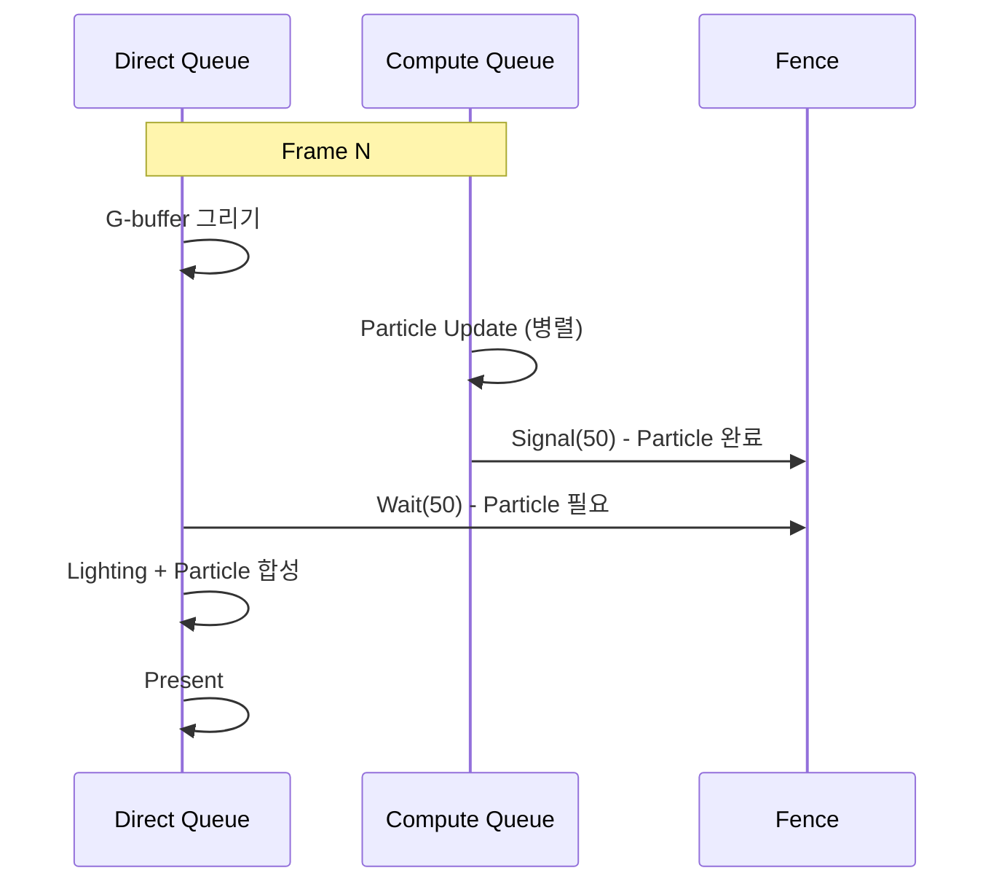
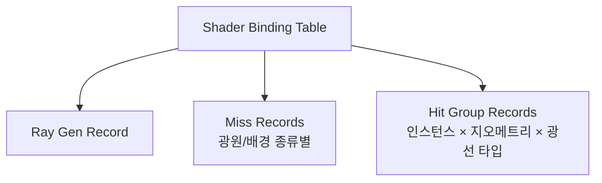

## 들어가며

> 컴퓨트의 전제는 스레드·워크그룹·디스패치 계층, 공유 메모리와 배리어, 맵·리덕션·스캔 패턴, 발산과 점유율이다. 레이트레이싱의 전제는 광선-장면 교차, BVH(BLAS/TLAS) 가속 구조, 광선 셰이더 파이프라인, 하이브리드 렌더링, 디노이징이다. 이 글은 그 전제를 DirectX 12와 DXR의 API로 구현한다. 핵심은 `numthreads`/`Dispatch`, UAV와 Indirect Draw, Compute Queue와 펜스 기반 비동기, DXR 티어 질의, `D3D12_RAYTRACING_*` 가속 구조 빌드, `DispatchRays`·Shader Binding Table·인라인 RayQuery다.

GPU는 그래픽스 파이프라인 외에도 일반 병렬 연산을 실행할 수 있다. DX12의 컴퓨트 셰이더(Compute Shader)가 그 일반 경로다. 정점·픽셀 단계를 거치지 않고, 래스터라이저도 깊이 테스트도 없이, GPU의 수천 개 ALU에 임의의 SIMD 커널을 직접 올린다. 파티클 시뮬레이션, 스키닝 변환, 포스트 이펙트, 물리 적분, 컬링, 프리필터링이 모두 같은 GPU 자원으로 그래픽스 워크로드와 병렬로 돈다.

한 단계 더 나아가면 레이 트레이싱(Ray Tracing)이 있다. DXR(DirectX Raytracing)은 가속 구조(Acceleration Structure)와 광선 셰이더를 통해 광선의 교차 판정을 하드웨어 RT 유닛에 위임한다. NVIDIA Turing 이후, AMD RDNA 2 이후, Intel Arc의 RT 가속 유닛이 BVH 순회와 삼각형 교차 일부를 고정 기능 회로로 처리한다. 래스터화가 깊은 최적화 끝에 도달한 한계 — 정확한 그림자, 다중 바운스 반사, 전역 조명 — 를 광선 추적은 정의상 자연스럽게 표현한다.

여기까지의 코드는 DX12 그래픽스 파이프라인이 PBR과 IBL까지 동작하는 상태다. 디스크립터 힙, 루트 시그니처, 파이프라인 상태 객체(PSO), 리소스 배리어, 펜스 기반 동기화가 모두 손에 익은 토대 위에 있다. 이 글에서 도달할 결과물은 GPU 컴퓨트 셰이더로 시뮬레이션되는 100만 파티클과, DXR로 그려지는 첫 광선 추적 한 프레임이다. 일곱 단계로 쌓는다.

1. 컴퓨트 셰이더 디스패치 모델 — `numthreads`와 `Dispatch`.
2. GPU 파티클 시뮬레이션 — UAV 버퍼와 Indirect Draw.
3. Compute Queue와 비동기 컴퓨트.
4. DXR 개요와 RT 코어.
5. Acceleration Structure — BLAS와 TLAS.
6. Ray Generation 셰이더와 TraceRay.
7. Hit Group과 Shader Binding Table(SBT).


---

## 목차
1. [컴퓨트 셰이더 디스패치 모델](#1-컴퓨트-셰이더-디스패치-모델)
2. [GPU 파티클 시뮬레이션](#2-gpu-파티클-시뮬레이션)
3. [Compute Queue와 비동기](#3-compute-queue와-비동기)
4. [DXR 개요와 RT 코어](#4-dxr-개요와-rt-코어)
5. [Acceleration Structure](#5-acceleration-structure)
6. [Ray Generation 셰이더](#6-ray-generation-셰이더)
7. [Hit Group과 Shader Binding Table](#7-hit-group과-shader-binding-table)


---

## 1. 컴퓨트 셰이더 디스패치 모델

컴퓨트 셰이더는 그래픽스 파이프라인의 어느 고정 단계에도 묶이지 않는다. 입력 어셈블러도, 래스터라이저도, 출력 병합기도 없다. CPU가 발급하는 디스패치 한 번이 수만에서 수백만 개의 스레드를 GPU에 올리고, 각 스레드는 동일한 커널 코드를 자기 인덱스로 실행한다. 이 모델을 정확히 이해하려면 스레드가 어떻게 묶이고 어떻게 인덱싱되는지부터 봐야 한다.

### Dispatch의 3차원과 thread group

`Dispatch(x, y, z)`는 $x \cdot y \cdot z$개의 *스레드 그룹(thread group)* 을 발급한다. 각 그룹은 셰이더 선언부의 `numthreads(X, Y, Z)`로 내부 스레드 수가 정해진다. 따라서 한 번의 디스패치가 올리는 전체 스레드 수는 $x \cdot y \cdot z \cdot X \cdot Y \cdot Z$다.

```hlsl
[numthreads(8, 8, 1)]
void ProcessImage(uint3 gid  : SV_GroupID,
                  uint3 tid  : SV_GroupThreadID,
                  uint3 dtid : SV_DispatchThreadID,
                  uint  flat : SV_GroupIndex)
{
    // gid  : 그룹 인덱스 (Dispatch 좌표 공간)
    // tid  : 그룹 내부 스레드 좌표 (0..7, 0..7, 0)
    // dtid : 전역 스레드 인덱스 = gid * numthreads + tid
    // flat : 그룹 내 1차원 인덱스 = tid.z*X*Y + tid.y*X + tid.x
}
```

`SV_DispatchThreadID`는 디스패치 전체에서 유일한 좌표이므로 보통 데이터 인덱스로 그대로 쓴다. `SV_GroupThreadID`는 `groupshared` 메모리의 타일 좌표로, `SV_GroupIndex`는 그 타일을 1차원으로 펼친 배열 인덱스로 쓴다. 셋의 역할을 구분하지 못하면 공유 메모리 인덱싱에서 곧바로 경합이 난다.

그룹 크기에는 하드웨어 상한이 있다. `X * Y * Z`는 1024를 넘을 수 없고($D3D12$ 사양), 개별 차원도 `X, Y ≤ 1024`, `Z ≤ 64`로 제한된다. `groupshared`의 총량은 그룹당 32KB(셰이더 모델 기준)로, 이 둘이 한 SM/CU에 동시에 올릴 수 있는 그룹 수, 즉 *점유율(occupancy)* 을 결정한다.

### CPU 측 디스패치와 경계 처리

이미지 같은 2차원 데이터를 처리할 때는 데이터 크기를 그룹 크기로 나눠 *올림(ceil)* 한다.

```cpp
// 1920×1080 이미지, 그룹당 8×8 스레드
const UINT gx = (1920 + 7) / 8;   // = 240
const UINT gy = (1080 + 7) / 8;   // = 135
cmdList->Dispatch(gx, gy, 1);     // 240*135*64 = 2,073,600 스레드
```

`(N + threadCount - 1) / threadCount`가 올림 나눗셈 관용구다. 이 예의 1920과 1080은 모두 8로 정확히 나누어떨어지지만, 창 크기나 처리 대상이 바뀌면 마지막 그룹의 일부 스레드가 이미지 경계 밖을 가리킬 수 있다. 일반적인 셰이더는 크기를 고정값으로 가정하지 않고 경계를 검사한다.

```hlsl
[numthreads(8, 8, 1)]
void ProcessImage(uint3 dtid : SV_DispatchThreadID) {
    if (dtid.x >= imageWidth || dtid.y >= imageHeight) return;
    // 이후 본문은 유효 픽셀만 실행한다
}
```

이 검사를 빼먹으면 UAV 경계 밖 쓰기가 일어난다. D3D는 뷰 경계 밖 쓰기를 버리고 경계 밖 읽기는 0을 돌려주도록 정의하므로 크래시나 인접 리소스 오염은 없지만, 경계 밖 스레드가 낭비되고 원자 카운터 같은 부수 효과가 섞이면 결과가 조용히 틀어진다.

### 공유 메모리(groupshared)와 분리 가능 필터

같은 그룹 내 스레드들은 `groupshared` 메모리로 데이터를 빠르게 교환한다. 한 그룹은 GPU의 한 SM(NVIDIA)/CU(AMD)에 매핑되고, `groupshared`는 그 위의 온칩 SRAM(L1/LDS)에 놓여 외부 VRAM 접근보다 한 자릿수 빠르다. 블러처럼 이웃 픽셀을 반복해서 읽는 커널이 대표적 수혜자다.

```hlsl
groupshared float tile[10][10];   // 8×8 타일 + 사방 1픽셀 halo

[numthreads(8, 8, 1)]
void Blur(uint3 dtid : SV_DispatchThreadID, uint3 tid : SV_GroupThreadID) {
    uint width, height;
    inputImage.GetDimensions(width, height);

    uint linearTid = tid.y * 8 + tid.x;
    int2 groupBase = int2(dtid.xy) - int2(tid.xy);

    // 64개 스레드가 중앙+halo 100개 값을 나누어 로드한다.
    for (uint k = linearTid; k < 100; k += 64) {
        uint lx = k % 10;
        uint ly = k / 10;
        int2 src = groupBase + int2(lx, ly) - int2(1, 1);
        src = clamp(src, int2(0, 0), int2(width, height) - int2(1, 1));
        tile[ly][lx] = inputImage.Load(int3(src, 0));
    }

    GroupMemoryBarrierWithGroupSync();   // 그룹 내 모든 쓰기가 끝날 때까지 대기

    // 배리어 전에는 일부 invocation만 반환하면 안 된다.
    if (dtid.x >= width || dtid.y >= height) return;

    // 2. 타일에서 3×3 합을 계산한다
    float sum = 0;
    [unroll] for (int dx = -1; dx <= 1; ++dx)
    [unroll] for (int dy = -1; dy <= 1; ++dy)
        sum += tile[tid.y + 1 + dy][tid.x + 1 + dx];

    outputImage[dtid.xy] = sum / 9.0;
}
```

`GroupMemoryBarrierWithGroupSync`는 두 가지를 동시에 보장한다. `groupshared` 쓰기가 모든 스레드에 보이게 만드는 *메모리 배리어* 와, 그룹 내 모든 스레드가 이 지점에 도달할 때까지 멈추는 *실행 배리어* 다. 이 동기화 없이 2단계로 넘어가면 아직 1단계 로드를 끝내지 못한 이웃 스레드의 타일 칸을 읽어 가비지가 섞인다.

정량적으로, 공유 메모리 없이 짠 3×3 블러는 한 픽셀마다 9회씩 외부 텍스처를 읽어 8×8 타일에서 $9 \times 64 = 576$번의 텍스처 읽기 요청이 발생한다. 캐시 적중이 있으므로 이 횟수가 곧 VRAM 트랜잭션 수는 아니다. 타일 패턴은 중앙과 halo를 합친 100회를 읽고 나머지를 온칩에서 처리한다. 인접 그룹의 halo 중복은 남지만 외부 접근은 크게 줄어든다.

### Wave 단위 연산(Shader Model 6.0+)

GPU는 스레드를 *Wave(NVIDIA의 warp 32, AMD의 wavefront 32 또는 64, Intel 8/16/32)* 단위로 묶어 동일 명령을 잠금 단계(lockstep)로 실행한다. 셰이더 모델 6.0의 wave intrinsic은 같은 Wave 안의 스레드끼리 `groupshared`도 배리어도 없이 직접 값을 주고받게 한다.

```hlsl
RWStructuredBuffer<float> wavePartials : register(u0);

[numthreads(64, 1, 1)]
void Reduce(uint tid : SV_DispatchThreadID) {
    float value   = input[tid];
    float waveSum = WaveActiveSum(value);

    // 표준 SM 6.0에는 float 전역 atomic add가 없으므로 대표 레인이
    // 자신의 슬롯에 부분합을 쓰고 다음 dispatch가 이를 다시 줄인다.
    wavePartials[tid] = WaveIsFirstLane() ? waveSum : 0.0;
}
```

리덕션, 프리픽스 스캔, 비트 패킹 같은 알고리즘에서 `groupshared` 기반 트리 리덕션보다 단계 수가 줄어 수 배 빨라진다. 다만 Wave 크기는 벤더·세대마다 다르므로 32 또는 64를 가정한 코드는 이식성이 떨어진다. `WaveGetLaneCount`로 런타임에 질의하거나, 학습 단계에서는 명시적인 `numthreads` + `groupshared`로 의도를 분명히 드러내는 편이 안전하다.

## 2. GPU 파티클 시뮬레이션

파티클의 독립 적분 구간은 컴퓨트 셰이더에 잘 맞는다. 그러나 충돌 격자, 이웃 상호작용, 생성·사망 compact, 정렬은 원자 연산과 단계 간 동기화를 만든다. 상태를 GPU에 유지하면 매 파티클 CPU 루프와 readback을 피할 수 있지만, CPU는 dispatch 구성·자원 수명·렌더 그래프 의존성을 계속 관리한다.

### 파티클 데이터 구조와 정렬

HLSL과 C++ 양쪽이 비트 단위로 같은 레이아웃을 봐야 한다.

```hlsl
struct Particle {
    float3 pos;
    float  life;     // 0 이하이면 죽은 입자다
    float3 vel;
    float  size;
    float4 color;
};

RWStructuredBuffer<Particle> particles : register(u0);
```

```cpp
struct Particle {
    DirectX::XMFLOAT3 pos;
    float             life;
    DirectX::XMFLOAT3 vel;
    float             size;
    DirectX::XMFLOAT4 color;
};
static_assert(sizeof(Particle) == 48, "Particle layout mismatch");

constexpr UINT MAX_PARTICLES = 1'000'000;   // 48 바이트 × 100만 = 약 45.8 MB
```

`StructuredBuffer`는 HLSL 상수 버퍼의 16바이트 패킹 규칙을 따르지 않고 C++ 구조체와 같은 자연 정렬을 쓰므로, `float3` 뒤에 `float` 하나를 붙여 16바이트 경계에 맞춘 이 배치가 양쪽에서 동일하게 해석된다. `static_assert`로 48바이트를 못 박아 두면, 멤버를 추가하다 한쪽만 어긋나는 사고를 컴파일 타임에 잡는다.

버퍼는 GPU 전용(DEFAULT) 힙에 UAV 플래그를 켜서 만든다.

```cpp
D3D12_RESOURCE_DESC desc{};
desc.Dimension          = D3D12_RESOURCE_DIMENSION_BUFFER;
desc.Width              = sizeof(Particle) * MAX_PARTICLES;
desc.Height             = 1;
desc.DepthOrArraySize   = 1;
desc.MipLevels          = 1;
desc.SampleDesc.Count   = 1;
desc.Layout             = D3D12_TEXTURE_LAYOUT_ROW_MAJOR;
desc.Flags              = D3D12_RESOURCE_FLAG_ALLOW_UNORDERED_ACCESS;

ComPtr<ID3D12Resource> particleBuffer;
device->CreateCommittedResource(
    &kDefaultHeapProps, D3D12_HEAP_FLAG_NONE, &desc,
    D3D12_RESOURCE_STATE_UNORDERED_ACCESS, nullptr,
    IID_PPV_ARGS(&particleBuffer));
```

### Update 컴퓨트 셰이더

매 프레임 디스패치되는 갱신 커널은 한 입자당 한 스레드로 적분한다.

```hlsl
[numthreads(64, 1, 1)]
void UpdateParticles(uint id : SV_DispatchThreadID) {
    if (id >= maxParticles) return;

    Particle p = particles[id];
    if (p.life <= 0) return;        // 죽은 입자는 건너뛴다

    p.vel    += gravity * deltaTime;
    p.pos    += p.vel * deltaTime;
    p.life   -= deltaTime;
    p.color.a = saturate(p.life / spawnLife);   // 수명에 비례한 페이드 아웃

    particles[id] = p;
}
```

1차원 디스패치에서 그룹 크기 64는 64레인 하드웨어에서 한 Wave, 32레인 하드웨어에서 두 Wave를 채우는 무난한 출발점이다. 더 작은 Wave를 쓰는 구현에서는 한 그룹이 더 많은 Wave로 나뉜다. 디스패치 후에는 같은 버퍼를 정점 셰이더가 읽도록 상태를 전환해야 한다.

```cpp
cmdList->SetComputeRootSignature(computeRootSig.Get());
cmdList->SetPipelineState(updateParticlePSO.Get());
cmdList->SetComputeRootDescriptorTable(0, particleUavHandle);
cmdList->Dispatch((MAX_PARTICLES + 63) / 64, 1, 1);

// UAV 쓰기 완료 → 정점 셰이더 읽기로 전환한다
D3D12_RESOURCE_BARRIER b = CD3DX12_RESOURCE_BARRIER::Transition(
    particleBuffer.Get(),
    D3D12_RESOURCE_STATE_UNORDERED_ACCESS,
    D3D12_RESOURCE_STATE_NON_PIXEL_SHADER_RESOURCE);
cmdList->ResourceBarrier(1, &b);
```

전환 배리어는 두 가지 일을 한다. 컴퓨트의 모든 UAV 쓰기가 끝날 때까지 소비자의 읽기를 막는 실행 의존성과, 필요한 캐시·메모리 가시성 전환을 통해 소비자가 최신 데이터를 보게 하는 보장이다. 같은 버퍼를 컴퓨트 안에서 연속으로 디스패치하며 누적할 때는 전환 대신 UAV 배리어(`CD3DX12_RESOURCE_BARRIER::UAV`)로 쓰기-후-읽기 순서만 강제한다.

### Indirect Draw — CPU 개입 없이 인스턴스 수 결정

살아 있는 파티클 수는 GPU만 안다. CPU는 이번 프레임에 몇 개의 입자가 살아남았는지 모르므로 드로우 콜의 인스턴스 수를 채울 수 없다. 해법은 GPU가 드로우 인자 자체를 버퍼에 적고, CPU는 그 버퍼를 가리키며 한 번만 호출하는 *Indirect Draw* 다.

```hlsl
// Compact 커널 — 살아 있는 입자만 별도 버퍼로 모으고 인스턴스 수를 센다
RWStructuredBuffer<Particle> alive    : register(u0);
RWByteAddressBuffer          drawArgs : register(u1);
// drawArgs 레이아웃 = D3D12_DRAW_ARGUMENTS:
//   [0]=VertexCountPerInstance, [4]=InstanceCount, [8]=StartVertex, [12]=StartInstance

[numthreads(64, 1, 1)]
void CompactParticles(uint id : SV_DispatchThreadID) {
    if (id >= maxParticles) return;
    Particle p = particles[id];
    if (p.life > 0) {
        uint outIdx;
        drawArgs.InterlockedAdd(4, 1, outIdx);   // InstanceCount를 원자적으로 +1
        alive[outIdx] = p;                        // 반환된 옛 값이 출력 슬롯이 된다
    }
}
```

`InterlockedAdd`는 더하기 전의 값을 `outIdx`로 돌려준다. 그 값이 곧 이 입자가 압축 버퍼에서 차지할 고유 슬롯이 되므로, 수만 스레드가 동시에 append해도 충돌 없이 빈틈없는 배열이 만들어진다. `drawArgs`의 오프셋 4(InstanceCount)에 누적하는 것은 매 프레임 디스패치 전에 0으로 초기화해 둔다. 나머지 필드도 VertexCountPerInstance=4, StartVertex=0, StartInstance=0으로 준비하고 초기화 쓰기→compact의 GPU 의존성을 맞춘다.

```cpp
cmdList->ExecuteIndirect(
    indirectCmdSig.Get(),   // DrawInstanced 형태의 커맨드 시그니처
    1,                      // 명령 최대 개수
    drawArgsBuffer.Get(),   // GPU가 채운 인자 버퍼
    0,                      // 인자 버퍼 내 오프셋
    nullptr, 0);            // 카운트 버퍼 없음
```

`ExecuteIndirect`의 커맨드 시그니처는 인자 버퍼의 바이트 레이아웃이 `D3D12_DRAW_ARGUMENTS` 구조와 일치한다고 GPU에 알린다. 인스턴스 수가 GPU 측에서 결정되므로 CPU는 고정된 한 번의 호출만 발급하고, 결과적으로 입자 수를 CPU로 읽어 오지 않고 한 번의 간접 드로우 제출로 그릴 수 있다. CPU 제출 비용과 GPU의 입자 처리는 여전히 남으며, DX11도 `DrawInstancedIndirect` 같은 GPU 인자 경로를 제공한다.

이 호출이 안전하려면 컴퓨트가 쓴 인자와 데이터를 소비하기 전에 자원 상태와 가시성이 맞춰져 있어야 한다. `drawArgs`는 컴퓨트의 UAV 쓰기(`D3D12_RESOURCE_STATE_UNORDERED_ACCESS`)에서 `D3D12_RESOURCE_STATE_INDIRECT_ARGUMENT`로, 압축된 `alive` 버퍼는 UAV 쓰기에서 정점 셰이더가 읽는 `D3D12_RESOURCE_STATE_NON_PIXEL_SHADER_RESOURCE`로 전환해야 한다. 위에서 생략한 제출 헬퍼가 이 배리어와 가시성 전환을 수행한다는 계약을 전제로 하며, 같은 큐에서 디스패치와 드로우를 이어 붙이는 경로와 컴퓨트 큐에서 그래픽스 큐로 넘기는 경로를 구분해야 한다(다중 큐 경로는 큐 간 fence 핸드오프가 추가로 필요하다). helper가 이 전환을 하지 않으면 UAV 쓰기를 다 읽기 전에 소비해 잘못된 인자로 드로우하거나 데이터 경합이 난다.

### 빌보드 메시 렌더링

압축된 살아 있는 입자를 각 인스턴스가 정점 4개의 쿼드로 펼쳐 카메라를 향한 빌보드로 그린다.

```hlsl
struct VSOutput { float4 pos : SV_Position; float4 color : COLOR; };
StructuredBuffer<Particle> alive : register(t0);

VSOutput VSMain(uint vid : SV_VertexID, uint iid : SV_InstanceID) {
    Particle p = alive[iid];
    float2 corner = float2(vid & 1, vid >> 1) * 2.0 - 1.0;   // 0..3 → (-1,-1)..(1,1)
    float3 worldPos = p.pos + cameraRight * corner.x * p.size
                            + cameraUp    * corner.y * p.size;
    VSOutput o;
    o.pos   = mul(float4(worldPos, 1.0), viewProj);
    o.color = p.color;
    return o;
}
```

정점 버퍼 없이 `SV_VertexID`만으로 네 모서리를 생성하는 패턴이다. 한 입자가 한 인스턴스이고, `DrawInstanced(4, instanceCount, 0, 0)` 형태의 인자가 앞 절의 `drawArgs`에 들어 있다. 네 모서리를 두 삼각형으로 잇도록 PSO는 TRIANGLE 타입, 실제 IA 토폴로지는 `D3D_PRIMITIVE_TOPOLOGY_TRIANGLESTRIP`으로 설정한다. 알파 블렌딩이 필요한 입자는 거리순 정렬이 이상적이지만, 비용이 크면 가산 블렌딩(additive)으로 정렬을 회피하는 절충이 흔하다.

## 3. Compute Queue와 비동기

DX12는 하나의 디바이스 아래 여러 종류의 커맨드 큐를 둔다. 그래픽스를 그리는 Direct Queue, 순수 연산만 하는 Compute Queue, 복사 전용 Copy Queue다. 이들은 단순한 소프트웨어 추상이 아니라 GPU 하드웨어의 서로 다른 엔진에 매핑되어, 조건이 맞으면 물리적으로 동시에 실행된다.

### 비동기 컴퓨트의 의미

Direct Queue가 G-buffer를 그리는 동안 Compute Queue가 다음 프레임의 데이터를 준비하면, 그래픽스 엔진이 ROP·래스터라이저로 바쁠 때 놀고 있던 ALU를 컴퓨트가 채운다. 이 *빈틈 메우기* 가 비동기 컴퓨트의 본질이다.



### 의존성의 세 가지 패턴

큐 사이의 동기화 양은 의존 구조에 따라 갈린다.

- *완전 독립* — Compute Queue가 다음 프레임에 쓸 데이터를 미리 만든다. TLAS refit, IBL 프리필터, 다음 프레임용 컬링이 여기 든다. Direct Queue와의 동기화가 거의 없어 가장 큰 중첩 이득을 본다.
- *프레임 내 의존* — 컴퓨트 결과를 같은 프레임의 그래픽스가 읽는다. 파티클 업데이트 후 그리기가 전형적이다. 펜스로 한 지점에서 만난다.
- *그래픽스 → 컴퓨트* — G-buffer를 그린 뒤 컴퓨트로 라이팅을 계산하는 타일드/클러스터드 디퍼드 셰이딩이다. 그래픽스가 끝나야 컴퓨트가 시작하므로 중첩 여지가 좁고, 주로 코드 구조화 목적이다.

### GPU 측 동기화 — CPU를 거치지 않는 펜스

두 큐의 순서는 펜스(Fence)로 맞춘다. 한 큐가 펜스 값을 올리면(Signal), 다른 큐가 그 값에 도달할 때까지 GPU 측에서 기다린다(Wait).

```cpp
// Compute Queue가 파티클 업데이트를 실행하고 펜스를 올린다
computeQueue->ExecuteCommandLists(1, computeLists);
computeQueue->Signal(particleFence.Get(), ++particleFenceValue);

// Direct Queue는 그 펜스 값을 기다린 뒤에 합성 패스를 실행한다
directQueue->Wait(particleFence.Get(), particleFenceValue);
directQueue->ExecuteCommandLists(1, graphicsLists);
```

`ID3D12CommandQueue::Wait`는 GPU 측 대기다. CPU 스레드는 여기서 멈추지 않고 다음 프레임 준비를 계속한다. 두 큐가 각자 일을 진행하다 펜스 값에서만 만나므로, CPU가 중간에 끼어 GPU를 굶기는 일이 없다. 단, Fence는 실행 순서를 연결할 뿐 소비자에게 맞는 자원 상태를 대신 설정하지 않는다. 위 파티클 버퍼는 UAV 쓰기 뒤 정점 SRV 읽기에 맞는 `NON_PIXEL_SHADER_RESOURCE`로 전환한다. Direct↔Compute 사이에 무조건 COMMON으로 바꿔야 하는 것은 아니며, Copy 큐와의 handoff에는 별도의 COMMON 규칙이 있다.

### 비동기 컴퓨트가 실제로 빨라지는가

작성했다고 자동으로 빨라지지는 않는다. 효과는 벤더와 세대에 크게 의존한다.

벤더·세대 이름만으로 이득의 순위를 정할 수는 없다. 논리적 큐와 물리 엔진은 1:1 대응을 보장하지 않으며, 셰이더 실행 자원·레지스터·LDS·메모리 대역폭의 여유와 스케줄링이 실제 중첩을 결정한다.

따라서 비동기 컴퓨트는 반드시 측정으로 검증한다. PIX(Windows), AMD의 RGP, NVIDIA Nsight의 GPU 타임라인에서 두 큐의 바가 실제로 겹쳐 그려지는지 확인한다. 겹치지 않는다면 펜스 의존이 너무 빡빡하거나 하드웨어가 직렬화하고 있는 것이다.

## 4. DXR 개요와 RT 코어

광선 추적은 래스터화의 쌍대다. 래스터화가 기하에서 픽셀로 투영한다면, 광선 추적은 픽셀에서 기하로 광선을 쏜다. 그래서 그림자·반사·굴절·전역 조명 같은 가시성 질의를 정의상 자연스럽게 다룬다. 무차별 교차의 $O(\text{픽셀} \times \text{삼각형})$ 비용은 *BVH(Bounding Volume Hierarchy)* 가 평균 로그 횟수의 검사로 낮춘다. 여기서는 그 BVH 순회와 삼각형 교차를 *어느 하드웨어가 고정 기능으로 가속하는지*, 그리고 DXR을 쓰기 전에 *무엇을 질의해야 하는지* 를 다룬다.

| 벤더 | RT 유닛 명 | 고정 기능으로 가속하는 항목 |
|---|---|---|
| NVIDIA | RT Core | BVH 순회 + 삼각형 교차 |
| AMD | Ray Accelerator | 삼각형/박스 교차 (순회는 셰이더가 주도) |
| Intel | RTU(Ray Tracing Unit) | BVH 순회 + 삼각형 교차 |

RT 유닛은 BVH 순회와 삼각형-광선 교차라는, 셰이더 ALU로는 분기가 많고 느린 연산을 전용 회로로 처리한다. 이 가속이 있고 없고가 실시간 광선 추적의 실현 가능성을 가른다. DXR API 자체는 가속 유닛이 없는 GPU에서도 별도 소프트웨어/컴퓨트 폴백 라이브러리로 구현할 여지는 있지만, 네이티브 DXR 지원이 자동으로 생기는 것은 아니다. 이 원고의 네이티브 경로는 티어 질의를 통과해야 하며, 실시간 프레임 예산 안에서는 RT 유닛이 사실상 전제다.

### BVH 빌드 비용

가속 구조 빌드는 공짜가 아니다. 비용은 장면 규모와 빌더 품질 플래그에 따라 큰 편차를 보인다. 수십만 삼각형의 정적 메시는 GPU 빌드로 밀리초 단위, 수백만 삼각형의 동적 장면은 수에서 수십 밀리초에 이른다. 따라서 일반적인 게임은 정적 메시를 한 번만 빌드해 두고, 매 프레임 변하는 부분은 전체 재빌드 대신 변환만 갱신하는 refit로 처리하는 것이 표준이다. 이 정적/동적 분리가 5절의 BLAS/TLAS 구조와 직결된다.

### DXR 지원 확인과 티어

DXR 사용 전에 디바이스의 지원 티어를 질의한다.

```cpp
D3D12_FEATURE_DATA_D3D12_OPTIONS5 opts5{};
device->CheckFeatureSupport(D3D12_FEATURE_D3D12_OPTIONS5,
                            &opts5, sizeof(opts5));

bool dxrSupported = opts5.RaytracingTier >= D3D12_RAYTRACING_TIER_1_0;
bool inlineRT     = opts5.RaytracingTier >= D3D12_RAYTRACING_TIER_1_1;
```

`TIER_1_0`(DXR 1.0)은 `DispatchRays`와 Shader Binding Table 기반의 전통적 광선 추적 파이프라인을 제공한다. `TIER_1_1`(DXR 1.1)은 여기에 *인라인 레이 트레이싱(Inline Ray Tracing)* 을 더한다. 컴퓨트나 그래픽스 셰이더 안에서 별도 파이프라인 없이 `RayQuery`로 직접 광선을 쏘는 방식으로, 7절에서 첫 결과를 만들 때 이 경로를 쓴다.

## 5. Acceleration Structure

가속 구조는 두 단계로 나뉜다. 메시별 삼각형 트리인 *Bottom Level(BLAS)* 과, BLAS 인스턴스들을 변환 행렬로 배치한 *Top Level(TLAS)* 이다. 이 분리는 같은 메시를 여러 위치에 반복 배치하면서도 삼각형 트리는 한 번만 빌드하게 해 준다.

### BLAS — 메시별 BVH

각 고유 메시의 삼각형으로부터 하나의 BLAS를 만든다. 정적 메시는 빌드를 한 번만 하고, 정점이 매 프레임 변형되는 메시(스키닝 결과 등)는 refit하거나 재빌드한다.

```cpp
D3D12_RAYTRACING_GEOMETRY_DESC geomDesc{};
geomDesc.Type  = D3D12_RAYTRACING_GEOMETRY_TYPE_TRIANGLES;
geomDesc.Flags = D3D12_RAYTRACING_GEOMETRY_FLAG_OPAQUE;   // any-hit 생략 → 빠름
geomDesc.Triangles.VertexBuffer.StartAddress  = vb->GetGPUVirtualAddress();
geomDesc.Triangles.VertexBuffer.StrideInBytes = sizeof(Vertex);
geomDesc.Triangles.VertexCount  = vertexCount;
geomDesc.Triangles.VertexFormat = DXGI_FORMAT_R32G32B32_FLOAT;
geomDesc.Triangles.IndexBuffer  = ib->GetGPUVirtualAddress();
geomDesc.Triangles.IndexCount   = indexCount;
geomDesc.Triangles.IndexFormat  = DXGI_FORMAT_R32_UINT;

D3D12_BUILD_RAYTRACING_ACCELERATION_STRUCTURE_INPUTS blasInputs{};
blasInputs.Type           = D3D12_RAYTRACING_ACCELERATION_STRUCTURE_TYPE_BOTTOM_LEVEL;
blasInputs.Flags          = D3D12_RAYTRACING_ACCELERATION_STRUCTURE_BUILD_FLAG_PREFER_FAST_TRACE;
blasInputs.NumDescs       = 1;
blasInputs.pGeometryDescs = &geomDesc;
blasInputs.DescsLayout    = D3D12_ELEMENTS_LAYOUT_ARRAY;
```

`FLAG_OPAQUE`는 이 지오메트리에 any-hit 셰이더를 호출하지 않겠다는 약속으로, 순회 중 알파 테스트를 건너뛰어 교차를 빠르게 한다. `PREFER_FAST_TRACE`는 빌드를 느리게 하더라도 순회가 빠른 고품질 트리를 만들라는 지시다. 자주 재빌드하는 동적 메시는 반대로 `PREFER_FAST_BUILD`가 맞다.

빌드에는 결과 버퍼와 임시 스크래치 버퍼가 필요하며, 그 크기는 드라이버에 직접 질의한다.

```cpp
D3D12_RAYTRACING_ACCELERATION_STRUCTURE_PREBUILD_INFO prebuild{};
device->GetRaytracingAccelerationStructurePrebuildInfo(&blasInputs, &prebuild);
// prebuild.ResultDataMaxSizeInBytes, prebuild.ScratchDataSizeInBytes 만큼
// UAV 플래그 버퍼를 각각 할당한다 (결과 버퍼 초기 상태는
// D3D12_RESOURCE_STATE_RAYTRACING_ACCELERATION_STRUCTURE)

D3D12_BUILD_RAYTRACING_ACCELERATION_STRUCTURE_DESC buildDesc{};
buildDesc.Inputs                           = blasInputs;
buildDesc.ScratchAccelerationStructureData = scratch->GetGPUVirtualAddress();
buildDesc.DestAccelerationStructureData    = blas->GetGPUVirtualAddress();

cmdList->BuildRaytracingAccelerationStructure(&buildDesc, 0, nullptr);

// 빌드 완료 후 TLAS가 이 BLAS를 읽기 전에 UAV 배리어를 건다
D3D12_RESOURCE_BARRIER uavB = CD3DX12_RESOURCE_BARRIER::UAV(blas.Get());
cmdList->ResourceBarrier(1, &uavB);
```

가속 구조 버퍼는 특수한 상태 `RAYTRACING_ACCELERATION_STRUCTURE`에 놓이고 일반 전환 배리어 대상이 아니다. BLAS 빌드 후 TLAS 빌드가 그 결과를 읽으려면 그 사이에 UAV 배리어로 쓰기-후-읽기 순서를 강제해야 한다. 이 배리어를 빠뜨리면 절반만 빌드된 트리를 TLAS가 참조해 비결정적 깨짐이 난다.

### TLAS — 인스턴스 트리

TLAS는 여러 BLAS 인스턴스를 3×4 변환 행렬, 인스턴스 ID, 마스크로 묶는다. 같은 BLAS를 여러 위치·회전으로 인스턴스화하면 삼각형 트리는 공유하면서 장면을 구성한다.

```cpp
D3D12_RAYTRACING_INSTANCE_DESC instances[N]{};
for (UINT i = 0; i < N; ++i) {
    // transforms[i]: DirectXMath의 행벡터 규약 XMFLOAT4X4
    // DXR은 열벡터 affine 행렬의 앞 3행을 row-major 3×4로 받는다.
    DirectX::XMFLOAT3X4 affine;
    DirectX::XMStoreFloat3x4(&affine, DirectX::XMMatrixTranspose(
        DirectX::XMLoadFloat4x4(&transforms[i])));
    memcpy(instances[i].Transform, &affine, sizeof(affine));
    instances[i].InstanceID                          = i;        // 셰이더에서 InstanceID()
    instances[i].InstanceMask                        = 0xFF;     // 광선 마스크와 AND
    instances[i].InstanceContributionToHitGroupIndex = i;        // SBT 인덱싱 기여
    instances[i].Flags                               = D3D12_RAYTRACING_INSTANCE_FLAG_NONE;
    instances[i].AccelerationStructure               = blas->GetGPUVirtualAddress();
}
// 위 배열을 Upload Heap 버퍼에 복사한 뒤,
// blasInputs와 동일한 패턴으로 Type = TOP_LEVEL, InstanceDescs = 그 버퍼 주소로 빌드한다
```

`InstanceMask`는 6절 `TraceRay`의 InstanceInclusionMask와 비트 AND되어, 특정 광선이 특정 인스턴스 부류만 보게 한다. 예를 들어 그림자 광선은 그림자를 드리우는 객체 마스크만 통과시켜 투명 장식물을 건너뛰게 만들 수 있다. `InstanceContributionToHitGroupIndex`는 그 인스턴스에 어떤 Hit Group이 매핑되는지를 SBT에서 찾는 인덱스 기여분으로, 7절의 셰이더 바인딩과 직접 연결된다.

### Refit과 Rebuild

정적 메시인데 위치만 바뀐다면 TLAS만 갱신하면 된다(저비용). 정점 자체가 변형되는 동적 메시는 BLAS를 refit하거나 재빌드한다.

```cpp
// 갱신 가능하게 하려면 최초 빌드부터 ALLOW_UPDATE 플래그가 필요하다
blasInputs.Flags |= D3D12_RAYTRACING_ACCELERATION_STRUCTURE_BUILD_FLAG_ALLOW_UPDATE;
// 최초 prebuild 질의·빌드 전에 위 값을 설정하고 buildDesc.Inputs에도 복사한다.
// scratch는 최초 ScratchDataSizeInBytes와 UpdateScratchDataSizeInBytes 중 큰 크기로 잡는다.
// ... 최초 빌드 후, refit 시점에:
buildDesc.Inputs = blasInputs;
buildDesc.Inputs.Flags |= D3D12_RAYTRACING_ACCELERATION_STRUCTURE_BUILD_FLAG_PERFORM_UPDATE;
buildDesc.SourceAccelerationStructureData = blas->GetGPUVirtualAddress();   // 이전 트리
buildDesc.DestAccelerationStructureData   = blas->GetGPUVirtualAddress();   // 같은 위치 갱신
```

Refit은 트리의 위상은 그대로 두고 경계 상자만 새 정점으로 다시 맞춘다 — 리프 상자를 새 정점으로 재계산한 뒤 루트까지 상향으로 조상 노드의 상자를 다시 합친다. 비용은 장면과 하드웨어에 따라 전체 빌드보다 작지만 고정 비율로 보장되지는 않는다. 정점이 원래 위치에서 크게 벗어나면 위상이 그대로인 트리의 경계 상자가 과도하게 겹쳐 순회 효율이 떨어진다. 큰 변형이 누적되면 `ALLOW_UPDATE` 가능성은 유지하되 해당 빌드 호출에서 `PERFORM_UPDATE`를 빼고 전체 재빌드해 트리 품질을 회복한다. `ALLOW_UPDATE`를 제거해 새로 만들면 이후 그 가속 구조는 refit할 수 없다.

## 6. Ray Generation 셰이더

### DispatchRays와 RayGen

광선 추적 파이프라인의 진입점은 *Ray Generation* 셰이더다. `DispatchRays(W, H, D)`가 컴퓨트의 `Dispatch`처럼 $W \times H \times D$개의 스레드를 발급하고, 각 스레드가 자기 픽셀에서 카메라 광선을 만들어 추적한다.

```hlsl
RaytracingAccelerationStructure sceneTLAS : register(t0);
RWTexture2D<float4>             output    : register(u0);

struct Payload { float3 color; float hitDistance; uint bounceCount; };

[shader("raygeneration")]
void RayGen() {
    uint2 pixel = DispatchRaysIndex().xy;
    uint2 dims  = DispatchRaysDimensions().xy;

    float2 ndc = (pixel + 0.5) / dims * 2.0 - 1.0;
    ndc.y = -ndc.y;     // 화면 Y는 아래로, NDC Y는 위로

    float4 nearH  = mul(float4(ndc, 0.0, 1.0), invViewProj);
    float4 farH   = mul(float4(ndc, 1.0, 1.0), invViewProj);
    float3 origin = nearH.xyz / nearH.w;
    float3 dir    = normalize(farH.xyz / farH.w - origin);

    RayDesc ray;
    ray.Origin = origin; ray.Direction = dir;
    ray.TMin   = 0.0;    ray.TMax      = 10000;   // primary ray: near plane에서 시작

    Payload p = (Payload)0;
    TraceRay(sceneTLAS, RAY_FLAG_NONE,
             0xFF,   // InstanceInclusionMask — 모든 인스턴스
             0,      // RayContributionToHitGroupIndex
             1,      // MultiplierForGeometryContributionToHitGroupIndex
             0,      // MissShaderIndex
             ray, p);

    output[pixel] = float4(p.color, 1.0);
}
```

```cpp
D3D12_DISPATCH_RAYS_DESC dispatch{};
dispatch.RayGenerationShaderRecord = { rgRecordGpuVA, rgRecordSize };
dispatch.MissShaderTable           = { missTableVA, missTableSize, missStride };
dispatch.HitGroupTable             = { hitTableVA,  hitTableSize,  hitStride  };
dispatch.Width  = 1920; dispatch.Height = 1080; dispatch.Depth = 1;
cmdList->DispatchRays(&dispatch);
```

위 primary ray는 near plane에서 출발한다. near=0/far=1인 standard-Z·유한 far 투영을 전제로 하며, reverse-Z나 무한 far 행렬에서는 끝점 깊이와 w=0 방향 처리를 맞춰야 한다. 반사·그림자처럼 표면에서 시작하는 secondary ray의 `TMin` 또는 origin offset은 *self-intersection* 을 줄이기 위한 것이다. 이 epsilon이 너무 작으면 표면에 점박이 잡음(acne)이, 너무 크면 접촉 그림자가 떠 보이는(peter-panning) 인공물이 생긴다. `DispatchRays`에 넘기는 세 테이블의 주소는 7절에서 만드는 SBT의 영역을 가리킨다.

### Payload와 재귀 광선

Payload는 RayGen과 Hit/Miss 셰이더가 주고받는 임의 구조체다. 셰이더 단계 사이의 유일한 통신 채널이며, 크기가 작을수록 레지스터 압력이 낮아 점유율에 유리하다.

```hlsl
[shader("closesthit")]
void ClosestHit(inout Payload p, BuiltInTriangleIntersectionAttributes attr) {
    p.color += DirectLighting(HitWorldPosition(), HitWorldNormal());
    if (p.bounceCount < 4) {                  // 재귀 깊이 제한
        p.bounceCount++;
        RayDesc r;
        r.Origin    = HitWorldPosition();
        r.Direction = reflect(WorldRayDirection(), HitWorldNormal());
        r.TMin = 0.001; r.TMax = 10000;
        TraceRay(sceneTLAS, RAY_FLAG_NONE, 0xFF, 0, 1, 0, r, p);   // 반사 광선
    }
}
```

Hit 셰이더 안에서 `TraceRay`를 다시 부르면 반사·굴절이 재귀로 자연스럽게 표현된다. 위 예제는 호출 흐름을 보이는 단순 누적이며 물리적 반사 모델이 되려면 반사율·경로 가중치도 곱해야 한다. primary TraceRay에 반사 4번이 중첩되므로 위 그대로라면 최소 5의 `MaxTraceRecursionDepth`가 필요하다. 재귀 깊이는 RT State Object의 `MaxTraceRecursionDepth`로 상한이 정해지고, 깊이가 늘수록 스택 메모리와 비용이 커진다. 실시간에서는 보통 1~2바운스로 제한하고 나머지는 환경 맵으로 근사한다.

## 7. Hit Group과 Shader Binding Table

### 광선 셰이더의 종류

광선 추적 파이프라인은 여섯 종류의 셰이더 진입점을 가진다. 그중 순회와 무관하게 셰이더가 `CallShader()`로 직접 부르는 Callable 셰이더는 이 글에서 쓰지 않으므로, 아래 표는 나머지 다섯을 정리한다.

| 셰이더 | 호출 시점 |
|---|---|
| Ray Generation | 광선 발사, `DispatchRays`의 진입점 |
| Miss | 광선이 어떤 지오메트리에도 맞지 않음 |
| Closest Hit | 가장 가까운 교차점에서 한 번 |
| Any Hit | 후보 교차마다 (불투명이 아니거나 alpha test가 필요한 경우) |
| Intersection | 사용자 정의 프리미티브 (구, 절차적 표면) |

*Hit Group* 은 Closest Hit, Any Hit, Intersection 셋을 하나로 묶은 단위다. 광선이 어떤 인스턴스에 맞으면 그 인스턴스에 매핑된 Hit Group의 셰이더들이 실행된다. 불투명 삼각형만 다루는 가장 단순한 경우, Hit Group은 Closest Hit 하나만 담는다.

Any Hit는 모든 기하학적 교차에 대해 무조건 호출되는 것이 아니다. opaque 플래그가 켜진 인스턴스는 any-hit를 건너뛰고, ray/instance culling과 이미 얻은 hit의 t 범위, 종료 정책(`RAY_FLAG_ACCEPT_FIRST_HIT_AND_END_SEARCH` 등)에 따라 호출이 생략된다. 즉 Any Hit는 허용된 non-opaque 후보 교차를 필터링하는 단계이며, 셰이더가 `IgnoreHit()`/`AcceptHitAndEndSearch()`로 결과를 확정하는 계약을 따른다. API별 중복 호출 보장도 없으므로 호출 횟수에 의존한 로직을 두지 않는다.

### Shader Binding Table의 역할

광선이 어떤 인스턴스에 맞았을 때 어떤 셰이더가 어떤 매개변수로 실행될지를 정하는 룩업 테이블이 *Shader Binding Table(SBT)* 이다. GPU 메모리의 작은 버퍼로, RayGen 레코드 하나, Miss 레코드 N개, Hit Group 레코드 다수로 구성된다.



각 레코드는 셰이더 식별자와, 그 셰이더가 쓸 로컬 루트 시그니처 매개변수(텍스처 핸들, 머티리얼 상수 등)를 담은 짧은 메모리 블록이다. `DispatchRays`가 6절에서 넘긴 인덱스들과 인스턴스의 `InstanceContributionToHitGroupIndex`를 조합해 SBT에서 정확한 레코드를 찾아 셰이더를 디스패치한다. 전체 룩업과 디스패치가 GPU 측에서 완결된다.

### SBT 채우기와 정렬 규칙

컴파일된 RT PSO(State Object)에서 셰이더 식별자를 꺼내 레코드에 적는다.

```cpp
ComPtr<ID3D12StateObjectProperties> props;
rtPso.As(&props);
void* rayGenId   = props->GetShaderIdentifier(L"RayGen");
void* missId     = props->GetShaderIdentifier(L"Miss");
void* hitGroupId = props->GetShaderIdentifier(L"DefaultHitGroup");

// 식별자는 32바이트. 각 레코드는 32바이트 정렬,
// 각 테이블의 시작은 64바이트 정렬이어야 한다.
struct ShaderRecord {
    BYTE id[D3D12_SHADER_IDENTIFIER_SIZE_IN_BYTES];   // = 32
    // 이어서 로컬 루트 시그니처 매개변수 (cbuffer GPU VA, 디스크립터 핸들 등)
};

for (UINT i = 0; i < N; ++i) {
    ShaderRecord r;
    memcpy(r.id, hitGroupId, D3D12_SHADER_IDENTIFIER_SIZE_IN_BYTES);
    // r의 뒷부분에 i번째 인스턴스의 머티리얼/텍스처 핸들을 채운다
    AppendToSBT(sbtBuffer, r);   // hitStride 간격으로 정렬해 기록
}
```

SBT는 정렬 규칙이 까다롭다. 셰이더 식별자는 32바이트(`D3D12_SHADER_IDENTIFIER_SIZE_IN_BYTES`)이고, 각 레코드는 32바이트(`D3D12_RAYTRACING_SHADER_RECORD_BYTE_ALIGNMENT`) 경계에, 각 테이블의 시작 주소는 64바이트(`D3D12_RAYTRACING_SHADER_TABLE_BYTE_ALIGNMENT`) 경계에 정렬해야 한다. 스트라이드를 잘못 잡으면 `DispatchRays`가 엉뚱한 레코드를 읽어 잘못된 셰이더가 실행되거나, 디버그 레이어가 정렬 위반을 보고한다. 이 수동 정렬과 식별자 복사가 DXR 1.0의 가장 흔한 버그 원천이다.

### 인라인 레이 트레이싱(DXR 1.1)

DXR 1.1은 `TraceRay`와 SBT의 복잡도를 통째로 우회하는 길을 연다. 컴퓨트나 그래픽스 셰이더 안에서 별도 RT 파이프라인 없이 `RayQuery`로 직접 광선을 쏘는 *인라인 레이 트레이싱* 이다.

```hlsl
[numthreads(8, 8, 1)]
void ComputeShadowsCS(uint3 dtid : SV_DispatchThreadID) {
    float3 surfacePos = ReconstructWorldPos(dtid.xy);
    float3 toLight    = lightPos - surfacePos;
    float  lightDist  = length(toLight);
    float3 lightDir   = toLight / lightDist;

    RayDesc shadowRay;
    shadowRay.Origin    = surfacePos + lightDir * 0.001;   // self-shadow 방지
    shadowRay.Direction = lightDir;
    shadowRay.TMin = 0.0;
    // origin 을 lightDir 방향으로 0.001 옮겼으므로 TMax 도 그만큼 줄여,
    // 광원 뒤의 블로커를 그림자로 잘못 판정하지 않게 한다.
    shadowRay.TMax = max(lightDist - 0.001, 0.0);

    // 이 최소 예제는 불투명 삼각형만 그림자 caster로 취급한다.
    RayQuery<RAY_FLAG_ACCEPT_FIRST_HIT_AND_END_SEARCH |
             RAY_FLAG_FORCE_OPAQUE | RAY_FLAG_SKIP_PROCEDURAL_PRIMITIVES> q;
    q.TraceRayInline(scene, RAY_FLAG_NONE, 0xFF, shadowRay);
    q.Proceed();                                            // 순회 진행

    bool shadowed = (q.CommittedStatus() == COMMITTED_TRIANGLE_HIT);
    shadowOutput[dtid.xy] = shadowed ? 0.0 : 1.0;
}
```

그림자 광선은 가장 가까운 교차점이 아니라 *교차가 있는가* 만 알면 되므로, 위 `FORCE_OPAQUE | SKIP_PROCEDURAL_PRIMITIVES` 계약에서는 알파 테스트·절차적 후보를 처리하지 않으므로 한 번의 `Proceed`로 끝낼 수 있다. 알파 마스크나 절차적 기하를 지원하려면 `while(q.Proceed())`에서 후보별 판정과 commit을 구현해야 한다.

`ACCEPT_FIRST_HIT_AND_END_SEARCH` 플래그로 첫 교차에서 순회를 끝내 비용을 줄인다. SBT도 별도 셰이더 진입점도 없이 한 커널 안에서 광선을 쏘고 결과를 즉시 쓰므로, 그림자·AO·단순 반사 같은 워크로드에서는 코드가 짧고 캐시 효율도 좋다. 일반적인 게임에서 DXR 1.1 인라인 RT가 1.0의 SBT 기반보다 다루기 쉬운 이유다.

### 첫 RT 결과 — 광선 추적 그림자

첫 광선 추적 한 프레임은 전체를 광선으로 그리는 대신, 기존 PBR 메인 패스의 그림자 항만 교체하는 데서 시작한다. 픽셀 셰이더(또는 위의 컴퓨트 패스)가 각 픽셀의 월드 위치에서 광원 방향으로 그림자 광선을 쏘고, 교차 여부로 그림자 마스크를 만든다.

그림자 맵 대비 장점은 경계가 깊이 해상도나 텍셀 크기에 묶이지 않아 정확하고, 광원 위의 무작위 점을 샘플링하면 면적 광원의 부드러운 그림자(soft shadow)를 물리적으로 표현할 수 있다는 점이다. 대가는 RT 유닛이 있는 GPU가 사실상 필요하고, 광선당 BVH 순회 비용이 프레임 예산에서 밀리초 단위를 차지한다는 것이다. 그래서 실무에서는 픽셀당 광선 수를 줄이고 시공간 디노이징으로 잡음을 메우는 절충이 보편적이다.


---

## 결론

여기까지의 코드로 DX12 학습의 큰 축이 마무리된다. 컴퓨트 셰이더의 일반 병렬 연산, 비동기 컴퓨트 큐, DXR의 광선 추적 — 현대 GPU가 그래픽스 외에 갖는 두 일반 연산 축이 한 흐름에 모였다. 100만 파티클이 GPU 측에서 스스로 시뮬레이션되어 Indirect Draw로 그려지고, 광선 추적 그림자가 첫 RT 결과로 화면에 나타난다.

세 가지가 이 글의 핵심 트레이드오프다. 첫째, 비동기 컴퓨트는 코드를 짰다고 자동으로 빨라지지 않으며 벤더·세대에 따라 이득이 0에서 수십 퍼센트까지 갈리므로 GPU 타임라인 측정이 필수다. 둘째, 가속 구조는 빌드 품질 플래그(`FAST_TRACE` 대 `FAST_BUILD`)와 refit 대 rebuild 사이에서 빌드 비용과 순회 비용을 저울질해야 한다. 셋째, 광선 추적 그림자는 정확성을 얻는 대신 RT 유닛과 프레임당 밀리초 예산을 요구하므로, 광선 수와 디노이징의 균형이 실시간 적용의 관건이다.

DX12의 명시적 동기화 모델이 컴퓨트와 RT까지 일관되게 적용된다는 점이 가장 중요하다. PSO, 루트 시그니처, 배리어, 펜스라는 토대 위에 Compute PSO, RT State Object, UAV 배리어, Shader Binding Table 같은 동형의 추상이 그대로 얹힌다. 같은 개념을 더 노골적으로 노출하면서 멀티 큐 동기화를 사용자에게 전부 맡기는 API — Vulkan — 가 한 단계 더 깊은 학습의 자연스러운 토대다. 파이프라인 배리어의 sync/access/layout 세 축 분리, 디스크립터 풀의 세트 단위 할당, 명시적 Render Pass와 Subpass 같은 추상이 하드웨어 모델을 더 직접 드러낸다. 두 API를 모두 익히면 어느 한쪽도 더 이상 불투명하지 않다.

## 더 읽을거리

- Microsoft, [DirectX Raytracing (DXR) Functional Spec](https://microsoft.github.io/DirectX-Specs/d3d/Raytracing.html) — 가속 구조·SBT·광선 셰이더의 명세 원문.
- [Ray Tracing Gems II](https://www.realtimerendering.com/raytracinggems/rtg2/index.html) — DXR 실전 기법 모음(무료 공개).
- AMD GPUOpen, [비동기 컴퓨트 가이드](https://gpuopen.com/learn/concurrent-execution-asynchronous-queues/) — 큐 겹침의 이득과 측정.
- NVIDIA, [DXR 튜토리얼 시리즈](https://developer.nvidia.com/rtx/raytracing/dxr/dx12-raytracing-tutorial-part-1) — 단계별 첫 RT 파이프라인.
