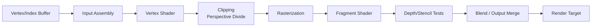
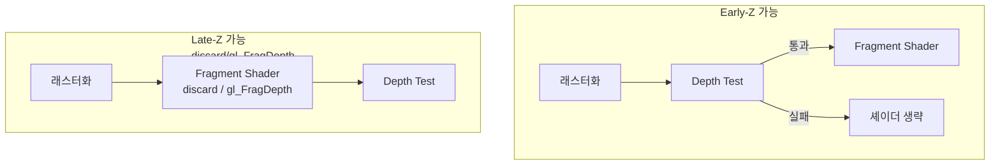

## 들어가며

> 그래픽스 파이프라인의 전제는 정점에서 픽셀로 가는 고정 순서의 흐름, 각 단계의 입력·출력 계약, 프로그래머블 단계와 고정 함수의 분할, 좌표계 사슬·MVP·투영 행렬·NDC·원근 분할, 엣지 함수·무게중심 좌표·원근 보정 보간이다. 이 글은 그 추상 단계를 Vulkan의 명시적 상태 모델로 구현한다. 핵심은 `VkPipeline` 하나에 셰이더와 고정 상태를 굳히는 모델, 상태 폭발과 pipeline cache·dynamic state, 정점 입력 기술(binding/attribute)·push constant 대 UBO, Vulkan 고유의 NDC 규약(z $[0,1]$·y-down)과 Reverse-Z, 래스터화·깊이/스텐실·블렌드 상태 구조체, GLSL 보간 한정자, `discard`와 Early-Z다.

그래픽스 파이프라인은 3D 데이터를 화면 픽셀로 바꾸는 고정된 데이터 흐름이다. 정점 버퍼의 숫자는 정점 셰이더를 지나 클립 공간 좌표가 되고, 삼각형은 래스터라이저에서 프래그먼트가 되며, 프래그먼트 셰이더와 깊이/블렌딩 단계를 지나 렌더 타깃에 기록된다. 이 흐름은 1990년대 고정 기능 파이프라인에서 출발해 정점 셰이더와 프래그먼트 셰이더가 프로그래머블 단계로 열렸을 뿐, 그 사이를 잇는 골격은 30년 가까이 유지되고 있다.

이 흐름은 OpenGL, DirectX, Vulkan 모두에서 거의 동일하다. API가 다르게 보이는 이유는 상태를 누가 관리하느냐다. OpenGL은 전역 상태를 드라이버가 많이 해석하고, Vulkan은 파이프라인 상태 객체와 렌더 패스, 동기화를 애플리케이션이 명시한다. OpenGL에서 `glEnable(GL_DEPTH_TEST)` 한 줄로 끝나던 일이 Vulkan에서는 `VkPipelineDepthStencilStateCreateInfo`를 채워 파이프라인 생성 시점에 박아 넣는 일이 된다. 하지만 정점 처리, 클리핑, 래스터화, 보간, 픽셀 처리, 출력 합성이라는 큰 구조는 변하지 않는다.

이 글은 그래픽스 파이프라인의 각 단계를 입력과 출력 중심으로 분해한다. 코드는 Vulkan을 기준으로 보이되, 같은 단계가 OpenGL과 DirectX에서 어떤 모습인지 짚는다. 목표는 렌더링 버그가 발생했을 때 "정점이 잘못됐는가, 보간이 잘못됐는가, 깊이 테스트가 잘못됐는가, 블렌딩이 잘못됐는가"를 단계별로 좁힐 수 있게 만드는 것이다. 검은 화면, 사라진 모델, 뒤집힌 색은 모두 파이프라인의 특정 단계에 원인이 있고, 그 단계를 알면 디버깅의 탐색 공간이 크게 줄어든다.


---

## 목차
1. [파이프라인 단계 전개](#1-파이프라인-단계-전개)
2. [정점 셰이더와 정점 후처리](#2-정점-셰이더와-정점-후처리)
3. [프리미티브 어셈블리와 클리핑](#3-프리미티브-어셈블리와-클리핑)
4. [래스터화와 보간](#4-래스터화와-보간)
5. [프래그먼트 셰이더](#5-프래그먼트-셰이더)
6. [픽셀 단위 후처리](#6-픽셀-단위-후처리)
7. [출력 합성](#7-출력-합성)


---

## 1. 파이프라인 단계 전개

그래픽스 파이프라인은 다음 순서로 데이터를 변환한다.



이 흐름에서 프로그래머블 단계는 정점 셰이더와 프래그먼트 셰이더 두 개뿐이고(테셀레이션과 지오메트리, 메시 셰이더를 빼면), 나머지는 모두 *고정 기능(Fixed Function)* 이다. 고정 기능 단계는 셰이더 코드가 아니라 상태 값으로 동작을 제어한다. 어떤 토폴로지로 묶을지, 어느 면을 컬링할지, 깊이 비교를 어떻게 할지, 블렌딩 계수가 무엇인지가 모두 상태 값이다.

### 단계 분류: 프로그래머블 vs 고정 기능

각 단계가 무엇으로 제어되는지 정리한다.

| 단계 | 종류 | 제어 방식 | 입력 → 출력 |
|---|---|---|---|
| Input Assembly | 고정 기능 | topology 상태 | 정점 스트림 → 프리미티브 |
| Vertex Shader | 프로그래머블 | SPIR-V/GLSL/HLSL | 정점 → 클립 좌표 + varyings |
| Clipping / Perspective Divide | 고정 기능 | (자동) | 클립 좌표 → NDC |
| Rasterization | 고정 기능 | cull/front face/polygon mode | 삼각형 → 프래그먼트 |
| Fragment Shader | 프로그래머블 | SPIR-V/GLSL/HLSL | 보간된 입력 → 색상 |
| Depth/Stencil Test | 고정 기능 | compare op, write mask | 프래그먼트 → 통과/폐기 |
| Blend / Output Merge | 고정 기능 | blend factor, op | 색상 → 렌더 타깃 합성 |

디버깅에서는 명령이 실제로 제출됐는지, attachment와 자원 수명이 유효한지, 셰이더·descriptor가 올바른지, 고정 기능 상태가 프리미티브를 버리는지를 단계별로 가른다. 캡처에서 정점·프래그먼트 셰이더 출력이 기대값이어도 render pass 호환성, 이미지 레이아웃·동기화, 색 쓰기 마스크 때문에 화면이 비어 있을 수 있으므로 고정 기능 상태 하나로 원인을 단정하지 않는다.

### Vulkan의 파이프라인 객체

Vulkan에서는 이 상태 대부분이 `VkPipeline` 하나에 묶인다. 셰이더 모듈, vertex input layout, primitive topology, viewport, rasterization, depth/stencil, color blend 상태가 파이프라인 생성 시점에 고정된다.

```cpp
VkGraphicsPipelineCreateInfo ci{};
ci.sType = VK_STRUCTURE_TYPE_GRAPHICS_PIPELINE_CREATE_INFO;
ci.stageCount = 2;                 // vertex + fragment
ci.pStages = shaderStages;         // VkPipelineShaderStageCreateInfo[2]
ci.pVertexInputState = &vertexInput;
ci.pInputAssemblyState = &inputAssembly;
ci.pViewportState = &viewportState;
ci.pRasterizationState = &rasterState;
ci.pMultisampleState = &msaaState;
ci.pDepthStencilState = &depthState;
ci.pColorBlendState = &blendState;
ci.pDynamicState = &dynamicState;  // 런타임에 바꿀 상태 목록
ci.layout = pipelineLayout;        // descriptor + push constant 레이아웃
ci.renderPass = renderPass;
ci.subpass = 0;
vkCreateGraphicsPipelines(device, pipelineCache, 1, &ci, nullptr, &pipeline);
```

핵심은 파이프라인이 셰이더 단계, 레이아웃, 고정 상태, 렌더링 호환 조건을 한 객체에 묶는다는 점이다. 구현은 생성 시점이나 내부적으로 선택한 시점에 셰이더 번역과 상태 검증을 수행할 수 있다. dynamic state로 선언하지 않은 상태와 호환 조건이 달라지면 별도 파이프라인 또는 파이프라인 변형이 필요하다.

### 상태 폭발과 dynamic state

이 모델의 대가는 *상태 조합 폭발* 이다. 머티리얼 50종, 블렌드 모드 4종, 컬링 모드 2종을 전부 독립 축으로 곱하면 최대 400개 조합이 생긴다. 파이프라인 생성 지연은 구현, 셰이더, 캐시 적중 여부에 따라 크게 달라지고 명세가 시간 상한을 보장하지 않는다. 렌더 스레드의 프레임 경로에서 처음 생성하면 측정 가능한 hitch가 될 수 있으므로 실제 변형 집합과 생성 지연 분포를 기록한다.

이를 줄이는 장치가 셋 있다.

- *Pipeline Cache*: `VkPipelineCache`는 구현이 재사용할 수 있는 불투명 데이터를 제공한다. 호환되는 캐시가 생성 시간을 줄일 수 있지만 컴파일 생략이나 특정 내부 표현을 보장하지 않는다.
- *Dynamic State*: viewport, scissor, line width, blend constant, depth bias 등을 dynamic으로 빼면 command buffer 기록 중 `vkCmdSetViewport` 같은 호출로 바꿀 수 있어 파이프라인 수가 줄어든다.
- *Pipeline Library / Shader Object*: `VK_EXT_graphics_pipeline_library`로 정점 입력, 셰이더, 프래그먼트 출력을 따로 컴파일해 조합하거나, `VK_EXT_shader_object`로 파이프라인 객체 자체를 없앤다.

```cpp
VkDynamicState dyn[] = {
    VK_DYNAMIC_STATE_VIEWPORT,
    VK_DYNAMIC_STATE_SCISSOR,
};
VkPipelineDynamicStateCreateInfo dynamicState{};
dynamicState.sType = VK_STRUCTURE_TYPE_PIPELINE_DYNAMIC_STATE_CREATE_INFO;
dynamicState.dynamicStateCount = 2;
dynamicState.pDynamicStates = dyn;
```

OpenGL은 많은 상태 조합을 응용이 명시적 파이프라인 객체 수로 관리하지 않는다. 대신 드라이버가 상태 변경과 draw에서 호환성 검증·내부 변형 선택을 수행하고 자체 캐시할 수 있어 비용의 시점이 덜 명시적이다. Vulkan도 모든 비용을 생성 시점에 끝낸다고 보장하지 않지만, 파이프라인 호환성과 캐시 제어를 응용에 더 많이 노출한다.

## 2. 정점 셰이더와 정점 후처리

정점 셰이더는 입력 정점을 클립 공간 위치와 varyings로 변환한다. 정점 입력을 처리하는 단계이지만, 논리 정점 하나당 셰이더가 정확히 한 번 실행된다고 의존해서는 안 된다. 인덱스 버퍼를 쓰면 GPU의 *post-transform vertex cache* 가 동일 인덱스의 결과를 재사용해 호출을 줄인다. 그래서 인덱스를 잘 정렬한 메시는 같은 삼각형 수라도 정점 셰이더 호출이 적다.

최소 출력은 클립 공간 위치 하나다.

```glsl
#version 450

layout(location = 0) in vec3 inPos;
layout(location = 1) in vec3 inNormal;
layout(location = 2) in vec2 inUv;

layout(set = 0, binding = 0) uniform Camera {
    mat4 view;
    mat4 proj;
} camera;

layout(push_constant) uniform Push {
    mat4 model;
} pushData;

layout(location = 0) out vec3 vWorldNormal;
layout(location = 1) out vec2 vUv;

void main() {
    vec4 world = pushData.model * vec4(inPos, 1.0);
    gl_Position = camera.proj * camera.view * world;
    // 비균등 스케일을 무시한 단순 법선 변환 (정확히는 역전치 행렬이 필요)
    vWorldNormal = mat3(pushData.model) * inNormal;
    vUv = inUv;
}
```

### 정점 입력 레이아웃의 정합성

정점 셰이더의 `layout(location = N) in` 선언은 파이프라인의 vertex input 상태와 *정확히* 맞아야 한다. Vulkan에서는 binding(버퍼 슬롯)과 attribute(셰이더 입력)를 따로 기술한다.

```cpp
VkVertexInputBindingDescription binding{};
binding.binding = 0;
binding.stride = sizeof(Vertex);          // 한 정점의 바이트 크기
binding.inputRate = VK_VERTEX_INPUT_RATE_VERTEX;  // 인스턴싱이면 _INSTANCE

VkVertexInputAttributeDescription attrs[3]{};
attrs[0] = {0, 0, VK_FORMAT_R32G32B32_SFLOAT, offsetof(Vertex, pos)};
attrs[1] = {1, 0, VK_FORMAT_R32G32B32_SFLOAT, offsetof(Vertex, normal)};
attrs[2] = {2, 0, VK_FORMAT_R32G32_SFLOAT,    offsetof(Vertex, uv)};
```

`offsetof`를 잘못 적거나 stride를 틀리면 정점이 어긋난 메모리에서 읽혀 모델이 폭발하듯 깨진다. 포맷의 채널 수가 셰이더 입력보다 적으면 나머지 채널은 정의된 기본값(x,y,z는 0, w는 1)으로 채워진다. `R32G32B32_SFLOAT`(12바이트)를 `vec2` 입력으로 받으면 z가 버려지는 식의 미묘한 버그가 생기므로 포맷과 셰이더 타입을 짝지어 본다.

### uniform 전달: UBO vs push constant

위 셰이더는 카메라 행렬을 UBO(set 0, binding 0)로, 모델 행렬을 push constant로 받는다. 둘의 트레이드오프는 다음과 같다.

| 전달 방식 | 크기 한계 | 바인딩 성격 | 용도 |
|---|---|---|---|
| Push Constant | `maxPushConstantsSize`, 코어 최소 보장 128바이트 | 명령으로 작은 바이트 범위 갱신 | 매 드로우의 작은 값·인덱스 |
| UBO | `maxUniformBufferRange` | descriptor와 offset | 프레임/패스 단위 읽기 전용 데이터 |
| SSBO | `maxStorageBufferRange` | descriptor와 offset | 대량 배열과 읽기·쓰기 데이터 |

push constant의 코어 최소 보장은 128바이트다. `mat4` 두 개는 스칼라 32비트 행렬 기준 정확히 128바이트이므로 “들어가지 않는다”가 아니라 *다른 멤버·정렬 여유 없이 최소 한도를 모두 사용한다*. 실제 상한과 stage 범위를 질의하고, 큰 배열은 UBO/SSBO에 둔다.

### 정점 후처리와 NDC

정점 셰이더 뒤에는 정점 후처리 단계가 있다. 클립 공간의 $x, y, z, w$는 클리핑을 거친 뒤 *perspective divide* 로 $w$를 나눠 NDC가 된다.

$$
\text{NDC} = \left(\frac{x}{w}, \frac{y}{w}, \frac{z}{w}\right)
$$

여기서 NDC 좌표 규약은 API마다 다르고, 이 차이가 흔한 버그의 원천이다.

| API | NDC x, y | NDC z | 화면 y 방향 |
|---|---|---|---|
| Vulkan | $[-1, 1]$ | $[0, 1]$ | 아래로 +y (위→아래) |
| OpenGL | $[-1, 1]$ | $[-1, 1]$ | 위로 +y (아래→위) |
| Direct3D | $[-1, 1]$ | $[0, 1]$ | 아래로 +y (프레임버퍼 좌표) |

Vulkan은 z가 $[0, 1]$이라 깊이 정밀도 분포가 OpenGL의 $[-1, 1]$과 다르다. OpenGL용 projection 행렬을 Vulkan에 그대로 넣으면 음수 NDC z에 해당하는 가까운 구간이 클립 볼륨 밖으로 판정되어 잘려 나간다(유효 near가 약 $2n$으로 밀린다). 또 Vulkan의 양수 높이 viewport는 NDC y 증가를 프레임버퍼의 아래쪽 증가로 매핑하므로, OpenGL 코드를 옮기면 화면이 위아래로 뒤집힌다. 이를 맞추는 방법은 projection 행렬의 $m_{11}$ 부호를 뒤집거나, viewport의 height를 음수로 주는 것이다(`VK_KHR_maintenance1` 이후 표준).

### Reverse-Z와 깊이 정밀도

깊이 버퍼의 정밀도는 near plane 근처에 몰린다. perspective projection에서 NDC z는 view 공간 깊이의 역수에 비례하므로, 24비트 정수 깊이 버퍼라도 먼 거리에서는 단계 간격이 수 미터로 벌어진다. 이를 완화하는 표준 기법이 *Reverse-Z* 다. near를 1.0, far를 0.0에 매핑하면 부동소수점 깊이의 정밀도 분포가 1/z의 분포와 거의 상쇄되어 넓은 거리 범위에서 거의 일정한 상대 정밀도를 얻는다. 절대 거리 간격이 일정해지는 것은 아니다.

Reverse-Z를 쓰려면 z가 $[0,1]$인 Vulkan/D3D 규약, depth compare op를 `GREATER`로, depth clear 값을 0.0으로 함께 바꿔야 한다. z가 $[-1,1]$인 OpenGL은 `glClipControl(GL_LOWER_LEFT, GL_ZERO_TO_ONE)`로 z 범위를 $[0,1]$로 바꾼 뒤에야 Reverse-Z의 이점을 온전히 얻는다. Vulkan이 깊이 규약 면에서 Reverse-Z에 더 자연스럽다.

## 3. 프리미티브 어셈블리와 클리핑

Input Assembly는 정점과 인덱스를 topology에 따라 프리미티브로 묶는다. 이 단계는 정점 셰이더 *앞* 에서 무엇을 한 프리미티브로 볼지 결정하지만, 클리핑은 정점 셰이더 *뒤* 클립 공간에서 일어난다.

| Topology | 입력 | 출력 | N개 삼각형에 필요한 정점 |
|---|---|---|---|
| `TRIANGLE_LIST` | 3개씩 독립 | 삼각형 N개 | $3N$ |
| `TRIANGLE_STRIP` | 앞 두 정점 재사용 | 연결된 삼각형 | $N + 2$ |
| `TRIANGLE_FAN` | 첫 정점 공유 | 부채꼴 삼각형 | $N + 2$ |
| `LINE_LIST` | 2개씩 독립 | 선분 N개 | $2N$ |
| `LINE_STRIP` | 앞 정점 재사용 | 연결된 선 | $N + 1$ |
| `POINT_LIST` | 1개씩 독립 | 점 N개 | $N$ |

strip은 정점 수를 줄이지만 한 메시를 하나의 strip으로 잇기 어려워 *primitive restart* 인덱스로 끊는다. 현대 엔진은 대부분 인덱스 버퍼 + TRIANGLE_LIST를 쓰고, post-transform cache 최적화에 의존한다. Vulkan에서 TRIANGLE_FAN은 portability subset(예: MoltenVK on macOS)에서 빠질 수 있으니 이식성을 원하면 피한다.

### 클리핑: 절두체 경계 자르기

프리미티브가 만들어지면 클립 공간에서 절두체(view frustum) 밖을 잘라낸다. 클립 조건은 perspective divide *전* 의 동차 좌표에서 $-w \le x, y \le w$ 와 $0 \le z \le w$(Vulkan)다. divide 전에 검사하는 이유는 $w \le 0$인 정점(카메라 뒤)에서 나눗셈이 부호를 뒤집어 좌표가 폭주하기 때문이다.

- 프리미티브가 *완전히 밖* 이면 통째로 버려진다(trivial reject).
- *완전히 안* 이면 그대로 통과한다(trivial accept).
- *경계에 걸치면* 새 정점이 경계 위에 생성되고, 그 정점의 varyings는 선형 보간으로 채워진다. 삼각형 하나가 클리핑으로 여러 삼각형으로 쪼개질 수 있다.

대부분의 GPU는 비싼 평면 클리핑을 가능한 한 피하고, *guard band* 라는 확장된 영역 안의 프리미티브는 자르지 않고 래스터화 단계에서 화면 밖 픽셀을 버리는 식으로 처리한다. guard band는 측면 평면 클리핑을 줄이는 구현 최적화이며, near/far 등 필요한 클리핑까지 일반적으로 사라진다고 가정해서는 안 된다.

### 면 방향과 컬링

삼각형의 앞면/뒷면 판정도 이 흐름 직후 래스터화 입구에서 일어난다. 화면 공간에서 정점이 도는 방향(winding)이 시계 방향인지 반시계 방향인지로 앞면을 정한다.

```cpp
VkPipelineRasterizationStateCreateInfo rs{};
rs.sType = VK_STRUCTURE_TYPE_PIPELINE_RASTERIZATION_STATE_CREATE_INFO;
rs.polygonMode = VK_POLYGON_MODE_FILL;          // LINE이면 와이어프레임
rs.cullMode = VK_CULL_MODE_BACK_BIT;            // 뒷면 제거
rs.frontFace = VK_FRONT_FACE_COUNTER_CLOCKWISE; // CCW를 앞면으로
rs.lineWidth = 1.0f;
rs.depthClampEnable = VK_FALSE;
rs.rasterizerDiscardEnable = VK_FALSE;          // TRUE면 래스터화 자체를 끔
```

백페이스 컬링은 뒷면 프리미티브의 래스터화를 생략한다. 프래그먼트 호출 절약량은 형상·시점·화면 가림과 early test에 따라 달라진다. 그런데 winding은 좌표 변환에 따라 뒤집힌다. 모델 행렬에 음수 스케일이 하나 있거나(거울 반사), 좌표계의 한 축을 뒤집거나, Vulkan에서 y-flip을 viewport로 처리하면 화면상 winding이 반대가 된다.

모델이 통째로 사라지면 vertex shader보다 *컬링과 winding을 먼저 의심* 한다. 디버깅의 빠른 길은 `cullMode = VK_CULL_MODE_NONE`으로 컬링을 끄고 모델이 다시 보이는지 확인하는 것이다. 다시 보이면 winding이 뒤집힌 것이고, `frontFace`를 반대로 바꾸면 된다. `rasterizerDiscardEnable = VK_TRUE`로 둔 채 잊는 실수도 같은 증상을 낸다.

## 4. 래스터화와 보간

래스터라이저는 삼각형이 덮는 픽셀 위치를 찾아 프래그먼트를 만든다. 한 픽셀의 중심이 삼각형 안에 들어가면 그 픽셀에 프래그먼트가 생성되고, 정점 셰이더가 출력한 varyings는 삼각형의 무게중심 좌표(barycentric coordinate)로 보간되어 프래그먼트 입력이 된다.

```glsl
// vertex shader
layout(location = 0) out vec3 vColor;
// fragment shader — location이 일치해야 한다
layout(location = 0) in  vec3 vColor;
```

GPU는 픽셀을 한 개씩 처리하지 않고 *2×2 쿼드* 단위로 처리한다. UV의 화면 공간 미분(`dFdx`, `dFdy`)으로 텍스처 밉맵 레벨을 정하려면 이웃 픽셀의 값이 필요하기 때문이다. 그래서 삼각형 가장자리에서는 삼각형 밖에 있는 픽셀도 *helper invocation* 으로 셰이더가 실행되었다가 버려진다. 작은 삼각형이 많은 메시(예: 화면에 멀리 있는 고폴리곤 모델)는 이 쿼드 오버헤드로 효율이 급락한다. 삼각형 하나가 한두 픽셀만 덮어도 쿼드 네 픽셀이 모두 셰이딩되기 때문이다.

### Perspective-correct 보간

보간은 기본적으로 *perspective-correct interpolation* 이다. 화면 공간에서 단순 선형 보간하면 원근감이 있는 텍스처가 뒤틀린다. 화면에 비스듬히 누운 바닥 텍스처가 멀어질수록 늘어나 보이는 고전적 PS1 게임의 왜곡이 바로 perspective 보정을 하지 않은 결과다. GPU는 각 정점의 $1/w$를 함께 보간해 보정하며, $w$가 모두 같은 직교 투영에서는 이 보정 항이 상쇄되어 단순 선형 보간과 같아진다. 셰이더가 신경 쓸 부분은 *어느 보간 규칙을 쓰느냐* 이고, 그것이 다음의 한정자다.

### 보간 qualifier

보간 규칙은 셰이더의 qualifier로 바꿀 수 있다.

| qualifier | 의미 | 용도 |
|---|---|---|
| (기본값) | perspective-correct | UV, 색상, 법선 |
| `noperspective` | 화면 공간 선형 | screen-space 효과, 풀스크린 처리 |
| `flat` | 보간 없음, provoking vertex 값 사용 | material id, face normal, 정수 데이터 |
| `centroid` | MSAA 샘플이 덮인 영역 내부에서 보간 | 가장자리 over-extrapolation 완화 |

`flat`을 빼먹는 것이 흔한 함정이다. 머티리얼 ID, 라이트 인덱스, 오브젝트 ID 같은 정수성 데이터는 삼각형 내부에서 보간되면 안 되는데, 기본 보간이 적용되면 두 정점 사이에서 ID가 섞여 깨진다. 정수 타입 varying은 *반드시* `flat`이어야 하고(정수는 보간 자체가 불가능), 어느 정점의 값을 쓸지는 `provoking vertex`(기본은 삼각형의 첫 정점) 규약을 따른다.

`centroid`는 MSAA에서 픽셀 중심이 삼각형 밖이지만 일부 샘플이 안에 있을 때, 보간 위치를 덮인 영역 안으로 끌어당겨 값이 삼각형 밖으로 외삽되는 artifact를 줄인다. 다만 보간 위치가 픽셀마다 달라질 수 있어 centroid 입력의 미분을 텍스처 LOD 등에 사용할 때는 주의한다.

## 5. 프래그먼트 셰이더

프래그먼트 셰이더는 보간된 입력을 받아 색상과 선택적 깊이를 출력한다. 프래그먼트 하나(MSAA에서는 샘플 하나 또는 픽셀 하나)당 한 번 호출되는 것이 원칙이다.

```glsl
#version 450

layout(location = 0) in vec3 vWorldNormal;
layout(location = 1) in vec2 vUv;
layout(set = 1, binding = 0) uniform sampler2D albedoTex;

layout(location = 0) out vec4 outColor;

void main() {
    vec3 albedo = texture(albedoTex, vUv).rgb;
    vec3 n = normalize(vWorldNormal);
    float ndotl = max(dot(n, normalize(vec3(0.4, 0.8, 0.2))), 0.0);
    outColor = vec4(albedo * ndotl, 1.0);
}
```

### 비용 모델: 해상도와 overdraw

프래그먼트 셰이더 비용은 *셰이딩된 프래그먼트 수 × 셰이더 복잡도* 다. 셰이딩된 프래그먼트 수는 화면 해상도와 *overdraw* 에 비례한다. overdraw는 한 픽셀이 여러 번 덮여 셰이딩되는 횟수다.

1920×1080의 단일 샘플 전체 화면 패스는 논리적으로 약 207만 픽셀 영역을 덮는다. 실제 프래그먼트 invocation에는 helper invocation, sample shading, discard, early depth가 영향을 준다. 투명 파티클의 오버드로도 장면별 분포를 측정해야 하며 고정 범위로 가정하지 않는다. GPU 카운터에서 vertex/fragment invocation과 texture·ALU·bandwidth 시간을 분리한다.

### discard와 Early-Z의 충돌

`discard`(GLSL)는 SPIR-V의 `OpKill`(deprecated) 또는 `OpTerminateInvocation` 계열로 내려가 프래그먼트를 버리고 색과 깊이를 쓰지 않게 한다. 잎사귀나 철망 같은 cutout 텍스처에서 알파가 임계값 아래인 픽셀을 지울 때 쓴다. 문제는 `discard`가 *Early-Z를 방해* 할 수 있다는 점이다.

GPU는 조건이 맞으면 프래그먼트 셰이더 실행 *전* 에 깊이 테스트를 수행해(Early-Z) 가려질 픽셀의 셰이더 실행을 건너뛴다. 여기서 조기 깊이 *테스트*와 조기 깊이 *갱신(update)* 은 구분된다. `discard`나 깊이 직접 쓰기(`gl_FragDepth`)는 구현이 조기 깊이 갱신을 적용하기 어렵게 만들며, 특히 side effect와 깊이 값 변경이 있으면 Late 처리가 필요할 수 있다. 반대로 GLSL `layout(early_fragment_tests) in;`나 보수적 깊이 한정자처럼 계약을 명시하면 조기 테스트의 의미를 고정할 수 있다. early test·early update·Hi-Z(계층적 깊이)는 서로 다른 단계이므로 “항상 Early-Z가 꺼진다”가 아니라 *Early-Z/early depth update 최적화를 제한할 수 있다* 고 이해해야 한다.

명시적 `early_fragment_tests`에서는 깊이/스텐실 처리가 셰이더보다 먼저 일어나므로, 뒤의 `discard`가 이미 쓴 깊이를 되돌리지는 못한다. 알파 컷아웃에 무심코 강제하면 투명 부분까지 가릴 수 있다.

cutout 머티리얼이 많은 장면(숲, 울타리)은 다음 대안을 고려한다.

- *depth pre-pass*: 깊이만 먼저 채운 뒤 본 패스에서 `EQUAL` 비교로 그려 overdraw 셰이딩을 줄인다.
- *alpha-to-coverage*: MSAA 샘플 마스크로 알파를 표현해 `discard` 없이 부드러운 가장자리를 얻는다.
- GLSL의 `layout(early_fragment_tests) in;`로 조기 테스트 의미를 요구할 수 있지만, `FragDepth` 쓰기와 부수 효과의 순서 의미가 바뀌므로 계약을 확인한다.

OpenGL도 `glEnable(GL_SAMPLE_ALPHA_TO_COVERAGE)`와 early fragment test 한정자를 제공한다. API 의미가 비슷해도 실제 최적화와 하드웨어 실행 순서까지 같다고 보장되지는 않는다.

## 6. 픽셀 단위 후처리

프래그먼트 셰이더 뒤에는 scissor test, multisample coverage, depth/stencil test, blending 같은 픽셀 단위 처리가 정해진 순서로 이어진다. 이 단계들은 모두 고정 기능이고 상태로 제어된다.

### 깊이 테스트

Depth test는 현재 프래그먼트의 깊이와 depth attachment에 이미 기록된 값을 비교해, 비교가 실패하면 프래그먼트를 버린다.

```cpp
VkPipelineDepthStencilStateCreateInfo ds{};
ds.sType = VK_STRUCTURE_TYPE_PIPELINE_DEPTH_STENCIL_STATE_CREATE_INFO;
ds.depthTestEnable = VK_TRUE;
ds.depthWriteEnable = VK_TRUE;
ds.depthCompareOp = VK_COMPARE_OP_LESS;   // Reverse-Z면 GREATER
ds.depthBoundsTestEnable = VK_FALSE;
ds.stencilTestEnable = VK_FALSE;
```

depth test와 depth write는 독립적인 두 스위치다. 둘을 조합한 의미는 다음과 같다.

| depthTest | depthWrite | 의미 | 용도 |
|---|---|---|---|
| ON | ON | 비교 후 통과하면 깊이 갱신 | 일반 불투명 패스 |
| ON | OFF | 비교만, 깊이는 유지 | 투명 패스, 데칼 |
| OFF | ON | 깊이 테스트가 꺼져 있어 쓰기도 꺼짐 | `depthWriteEnable` 값은 효과 없음 |
| OFF | OFF | 깊이 무시 | UI, 풀스크린 후처리, 스카이박스 일부 |

Vulkan에서 `depthTestEnable == VK_FALSE`이면 `depthWriteEnable` 값과 관계없이 깊이 쓰기도 비활성화된다. 비교 없이 깊이만 채우려면 테스트를 켜고 compare op를 `VK_COMPARE_OP_ALWAYS`, 쓰기를 `VK_TRUE`로 둔다. 일반적인 정렬 기반 투명 패스는 깊이 테스트를 켜 불투명 표면 뒤를 버리되 깊이 쓰기는 끈다. 다만 투명 오류는 잘못된 정렬, 비가환 블렌딩, 교차 표면에서도 생기므로 depth write 하나만 원인으로 단정할 수 없다.

### 스텐실 테스트

스텐실 버퍼는 픽셀별 정수 마스크다. 깊이 테스트와 함께 동작하며, "이 영역에만 그려라" 또는 "이미 그린 영역은 다시 그리지 마라" 같은 조건을 만든다. 거울 반사 영역 제한, 아웃라인, 데칼 마스킹, 그림자 볼륨(stencil shadow)에 쓰인다. compare op, 통과/실패 시 연산(keep/replace/increment), reference 값과 마스크를 함께 설정한다.

### Early-Z와 Late-Z의 위치

5절에서 본 Early-Z는 이 깊이 테스트를 프래그먼트 셰이더 *앞* 으로 당겨 실행한 것이다. 정리하면 다음과 같다.



위 다이어그램은 `discard`/`gl_FragDepth`를 Late-Z로 묶은 기본 동작을 단순화한 것이다. 실제로는 명시적 early fragment test 선언, conservative depth 조건, 구현 최적화에 따라 조기 테스트와 조기 깊이 갱신의 허용 범위가 달라진다. 깊이 값을 셰이더에서 바꾸는지, 파이프라인 상태로 조기 테스트를 요구했는지에 따라 어느 처리가 허용되는지 판단해야 한다.

Early-Z는 가려질 프래그먼트의 셰이더 실행을 통째로 없애므로, 불투명 객체를 *앞에서 뒤로(front-to-back)* 정렬해 그리면 뒤쪽 객체 대부분이 깊이에서 탈락해 셰이딩 비용이 크게 준다. 깊이만 먼저 채우는 depth pre-pass가 효과적인 이유도 같다. 본 패스 진입 시점에 깊이 버퍼가 완성되어 있어 Early-Z가 최대로 작동한다.

## 7. 출력 합성

출력 합성(Output Merge) 단계는 프래그먼트 셰이더 결과를 렌더 타깃의 기존 값과 합친다. 불투명 렌더링은 보통 blending을 끄고 새 값으로 덮어쓴다.

```cpp
VkPipelineColorBlendAttachmentState att{};
att.colorWriteMask =
    VK_COLOR_COMPONENT_R_BIT | VK_COLOR_COMPONENT_G_BIT |
    VK_COLOR_COMPONENT_B_BIT | VK_COLOR_COMPONENT_A_BIT;
att.blendEnable = VK_FALSE;   // 그냥 덮어쓰기
```

`colorWriteMask`는 채널별 쓰기 허용 비트다. depth pre-pass에서는 색을 쓸 필요가 없으므로 마스크를 0으로 두거나 color attachment 없이 깊이만 그린다.

### 알파 블렌딩

블렌딩을 켜면 소스(셰이더 출력)와 데스티네이션(렌더 타깃 기존 값)을 계수로 섞는다. 불투명 배경 위에 straight-alpha 소스를 얹는 RGB 식은 다음과 같다. 중간 타깃의 누적 알파도 보존하려면 아래 상태처럼 $α_{out}=α_s+α_d(1-α_s)$로 갱신한다.

$$
C_{\text{out}} = C_{\text{src}} \, \alpha_{\text{src}} + C_{\text{dst}} \, (1 - \alpha_{\text{src}})
$$

이를 Vulkan 상태로 옮기면 다음과 같다.

```cpp
att.blendEnable = VK_TRUE;
att.srcColorBlendFactor = VK_BLEND_FACTOR_SRC_ALPHA;
att.dstColorBlendFactor = VK_BLEND_FACTOR_ONE_MINUS_SRC_ALPHA;
att.colorBlendOp = VK_BLEND_OP_ADD;
att.srcAlphaBlendFactor = VK_BLEND_FACTOR_ONE;
att.dstAlphaBlendFactor = VK_BLEND_FACTOR_ONE_MINUS_SRC_ALPHA;
att.alphaBlendOp = VK_BLEND_OP_ADD;
```

블렌딩 모드별 계수 조합은 효과를 결정한다.

| 효과 | srcFactor | dstFactor | 식 |
|---|---|---|---|
| 일반 투명 (over) | `SRC_ALPHA` | `ONE_MINUS_SRC_ALPHA` | $C_s\alpha + C_d(1-\alpha)$ |
| 가산 (불, 빛) | `ONE` | `ONE` | $C_s + C_d$ |
| 곱셈 (그림자, 틴트) | `DST_COLOR` | `ZERO` | $C_s C_d$ |
| Premultiplied alpha | `ONE` | `ONE_MINUS_SRC_ALPHA` | $C_s + C_d(1-\alpha)$ |

premultiplied alpha는 텍스처의 색에 알파를 미리 곱해 저장하는 방식으로, 밉맵 필터링과 블렌딩에서 가장자리 검은 테(dark fringing)를 막는다. 텍스처 파이프라인을 일관되게 짜면 일반 투명보다 깔끔하다.

### 순서 의존성과 sRGB

블렌딩은 *순서 의존적* 이다. $C_s\alpha + C_d(1-\alpha)$는 교환법칙이 성립하지 않아, 같은 투명 표면들이라도 그리는 순서가 바뀌면 결과 색이 달라진다. 그래서 렌더링 순서를 둘로 나눈다. 불투명 객체는 blending을 끄고 *front-to-back* 으로 그려 Early-Z 효율을 높이고, 투명 객체는 blending을 켜고 *back-to-front* 로 정렬해 시각 결과를 맞춘다. 서로 교차하거나 깊이가 얽힌 투명 객체는 정렬만으로 풀리지 않고, *Order-Independent Transparency*(weighted blended OIT, per-pixel linked list 등) 같은 별도 알고리즘이 필요하다.

한 가지 정밀도 함정은 블렌딩이 *어느 색 공간에서* 일어나는가다. `UNORM`은 저장 코드값에 선형 연산을 적용한다. 그 값이 이미 sRGB 인코딩되어 있다면 잘못된 공간에서 섞이지만, 선형 중간 버퍼로 사용한다면 `UNORM` 블렌딩도 선형 공간에서 수행된다. `SRGB` 포맷이면 하드웨어가 읽을 때 선형으로 풀고 쓸 때 다시 인코딩해 *선형 공간에서* 올바르게 섞인다. 출력용 sRGB attachment를 쓰거나 선형 중간 타깃에서 블렌딩한 뒤 최종 패스에서 인코딩한다. 비선형 코드값을 저장한 UNORM 타깃에 셰이더 출력만 수동 인코딩해 보내는 것으로는 고정 기능 블렌딩을 선형으로 바꿀 수 없다. OpenGL의 `glEnable(GL_FRAMEBUFFER_SRGB)`가 같은 일을 한다.


---

## 결론

기본 그래픽스 파이프라인은 정점 데이터를 클립 공간으로 변환하고, 삼각형을 프래그먼트로 래스터화한 뒤, 프래그먼트 셰이더와 depth/stencil/blend 단계를 거쳐 렌더 타깃에 기록하는 흐름이다. 가장 단순한 구성의 프로그래머블 단계는 정점·프래그먼트 셰이더이며, 필요하면 tessellation·geometry 또는 task·mesh 셰이더가 추가되거나 앞단을 대체한다. 입력 조립, 클리핑, 컬링, 깊이/스텐실, 블렌딩은 상태로 제어되는 고정 기능이다. API가 OpenGL이든 Vulkan이든 큰 데이터 흐름과 고정 기능의 의미는 같다. 다른 것은 상태를 전역으로 두고 드라이버가 조합하느냐(OpenGL), 파이프라인 객체로 미리 굽느냐(Vulkan)의 차이다.

이 구조에서 두 가지 트레이드오프가 반복된다. 하나는 *상태를 언제 결정하느냐* 다. Vulkan은 생성 시점에 고정해 드로우를 싸게 만들지만 파이프라인 조합이 폭발하고, 그 비용을 pipeline cache와 dynamic state로 누른다. 다른 하나는 *순서와 가려짐* 이다. 불투명은 front-to-back으로 Early-Z를 살리고, 투명은 back-to-front로 블렌딩 순서를 맞추며, 둘이 충돌하는 곳에서 depth write와 OIT 같은 선택이 생긴다.

렌더링 문제를 디버깅할 때는 단계별로 잘라 본다. 정점이 어긋나면 vertex input 레이아웃과 transform, NDC 규약을 확인하고, 면이 통째로 사라지면 winding과 culling을 먼저 의심하고, 색이 뒤틀리면 보간 qualifier와 fragment shader를, 투명이 사라지거나 가려짐이 이상하면 depth write와 블렌딩 순서를 확인한다. 파이프라인을 입력과 출력의 단계로 읽는 능력이 그래픽스 디버깅의 기본이다.

## 더 읽을거리

- [Vulkan Specification: Pipelines](https://docs.vulkan.org/spec/latest/chapters/pipelines.html) — 파이프라인 상태의 명세 원문.
- [Vulkan Guide (Khronos)](https://docs.vulkan.org/guide/latest/index.html) — dynamic state·pipeline cache 의 공식 해설.
- [RenderDoc](https://renderdoc.org/) — 단계별 디버깅 워크플로의 표준 도구.
