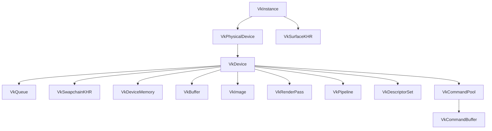
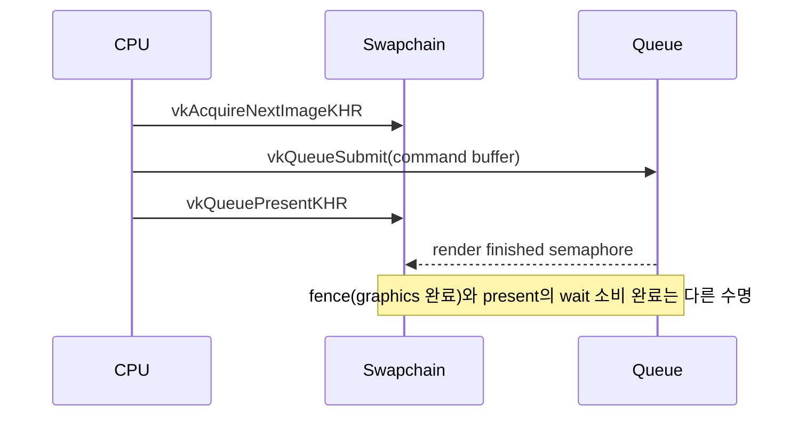
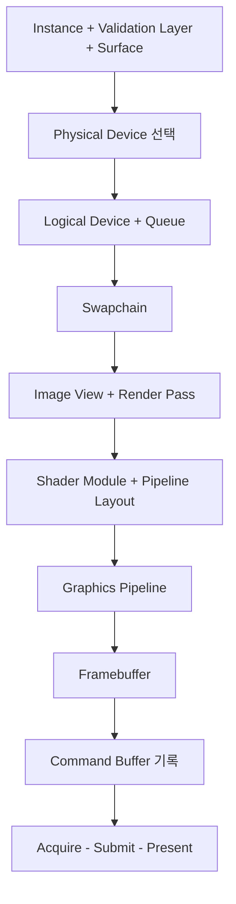

## 들어가며

Vulkan은 그래픽스 드라이버가 암묵적으로 처리하던 일을 애플리케이션이 명시하도록 만든 API다. 객체 생성, 메모리 선택, command buffer 기록, queue 제출, image layout 전이, semaphore/fence 동기화가 모두 코드에 드러난다. OpenGL에서 `glDrawArrays` 한 줄이 드라이버 안에서 상태 검증, 자원 레이아웃 결정, 메모리 가시성 보장, 명령 스케줄링까지 알아서 처리했다면, Vulkan은 그 모든 단계를 애플리케이션이 직접 적는다. 코드량은 늘지만, 드라이버 추측이 줄고 멀티스레드 명령 기록과 정확한 GPU 자원 제어가 가능해진다.

OpenGL의 핵심이 현재 컨텍스트와 전역 상태라면, Vulkan의 핵심은 핸들 그래프와 명시적 소유권이다. `VkInstance`에서 물리 디바이스를 고르고, `VkDevice`에서 queue를 얻고, swapchain image와 render pass, framebuffer, pipeline, descriptor set, command buffer를 연결해야 첫 삼각형이 화면에 나온다. 이 객체들은 서로를 참조하는 방향 그래프를 이루고, 그래프의 위상(topology)이 곧 생성 순서를 강제한다. 부모가 없으면 자식을 만들 수 없고, 자식이 살아 있으면 부모를 파괴할 수 없다.

이 글은 Vulkan의 핵심 객체들을 생성 순서와 책임 기준으로 정리한다. 목표는 "무엇을 먼저 만들고, 어떤 객체가 어떤 객체를 참조하며, CPU-GPU 동기화가 어느 지점에서 필요한가"를 하나의 흐름으로 이해하는 것이다. 빈 윈도우에 색을 채워 화면에 표시하는 데까지 필요한 최소 객체 집합을, 각 객체가 무엇을 책임지고 어디서 함정이 생기는지와 함께 다룬다.


---

## 목차
1. [Vulkan Object Hierarchy](#1-vulkan-object-hierarchy)
2. [Instance와 Physical Device](#2-instance와-physical-device)
3. [Logical Device와 Queue](#3-logical-device와-queue)
4. [Surface와 Swapchain](#4-surface와-swapchain)
5. [Command Buffer](#5-command-buffer)
6. [Synchronization](#6-synchronization)
7. [Memory Management](#7-memory-management)
8. [First Triangle 흐름](#8-first-triangle-흐름)


---

## 1. Vulkan Object Hierarchy

### 핸들과 디스패치 모델

Vulkan 객체는 모두 *핸들(handle)* 로 다룬다. 핸들은 두 종류다. `VkInstance`, `VkPhysicalDevice`, `VkDevice`, `VkQueue`, `VkCommandBuffer`는 *dispatchable handle* 로, 내부적으로 함수 디스패치 테이블을 가리키는 불투명 포인터다. 나머지 대부분(`VkBuffer`, `VkImage`, `VkSemaphore`, `VkPipeline` 등)은 *non-dispatchable handle* 로, 64비트 정수로 정의된다. 32비트 빌드에서는 non-dispatchable 핸들이 포인터가 아니라 `uint64_t`라서, 핸들을 포인터로 캐스팅하는 코드는 이식성이 깨진다.

이 구분은 함수 호출 비용에 영향을 준다. dispatchable 핸들을 첫 인자로 받는 함수(`vkCmdDraw(cmd,...)`)는 그 핸들 안의 테이블을 거쳐 드라이버 함수로 점프한다. layer가 끼면 이 테이블이 layer 함수를 가리키도록 교체되어, validation layer가 모든 호출을 가로챌 수 있다. 디스패치 한 단계가 추가되므로 layer를 켠 상태는 끈 상태보다 호출 오버헤드가 크다.

### 계층 구조

Vulkan 객체는 대체로 다음 계층을 이룬다.



핸들은 포인터처럼 보이지만 소유권 규칙은 명확하다. `VkDevice`에서 만든 객체는 같은 `VkDevice`로 파괴한다. swapchain image처럼 애플리케이션이 소유하지 않는 객체도 있다 — 이들은 swapchain이 만들고, swapchain을 파괴하면 함께 사라지므로 `vkDestroyImage`를 부르면 안 된다. 생성 함수와 파괴 함수가 짝을 이룬다는 점이 Vulkan 수명 관리의 기본이다.

```cpp
vkCreateBuffer(device, &bufferInfo, nullptr, &buffer);
vkDestroyBuffer(device, buffer, nullptr);
```

파괴 순서는 생성의 역순이다. `VkDevice`보다 `VkInstance`를 먼저 파괴하면, device가 만든 자원이 고아가 된다. 또 GPU가 사용 중인 객체를 파괴해서는 안 된다 — `vkDestroyBuffer`를 부르기 전에 그 버퍼를 참조한 command buffer 실행이 끝났음을 fence나 `vkDeviceWaitIdle`로 보장해야 한다.

### 생성 함수의 공통 패턴

거의 모든 Vulkan 생성 함수는 같은 골격을 따른다. `Vk...CreateInfo` 구조체를 채우고, 그 포인터와 출력 핸들 주소를 넘긴다. 모든 CreateInfo의 첫 멤버는 `sType`이고, 두 번째는 확장 체인을 잇는 `pNext`다.

```cpp
VkBufferCreateInfo info{};
info.sType = VK_STRUCTURE_TYPE_BUFFER_CREATE_INFO;
info.pNext = nullptr;             // 확장 구조체를 여기에 체이닝한다
info.size = 1024;
info.usage = VK_BUFFER_USAGE_VERTEX_BUFFER_BIT;
info.sharingMode = VK_SHARING_MODE_EXCLUSIVE;

VkResult r = vkCreateBuffer(device, &info, nullptr, &buffer);
if (r != VK_SUCCESS) { /* 오류 처리 */ }
```

`{}`로 0 초기화하는 습관이 중요하다. CreateInfo는 멤버가 많고, 초기화하지 않은 멤버에 쓰레기 값이 남으면 드라이버가 정의되지 않은 동작을 한다. `sType`을 빠뜨리면 드라이버가 구조체 종류를 식별하지 못해 즉시 실패한다.

### 반환 코드와 검증

Vulkan은 대부분의 오류를 즉시 수정해 주지 않는다. 함수는 `VkResult`를 돌려주는데, `VK_SUCCESS`(0) 외에 `VK_ERROR_OUT_OF_DEVICE_MEMORY`, `VK_ERROR_DEVICE_LOST`, swapchain 관련 `VK_SUBOPTIMAL_KHR`/`VK_ERROR_OUT_OF_DATE_KHR` 등이 있다. `VkResult`는 단순히 부호로 성공과 실패를 나눌 수 없다. `VK_SUCCESS`(0)와 `VK_SUBOPTIMAL_KHR`(양수)는 사용 가능한 결과지만, `VK_TIMEOUT`·`VK_NOT_READY`(양수)는 성공이 아니며 음수는 오류다. 특히 `vkAcquireNextImageKHR`는 `VK_SUCCESS`/`VK_SUBOPTIMAL_KHR`에서만 image index를 유효한 것으로 보아 이후 제출과 fence reset을 진행해야 한다. `VK_TIMEOUT`/`VK_NOT_READY`는 재시도, `VK_ERROR_OUT_OF_DATE_KHR`는 swapchain 재생성, 그 밖의 음수는 오류 경로로 분기한다.

validation layer를 켜면 잘못된 usage, layout, lifetime, synchronization 문제를 메시지로 알려준다. 가령 GPU가 사용 중인 버퍼를 파괴하면 validation이 "Cannot call vkDestroyBuffer on VkBuffer that is currently in use"라고 지적한다. 개발 중에는 validation layer를 기본으로 켜고, 릴리스 빌드에서만 끄는 패턴이 일반적이다. layer는 디스패치 오버헤드와 추가 추적 비용 때문에 프레임 시간을 수 배까지 늘릴 수 있으므로 성능 측정은 layer를 끈 빌드에서 한다.

## 2. Instance와 Physical Device

### Instance 생성

`VkInstance`는 애플리케이션과 Vulkan loader 사이의 루트 객체다. loader는 시스템에 설치된 ICD(Installable Client Driver)와 layer를 찾아 연결하는 중개자이고, instance는 그 위에 애플리케이션의 전역 설정을 얹는다. 여기서 instance-level extension과 layer를 켠다.

```cpp
VkApplicationInfo app{};
app.sType = VK_STRUCTURE_TYPE_APPLICATION_INFO;
app.pApplicationName = "VulkanApp";
app.apiVersion = VK_API_VERSION_1_3;

VkInstanceCreateInfo ci{};
ci.sType = VK_STRUCTURE_TYPE_INSTANCE_CREATE_INFO;
ci.pApplicationInfo = &app;
ci.enabledLayerCount = layerCount;
ci.ppEnabledLayerNames = layers;
ci.enabledExtensionCount = extensionCount;
ci.ppEnabledExtensionNames = extensions;

vkCreateInstance(&ci, nullptr, &instance);
```

`apiVersion`은 애플리케이션이 사용할 최고 Vulkan 버전을 선언한다. loader는 이 값보다 낮은 버전만 지원하는 환경에서 `VK_ERROR_INCOMPATIBLE_DRIVER`를 돌려줄 수 있으므로, 가능하면 `vkEnumerateInstanceVersion`으로 사용 가능한 버전을 먼저 조회한다.

### Instance extension과 layer

윈도우에 표시하려면 surface 관련 extension이 필요하다. 플랫폼 무관한 `VK_KHR_surface`와 플랫폼별 extension(`VK_KHR_win32_surface`, `VK_KHR_xcb_surface`, `VK_KHR_wayland_surface`, macOS의 `VK_EXT_metal_surface`)을 함께 켠다. GLFW는 `glfwGetRequiredInstanceExtensions`로 현재 플랫폼에 필요한 목록을 돌려주므로 직접 분기할 필요가 없다.

디버그 메시지를 받으려면 `VK_EXT_debug_utils` extension과 `VK_LAYER_KHRONOS_validation` layer를 켠다. 사용 가능한지 먼저 확인해야 한다.

```cpp
uint32_t layerCount = 0;
vkEnumerateInstanceLayerProperties(&layerCount, nullptr);
std::vector<VkLayerProperties> available(layerCount);
vkEnumerateInstanceLayerProperties(&layerCount, available.data());
// available에서 "VK_LAYER_KHRONOS_validation"을 찾는다
```

지원하지 않는 layer 이름을 넘기면 `vkCreateInstance`가 `VK_ERROR_LAYER_NOT_PRESENT`로 실패한다. extension도 마찬가지로 `VK_ERROR_EXTENSION_NOT_PRESENT`를 돌려준다.

### Physical Device 열거

`VkPhysicalDevice`는 실제 GPU를 나타내는 핸들이다. discrete GPU, integrated GPU, software adapter(예: Mesa lavapipe)가 모두 후보가 될 수 있다. Physical device는 생성/파괴하는 객체가 아니라 instance에서 *열거되는* 핸들이다. instance가 살아 있는 동안 유효하고, 이후 logical device 생성의 입력으로 사용한다.

```cpp
uint32_t count = 0;
vkEnumeratePhysicalDevices(instance, &count, nullptr);
std::vector<VkPhysicalDevice> devices(count);
vkEnumeratePhysicalDevices(instance, &count, devices.data());
```

이 두 번 호출 패턴 — 먼저 개수만 받고, 버퍼를 잡은 뒤 다시 받는 — 은 Vulkan 전역에 반복된다. `vkEnumerate*`, `vkGet*Properties` 류 함수 대부분이 같은 방식으로 동작한다.

### 디바이스 선택 기준

후보 중 어떤 GPU를 쓸지 결정하려면 능력을 조회한다. `vkGetPhysicalDeviceProperties`는 디바이스 타입과 한계값(limits)을, `vkGetPhysicalDeviceFeatures`는 선택적 기능 지원 여부를, `vkGetPhysicalDeviceMemoryProperties`는 메모리 힙 구성을 돌려준다.

| 검사 항목 | 조회 함수 | 판단 기준 |
|---|---|---|
| 디바이스 타입 | `vkGetPhysicalDeviceProperties` | discrete를 integrated보다 선호 |
| Queue family | `vkGetPhysicalDeviceQueueFamilyProperties` | graphics + present 가능 family 존재 |
| Swapchain | `vkEnumerateDeviceExtensionProperties` | `VK_KHR_swapchain` 지원 |
| Surface 호환 | `vkGetPhysicalDeviceSurfaceSupportKHR` | 해당 family가 present 가능 |
| Feature | `vkGetPhysicalDeviceFeatures` | 필요한 기능(예: `samplerAnisotropy`) 지원 |

discrete GPU를 우선하되, 없으면 integrated로 폴백하는 점수제가 흔하다. integrated GPU는 시스템 메모리를 공유하므로 device-local 힙과 host-visible 힙이 사실상 같은 물리 메모리를 가리키는 경우가 있고, 이때는 staging 복사가 불필요해진다.

## 3. Logical Device와 Queue

### Queue family 탐색

`VkDevice`는 선택한 physical device에서 실제 자원을 만들기 위한 논리 디바이스다. 생성하기 전에 어떤 queue family를 활성화할지 정해야 한다. Queue family는 GPU가 제공하는 작업 채널의 종류를 묶은 단위로, 각 family는 지원 기능 플래그와 queue 개수를 가진다.

```cpp
uint32_t qfCount = 0;
vkGetPhysicalDeviceQueueFamilyProperties(physicalDevice, &qfCount, nullptr);
std::vector<VkQueueFamilyProperties> families(qfCount);
vkGetPhysicalDeviceQueueFamilyProperties(physicalDevice, &qfCount,
                                         families.data());
// families[i].queueFlags에 VK_QUEUE_GRAPHICS_BIT 등이 들어 있다
// present 가능 여부는 vkGetPhysicalDeviceSurfaceSupportKHR로 별도 확인한다
```

`queueFlags`에 graphics/compute/transfer 비트가 들어 있다. present 지원은 queueFlags가 아니라 surface와 짝지어 별도로 조회한다는 점이 함정이다 — present는 WSI(Window System Integration) extension의 영역이라 코어 flag에 들어 있지 않다.

### Logical Device 생성

활성화할 family와 extension, feature를 확정해 device를 만든다.

```cpp
float priority = 1.0f;
VkDeviceQueueCreateInfo qci{};
qci.sType = VK_STRUCTURE_TYPE_DEVICE_QUEUE_CREATE_INFO;
qci.queueFamilyIndex = graphicsFamily;
qci.queueCount = 1;
qci.pQueuePriorities = &priority;

VkDeviceCreateInfo dci{};
dci.sType = VK_STRUCTURE_TYPE_DEVICE_CREATE_INFO;
dci.queueCreateInfoCount = 1;
dci.pQueueCreateInfos = &qci;
dci.enabledExtensionCount = deviceExtensionCount;
dci.ppEnabledExtensionNames = deviceExtensions;   // 예: VK_KHR_swapchain

vkCreateDevice(physicalDevice, &dci, nullptr, &device);
vkGetDeviceQueue(device, graphicsFamily, 0, &graphicsQueue);
```

`pQueuePriorities`는 0.0에서 1.0 사이 값으로, 같은 family에서 여러 queue를 만들 때 드라이버의 스케줄링 힌트가 된다. 절대적 보장은 아니다. `vkGetDeviceQueue`는 새 객체를 만들지 않고, device 생성 시 이미 만들어진 queue 핸들을 꺼낸다. 그래서 queue는 별도 파괴 함수가 없고 device와 운명을 같이한다.

graphics와 present가 같은 family index면 `VkDeviceQueueCreateInfo` 하나로 충분하다. 다르면 두 family에 대한 CreateInfo를 배열로 넘긴다. 같은 family를 두 CreateInfo에 중복으로 넣으면 안 되므로, 보통 family index를 `std::set`에 모아 유일하게 만든 뒤 순회한다.

### Queue family의 의미

Queue family는 GPU 작업의 종류를 나타낸다.

| Queue | 용도 | 예 |
|---|---|---|
| Graphics | draw/dispatch/copy 대부분 | 렌더링 |
| Compute | dispatch | GPU 시뮬레이션 |
| Transfer | copy/blit | 리소스 업로드 |
| Present | swapchain present | 화면 표시 |

명세상 graphics 비트를 가진 family는 transfer 작업도 항상 수행할 수 있고, compute 비트를 가진 family도 마찬가지다. 따라서 graphics queue 하나만으로 draw, copy, dispatch를 전부 처리하는 것이 가장 단순한 구성이다.

한 queue가 여러 기능을 함께 지원할 수 있다. 단순한 앱은 graphics+present가 같은 family인 디바이스를 고르면 구현이 단순해진다. 별도 transfer queue를 쓰면 업로드와 렌더링을 겹쳐 DMA 엔진을 따로 돌릴 수 있지만, 두 queue가 같은 자원을 다룰 때 queue family ownership transfer와 semaphore가 필요해진다. 이른바 dedicated transfer queue(graphics 비트 없이 transfer 비트만 가진 family)는 PCIe 복사 전용 하드웨어 엔진에 매핑되는 경우가 많아, 대용량 텍스처 스트리밍에서 렌더링과 병렬로 업로드를 돌릴 수 있다.

## 4. Surface와 Swapchain

### Surface

`VkSurfaceKHR`는 OS 윈도우와 Vulkan을 연결하는 객체다. instance-level 객체이고 device가 아니라 instance로 파괴한다. GLFW, SDL 같은 라이브러리가 플랫폼별 surface 생성을 감싼다.

```cpp
// GLFW가 내부에서 vkCreateWin32SurfaceKHR 등을 호출한다
VkSurfaceKHR surface;
if (glfwCreateWindowSurface(instance, window, nullptr, &surface)
        != VK_SUCCESS) {
    // 실패 처리
}
```

Surface 자체는 이미지를 제공하지 않고, present 가능한 대상만 표현한다. surface를 만든 뒤에야 physical device 선택에서 present 지원을 검사할 수 있으므로, 실전 초기화 순서는 instance → surface → physical device 선택 → device가 된다.

### Swapchain 파라미터 협상

Swapchain은 surface에 표시할 image들의 순환 큐다. 만들기 전에 surface가 무엇을 지원하는지 세 가지를 조회해 협상한다.

```cpp
VkSurfaceCapabilitiesKHR caps{};
vkGetPhysicalDeviceSurfaceCapabilitiesKHR(physical, surface, &caps);
// minImageCount, maxImageCount, currentExtent, supportedTransforms 등

// surfaceFormats: format + colorSpace 조합 목록
// presentModes: FIFO / MAILBOX / IMMEDIATE 등
```

세 가지 결정이 화질과 지연을 좌우한다.

| 결정 | 후보 | 권장 |
|---|---|---|
| Surface format | `B8G8R8A8_SRGB` 등 | sRGB 포맷 + `SRGB_NONLINEAR` color space |
| Present mode | FIFO / MAILBOX / IMMEDIATE | 항상 보장되는 FIFO를 기본 |
| Image count | minImageCount 이상 | `minImageCount + 1` (트리플 버퍼링 유도) |

`VK_PRESENT_MODE_FIFO_KHR`은 명세가 모든 구현에서 지원을 보장하는 유일한 모드로, OpenGL의 V-Sync에 해당한다. present 요청이 큐에 쌓이고 수직 동기 신호마다 하나씩 표시되어 티어링이 없다. `MAILBOX`는 큐가 가득 차면 대기 중인 image를 최신 것으로 교체해 티어링 없이 지연을 줄이지만 지원이 선택적이다. `IMMEDIATE`는 즉시 표시해 지연이 가장 짧지만 티어링이 생긴다.

### Swapchain 생성

```cpp
VkSwapchainCreateInfoKHR sci{};
sci.sType = VK_STRUCTURE_TYPE_SWAPCHAIN_CREATE_INFO_KHR;
sci.surface = surface;
sci.minImageCount = imageCount;
sci.imageFormat = surfaceFormat.format;
sci.imageColorSpace = surfaceFormat.colorSpace;
sci.imageExtent = extent;
sci.imageArrayLayers = 1;
sci.imageUsage = VK_IMAGE_USAGE_COLOR_ATTACHMENT_BIT;
sci.imageSharingMode = VK_SHARING_MODE_EXCLUSIVE;
sci.preTransform = capabilities.currentTransform;
sci.compositeAlpha = VK_COMPOSITE_ALPHA_OPAQUE_BIT_KHR;
sci.presentMode = presentMode;
sci.clipped = VK_TRUE;

vkCreateSwapchainKHR(device, &sci, nullptr, &swapchain);
```

`imageSharingMode`는 graphics와 present가 다른 family일 때 중요하다. `EXCLUSIVE`는 한 family가 image를 독점하므로 ownership transfer barrier가 필요하고, `CONCURRENT`는 여러 family가 공유하되 약간의 성능을 양보한다. 두 family가 같으면 `EXCLUSIVE`로 두면 된다.

swapchain image는 애플리케이션이 만들지 않는다. `vkGetSwapchainImagesKHR`로 핸들을 꺼내 쓰고, 각 image마다 `VkImageView`를 만들어 framebuffer/attachment로 연결한다. image 자체는 swapchain이 소유하므로 `vkDestroyImage`를 부르면 안 되고, image view는 애플리케이션이 만들었으므로 직접 파괴한다.

### 렌더링 루프와 재생성

렌더링 루프는 acquire → render → present 순서다.



`vkAcquireNextImageKHR`는 다음에 그릴 image의 인덱스를 돌려주고, 그 image가 표시 가능해지면 신호할 semaphore를 받는다. 윈도우 크기가 바뀌거나 surface가 invalid 상태가 되면 acquire나 present가 `VK_ERROR_OUT_OF_DATE_KHR`를 돌려주는데, 이때 swapchain을 다시 만들어야 한다. `VK_SUBOPTIMAL_KHR`는 표시는 되지만 최적이 아니라는 신호로, 다음 프레임에 재생성하면 된다.

재생성 시에는 `vkDeviceWaitIdle`로 GPU가 기존 image 사용을 끝낼 때까지 기다린 뒤, swapchain image view와 framebuffer처럼 swapchain image에 의존하는 객체를 모두 다시 만든다. 재생성을 빠뜨리면 크기가 바뀐 윈도우에 늘어난 화면이 표시되거나 검증 오류가 쏟아진다.

## 5. Command Buffer

### 기록과 제출 모델

Vulkan은 즉시 실행 API가 아니다. CPU는 command buffer에 명령을 *기록(record)* 하고, queue submit으로 GPU에 한꺼번에 *제출(submit)* 한다. 기록과 실행이 분리되어 있어서, 한 번 기록한 command buffer를 여러 번 제출하거나 여러 스레드에서 동시에 기록할 수 있다.

```cpp
vkBeginCommandBuffer(cmd, &beginInfo);

vkCmdBeginRenderPass(cmd, &rpBegin, VK_SUBPASS_CONTENTS_INLINE);
vkCmdBindPipeline(cmd, VK_PIPELINE_BIND_POINT_GRAPHICS, pipeline);
vkCmdBindVertexBuffers(cmd, 0, 1, &vertexBuffer, offsets);
vkCmdDraw(cmd, 3, 1, 0, 0);
vkCmdEndRenderPass(cmd);

vkEndCommandBuffer(cmd);
```

`vkCmd*` 접두사가 붙은 함수는 즉시 실행되지 않고 command buffer에 기록만 한다. 실제 GPU 작업은 `vkQueueSubmit` 시점에 시작된다. 이 분리 덕분에 드라이버는 기록된 명령 전체를 보고 최적화할 수 있다.

### Command Pool과 수명

Command buffer는 `VkCommandPool`에서 할당된다. pool은 command buffer가 쓰는 메모리를 관리하는 객체이고, command buffer를 reset하거나 free하는 단위가 된다.

```cpp
VkCommandPoolCreateInfo pci{};
pci.sType = VK_STRUCTURE_TYPE_COMMAND_POOL_CREATE_INFO;
pci.queueFamilyIndex = graphicsFamily;
pci.flags = VK_COMMAND_POOL_CREATE_RESET_COMMAND_BUFFER_BIT;
vkCreateCommandPool(device, &pci, nullptr, &pool);

VkCommandBufferAllocateInfo ai{};
ai.sType = VK_STRUCTURE_TYPE_COMMAND_BUFFER_ALLOCATE_INFO;
ai.commandPool = pool;
ai.level = VK_COMMAND_BUFFER_LEVEL_PRIMARY;
ai.commandBufferCount = 1;
vkAllocateCommandBuffers(device, &ai, &cmd);
```

pool은 한 queue family에 묶인다. 그 pool에서 할당한 command buffer는 같은 family의 queue에만 제출할 수 있다. 또 pool은 외부 동기화(externally synchronized) 객체라, 두 스레드가 같은 pool이나 그 pool의 command buffer를 동시에 건드리면 정의되지 않은 동작이다. 그래서 여러 스레드에서 명령을 기록할 때는 *스레드별로 별도 pool* 을 둔다.

일반적으로 frame-in-flight마다 command pool을 분리하거나 reset 정책을 명확히 둔다. 매 프레임 `vkResetCommandPool`로 그 프레임의 pool 전체를 한 번에 초기화하면, command buffer를 개별로 reset하는 것보다 드라이버가 메모리를 효율적으로 회수한다.

### Primary와 Secondary

Primary command buffer는 queue에 직접 제출 가능하다. Secondary command buffer는 직접 제출할 수 없고 primary 안에서 `vkCmdExecuteCommands`로 실행된다. 많은 오브젝트의 draw를 여러 스레드에서 나눠 기록할 때 각 스레드가 secondary command buffer를 채우고, 메인 스레드가 그것들을 하나의 primary에 모아 제출하는 패턴이 유용하다. 단일 스레드 렌더링이라면 primary 하나로 충분하다.

## 6. Synchronization

### 세 가지 동기화 도구

Vulkan은 동기화를 자동으로 해 주지 않는다. GPU 작업은 기본적으로 순서가 보장되지 않고 병렬로 겹쳐 실행될 수 있으므로, 의존 관계를 애플리케이션이 명시한다. 도구는 셋이고 각각 다른 경계를 담당한다.

| 객체/명령 | 범위 | 용도 |
|---|---|---|
| Fence | GPU → CPU | frame resource 재사용 확인 |
| Semaphore | Queue 간 / GPU 작업 간 | acquire/render/present 연결 |
| Pipeline Barrier | 한 command stream 내부 | layout 전이, 메모리 가시성 |

Fence는 GPU가 작업을 끝냈는지 CPU가 기다리거나 폴링하는 데 쓴다. Semaphore는 GPU 측에서 한 작업의 완료가 다른 작업의 시작을 풀어 주는 데 쓰며 CPU는 그 값을 직접 보지 않는다. Pipeline barrier는 같은 command buffer 안에서 앞선 명령의 메모리 쓰기가 뒤따르는 명령의 읽기에 보이도록 강제한다.

### 프레임 루프

프레임 루프는 보통 다음 구조다. fence로 이전 프레임 자원의 재사용 가능 시점을 확인하고, semaphore로 acquire-render-present를 잇는다.

```cpp
vkWaitForFences(device, 1, &inFlightFence, VK_TRUE, UINT64_MAX);

VkResult r = vkAcquireNextImageKHR(device, swapchain, UINT64_MAX,
                                   imageAvailable, VK_NULL_HANDLE, &imageIndex);
if (r == VK_ERROR_OUT_OF_DATE_KHR) { RecreateSwapchain(); return; }
if (r == VK_TIMEOUT || r == VK_NOT_READY) { return; }        // 유효한 image index가 아니다
if (r != VK_SUCCESS && r != VK_SUBOPTIMAL_KHR) { /* 오류 처리 */ return; }

vkResetFences(device, 1, &inFlightFence);   // submit이 확정된 뒤에 reset

VkPipelineStageFlags waitStage = VK_PIPELINE_STAGE_COLOR_ATTACHMENT_OUTPUT_BIT;
VkSubmitInfo submit{};
submit.sType = VK_STRUCTURE_TYPE_SUBMIT_INFO;
submit.waitSemaphoreCount = 1;
submit.pWaitSemaphores = &imageAvailable;   // image가 준비되면
submit.pWaitDstStageMask = &waitStage;      // 이 단계 직전까지 대기
submit.commandBufferCount = 1;
submit.pCommandBuffers = &cmd;
submit.signalSemaphoreCount = 1;
submit.pSignalSemaphores = &renderFinished;
vkQueueSubmit(graphicsQueue, 1, &submit, inFlightFence);

// present는 renderFinished를 기다린다
vkQueuePresentKHR(presentQueue, &presentInfo);
```

`imageAvailable` semaphore는 acquire가 끝났음을 알리고, submit은 그것을 기다린 뒤 시작한다. `pWaitDstStageMask`가 핵심이다 — image가 준비될 때까지 *컬러 어태치먼트 출력 단계 직전* 까지만 대기하고, 정점 셰이딩 같은 앞단계는 미리 진행한다. 이렇게 대기 지점을 좁히면 GPU 활용도가 올라간다. `renderFinished` semaphore는 렌더링 완료를 present에 연결하고, `inFlightFence`는 다음 루프에서 이 프레임의 command buffer와 자원이 다시 안전하게 쓰일 수 있는지 CPU가 확인하는 데 쓴다.

### Frames in flight

성능을 위해 보통 2~3개 프레임을 동시에 진행(frames in flight)시킨다. CPU가 프레임 N+1을 기록하는 동안 GPU가 프레임 N을 처리한다. 이때 semaphore와 fence, command buffer를 프레임 수만큼 복제해 돌려 써야 한다. 같은 semaphore를 두 프레임이 동시에 쓰면 신호와 대기가 꼬여 검증 오류나 교착이 생긴다. frames in flight 수가 많을수록 처리량은 늘지만 입력 지연도 늘어나는 트레이드오프가 있다. 다만 재사용 기준이 되는 단위는 자원마다 다르다. command buffer, acquire semaphore(`imageAvailable`), submission fence는 *frame index* 슬롯에 묶이지만, present에 넘기는 `renderFinished` semaphore는 *swapchain image index*에 묶어야 한다. GPU submit fence가 완료됐다는 사실은 presentation이 그 binary semaphore의 wait를 이미 소비했다는 증거가 아니다. 아직 present가 기다리는 `renderFinished`를 다음 프레임에서 다시 signal하면 그 wait가 깨질 수 있다. 그래서 `renderFinished`는 swapchain image마다 별도로 두고, 그 image를 다시 acquire했을 때만 재사용한다. acquire가 image를 얻지 못한 결과(`OUT_OF_DATE`/`TIMEOUT`/`NOT_READY`)에서는 image를 소비하지 않았으므로 submission fence를 reset하지 않고 빠져나온다.

### Pipeline Barrier와 Layout 전이

Pipeline barrier는 "이전 단계의 어떤 쓰기가 이후 단계의 어떤 읽기에 보여야 하는가"를 명시한다. 이미지 layout 전이도 barrier로 표현한다. layout은 image 데이터가 메모리에 배치된 방식으로, GPU가 용도에 맞춰 압축이나 타일링을 바꾸기 때문에 attachment로 쓸 때, 샘플링할 때, present할 때 각각 최적 layout이 다르다.

```cpp
VkImageMemoryBarrier barrier{};
barrier.sType = VK_STRUCTURE_TYPE_IMAGE_MEMORY_BARRIER;
barrier.oldLayout = VK_IMAGE_LAYOUT_UNDEFINED;
barrier.newLayout = VK_IMAGE_LAYOUT_COLOR_ATTACHMENT_OPTIMAL;
barrier.srcAccessMask = 0;
barrier.dstAccessMask = VK_ACCESS_COLOR_ATTACHMENT_WRITE_BIT;
barrier.image = image;
barrier.subresourceRange.aspectMask = VK_IMAGE_ASPECT_COLOR_BIT;
barrier.subresourceRange.levelCount = 1;
barrier.subresourceRange.layerCount = 1;

vkCmdPipelineBarrier(cmd,
    VK_PIPELINE_STAGE_TOP_OF_PIPE_BIT,            // srcStage
    VK_PIPELINE_STAGE_COLOR_ATTACHMENT_OUTPUT_BIT, // dstStage
    0,
    0, nullptr,
    0, nullptr,
    1, &barrier);
```

barrier에는 두 축이 있다. *스테이지 마스크*(src/dst stage)는 "어느 파이프라인 단계 사이에 의존이 있는가"를 정하고, *액세스 마스크*(src/dst access)는 "어떤 종류의 메모리 접근 사이에 가시성이 필요한가"를 정한다. `oldLayout`을 `VK_IMAGE_LAYOUT_UNDEFINED`로 두면 기존 내용을 보존하지 않겠다는 뜻이라 전이가 빠르다 — 매 프레임 새로 그리는 attachment에 적합하다.

동기화 오류는 "가끔 깨짐"으로 나타나는 것이 특징이다. 한 벤더의 GPU에서는 우연히 단계가 겹치지 않아 멀쩡하다가 다른 GPU에서 화면이 찢어지거나 잔상이 남는다. validation layer와 GPU-assisted validation, synchronization validation을 켜면 layout, access mask, queue ownership 문제를 훨씬 빨리 찾을 수 있다.

## 7. Memory Management

### 메모리 요구사항과 바인딩

Vulkan buffer와 image는 생성만으로 메모리를 갖지 않는다. `vkCreateBuffer`는 메타데이터만 만들고, 실제 저장 공간은 별도로 할당해 바인딩한다. 메모리 요구사항을 조회하고, 알맞은 memory type을 찾아 `VkDeviceMemory`를 할당한 뒤 bind해야 사용할 수 있다.

```cpp
VkMemoryRequirements req{};
vkGetBufferMemoryRequirements(device, buffer, &req);

uint32_t typeIndex = FindMemoryType(
    req.memoryTypeBits,                  // 어떤 type이 허용되는지 비트마스크
    VK_MEMORY_PROPERTY_DEVICE_LOCAL_BIT);

VkMemoryAllocateInfo ai{};
ai.sType = VK_STRUCTURE_TYPE_MEMORY_ALLOCATE_INFO;
ai.allocationSize = req.size;
ai.memoryTypeIndex = typeIndex;

vkAllocateMemory(device, &ai, nullptr, &memory);
vkBindBufferMemory(device, buffer, memory, 0);   // offset은 alignment 배수
```

`req`는 크기뿐 아니라 정렬(alignment)과 허용 memory type 비트마스크를 함께 돌려준다. 한 할당을 여러 자원이 나눠 쓸 때 각 자원의 offset은 `req.alignment`의 배수여야 한다. `vkGetPhysicalDeviceMemoryProperties`가 돌려주는 type 목록에서 `memoryTypeBits`가 허용하면서 원하는 property를 가진 첫 type을 찾는 것이 `FindMemoryType`의 일이다.

### Memory property와 힙

Memory property는 성능과 접근 방식을 결정한다.

| 속성 | 의미 | 용도 |
|---|---|---|
| `DEVICE_LOCAL` | GPU 접근 빠름 | vertex/index/image |
| `HOST_VISIBLE` | CPU map 가능 | staging buffer |
| `HOST_COHERENT` | flush/invalidate 생략 가능 | 작은 동적 업로드 |
| `HOST_CACHED` | CPU 읽기 빠름 | readback |

discrete GPU에서 `DEVICE_LOCAL` 힙은 VRAM, `HOST_VISIBLE` 힙은 시스템 RAM에 매핑되는 것이 보통이다. `DEVICE_LOCAL`이면서 `HOST_VISIBLE`인 작은 힙(흔히 256MB 안팎의 BAR 영역)이 있는 경우도 있어, CPU가 직접 쓰면서도 GPU 접근이 빠른 영역으로 활용한다. `HOST_COHERENT`가 없는 host-visible 메모리는 CPU가 쓴 뒤 `vkFlushMappedMemoryRanges`로 명시적 flush를 해야 GPU에 보인다.

### Staging과 Allocator

대부분의 텍스처와 정점 버퍼는 device local에 두고, CPU가 host-visible staging buffer에 데이터를 쓴 뒤 `vkCmdCopyBuffer`나 `vkCmdCopyBufferToImage`로 옮긴다. host-visible이 아닌 device-local 메모리는 CPU가 직접 map할 수 없으므로 이 staging 단계가 거의 필수다. 작은 uniform buffer는 매 프레임 갱신되므로 host-visible ring buffer로 운영해 복사를 생략한다.

```cpp
// 큰 정점 데이터를 device-local로 올리는 흐름
// 1. host-visible staging buffer에 memcpy
// 2. device-local 목적지 buffer 준비
// 3. vkCmdCopyBuffer로 staging -> device-local
// 4. fence로 복사 완료 대기 후 staging buffer 해제
```

큰 자원마다 `vkAllocateMemory`를 직접 호출하면 비용과 파편화가 커진다. 핵심 제약은 `maxMemoryAllocationCount` — 명세상 최소 보장이 4,096이라, 자원 하나당 할당 하나를 잡으면 그 한계에 금방 닿는다. 그래서 실제 엔진은 큰 블록을 몇 번 할당해 그 안을 잘라 쓰는 *suballocator* 를 둔다. Vulkan Memory Allocator(VMA) 같은 라이브러리가 이 일을 표준화해 제공한다.

## 8. First Triangle 흐름

### 전체 흐름

첫 삼각형을 그리기 위한 최소 흐름은 다음과 같다. 앞 절들의 객체가 여기서 한 줄로 꿰어진다.



Vulkan 코드가 길어지는 이유는 이 흐름을 모두 명시하기 때문이다. OpenGL이라면 컨텍스트 생성 후 셰이더 컴파일과 `glDrawArrays`로 끝났을 일이, Vulkan에서는 render pass의 attachment 사용 방식, pipeline의 고정 상태, framebuffer 연결, command buffer 기록, 제출 동기화까지 전부 코드로 드러난다. 그러나 각 객체의 책임은 분명하다.

### 객체별 책임

| 객체 | 책임 |
|---|---|
| Instance | loader/layer/extension 루트 |
| Physical Device | GPU 능력 조회 |
| Device | 자원 생성과 queue 접근 |
| Swapchain | 화면 표시용 image 순환 |
| Render Pass | attachment 사용 방식 |
| Pipeline | 셰이더와 고정 상태 묶음 |
| Command Buffer | GPU 명령 기록 |
| Semaphore/Fence | GPU 작업 순서와 재사용 제어 |

### 한 프레임의 명령 흐름

초기화가 끝나면 매 프레임은 같은 골격을 반복한다. fence로 자원 재사용을 확인하고, image를 acquire하고, 그 image를 대상으로 한 render pass를 기록해 제출하고, present한다.

```cpp
void DrawFrame() {
    vkWaitForFences(device, 1, &inFlight[frame], VK_TRUE, UINT64_MAX);

    uint32_t idx;
    VkResult r = vkAcquireNextImageKHR(device, swapchain, UINT64_MAX,
                                       imageAvailable[frame],
                                       VK_NULL_HANDLE, &idx);
    if (r == VK_ERROR_OUT_OF_DATE_KHR) { RecreateSwapchain(); return; }
    if (r == VK_TIMEOUT || r == VK_NOT_READY) { return; }   // idx는 유효하지 않다
    if (r != VK_SUCCESS && r != VK_SUBOPTIMAL_KHR) { return; }

    vkResetFences(device, 1, &inFlight[frame]);
    vkResetCommandBuffer(cmd[frame], 0);
    RecordCommands(cmd[frame], idx);   // begin renderpass, bind, draw, end

    // submit: imageAvailable[frame] 대기, renderFinished[idx] 신호, inFlight[frame] 발화
    vkQueueSubmit(graphicsQueue, 1, &submit, inFlight[frame]);

    // present: renderFinished[idx] 대기
    r = vkQueuePresentKHR(presentQueue, &presentInfo);
    if (r == VK_ERROR_OUT_OF_DATE_KHR || r == VK_SUBOPTIMAL_KHR)
        RecreateSwapchain();

    frame = (frame + 1) % MAX_FRAMES_IN_FLIGHT;
}
```

`vkResetFences`를 acquire 결과를 확인한 *뒤에* 부르는 순서가 중요하다. acquire가 `OUT_OF_DATE`로 일찍 반환하면 submit을 건너뛰는데, 그 전에 fence를 reset해 버리면 어떤 작업도 그 fence를 다시 신호하지 않아 다음 프레임의 `vkWaitForFences`가 영원히 막힌다. `VK_TIMEOUT`/`VK_NOT_READY`도 image를 얻지 못한 결과이므로 같은 이유로 fence를 reset하지 않고 빠져나온다. `VK_SUCCESS`/`VK_SUBOPTIMAL_KHR`일 때만 실제 image를 사용하고 그 시점에 fence를 reset한다.

첫 삼각형이 화면에 나오면 Vulkan의 핵심 뼈대는 이미 통과한 상태다. 이후 모델, 텍스처, 깊이, MSAA, PBR, 컴퓨트는 이 객체 그래프 위에 자원 종류와 동기화 규칙을 추가하는 방식으로 확장된다.


---

## 결론

Vulkan은 명시적 API다. `VkInstance`, `VkPhysicalDevice`, `VkDevice`, `VkQueue`, `VkSwapchainKHR`, `VkCommandBuffer`, `VkDeviceMemory`가 각각의 책임을 갖고, 애플리케이션은 이 객체들을 올바른 순서로 만들고 연결한다. 드라이버가 숨겨 주던 상태 전이와 동기화가 코드에 드러나는 것이 Vulkan의 비용이자 장점이다. instance → surface → physical device → device → swapchain → command buffer 순으로 그래프가 아래로 자라고, 파괴는 그 역순으로 진행되며, GPU가 사용 중인 객체는 fence나 `vkDeviceWaitIdle`로 안전을 확인한 뒤에만 손댄다.

핵심은 생성 순서보다 책임 분리다. Surface는 표시 대상, swapchain은 표시 image, command buffer는 기록된 명령, semaphore/fence는 실행 순서, pipeline barrier는 메모리 가시성과 layout 전이를 담당한다. 이 구분이 명확하면 긴 Vulkan 코드도 단순한 객체 그래프와 제출 흐름으로 읽힌다. 동기화는 자동이 아니라는 점, 메모리는 생성과 분리해 직접 바인딩한다는 점, 그리고 잘못된 동기화는 "가끔 깨짐"으로 숨는다는 점이 OpenGL에서 넘어올 때 가장 자주 부딪히는 세 가지 함정이다. validation layer를 개발 내내 켜 두는 습관이 이 함정들을 조기에 드러낸다.

## 더 읽을거리

- [Vulkan Tutorial](https://vulkan-tutorial.com/) — instance→swapchain→첫 삼각형의 표준 입문.
- [vkguide.dev](https://vkguide.dev/) — 현대적(동적 렌더링·VMA) Vulkan 구성의 실전 가이드.
- [Vulkan Specification](https://registry.khronos.org/vulkan/specs/latest/html/) 과 [Synchronization Examples (Khronos Wiki)](https://github.com/KhronosGroup/Vulkan-Docs/wiki/Synchronization-Examples) — 동기화 패턴의 정답지.
- [Vulkan Memory Allocator (AMD)](https://gpuopen.com/vulkan-memory-allocator/) — 실무 메모리 바인딩의 표준 라이브러리.
