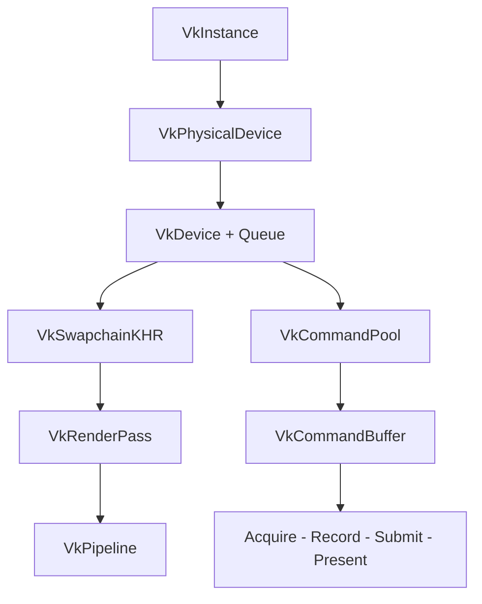
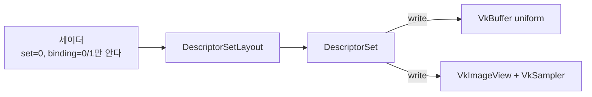
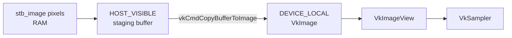
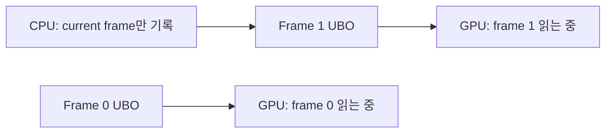

## 들어가며

Vulkan의 첫 삼각형은 API 골격을 확인하는 단계다. 정점 데이터는 셰이더에 하드코딩되어 있고, 화면을 채우는 색은 fragment shader 상수이며, 외부에서 들어오는 자원이 없다. 실제 3D 장면으로 넘어가려면 이 골격에 네 가지를 더해야 한다. 정점 입력을 위치+UV로 확장하고, MVP 행렬을 uniform buffer로 전달하고, 텍스처 픽셀을 staging buffer를 거쳐 device local image에 올리고, 이 모든 자원을 descriptor set으로 셰이더 binding에 묶는 일이다.

이 글의 결과물은 회전하는 텍스처 큐브다. 단순해 보이지만 Vulkan의 핵심 자원 패턴이 대부분 들어간다. Buffer 생성과 메모리 타입 선택, device local memory, staging copy, image layout 전이, pipeline barrier의 stage/access mask, sampler와 anisotropy, descriptor pool과 set, per-frame uniform update, frame-in-flight 동기화가 한 흐름으로 연결된다. 첫 삼각형이 "파이프라인이 도는가"를 확인했다면, 텍스처 큐브는 "자원이 GPU 메모리로 올라가 셰이더에 도달하는가"를 확인한다.

목표는 큐브 하나가 아니라 *자원 업로드와 바인딩의 표준 경로* 를 익히는 것이다. 이 경로는 곧 모든 Vulkan 렌더러의 뼈대다. 한 번 이해하면 외부 모델의 정점 버퍼, PBR 텍스처 셋, shadow map의 깊이 이미지, compute가 쓰는 storage buffer가 전부 같은 다섯 단계(자원 생성 → 메모리 할당 → 업로드 → layout/barrier → descriptor 연결)로 읽힌다. 큐브는 그 다섯 단계를 가장 작은 예제로 압축한 것이다.


---

## 목차
1. [첫 삼각형 코드 골격 점검](#1-첫-삼각형-코드-골격-점검)
2. [정점 입력 확장](#2-정점-입력-확장)
3. [Uniform Buffer와 Descriptor Set](#3-uniform-buffer와-descriptor-set)
4. [텍스처 자원 생성과 스테이징](#4-텍스처-자원-생성과-스테이징)
5. [Image Layout 전이](#5-image-layout-전이)
6. [Sampler와 Combined Image Sampler](#6-sampler와-combined-image-sampler)
7. [큐브 메시 데이터](#7-큐브-메시-데이터)
8. [회전 행렬과 매 프레임 업데이트](#8-회전-행렬과-매-프레임-업데이트)


---

## 1. 첫 삼각형 코드 골격 점검

### 이미 존재한다고 가정하는 것

텍스처 큐브는 다음 객체들이 이미 만들어져 있다고 가정한다. 첫 삼각형 단계에서 구성된 핵심 골격이다.



이 골격에서 매 프레임은 swapchain image를 acquire하고, command buffer를 기록하고, graphics queue에 submit하고, present한다. 세마포어 두 개(image available, render finished)와 fence 하나(in-flight)가 이 흐름을 동기화한다. 큐브를 그린다고 이 동기화 구조가 바뀌지는 않는다. 바뀌는 것은 command buffer 안에서 발급하는 draw의 내용과, draw가 참조하는 자원이다.

### 추가되는 네 묶음

여기에 추가되는 것은 정확히 네 묶음이다.

| 추가 요소 | 역할 | 메모리 위치 |
|---|---|---|
| Vertex/Index Buffer | 큐브 메시 데이터 | DEVICE_LOCAL |
| Uniform Buffer | MVP 행렬, 매 프레임 갱신 | HOST_VISIBLE (persistent map) |
| Texture Image + View + Sampler | 셰이더에서 샘플할 이미지 | DEVICE_LOCAL |
| Descriptor Pool + Set + Layout | 자원을 셰이더 binding에 연결 | (메모리 객체 아님) |

정점 버퍼와 텍스처는 GPU가 매 프레임 *읽기만* 하므로 device local에 한 번 올리고 끝낸다. uniform buffer는 매 프레임 CPU가 새 행렬을 쓰므로 CPU가 직접 map할 수 있는 host visible 메모리에 둔다. 이 구분이 4절과 8절에서 메모리 타입 선택을 가르는 기준이 된다.

### Vulkan의 간접 바인딩 모델

Vulkan의 핵심은 자원과 셰이더가 *직접* 연결되지 않는다는 점이다. OpenGL이라면 `glBindTexture(GL_TEXTURE_2D, id)`로 텍스처를 슬롯에 직접 바인딩하고, `glUniformMatrix4fv`로 uniform을 직접 셋업했다. Vulkan은 이 연결을 한 단계 우회시킨다.



셰이더는 `set`, `binding` 번호만 컴파일 타임에 안다. 어떤 실제 buffer/image가 거기 들어갈지는 모른다. 애플리케이션이 descriptor set이라는 "자원 핸들 묶음"을 만들고, `vkUpdateDescriptorSets`로 실제 자원을 그 묶음에 써 넣은 뒤, draw 직전에 `vkCmdBindDescriptorSets`로 묶음 전체를 한 번에 바인딩한다. 이 간접성 덕분에 같은 셰이더로 텍스처만 바꿔 수천 번 draw하는 것이 set 교체 한 번으로 끝난다. 비용은 descriptor pool, layout, set이라는 객체를 직접 관리해야 한다는 점이다.

## 2. 정점 입력 확장

### Vertex 구조체와 입력 description

첫 삼각형의 정점이 위치만 가졌다면, 텍스처 큐브의 정점은 위치와 UV를 갖는다.

```cpp
struct Vertex {
    glm::vec3 pos;   // 12 byte, offset 0
    glm::vec2 uv;    // 8 byte,  offset 12

    static VkVertexInputBindingDescription Binding() {
        return {
            0,                            // binding 번호
            sizeof(Vertex),               // stride = 20 byte
            VK_VERTEX_INPUT_RATE_VERTEX   // 정점마다 전진 (인스턴스 아님)
        };
    }

    static std::array<VkVertexInputAttributeDescription, 2> Attributes() {
        return {{
            {0, 0, VK_FORMAT_R32G32B32_SFLOAT, offsetof(Vertex, pos)},
            {1, 0, VK_FORMAT_R32G32_SFLOAT,    offsetof(Vertex, uv)}
        }};
    }
};
```

`VkVertexInputAttributeDescription`의 네 필드는 순서대로 `{location, binding, format, offset}`이다. location은 셰이더의 `layout(location=N)`과 매칭되고, binding은 어느 vertex buffer에서 가져올지, format은 GPU가 바이트를 어떻게 해석할지, offset은 stride 안에서 이 attribute가 시작하는 위치다. `offsetof`로 offset을 박는 것이 손계산보다 안전하다. 구조체에 멤버를 끼워 넣으면 자동으로 따라오기 때문이다.

### Pipeline에 입력 레이아웃 연결

생성한 binding/attribute description을 pipeline 생성 시 `VkPipelineVertexInputStateCreateInfo`에 넘긴다.

```cpp
auto binding = Vertex::Binding();
auto attrs = Vertex::Attributes();

VkPipelineVertexInputStateCreateInfo vi{};
vi.sType = VK_STRUCTURE_TYPE_PIPELINE_VERTEX_INPUT_STATE_CREATE_INFO;
vi.vertexBindingDescriptionCount = 1;
vi.pVertexBindingDescriptions = &binding;
vi.vertexAttributeDescriptionCount = static_cast<uint32_t>(attrs.size());
vi.pVertexAttributeDescriptions = attrs.data();
```

`binding`과 `attrs`가 지역 변수라는 점에 주의한다. `vkCreateGraphicsPipelines`가 이 포인터를 읽는 시점까지 두 변수가 살아 있어야 한다. pipeline 생성을 별도 함수로 빼면서 description을 그 함수 안의 임시 변수로 두면, create info에 포인터만 저장된 채 함수가 끝나 dangling pointer가 된다. 검증 레이어가 잡지 못하는 흔한 함정이다.

### 셰이더 측 location 매칭

셰이더의 입력 location은 attribute description의 location과 정확히 일치해야 한다.

```glsl
// vertex shader
layout(location = 0) in vec3 inPos;
layout(location = 1) in vec2 inUv;

layout(location = 0) out vec2 fragUv;  // fragment로 전달

void main() {
    fragUv = inUv;
    // gl_Position은 3절의 MVP로 계산
}
```

### format과 셰이더 타입의 폭

`VK_FORMAT_R32G32B32_SFLOAT`는 32비트 부동소수점 3채널, 즉 `vec3`다. format이 정점 데이터의 폭을 정하고, 셰이더는 그것을 받는다. 둘의 채널 수가 어긋나도 검증 레이어가 항상 잡아주지는 않는다. 자주 쓰는 매핑을 표로 정리한다.

| format | 바이트 | 셰이더 타입 | 용도 |
|---|---|---|---|
| `R32_SFLOAT` | 4 | `float` | 스칼라 가중치 |
| `R32G32_SFLOAT` | 8 | `vec2` | UV 좌표 |
| `R32G32B32_SFLOAT` | 12 | `vec3` | 위치, 법선 |
| `R32G32B32A32_SFLOAT` | 16 | `vec4` | 탄젠트(w 부호 포함) |
| `R8G8B8A8_UNORM` | 4 | `vec4` (0~1) | 정점 색상 압축 |

정점 색상을 `R8G8B8A8_UNORM`으로 두면 채널당 1바이트로 4배 압축되고, GPU가 자동으로 0~1 float로 정규화해 셰이더에 넘긴다. 큐브에서는 UV에 8바이트, 위치에 12바이트를 쓰는 것으로 충분하다.

## 3. Uniform Buffer와 Descriptor Set

### MVP 데이터와 alignment

MVP 행렬은 uniform buffer로 전달한다.

```cpp
struct UniformData {
    glm::mat4 model;   // 64 byte
    glm::mat4 view;    // 64 byte
    glm::mat4 proj;    // 64 byte
};                     // 총 192 byte
```

`mat4`는 std140 레이아웃에서 16바이트 정렬을 요구하고 `mat4` 자체가 64바이트라 자연스럽게 맞는다. 그러나 `vec3`를 uniform 멤버로 넣을 때 함정이 생긴다. std140에서 `vec3`는 16바이트 정렬을 받아 뒤에 4바이트 패딩이 붙는다. C++ 구조체의 `glm::vec3`(12바이트)와 셰이더의 `vec3`(정렬 후 16바이트)가 어긋나면 그 뒤의 모든 멤버가 밀린다. 안전한 습관은 uniform 구조체 멤버에 `alignas(16)`을 명시하거나, `vec3` 대신 `vec4`를 쓰고 w를 버리는 것이다.

```cpp
struct UniformData {
    glm::mat4 model;
    glm::mat4 view;
    glm::mat4 proj;
    alignas(16) glm::vec3 lightDir;  // vec3 뒤 std140 정렬 강제
};
```

### GLM projection과 Vulkan NDC

GLM은 기본적으로 OpenGL식 projection을 만든다. OpenGL NDC는 z가 $[-1, 1]$이고 화면 y축이 위를 향한다. Vulkan은 NDC z가 $[0, 1]$이고 화면 y축이 아래를 향한다. 이 차이를 무시하면 큐브가 위아래로 뒤집히고 깊이 비교가 어긋난다.

z 범위는 GLM에 `GLM_FORCE_DEPTH_ZERO_TO_ONE`을 정의해 해결하고, y축은 projection 행렬의 $[1][1]$ 원소 부호를 뒤집어 해결한다.

```cpp
// 컴파일 단위 최상단 또는 빌드 정의
#define GLM_FORCE_DEPTH_ZERO_TO_ONE
#include <glm/glm.hpp>

ubo.proj = glm::perspective(glm::radians(45.0f), aspect, 0.1f, 100.0f);
ubo.proj[1][1] *= -1.0f;  // Vulkan y-flip
```

`ubo.proj[1][1] *= -1.0f` 한 줄을 빼면 큐브가 상하 반전된 채로 정상처럼 보일 수 있어 디버깅이 까다롭다. 텍스처에 글자가 있거나 비대칭 패턴이면 즉시 드러난다. y-flip 대신 viewport의 height를 음수로 주는 방법(`VK_KHR_maintenance1` 이후 코어)도 있으나, projection에서 처리하는 쪽이 GLM 코드와 한 곳에 모여 추적하기 쉽다.

### Descriptor set layout

descriptor set layout은 셰이더가 기대하는 binding의 *형태* 를 선언한다. 큐브는 vertex stage의 uniform buffer 하나, fragment stage의 texture sampler 하나, 두 binding을 가진다.

```cpp
VkDescriptorSetLayoutBinding uboBinding{};
uboBinding.binding = 0;
uboBinding.descriptorType = VK_DESCRIPTOR_TYPE_UNIFORM_BUFFER;
uboBinding.descriptorCount = 1;
uboBinding.stageFlags = VK_SHADER_STAGE_VERTEX_BIT;

VkDescriptorSetLayoutBinding samplerBinding{};
samplerBinding.binding = 1;
samplerBinding.descriptorType = VK_DESCRIPTOR_TYPE_COMBINED_IMAGE_SAMPLER;
samplerBinding.descriptorCount = 1;
samplerBinding.stageFlags = VK_SHADER_STAGE_FRAGMENT_BIT;

VkDescriptorSetLayoutBinding bindings[] = { uboBinding, samplerBinding };

VkDescriptorSetLayoutCreateInfo li{};
li.sType = VK_STRUCTURE_TYPE_DESCRIPTOR_SET_LAYOUT_CREATE_INFO;
li.bindingCount = 2;
li.pBindings = bindings;
vkCreateDescriptorSetLayout(device, &li, nullptr, &setLayout);
```

`stageFlags`는 이 binding이 어느 셰이더 스테이지에서 접근 가능한지 제한한다. uniform을 vertex에서만, sampler를 fragment에서만 쓴다고 명시하면 드라이버가 불필요한 스테이지에 자원을 노출하지 않는다. 양쪽에서 다 쓰려면 `VK_SHADER_STAGE_VERTEX_BIT | VK_SHADER_STAGE_FRAGMENT_BIT`로 OR한다.

### Descriptor pool과 set 할당

descriptor set은 직접 만들지 못한다. descriptor pool에서 할당받는다. pool은 타입별로 몇 개의 descriptor를 담을 수 있는지 미리 선언한다.

```cpp
VkDescriptorPoolSize sizes[] = {
    { VK_DESCRIPTOR_TYPE_UNIFORM_BUFFER,         MAX_FRAMES },
    { VK_DESCRIPTOR_TYPE_COMBINED_IMAGE_SAMPLER, MAX_FRAMES }
};

VkDescriptorPoolCreateInfo pi{};
pi.sType = VK_STRUCTURE_TYPE_DESCRIPTOR_POOL_CREATE_INFO;
pi.poolSizeCount = 2;
pi.pPoolSizes = sizes;
pi.maxSets = MAX_FRAMES;  // frame-in-flight 수만큼
vkCreateDescriptorPool(device, &pi, nullptr, &descriptorPool);
```

pool의 `maxSets`와 타입별 카운트를 실제 할당량보다 작게 잡으면 `vkAllocateDescriptorSets`가 `VK_ERROR_OUT_OF_POOL_MEMORY`를 반환한다. frame-in-flight가 2면 uniform buffer descriptor도 2개, set도 2개가 필요하다. 텍스처는 프레임 간 공유하므로 sampler descriptor를 프레임 수만큼 잡을지 1개만 잡을지는 set 구성에 달려 있다. set 전체를 프레임별로 복제하는 단순 구현에서는 양쪽 다 `MAX_FRAMES`로 둔다.

### 셰이더 측 선언

```glsl
layout(set = 0, binding = 0) uniform Camera {
    mat4 model;
    mat4 view;
    mat4 proj;
} ubo;

layout(set = 0, binding = 1) uniform sampler2D tex;
```

셰이더의 `set`/`binding`이 layout의 binding 번호, descriptor 타입과 어긋나면 결과는 정의되지 않는다. 검증 레이어가 대부분 잡아주지만, set 번호 불일치는 런타임에 조용히 빈 자원을 읽어 검은 화면으로 나타나기도 한다.

## 4. 텍스처 자원 생성과 스테이징

### 왜 staging buffer를 거치는가

CPU가 `stb_image`로 읽은 픽셀을 곧바로 device local image에 쓸 수는 없다. device local 메모리는 일반적으로 CPU가 map할 수 없는 GPU 전용 VRAM이기 때문이다. CPU가 직접 쓸 수 있는 host visible 메모리에 일단 픽셀을 올린 뒤, GPU의 transfer 명령으로 device local image에 복사한다. 이 중간 버퍼가 staging buffer다.



device local에 두는 이유는 대역폭이다. discrete GPU에서 VRAM 대역폭은 수백 GB/s에 이르지만, host visible 메모리(시스템 RAM)는 PCIe를 거쳐 보통 한 자릿수~십수 GB/s에 머문다. 텍스처는 매 프레임 여러 번 샘플되므로 device local에 두는 것이 fragment 처리량을 좌우한다. 정점/인덱스 버퍼도 같은 이유로 staging을 거쳐 device local에 올린다.

### Staging buffer 채우기

staging buffer는 CPU가 map해서 직접 쓸 수 있도록 `HOST_VISIBLE | HOST_COHERENT`로 만든다.

```cpp
int w, h, ch;
stbi_uc* pixels = stbi_load("cube.png", &w, &h, &ch, STBI_rgb_alpha);
VkDeviceSize imageSize = static_cast<VkDeviceSize>(w) * h * 4;  // RGBA 4 byte

CreateBuffer(imageSize,
    VK_BUFFER_USAGE_TRANSFER_SRC_BIT,
    VK_MEMORY_PROPERTY_HOST_VISIBLE_BIT |
    VK_MEMORY_PROPERTY_HOST_COHERENT_BIT,
    stagingBuffer,
    stagingMemory);

void* mapped = nullptr;
vkMapMemory(device, stagingMemory, 0, imageSize, 0, &mapped);
std::memcpy(mapped, pixels, static_cast<size_t>(imageSize));
vkUnmapMemory(device, stagingMemory);
stbi_image_free(pixels);
```

`STBI_rgb_alpha`로 강제 4채널 로딩하는 이유는 GPU가 3채널 RGB 텍스처 포맷을 보장하지 않기 때문이다. `R8G8B8_SRGB`(3바이트)는 많은 하드웨어에서 sampling 지원이 빠져 있어, 4채널 `R8G8B8A8_SRGB`로 통일하는 편이 안전하다. 알파가 없는 이미지라도 알파를 1.0으로 채운 4채널로 올린다.

`HOST_COHERENT`가 없는 메모리를 map해서 쓰면 CPU 쓰기가 GPU에 즉시 보이지 않아 `vkFlushMappedMemoryRanges`를 직접 불러야 한다. coherent 플래그를 함께 요구하면 이 수동 플러시가 생략되어 staging 코드가 단순해진다.

### Device local image 생성

실제 texture image는 GPU 접근이 빠른 device local에 둔다. usage에 복사 대상(`TRANSFER_DST`)과 샘플링(`SAMPLED`) 둘 다 켠다.

```cpp
CreateImage(w, h,
    VK_FORMAT_R8G8B8A8_SRGB,
    VK_IMAGE_TILING_OPTIMAL,
    VK_IMAGE_USAGE_TRANSFER_DST_BIT |
    VK_IMAGE_USAGE_SAMPLED_BIT,
    VK_MEMORY_PROPERTY_DEVICE_LOCAL_BIT,
    textureImage,
    textureMemory);
```

`VK_IMAGE_TILING_OPTIMAL`은 GPU가 캐시 친화적으로 픽셀을 swizzle해 저장하도록 둔다. 이 배치는 드라이버 내부 형식이라 CPU가 직접 해석할 수 없고, 그래서 `LINEAR` tiling이 아닌 한 staging copy가 강제된다. `LINEAR` tiling은 CPU가 행 단위로 읽을 수 있지만 sampling 성능이 떨어지고 지원 포맷이 제한적이라, 텍스처에는 거의 쓰지 않는다.

### sRGB와 선형 포맷의 구분

색상 텍스처는 `_SRGB` 포맷을 사용한다. 그러면 셰이더의 `texture` 결과가 자동으로 선형 공간 값으로 변환되어 들어온다. 라이팅 계산은 선형 공간에서 해야 물리적으로 옳기 때문에 이 자동 변환이 중요하다.

| 텍스처 종류 | 포맷 | 이유 |
|---|---|---|
| albedo / 색상 | `R8G8B8A8_SRGB` | sRGB 인코딩된 색, 샘플 시 선형으로 디코딩 |
| 노멀 맵 | `R8G8B8A8_UNORM` | 방향 벡터, 선형 데이터라 디코딩하면 안 됨 |
| roughness/metallic | `R8G8B8A8_UNORM` | 스칼라 물성값, 선형 데이터 |
| 높이/변위 맵 | `R16_UNORM` 등 | 단일 채널 선형, 정밀도 우선 |

노멀 맵을 실수로 `_SRGB`로 올리면 sampling 시 감마 디코딩이 들어가 법선 방향이 비선형으로 휘고, 라이팅이 틀어진다. 핵심 규칙은 색 인코딩이 아닌 데이터에 *의도하지 않은 sRGB 변환을 적용하지 않는 것* 이다. 저장 범위와 정밀도에 따라 UNORM, SNORM, 부동소수점, 정수 포맷을 고른다. 예를 들어 부호 있는 법선 성분은 SNORM 또는 BC5 계열, HDR 데이터는 부동소수점 포맷이 더 자연스러울 수 있다.

## 5. Image Layout 전이

### Layout이라는 개념

Vulkan image는 단순한 픽셀 배열이 아니라, 현재 어떤 용도에 최적화된 메모리 배치를 가지는지를 나타내는 *layout* 상태를 함께 가진다. 복사 대상으로 쓸 때, 셰이더가 읽을 때, 렌더 타깃으로 쓸 때 GPU가 선호하는 내부 배치가 다르다. 잘못된 layout으로 자원을 쓰면 결과가 정의되지 않는다. 텍스처 업로드는 보통 세 단계 layout을 거친다.

| 단계 | Layout | 용도 |
|---|---|---|
| 생성 직후 | `VK_IMAGE_LAYOUT_UNDEFINED` | 기존 내용 버림, 아무 약속 없음 |
| 복사 대상 | `TRANSFER_DST_OPTIMAL` | staging buffer에서 복사받기 |
| 셰이더 읽기 | `SHADER_READ_ONLY_OPTIMAL` | fragment shader sampling |

`UNDEFINED`를 old layout으로 쓰는 것은 이전 내용을 보존하지 않겠다는 선언이다. `VkImageCreateInfo::initialLayout`을 `VK_IMAGE_LAYOUT_UNDEFINED`로 만든 일반적인 최적 타일링 텍스처는 첫 사용에서 이 값을 old layout으로 둔다. 그러나 모든 이미지의 첫 전이가 `UNDEFINED`인 것은 아니다. 선형 타일링 이미지가 `PREINITIALIZED`로 생성되어 호스트가 쓴 내용을 보존해야 할 수 있고, swapchain·외부 메모리·이미 사용한 이미지는 획득하거나 동기화 계약이 정한 현재 layout에서 출발한다. 내용을 보존해야 하는데 `UNDEFINED`를 넘기면 이전 픽셀은 폐기 가능하다고 선언하는 셈이다.

### Pipeline barrier로 전이

layout 전이는 `vkCmdPipelineBarrier`의 image memory barrier로 수행한다. barrier는 두 가지를 동시에 한다. layout을 바꾸고, 그리고 *실행 순서와 메모리 가시성* 을 보장한다.

```cpp
void TransitionImage(VkCommandBuffer cmd, VkImage image,
                     VkImageLayout oldLayout, VkImageLayout newLayout,
                     VkPipelineStageFlags srcStage, VkPipelineStageFlags dstStage,
                     VkAccessFlags srcAccess, VkAccessFlags dstAccess) {
    VkImageMemoryBarrier barrier{};
    barrier.sType = VK_STRUCTURE_TYPE_IMAGE_MEMORY_BARRIER;
    barrier.oldLayout = oldLayout;
    barrier.newLayout = newLayout;
    barrier.srcQueueFamilyIndex = VK_QUEUE_FAMILY_IGNORED;
    barrier.dstQueueFamilyIndex = VK_QUEUE_FAMILY_IGNORED;
    barrier.image = image;
    barrier.subresourceRange.aspectMask = VK_IMAGE_ASPECT_COLOR_BIT;
    barrier.subresourceRange.baseMipLevel = 0;
    barrier.subresourceRange.levelCount = 1;
    barrier.subresourceRange.baseArrayLayer = 0;
    barrier.subresourceRange.layerCount = 1;
    barrier.srcAccessMask = srcAccess;
    barrier.dstAccessMask = dstAccess;

    vkCmdPipelineBarrier(cmd, srcStage, dstStage, 0,
                         0, nullptr, 0, nullptr, 1, &barrier);
}
```

### stage와 access mask 채우기

barrier에서 가장 실수가 잦은 곳이 stage와 access mask다. 이 둘은 "이전 작업의 어느 단계까지가 끝나야 하고, 그 결과 메모리가 다음 작업의 어느 단계에 보여야 하는가"를 지정한다. 두 전이의 올바른 조합은 다음과 같다.

| 전이 | srcStage → dstStage | srcAccess → dstAccess |
|---|---|---|
| `UNDEFINED → TRANSFER_DST` | `TOP_OF_PIPE` → `TRANSFER` | `0` → `TRANSFER_WRITE` |
| `TRANSFER_DST → SHADER_READ` | `TRANSFER` → `FRAGMENT_SHADER` | `TRANSFER_WRITE` → `SHADER_READ` |

첫 전이는 기다릴 이전 작업이 없으므로 src access가 `0`이고 src stage가 파이프라인 맨 위다. 둘째 전이는 transfer write가 끝나고 그 결과가 fragment shader의 read에 보여야 하므로, transfer write를 src로, shader read를 dst로 둔다.

```cpp
// UNDEFINED -> TRANSFER_DST
TransitionImage(cmd, textureImage,
    VK_IMAGE_LAYOUT_UNDEFINED, VK_IMAGE_LAYOUT_TRANSFER_DST_OPTIMAL,
    VK_PIPELINE_STAGE_TOP_OF_PIPE_BIT, VK_PIPELINE_STAGE_TRANSFER_BIT,
    0, VK_ACCESS_TRANSFER_WRITE_BIT);

// 여기서 vkCmdCopyBufferToImage 발급

// TRANSFER_DST -> SHADER_READ_ONLY
TransitionImage(cmd, textureImage,
    VK_IMAGE_LAYOUT_TRANSFER_DST_OPTIMAL,
    VK_IMAGE_LAYOUT_SHADER_READ_ONLY_OPTIMAL,
    VK_PIPELINE_STAGE_TRANSFER_BIT, VK_PIPELINE_STAGE_FRAGMENT_SHADER_BIT,
    VK_ACCESS_TRANSFER_WRITE_BIT, VK_ACCESS_SHADER_READ_BIT);
```

stage/access를 잘못 잡으면 검증 레이어가 `SYNC-HAZARD` 경고를 낸다. 이 텍스처를 프래그먼트 셰이더가 읽는데 dst stage를 `COLOR_ATTACHMENT_OUTPUT`처럼 너무 늦은 단계로 잡거나 dstAccess를 비워 두면, 복사 완료와 셰이더 읽기 사이의 의존성이 빠질 수 있다. 반대로 `VERTEX_SHADER`처럼 더 이른 단계를 지정하면 논리적으로 뒤따르는 프래그먼트 단계까지 범위에 들어가므로 안전하지만 필요 이상으로 보수적이다. 이런 동기화 버그는 특정 드라이버와 타이밍에서만 재현될 수 있으므로 validation layer의 synchronization validation을 켜고 확인한다.

### CopyBufferToImage

전이 사이에 실제 복사를 발급한다. 복사 영역은 buffer의 픽셀 배치와 image의 영역을 함께 기술한다.

```cpp
VkBufferImageCopy region{};
region.bufferOffset = 0;
region.bufferRowLength = 0;    // 0이면 imageExtent.width에 꽉 채움
region.bufferImageHeight = 0;
region.imageSubresource.aspectMask = VK_IMAGE_ASPECT_COLOR_BIT;
region.imageSubresource.mipLevel = 0;
region.imageSubresource.layerCount = 1;
region.imageExtent = { (uint32_t)w, (uint32_t)h, 1 };

vkCmdCopyBufferToImage(cmd, stagingBuffer, textureImage,
    VK_IMAGE_LAYOUT_TRANSFER_DST_OPTIMAL, 1, &region);
```

이 전이와 복사는 모두 command buffer에 기록되는 명령이다. 보통 한 번 쓰고 버리는 일회성 command buffer(single-time command)에 모아 기록하고, 한 번 submit한 뒤 `vkQueueWaitIdle` 또는 fence로 완료를 기다린 다음 staging buffer를 파괴한다. 복사가 끝나기 전에 staging buffer를 해제하면 GPU가 해제된 메모리를 읽는다.

## 6. Sampler와 Combined Image Sampler

### Image, View, Sampler의 3분할

OpenGL의 텍스처 객체 하나가 Vulkan에서는 세 객체로 나뉜다. image는 픽셀이 저장된 메모리 자원이고, image view는 그 image를 어떤 포맷·mip 범위·채널 swizzle로 볼지 정의하는 창이며, sampler는 좌표를 픽셀로 변환하는 규칙(주소 모드, 필터링, 이방성)이다. 이 분리 덕분에 같은 image를 다른 view로 보거나, 한 sampler를 여러 텍스처에 공유할 수 있다.

```cpp
VkImageViewCreateInfo vi{};
vi.sType = VK_STRUCTURE_TYPE_IMAGE_VIEW_CREATE_INFO;
vi.image = textureImage;
vi.viewType = VK_IMAGE_VIEW_TYPE_2D;
vi.format = VK_FORMAT_R8G8B8A8_SRGB;  // image와 호환되는 포맷
vi.subresourceRange.aspectMask = VK_IMAGE_ASPECT_COLOR_BIT;
vi.subresourceRange.levelCount = 1;
vi.subresourceRange.layerCount = 1;
vkCreateImageView(device, &vi, nullptr, &textureImageView);
```

### Sampler 생성과 anisotropy

sampler는 주소 모드와 필터링을 정의한다.

```cpp
VkSamplerCreateInfo si{};
si.sType = VK_STRUCTURE_TYPE_SAMPLER_CREATE_INFO;
si.magFilter = VK_FILTER_LINEAR;   // 확대 시 bilinear
si.minFilter = VK_FILTER_LINEAR;   // 축소 시 bilinear
si.mipmapMode = VK_SAMPLER_MIPMAP_MODE_LINEAR;  // mip 간 trilinear
si.addressModeU = VK_SAMPLER_ADDRESS_MODE_REPEAT;
si.addressModeV = VK_SAMPLER_ADDRESS_MODE_REPEAT;
si.addressModeW = VK_SAMPLER_ADDRESS_MODE_REPEAT;
si.anisotropyEnable = VK_TRUE;
si.maxAnisotropy = physicalLimits.maxSamplerAnisotropy;  // 보통 16
si.borderColor = VK_BORDER_COLOR_INT_OPAQUE_BLACK;
si.unnormalizedCoordinates = VK_FALSE;  // [0,1] 정규화 좌표
si.compareEnable = VK_FALSE;
si.mipLodBias = 0.0f;
si.minLod = 0.0f;
si.maxLod = 0.0f;  // mipmap 안 쓰면 0

vkCreateSampler(device, &si, nullptr, &textureSampler);
```

`anisotropyEnable`은 물리 디바이스 feature를 활성화했을 때만 켤 수 있다. device 생성 시 `VkPhysicalDeviceFeatures::samplerAnisotropy = VK_TRUE`를 요청하지 않고 sampler에서 anisotropy를 켜면 검증 레이어가 오류를 낸다. `maxAnisotropy`는 디바이스의 `maxSamplerAnisotropy` 한계(흔히 16)를 넘으면 안 되므로 limit 값을 그대로 가져와 clamp하는 것이 안전하다.

이방성 필터링은 큐브를 비스듬히 볼 때 효과가 크다. 표면이 시선과 예각을 이루는 면에서 일반 trilinear는 한 방향으로만 mip을 고르기 때문에 텍스처가 뭉개진다. 16× 이방성은 그 방향으로 최대 16개 샘플을 추가로 잡아 선명도를 유지한다. 비용은 메모리 대역폭으로, 같은 픽셀을 여러 번 읽는다.

### Combined Image Sampler descriptor 쓰기

큐브는 `VK_DESCRIPTOR_TYPE_COMBINED_IMAGE_SAMPLER`를 쓴다. image view와 sampler를 한 binding으로 묶는 형태다.

```cpp
VkDescriptorImageInfo imageInfo{};
imageInfo.imageLayout = VK_IMAGE_LAYOUT_SHADER_READ_ONLY_OPTIMAL;
imageInfo.imageView = textureImageView;
imageInfo.sampler = textureSampler;

VkWriteDescriptorSet write{};
write.sType = VK_STRUCTURE_TYPE_WRITE_DESCRIPTOR_SET;
write.dstSet = descriptorSet;
write.dstBinding = 1;
write.dstArrayElement = 0;
write.descriptorType = VK_DESCRIPTOR_TYPE_COMBINED_IMAGE_SAMPLER;
write.descriptorCount = 1;
write.pImageInfo = &imageInfo;

vkUpdateDescriptorSets(device, 1, &write, 0, nullptr);
```

`imageInfo.imageLayout`을 `SHADER_READ_ONLY_OPTIMAL`로 쓰는 것이 5절에서 텍스처를 그 layout으로 전이시킨 이유다. descriptor가 기록하는 layout과 draw 시점의 실제 image layout이 일치해야 한다. uniform buffer binding(binding 0)도 같은 방식으로 `VkDescriptorBufferInfo`를 채워 `pBufferInfo`로 쓴다. 두 write를 배열로 묶어 한 번에 update하는 것이 일반적이다.

`COMBINED_IMAGE_SAMPLER`는 OpenGL의 texture object + sampler state를 한 binding으로 합친 형태에 가깝다. Vulkan은 원하면 `SAMPLED_IMAGE`와 `SAMPLER`를 분리한 descriptor 타입도 제공해, 한 sampler를 여러 image에 재사용하거나 image 배열을 한 sampler로 훑는 구성을 만들 수 있다. 큐브 수준에서는 combined 쪽이 단순하다.

## 7. 큐브 메시 데이터

### 왜 정점이 24개인가

큐브는 꼭짓점 좌표가 8개뿐이다. 그러나 렌더링용 정점은 보통 24개다. 이유는 면마다 UV와 법선이 다르기 때문이다. 한 꼭짓점은 세 면이 만나는 모서리인데, 각 면이 그 꼭짓점에 서로 다른 UV 좌표와 서로 다른 법선 방향을 요구한다. 정점은 위치뿐 아니라 그에 딸린 모든 attribute가 같아야 공유할 수 있으므로, 면이 다르면 정점도 분리한다.

면 6개 × 모서리 4개 = 24개 정점, 면 6개 × 삼각형 2개 × 3 = 36개 인덱스다.

```cpp
// 앞면(+Z)의 4개 정점. UV는 면 전체를 0~1로 덮는다.
std::vector<Vertex> vertices = {
    {{-1,-1, 1}, {0,0}}, {{ 1,-1, 1}, {1,0}},
    {{ 1, 1, 1}, {1,1}}, {{-1, 1, 1}, {0,1}},
    // 뒷면(-Z), 윗면(+Y), 아랫면(-Y), 오른쪽(+X), 왼쪽(-X) 5면 동일 패턴
};

std::vector<uint16_t> indices = {
    0, 1, 2, 2, 3, 0,        // 앞면: 두 삼각형
    // 나머지 5면은 4*면번호 오프셋으로 같은 패턴 반복
};
```

`uint16_t` 인덱스는 정점 수가 65,536개 미만일 때 쓴다. 큐브는 24개라 여유가 충분하고, 인덱스 버퍼 크기가 절반이라 대역폭에 유리하다. 정점이 그 이상이면 `uint32_t`와 `VK_INDEX_TYPE_UINT32`로 바꾼다.

### Winding order와 culling

인덱스 순서는 삼각형의 winding(정점 도는 방향)을 정한다. Vulkan 기본은 `VK_FRONT_FACE_COUNTER_CLOCKWISE`를 앞면으로 본다. back-face culling을 켜면 카메라 쪽을 향한 면만 그려진다. 인덱스 순서를 잘못 두면 큐브의 보이는 면이 컬링되어 안쪽이 보이거나 면이 통째로 사라진다. 큐브가 부분적으로만 보이면 winding과 `frontFace`/`cullMode` 설정을 먼저 의심한다.

```cpp
// rasterization state
rs.cullMode = VK_CULL_MODE_BACK_BIT;
// 정점은 CCW로 작성했지만 proj y-flip이 framebuffer winding을 뒤집으므로 CW가 앞면이 된다
rs.frontFace = VK_FRONT_FACE_CLOCKWISE;
```

### 정점/인덱스 버퍼 업로드

정점·인덱스 버퍼도 텍스처와 같은 staging 패턴을 쓴다. host visible staging에 데이터를 채우고, device local 버퍼로 복사한다.

```cpp
// device local vertex buffer
CreateBuffer(vertexSize,
    VK_BUFFER_USAGE_TRANSFER_DST_BIT |
    VK_BUFFER_USAGE_VERTEX_BUFFER_BIT,
    VK_MEMORY_PROPERTY_DEVICE_LOCAL_BIT,
    vertexBuffer, vertexMemory);

VkBufferCopy copyRegion{};
copyRegion.size = vertexSize;
vkCmdCopyBuffer(cmd, stagingBuffer, vertexBuffer, 1, &copyRegion);
```

usage에 `VERTEX_BUFFER_BIT`와 `TRANSFER_DST_BIT`를 함께 켜는 점이 핵심이다. 전자는 정점 입력으로 바인딩 가능하게 하고, 후자는 staging에서 복사받을 수 있게 한다. 인덱스 버퍼는 `INDEX_BUFFER_BIT`로 같은 패턴을 따른다.

### 렌더링 시 바인딩

draw 직전에 vertex buffer와 index buffer를 바인딩하고 indexed draw를 발급한다.

```cpp
VkBuffer vbs[] = { vertexBuffer };
VkDeviceSize offsets[] = { 0 };
vkCmdBindVertexBuffers(cmd, 0, 1, vbs, offsets);
vkCmdBindIndexBuffer(cmd, indexBuffer, 0, VK_INDEX_TYPE_UINT16);
vkCmdDrawIndexed(cmd, indexCount, 1, 0, 0, 0);
```

`vkCmdDrawIndexed`의 인자는 순서대로 `{indexCount, instanceCount, firstIndex, vertexOffset, firstInstance}`다. 큐브는 인스턴스 1개, 오프셋 0이라 `(36, 1, 0, 0, 0)`이다.

## 8. 회전 행렬과 매 프레임 업데이트

### 매 프레임 uniform 갱신

큐브를 회전시키려면 매 프레임 model 행렬을 새로 계산해 uniform buffer에 쓴다.

```cpp
float t = static_cast<float>(glfwGetTime());

UniformData ubo{};
ubo.model = glm::rotate(glm::mat4(1.0f), t, glm::vec3(0.3f, 1.0f, 0.0f));
ubo.view = glm::lookAt(glm::vec3(0, 0, 5),
                       glm::vec3(0, 0, 0),
                       glm::vec3(0, 1, 0));
ubo.proj = glm::perspective(glm::radians(45.0f), aspect, 0.1f, 100.0f);
ubo.proj[1][1] *= -1.0f;  // Vulkan y-flip

std::memcpy(mappedUniform[currentFrame], &ubo, sizeof(ubo));
```

여기서 회전축에 `(0.3, 1.0, 0.0)`처럼 비대칭 축을 주는 이유는 큐브의 여러 면이 번갈아 보이도록 하기 위해서다. y축 단독 회전이면 위·아래 면이 보이지 않아 텍스처 큐브의 6면 매핑을 확인하기 어렵다.

### Persistent mapped memory

uniform buffer는 매 프레임 갱신되므로 host visible 메모리에 두고, 한 번 map한 포인터를 계속 들고 있는다. 매 프레임 `vkMapMemory`/`vkUnmapMemory`를 반복하면 드라이버 오버헤드가 쌓인다.

```cpp
// 생성 시 한 번만 map
for (int i = 0; i < MAX_FRAMES; ++i) {
    CreateBuffer(sizeof(UniformData),
        VK_BUFFER_USAGE_UNIFORM_BUFFER_BIT,
        VK_MEMORY_PROPERTY_HOST_VISIBLE_BIT |
        VK_MEMORY_PROPERTY_HOST_COHERENT_BIT,
        uniformBuffer[i], uniformMemory[i]);
    vkMapMemory(device, uniformMemory[i], 0, sizeof(UniformData), 0,
                &mappedUniform[i]);  // 끝까지 unmap하지 않는다
}
```

`HOST_COHERENT`로 만들었으므로 `memcpy` 직후 별도 flush 없이 GPU가 새 값을 본다. coherent가 없다면 매 갱신마다 `vkFlushMappedMemoryRanges`가 필요하다.

### Frame-in-flight와 자원 분리

CPU와 GPU는 비동기로 동작한다. CPU가 프레임 N+1을 준비하는 동안 GPU는 아직 프레임 N을 그리고 있을 수 있다. uniform buffer가 하나뿐이면, CPU가 프레임 N+1의 행렬을 쓰는 순간 GPU가 읽고 있던 프레임 N의 데이터가 덮어써져 큐브가 간헐적으로 떨리거나 깨진다.



해법은 frame-in-flight 수(보통 2)만큼 uniform buffer를 복제하고, CPU는 현재 프레임 인덱스의 버퍼에만 쓰는 것이다. fence가 "이 슬롯의 이전 프레임이 끝났는가"를 보장하므로, 같은 슬롯에 다시 쓸 때는 이미 GPU가 읽기를 마친 뒤다. descriptor set도 프레임별로 만들어 각자의 uniform buffer를 가리키게 하거나, dynamic uniform buffer offset 하나로 슬롯을 골라 쓴다. 단순 구현은 프레임별 uniform buffer + 프레임별 descriptor set이 가장 명확하다.

### Push constant라는 대안

작고 매 프레임 바뀌는 데이터는 uniform buffer 대신 push constant로 보낼 수도 있다. push constant는 descriptor를 거치지 않고 command buffer에 직접 박히는 작은 데이터로, MVP 중 model 행렬 하나(64바이트) 정도는 push constant로 보내는 구성이 흔하다.

```cpp
vkCmdPushConstants(cmd, pipelineLayout, VK_SHADER_STAGE_VERTEX_BIT,
                   0, sizeof(glm::mat4), &ubo.model);
```

push constant는 크기 한계가 작다. 보장되는 최소치는 128바이트라, `mat4` 두 개(128바이트)가 사실상 상한이다. 그 이상은 uniform buffer를 쓴다. 큐브에서는 view·proj를 uniform buffer에 두고 자주 바뀌는 model만 push constant로 보내는 절충도 가능하다.

### 최종 draw 흐름

한 프레임의 command buffer 기록에서 큐브를 그리는 핵심 순서다.

```cpp
vkCmdBindPipeline(cmd, VK_PIPELINE_BIND_POINT_GRAPHICS, pipeline);
vkCmdBindDescriptorSets(cmd, VK_PIPELINE_BIND_POINT_GRAPHICS,
    pipelineLayout, 0, 1, &descriptorSet[currentFrame], 0, nullptr);
vkCmdBindVertexBuffers(cmd, 0, 1, &vertexBuffer, offsets);
vkCmdBindIndexBuffer(cmd, indexBuffer, 0, VK_INDEX_TYPE_UINT16);
vkCmdDrawIndexed(cmd, indexCount, 1, 0, 0, 0);
```

바인딩 순서 자체는 pipeline → descriptor → vertex/index buffer로 묶어 두면 읽기 쉽지만, draw 발급 전에 모두 바인딩되어 있기만 하면 순서에 강제는 없다. 단, descriptor set의 set 번호(여기서는 0)는 pipeline layout이 선언한 set 번호와 일치해야 한다.


---

## 결론

회전하는 텍스처 큐브는 Vulkan 자원 모델의 압축판이다. 정점·인덱스 버퍼는 staging buffer를 거쳐 device local memory에 올리고, MVP 행렬은 host visible uniform buffer로 매 프레임 전달하며, 텍스처는 staging copy와 두 번의 layout 전이를 거쳐 image view·sampler로 묶여 descriptor set에 연결된다. 다섯 단계(생성 → 메모리 할당 → 업로드 → layout/barrier → descriptor 연결)가 buffer든 image든 똑같이 반복된다는 점이 이 글의 핵심 수확이다.

세 가지 트레이드오프가 자원 설계를 가른다. 첫째, *device local vs host visible* 메모리다. GPU가 매 프레임 읽기만 하는 정점·텍스처는 대역폭이 높은 device local에 staging으로 올리고, CPU가 매 프레임 갱신하는 uniform은 host visible에 둔다. 둘째, *uniform buffer vs push constant* 다. 128바이트 이하의 자주 바뀌는 데이터는 push constant가 descriptor 우회 없이 빠르고, 그 이상은 uniform buffer가 맞다. 셋째, *combined image sampler vs 분리* 다. 단일 텍스처는 combined가 단순하고, image 배열이나 sampler 재사용이 필요하면 분리 타입이 유연하다.

핵심은 모든 자원이 명시적으로 연결된다는 점이다. 셰이더는 `set/binding` 번호만 알고, descriptor set은 실제 buffer·image·sampler를 담고, command buffer는 pipeline과 descriptor set과 vertex/index buffer를 바인딩해 draw를 발급한다. 여기까지의 코드는 한 개의 큐브를 화면에서 회전시킨다. 아직 깊이 버퍼를 활성화한 정확한 가림 처리, 여러 객체를 위한 동적 descriptor 관리, 외부 메시 로딩은 들어 있지 않다. 그 확장들은 모두 이 글에서 익힌 다섯 단계 위에 얹힌다.

## 더 읽을거리

- [Vulkan Tutorial: Vertex buffers](https://vulkan-tutorial.com/Vertex_buffers/Vertex_buffer_creation) 및 이어지는 Uniform buffers·Texture mapping 장 — 본문 다섯 단계와 1:1 대응.
- [Sascha Willems, Vulkan Examples](https://github.com/SaschaWillems/Vulkan) — 자원 패턴별 단문 예제의 보고.
- [Vulkan Guide: Descriptor Dynamic Offset](https://docs.vulkan.org/guide/latest/descriptor_dynamic_offset.html) — 동적 uniform/storage buffer offset의 정렬과 바인딩 규칙.
