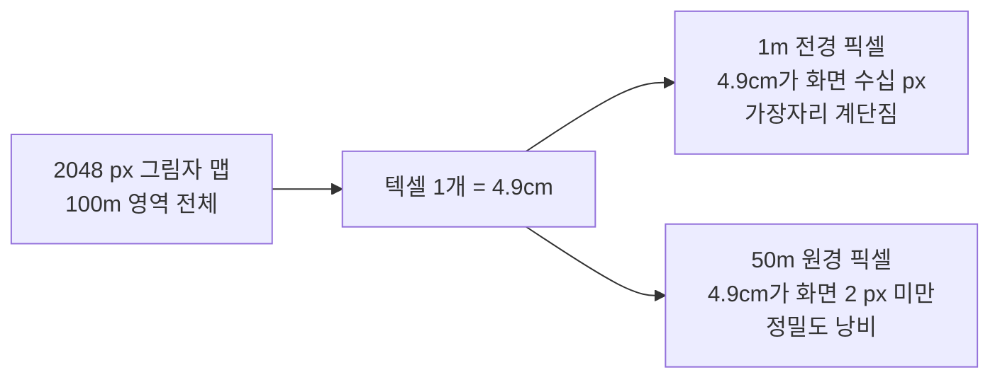

## 들어가며

> 그림자 매핑의 기본 골격은 빛 시점 깊이 패스와 카메라 시점 깊이 비교다. 이 글은 그 위에서 광역 야외용 고급 기법인 캐스케이드 그림자 맵(CSM)과 PCSS를 Vulkan으로 구현한다. 절두체 분할 수학·텍셀 스냅·배열 텍스처·Multiview·캐스케이드 블렌딩·Vulkan 하드웨어 depth bias 등 CSM과 Vulkan 고유 사항을 다룬다.

직사광이 만드는 그림자는 장면의 공간 감각을 결정한다. 객체가 바닥에 닿아 있는지 떠 있는지, 한 물체가 다른 물체 뒤에 있는지, 지형의 굴곡이 어느 방향으로 패여 있는지를 사람은 그림자의 형태와 농도로 읽는다. 여기까지의 코드는 외부 메시를 로딩하고 물리 기반 셰이딩(Physically Based Rendering)과 이미지 기반 조명(Image Based Lighting)으로 표면을 그리지만, 그림자가 없어 모든 객체가 같은 평면 위에 인쇄된 것처럼 보인다.

그림자 매핑(Shadow Mapping)의 기본 아이디어는 단순하다. 빛의 시점에서 장면을 한 번 렌더링해 각 방향으로 가장 가까운 표면까지의 깊이를 기록하고, 이 깊이 맵을 카메라 시점의 셰이딩에서 다시 읽어 현재 픽셀이 빛에서 보이는 표면보다 멀리 있으면 그늘로 판정한다. 문제는 *해상도 분배* 다. 하나의 그림자 맵으로 카메라 앞 1m의 발밑과 500m 떨어진 산등성이를 동시에 덮으면, 가까운 곳은 텍셀이 너무 듬성듬성해 그림자 가장자리가 픽셀 단위로 계단지고, 먼 곳은 화면에 한두 픽셀로 투영될 표면에 텍셀 수천 개가 낭비된다. 캐스케이드 그림자 맵(Cascaded Shadow Map, CSM)은 카메라 절두체(Frustum)를 거리에 따라 여러 구간으로 쪼개고 각 구간을 별도의 그림자 맵에 그려, 거리마다 적절한 텍셀 밀도를 분배해 이 문제를 해결한다.

이 글은 CSM을 Vulkan 위에서 구현할 때 필요한 주요 구성을 다룬다. 제품에서는 caster 컬링·시간적 안정화·필터 경계까지 장면에 맞게 검증해야 한다. 도달할 결과물은 광역 야외 장면에서 가까운 그림자가 선명하고 먼 그림자도 끊김 없이 부드럽게 이어지는 직사광 그림자 시스템이다. 단일 맵의 한계를 정량화하는 데서 출발해, 절두체 분할 수학, 캐스케이드별 라이트 공간 행렬과 텍셀 스냅, 배열 텍스처(Texture Array) 저장, 한 패스로 여러 층을 그리는 Multiview, 캐스케이드 선택과 경계 블렌딩, 거리에 따라 부드러움이 변하는 PCSS, 그리고 그림자 매핑의 고질병인 깊이 바이어스(Depth Bias) 튜닝까지 차례로 쌓는다. 각 단계는 측정 가능한 비용과 품질의 트레이드오프를 가진다.


---

## 목차
1. [단일 그림자 맵의 한계](#1-단일-그림자-맵의-한계)
2. [캐스케이드 분할 방식](#2-캐스케이드-분할-방식)
3. [캐스케이드별 라이트 공간 행렬](#3-캐스케이드별-라이트-공간-행렬)
4. [Texture Array로 캐스케이드 저장](#4-texture-array로-캐스케이드-저장)
5. [Geometry Shader와 Multiview](#5-geometry-shader와-multiview)
6. [캐스케이드 선택과 블렌딩](#6-캐스케이드-선택과-블렌딩)
7. [PCSS의 세 단계](#7-pcss의-세-단계)
8. [Depth Bias 튜닝](#8-depth-bias-튜닝)


---

## 1. 단일 그림자 맵의 한계

### 텍셀 밀도라는 핵심 지표

그림자 품질을 좌우하는 단일 지표는 그림자 맵 텍셀 하나가 월드 공간에서 차지하는 면적이다. 이 면적이 화면 픽셀보다 크면 그림자 가장자리가 텍셀 격자를 따라 계단진다. 작으면 한 화면 픽셀 안에 여러 텍셀이 들어가 정밀도가 낭비된다.

직사광은 무한히 먼 평행광이므로 라이트 공간에서 직교 투영(Orthographic Projection)을 쓴다. 직교 투영은 깊이와 무관하게 일정한 월드 면적을 텍셀 격자에 균등하게 매핑한다. 2048×2048 그림자 맵으로 가로 100m 영역을 덮으면 텍셀 하나의 변은 다음과 같다.

$$\text{texel size} = \frac{100\text{m}}{2048} \approx 4.9\text{cm}$$

이 4.9cm가 카메라에서 1m 떨어진 전경 픽셀에 투영되면, 화면에서 수십 픽셀 폭으로 확대되어 들쭉날쭉한 가장자리가 그대로 드러난다. 반대로 카메라에서 50m 떨어진 표면은 화면에서 단 몇 픽셀로 줄어들어, 같은 4.9cm 텍셀이 이미 화면 픽셀보다 작다. 가까운 곳에는 정밀도가 부족하고 먼 곳에는 남아도는 분배 불균형이다.



### 맵을 키우는 방법이 통하지 않는 이유

직관적인 해법은 그림자 맵 해상도를 올리는 것이다. 2048에서 8192로 한 변을 4배 키우면 텍셀 면적이 16분의 1로 줄어 가까운 그림자가 선명해진다. 다만 첨부 저장량과 표본 작업량이 크게 늘어난다. D32_SFLOAT 깊이 포맷 기준으로 메모리는 다음과 같다.

| 해상도 | 텍셀 수 | VRAM (D32) |
|---|---:|---:|
| 2048² | 4.2M | 16 MiB |
| 4096² | 16.8M | 64 MiB |
| 8192² | 67.1M | 256 MiB |

메모리만 16배가 아니다. 그림자 패스는 장면의 모든 그림자 투사 지오메트리를 다시 래스터화하므로, 8192² 맵을 채우는 픽셀 셰이더(깊이만 쓰는 경우에도 래스터라이저 처리량)와 표본·깊이 쓰기 수가 같은 투영 면적에서 최대 16배 규모로 늘 수 있다. 정점 처리·압축·타일 캐시도 비용에 관여하므로 패스 시간이 정확히 16배가 되는 것은 아니다. 더 근본적으로, 해상도를 아무리 올려도 *밀도 분배의 불균형* 자체는 해결되지 않는다. 여전히 가까운 곳과 먼 곳에 같은 월드 면적당 텍셀 수가 할당되기 때문이다.

CSM의 핵심 통찰은 같은 메모리를 거리별로 재분배하는 데 있다. 2048² 캐스케이드 4장은 합쳐서 64MB로 단일 4096² 맵과 같은 메모리지만, 첫 캐스케이드가 카메라 앞 가까운 영역만 덮으므로 그 구간의 텍셀 밀도는 비교할 수 없이 높다. 같은 원시 저장량으로 가까운 영역에 더 많은 해상도를 배정한다. 여러 캐스케이드에 겹치는 caster를 다시 그리는 실행 비용은 별도로 든다.

### 투영 텍셀 종횡비 문제

단일 맵의 또 다른 약점은 시점에 따른 가장자리 품질의 비일관성이다. 빛의 방향과 카메라가 보는 표면이 비스듬할수록, 화면의 한 픽셀이 그림자 맵에서 길쭉한 직사각형 영역에 대응한다. 이 종횡비 왜곡(projection aliasing)은 단일 맵으로는 제어할 방법이 거의 없다. CSM은 가까운 캐스케이드의 절두체 범위가 좁아 텍셀 하나가 덮는 월드 면적이 작아지므로, 길쭉해진 풋프린트의 절대 크기도 그만큼 줄어 이 왜곡이 완화된다. CSM이 단순히 텍셀 수를 늘리는 기법이 아니라 *문제를 거리별로 분해* 하는 기법인 이유다.

## 2. 캐스케이드 분할 방식

### 분할이 결정하는 것

캐스케이드 분할은 카메라의 near 평면 $n$과 far 평면 $f$ 사이를 $N$개 구간으로 나누는 경계 거리 $z_1, z_2, \dots, z_{N-1}$를 정하는 일이다. 각 구간은 하나의 그림자 맵 층에 대응한다. 어디에 경계를 두느냐가 거리별 텍셀 밀도를 직접 결정하므로, 분할 함수의 선택이 CSM 품질의 절반을 차지한다.

### 균등 분할(Uniform)

가장 단순한 방식은 거리를 등간격으로 나누는 것이다.

$$z_i = n + (f - n) \cdot \frac{i}{N}$$

near 1m, far 500m, 4 캐스케이드라면 경계는 125.75m, 250.5m, 375.25m가 된다. 첫 캐스케이드가 1m에서 125.75m까지를 단 하나의 맵으로 덮으므로, 정작 정밀도가 필요한 카메라 바로 앞 영역의 텍셀 밀도가 단일 맵과 다를 바 없이 낮다. 균등 분할은 거의 쓰이지 않는다.

### 로그 분할(Logarithmic)

원근 앨리어싱 이론이 제시하는 이상적 분할은 깊이를 로그 스케일로 나누는 것이다.

$$z_i = n \cdot \left(\frac{f}{n}\right)^{i/N}$$

같은 1m–500m, 4 캐스케이드라면 경계는 약 4.7m, 22.4m, 105.7m가 된다. 화면 공간의 앨리어싱이 깊이에 반비례하는 분포를 따르므로, 로그 분할은 이론적으로 화면 전체에 균일한 그림자 정밀도를 제공한다. 문제는 near 값에 극도로 민감하다는 점이다. 같은 $f=500$m에서 $n$을 0.1m로 줄이면 첫 캐스케이드가 0.1m–0.84m로 좁아져, 정작 캐릭터 발밑 수 미터 범위의 깊이 디테일이 다음 캐스케이드로 밀려난다. near를 어디에 두느냐에 결과가 출렁인다.

### 실용 분할(Practical)

대부분의 게임은 두 방식의 가중 평균을 쓴다.

$$z_i = \lambda \cdot z_i^{\text{log}} + (1 - \lambda) \cdot z_i^{\text{uni}}$$

$\lambda$는 로그 항의 비중이며 0.5에서 0.75 사이가 일반적이다. $\lambda$가 1에 가까우면 로그 분할의 정밀도 균일성을, 0에 가까우면 균등 분할의 안정성을 얻는다. 실무에서는 near를 0.1m처럼 극단적으로 잡지 않고 $\lambda$를 0.5–0.75로 두어, 가까운 캐스케이드의 폭이 적당히 좁으면서도 too narrow하지 않도록 균형을 맞춘다.

```cpp
std::array<float, 5> ComputeCascadeSplits(float n, float f, float lambda) {
    constexpr int N = 4;
    std::array<float, 5> splits;
    splits[0] = n;
    splits[N] = f;
    for (int i = 1; i < N; ++i) {
        float p = float(i) / N;
        float logZ = n * std::pow(f / n, p);
        float uniZ = n + (f - n) * p;
        splits[i] = lambda * logZ + (1.0f - lambda) * uniZ;
    }
    return splits;
}
```

이 함수가 돌려주는 다섯 값은 *view 공간의 양수 깊이* 이며 `[cameraNear, cascade0Far, cascade1Far, cascade2Far, cameraFar]` 순서다. 셰이더에는 각 캐스케이드의 far 경계만 필요하므로 `gpuCascadeFar[i] = splits[i + 1]`로 네 값을 만들어 넘긴다. near를 포함한 배열을 그대로 넘기면 캐스케이드 선택이 한 칸씩 밀린다.

### near와 far를 좁히는 실전 조정

분할 함수보다 더 큰 효과를 내는 것이 그림자용 far 평면을 카메라의 렌더링 far와 분리하는 것이다. 카메라는 1km까지 그리더라도 그림자는 200m까지만 드리워도 충분한 경우가 많다. 그림자 far를 줄이면 모든 캐스케이드의 텍셀 밀도가 동시에 올라간다. 분할 함수를 정교하게 다듬기 전에 그림자 far를 장면에 맞게 줄이는 것이 가장 비용 대비 효과가 큰 조정이다.

### 캐스케이드 수의 트레이드오프

캐스케이드 수 $N$은 그림자 패스 비용과 메모리에 선형으로 영향을 준다. 캐스케이드가 늘수록 각 캐스케이드의 깊이 구간이 좁아져 텍셀 밀도가 높아지지만, 그림자 패스가 $N$번 반복되므로 정점 처리량이 그만큼 늘어난다.

| N | VRAM (2048² × N, D32) | 그림자 패스 비용 | 품질 |
|---|---:|---|---|
| 2 | 32 MiB | 2× | 가까이만 정밀 |
| 3 | 48 MiB | 3× | 균형 |
| 4 | 64 MiB | 4× | 표준 |
| 6 | 96 MiB | 6× | 콘솔 고사양 |

캐스케이드 4장에 한 변 1024–2048 해상도가 PC 게임의 표준 구성이다. 이 비용을 $N$번의 드로우 콜로 내지 않고 한 패스로 처리하는 방법이 5절의 Multiview다.

## 3. 캐스케이드별 라이트 공간 행렬

### 절두체 코너에서 직교 투영으로

각 캐스케이드는 카메라 절두체의 한 깊이 구간($z_i$에서 $z_{i+1}$까지)을 덮는다. 이 구간을 빛의 시점에서 빈틈없이 담는 직교 투영을 만들어야 한다. 절차는 다음과 같다. 구간에 해당하는 절두체 부분(sub-frustum)의 여덟 코너를 월드 공간에서 구하고, 빛 공간으로 변환한 뒤, 빛 공간에서의 축 정렬 경계 상자(Axis-Aligned Bounding Box, AABB)를 계산한다. 이 AABB가 곧 직교 투영의 좌우·상하·전후 범위가 된다.

```cpp
glm::mat4 ComputeLightSpaceMatrix(
    float nearSplit, float farSplit,
    float cameraNear, float cameraFar,
    const glm::mat4& camView, const glm::mat4& camProj,
    const glm::vec3& lightDir, float shadowMapSize)
{
    // 1. 원본 카메라 절두체의 월드 공간 코너를 구한다.
    //    아래에서 깊이 비율로 보간해 이 캐스케이드 구간만 잘라낸다.
    glm::mat4 invVP = glm::inverse(camProj * camView);

    glm::vec4 ndc[8] = {
        {-1,-1,0,1},{1,-1,0,1},{-1,1,0,1},{1,1,0,1},   // near 평면 (Vulkan z=0)
        {-1,-1,1,1},{1,-1,1,1},{-1,1,1,1},{1,1,1,1},   // far 평면 (z=1)
    };
    glm::vec3 worldCorners[8];
    for (int i = 0; i < 8; ++i) {
        glm::vec4 wc = invVP * ndc[i];
        worldCorners[i] = glm::vec3(wc) / wc.w;
    }
    // ... 이어서 구간 보간, 중심 계산, AABB 산출
```

Vulkan의 NDC 깊이 범위는 OpenGL의 [-1, 1]이 아니라 [0, 1]이다. 위 코드는 유한 far의 표준 Z를 전제하므로 near 코너 z가 0, far 코너 z가 1이다. Reverse-Z이면 두 값을 바꾸고, 무한 far이면 w=0인 끝점을 나누는 대신 유한 shadow distance의 코너를 구성해야 한다. `glm`을 쓴다면 `GLM_FORCE_DEPTH_ZERO_TO_ONE`을 정의해 투영 행렬이 Vulkan 규약을 따르도록 맞춰야, 이 역변환과 투영 생성이 일관된다. 이 한 줄을 빠뜨리면 깊이가 절반 영역에만 매핑되어 그림자가 통째로 어긋난다.

코너를 전체 절두체로 잡았다면, 이를 캐스케이드 구간의 비율로 보간해 sub-frustum을 만든다.

```cpp
    // 2. 전체 절두체 코너를 이 캐스케이드의 near/far 비율로 잘라낸다.
    float nearT = (nearSplit - cameraNear) / (cameraFar - cameraNear);
    float farT  = (farSplit  - cameraNear) / (cameraFar - cameraNear);
    for (int i = 0; i < 4; ++i) {
        glm::vec3 ray = worldCorners[i + 4] - worldCorners[i];  // near→far 방향
        glm::vec3 cameraNearCorner = worldCorners[i];
        worldCorners[i]     = cameraNearCorner + ray * nearT;
        worldCorners[i + 4] = cameraNearCorner + ray * farT;
    }

    // 3. 구간 중심을 빛 시점 LookAt의 타깃으로 쓴다.
    glm::vec3 center(0.0f);
    for (auto& c : worldCorners) center += c;
    center /= 8.0f;

    // lightDir이 (0,±1,0)에 가까우면 고정 up과 평행해 lookAt 기저가 퇴화한다.
    glm::vec3 up =
        std::abs(glm::dot(glm::normalize(lightDir), glm::vec3(0, 1, 0))) < 0.999f
            ? glm::vec3(0, 1, 0) : glm::vec3(0, 0, 1);
    glm::mat4 lightView =
        glm::lookAt(center - lightDir * 50.0f, center, up);
```

여기서 `nearSplit`과 `farSplit`은 카메라부터의 거리이며, near 코너에서 far 코너로 향하는 광선 위의 점으로 보간한다. 빛 카메라를 구간 중심에서 임의의 50m만 물리는 방식은 장면 크기에 종속되어 caster를 잘라낼 수 있다. Receiver sub-frustum의 light-space 범위에 더해 그림자를 투사할 수 있는 caster bounds를 포함하고, 그 결과로 직교 투영의 near/far를 계산해야 한다. `lightDir`이 (0,±1,0)에 가까우면 고정 up `(0,1,0)`과 평행해져 `lookAt`의 오른쪽 축 길이가 0이 되므로, 평행할 때는 `(0,0,1)` 같은 다른 축을 고른다. 안정된 orthonormal basis helper를 쓰는 경우에도 이 평행 입력 처리를 helper 계약으로 명시한다.

### 빛 공간 AABB와 투영 행렬

```cpp
    // 4. 코너들을 빛 공간으로 옮겨 AABB를 구한다.
    glm::vec3 minV(FLT_MAX), maxV(-FLT_MAX);
    for (auto& c : worldCorners) {
        glm::vec3 lc = glm::vec3(lightView * glm::vec4(c, 1.0f));
        minV = glm::min(minV, lc);
        maxV = glm::max(maxV, lc);
    }

    // 5. z 범위는 절두체 밖 투사체까지 담도록 빛 쪽으로 확장한다.
    constexpr float zExtend = 50.0f;
    maxV.z += zExtend;

    glm::mat4 lightProj = glm::ortho(
        minV.x, maxV.x, minV.y, maxV.y, -maxV.z, -minV.z);
    return lightProj * lightView;
}
```

`maxV.z`를 빛 쪽으로 확장하는 이유가 그림자 매핑의 흔한 함정 하나다. 절두체 안에는 없지만 절두체 안의 표면에 그림자를 드리우는 객체(예: 화면 밖에 선 큰 나무)는 빛 공간 AABB의 z 범위 밖에 있어 그림자 맵에 기록되지 않는다. near 평면을 빛 방향 쪽으로 충분히 당겨 이런 *그림자 투사체* 를 포함시켜야 화면 가장자리에서 그림자가 갑자기 사라지는 현상을 막는다. `glm::ortho`의 z 인자가 [near, far] 거리 형태인 점에 주의한다. 빛 공간에서 정면 점의 z는 음수이므로 `-maxV.z`가 가까운 평면, `-minV.z`가 먼 평면으로 들어간다.

### 텍셀 스냅으로 떨림 제거

CSM의 가장 눈에 띄는 아티팩트는 카메라가 움직이거나 회전할 때 그림자 가장자리가 미세하게 끓듯이 떨리는 현상(shimmering)이다. 원인은 명확하다. 카메라가 조금만 움직여도 절두체 코너가 바뀌고, 따라서 빛 공간 AABB가 살짝 달라진다. 그러면 같은 월드 표면이 매 프레임 그림자 맵의 다른 텍셀에 양자화되어, 가장자리가 반 텍셀씩 진동한다.

해법은 빛 공간 AABB의 원점을 항상 텍셀 경계에 맞춰 스냅하는 것이다. 한 텍셀이 차지하는 월드 단위를 구하고, AABB의 최소 모서리를 그 단위의 정수배로 내림한다.

```cpp
    // 5'. 투영 직전, AABB를 텍셀 격자에 스냅한다.
    float worldUnitsPerTexel = std::max(maxV.x - minV.x, maxV.y - minV.y) / shadowMapSize;

    const float rawMaxX = maxV.x, rawMaxY = maxV.y;   // 원본 최대 경계 보존
    minV.x = std::floor(minV.x / worldUnitsPerTexel) * worldUnitsPerTexel;
    minV.y = std::floor(minV.y / worldUnitsPerTexel) * worldUnitsPerTexel;
    // max=min+기존 폭으로 두면 원본 최대 경계가 잘릴 수 있으므로, 스냅된 bounds가
    // 원본을 포함하도록 필요할 때만 확장한다(포함 보장과 안정화는 별개).
    maxV.x = std::max(rawMaxX, minV.x + worldUnitsPerTexel * shadowMapSize);
    maxV.y = std::max(rawMaxY, minV.y + worldUnitsPerTexel * shadowMapSize);
```

light-space 투영 원점과 폭을 텍셀 격자에 맞추면 작은 카메라 이동이 그림자 투영을 매 프레임 부분 텍셀씩 흔드는 현상을 줄일 수 있다. 이것만으로 모든 shimmer가 사라지는 것은 아니다. 표면이 그림자 텍셀을 가로지르는 투영 aliasing, 움직이는 광원·물체, bias와 필터 변화는 남는다. 절두체 조각의 외접구 반지름으로 정사영 폭을 정하면 카메라 회전에 따른 폭 변화를 줄일 수 있지만, FOV·aspect·split 거리 변경에는 다시 계산해야 한다. 스냅은 light-space의 두 축과 실제 shadow-map 해상도를 기준으로 적용한다.

```cpp
// AABB 폭을 외접구 지름으로 고정하면 회전 시에도 worldUnitsPerTexel이 불변이다.
float radius = 0.0f;
for (auto& c : worldCorners) radius = std::max(radius, glm::length(c - center));
radius = std::ceil(radius * 16.0f) / 16.0f;   // 미세 변동 흡수
```

폭 고정과 텍셀 스냅을 함께 적용하면 카메라 이동에 따른 부분 텍셀 흔들림의 한 종류를 줄일 수 있다. 다만 위에서 스냅하는 값은 카메라를 따라 함께 움직이는 light-view 공간의 로컬 AABB이므로, 같은 월드 표면의 텍셀 위상까지 월드에 고정되지는 않는다. 진짜 stable CSM을 원하면 orientation을 고정하고 폭을 외접구 등으로 안정화한 뒤, 월드에 고정된 light basis/anchor에서 중심(또는 최종 shadow origin)의 텍셀 좌표를 스냅해야 한다. 둘 중 하나만 적용하면 회전 시에는 여전히 끓고, 이 처리만으로 모든 shimmer가 사라진다고 단정하지 않는다.

## 4. Texture Array로 캐스케이드 저장

### 하나의 이미지, N개의 레이어

캐스케이드 $N$장을 별도의 `VkImage`로 만들 수도 있지만, 셰이더에서 캐스케이드 인덱스로 동적 접근하려면 배열 텍스처가 훨씬 자연스럽다. Vulkan에서는 `arrayLayers`를 $N$으로 둔 단일 2D 이미지를 만들고, 각 층을 한 캐스케이드의 깊이 맵으로 쓴다.

```cpp
constexpr uint32_t SHADOW_MAP_SIZE = 2048;
constexpr uint32_t CASCADE_COUNT   = 4;

VkImageCreateInfo info{};
info.sType = VK_STRUCTURE_TYPE_IMAGE_CREATE_INFO;
info.imageType = VK_IMAGE_TYPE_2D;
info.format = VK_FORMAT_D32_SFLOAT;
info.extent = { SHADOW_MAP_SIZE, SHADOW_MAP_SIZE, 1 };
info.mipLevels = 1;
info.arrayLayers = CASCADE_COUNT;            // 각 층이 한 캐스케이드
info.tiling = VK_IMAGE_TILING_OPTIMAL;
info.usage = VK_IMAGE_USAGE_DEPTH_STENCIL_ATTACHMENT_BIT
           | VK_IMAGE_USAGE_SAMPLED_BIT;     // 깊이 첨부 + 셰이더 샘플
info.samples = VK_SAMPLE_COUNT_1_BIT;
info.initialLayout = VK_IMAGE_LAYOUT_UNDEFINED;

vkCreateImage(device, &info, nullptr, &shadowImage);
```

포맷으로 `D32_SFLOAT`을 쓴다. Vulkan의 `VK_FORMAT_X8_D24_UNORM_PACK32`와 `VK_FORMAT_D24_UNORM_S8_UINT`도 텍셀당 32비트이므로 D32로 바꾼다고 저장 공간이 33% 늘지는 않는다. 다만 정규화 정수와 부동소수점의 표현 분포·스텐실 유무는 다르다. 사용할 GPU에서 `VK_FORMAT_FEATURE_DEPTH_STENCIL_ATTACHMENT_BIT`와 sampled-image 지원을 `vkGetPhysicalDeviceFormatProperties`로 확인하고, `usage`에 `DEPTH_STENCIL_ATTACHMENT_BIT`와 `SAMPLED_BIT`를 함께 켠다.

### 두 종류의 이미지 뷰

같은 이미지에 두 가지 뷰가 필요하다. 그림자 패스에서 각 캐스케이드 층에 따로 렌더링하려면 *단일 층 2D 뷰* 가 층마다 하나씩 필요하다.

```cpp
std::array<VkImageView, CASCADE_COUNT> layerViews;
for (uint32_t i = 0; i < CASCADE_COUNT; ++i) {
    VkImageViewCreateInfo vi{};
    vi.sType = VK_STRUCTURE_TYPE_IMAGE_VIEW_CREATE_INFO;
    vi.image = shadowImage;
    vi.viewType = VK_IMAGE_VIEW_TYPE_2D;
    vi.format = VK_FORMAT_D32_SFLOAT;
    vi.subresourceRange.aspectMask = VK_IMAGE_ASPECT_DEPTH_BIT;
    vi.subresourceRange.baseMipLevel = 0;
    vi.subresourceRange.levelCount = 1;
    vi.subresourceRange.baseArrayLayer = i;     // 이 층만
    vi.subresourceRange.layerCount = 1;
    vkCreateImageView(device, &vi, nullptr, &layerViews[i]);
}
```

5절의 Multiview를 쓰면 이 단일 층 뷰들 대신, 전체 층을 한 번에 첨부하는 `VK_IMAGE_VIEW_TYPE_2D_ARRAY` 뷰 하나를 렌더 패스 첨부로 쓴다. 어느 쪽이든, 셰이더에서 깊이를 비교 샘플링할 때는 전체 층을 묶는 배열 뷰가 따로 필요하다.

```cpp
VkImageViewCreateInfo arrayView{};
arrayView.sType = VK_STRUCTURE_TYPE_IMAGE_VIEW_CREATE_INFO;
arrayView.image = shadowImage;
arrayView.viewType = VK_IMAGE_VIEW_TYPE_2D_ARRAY;
arrayView.format = VK_FORMAT_D32_SFLOAT;
arrayView.subresourceRange.aspectMask = VK_IMAGE_ASPECT_DEPTH_BIT;
arrayView.subresourceRange.baseMipLevel = 0;
arrayView.subresourceRange.levelCount = 1;
arrayView.subresourceRange.baseArrayLayer = 0;
arrayView.subresourceRange.layerCount = CASCADE_COUNT;
vkCreateImageView(device, &arrayView, nullptr, &shadowSampleView);
```

### 비교 샘플러와 하드웨어 PCF

그림자 샘플링의 본질은 "이 픽셀의 빛 공간 깊이가 그림자 맵에 저장된 깊이보다 큰가"라는 비교다. Vulkan은 이 비교를 텍스처 필터링 하드웨어에서 직접 수행하는 *비교 샘플러* 를 제공한다. 샘플러를 비교 모드와 선형 필터로 만들면, 일반적으로 인접 텍셀의 비교 결과를 보간해 0과 1 사이의 부드러운 그늘 값을 반환한다. 이것이 하드웨어 가속 PCF(Percentage-Closer Filtering)의 가장 싼 형태다.

```cpp
VkSamplerCreateInfo s{};
s.sType = VK_STRUCTURE_TYPE_SAMPLER_CREATE_INFO;
s.magFilter = VK_FILTER_LINEAR;            // 비교 결과의 이중선형 보간
s.minFilter = VK_FILTER_LINEAR;
s.addressModeU = VK_SAMPLER_ADDRESS_MODE_CLAMP_TO_BORDER;
s.addressModeV = VK_SAMPLER_ADDRESS_MODE_CLAMP_TO_BORDER;
s.borderColor = VK_BORDER_COLOR_FLOAT_OPAQUE_WHITE;  // 맵 밖은 그늘 없음(1.0)
s.compareEnable = VK_TRUE;                 // 비교 샘플러 활성
s.compareOp = VK_COMPARE_OP_LESS_OR_EQUAL; // depth <= stored ? 1 : 0
vkCreateSampler(device, &s, nullptr, &shadowSampler);
```

표준 Z와 [0,1] 비교 깊이를 전제로 테두리 색을 흰색(1.0)으로 두는 이유는 그림자 맵 밖을 샘플링했을 때 그늘이 아니라 빛으로 처리하기 위함이다. 캐스케이드 경계 밖이나 절두체 밖 영역이 검게 변하는 것을 막는다. 범위 밖 z는 셰이더에서 별도 처리한다. Reverse-Z에서는 clear·비교 방향·border와 bias 부호도 맞춘다. 셰이더에서는 `sampler2DArrayShadow` 타입으로 받아 한 번의 `texture` 호출로 층 인덱스와 깊이 비교를 동시에 한다.

```glsl
layout(set = 3, binding = 0) uniform sampler2DArrayShadow shadowMap;

// vec4 = (uv.x, uv.y, cascadeLayer, 깊이 비교값)
float lit = texture(shadowMap, vec4(uv, float(cascadeLayer), compareDepth));
```

이 호출은 지정한 층의 필터링된 비교 결과를 돌려준다. Vulkan의 선형 depth comparison은 구현에 따라 일반 선형 필터 규칙과 다를 수 있어, 모든 GPU에서 소프트웨어 4탭과 비트 단위로 같다고 가정하지 않는다. `lit`은 1.0이 완전히 빛, 0.0이 완전히 그늘이다. 소프트웨어로 같은 일을 하려면 네 번의 텍스처 페치와 비교, 보간을 직접 작성해야 한다.

### 그림자 맵의 레이아웃 전이

그림자 이미지는 한 프레임 안에서 두 역할을 오간다. 그림자 패스에서는 `VK_IMAGE_LAYOUT_DEPTH_ATTACHMENT_OPTIMAL`로 깊이를 쓰고, 메인 패스에서는 `VK_IMAGE_LAYOUT_SHADER_READ_ONLY_OPTIMAL`로 샘플링한다. 두 패스 사이에 파이프라인 배리어로 레이아웃을 전이하고, 쓰기 완료가 읽기 시작 전에 보이도록 동기화해야 한다.

```cpp
VkImageMemoryBarrier b{};
b.sType = VK_STRUCTURE_TYPE_IMAGE_MEMORY_BARRIER;
b.oldLayout = VK_IMAGE_LAYOUT_DEPTH_ATTACHMENT_OPTIMAL;
b.newLayout = VK_IMAGE_LAYOUT_SHADER_READ_ONLY_OPTIMAL;
b.srcQueueFamilyIndex = VK_QUEUE_FAMILY_IGNORED;
b.dstQueueFamilyIndex = VK_QUEUE_FAMILY_IGNORED;
b.image = shadowImage;
b.subresourceRange = { VK_IMAGE_ASPECT_DEPTH_BIT, 0, 1, 0, CASCADE_COUNT };
b.srcAccessMask = VK_ACCESS_DEPTH_STENCIL_ATTACHMENT_WRITE_BIT;
b.dstAccessMask = VK_ACCESS_SHADER_READ_BIT;

vkCmdPipelineBarrier(cmd,
    VK_PIPELINE_STAGE_EARLY_FRAGMENT_TESTS_BIT |
    VK_PIPELINE_STAGE_LATE_FRAGMENT_TESTS_BIT,   // 깊이 쓰기 완료 지점
    VK_PIPELINE_STAGE_FRAGMENT_SHADER_BIT,       // 샘플링 시작 지점
    0, 0, nullptr, 0, nullptr, 1, &b);
```

깊이 쓰기는 early 또는 late fragment tests 단계에서 일어날 수 있으므로 producer 범위에 두 stage를 모두 둔다. 이 배리어는 현재 쓰기→읽기 전이를 다룬다. 다음 프레임 shader read→depth write 전이나 queue ownership은 다루지 않으므로, 그런 외부 계약은 완료 fence나 소유권 이전 절차로 별도로 맞춘다. `subresourceRange`의 `layerCount`를 `CASCADE_COUNT`로 두어 모든 층을 한 번에 전이한다. 이 배리어를 빠뜨리면 검증 레이어가 레이아웃 불일치를 보고하거나, 운이 나쁘면 메인 패스가 아직 쓰이지 않은 깊이를 읽어 그림자가 깜빡인다. 그림자 디버깅에서 가장 먼저 의심할 지점이 이 동기화다.

## 5. Geometry Shader와 Multiview

### 한 패스로 N개 층을 그리는 두 방법

캐스케이드 $N$장을 각각 별도 드로우 콜로 그리면, 같은 지오메트리를 $N$번 정점 처리해야 한다. 정점 처리량이 병목인 장면에서는 이것이 그대로 $N$배 비용이다. draw 제출을 줄이면서 여러 층에 출력하는 두 가지 방법이 있다. view별 변환과 래스터화까지 한 번으로 줄어드는 것은 아니다. 지오메트리 셰이더(Geometry Shader)와 Multiview 확장이다.

### 방법 (a) — 지오메트리 셰이더로 복제

지오메트리 셰이더의 `invocations`를 $N$으로 두면, 입력 삼각형 하나마다 셰이더가 $N$번 호출된다. 각 호출이 `gl_Layer`로 다른 캐스케이드 층을 지정하고 해당 라이트 공간 행렬을 곱해 출력한다.

```glsl
// Vertex Shader: 모델 변환만 하고 월드 좌표를 넘긴다
#version 450
layout(location = 0) in vec3 aPos;
layout(push_constant) uniform Push { mat4 model; } pc;
void main() { gl_Position = pc.model * vec4(aPos, 1.0); }
```

```glsl
// Geometry Shader: 한 삼각형을 N개 층에 복제 출력
#version 450
layout(triangles, invocations = 4) in;
layout(triangle_strip, max_vertices = 3) out;

layout(set = 0, binding = 0) uniform Cascades {
    mat4 lightSpace[4];
} cs;

void main() {
    for (int i = 0; i < 3; ++i) {
        gl_Position = cs.lightSpace[gl_InvocationID] * gl_in[i].gl_Position;
        gl_Layer = gl_InvocationID;   // 이 호출의 출력 대상 층
        EmitVertex();
    }
    EndPrimitive();
}
```

`gl_InvocationID`가 0에서 3까지 돌며 각 호출이 다른 층으로 출력한다. 드로우 콜 하나로 4 캐스케이드가 채워진다. 다만 지오메트리 셰이더는 정점을 셰이더 메모리로 모았다가 다시 흘려보내는 구조라, 많은 GPU에서 고정 비용이 크다. 특히 타일 기반 모바일 GPU에서는 지오메트리 셰이더가 타일 메모리 모델과 맞지 않아 극도로 느리다.

### 방법 (b) — Multiview 확장

`VK_KHR_multiview`(Vulkan 1.1 코어)는 지오메트리 셰이더 없이 같은 일을 한다. 렌더 패스에 *뷰 마스크* 를 지정하면, 드라이버가 같은 드로우를 활성화된 각 뷰에 자동으로 브로드캐스트하고, 정점 셰이더에서 `gl_ViewIndex`로 현재 뷰를 안다.

```cpp
VkPhysicalDeviceMultiviewFeatures mvFeatures{};
mvFeatures.sType = VK_STRUCTURE_TYPE_PHYSICAL_DEVICE_MULTIVIEW_FEATURES;
mvFeatures.multiview = VK_TRUE;   // 디바이스 생성 시 pNext 체인에 연결
```

```cpp
uint32_t viewMask = 0b1111;       // 비트 0~3 = 뷰 0~3 활성
uint32_t correlationMask = 0b1111;

VkRenderPassMultiviewCreateInfo mvInfo{};
mvInfo.sType = VK_STRUCTURE_TYPE_RENDER_PASS_MULTIVIEW_CREATE_INFO;
mvInfo.subpassCount = 1;
mvInfo.pViewMasks = &viewMask;
mvInfo.correlationMaskCount = 1;
mvInfo.pCorrelationMasks = &correlationMask;

VkRenderPassCreateInfo rpInfo{};
rpInfo.sType = VK_STRUCTURE_TYPE_RENDER_PASS_CREATE_INFO;
rpInfo.pNext = &mvInfo;            // 뷰 마스크를 렌더 패스에 연결
// ... 첨부는 2D_ARRAY 뷰 하나, layerCount = CASCADE_COUNT
```

뷰 마스크 `0b1111`은 4개 뷰를 켠다. Multiview framebuffer의 `layers`는 1로 두고, 첨부 array view는 가장 높은 view index까지 포함해야 한다. feature 지원과 view 수 한계를 확인하고 활성화한다. 첨부로는 4절의 `2D_ARRAY` 뷰를 쓰며, 드라이버가 뷰 인덱스 $i$의 출력을 배열 층 $i$로 보낸다. `correlationMask`는 이 뷰들이 같은 지오메트리를 공유하니 함께 처리해도 된다는 힌트로, 드라이버가 정점 처리를 한 번만 하도록 최적화할 여지를 준다.

```glsl
#version 450
#extension GL_EXT_multiview : enable
layout(location = 0) in vec3 aPos;
layout(set = 0, binding = 0) uniform Cascades { mat4 lightSpace[4]; } cs;
layout(push_constant) uniform Push { mat4 model; } pc;

void main() {
    gl_Position = cs.lightSpace[gl_ViewIndex] * pc.model * vec4(aPos, 1.0);
}
```

지오메트리 셰이더 단계 자체가 없으므로 invocation 오버헤드가 사라진다. 코드도 정점 셰이더 한 줄의 차이로 끝난다.

### 성능 비교

두 방법의 격차는 GPU 종류에 크게 의존한다.

GS, Multiview, 캐스케이드별 draw를 같은 장면에서 비교한다. Multiview는 CPU 제출을 줄일 수 있지만 view별 변환과 래스터 작업은 남고, caster 합집합을 처리하면 불필요한 작업이 늘 수 있다. 모바일에서는 geometry shader 자체를 지원하지 않는 구현도 있으므로 feature 확인과 별도 draw 폴백이 필요하다. VR 양안 렌더링에도 같은 view-index 메커니즘을 적용할 수 있다.

### Multiview의 제약

Multiview에는 두 가지 주의점이 있다. 첫째, 모든 뷰가 같은 드로우 콜을 받으므로 뷰별로 다른 지오메트리를 그릴 수 없다. 캐스케이드별 절두체 컬링으로 보이는 객체를 다르게 추리고 싶다면, 컬링 결과의 합집합을 그리거나 여러 subpass·pass로 뷰를 나누는 등의 구성이 필요하다. 이 render-pass API의 viewMask는 draw마다 자유롭게 바꾸는 동적 상태가 아니다. 둘째, 활성 뷰 수에 상한이 있다(`maxMultiviewViewCount`, 보통 최소 보장 6 이상). 6 캐스케이드까지는 대개 문제없지만, 더 많은 뷰가 필요하면 디바이스 한계를 조회해야 한다.

## 6. 캐스케이드 선택과 블렌딩

### view 공간 깊이로 캐스케이드 결정

메인 패스의 각 픽셀은 자신이 어느 캐스케이드에 속하는지 정해야 한다. 기준은 카메라부터의 거리, 즉 view 공간 깊이다. 2절에서 계산한 분할 거리 배열과 픽셀의 view 공간 깊이를 비교한다.

```glsl
float viewDepth = abs(viewSpacePos.z);   // 축 방향 깊이(양수), 유클리드 거리가 아님
int cascade = CASCADE_COUNT - 1;         // 기본은 가장 먼 캐스케이드
for (int i = 0; i < CASCADE_COUNT - 1; ++i) {
    if (viewDepth < cascadeSplits[i]) { cascade = i; break; }
}
```

분할 거리는 셰이더가 카메라 좌표계의 거리와 직접 비교할 수 있도록 view 공간 양수 깊이로 넘긴 값이다. 가까운 캐스케이드부터 검사해 첫 번째로 들어맞는 구간을 고른다.

### 캐스케이드 경계의 점프

캐스케이드 $N$과 $N+1$은 텍셀 밀도가 다르므로, 경계를 지나는 순간 그림자의 부드러움과 바이어스 양이 달라져 가시적인 줄(seam)이 생긴다. 한 캐스케이드 안에서는 매끄럽던 그림자 가장자리가 경계선에서 폭이 갑자기 바뀐다. 이 줄을 가리려면 경계 부근에서 두 캐스케이드의 결과를 가중 평균한다.

```glsl
float SampleCascade(int c, vec3 worldPos, vec2 uv);  // 캐스케이드 c의 그늘 값

float blendBand = 0.1;   // 캐스케이드 폭 대비 전이 구간 비율
float splitDist = cascadeSplits[cascade];
float cascadeNear = (cascade == 0) ? cameraNear : cascadeSplits[cascade - 1];
float bandStart = splitDist - blendBand * (splitDist - cascadeNear);

float shadow = SampleCascade(cascade, worldPos, uv);
if (viewDepth > bandStart && cascade + 1 < CASCADE_COUNT) {
    float t = (viewDepth - bandStart) / (splitDist - bandStart);
    float next = SampleCascade(cascade + 1, worldPos, uv);
    shadow = mix(shadow, next, clamp(t, 0.0, 1.0));
}
```

이 전이 구간의 점을 다음 캐스케이드에서도 샘플하므로, 다음 캐스케이드의 렌더링 범위를 그 구간까지 겹치게 확장해야 한다. 경계에서 딱 잘라 만든 맵만 섞으면 다음 맵에 필요한 receiver·caster가 없어 줄이 남을 수 있다.

전이 폭은 고정 비율의 정답이 없다. 분할 간 해상도 차이, 필터 반경, 카메라 속도와 장면 대비에 따라 경계가 보이지 않는 최소 폭을 찾는다. 너무 좁으면 경계가 남고, 너무 넓으면 두 캐스케이드를 함께 샘플링하는 영역과 비용이 커진다. 전이 구간의 추가 샘플 수를 GPU 캡처로 확인하고 화질 기준과 함께 조절한다.

### 디버그 시각화

캐스케이드 선택이 의도대로 분포하는지 확인하려면, 각 캐스케이드를 다른 색으로 칠해 화면에 겹쳐 보는 것이 가장 빠르다.

```glsl
// 디버그 모드: 캐스케이드별 색조
const vec3 cascadeTint[4] = vec3[](
    vec3(1,0.4,0.4), vec3(0.4,1,0.4), vec3(0.4,0.4,1), vec3(1,1,0.4));
if (debugCascades) color.rgb *= cascadeTint[cascade];
```

화면을 둘러보며 색 띠가 거리에 따라 자연스럽게 동심으로 퍼지는지 본다. 이 색 띠는 축 방향 깊이 구간이라 화면에서 반드시 동심원이 되지는 않는다. 띠 분포는 split·view-depth 계약을, 그림자 격자의 떨림은 3절의 스냅·폭 안정화를 확인한다. 가까운 띠가 너무 좁거나 넓으면 2절의 분할 $\lambda$를 조정할 신호다.

## 7. PCSS의 세 단계

### 거리에 따라 변하는 부드러움

현실의 그림자는 광원과 차폐물, 받는 면의 거리 관계에 따라 가장자리 부드러움이 달라진다. 광원이 클수록, 차폐물이 받는 면에서 멀수록 반그늘(penumbra)이 넓어진다. 고정 반경 PCF는 어디서나 같은 폭으로 흐리지만, PCSS(Percentage-Closer Soft Shadows)는 이 물리적 관계를 흉내 내 거리에 따라 부드러움 폭을 동적으로 정한다. 세 단계로 진행한다. 차폐물을 찾고, 반그늘 폭을 추정하고, 그 폭으로 PCF를 돌린다.

### 단계 1 — Blocker Search

받는 픽셀 주변의 그림자 맵을 훑어, 현재 픽셀보다 빛에 가까운(즉 그늘을 만드는) 텍셀들의 평균 깊이를 구한다. 이것이 차폐물의 대표 깊이다.

```glsl
float BlockerSearch(vec2 uv, int layer, float receiverDepth, float searchRadius)
{
    float sum = 0.0;
    int count = 0;
    for (int x = -2; x <= 2; ++x) {
        for (int y = -2; y <= 2; ++y) {
            vec2 offset = vec2(x, y) * searchRadius;
            // 비교가 아닌 원시 깊이 페치이므로 일반 sampler2DArray를 쓴다
            float d = texture(shadowDepthArray, vec3(uv + offset, layer)).r;
            if (d < receiverDepth) { sum += d; count++; }
        }
    }
    return (count == 0) ? -1.0 : sum / float(count);   // -1 = 차폐물 없음
}
```

차폐물을 하나도 못 찾으면(-1) 그 픽셀은 이 검색에서는 차폐물을 찾지 못했으므로 근사적으로 이후 단계를 건너뛰고 그늘 값 1.0을 반환한다. 여기서는 깊이 비교가 아니라 원시 깊이가 필요하므로 비교 샘플러가 아닌 같은 깊이 뷰에 compareEnable=false인 일반 sampler를 별도로 연결한다. Blocker search는 NEAREST 등 원시 표본 경로로 두어 선형 보간된 가상 깊이를 차폐물로 오인하지 않게 한다.

### 단계 2 — Penumbra Estimation

차폐물 깊이와 받는 면 깊이의 비, 그리고 광원 크기로 반그늘 폭을 닮음비로 추정한다.

$$w_{\text{penumbra}} = \frac{(d_{\text{receiver}} - d_{\text{blocker}}) \cdot w_{\text{light}}}{d_{\text{blocker}}}$$

차폐물이 받는 면에서 멀수록(분자의 차이가 클수록), 광원이 클수록 반그늘이 넓어진다.

```glsl
float penumbra = (receiverDepth - blockerDepth) * lightSizeUV;   // 직교 투영이라 분모가 없다
```

위 식의 분모 $d_{\text{blocker}}$는 점광원의 원근 투영에서 선형 폭 $w_{\text{light}}$를 각크기로 바꾸는 항이다. 직사광은 직교 투영이라 각크기가 상수이므로 반그늘 폭은 차폐물–받는 면 거리에만 비례하고, 분모를 두면 3절에서 임의로 정한 near 확장 폭에 따라 같은 기하의 반그늘이 달라진다. `lightSizeUV`는 필터 반경에 대응하는 광원의 각반지름(태양은 약 0.25도)의 탄젠트에 깊이 범위(far−near)를 곱하고 직교 투영 폭으로 나눈 상수로 두고, 원하는 부드러움에 맞춰 미세 조정한다.

### 단계 3 — Penumbra 폭으로 PCF

마지막으로 추정한 반그늘 폭을 필터 반경으로 삼아 PCF를 돌린다. Poisson 디스크 샘플 패턴을 쓰면 적은 샘플로도 규칙적 격자보다 자연스러운 흐림을 얻는다.

```glsl
float shadow = 0.0;
const int SAMPLES = 16;     // Poisson 디스크 16 샘플
for (int i = 0; i < SAMPLES; ++i) {
    vec2 offset = poissonDisk[i] * penumbra;
    // 비교 샘플러로 깊이 비교 + 하드웨어 보간을 동시에
    shadow += texture(shadowMap, vec4(uv + offset, float(layer), receiverDepth));
}
shadow /= float(SAMPLES);
```

세 단계를 합치면 가까운 차폐물은 날카롭게, 먼 차폐물은 부드럽게 그늘진다. 캐릭터 발밑의 그림자는 선명하고, 높은 구조물이 멀리 드리우는 그림자는 가장자리가 자연스럽게 번진다.

### PCSS의 비용

PCSS는 세 단계에 걸쳐 텍스처 페치가 누적된다. Blocker Search 25 페치, PCF 16 페치, 거기에 캐스케이드 블렌딩이 겹치면 한 캐스케이드당 41회, 두 캐스케이드를 모두 계산하면 82회의 texture 호출이다(조기 종료 제외). 셰이더 호출 수와 하드웨어 내부 texel 읽기 수는 다르다.

| 방식 | 텍스처 페치 (상대) | 품질 |
|---|---:|---|
| 1-tap | ×1 | 들쭉날쭉 |
| 2×2 하드웨어 PCF | ×1 | 약간 부드러움 |
| 3×3 PCF | ×9 | 부드러움 |
| 5×5 PCF | ×25 | 매우 부드러움(균일 폭) |
| PCSS (본문) | ×41, 경계에서 최대 ×82 | 거리에 따른 자연스러움 |
| VSM | ×1–4 + 블러 | 부드러움(light bleeding 가능) |
| Moment Shadow Maps | ×2–6 | VSM 개선 |

이 비용 때문에 PCSS는 고사양 옵션으로 두거나, 분산 그림자 맵(Variance Shadow Maps, VSM) 계열로 대체하는 경우가 많다. VSM은 깊이의 평균과 제곱평균을 저장해 블러로 부드러운 그림자를 싸게 얻지만, 겹친 차폐물에서 빛이 새는 light bleeding이 약점이다. 모먼트 그림자 맵은 더 높은 차수의 모먼트로 이 약점을 줄인다. 어느 쪽을 쓰든, 가까운 캐스케이드에만 PCSS를 적용하고 먼 캐스케이드는 싼 PCF로 처리하는 혼합 전략이 비용을 크게 줄인다. 먼 그림자는 화면에서 작아 부드러움 차이가 거의 보이지 않기 때문이다.

## 8. Depth Bias 튜닝

### Shadow Acne와 Peter-Panning

그림자 매핑의 고질적 아티팩트 두 가지가 바이어스 튜닝의 대상이다. *Shadow Acne* 는 표면이 자기 자신에게 그늘을 드리우는 줄무늬다. 원인은 양자화다. 한 텍셀이 덮는 월드 면적 안에서 깊이가 한 값으로 고정되는데, 경사면에서는 그 면적 안에서 실제 깊이가 변하므로, 표면의 일부가 자신의 저장된 깊이보다 멀다고 판정되어 그늘진다. 반대로 깊이를 너무 많이 밀어내면 그림자가 객체에서 분리되어 떠 보이는 *Peter-Panning* 이 생긴다. 두 아티팩트는 한쪽을 줄이면 다른 쪽이 커지는 트레이드오프 관계다.

### 하드웨어 Depth Bias

Vulkan은 래스터라이저 단계에서 깊이에 바이어스를 더하는 하드웨어 기능을 제공한다. 파이프라인에서 활성화하고, 두 인자로 양을 조절한다.

```cpp
VkPipelineRasterizationStateCreateInfo raster{};
raster.sType = VK_STRUCTURE_TYPE_PIPELINE_RASTERIZATION_STATE_CREATE_INFO;
raster.depthBiasEnable = VK_TRUE;
raster.depthBiasConstantFactor = 1.25f;  // 깊이 단위 상수 오프셋
raster.depthBiasSlopeFactor    = 1.75f;  // 표면 기울기 비례 오프셋
raster.depthBiasClamp          = 0.0f;   // 오프셋 상한(0 = 무제한)
```

`depthBiasConstantFactor`는 깊이 최소 표현 단위에 비례한 상수를 더한다. `depthBiasSlopeFactor`는 화면 공간에서 깊이가 변하는 기울기에 비례해 오프셋을 키운다. 핵심은 슬로프 항이다. 경사면일수록 텍셀 안의 깊이 변화가 크므로 더 큰 바이어스가 필요하고, GPU가 프래그먼트마다 이 기울기를 자동 계산해 적용한다. 상수 항만으로는 정면 표면에 맞추면 경사면에서 acne가, 경사면에 맞추면 정면에서 Peter-Panning이 생긴다.

### 캐스케이드별 동적 바이어스

캐스케이드마다 텍셀의 월드 크기가 다르므로 필요한 바이어스 양도 다르다. 먼 캐스케이드는 텍셀이 커서 더 큰 바이어스가 필요하다. 파이프라인에서 `VK_DYNAMIC_STATE_DEPTH_BIAS`를 켜면, 같은 파이프라인으로 캐스케이드를 그리면서 드로우마다 바이어스를 갱신할 수 있다.

```cpp
// 파이프라인 동적 상태에 VK_DYNAMIC_STATE_DEPTH_BIAS 추가 후
for (uint32_t c = 0; c < CASCADE_COUNT; ++c) {
    // 먼 캐스케이드일수록 텍셀이 크므로 바이어스를 키운다
    float scale = 1.0f + float(c) * 0.5f;
    vkCmdSetDepthBias(cmd, 1.25f * scale, 0.0f, 1.75f * scale);
    DrawCascade(cmd, c);
}
```

### 셰이더 측 slope-scaled receiver depth bias

receiver의 비교 깊이에서 각도에 따른 값을 빼는 셰이더 바이어스를 함께 쓸 수 있다. 표면에 빛이 비스듬히 닿을수록 깊이 기울기와 보간 오차가 커지므로 더 큰 값을 쓴다.

```glsl
float NdotL = max(dot(N, L), 0.0);
float bias = max(slopeBias * (1.0 - NdotL), minBias); // 캐스케이드 깊이 범위에 맞춘 값
float compareDepth = lightSpacePos.z - bias;   // 비교 깊이를 빛 쪽으로
```

스치는 각도에서 $1 - N\cdot L$이 1에 가까워 바이어스가 커지고, 정면에서는 작은 하한값으로 수렴한다. 이 코드는 receiver의 *비교 깊이* 를 바꾸는 slope-scaled depth bias이며, 월드 위치를 법선 방향으로 이동시키는 normal offset bias는 아니다. 두 기법을 함께 쓸 수 있지만 같은 이름으로 취급하면 단위와 효과를 잘못 튜닝하게 된다.

### Front-Face Culling이라는 대안

바이어스 튜닝의 부담을 줄이는 우회로가 그림자 패스에서 앞면을 컬링하는 것이다. 그림자 맵에 객체의 *뒷면* 깊이만 기록하면, 받는 면(앞면)과 저장된 깊이 사이에 객체 두께만큼의 간격이 생겨 acne가 거의 사라진다.

```cpp
// 그림자 패스 파이프라인: 앞면 컬링
shadowRaster.cullMode = VK_CULL_MODE_FRONT_BIT;

// 메인 패스 파이프라인: 뒷면 컬링(평소대로)
mainRaster.cullMode = VK_CULL_MODE_BACK_BIT;
```

대신 얇은 객체나 평면(벽, 잎사귀)에서는 앞뒤 간격이 없어 Peter-Panning이 생길 수 있고, 닫히지 않은(non-manifold) 메시에서는 뒷면이 없어 그림자가 빠질 수 있다. 닫힌 두꺼운 메시에서는 앞면 컬링과 작은 슬로프 바이어스를 함께 시험할 수 있다. 평면·양면 재질은 별도 컬링 정책이 필요하다. 앞면 컬링으로 acne의 대부분을 없애고, 남은 미세 acne만 작은 바이어스로 마무리한다.

### 튜닝 절차

바이어스는 장면마다 손으로 맞추는 값이다. 절차를 정해 두면 헤매지 않는다. 먼저 모든 바이어스를 0으로 두고 acne가 어디서 가장 심한지 본다. 슬로프 바이어스를 acne가 사라질 때까지 올린 뒤, Peter-Panning이 시작되기 직전에서 멈춘다. 정면 표면에 남는 acne가 있으면 상수 바이어스를 조금 더한다. 캐스케이드 경계에서 바이어스 차이로 줄이 보이면 캐스케이드별 스케일을 조정한다. 이 순서를 지키면 두 아티팩트 사이의 좁은 안전 구간을 효율적으로 찾는다.


---

## 결론

캐스케이드 그림자 맵은 단일 그림자 맵의 텍셀 밀도 분배 문제를 거리별 분해로 푼다. 같은 메모리를 카메라 가까운 곳에 집중시켜, 광역 야외 장면에서도 발밑은 선명하고 먼 능선은 끊김 없이 이어지는 그림자를 얻는다. 분할 함수가 밀도를 결정하고, 텍셀 스냅과 폭 고정이 떨림을 없애며, 배열 텍스처와 Multiview가 $N$개 층을 한 패스로 채우고, 경계 블렌딩이 캐스케이드 줄을 가리며, PCSS가 거리에 따른 부드러움을, 바이어스 튜닝이 acne와 Peter-Panning을 다스린다. 이 구성요소들이 모여 프로덕션 직사광 그림자 시스템을 이룬다.

핵심 트레이드오프는 세 가지다. 첫째, 캐스케이드 수와 해상도는 메모리·정점 처리량과 정밀도를 맞바꾼다. 4 캐스케이드에 1024–2048 해상도가 PC의 표준 절충이다. 둘째, 한 패스 출력 방식에서 Multiview는 제출을 줄이지만 feature 지원과 캐스케이드별 컬링 이득을 비교해 선택한다. 셋째, 그림자 부드러움은 비용과 직결되어, 고정 PCF의 균일 흐림, PCSS의 거리 종속 자연스러움, VSM 계열의 저비용 블러 사이에서 장면과 성능 예산에 맞춰 고른다. 가까운 캐스케이드에만 PCSS를 쓰는 혼합 전략이 비용을 줄이는 실용적 출발점이다.

여기까지로 그래픽 파이프라인의 표현 능력은 모델, 물리 기반 셰이딩, 이미지 기반 조명, 그림자로 한 매듭을 짓는다. GPU의 또 다른 큰 축은 그래픽스가 아닌 일반 연산이다. 컴퓨트 셰이더와 그것을 활용한 GPU 파티클, GPU 컬링, GPU 시뮬레이션이 그 영역이며, Vulkan의 컴퓨트 큐와 스토리지 버퍼, 디스크립터 셋이 그래픽스 추상화와 같은 구조로 구성된다는 점이 Vulkan API 일관성의 핵심이다.

## 더 읽을거리

- Rouslan Dimitrov, ["Cascaded Shadow Maps"](https://developer.download.nvidia.com/SDK/10.5/opengl/src/cascaded_shadow_maps/doc/cascaded_shadow_maps.pdf) (NVIDIA) — CSM 분할·안정화의 표준 정리.
- Randima Fernando, "Percentage-Closer Soft Shadows" (SIGGRAPH 2005 Sketch) — PCSS 원전.
- [Sascha Willems: Cascaded Shadow Mapping 예제](https://github.com/SaschaWillems/Vulkan/tree/master/examples/shadowmappingcascade) — Vulkan 배열 텍스처 구현.
- *Real-Time Rendering, 4th Edition*, Ch.7 — 그림자 기법의 전체 지형도.
