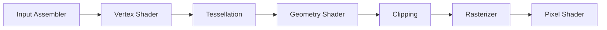
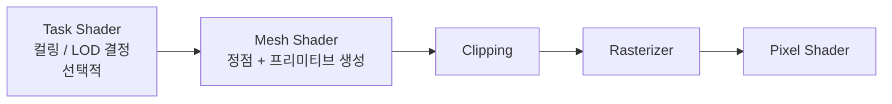
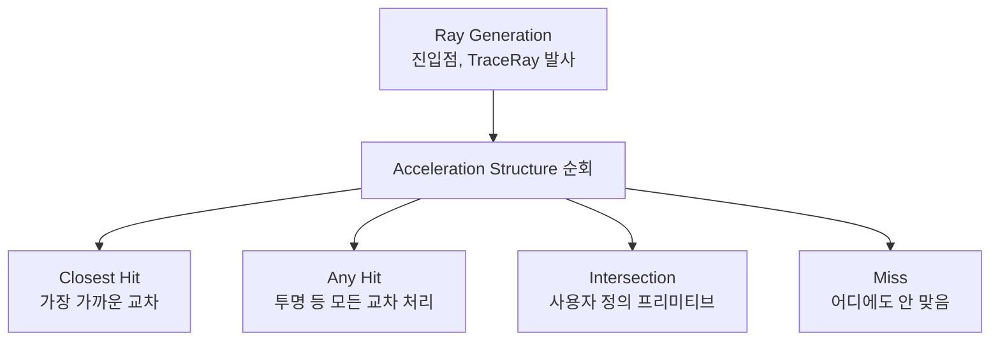
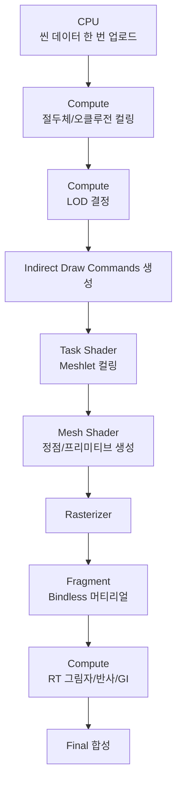

## 들어가며

> 이 글의 전제는 세 가지다. Mesh Shader는 입력 어셈블러·정점·테셀레이션·지오메트리 단계를 대체하고, Ray Tracing은 광선-장면 교차와 BVH(BLAS/TLAS) 가속 구조를 사용하며, GPU 주도 렌더링은 컴퓨트 컬링과 간접 드로우로 CPU 제출 비용을 줄인다. 이 글은 이 전제를 Vulkan API로 구현한다. 핵심은 Descriptor Indexing 기반 Bindless, Task/Mesh Shader와 meshlet 자료 구조, `VK_KHR_acceleration_structure`·`ray_tracing_pipeline`·`ray_query`, SBT 정렬 규칙이다.

전통적인 GPU 파이프라인은 30년에 걸쳐 굳어진 몇 가지 가정 위에 서 있다. 머티리얼이 바뀔 때마다 디스크립터 셋을 다시 바인딩하고, 정점은 인덱스 버퍼를 통해 입력 어셈블러로 들어가 정점 셰이더에 공급되며, 광선이 만들어내는 시각 효과는 래스터화로 근사된다. 이 세 가정은 오랫동안 의심받지 않았다. 드로우 콜이 수백 개 수준이고, 정점이 수십만 개 수준이며, 그림자와 반사가 화면 공간 트릭으로 충분히 그럴듯했기 때문이다.

세 기술군은 서로 다른 가정을 바꾼다. Bindless는 많은 자원을 인덱스로 선택해 디스크립터 재바인딩을 줄인다. Mesh Shader는 고정 입력 어셈블리와 전통적인 정점 전처리 대신 작은 메시 클러스터를 GPU에서 생성·컬링하는 모델을 제공한다. Ray Tracing은 BVH 위의 광선 교차 질의를 프로그래밍 모델로 노출해 그림자·반사·간접광을 다른 오차와 비용 구조로 계산한다. 유한한 광선 수, 제한된 바운스, 디노이징을 쓰므로 “근사가 사라지는” 것은 아니다. Bindless와 Mesh Shader의 주된 동기는 제출·가시성·지오메트리 처리이고, Ray Tracing의 주된 동기는 빛 전달과 가시성 질의의 표현력이다.

여기까지의 코드는 모델 로딩, PBR(Physically Based Rendering), IBL(Image-Based Lighting), CSM(Cascaded Shadow Maps), GPU 컴퓨트 파티클까지 동작한다. 전통적 래스터 그래픽스와 일반 컴퓨트의 완성형 토대다. 이 글에서 도달할 결과물은 그 토대 위에서 세 기술군이 파이프라인을 어떻게 다시 짜는지를 정확한 Vulkan API 수준에서 정리한 것이다. Bindless 디스크립터 배열을 만들어 단일 셋으로 모든 텍스처를 노출하고, Mesh Shader로 정점 버퍼 없이 메시를 생성하며, Acceleration Structure를 빌드해 광선을 쏘는 데까지를 다룬다.


---

## 목차
1. [세 기술이 깨는 가정](#1-세-기술이-깨는-가정)
2. [Bindless 디스크립터](#2-bindless-디스크립터)
3. [Descriptor Indexing 확장](#3-descriptor-indexing-확장)
4. [Mesh Shader의 새 두 단계](#4-mesh-shader의-새-두-단계)
5. [Meshlet 자료 구조](#5-meshlet-자료-구조)
6. [Vulkan Ray Tracing 개요](#6-vulkan-ray-tracing-개요)
7. [Acceleration Structure 빌드](#7-acceleration-structure-빌드)
8. [Ray Tracing Pipeline과 SBT](#8-ray-tracing-pipeline과-sbt)
9. [세 기술의 조합 시나리오](#9-세-기술의-조합-시나리오)


---

## 1. 세 기술이 깨는 가정

세 기술이 각각 어떤 전통적 가정을 깨고, 그 결과 무엇이 달라지는지를 먼저 표로 정리한다.

| 가정 | 깨는 기술 | 달라지는 점 |
|---|---|---|
| 머티리얼 변경 시 디스크립터 재바인딩 | Bindless | 드로우 콜당 CPU 비용 감소 |
| 정점은 입력 어셈블러 + 정점 셰이더로만 진입 | Mesh Shader | GPU 측 컬링과 메시 생성을 한 단계로 통합 |
| 광선 효과는 래스터로 근사 | Ray Tracing | 광선을 1차 시각화 도구로 사용 |

세 기술은 기능 요구와 하드웨어 지원에 따라 독립적으로 도입한다. Bindless와 Mesh Shader는 GPU 주도 렌더링에서 결합하기 쉽지만 Ray Tracing은 별도의 가속 구조 빌드·업데이트와 셰이딩 비용을 추가한다. 셋을 한 묶음으로 도입해야 할 기술적 의무는 없다.

### 공통의 병목: CPU 측 드로우 콜 비용

CPU 제출 비용은 Bindless와 GPU 주도 지오메트리의 중요한 동기다. 그러나 명령 하나의 비용을 고정된 나노초·마이크로초로 둘 수는 없다. 드라이버, 검증 레이어, 명령 버퍼 재사용, 상태 정렬, 스레드 수에 따라 달라진다. CPU 프로파일에서 명령 기록·정렬·culling·descriptor 갱신을 분리하고, 드로우 수를 늘린 확장성 곡선으로 병목을 확인해야 한다. Ray Tracing의 채택 여부는 이 CPU 곡선보다 BVH 빌드, 광선 발산, 메모리 대역폭, 화질 목표로 판단한다.

전통적 접근은 인스턴싱과 배칭으로 드로우 콜 수를 줄였다. 그러나 머티리얼이 다르면 배칭할 수 없고, 메시가 동적으로 생성되면 인스턴싱이 어렵다. Bindless는 머티리얼 차이로 인한 재바인딩을, Mesh Shader는 정점 처리 단계의 고정 기능 오버헤드를, Ray Tracing은 다중 패스 누적 비용을 각각 줄인다.

### 가시성 문제의 이전

세 기술 중 Mesh Shader와 Ray Tracing은 가시성 판정(visibility)을 어디서 하느냐의 문제이기도 하다. 전통적 파이프라인에서 CPU는 어떤 객체를 그릴지 절두체 컬링(frustum culling)으로 결정한 뒤 드로우 콜을 발급한다. 컬링 단위는 객체 하나, 즉 수천에서 수만 정점 덩어리다.

Mesh Shader는 메시를 구현 한도 안의 작은 meshlet으로 나눠 GPU에서 컬링·증폭 여부를 판정한다. 64 정점은 흔한 자산 구축 설정일 뿐 API의 고정 단위가 아니다. Ray Tracing은 광선마다 BVH를 순회해 가장 가까운 교차나 임의 교차를 질의한다. 래스터와 다른 가시성 순서를 쓰지만, 교차하지 않은 후보의 BVH 순회 비용과 발산이 사라지는 것은 아니다. 두 기술 모두 GPU에서 더 많은 가시성 결정을 수행할 수 있으나 사용하는 자료구조와 성능 모델은 다르다.

## 2. Bindless 디스크립터

### 전통적 모델의 비용

전통적 Vulkan 렌더링에서 머티리얼이 다른 메시를 그리려면 머티리얼마다 디스크립터 셋을 따로 만들고, 드로우 콜 직전에 그 셋을 바인딩한다.

```cpp
// 머티리얼 N 종마다 별도 디스크립터 셋
for (auto& mesh : model.meshes) {
    vkCmdBindDescriptorSets(cmd, VK_PIPELINE_BIND_POINT_GRAPHICS,
                            layout, 1, 1,
                            &materialSets[mesh.materialIdx], 0, nullptr);
    vkCmdDrawIndexed(cmd, mesh.indexCount, 1, 0, 0, 0);
}
```

메시가 M개면 머티리얼 종류 수와 무관하게 M번의 디스크립터 바인딩이 일어난다. 각 `vkCmdBindDescriptorSets`는 드라이버가 셰이더가 참조할 리소스 테이블을 갱신하도록 명령 버퍼에 기록하므로, 비용이 무시할 수 없다. 더 큰 문제는 이 패턴이 명령 버퍼를 정렬된 상태 변경의 연속으로 만든다는 데 있다. 드로우 순서를 머티리얼별로 정렬해 재바인딩을 줄이는 최적화가 필요하고, 이 정렬 자체가 CPU 부담이 된다.

### Bindless 모델

Bindless는 모든 텍스처를 하나의 거대한 디스크립터 배열에 넣고, 프레임 시작에 그 배열을 단 한 번 바인딩한다. 드로우 콜에서는 머티리얼을 가리키는 정수 인덱스만 push constant로 넘긴다.

```cpp
// 모든 텍스처를 단일 큰 배열로 묶어 한 번만 바인딩
vkCmdBindDescriptorSets(cmd, VK_PIPELINE_BIND_POINT_GRAPHICS,
                        layout, 0, 1, &globalBindlessSet, 0, nullptr);

for (auto& mesh : model.meshes) {
    uint32_t materialIdx = mesh.materialIdx;
    vkCmdPushConstants(cmd, layout, VK_SHADER_STAGE_FRAGMENT_BIT,
                       0, sizeof(uint32_t), &materialIdx);
    vkCmdDrawIndexed(cmd, mesh.indexCount, 1, 0, 0, 0);
}
```

디스크립터 바인딩은 프레임당 한 번이고, 드로우마다 드는 비용은 push constant 4바이트 기록뿐이다. push constant는 명령 버퍼 안에 인라인으로 들어가 별도 메모리 동기화가 필요 없으므로 가장 싼 데이터 전달 경로다. CPU 측 비용이 줄고, 드로우 순서를 머티리얼로 정렬할 필요도 사라진다.

### Indirect Draw와의 결합

Bindless의 진가는 indirect draw와 결합할 때 드러난다. 드로우 콜 목록 전체를 GPU 버퍼에 미리 채워 두고, CPU는 그 버퍼를 가리키는 명령 하나만 발급한다.

```cpp
// CPU는 드로우 콜 묶음을 가리키는 명령 하나만 기록
vkCmdDrawIndexedIndirect(cmd, drawCommandBuffer, 0,
                         numMeshes,
                         sizeof(VkDrawIndexedIndirectCommand));
```

`VkDrawIndexedIndirectCommand`의 `firstInstance` 필드를 머티리얼 인덱스 전달 통로로 활용하는 기법이 널리 쓰인다. 셰이더에서 `gl_InstanceIndex`로 그 값을 읽어 Bindless 배열을 인덱싱하면, push constant 없이도 메시별 머티리얼을 고를 수 있다. CPU가 드로우 콜을 발급하는 횟수는 1회로 고정되고, 실제 N개의 메시를 그리는 일은 GPU가 스스로 한다. GPU-Driven Rendering의 토대가 이 결합이다.

drawCommandBuffer 자체를 컴퓨트 셰이더가 채우게 하면 컬링과 LOD 결정까지 GPU로 옮길 수 있다. 절두체에 들어오는 메시만 골라 명령 버퍼에 기록하고, 그 개수를 `vkCmdDrawIndexedIndirectCount`로 넘기면 CPU는 씬 전체에 대해 단 한 번의 명령만 발급한다.

## 3. Descriptor Indexing 확장

Bindless를 Vulkan에서 실현하려면 가변 크기 디스크립터 배열과 비균일 인덱싱을 허용하는 기능을 켜야 한다. 이 기능은 Descriptor Indexing 확장이 제공한다.

### 기능 활성화

```cpp
VkPhysicalDeviceDescriptorIndexingFeatures di{};
di.sType = VK_STRUCTURE_TYPE_PHYSICAL_DEVICE_DESCRIPTOR_INDEXING_FEATURES;
di.runtimeDescriptorArray = VK_TRUE;
di.descriptorBindingPartiallyBound = VK_TRUE;
di.descriptorBindingVariableDescriptorCount = VK_TRUE;
di.shaderSampledImageArrayNonUniformIndexing = VK_TRUE;
di.descriptorBindingSampledImageUpdateAfterBind = VK_TRUE;

VkPhysicalDeviceFeatures2 features{};
features.sType = VK_STRUCTURE_TYPE_PHYSICAL_DEVICE_FEATURES_2;
features.pNext = &di;
// vkCreateDevice 시 pCreateInfo.pNext 에 features 를 연결한다
```

각 플래그의 의미가 다르다. `runtimeDescriptorArray`는 셰이더에서 크기가 명시되지 않은 배열(`textures[]`)을 선언하도록 허용한다. `descriptorBindingPartiallyBound`는 배열의 일부 슬롯만 유효한 디스크립터를 가져도 되도록 한다. 슬롯 10만 개를 선언해도 실제로 1,000개만 채우고 나머지는 비워 둘 수 있다는 뜻이다. `descriptorBindingVariableDescriptorCount`는 셋 할당 시점에 배열 크기를 동적으로 정하게 한다. `shaderSampledImageArrayNonUniformIndexing`은 워프 안에서 스레드마다 다른 인덱스로 배열에 접근하는 비균일 인덱싱을 허용한다.

이 묶음은 Vulkan 1.2부터 코어 기능으로 승격되어 별도 확장 활성화 없이 `VkPhysicalDeviceVulkan12Features`로 켤 수 있다. Vulkan 1.0/1.1만 지원하는 일부 모바일 GPU에서는 `VK_EXT_descriptor_indexing` 확장을 명시적으로 활성화해야 한다. 활성화 전에 `vkGetPhysicalDeviceFeatures2`로 각 플래그가 지원되는지 조회하지 않으면, 미지원 GPU에서 디바이스 생성이 실패한다.

### 디스크립터 풀 설정

Bindless 풀은 큰 디스크립터 수를 한 셋에 담을 수 있어야 하고, 바인딩 이후 갱신을 허용해야 한다.

```cpp
VkDescriptorPoolSize poolSize{};
poolSize.type = VK_DESCRIPTOR_TYPE_COMBINED_IMAGE_SAMPLER;
poolSize.descriptorCount = 100000;     // 상한을 넉넉히 잡는다

VkDescriptorPoolCreateInfo pi{};
pi.sType = VK_STRUCTURE_TYPE_DESCRIPTOR_POOL_CREATE_INFO;
pi.flags = VK_DESCRIPTOR_POOL_CREATE_UPDATE_AFTER_BIND_BIT;
pi.maxSets = 1;
pi.poolSizeCount = 1;
pi.pPoolSizes = &poolSize;

vkCreateDescriptorPool(device, &pi, nullptr, &bindlessPool);
```

상한 100,000은 임의의 큰 값이다. 실제 상한은 `VkPhysicalDeviceDescriptorIndexingProperties::maxDescriptorSetUpdateAfterBindSampledImages`로 조회해야 하며, 데스크톱 GPU에서는 보통 백만 단위, 일부 구형이나 모바일에서는 수십만 수준으로 제한된다. 조회 없이 하드코딩하면 특정 하드웨어에서 풀 생성이 실패할 수 있다.

### 무한 배열 디스크립터 레이아웃

```cpp
VkDescriptorSetLayoutBinding b{};
b.binding = 0;
b.descriptorType = VK_DESCRIPTOR_TYPE_COMBINED_IMAGE_SAMPLER;
b.descriptorCount = 100000;            // 배열 상한
b.stageFlags = VK_SHADER_STAGE_FRAGMENT_BIT;

VkDescriptorBindingFlags flags =
    VK_DESCRIPTOR_BINDING_PARTIALLY_BOUND_BIT |
    VK_DESCRIPTOR_BINDING_VARIABLE_DESCRIPTOR_COUNT_BIT |
    VK_DESCRIPTOR_BINDING_UPDATE_AFTER_BIND_BIT;

VkDescriptorSetLayoutBindingFlagsCreateInfo bfi{};
bfi.sType = VK_STRUCTURE_TYPE_DESCRIPTOR_SET_LAYOUT_BINDING_FLAGS_CREATE_INFO;
bfi.bindingCount = 1;
bfi.pBindingFlags = &flags;

VkDescriptorSetLayoutCreateInfo li{};
li.sType = VK_STRUCTURE_TYPE_DESCRIPTOR_SET_LAYOUT_CREATE_INFO;
li.flags = VK_DESCRIPTOR_SET_LAYOUT_CREATE_UPDATE_AFTER_BIND_POOL_BIT;
li.bindingCount = 1;
li.pBindings = &b;
li.pNext = &bfi;

vkCreateDescriptorSetLayout(device, &li, nullptr, &bindlessLayout);
```

`pBindingFlags` 배열은 `pBindings`와 길이가 같아야 하고, 인덱스로 1:1 대응한다. 가변 카운트 플래그를 가진 바인딩은 레이아웃 안에서 마지막 바인딩이어야 한다는 제약이 있다. 이 규칙을 어기면 검증 레이어가 `VUID-VkDescriptorSetLayoutBindingFlagsCreateInfo` 계열 오류를 보고한다.

### 셰이더 측의 nonuniformEXT

Bindless 셰이더에서 핵심은 인덱스가 워프 안에서 균일하지 않을 수 있다는 점을 드라이버에 알리는 일이다.

```glsl
#version 450
#extension GL_EXT_nonuniform_qualifier : require

layout(set = 0, binding = 0) uniform sampler2D textures[];

layout(push_constant) uniform Push {
    uint materialIndex;
} pc;

layout(location = 0) in vec2 vUv;
layout(location = 0) out vec4 fragColor;

void main() {
    // 인덱스가 워프 내에서 균일하지 않을 수 있음을 명시한다
    fragColor = texture(textures[nonuniformEXT(pc.materialIndex)], vUv);
}
```

`nonuniformEXT`가 왜 필요한지는 GPU의 실행 모델을 보면 분명해진다. GPU는 32 또는 64개 스레드를 하나의 워프(또는 웨이브프론트)로 묶어 SIMD 방식으로 동시에 실행한다. 워프 안의 모든 스레드가 같은 텍스처 인덱스를 쓴다면 드라이버는 디스크립터를 한 번만 읽으면 된다. 이를 균일(uniform) 접근이라 부른다.

그런데 Bindless에서는 같은 서브그룹 안의 서로 다른 픽셀이 서로 다른 머티리얼, 즉 서로 다른 인덱스를 가질 수 있다. 디스크립터 배열을 동적으로 비균일 인덱싱할 때 필요한 기능과 한정자를 빠뜨리면 동작은 미정의가 될 수 있다. `nonuniformEXT`는 해당 값이 서브그룹 안에서 서로 다를 수 있음을 컴파일러에 알리고 올바른 descriptor indexing 코드를 생성하게 한다. 구현이 이를 직렬화할지, 여러 요청으로 나눌지, 하드웨어가 직접 처리할지는 GPU와 드라이버의 선택이며 비균일 접근은 균일 접근보다 비쌀 수 있다.

### Update After Bind

전통적 디스크립터는 명령 버퍼가 그 셋을 참조하는 동안 갱신할 수 없다. Bindless는 `UPDATE_AFTER_BIND` 플래그 덕분에 바인딩 이후에도 슬롯을 갱신할 수 있다. 프레임 도중 새 텍스처를 비동기 스트리밍으로 올리고, 다 올라온 슬롯만 갱신하는 패턴이 가능해진다.

```cpp
VkWriteDescriptorSet write{};
write.sType = VK_STRUCTURE_TYPE_WRITE_DESCRIPTOR_SET;
write.dstSet = bindlessSet;
write.dstBinding = 0;
write.dstArrayElement = 42;       // 슬롯 42만 갱신한다
write.descriptorType = VK_DESCRIPTOR_TYPE_COMBINED_IMAGE_SAMPLER;
write.descriptorCount = 1;
write.pImageInfo = &imageInfo;

vkUpdateDescriptorSets(device, 1, &write, 0, nullptr);
```

다만 갱신하려는 슬롯이 현재 GPU가 실행 중인 명령에서 읽히고 있지 않아야 한다. 스트리밍 슬롯과 사용 중 슬롯을 분리하거나, 프레임 펜스로 이전 프레임의 완료를 보장한 뒤 갱신하는 식의 동기화가 필요하다. 이 동기화를 빼면 GPU가 읽는 중인 디스크립터를 덮어써 표면이 깜빡이거나 잘못된 텍스처가 한 프레임 노출되는 결함이 생긴다.

## 4. Mesh Shader의 새 두 단계

### 전통적 파이프라인의 한계

전통적 정점 처리 파이프라인은 다음 순서로 흐른다.



입력 어셈블러는 정점 버퍼와 인덱스 버퍼를 읽어 정점들을 정점 셰이더에 공급하는 고정 기능 하드웨어다. 이 단계는 정점 페치(vertex fetch)와 후처리 변환 캐시(post-transform cache) 관리를 담당한다. 고정 기능이라 유연성이 떨어지고, 특히 메시가 수만 개의 미세 조각으로 쪼개져 있으면 입력 어셈블러의 인덱스 페치 오버헤드가 누적된다.

또 하나의 한계는 컬링 단위다. 정점 셰이더는 정점 하나씩 변환할 뿐, 그 정점이 속한 삼각형 덩어리가 화면 밖에 있는지 미리 알 수 없다. 절두체 밖이거나 뒷면이라 결국 버려질 정점도 일단 변환 비용을 치른다.

### Mesh Shader 파이프라인

Mesh Shader는 입력 어셈블러부터 지오메트리 셰이더까지의 앞단을 두 개의 새 컴퓨트형 단계로 대체한다.



Task Shader(앰플리피케이션 셰이더라고도 한다)는 선택적이다. GPU 측에서 클러스터 단위로 컬링과 LOD 결정을 수행하고, 살아남은 작업만 Mesh Shader에 분배한다. Mesh Shader는 정점 버퍼 입력 없이 셰이더 코드가 직접 정점과 프리미티브를 생성한다. 두 단계 모두 컴퓨트 셰이더처럼 워크그룹 단위로 동작하므로, 공유 메모리와 워크그룹 내 협력 계산을 쓸 수 있다.

### Mesh Shader 예제

Mesh Shader는 워크그룹 하나가 메시릿(meshlet) 하나를 처리한다. `SetMeshOutputsEXT`로 출력 개수를 먼저 선언한 뒤, 정점을 생성해 클립 공간 위치를 쓰고 삼각형 인덱스를 출력한다.

```glsl
#version 460
#extension GL_EXT_mesh_shader : require

layout(local_size_x = 32) in;
layout(triangles, max_vertices = 64, max_primitives = 124) out;

layout(location = 0) out vec3 outNormal[];
layout(location = 1) out vec2 outUv[];

void main() {
    uint tid = gl_LocalInvocationID.x;
    uint meshletIdx = gl_WorkGroupID.x;
    Meshlet m = meshlets[meshletIdx];

    SetMeshOutputsEXT(m.vertexCount, m.primitiveCount);

    // 32 스레드가 최대 64 정점을 처리하므로 한 스레드가 2개를 담당
    for (uint i = tid; i < m.vertexCount; i += 32) {
        Vertex v = vertices[m.vertexOffset + i];
        gl_MeshVerticesEXT[i].gl_Position = viewProj * vec4(v.pos, 1.0);
        outNormal[i] = v.normal;
        outUv[i]     = v.uv;
    }

    // 프리미티브(삼각형) 인덱스 생성
    for (uint i = tid; i < m.primitiveCount; i += 32) {
        gl_PrimitiveTriangleIndicesEXT[i] = uvec3(
            localIndices[m.indexOffset + i * 3 + 0],
            localIndices[m.indexOffset + i * 3 + 1],
            localIndices[m.indexOffset + i * 3 + 2]);
    }
}
```

`SetMeshOutputsEXT`는 워크그룹이 출력할 정점 수와 프리미티브 수를 가장 먼저 선언해야 한다. 이 호출 이후에 `gl_MeshVerticesEXT`와 `gl_PrimitiveTriangleIndicesEXT` 배열에 쓴다. 두 배열의 크기는 `max_vertices`, `max_primitives`로 컴파일 타임에 고정되며, 실제 출력은 선언한 개수까지만 유효하다.

루프가 `i += 32`로 진행하는 이유는 워크그룹이 32 스레드인데 정점이 최대 64개이기 때문이다. 한 스레드가 정점 두 개를 처리하는 식으로 모든 정점을 덮는다. 워크그룹 크기와 출력 개수의 관계를 잘못 잡으면 일부 정점이 초기화되지 않은 채 래스터화되어 화면에 깨진 삼각형이 나타난다.

삼각형 인덱스가 `uvec3`로 표현되며 메시릿 안의 로컬 정점 번호(0~63)를 가리킨다는 점이 중요하다. 전역 정점 배열의 인덱스가 아니라 이번 워크그룹이 출력한 정점들의 로컬 번호다. 이 구분을 놓치면 인덱스가 범위를 벗어나 미정의 동작이 된다.

### Task Shader: GPU 측 컬링

Task Shader는 메시릿 단위로 가시성을 판정해 보이는 것만 Mesh Shader로 넘긴다.

```glsl
#version 460
#extension GL_EXT_mesh_shader : require

layout(local_size_x = 32) in;

taskPayloadSharedEXT struct {
    uint meshletIndices[32];
} payload;

shared uint visibleCount;

void main() {
    uint id = gl_GlobalInvocationID.x;
    if (gl_LocalInvocationID.x == 0) visibleCount = 0;
    barrier();

    bool visible = false;
    if (id < meshletCount) {
        Meshlet m = meshlets[id];
        visible = FrustumCheck(m.center, m.radius)
               && !BackfaceCone(m.coneAxis, m.coneCutoff);
    }

    if (visible) {
        uint slot = atomicAdd(visibleCount, 1);
        payload.meshletIndices[slot] = id;
    }
    barrier();

    // 모든 invocation이 uniform control flow에서 정확히 한 번 호출한다.
    // 인자는 첫 invocation의 값이 사용된다.
    EmitMeshTasksEXT(visibleCount, 1, 1);  // 살아남은 수만큼 Mesh 워크그룹 발급
}
```

흐름은 다음과 같다. 이 예제의 local size가 32이므로 CPU는 `ceil(meshletCount / 32)`개의 Task Shader 워크그룹을 dispatch한다. 마지막 워크그룹의 남는 invocation은 `id < meshletCount` 검사로 거른다. Task Shader가 메시릿 단위로 절두체 컬링과 백페이스 콘 컬링을 수행하고, 살아남은 메시릿 인덱스를 페이로드에 모은다. `EmitMeshTasksEXT`가 살아남은 개수만큼 Mesh Shader 워크그룹을 발급하고, 페이로드를 통해 어떤 메시릿을 그릴지 전달한다.

이 구조의 효과는 정량적으로 크다. 수천만 폴리곤 씬에서 실제 화면에 보이는 폴리곤은 픽셀 수에 가깝게 수렴하므로, 절두체 밖이나 뒷면 메시릿을 GPU에서 일찍 버리면 정점 변환과 래스터화 비용이 화면 해상도에 비례하는 수준으로 줄어든다. CPU는 dispatch 한 번만 하면 되므로 드로우 콜 비용도 사라진다.

`EmitMeshTasksEXT`는 워크그룹의 *모든 invocation* 이 uniform control flow에서 정확히 한 번 호출해야 한다. 인자는 첫 invocation의 값이 사용되고 호출 자체가 `barrier()`를 암시한다. 대표 스레드만 조건부로 호출하면 미정의 동작이다. 위 코드의 앞선 배리어는 `visibleCount`와 페이로드 집계가 끝난 뒤 모든 invocation이 같은 호출 지점으로 오게 한다.

## 5. Meshlet 자료 구조

### Meshlet 정의

메시릿은 메시를 작은 클러스터로 쪼갠 단위다. 각 메시릿은 자신이 참조할 정점 범위, 프리미티브 범위, 그리고 컬링에 쓸 경계 정보를 담는다.

```cpp
struct Meshlet {
    uint32_t vertexOffset;     // 전역 정점 배열에서의 시작 위치
    uint32_t vertexCount;      // 0~64
    uint32_t indexOffset;      // 로컬 인덱스 배열에서의 시작 위치
    uint32_t primitiveCount;   // 0~124
    // 컬링 데이터
    float    center[3];        // bounding sphere 중심
    float    radius;           // bounding sphere 반지름
    int8_t   coneAxis[3];      // backface cone 축 (양자화)
    int8_t   coneCutoff;       // backface cone 임계값 (양자화)
};
```

64 정점과 124 프리미티브라는 한계가 자주 보이는 이유는 Mesh Shader 명세의 권장이 아니라 NVIDIA 의 하드웨어 가이드(64 정점·126 프리미티브)와 meshoptimizer 의 관례가 이 근처를 쓰기 때문이다. 정점 수를 64로 잡으면 인덱스를 8비트로 표현할 수 있어 메모리가 절약되고, 워크그룹 단위 처리가 캐시에 잘 들어맞는다. 프리미티브 수 124는 meshoptimizer v0.25 이하가 `max_triangles` 를 4의 배수로 요구했기 때문에 NVIDIA 권장값 126 대신 쓰이던 값이고, 정점 대비 적당한 삼각형 밀도를 고려한 값이다. 정확한 최적 값은 하드웨어마다 다르므로, `VkPhysicalDeviceMeshShaderPropertiesEXT`의 `maxMeshOutputVertices`와 `maxMeshOutputPrimitives`로 상한을 조회해 맞춘다.

### meshoptimizer 라이브러리

메시를 메시릿으로 분할하는 작업은 직접 구현하기보다 검증된 도구를 쓴다. Arseny Kapoulkine의 [meshoptimizer](https://github.com/zeux/meshoptimizer)가 사실상 표준이다.

```cpp
const size_t maxVertices = 64;
const size_t maxTriangles = 124;
size_t maxMeshlets =
    meshopt_buildMeshletsBound(indexCount, maxVertices, maxTriangles);

std::vector<meshopt_Meshlet> meshlets(maxMeshlets);
std::vector<unsigned int>    meshletVertices(maxMeshlets * maxVertices);
std::vector<unsigned char>   meshletTriangles(maxMeshlets * maxTriangles * 3);

size_t count = meshopt_buildMeshlets(
    meshlets.data(), meshletVertices.data(), meshletTriangles.data(),
    indices.data(), indexCount,
    &vertices[0].pos.x, vertexCount, sizeof(Vertex),
    maxVertices, maxTriangles, /* cone_weight */ 0.5f);

meshlets.resize(count);
```

`meshopt_buildMeshletsBound`는 분할 결과 메시릿 수의 상한을 미리 알려 주어 버퍼를 한 번에 할당하게 한다. 마지막 인자 `cone_weight`는 분할 시 공간 지역성과 법선 방향 정렬 사이의 가중치다. 0이면 순수하게 공간적으로 가까운 정점을 묶고, 1에 가까울수록 법선 방향이 비슷한 정점을 묶어 백페이스 콘 컬링이 더 잘 들도록 한다. 0.5는 균형점으로 흔히 쓰이는 값이다.

### 컬링 데이터 계산

각 메시릿의 경계 구와 백페이스 콘은 같은 라이브러리로 계산한다.

```cpp
meshopt_Bounds bounds = meshopt_computeMeshletBounds(
    &meshletVertices[meshlets[i].vertex_offset],
    &meshletTriangles[meshlets[i].triangle_offset],
    meshlets[i].triangle_count,
    &vertices[0].pos.x, vertexCount, sizeof(Vertex));

// bounds.center, bounds.radius        -> 절두체 컬링
// bounds.cone_axis[3], bounds.cone_cutoff -> 백페이스 콘 컬링
```

경계 구는 절두체 컬링에 쓴다. 구의 중심과 반지름을 절두체 여섯 평면과 비교해 완전히 바깥이면 버린다. 백페이스 콘은 메시릿 전체가 카메라를 등지고 있는지 판정하는 도구다. 메시릿 안 삼각형들의 법선이 좁은 원뿔 안에 모여 있을 때, 그 원뿔이 시선 방향과 같은 쪽을 향하면 메시릿 전체가 뒷면이므로 통째로 버린다. 콘 축과 컷오프를 8비트로 양자화해 저장하는 이유는 메시릿당 메모리를 최소화하기 위해서다. 콘 컬링은 보수적이라 일부 뒷면을 놓칠 수 있지만, 메시릿 단위로 빠르게 거르는 게 목적이므로 정확도보다 속도를 택한다.

GPU는 프레임마다 수만에서 수십만 개의 메시릿을 검사하고, 통과한 것만 그린다. 이 검사 자체가 Task Shader에서 병렬로 일어나므로 CPU 부담이 없다.

## 6. Vulkan Ray Tracing 개요

### 세 핵심 확장

Vulkan의 하드웨어 레이 트레이싱은 세 개의 확장으로 구성된다.

| 확장 | 역할 |
|---|---|
| `VK_KHR_acceleration_structure` | BVH 빌드와 갱신 |
| `VK_KHR_ray_tracing_pipeline` | 레이 트레이싱 파이프라인과 Shader Binding Table |
| `VK_KHR_ray_query` | 컴퓨트나 프래그먼트 셰이더 안에서의 인라인 레이 트레이싱 |

이 API는 DirectX Raytracing(DXR)과 거의 1:1로 대응한다. 개념과 셰이더 단계 구성이 같고, SPIR-V로 컴파일되는 셰이더 작성 방식만 다르다. 한쪽을 익히면 다른 쪽으로 옮기기 쉽다.

### 기능 활성화

세 확장은 모두 `VK_KHR_buffer_device_address`를 전제로 한다. Acceleration Structure가 정점·인덱스 버퍼를 디바이스 주소로 참조하기 때문이다. feature 체인을 정확히 연결해야 한다.

```cpp
VkPhysicalDeviceAccelerationStructureFeaturesKHR asFeat{};
asFeat.sType = VK_STRUCTURE_TYPE_PHYSICAL_DEVICE_ACCELERATION_STRUCTURE_FEATURES_KHR;
asFeat.accelerationStructure = VK_TRUE;

VkPhysicalDeviceRayTracingPipelineFeaturesKHR rtpFeat{};
rtpFeat.sType = VK_STRUCTURE_TYPE_PHYSICAL_DEVICE_RAY_TRACING_PIPELINE_FEATURES_KHR;
rtpFeat.rayTracingPipeline = VK_TRUE;
rtpFeat.pNext = &asFeat;

VkPhysicalDeviceBufferDeviceAddressFeatures bdaFeat{};
bdaFeat.sType = VK_STRUCTURE_TYPE_PHYSICAL_DEVICE_BUFFER_DEVICE_ADDRESS_FEATURES;
bdaFeat.bufferDeviceAddress = VK_TRUE;
bdaFeat.pNext = &rtpFeat;

VkPhysicalDeviceFeatures2 features{};
features.sType = VK_STRUCTURE_TYPE_PHYSICAL_DEVICE_FEATURES_2;
features.pNext = &bdaFeat;
// vkCreateDevice 시 pCreateInfo.pNext = &features
```

세 feature 구조체를 pNext 체인으로 엮고, 그 체인의 머리를 `VkPhysicalDeviceFeatures2`에 건다. 체인 순서 자체는 무관하지만, 각 구조체의 `sType`을 정확히 채워야 드라이버가 어떤 구조체인지 식별한다. 이 채우기를 빠뜨리면 디바이스 생성이 조용히 기능을 무시하거나 실패한다.

### 셰이더 단계

레이 트레이싱 파이프라인은 그래픽스 파이프라인과 전혀 다른 셰이더 단계 집합을 쓴다.



Ray Generation 셰이더가 진입점이다. 픽셀마다 한 번씩 호출되어 카메라에서 광선을 만들어 `traceRayEXT`로 발사한다. 발사된 광선은 Acceleration Structure를 순회하며 교차를 찾는다. 가장 가까운 교차가 확정되면 Closest Hit 셰이더가 그 표면의 셰이딩을 계산한다. Any Hit는 교차가 발견될 때마다 호출되어 투명 표면을 통과시킬지 결정한다. Intersection은 삼각형이 아닌 사용자 정의 프리미티브(구, 복셀 등)의 교차 판정을 직접 구현할 때만 쓴다. 광선이 어떤 표면에도 닿지 않으면 Miss 셰이더가 호출되어 배경색이나 환경 맵을 반환한다.

## 7. Acceleration Structure 빌드

Acceleration Structure는 광선과 표면의 교차를 빠르게 찾기 위한 공간 분할 자료 구조, 즉 BVH다. 두 단계로 나뉜다. BLAS(Bottom-Level Acceleration Structure)는 메시 하나의 삼각형들을 담는 BVH이고, TLAS(Top-Level Acceleration Structure)는 여러 BLAS 인스턴스를 변환 행렬과 함께 묶는 상위 트리다.

### BLAS 지오메트리 기술

BLAS는 정점 버퍼와 인덱스 버퍼를 디바이스 주소로 참조해 삼각형 지오메트리를 기술한다.

```cpp
VkAccelerationStructureGeometryTrianglesDataKHR tri{};
tri.sType = VK_STRUCTURE_TYPE_ACCELERATION_STRUCTURE_GEOMETRY_TRIANGLES_DATA_KHR;
tri.vertexFormat = VK_FORMAT_R32G32B32_SFLOAT;
tri.vertexData.deviceAddress = vertexBufferAddress;
tri.vertexStride = sizeof(Vertex);
tri.maxVertex = vertexCount - 1;
tri.indexType = VK_INDEX_TYPE_UINT32;
tri.indexData.deviceAddress = indexBufferAddress;

VkAccelerationStructureGeometryKHR geom{};
geom.sType = VK_STRUCTURE_TYPE_ACCELERATION_STRUCTURE_GEOMETRY_KHR;
geom.geometryType = VK_GEOMETRY_TYPE_TRIANGLES_KHR;
geom.flags = VK_GEOMETRY_OPAQUE_BIT_KHR;
geom.geometry.triangles = tri;

VkAccelerationStructureBuildGeometryInfoKHR buildInfo{};
buildInfo.sType = VK_STRUCTURE_TYPE_ACCELERATION_STRUCTURE_BUILD_GEOMETRY_INFO_KHR;
buildInfo.type = VK_ACCELERATION_STRUCTURE_TYPE_BOTTOM_LEVEL_KHR;
buildInfo.flags = VK_BUILD_ACCELERATION_STRUCTURE_PREFER_FAST_TRACE_BIT_KHR;
buildInfo.mode = VK_BUILD_ACCELERATION_STRUCTURE_MODE_BUILD_KHR;
buildInfo.geometryCount = 1;
buildInfo.pGeometries = &geom;
```

`VK_GEOMETRY_OPAQUE_BIT_KHR`은 이 지오메트리가 불투명이라 Any Hit 셰이더를 건너뛰어도 된다는 힌트다. 불투명 표면에 이 플래그를 주면 순회 비용이 줄어든다. 빌드 플래그 `PREFER_FAST_TRACE`는 순회 성능을 빌드 시간보다 우선하라는 뜻으로, 정적 지오메트리에 적합하다. 매 프레임 갱신되는 지오메트리에는 `PREFER_FAST_BUILD`나 `ALLOW_UPDATE`를 쓴다.

### Scratch Buffer

BLAS 빌드는 작업 메모리, 즉 scratch buffer를 요구한다. 이는 빌드 과정에서만 쓰이는 임시 GPU 메모리로, CPU와 GPU 사이의 staging 버퍼와는 다른 개념이다. 빌드가 끝나면 재사용하거나 해제할 수 있다.

```cpp
uint32_t primitiveCount = indexCount / 3;

VkAccelerationStructureBuildSizesInfoKHR sizes{};
sizes.sType = VK_STRUCTURE_TYPE_ACCELERATION_STRUCTURE_BUILD_SIZES_INFO_KHR;
vkGetAccelerationStructureBuildSizesKHR(device,
    VK_ACCELERATION_STRUCTURE_BUILD_TYPE_DEVICE_KHR,
    &buildInfo, &primitiveCount, &sizes);

// AS 버퍼와 scratch 버퍼를 모두 Device Local 로 할당한다
// AS 버퍼: usage 에 VK_BUFFER_USAGE_ACCELERATION_STRUCTURE_STORAGE_BIT_KHR
// scratch 버퍼: usage 에 VK_BUFFER_USAGE_STORAGE_BUFFER_BIT |
//               VK_BUFFER_USAGE_SHADER_DEVICE_ADDRESS_BIT
VkBuffer asBuffer;       // 크기: sizes.accelerationStructureSize
VkBuffer scratchBuffer;  // 크기: sizes.buildScratchSize
```

`vkGetAccelerationStructureBuildSizesKHR`는 AS 자체의 크기와 빌드에 필요한 scratch 크기를 한 번에 알려 준다. scratch 버퍼는 `VkPhysicalDeviceAccelerationStructurePropertiesKHR::minAccelerationStructureScratchOffsetAlignment`에 맞춰 정렬된 디바이스 주소를 가져야 한다. 이 정렬을 맞추지 않으면 빌드가 실패하거나 검증 레이어가 경고한다.

### BLAS 객체 생성과 빌드 명령

```cpp
VkAccelerationStructureCreateInfoKHR ci{};
ci.sType = VK_STRUCTURE_TYPE_ACCELERATION_STRUCTURE_CREATE_INFO_KHR;
ci.buffer = asBuffer;
ci.size = sizes.accelerationStructureSize;
ci.type = VK_ACCELERATION_STRUCTURE_TYPE_BOTTOM_LEVEL_KHR;

VkAccelerationStructureKHR blas;
vkCreateAccelerationStructureKHR(device, &ci, nullptr, &blas);

buildInfo.dstAccelerationStructure = blas;
buildInfo.scratchData.deviceAddress = scratchBufferAddress;

VkAccelerationStructureBuildRangeInfoKHR range{};
range.primitiveCount = primitiveCount;
range.primitiveOffset = 0;
range.firstVertex = 0;
const VkAccelerationStructureBuildRangeInfoKHR* pRange = &range;

vkCmdBuildAccelerationStructuresKHR(cmd, 1, &buildInfo, &pRange);
```

빌드 명령은 명령 버퍼에 기록되어 GPU에서 비동기로 실행된다. 빌드가 끝났는지 보장하려면 이후 TLAS 빌드나 광선 발사 전에 파이프라인 배리어로 동기화해야 한다. BLAS 쓰기와 TLAS의 BLAS 읽기 사이에는 `VK_ACCESS_ACCELERATION_STRUCTURE_WRITE_BIT_KHR`에서 `VK_ACCESS_ACCELERATION_STRUCTURE_READ_BIT_KHR`로의 메모리 배리어가 필요하다.

### TLAS: 인스턴스 트리

TLAS는 BLAS들을 인스턴스로 묶는다. 각 인스턴스는 변환 행렬, 마스크, SBT 오프셋, BLAS 참조 주소를 가진다.

```cpp
struct VkAccelerationStructureInstanceKHR {
    VkTransformMatrixKHR transform;                            // 3x4 행렬
    uint32_t            instanceCustomIndex : 24;              // 셰이더에서 읽을 ID
    uint32_t            mask : 8;                              // 광선 마스크
    uint32_t            instanceShaderBindingTableRecordOffset : 24;
    VkGeometryInstanceFlagsKHR flags : 8;
    uint64_t            accelerationStructureReference;        // BLAS 디바이스 주소
};
```

한 BLAS를 서로 다른 변환 행렬로 여러 번 참조하면, 같은 메시를 메모리 복제 없이 N개 인스턴스로 배치할 수 있다. 숲의 나무 수천 그루가 하나의 BLAS를 공유하는 식이다.

```cpp
std::vector<VkAccelerationStructureInstanceKHR> instances(N);
for (uint32_t i = 0; i < N; ++i) {
    instances[i].transform = ToTransformKHR(modelMatrices[i]);
    instances[i].instanceCustomIndex = i;
    instances[i].mask = 0xFF;   // mask & rayMask != 0 이어야 교차로 인정
    instances[i].instanceShaderBindingTableRecordOffset = 0;
    instances[i].flags =
        VK_GEOMETRY_INSTANCE_TRIANGLE_FACING_CULL_DISABLE_BIT_KHR;
    instances[i].accelerationStructureReference = blasDeviceAddress;
}
// 인스턴스 배열을 GPU 버퍼에 업로드한 뒤,
// type 을 VK_ACCELERATION_STRUCTURE_TYPE_TOP_LEVEL_KHR 로 두고
// BLAS 와 동일한 패턴으로 빌드한다
```

`mask`는 광선과 인스턴스의 선택적 교차를 제어한다. 광선을 쏠 때 지정하는 cull mask와 인스턴스의 mask를 AND 연산해 0이 아닐 때만 교차로 인정한다. 그림자 광선이 특정 객체를 무시하게 하거나, 카메라 광선과 그림자 광선이 서로 다른 지오메트리 집합을 보게 하는 데 쓴다. `instanceCustomIndex`는 셰이더에서 `gl_InstanceCustomIndexEXT`로 읽혀, 인스턴스별 머티리얼이나 변환 정보를 룩업하는 키가 된다.

## 8. Ray Tracing Pipeline과 SBT

### RT 파이프라인 생성

레이 트레이싱 파이프라인은 셰이더 단계들을 그룹으로 묶어 구성한다. 그룹은 세 종류다. General 그룹은 Ray Generation과 Miss를 담고, Hit 그룹은 Closest Hit·Any Hit·Intersection을 묶는다.

```cpp
std::vector<VkPipelineShaderStageCreateInfo> stages;
// 인덱스 0: RayGen, 1: Miss, 2: ClosestHit 셰이더를 stages 에 채운다

std::vector<VkRayTracingShaderGroupCreateInfoKHR> groups;

// Group 0 — RayGen (General)
groups.push_back({
    VK_STRUCTURE_TYPE_RAY_TRACING_SHADER_GROUP_CREATE_INFO_KHR, nullptr,
    VK_RAY_TRACING_SHADER_GROUP_TYPE_GENERAL_KHR,
    /* generalShader      */ 0,
    /* closestHitShader   */ VK_SHADER_UNUSED_KHR,
    /* anyHitShader       */ VK_SHADER_UNUSED_KHR,
    /* intersectionShader */ VK_SHADER_UNUSED_KHR, nullptr });

// Group 1 — Miss (General), generalShader = 1
groups.push_back({ /* ... general = 1, 나머지 UNUSED ... */ });

// Group 2 — Hit Group (closest hit only)
groups.push_back({
    VK_STRUCTURE_TYPE_RAY_TRACING_SHADER_GROUP_CREATE_INFO_KHR, nullptr,
    VK_RAY_TRACING_SHADER_GROUP_TYPE_TRIANGLES_HIT_GROUP_KHR,
    VK_SHADER_UNUSED_KHR,
    /* closestHit = */ 2,
    VK_SHADER_UNUSED_KHR, VK_SHADER_UNUSED_KHR, nullptr });

VkRayTracingPipelineCreateInfoKHR pipeInfo{};
pipeInfo.sType = VK_STRUCTURE_TYPE_RAY_TRACING_PIPELINE_CREATE_INFO_KHR;
pipeInfo.stageCount = (uint32_t)stages.size();
pipeInfo.pStages = stages.data();
pipeInfo.groupCount = (uint32_t)groups.size();
pipeInfo.pGroups = groups.data();
pipeInfo.maxPipelineRayRecursionDepth = 2;   // 재귀 깊이 상한
pipeInfo.layout = rtLayout;

VkPipeline rtPipeline;
vkCreateRayTracingPipelinesKHR(device, VK_NULL_HANDLE, VK_NULL_HANDLE,
                               1, &pipeInfo, nullptr, &rtPipeline);
```

`maxPipelineRayRecursionDepth`는 광선이 재귀적으로 새 광선을 쏠 수 있는 최대 깊이다. 반사의 반사를 추적하려면 깊이를 늘려야 하지만, 하드웨어 상한(`VkPhysicalDeviceRayTracingPipelinePropertiesKHR::maxRayRecursionDepth`)을 넘으면 파이프라인 생성이 실패한다. 데스크톱 GPU의 상한은 보통 한 자리에서 두 자리 초반 수준이다. 깊은 반사는 재귀 대신 Ray Generation에서 루프로 펼치는 편이 성능과 호환성 양면에서 낫다.

### Shader Binding Table

광선이 어떤 셰이더를 실행할지는 컴파일 타임이 아니라 런타임에 결정된다. 그 매핑을 담는 GPU 메모리가 Shader Binding Table(SBT)이다. SBT는 파이프라인에서 추출한 셰이더 그룹 핸들을 정렬 규칙에 맞춰 배치한 버퍼다.

```cpp
VkPhysicalDeviceRayTracingPipelinePropertiesKHR rtProps{};
rtProps.sType = VK_STRUCTURE_TYPE_PHYSICAL_DEVICE_RAY_TRACING_PIPELINE_PROPERTIES_KHR;
// VkPhysicalDeviceProperties2 의 pNext 에 연결해 조회한다

uint32_t handleSize  = rtProps.shaderGroupHandleSize;       // 보통 32 바이트
uint32_t handleAlign = rtProps.shaderGroupHandleAlignment;  // 핸들 정렬
uint32_t baseAlign   = rtProps.shaderGroupBaseAlignment;    // 그룹 시작 정렬

std::vector<uint8_t> handles(handleSize * groups.size());
vkGetRayTracingShaderGroupHandlesKHR(device, rtPipeline,
                                     0, (uint32_t)groups.size(),
                                     handles.size(), handles.data());
// 각 핸들을 baseAlign 에 맞춘 SBT 버퍼 안의 적절한 위치로 복사한다
```

SBT 배치에서 가장 흔한 실수가 두 정렬을 혼동하는 일이다. `shaderGroupHandleSize`는 핸들의 실제 크기이고, `shaderGroupHandleAlignment`는 한 영역 안에서 핸들 사이의 stride 정렬이며, `shaderGroupBaseAlignment`는 RayGen·Miss·Hit 각 영역의 시작 주소 정렬이다. 핸들 크기가 32바이트라도 base 정렬이 64바이트면 각 영역은 64바이트 경계에서 시작해야 한다. 이 정렬을 어기면 잘못된 셰이더가 실행되거나 GPU가 결함을 일으킨다.

### TraceRays 발급

광선 발사는 네 개의 SBT 영역(RayGen, Miss, Hit, Callable)을 가리키는 주소 영역을 넘겨 호출한다.

```cpp
VkStridedDeviceAddressRegionKHR rayGenSBT{};
rayGenSBT.deviceAddress = sbtBufferAddress + rayGenOffset;
rayGenSBT.stride = baseAlign;          // RayGen 은 stride == size
rayGenSBT.size   = baseAlign;

VkStridedDeviceAddressRegionKHR missSBT{};
missSBT.deviceAddress = sbtBufferAddress + missOffset;
missSBT.stride = handleSizeAligned;
missSBT.size   = handleSizeAligned * numMissShaders;

VkStridedDeviceAddressRegionKHR hitSBT{};
hitSBT.deviceAddress = sbtBufferAddress + hitOffset;
hitSBT.stride = handleSizeAligned;
hitSBT.size   = handleSizeAligned * numHitGroups;

VkStridedDeviceAddressRegionKHR callSBT{};   // 사용 안 함, 0 으로 둔다

vkCmdBindPipeline(cmd, VK_PIPELINE_BIND_POINT_RAY_TRACING_KHR, rtPipeline);
vkCmdBindDescriptorSets(cmd, VK_PIPELINE_BIND_POINT_RAY_TRACING_KHR,
                        rtLayout, 0, 1, &rtSet, 0, nullptr);

vkCmdTraceRaysKHR(cmd, &rayGenSBT, &missSBT, &hitSBT, &callSBT,
                  1920, 1080, 1);   // 화면 해상도만큼 RayGen 호출
```

마지막 세 인자는 dispatch 차원이다. `vkCmdTraceRaysKHR`는 컴퓨트 dispatch처럼 width × height × depth만큼 Ray Generation 셰이더를 호출하므로, 보통 화면 해상도를 넘긴다. RayGen 영역은 단일 셰이더라 stride와 size가 같지만, Miss와 Hit는 여러 레코드를 담을 수 있어 stride를 정렬 크기로 둔다.

### Ray Query: 인라인 레이 트레이싱

별도 파이프라인과 SBT 없이 컴퓨트나 프래그먼트 셰이더 안에서 직접 광선을 쏠 수도 있다. 그림자나 앰비언트 오클루전처럼 단순한 광선에 적합하다.

```glsl
#version 460
#extension GL_EXT_ray_query : require

layout(set = 0, binding = 0) uniform accelerationStructureEXT scene;

bool TraceShadow(vec3 origin, vec3 direction, float tMax) {
    rayQueryEXT q;
    rayQueryInitializeEXT(q, scene,
        gl_RayFlagsTerminateOnFirstHitEXT | gl_RayFlagsOpaqueEXT,
        0xFF, origin, 0.001, direction, tMax);
    rayQueryProceedEXT(q);
    return rayQueryGetIntersectionTypeEXT(q, true)
           != gl_RayQueryCommittedIntersectionNoneEXT;
}

void main() {
    // ... PBR 셰이딩 ...
    vec3  L    = normalize(lightPos - worldPos);
    float dist = length(lightPos - worldPos);
    bool shadowed = TraceShadow(worldPos + L * 0.001, L, dist);
    if (!shadowed) {
        color += directLighting;
    }
}
```

Ray Query는 기존 래스터 파이프라인에 광선 기반 효과를 점진적으로 얹기 좋다. 이미 동작하는 PBR 프래그먼트 셰이더에 그림자 광선 한 줄을 추가하면 화면 공간 그림자의 한계를 넘는 정확한 그림자를 얻는다. `gl_RayFlagsTerminateOnFirstHitEXT`는 첫 교차에서 순회를 멈추라는 플래그로, 그림자는 가림 여부만 알면 되므로 가장 가까운 교차를 끝까지 찾을 필요가 없다. 이 플래그가 그림자 광선의 비용을 크게 줄인다.

광선 시작점에 `L * 0.001`을 더하는 것은 자기 그림자(self-shadowing) 아티팩트, 즉 표면이 자신을 그림자로 가리는 문제를 막기 위한 오프셋이다. 부동소수점 정밀도 때문에 광선 시작점이 표면 바로 위에 있으면 자기 자신과 교차할 수 있다. 이 오프셋이 작으면 여전히 줄무늬가 남고, 크면 그림자가 표면에서 떠 보인다. 장면 스케일에 맞춰 조정하는 값이다.

## 9. 세 기술의 조합 시나리오

### GPU-Driven Rendering의 전체 흐름

세 기술은 따로 쓸 수도 있지만, GPU-Driven Rendering이라는 하나의 흐름으로 묶일 때 시너지가 가장 크다. 다음은 그 통합 파이프라인의 데이터 흐름이다.



CPU는 프레임 시작에 씬 데이터를 한 번 올리고 dispatch 몇 번만 발급한다. 컴퓨트 패스가 객체 단위 컬링과 LOD를 결정해 indirect draw 명령을 채우고, Task Shader가 메시릿 단위로 한 번 더 거르고, Mesh Shader가 살아남은 메시릿만 정점으로 펼친다. 프래그먼트 셰이더는 Bindless로 머티리얼을 인덱싱하고, 마지막에 Ray Query나 RT 파이프라인이 그림자와 반사를 얹는다. 가시성 결정과 작업량 결정이 전부 GPU 안에서 일어난다는 점이 핵심이다.

### 산업 적용 사례

상용 엔진들이 이 방향을 어떻게 구현했는지를 보면 세 기술이 함께 등장하는 이유가 분명해진다.

Unreal Engine 5의 Nanite는 메시를 클러스터(메시릿)로 분할하고 거리별 LOD를 자동 선택한다. 작은 클러스터의 래스터화에는 전통적 래스터 하드웨어 대신 컴퓨트 기반 소프트웨어 래스터라이저를 쓰는데, 픽셀 하나 크기의 삼각형이 많을 때 컴퓨트 쪽이 더 효율적이기 때문이다. 그 결과 수천만에서 수억 폴리곤 씬을 실시간으로 그린다.

Unreal Engine 5의 Lumen은 동적 전역 조명과 반사를 다룬다. 표면별 라이팅 정보를 담는 Surface Cache와 복셀 기반 표현을 결합하고, 하드웨어 레이 트레이싱이 가능한 환경에서는 더 정확한 결과를 위해 선택적으로 활용한다. 하드웨어 RT가 없으면 소프트웨어 추적으로 폴백한다.

EA의 Frostbite와 id Software의 id Tech 계열은 Bindless 디스크립터와 컴퓨트 기반 렌더링 그래프를 중심에 둔다. 드로우 콜을 데이터로 다루고, 머티리얼 바인딩을 인덱스로 환원해 CPU 비용을 최소화하는 방향이다.

세 엔진 모두 세 기술을 교과서적으로 단순 조합한 것은 아니지만, 전통적 가정(재바인딩, 입력 어셈블러, 래스터 광선)을 깨는 방향만큼은 일치한다.

### 학습 단계의 출발점

세 기술 모두 초기 진입 비용이 크다. Bindless는 디스크립터 모델 전체를 다시 짜야 하고, Mesh Shader는 정점 처리 사고방식을 바꿔야 하며, Ray Tracing은 BVH 빌드와 SBT 배치라는 새 자료 구조를 다뤄야 한다. 그래서 안정적인 토대, 즉 큐브에서 모델, PBR, 그림자로 이어지는 래스터 파이프라인을 먼저 다진 뒤 도입하는 편이 자연스럽다.

작은 데모로 검증하는 순서가 있다. 먼저 텍스처 몇 개를 Bindless 배열에 올려 인덱스로 샘플링해 본다. 그다음 단순한 메시 하나를 Mesh Shader로 그려 정점 생성 모델을 익힌다. 마지막으로 기존 PBR 셰이더에 Ray Query 그림자 한 줄을 더해 광선의 동작을 확인한다. 각 단계를 독립적으로 검증한 뒤 합치면, 통합 시 어느 부분에서 문제가 생기는지 추적하기 쉽다.


---

## 결론

Bindless·Mesh Shader·Ray Tracing은 Vulkan에서 서로 다른 API 진입점을 갖지만 공통된 방향을 보인다. Bindless는 디스크립터 재바인딩 비용을 인덱스 전달로 환원하고, Mesh Shader는 입력 어셈블러와 정점 셰이더의 고정 기능을 컴퓨트형 두 단계로 대체하며, Ray Tracing은 광선을 BVH 순회로 추적해 가시성 판정 자체를 새로 짠다. 세 기술 모두 CPU의 명시적 명령 일부를 GPU의 자체 결정으로 옮겨 수천에서 수만 드로우 콜의 한계를 우회한다.

세 기술 각각에는 분명한 트레이드오프가 있다. Bindless는 CPU 비용을 줄이는 대신 `nonuniformEXT`의 직렬화 비용과 디스크립터 갱신 동기화의 부담을 진다. Mesh Shader는 GPU 컬링으로 정점 처리량을 줄이는 대신 메시릿 분할이라는 전처리와 새 셰이더 모델을 요구한다. Ray Tracing은 정확한 그림자와 반사를 주는 대신 BVH 빌드 비용, scratch 메모리, SBT 정렬이라는 복잡도를 더한다. 어느 기술이든 안정적인 래스터 토대 위에서 한 번에 하나씩 도입해 검증하는 편이 안전하다.

여기까지의 코드는 Bindless 배열을 단일 셋으로 바인딩하고, Mesh Shader로 정점 버퍼 없이 메시를 생성하며, Acceleration Structure를 빌드해 광선을 쏘는 데까지 도달한다. 이 세 조각을 한 씬에서 동시에 돌리면 가시성 결정과 작업량 결정이 GPU 안에서 닫히는 GPU-Driven Rendering의 골격이 완성되며, 상용 엔진의 대규모 씬 처리가 왜 이 방향으로 수렴했는지가 구조적으로 드러난다.

## 더 읽을거리

- Khronos, [Vulkan Ray Tracing Best Practices](https://www.khronos.org/blog/vulkan-ray-tracing-best-practices-for-hybrid-rendering) 및 [NVIDIA vk_raytracing_tutorial_KHR](https://github.com/nvpro-samples/vk_raytracing_tutorial_KHR) — KHR RT 의 단계별 구현.
- [vkguide.dev: GPU Driven Rendering](https://vkguide.dev/docs/gpudriven/gpu_driven_engines/) — bindless+간접 드로우 기반 엔진 구조.
- NVIDIA, ["Introduction to Turing Mesh Shaders"](https://developer.nvidia.com/blog/introduction-turing-mesh-shaders/) — 메시릿 모델의 원전 해설.
- [Vulkan Specification: VK_EXT_descriptor_indexing](https://registry.khronos.org/vulkan/specs/latest/man/html/VK_EXT_descriptor_indexing.html) — bindless 의 명세 기반.
