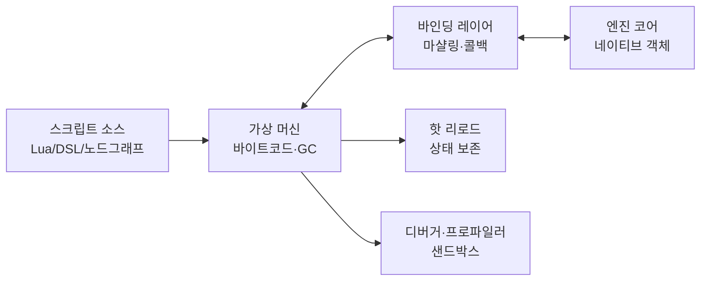
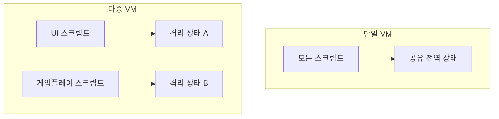
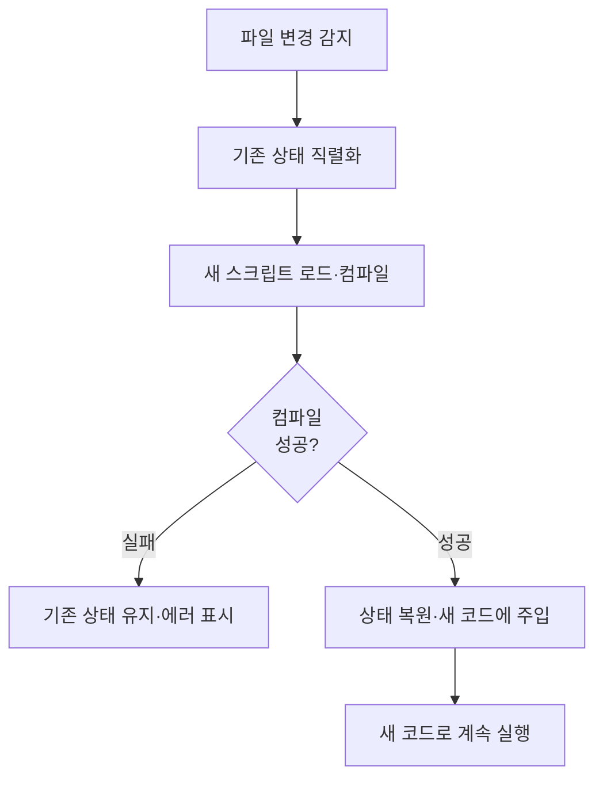
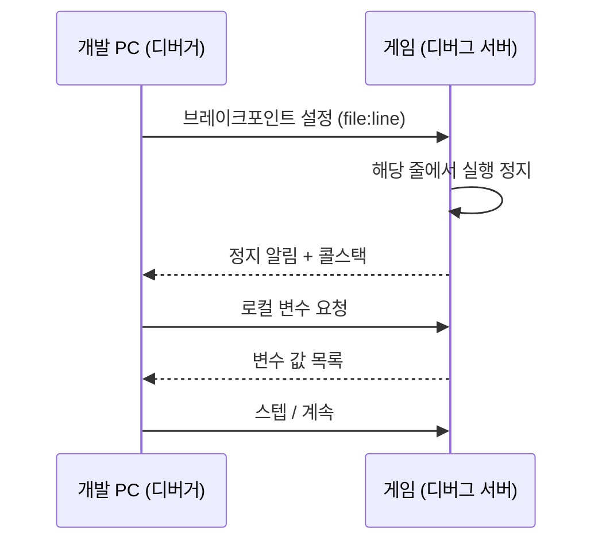
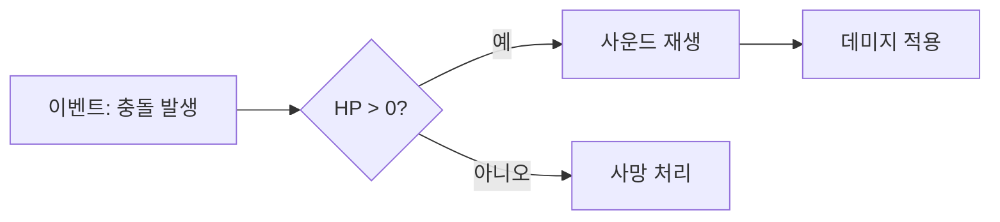

## 들어가며

게임 스크립팅 시스템은 언어 구현이 실제 게임 엔진 경계와 만나는 지점이다. 스크립트는 게임 로직을 빠르게 고치고, 재컴파일 없이 동작을 바꾸고, 프로그래머가 아닌 디자이너도 행동을 조립하게 한다. 그 대가는 네이티브 코드보다 느린 실행, 가비지 컬렉션의 멈칫거림, 그리고 *네이티브와 스크립트 사이를 건널 때마다 드는 경계 비용* 이다. 스크립팅 시스템의 거의 모든 결정은 *반복 속도 ↔ 런타임 비용 ↔ 통제력* 의 삼각 트레이드오프 위에 놓인다.

이 글은 그 트레이드오프를 따라 스크립팅 시스템의 구성요소를 한 흐름으로 정리한다. 어떤 임베디드 언어를 고르고 무엇을 기준으로 판단하는지, VM을 엔진에 어떻게 통합하고 메모리를 누가 소유하는지, 네이티브 함수를 스크립트에 노출하는 바인딩 레이어를 어떻게 짓고 그 경계 비용이 어디서 나오는지, 핫 리로드가 상태를 어떻게 보존하는지, 신뢰할 수 없는 스크립트를 어떻게 샌드박싱하는지, 보이지 않는 스크립트를 어떻게 디버깅하고 프로파일링하는지, 그리고 비주얼 스크립팅이 이 모두 위에 어떻게 얹히는지를 다룬다.



이 글의 목표.

1. **언어 선택** — 임베디드 언어 비교, DSL, 타입 시스템, 생산성.
2. **VM 통합과 메모리** — VM 임베딩, 소유권, GC 대 수동 관리, 멀티스레딩.
3. **바인딩 레이어** — 수동 대 자동, 코드 생성, 타입 마샬링, 콜백.
4. **네이티브 경계 비용** — 경계 오버헤드의 해부, 배치 API, 폴백.
5. **핫 리로드** — 상태 보존, 의존성 추적, 에러 복구.
6. **샌드박싱과 보안** — 신뢰 경계, 리소스 제한, 결정성.
7. **디버깅과 프로파일링** — 디버거 훅, 스택 트레이스, 원격 디버깅, 측정.
8. **비주얼 스크립팅** — 노드 그래프, 코드 변환, 네이티베이션, 복잡도.


---

## 목차
1. [언어 선택](#1-언어-선택)
2. [VM 통합과 메모리](#2-vm-통합과-메모리)
3. [바인딩 레이어](#3-바인딩-레이어)
4. [네이티브 경계 비용](#4-네이티브-경계-비용)
5. [핫 리로드](#5-핫-리로드)
6. [샌드박싱과 보안](#6-샌드박싱과-보안)
7. [디버깅과 프로파일링](#7-디버깅과-프로파일링)
8. [비주얼 스크립팅](#8-비주얼-스크립팅)


---

## 1. 언어 선택

### 왜 스크립트인가

게임 로직 전부를 C++로 짜면 *작은 수치 하나를 바꾸려 해도 재컴파일·재링크·재실행* 을 거쳐야 한다. 대형 프로젝트에서 이 한 사이클이 수 분이다. 스크립트는 이 루프를 *초 단위* 로 줄인다 — 코드를 고치고 핫 리로드하면 즉시 반영된다. 반복 속도가 곧 게임 디자인의 반복 횟수이고, 반복 횟수가 게임의 완성도를 좌우한다.

스크립트가 담당하는 영역과 네이티브가 담당하는 영역은 보통 선이 분명하다.

| 영역 | 담당 | 이유 |
|---|---|---|
| 프레임마다 도는 핫 루프 (물리·렌더·애니메이션) | 네이티브 | 성능 임계, 경계 비용 부담 |
| 게임플레이 규칙 (퀘스트·AI 행동·아이템 효과) | 스크립트 | 자주 바뀜, 디자이너 영역 |
| UI 흐름·이벤트 반응·컷신 | 스크립트 | 반복 개발, 데이터 주도 |
| 엔진 서브시스템 (메모리·스레딩·I/O) | 네이티브 | 스크립트가 건드리면 안 됨 |

원칙은 *비싼 것은 네이티브가 묶음으로 처리하고, 스크립트는 그 묶음을 지휘만 한다* 다. 스크립트가 픽셀 하나하나를 그리려 들면 경계 비용에 짓눌린다(4절).

### 임베디드 언어 비교

게임에 가장 널리 임베드되는 언어는 Lua다. 이유가 분명하다.

- *작다*: 인터프리터 전체가 수백 KB. 콘솔·모바일 메모리 예산에 부담이 없다.
- *임베딩이 설계 목표*: C API가 호스트 애플리케이션에 끼워 넣도록 처음부터 만들어졌다. VM 인스턴스를 여러 개 띄우고, 스택 기반 C API로 값을 주고받는다.
- *빠른 변종이 있다*: LuaJIT는 JIT 컴파일과 빠른 FFI로 표준 Lua보다 한 자릿수 빠른 경우가 흔하다. 단, iOS·콘솔·샌드박스 환경처럼 JIT가 제한되는 플랫폼에서는 같은 장점을 기대하기 어렵다.
- *GC가 점진적*: 인크리멘털 GC로 프레임당 멈춤을 잘게 쪼갤 수 있다(2절).

다른 후보와의 비교는 다음과 같다.

| 언어 | 임베딩 적합성 | VM 크기 | 성능 | 함정 |
|---|---|---|---|---|
| Lua / LuaJIT | 매우 높음 | 작음 | JIT 허용 시 LuaJIT 빠름 | 1-기반 인덱스, JIT 제한 플랫폼 |
| Python | 중간 | 큼 | 느림 | GIL, 임베딩 무거움, 의존성 |
| JavaScript (V8/QuickJS) | 중간 | V8 큼·QuickJS 작음 | V8 빠름 | V8 통합 복잡, 메모리 큼 |
| C# (Mono/IL2CPP) | 높음 (특정 엔진) | 큼 | 빠름 (JIT/AOT) | 런타임 무거움, GC 압박 |
| Wren / AngelScript | 높음 | 작음 | 중간 | 생태계 작음 |

선택은 *팀·플랫폼·통제 요구* 가 정한다. 메모리가 빠듯한 콘솔·모바일은 Lua/QuickJS 같은 경량 VM을, 빠른 수치 연산이 스크립트에 많으면 LuaJIT나 JIT 언어를, 기존 코드베이스가 특정 언어로 묶여 있으면 그 언어를 택한다.

### 커스텀 DSL — 좁고 정확하게

범용 언어 대신 *문제에 딱 맞는 작은 언어(DSL, Domain-Specific Language)* 를 만드는 선택도 있다. 대화 트리, 셰이더 그래프, 행동 트리, 카드 효과 같은 *좁은 도메인* 은 범용 언어보다 DSL이 안전하고 명료하다.

```text
# 대화 DSL 예시 — 범용 언어보다 의도가 직접 드러난다
npc "상인":
    say "어서 오게, 여행자."
    choice "물건을 보여주시오" -> shop
    choice "그냥 둘러보겠소"   -> exit
    if quest("도난당한 반지").done:
        say "반지를 찾아줘서 고맙네!"
        give gold 100
```

DSL의 이득은 *표현력과 검증 가능성* 이다. 위 스크립트는 임의 코드를 실행할 수 없으므로 샌드박싱이 거의 공짜다(6절). 파서가 잘못된 분기·없는 퀘스트 ID를 컴파일 타임에 잡는다. 대가는 *직접 만들어야 한다* 는 것 — 파서, 검증기, 디버거, 에디터 지원을 전부 짊어진다. 그래서 실무는 보통 *범용 임베디드 언어 위에 얇은 DSL 레이어* 를 얹는다. DSL을 Lua 테이블이나 함수 호출로 컴파일해, 런타임은 검증된 Lua VM을 재사용하고 표면만 도메인에 맞춘다.

### 타입 시스템과 생산성

스크립트 언어는 대개 *동적 타입* 이다 — 변수에 타입 선언이 없고 런타임에 타입이 정해진다. 동적 타입은 *쓰기 빠르고 유연* 하지만, *타입 오류가 런타임까지 숨는다*. `enemy.helath`(오타)는 컴파일 타임에 잡히지 않고, 그 코드 경로를 실제로 밟을 때 `nil` 접근으로 터진다.

대형 스크립트 코드베이스가 커지면 이 비용이 누적된다. 그래서 *점진적 타입(gradual typing)* 이 보강책으로 쓰인다 — Lua의 타입 주석 방언(예: 타입 체커가 읽는 주석)이나 TypeScript처럼, *원하는 곳에만 타입을 달고* 나머지는 동적으로 둔다. 정적 검사기가 빌드 단계에서 타입 오류를 잡아주면, 동적 언어의 반복 속도를 유지하면서 런타임 폭발을 줄인다.

생산성은 언어 자체보다 *도구* 가 좌우한다. 자동완성, 인라인 에러, 핫 리로드, 디버거가 갖춰진 동적 언어가, 도구 없는 정적 언어보다 빠르다. 언어 선택 시 *VM 성능만큼 도구 생태계* 를 본다 — 이 글의 5·7·8절이 다루는 핫 리로드·디버깅·비주얼 편집이 실제 생산성의 대부분을 만든다.

## 2. VM 통합과 메모리

### VM을 엔진에 임베드하기

임베디드 언어는 *라이브러리로 엔진에 링크* 되고, 엔진이 VM 인스턴스를 띄워 소유한다. Lua의 통합은 *스택 기반 C API* 로 이뤄진다 — 값을 가상 스택에 푸시하고, 함수를 호출하고, 결과를 팝한다.

```cpp
class ScriptVM {
    lua_State* L_;
public:
    ScriptVM() {
        L_ = luaL_newstate();      // VM 인스턴스 생성
        OpenSafeLibraries(L_);     // 표준 라이브러리 선별 등록 (6절 샌드박싱)
        RegisterEngineAPI(L_);     // 네이티브 함수 바인딩 (3절)
    }
    ~ScriptVM() { lua_close(L_); }  // VM과 그 안의 모든 GC 객체 해제

    bool DoFile(const char* path) {
        if (luaL_loadfile(L_, path) != LUA_OK) {   // 컴파일
            LogError(lua_tostring(L_, -1));
            lua_pop(L_, 1);
            return false;
        }
        if (lua_pcall(L_, 0, 0, 0) != LUA_OK) {     // 보호 호출 — 에러를 잡아 반환
            LogError(lua_tostring(L_, -1));
            lua_pop(L_, 1);
            return false;
        }
        return true;
    }
};
```

핵심은 *`lua_pcall` 같은 보호 호출* 이다. 스크립트 안의 에러(`nil` 접근, 잘못된 인덱스)가 *호스트 프로세스를 죽이지 않고* C++로 에러 코드로 돌아온다. 스크립트 오류로 게임 전체가 크래시하면 스크립팅의 안전성 이점이 사라진다. 모든 스크립트 진입점은 보호 호출로 감싼다.

### VM 인스턴스 모델

VM을 *하나만 띄울지 여러 개 띄울지* 가 격리 모델을 정한다.



단일 VM은 *전역 상태를 공유* 해 스크립트끼리 직접 통신하기 쉽지만, 한 스크립트가 전역을 오염시키면 전부가 영향받는다. 다중 VM은 *서로를 모르게 격리* 해 안전하고, 서로 다른 스레드에 배치하기 좋지만(아래), 인스턴스마다 메모리·바인딩 등록 비용이 든다. 흔한 절충은 *서브시스템별 VM* 이다 — UI, 게임플레이, 모드(mod) 스크립트를 분리해 모드의 무한 루프가 코어 UI를 멈추지 않게 한다.

### 메모리 소유권 — 누가 객체를 소유하는가

스크립팅 메모리의 가장 까다로운 부분은 *네이티브 객체와 스크립트 객체의 소유권 경계* 다. 스크립트가 네이티브 `Entity*` 를 들고 있는데, 네이티브 쪽에서 그 `Entity` 가 파괴되면 스크립트는 *댕글링 포인터* 를 쥐게 된다.

네 가지 대표 전략이 있다.

| 전략 | 동작 | 함정 |
|---|---|---|
| 생(raw) 포인터 | 스크립트가 `Entity*` 를 그대로 보유 | 네이티브 파괴 시 댕글링, 크래시 |
| 핸들·ID | 스크립트는 정수 ID, 매 접근 시 조회 | 조회 비용, 그러나 안전 (죽은 ID → nil) |
| 참조 카운트 | 스크립트 참조가 네이티브 수명 연장 | 순환 참조, 의도치 않은 수명 연장 |
| 약한 참조 | 스크립트는 약한 핸들, 죽으면 무효화 | 매 접근 유효성 검사 |

게임 엔진에서 가장 안전한 선택은 *핸들·ID* 다. 스크립트는 `Entity*` 가 아니라 `EntityId`(정수)를 들고, 네이티브 함수가 매번 ID를 실제 객체로 조회한다. 죽은 엔티티의 ID를 조회하면 `nil` 이 돌아와 스크립트가 *우아하게 처리* 할 수 있다. 생 포인터를 스크립트에 넘기는 것은 *크래시를 스크립트 작성자에게 위임* 하는 것과 같으므로 피한다.

### GC 대 수동 관리

스크립트 VM은 거의 항상 *가비지 컬렉션(GC)* 을 쓴다 — 스크립트 작성자가 메모리를 해제하지 않아도 도달 불가능한 객체를 자동 회수한다. 이것이 동적 언어 생산성의 절반이다. 대가는 *GC 멈춤(pause)* 이다 — 수집기가 도는 동안 스크립트(때로는 프레임)가 멈칫한다.

게임은 *프레임 예산(예: 16ms)* 이 엄격해 GC 멈춤을 통제해야 한다. 전략이 셋이다.

```cpp
// 프레임마다 GC를 조금씩만 — 한 번에 다 돌지 않게 시간/단계 제한
void ScriptVM::TickGC(float frameMsBudget) {
    // 인크리멘털 GC: 정해진 "작업량"만큼만 마킹·스윕 진행
    lua_gc(L_, LUA_GCSTEP, kGCStepSize);
}

// 로딩 화면처럼 멈춰도 되는 순간에 풀 GC로 누적 쓰레기 청소
void ScriptVM::FullCollectAtSafePoint() {
    lua_gc(L_, LUA_GCCOLLECT, 0);
}
```

- *인크리멘털 GC*: 수집을 잘게 쪼개 프레임마다 일부만 진행. 멈춤을 분산하되 약간의 throughput을 희생한다.
- *세대 GC(generational)*: 새로 만든 객체만 자주 수집(대부분 곧 죽는다는 가정). 게임의 프레임당 임시 객체 패턴에 잘 맞는다.
- *안전 지점 풀 GC*: 로딩·일시정지 같이 멈춰도 되는 순간에 한 번에 청소.

핵심 함정은 *프레임마다 스크립트가 임시 객체를 대량 생성* 하는 것이다. 매 프레임 새 테이블·문자열을 만들면 GC 압박이 폭증한다. 핫 경로 스크립트는 *객체를 재사용*(테이블 풀, 미리 만든 버퍼)해 할당 자체를 줄인다 — GC를 빠르게 하는 가장 좋은 방법은 쓰레기를 덜 만드는 것이다.

### 멀티스레딩

대부분의 스크립트 VM은 *스레드 안전하지 않다* — 하나의 `lua_State` 를 여러 스레드가 동시에 건드리면 깨진다. 두 가지 모델이 있다.

- *단일 스레드 VM*: 모든 스크립트를 한 스레드(보통 게임플레이 스레드)에서 실행. 단순하고 안전하지만, 스크립트가 무거우면 그 스레드가 병목.
- *VM per 스레드*: 스레드마다 독립 VM. 진짜 병렬이지만, VM 간 데이터 공유는 *메시지 전달* 로만(공유 가변 상태 금지).

게임의 일반적 선택은 *단일 스레드 VM + 무거운 작업은 네이티브로 위임* 이다. 스크립트는 "이 1000개 엔티티를 처리하라"고 *지시* 하고, 실제 병렬 처리는 네이티브 잡 시스템이 한다(4절의 배치 API). 스크립트 자체를 병렬화하기보다, 스크립트가 부르는 네이티브 함수를 병렬화하는 편이 안전하고 빠르다.

## 3. 바인딩 레이어

### 바인딩이란

스크립트가 게임을 조종하려면 *네이티브 함수를 스크립트에서 부를 수 있어야* 한다 — `spawn_enemy("goblin", x, y)`, `play_sound("explosion")`. 이 *스크립트 호출 → 네이티브 함수* 연결을 만드는 코드가 *바인딩 레이어(binding layer)* 다. 바인딩은 양방향이다 — 스크립트가 네이티브를 부르고(API 호출), 네이티브가 스크립트를 부른다(콜백·이벤트).

```cpp
// 가장 원초적인 수동 바인딩 — Lua C 함수 시그니처
// 스택에서 인자를 꺼내고, 결과를 스택에 푸시한다
static int lua_SpawnEnemy(lua_State* L) {
    const char* type = luaL_checkstring(L, 1);   // 1번 인자: 문자열
    float x = (float)luaL_checknumber(L, 2);     // 2번 인자: 숫자
    float y = (float)luaL_checknumber(L, 3);
    EntityId id = g_World->SpawnEnemy(type, x, y);
    lua_pushinteger(L, id);                      // 반환: 엔티티 ID
    return 1;                                     // 반환값 개수
}
```

스택을 직접 다루는 이 패턴은 *정확하지만 장황* 하다. 함수마다 인자 검사·변환·푸시를 손으로 쓴다. 네이티브 API가 수백 개면 이 보일러플레이트가 감당이 안 된다. 그래서 *수동 대 자동* 의 선택이 생긴다.

### 수동 대 자동 바인딩

| 방식 | 동작 | 장점 | 단점 |
|---|---|---|---|
| 수동 | 함수마다 손으로 작성 | 완전한 통제, 의존성 0 | 장황, 유지보수 부담 |
| 템플릿 자동 | C++ 템플릿으로 시그니처에서 추론 | 보일러플레이트 제거 | 컴파일 시간·에러 메시지 난해 |
| 리플렉션 기반 | 런타임 타입 정보로 자동 노출 | 선언적, 일괄 노출 | 리플렉션 인프라 필요 |
| 코드 생성 | 헤더 파싱 → 바인딩 코드 생성 | 빌드 타임 확정, 빠름 | 빌드 파이프라인 복잡 |

*템플릿 기반 바인딩* 은 함수 포인터의 타입에서 인자 개수·타입을 추론해 마샬링을 자동 생성한다.

```cpp
// 템플릿이 함수 시그니처를 읽어 스택 마샬링을 자동 생성
template<auto Fn>
int AutoBind(lua_State* L) {
    return CallWithStackArgs<Fn>(L);   // 인자 추출·호출·결과 푸시를 템플릿이 전개
}

// 등록은 한 줄로 — 보일러플레이트 없음
vm.Register("spawn_enemy", AutoBind<&World::SpawnEnemy>);
vm.Register("play_sound",  AutoBind<&Audio::Play>);
```

자동 바인딩은 *작성 비용을 컴파일러로 옮긴다* — 코드는 한 줄이지만, 템플릿 전개로 컴파일 시간이 늘고 에러 메시지가 난해해진다. 큰 프로젝트는 *코드 생성* 으로 한 걸음 더 간다 — 빌드 단계에서 헤더를 파싱하거나 매크로로 표시된 함수를 모아 *바인딩 소스를 생성* 한다. 런타임 추론이 없어 빠르고, 생성된 코드를 직접 볼 수 있어 디버깅이 쉽다. 대가는 빌드 파이프라인에 코드 생성 단계가 끼는 복잡도다.

### 타입 마샬링

바인딩의 실제 작업은 *타입 마샬링(type marshaling)* — 네이티브 타입과 스크립트 타입 사이의 변환이다. `float`/`int` 같은 단순 값은 거의 공짜지만, 복합 타입은 비용이 든다.

| 네이티브 타입 | 스크립트 표현 | 마샬링 비용 |
|---|---|---|
| `int` / `float` / `bool` | number / boolean | 거의 0 |
| `const char*` / `std::string` | string | 복사 (길이 비례) |
| `Vector3` | table 또는 userdata | table이면 할당, userdata면 박싱 |
| `Entity*` | 핸들 ID 또는 userdata | 조회·박싱 |
| 배열·컨테이너 | table | 원소마다 변환 (O(n)) |

함정은 *복합 타입의 숨은 비용* 이다. `Vector3` 를 매번 스크립트 테이블로 변환하면 *호출마다 테이블 할당* 이 일어나 GC를 압박한다. 자주 쓰는 작은 값 타입은 *userdata로 박싱* 하거나, 아예 *세 개의 number로 평탄화* 해서 넘긴다. 큰 배열을 매 프레임 스크립트 테이블로 복사하면 O(n) 변환이 경계 비용을 폭발시킨다(4절) — 이런 데이터는 *스크립트에 넘기지 말고 네이티브에서 처리* 하고, 스크립트엔 핸들만 준다.

### 콜백과 이벤트

반대 방향 — *네이티브가 스크립트를 부르는* 콜백 — 은 수명 관리가 까다롭다. 스크립트가 `on_collision` 핸들러를 등록하면, 네이티브는 그 스크립트 함수에 대한 참조를 들고 있어야 충돌 시 부를 수 있다. 이 참조가 *GC로부터 함수를 보호* 해야 하고, 핸들러가 등록 해제되면 *참조를 풀어* GC가 회수하게 해야 한다.

```cpp
// 스크립트 콜백을 GC로부터 보호하며 보관 (Lua registry 참조)
class ScriptCallback {
    lua_State* L_;
    int ref_ = LUA_NOREF;
public:
    void Set(lua_State* L, int stackIdx) {
        L_ = L;
        lua_pushvalue(L, stackIdx);              // 콜백 함수를 복제
        ref_ = luaL_ref(L, LUA_REGISTRYINDEX);   // registry에 고정 → GC 안 됨
    }
    void Invoke(int collisionEntity) {
        lua_rawgeti(L_, LUA_REGISTRYINDEX, ref_); // 보관한 함수 꺼냄
        lua_pushinteger(L_, collisionEntity);
        lua_pcall(L_, 1, 0, 0);                   // 보호 호출 — 콜백 에러 격리
    }
    ~ScriptCallback() {
        if (ref_ != LUA_NOREF) luaL_unref(L_, LUA_REGISTRYINDEX, ref_); // 참조 해제
    }
};
```

콜백 호출도 *반드시 보호 호출* 로 감싼다 — 충돌 콜백 안의 스크립트 에러가 물리 엔진을 멈추면 안 된다. 그리고 콜백 호출은 *경계를 건너는 빈번한 지점* 이므로, 프레임마다 수천 번 불리는 이벤트(매 충돌, 매 틱)를 스크립트 콜백으로 만들면 4절의 경계 비용이 쌓인다. 고빈도 이벤트는 *네이티브에서 모았다가 묶음으로* 스크립트에 전달한다.

## 4. 네이티브 경계 비용

### 경계 비용의 해부

스크립트와 네이티브 사이를 한 번 건널 때마다 *고정 오버헤드* 가 든다. 이 비용은 함수 본문과 무관하게 *건너는 행위 자체* 에서 나온다.


한 호출의 경계 비용은 다음의 합이다.

- *인자 마샬링*: 스택 푸시·팝, 타입 검사·변환.
- *디스패치*: VM이 C 함수 포인터로 점프(인터프리터 루프 이탈).
- *컨텍스트 전환 비용*: 레지스터 상태, 캐시 지역성 손실.
- *반환 마샬링*: 결과를 다시 스크립트 표현으로.

본문이 무거운 함수(예: `spawn_enemy` 가 엔티티 생성·물리 등록·렌더 등록을 다 함)는 경계 비용이 본문에 묻혀 무시할 만하다. 문제는 *본문이 가벼운 함수를 자주 부를 때* 다 — `get_x`, `get_y`, `get_z` 를 따로 부르면 *함수 세 번의 경계 비용으로 숫자 세 개* 를 얻는다. 경계를 자주 건널수록 비용이 본문을 압도한다.

### 측정 — 경계가 얼마나 비싼가

경계 비용의 정량은 VM·바인딩 방식에 따라 다르지만, *상대적 크기* 의 감은 일정하다. 네이티브-대-네이티브 직접 호출을 1로 보면, 경계를 건너는 호출은 그보다 *한두 자릿수* 비싸다.

| 호출 종류 | 상대 비용 | 비고 |
|---|---|---|
| 네이티브 → 네이티브 (인라인) | 1× | 컴파일러가 인라인, 거의 0 |
| 네이티브 → 네이티브 (가상 함수) | 수× | vtable 디스패치 |
| 스크립트 → 스크립트 (VM 내부) | 수× | 인터프리터 디스패치 |
| 스크립트 → 네이티브 (경계 통과) | 수십× | 마샬링 + 디스패치 |
| 스크립트 → 네이티브 (LuaJIT FFI) | 수× | JIT가 마샬링 제거 |

LuaJIT의 FFI가 빠른 이유가 여기 있다 — JIT가 *경계 호출을 컴파일* 해 마샬링을 제거하고 거의 네이티브 호출로 만든다. JIT 없는 VM에서는 경계 통과가 본질적으로 비싸므로, *경계를 덜 건너도록 API를 설계* 하는 것이 유일한 해법이다.

### 배치 API — 경계를 덜 건너기

핵심 기법은 *호출 횟수를 줄이는 배치(batch) API* 다. 작은 호출 N개를 묶음 호출 1개로 합치면, 경계 비용을 N분의 1로 줄인다.

```cpp
// 나쁨: 엔티티 N개를 옮기는 데 경계를 N번 건넌다
//   for i in entities: set_position(i, x[i], y[i])   -- N회 경계 통과

// 좋음: 묶음 하나로 N개를 옮긴다 — 경계 1회
static int lua_SetPositionsBatch(lua_State* L) {
    // 인자: 엔티티 ID 테이블, 위치 테이블 — 한 번에 전부
    int n = (int)lua_rawlen(L, 1);
    for (int i = 1; i <= n; ++i) {
        lua_rawgeti(L, 1, i); EntityId id = (EntityId)lua_tointeger(L, -1); lua_pop(L, 1);
        // ... 위치 추출 ...
        g_World->SetPosition(id, x, y);   // 네이티브 루프 — 경계 안 건넘
    }
    return 0;
}
```

배치의 효과는 극적이다 — 1000개 엔티티를 개별 호출로 옮기면 경계를 1000번 건너지만, 배치는 1번 건너고 나머지 999번의 반복은 *네이티브 안에서* 돈다. 게임 스크립트 API 설계의 핵심 원칙이 *루프를 경계의 어느 쪽에 두는가* 다 — 루프가 스크립트에 있으면 경계를 매 반복 건너고, 네이티브에 있으면 한 번만 건넌다. 비싼 반복은 항상 네이티브 쪽으로 민다.

### 네이티브 폴백

성능 임계 스크립트 함수를 *네이티브로 재구현* 하는 것이 폴백(fallback)이다. 프로파일링으로 스크립트의 핫 경로를 찾으면(7절), 그 함수만 네이티브로 옮긴다. 스크립트는 동일한 이름의 함수를 부르지만, 등록된 구현이 네이티브여서 경계는 한 번만 건너고 본문이 빠르게 돈다.

```cpp
// 프로파일링이 지목한 핫 경로: AI 시야 판정.
// 스크립트 버전을 네이티브로 교체 — 인터페이스는 동일, 구현만 네이티브.
vm.Register("ai_can_see_target", AutoBind<&AISystem::CanSeeTarget>);
// 스크립트 쪽 코드는 그대로: local visible = ai_can_see_target(self, player)
```

이것이 스크립팅의 일반 전략을 요약한다 — *대부분을 스크립트로 빠르게 반복하다가, 프로파일러가 지목한 소수의 핫 경로만 네이티브로 내린다*. 처음부터 전부 네이티브로 짜는 것도, 끝까지 전부 스크립트로 두는 것도 답이 아니다. 측정이 경계의 위치를 정한다.

## 5. 핫 리로드

### 핫 리로드가 푸는 문제

핫 리로드(hot reload)는 *게임을 재시작하지 않고 스크립트 변경을 즉시 반영* 하는 기능이다. 보스전 후반의 버그를 고칠 때, 재시작하면 보스전까지 다시 가야 한다. 핫 리로드는 *그 자리에서* 스크립트만 갈아끼운다. 이 한 기능이 스크립팅의 반복 속도 이점을 실현한다.

문제는 *상태* 다. 스크립트를 다시 로드하면 *코드는 새것이 되지만, 이미 살아있는 객체의 상태* 는 어떻게 되는가? 보스의 체력, 진행 중인 퀘스트, 열린 UI 상태 — 이걸 잃으면 핫 리로드가 사실상 재시작이 된다.

### 상태 보존 전략



상태 보존의 핵심은 *코드와 데이터를 분리* 하는 것이다. Lua에서는 *함수(코드)는 새 청크로 교체하되, 테이블(데이터)은 유지* 하는 패턴이 흔하다.

```lua
-- 모듈이 이미 로드되어 있으면, 데이터 테이블은 보존하고 함수만 교체
local M = package.loaded["enemy_ai"] or { state = {} }  -- 기존 state 유지

function M.update(dt)   -- 함수는 새 정의로 덮어씀 (핫 리로드된 코드)
    -- M.state.health 등 기존 데이터는 그대로 살아있음
end

package.loaded["enemy_ai"] = M
return M
```

원칙은 *지속되어야 할 상태는 명시적으로 데이터에 두고, 코드는 언제든 버려질 수 있게* 짠다. 함수 안의 로컬 변수에 중요한 상태를 가두면 리로드 시 사라진다. 게임 객체의 상태를 *직렬화 가능한 데이터 구조* 에 모아두면, 리로드 시 그것을 보존하고 새 코드에 다시 주입할 수 있다.

### 의존성 추적과 증분 리로드

스크립트 하나를 고치면 *그것에 의존하는 다른 스크립트* 도 영향받는다. `combat.lua` 를 고치면 그것을 `require` 하는 `enemy.lua`, `player.lua` 가 새 버전을 봐야 한다. 의존성 그래프를 추적해 *변경된 모듈과 그 역의존자만* 다시 로드하면, 전체 리로드보다 빠르고 안전하다.

```text
변경: combat.lua
역의존 그래프:
  combat.lua  ← enemy.lua  ← spawner.lua
              ← player.lua
리로드 대상: combat, enemy, player, spawner (그 외는 건드리지 않음)
```

증분 리로드는 *변경 범위를 좁혀* 리로드 시간과 상태 교란을 줄인다. 무관한 스크립트의 상태는 전혀 건드리지 않으므로, 큰 코드베이스에서도 리로드가 가볍다.

### 에러 복구

핫 리로드의 위험은 *새 스크립트에 문법 오류나 런타임 오류가 있을 때* 다. 새 코드를 무턱대고 적용했다가 터지면, 핫 리로드가 *작업 흐름을 끊는다* — 고치는 도구가 게임을 죽이는 도구가 된다.

안전한 핫 리로드는 *트랜잭션처럼* 동작한다.

1. 새 스크립트를 *컴파일만* 해본다. 문법 오류면 *적용하지 않고* 에러만 표시 — 기존 코드가 계속 돈다.
2. 컴파일 성공이면 새 코드를 적용하되, 첫 실행을 *보호 호출* 로 감싼다. 런타임 오류가 나면 *이전 버전으로 롤백* 하거나 에러를 격리한다.
3. 어느 경우든 *게임은 멈추지 않는다*. 개발자는 에러 메시지를 보고 고친 뒤 다시 저장한다.

이 "실패해도 기존 상태 유지" 원칙이 핫 리로드를 *안심하고 쓸 수 있는* 도구로 만든다. 저장할 때마다 게임이 죽을까 두려우면 아무도 핫 리로드를 켜지 않는다. 핫 리로드는 디버거 세션과도 공존해야 한다(7절) — 리로드 후에도 브레이크포인트·워치가 유지되어야 디버깅 흐름이 끊기지 않는다.

## 6. 샌드박싱과 보안

### 신뢰 경계

스크립트를 *누가 작성하는가* 가 보안 요구를 정한다.

| 스크립트 출처 | 신뢰 수준 | 샌드박싱 필요 |
|---|---|---|
| 내부 팀 (게임 로직) | 신뢰 | 약함 (실수 방지 정도) |
| 모드 제작자 (사용자 모드) | 부분 신뢰 | 강함 (악성·버그 방지) |
| 임의 사용자 (UGC·온라인) | 불신 | 매우 강함 (완전 격리) |

내부 스크립트라도 *실수* 는 막아야 한다 — 스크립트가 파일 시스템을 지우거나 무한 루프에 빠지면 곤란하다. 사용자 제작 콘텐츠(UGC)나 모드는 *악의* 까지 가정한다 — 스크립트가 디스크를 읽고, 네트워크에 접속하고, 게임을 크래시시키려 들 수 있다고 보고 막는다.

### 기능 제한 — 위험한 것을 빼앗기

샌드박싱의 1차 방어선은 *위험한 표준 라이브러리를 노출하지 않는 것* 이다. Lua의 `os.execute`(셸 실행), `io.open`(파일 접근), `loadstring`(임의 코드 로드)을 스크립트 환경에서 제거하면, 스크립트가 할 수 있는 일이 크게 줄어든다.

```cpp
// 위험한 전역을 제거한 환경만 스크립트에 노출
void OpenSafeLibraries(lua_State* L) {
    luaL_requiref(L, "_G", luaopen_base, 1);
    luaL_requiref(L, "table", luaopen_table, 1);
    luaL_requiref(L, "string", luaopen_string, 1);
    luaL_requiref(L, "math", luaopen_math, 1);
    // io, os, package, debug 등은 등록하지 않음 — 스크립트에서 보이지 않음
    lua_pop(L, 4);

    // base에서도 위험 함수 개별 제거
    lua_pushnil(L); lua_setglobal(L, "loadstring");
    lua_pushnil(L); lua_setglobal(L, "dofile");
    lua_pushnil(L); lua_setglobal(L, "load");
}
```

스크립트가 *볼 수 있는 함수만 부를 수 있다* — 등록하지 않은 함수는 스크립트 입장에서 존재하지 않는다. 노출한 엔진 API도 *권한을 좁힌다*. 모드 스크립트에 `spawn_enemy` 는 주되 `delete_save_file` 은 주지 않는다. 노출 표면(attack surface)이 작을수록 안전하다.

### 리소스 제한

기능을 빼앗아도 *자원 고갈* 공격은 남는다 — 무한 루프, 메모리 무한 할당. 이건 *런타임 제한* 으로 막는다.

```cpp
// 명령 수 제한 — VM이 일정 명령마다 훅을 호출, 초과 시 중단
void InstallExecutionLimit(lua_State* L, int maxInstructions) {
    lua_sethook(L, [](lua_State* L, lua_Debug*) {
        luaL_error(L, "스크립트 실행 한도 초과 — 무한 루프 의심");  // 강제 중단
    }, LUA_MASKCOUNT, maxInstructions);
}
```

- *명령 수 제한*: VM이 일정 바이트코드 명령마다 훅을 부르게 해, 한 호출이 정해진 명령 수를 넘으면 강제 중단. 무한 루프를 잡는다.
- *메모리 제한*: VM의 할당자를 가로채 누적 할당이 상한을 넘으면 할당을 거부. 메모리 폭탄을 막는다.
- *시간 예산*: 스크립트 한 틱이 프레임 예산의 일부를 넘으면 다음 프레임으로 미룬다(협조적 양보가 가능한 경우).

이 제한들이 *한 스크립트가 게임 전체를 멈추거나 메모리를 고갈시키는* 것을 막는다. 다중 VM 모델(2절)과 결합하면, 문제 있는 모드 하나가 코어 시스템을 건드리지 못하게 완전히 격리할 수 있다.

### 결정성 — 멀티플레이어의 추가 요구

네트워크 게임에서 스크립트가 게임 상태에 영향을 주면, *모든 클라이언트에서 같은 입력은 같은 결과* 를 내야 한다(결정성). 스크립트가 *실제 시각, 시스템 난수, 부동소수 비결정성* 에 의존하면 클라이언트마다 결과가 갈려 동기화가 깨진다.

결정적 스크립팅은 *비결정성 원천을 차단* 한다 — 스크립트에 노출하는 난수는 *게임이 시드를 통제하는 결정적 PRNG* 만, 시간은 *실제 시각이 아니라 게임 틱* 만, 부동소수 연산은 플랫폼 간 일치를 보장하는 경로만 쓴다. 이것 역시 샌드박싱의 일부다 — 결정성을 깨는 함수를 *빼앗는* 것이다.

## 7. 디버깅과 프로파일링

### 스크립트는 보이지 않는다

스크립트 버그는 네이티브 디버거(예: Visual Studio)로 보이지 않는다 — VM 내부에서 인터프리터 루프가 도는 것만 보일 뿐, 스크립트의 변수·콜스택은 보이지 않는다. 그래서 스크립트 전용 디버깅 인프라가 필요하다. 다행히 대부분의 VM은 *디버그 훅(debug hook)* API를 제공한다.

```cpp
// 디버그 훅: VM이 각 줄 실행·함수 진입·복귀 시 콜백
void InstallDebugHook(lua_State* L) {
    lua_sethook(L, [](lua_State* L, lua_Debug* ar) {
        lua_getinfo(L, "nSl", ar);   // 함수명·소스·현재 줄 정보 채움
        if (BreakpointHit(ar->source, ar->currentline)) {
            EnterDebugBreak(L, ar);  // 브레이크포인트 — 실행 멈추고 상태 검사
        }
    }, LUA_MASKLINE, 0);             // 매 줄마다 훅
}
```

### 브레이크포인트와 상태 검사

줄 단위 디버그 훅이 *브레이크포인트* 의 토대다. 훅이 현재 소스·줄을 보고하면, 그 위치에 브레이크포인트가 걸렸는지 확인하고 일치하면 실행을 멈춘다. 멈춘 상태에서 *콜스택 순회, 로컬 변수 검사, 워치 표현식 평가* 를 한다.

```cpp
// 멈춘 지점에서 로컬 변수 열거 — 워치 패널·변수 검사에 사용
void DumpLocals(lua_State* L, int level) {
    lua_Debug ar; lua_getstack(L, level, &ar);
    const char* name;
    for (int i = 1; (name = lua_getlocal(L, &ar, i)) != nullptr; ++i) {
        LogVar(name, DescribeValue(L, -1));   // 변수명·값 표시
        lua_pop(L, 1);
    }
}
```

함정은 *디버그 훅의 오버헤드* 다. 매 줄 훅을 거는 줄 단위 디버깅은 스크립트를 크게 느리게 한다. 그래서 *디버깅 세션에서만* 훅을 켜고, 평소엔 끈다. 더 가벼운 변형은 *브레이크포인트가 있는 줄에만* 훅을 거는 것 — VM이 지원하면 줄 단위 전체 훅보다 훨씬 싸다.

### 스택 트레이스와 에러 보고

스크립트가 에러로 터질 때, *어디서 어떻게 도달했는지* 를 보여주는 스택 트레이스가 디버깅의 절반이다. 보호 호출의 에러 핸들러에서 콜스택을 캡처한다.

```cpp
// pcall의 메시지 핸들러로 등록 — 에러 시점의 콜스택을 문자열로
static int Traceback(lua_State* L) {
    const char* msg = lua_tostring(L, 1);
    luaL_traceback(L, L, msg, 1);   // "에러 메시지 + 전체 콜스택" 생성
    return 1;
}
// lua_pcall 대신 메시지 핸들러를 단 호출을 쓰면, 에러에 콜스택이 붙는다
```

좋은 에러 보고는 *스크립트 작성자의 언어로* 말한다 — `enemy.lua:42: attempt to index nil value 'target'` 처럼 *파일·줄·원인* 을 짚는다. 네이티브 주소나 VM 내부 상태가 아니라, 스크립트 작성자가 고칠 수 있는 정보를 준다. 에러 메시지의 품질이 스크립팅 시스템의 체감 생산성을 크게 좌우한다.

### 원격 디버깅

스크립트는 종종 *개발 PC가 아닌 곳* 에서 돈다 — 콘솔 개발 키트, 모바일 기기, 빌드 서버. 그 위의 스크립트를 디버깅하려면 *원격 디버깅* 이 필요하다. 게임 프로세스 안에 *디버그 서버* 를 띄우고, 개발 PC의 디버거 클라이언트(또는 에디터)가 네트워크로 연결한다. 디버그 프로토콜로 브레이크포인트 설정, 변수 조회, 스텝 실행을 원격으로 주고받는다.



### 스크립트 프로파일링

스크립트는 *조용히 느려진다* — 어느 함수가 프레임 예산을 먹는지 보이지 않으면 최적화할 곳을 모른다. 디버그 훅의 함수 진입·복귀 콜백으로 *함수별 소요 시간* 을 모은다. 측정 항목이 분명하다.

| 지표 | 의미 | 위험 신호 |
|---|---|---|
| 함수별 누적 시간 | 어느 스크립트 함수가 비싼가 | 핫 경로 → 네이티브 폴백 후보(4절) |
| 경계 통과 횟수 | 스크립트→네이티브 호출 빈도 | 과다 → 배치 API 필요(4절) |
| 할당 횟수·바이트 | 프레임당 임시 객체 생성 | GC 압박(2절) |
| GC 멈춤 시간 | 수집기가 먹은 프레임 시간 | 프레임 스파이크 |
| VM 실행 시간 / 프레임 | 스크립트가 먹는 프레임 예산 | 예산 초과 → 끊김 |

핵심은 *스크립트 시간이 프레임 예산 안에 드는가* 다. 16ms 예산에서 스크립트가 8ms를 먹으면, 렌더·물리에 남는 것은 8ms뿐이다. 프로파일러가 지목한 핫 함수는 4절의 네이티브 폴백으로 내리고, 경계 통과가 많으면 배치 API로 묶고, 할당이 많으면 객체 재사용으로 GC를 줄인다. 측정이 모든 최적화의 출발점이다.

## 8. 비주얼 스크립팅

### 노드 그래프 — 코드 없는 로직

비주얼 스크립팅은 *텍스트 코드 대신 노드 그래프* 로 로직을 짠다. 노드는 동작(이동, 사운드 재생, 분기)을 나타내고, 노드를 선으로 이어 흐름을 만든다. 프로그래머가 아닌 디자이너·아티스트가 *코드를 쓰지 않고* 게임 행동을 조립하는 것이 목적이다.



비주얼 스크립팅의 이득은 *진입 장벽* 이다 — 문법 오류가 없고(노드는 정해진 입출력으로만 연결됨), 흐름이 그림으로 보이고, 유효하지 않은 연결을 에디터가 막는다. 대가는 *복잡한 로직의 가독성* 이다. 텍스트 열 줄로 끝날 것이 노드 수십 개와 선 수백 개로 펼쳐지면("스파게티"), 텍스트보다 읽기 어려워진다.

### 데이터 플로우 대 제어 플로우

노드 그래프는 두 종류의 연결을 섞는다.

- *제어 플로우(control flow)*: *실행 순서* 를 나타낸다 — "이 노드 다음 저 노드". 분기·반복이 여기 속한다.
- *데이터 플로우(data flow)*: *값의 전달* 을 나타낸다 — "이 노드의 출력 값이 저 노드의 입력". 계산이 여기 속한다.

| 구분 | 제어 플로우 | 데이터 플로우 |
|---|---|---|
| 표현 | 실행 순서 (언제) | 값 의존 (무엇을) |
| 시각적 구분 | 보통 굵은 흰 선 | 보통 타입별 색 선 |
| 적합 | 게임 이벤트·시퀀스 | 수식·조건 계산 |

좋은 노드 에디터는 둘을 *시각적으로 구분* 한다(선 색·굵기). 둘을 섞어 표현하면 "이게 순서인지 값인지" 헷갈려 그래프 가독성이 무너진다.

### 텍스트·바이트코드로의 변환

비주얼 그래프는 *그 자체로 실행되지 않는다* — 노드 그래프를 *실행 가능한 형태로 변환* 해야 한다. 두 접근이 있다.

- *인터프리트*: 그래프를 런타임에 노드 단위로 순회하며 실행. 단순하지만 *노드마다 디스패치 오버헤드* 가 있어 느리다.
- *코드/바이트코드 생성*: 그래프를 텍스트 스크립트(예: Lua)나 바이트코드로 *컴파일*. 노드를 함수 호출·분기로 평탄화해 인터프리트보다 빠르다.

```text
노드 그래프              →  생성된 스크립트
[충돌] → [분기 HP>0]        function on_collision()
  → [사운드]                  if hp > 0 then
  → [데미지]                    play_sound("hit")
[분기 아니오] → [사망]          apply_damage(10)
                              else
                                handle_death()
                              end
                            end
```

그래프를 텍스트 스크립트로 컴파일하면 *비주얼·텍스트가 같은 런타임을 공유* 한다 — 같은 VM, 같은 디버거, 같은 핫 리로드. 비주얼 스크립팅을 텍스트 스크립팅 위의 *프론트엔드* 로 만드는 것이, 두 시스템을 따로 짓는 것보다 유지보수가 싸다.

### 네이티베이션 — 비주얼을 네이티브로

비주얼 스크립트는 *노드 디스패치 오버헤드* 때문에 손으로 쓴 네이티브보다 느리다. *네이티베이션(nativization)* 은 빌드 시점에 *비주얼 그래프를 네이티브 코드(C++)로 변환* 해 이 오버헤드를 제거한다. 개발 중에는 비주얼 그래프로 빠르게 반복하고(인터프리트), 출시 빌드에서는 핫한 그래프를 네이티브로 컴파일해 성능을 회복한다.

이것은 4절의 네이티브 폴백과 같은 발상의 비주얼 버전이다 — *반복 속도가 필요한 개발 중엔 유연한 표현, 성능이 필요한 출시엔 네이티브* 로 내린다. 모든 그래프를 네이티베이션할 필요는 없다. 프로파일러가 비싼 그래프를 지목하면 그것만 변환한다.

### 복잡도 관리

비주얼 스크립팅의 가장 큰 함정은 *규모 확장 시의 가독성 붕괴* 다. 작은 로직은 그래프가 명료하지만, 큰 로직은 노드와 선이 화면을 뒤덮는다. 이를 다루는 도구가 있다.

- *함수 노드(서브그래프)*: 복잡한 그래프를 *하나의 노드로 접어* 추상화. 텍스트의 함수와 같은 역할.
- *주석·정렬*: 그래프에 그룹 박스·주석을 달아 영역을 표시.
- *비주얼·텍스트 혼용*: 흐름은 비주얼로, 복잡한 수식은 *텍스트 표현식 노드* 로 — 각자 잘하는 것에 쓴다.

원칙은 *비주얼 스크립팅은 텍스트의 대체가 아니라 보완* 이라는 것이다. 이벤트 반응·시퀀스·디자이너 영역은 비주얼이 강하고, 복잡한 알고리즘·수치 로직은 텍스트가 강하다. 둘을 같은 런타임 위에서 *적재적소에 섞는* 시스템이, 어느 한쪽만 고집하는 시스템보다 실용적이다.


---

## 결론

스크립팅 시스템의 모든 결정은 *반복 속도 ↔ 런타임 비용 ↔ 통제력* 의 삼각 트레이드오프 위에 놓인다. 언어 선택(경량 VM 대 빠른 JIT), 메모리 모델(GC 편의 대 멈춤 비용), 바인딩 방식(수동 통제 대 자동 생성), 경계 설계(작은 호출 대 배치), 샌드박싱(유연성 대 격리) — 모두 이 삼각형 위에서 어디에 무게를 둘지의 선택이다.

이 트레이드오프를 다루는 기반 구조는 일관된다. VM이 격리된 실행 환경을 주고, 바인딩 레이어가 네이티브와 스크립트를 잇되 그 경계마다 비용이 들며, 배치 API와 네이티브 폴백이 경계를 덜 건너게 하고, 핫 리로드가 반복 속도를 실현하며, 샌드박싱이 신뢰 경계를 지키고, 디버거와 프로파일러가 보이지 않는 스크립트를 보이게 만든다. 비주얼 스크립팅은 이 모두 위에 얹히는 프론트엔드일 뿐, 같은 런타임을 공유할 때 가장 잘 작동한다.

스크립팅의 일반 전략은 하나로 요약된다 — *대부분을 스크립트로 빠르게 반복하다가, 프로파일러가 지목한 소수의 핫 경로만 네이티브로 내린다*. 처음부터 전부 네이티브로 짜면 반복이 죽고, 끝까지 전부 스크립트로 두면 성능이 죽는다. 경계의 위치는 추측이 아니라 측정이 정한다 — 함수별 시간, 경계 통과 횟수, GC 압박을 보이게 만드는 프로파일링이 "유연성과 성능을 동시에" 지키는 마지막 도구다.

## 더 읽을거리

- Lua 5.4 Reference Manual — C API, 스택 모델, GC, 디버그 인터페이스의 1차 출처.
- "Programming in Lua" (Roberto Ierusalimschy) — 임베딩, 바인딩, 메타테이블의 실무 해설.
- LuaJIT 문서 — FFI, JIT 컴파일, 경계 비용 최소화의 참고.
- "Game Engine Architecture" (Jason Gregory) 스크립팅 장 — VM 통합·바인딩·핫 리로드의 엔진 관점 정리.
- Sol2 / pybind11 문서 — 현대 C++ 자동 바인딩 라이브러리의 설계 참고.
- Debug Adapter Protocol (Microsoft) 명세 — 원격 디버깅 프로토콜의 산업 표준.
