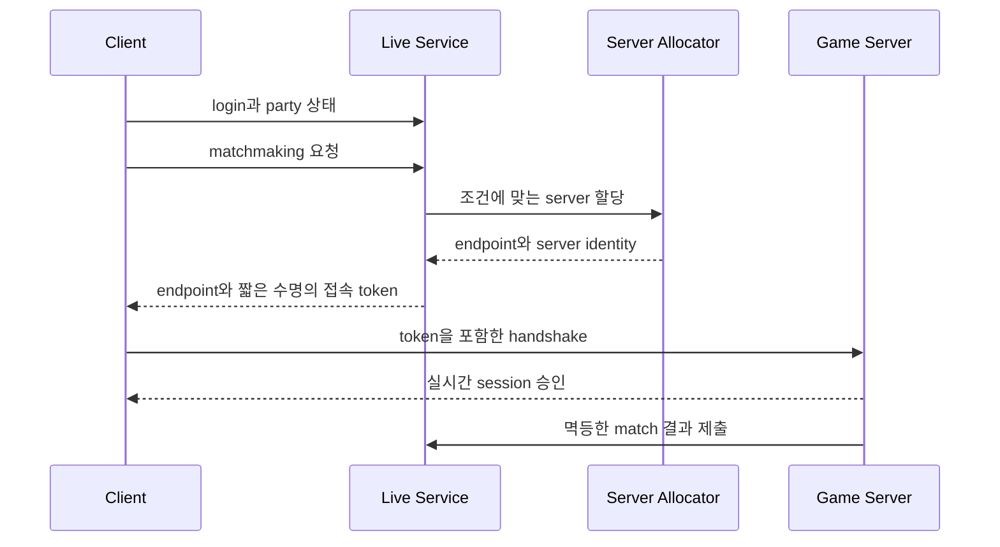

# 라이브 서비스 시리즈

게임 한 판의 실시간 simulation 바깥에서 계정, 콘텐츠, 경제, 분석, 고객 지원, 인증, 매치 배정과 server fleet을 운영하는 제어 경로를 다룬다. 요청 성공 여부가 영속 데이터와 플레이어 자산에 영향을 주므로 deadline, retry, idempotency, transaction, audit가 핵심 계약이다.

## 공통 핵심

| # | 문서 | 소유하는 모델 |
|---|---|---|
| 01 | [패치와 콘텐츠 배포](part01_patch.md) | manifest·chunk·CDN·version·rollback |
| 02 | [이벤트 운영](part02_event.md) | schedule·configuration·feature flag·timezone |
| 03 | [게임 경제](part03_economy.md) | source·sink·ledger·transaction·abuse boundary |
| 04 | [분석](part04_analytics.md) | event schema·sampling·cohort·experiment |
| 05 | [고객 지원](part05_support.md) | case·audit·복구 권한·개인정보 |
| 06 | [모니터링](part06_monitoring.md) | SLI·SLO·alert·incident·capacity |
| 07 | [계정과 인증](part07_account_auth.md) | identity·credential·token·recovery·ban |
| 08 | [매치메이킹](part08_matchmaking.md) | MMR·queue widening·party·region·quality metric |
| 09 | [게임 서버 Fleet](part09_game_server_fleet.md) | registration·allocation·drain·autoscaling·cost·failure |

## 제어 경로와 데이터 경로

라이브 서비스는 매치의 매 frame 상태를 전달하지 않는다. 로그인과 matchmaking을 마친 뒤 game server endpoint, match ID, audience, 만료 시각을 묶은 짧은 수명의 접속 token을 발급한다. 실시간 게임 서버는 이 token을 검증해 session을 만들고, match 결과는 멱등한 결과 ID와 함께 제어 경로로 반환한다.

## 완료 조건

- 중복 요청과 timeout 뒤 retry가 자산을 두 번 지급하지 않는가?
- match assignment와 server readiness 사이의 race를 상태 기계로 설명할 수 있는가?
- 진행 중 match를 새 build로 강제 이동하지 않고 drain할 수 있는가?
- 계정 정지와 token 만료가 이미 열린 game session에 어떻게 반영되는가?
- queue 품질, 대기 시간, region latency, fleet 여유분을 하나의 정책으로 측정하는가?

