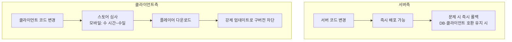
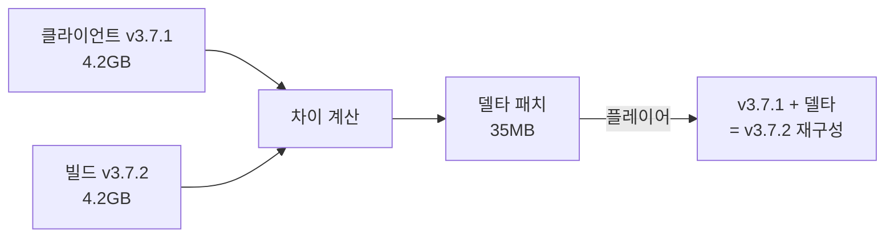
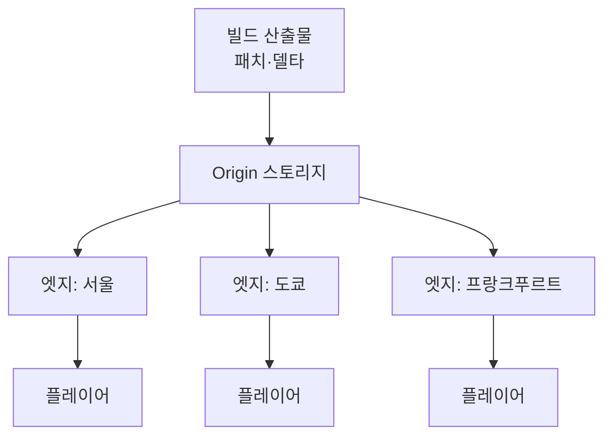
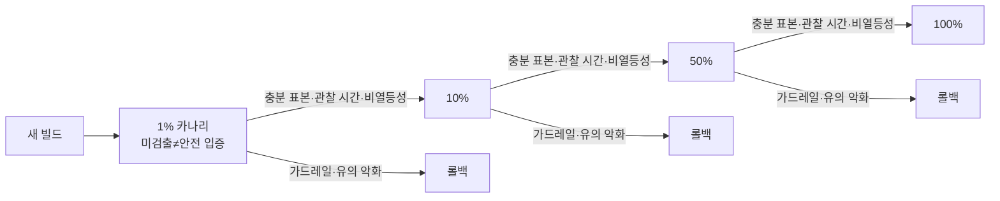
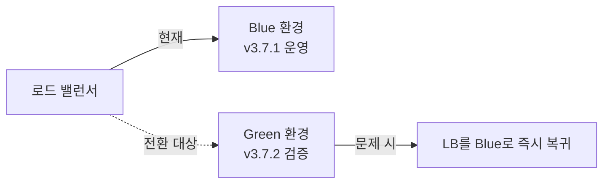
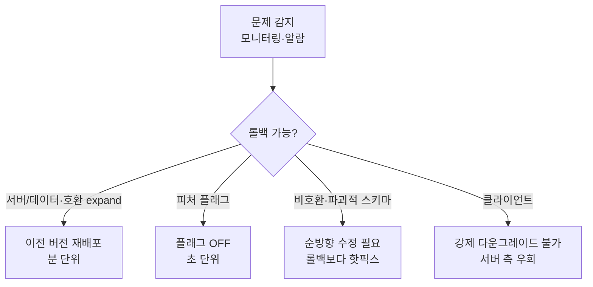
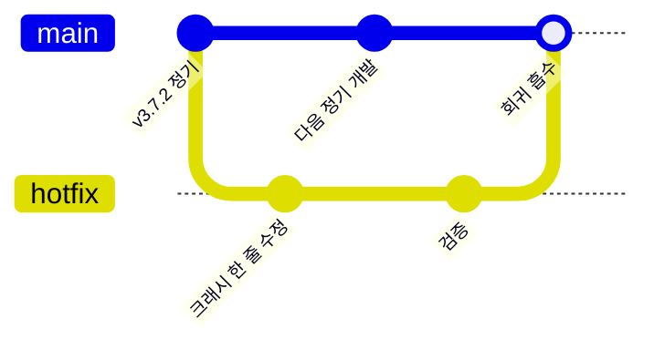
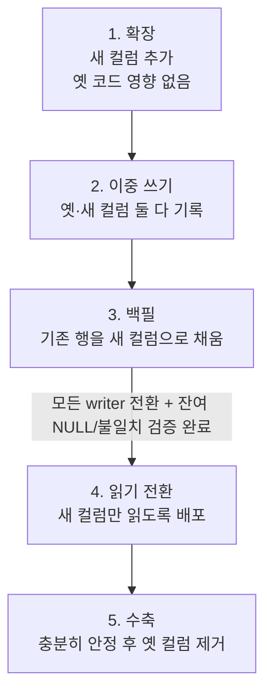
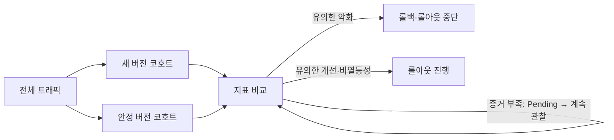
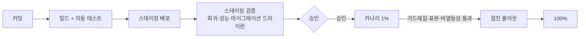

## 들어가며

라이브 서비스 게임의 패치는 *빠른 배포* 와 *안정성* 사이의 끝없는 줄다리기다. 플레이어는 버그 수정과 신규 콘텐츠를 하루라도 빨리 원하고, 경쟁 게임은 매주 무언가를 갱신하며, 밸런스 붕괴 하나가 며칠 만에 이탈을 부른다. 그래서 운영팀은 *더 자주, 더 빨리* 배포하라는 압력을 받는다. 그런데 검증 없이 배포한 패치 하나가 *전 서버를 다운* 시키고, 호환되지 않는 클라이언트가 *접속 자체를 막고*, 잘못된 마이그레이션이 *플레이어 자산을 영구 손실* 시킨다. 빠를수록 위험하고, 안전할수록 느리다.

이 글은 그 트레이드오프를 따라 라이브 패치 시스템을 한 흐름으로 정리한다. 패치를 무엇으로 쪼개고(클라이언트/서버, 데이터/코드), 클라이언트 빌드를 어떻게 작게 만들어(델타 패치) CDN으로 뿌리며, 버전을 어떻게 매겨 클라이언트와 서버의 호환을 보장하고 강제 업데이트를 거는지, 새 버전을 어떻게 점진적으로 노출(카나리·점진 롤아웃)해 폭발 반경을 줄이며, 문제가 터졌을 때 어떻게 되돌리고(롤백), 정기 패치 사이의 긴급 수정(핫픽스)을 어떻게 운영하고, 무중단으로 스키마를 바꾸고, 배포 후 무엇을 측정해 성공/실패를 판정하는지를 다룬다.


이 글의 목표.

1. **패치의 해부** — 클라이언트/서버, 코드/데이터 분리와 그에 따른 배포 비용.
2. **버전 관리와 호환성** — 시맨틱 버전, 호환 규칙, 강제 업데이트, 멀티 버전 공존.
3. **클라이언트 배포와 델타 패치** — 풀 빌드 대 델타, CDN 토폴로지, 무결성.
4. **점진적 롤아웃과 카나리** — 폭발 반경 축소, 블루-그린, 피처 플래그.
5. **롤백과 핫픽스** — 되돌릴 수 있게 설계, 긴급 수정의 운영.
6. **데이터 마이그레이션** — 스키마 변경의 무중단·확장-수축 패턴.
7. **배포 후 모니터링** — KPI, 크래시율, 성공/실패 판정.
8. **파이프라인과 조직** — CI/CD, 스테이징, 승인·회고.


---

## 목차
1. [패치의 해부 — 무엇을 쪼개는가](#1-패치의-해부--무엇을-쪼개는가)
2. [버전 관리와 호환성](#2-버전-관리와-호환성)
3. [클라이언트 배포와 델타 패치](#3-클라이언트-배포와-델타-패치)
4. [점진적 롤아웃과 카나리](#4-점진적-롤아웃과-카나리)
5. [롤백과 핫픽스](#5-롤백과-핫픽스)
6. [데이터 마이그레이션](#6-데이터-마이그레이션)
7. [배포 후 모니터링과 성공 판정](#7-배포-후-모니터링과-성공-판정)
8. [파이프라인과 조직](#8-파이프라인과-조직)


---

## 1. 패치의 해부 — 무엇을 쪼개는가

### 패치는 단일 덩어리가 아니다

"패치를 낸다"는 한 마디 안에는 성격이 전혀 다른 변경들이 섞여 있다. 서버 코드 변경, 클라이언트 실행 파일 변경, 게임 데이터(밸런스 수치·테이블) 변경, 데이터베이스 스키마 변경 — 이 넷은 *배포 비용, 위험, 되돌리기 난이도* 가 모두 다르다. 라이브 패치 시스템의 첫 설계는 이들을 *독립적으로 배포 가능한 축* 으로 분리하는 것이다.

| 축 | 누가 받나 | 배포 비용 | 롤백 난이도 | 강제성 |
|---|---|---|---|---|
| 서버 코드 | 서버만 | 중간 (재시작·롤링) | 중간 | 자동 |
| 클라이언트 코드 | 모든 플레이어 | 높음 (다운로드·스토어 심사) | 높음 (이미 설치됨) | 강제 업데이트 필요 |
| 게임 데이터 | 서버+클라이언트 | 낮음 (테이블 교체) | 낮음 (이전 테이블 복원) | 데이터만 갱신 |
| DB 스키마 | DB | 높음 (마이그레이션) | 매우 높음 (데이터 손실 위험) | 자동 |

이 표가 패치 전략의 출발점이다. *가장 자주 바꾸고 싶은 것* (밸런스 수치)이 *가장 싸고 안전한 축* (게임 데이터)에 있고, *가장 비싸고 위험한 축* (클라이언트 코드, 스키마)은 되도록 덜 건드린다. 밸런스 한 줄을 고치겠다고 클라이언트 풀 빌드를 다시 배포하는 것은 비용 구조를 거꾸로 쓰는 일이다.

### 코드와 데이터의 분리

라이브 운영의 민첩성은 *얼마나 많은 변경을 클라이언트 재배포 없이 처리하느냐* 로 결정된다. 핵심은 *데이터 주도(data-driven)* 설계다. 무기 데미지, 드롭 확률, 이벤트 일정, 상점 구성을 코드에 하드코딩하지 않고 *서버가 내려주는 데이터 테이블* 로 둔다.

```cpp
// 나쁨: 밸런스가 코드에 박혀 클라이언트 재배포가 필요하다
float GetSwordDamage() { return 42.0f; }

// 좋음: 서버가 내려주는 테이블에서 읽는다. 수치 변경에 재배포 불필요
struct WeaponData {
    int   id;
    float damage;
    float critRate;
    int   patchRevision;   // 이 데이터가 어느 리비전인지
};
WeaponTable g_weapons;     // 접속 시 서버에서 동기화
```

데이터 주도 설계의 효과는 정량적이다. 밸런스 변경을 코드 패치로 처리하면 *빌드 → 심사 → 다운로드 → 강제 업데이트* 의 며칠짜리 사이클을 거치지만, 데이터로 처리하면 *테이블 교체 → 서버 재로드* 로 분 단위에 끝난다. 라이브 서비스에서 "오늘 오후 드롭률을 올린다" 같은 운영이 가능한 것은 이 분리 덕분이다.

다만 모든 것을 데이터로 뺄 수는 없다. 새로운 *게임 로직* (새 스킬의 작동 방식, 새 시스템)은 코드를 요구한다. 경계는 "수치·구성은 데이터, 동작·구조는 코드"이며, 잘 설계된 게임은 그 경계를 *최대한 데이터 쪽으로* 민다.

### 서버 패치와 클라이언트 패치의 비대칭

서버와 클라이언트는 배포의 비대칭이 크다. 서버는 운영팀이 *완전히 통제* 한다 — 언제든 새 빌드를 올리고, 문제가 있으면 즉시 되돌린다. 클라이언트는 *이미 수백만 대의 기기에 설치* 되어 있고, 갱신하려면 플레이어가 다운로드를 받아야 하며, 모바일은 스토어 심사라는 *외부 지연* 까지 끼어든다.



이 비대칭이 설계 원칙을 낳는다. *가능하면 서버에서 고친다*. 클라이언트 버그라도 서버 측 우회(잘못된 요청을 서버가 보정, 문제 기능을 서버 플래그로 비활성화)로 막을 수 있으면, 클라이언트 재배포를 피한다. 클라이언트 패치는 *서버로 막을 수 없을 때의 최후 수단* 이며, 한 번 내보내면 되돌리기가 가장 어렵다.

## 2. 버전 관리와 호환성

### 무엇을 버전으로 식별하는가

라이브 서비스에서 "버전"은 단일 숫자가 아니다. 서버 빌드, 클라이언트 빌드, 데이터 리비전, 프로토콜 버전이 각각 진화하며, 이들의 *조합* 이 호환되는지가 접속 가부를 결정한다. 흔한 표기는 시맨틱 버전(SemVer)의 변형이다.

```text
ClientVersion = MAJOR.MINOR.PATCH      예: 3.7.2
  MAJOR : 프로토콜 비호환 변경 (구 클라이언트 접속 불가 → 강제 업데이트)
  MINOR : 기능 추가, 하위 호환 (구 클라이언트도 접속 가능)
  PATCH : 버그 수정, 호환 (자유 접속)

ProtocolVersion = 정수                  예: 41
  패킷 구조·핸드셰이크가 바뀔 때만 증가
DataRevision    = 정수                  예: 10583
  게임 데이터 테이블의 버전. 접속 시 동기화
```

핵심은 *프로토콜 버전을 클라이언트 버전과 분리* 하는 것이다. 클라이언트가 3.7.1에서 3.7.2로 올라가도 프로토콜이 그대로면(버그 수정만) 서버는 둘을 동등하게 받는다. 프로토콜 버전이 곧 *호환의 단위* 다.

### 호환성 규칙과 멀티 버전 공존

새 서버를 배포하는 순간 모든 플레이어가 즉시 새 클라이언트로 갈아타지는 않는다. 다운로드 중인 플레이어, 게임 중이라 갱신을 미룬 플레이어 때문에 *구버전과 신버전이 한동안 공존* 한다. 서버는 이 공존 구간을 견뎌야 한다.

```cpp
// 접속 핸드셰이크: 클라이언트 버전을 검사해 접속 정책을 결정한다
// 지원 범위는 g_minSupportedProtocol <= protocolVersion <= g_currentProtocol 이다
enum class VersionVerdict { Allow, ClientTooOld, ClientTooNew, Maintenance, Unsupported };

VersionVerdict CheckVersion(const ClientHello& hello) {
    if (g_serverState == ServerState::Maintenance)
        return VersionVerdict::Maintenance;
    if (hello.protocolVersion < g_minSupportedProtocol)
        return VersionVerdict::ClientTooOld;         // 지원 범위 미만 → 스토어 업데이트로 해결 가능
    if (hello.protocolVersion > g_currentProtocol)
        return VersionVerdict::ClientTooNew;         // 서버보다 앞섬(롤백 직후) → 업데이트로 해결 불가
    if (!g_supportedProtocols.count(hello.protocolVersion))
        return VersionVerdict::Unsupported;          // 범위 안이지만 지원 목록에 없는 프로토콜
    return VersionVerdict::Allow;                    // 호환 범위 내
}
```

`g_minSupportedProtocol` 과 `g_currentProtocol` 사이의 *범위* 가 멀티 버전 지원 폭이다. 이 폭이 넓으면 플레이어가 갱신을 미뤄도 접속이 되지만, 서버가 *여러 프로토콜을 동시에 해석* 하는 코드를 안고 가야 한다(분기, 어댑터). 폭이 좁으면 서버 코드는 깔끔하지만 강제 업데이트가 잦아 플레이어 경험이 나빠진다. 보통 *직전 1~2개 마이너 버전* 까지만 받고, 그 이전은 강제 업데이트로 정리한다.

### 강제 업데이트 대 선택적 업데이트

업데이트를 *강제* 할지 *선택* 으로 둘지는 호환성과 사업 판단이 함께 결정한다.

| 변경 성격 | 정책 | 이유 |
|---|---|---|
| 프로토콜 비호환 | 강제 업데이트 | 구버전이 서버와 통신 불가 |
| 보안·결제 결함 수정 | 강제 업데이트 | 구버전 방치가 위험 |
| 신규 콘텐츠(호환) | 선택적 | 구버전도 작동, 권장만 |
| 버그 수정(호환) | 선택적 또는 자동 | 다음 접속 시 자연 갱신 |

강제 업데이트는 *플레이어를 게임 밖으로 밀어내는* 비용이 크다. 갱신 다운로드가 느리거나 큰 시점에 강제하면 그 자리에서 이탈하는 플레이어가 생긴다. 그래서 강제 업데이트는 *프로토콜 비호환·보안* 처럼 불가피할 때로 한정하고, 나머지는 *조용한 권장* 으로 둔다.

```cpp
// 클라이언트 시작 시 버전 게이트
auto resp = QueryVersionGate(currentVersion);
if (resp.verdict == ClientTooOld) {
    ShowBlockingDialog("업데이트가 필요하다", resp.storeUrl);  // 업데이트로 해결 가능
    return;                                  // 진행 차단
} else if (resp.verdict == ClientTooNew) {
    ShowBlockingDialog("서버 점검 중이거나 버전이 맞지 않는다");  // storeURL 없음
    return;                                  // 스토어 업데이트로 해결되지 않음
} else if (resp.verdict == Maintenance || resp.verdict == Unsupported) {
    ShowBlockingDialog("접속할 수 없다", resp.statusMessage);
    return;                                  // 서버 상태/지원 정책 문제
} else if (resp.hasOptionalUpdate) {
    ShowDismissableBanner("새 버전이 있다");  // 권장만, 게임은 진행
}
```

### 프로토콜 호환을 깨지 않는 직렬화

프로토콜 비호환을 *최대한 미루는* 가장 실용적인 수단은 *진화 가능한 직렬화 포맷* 이다. 필드 추가가 구버전을 깨지 않도록 설계한다. Protocol Buffers, FlatBuffers 계열이 이 성질을 가진다 — 알 수 없는 필드는 무시하고, 빠진 필드는 기본값으로 처리한다.

```protobuf
message PlayerState {
  int64 player_id = 1;
  int32 level     = 2;
  // v41에서 추가. 구 클라이언트는 이 필드를 모르고 무시한다 → 호환 유지
  int32 prestige  = 3;
}
```

규칙은 단순하다. *필드 번호를 재사용하지 않는다*. *기존 필드의 의미를 바꾸지 않는다*. *제거 대신 deprecated 표시 후 방치한다*. 이 규율을 지키면 대부분의 변경이 *호환 추가* 로 끝나 강제 업데이트를 피할 수 있다. 다만 여기서 "호환"은 한 층이 아니다. *wire 호환* 은 직렬화 바이트를 서로 해석할 수 있는가, *source 호환* 은 API·생성 코드가 그대로 컴파일되는가, *semantic 호환* 은 같은 필드가 같은 의미로 쓰이는가를 뜻한다. Protocol Buffers에서 필드를 *삭제* 해도 번호를 `reserved`로 묶고 재사용하지 않으면 구버전은 모르는 번호를 무시하고 새 코드는 없는 필드를 기본값으로 읽어 wire 호환은 유지된다 — wire에서 깨지는 것은 번호 재사용이나 타입 변경이다. 반면 source 호환은 생성 API의 접근자가 사라져 깨질 수 있고, semantic 호환은 그 필드가 애플리케이션 필수 값이었으면 깨진다. FlatBuffers는 규칙이 더 까다롭다 — table은 deprecated로 남겨 진화시킬 수 있지만 struct는 필드를 추가·삭제하면 레이아웃이 어긋나 wire 호환이 깨진다. 따라서 프로토콜 버전을 올리는 기준은 "제거했는가"가 아니라 *어느 층의 호환이, 어떤 형식의 규칙 아래에서 깨졌는가*다.

## 3. 클라이언트 배포와 델타 패치

### 풀 빌드의 비용

클라이언트 빌드가 수 GB인 시대에, 패치마다 *전체를 다시 받게* 하는 것은 양쪽 모두에 비싸다. 플레이어는 긴 다운로드를 기다리고, 운영자는 *수백만 명 × 수 GB* 의 CDN 트래픽 비용을 낸다. 밸런스 몇 줄 바뀐 패치에 전체 재다운로드는 낭비다. 그래서 라이브 게임은 *델타 패치(delta patch)* 를 쓴다 — 이전 버전과 새 버전의 *차이만* 전송한다.



### 델타를 어떻게 계산하는가

델타 패치는 두 바이너리의 차이를 표현하는 *이진 디프(binary diff)* 다. 단순 바이트 비교가 아니라, 블록 단위로 *옮겨진 영역과 새 영역* 을 찾아 "기존 블록 복사 + 새 데이터 삽입"의 명령 스트림으로 인코딩한다(bsdiff, xdelta 계열의 아이디어).

```text
델타 = [복사 op: oldOffset 0,      len 1.2GB]   // 변하지 않은 영역
       [삽입 op: 새 데이터 35MB]                 // 새로 추가/변경된 코드·에셋
       [복사 op: oldOffset 1.2GB+,  len 3.0GB]   // 다시 변하지 않은 영역
```

에셋 패키징 방식이 델타 크기를 좌우한다. 에셋을 *콘텐츠 단위로 청크(chunk)* 화해 두면, 바뀐 청크만 새 청크로 교체되어 델타가 작아진다. 반대로 모든 에셋을 *하나의 거대 아카이브* 로 묶으면, 한 에셋 변경이 아카이브 전체 오프셋을 밀어 *변하지 않은 데이터까지 디프* 에 잡힌다. 그래서 패치 친화적 빌드는 에셋을 *안정적인 경계로 청크화* 하고, *결정적(deterministic) 빌드* 로 같은 입력이 같은 바이트를 내도록 보장한다.

### 왜 고정 블록은 한 바이트에 무너지고 콘텐츠 청킹은 견디는가 — 경계 이동과 재동기화

위 문단의 "오프셋 밀림"은 정성적 비유로 끝낼 문제가 아니다. *어디에 청크 경계를 긋느냐* 가 델타 크기를 결정 단위로 바꾸고, 그 차이는 닫힌 식으로 유도된다. 청크 스토어 방식(클라이언트가 가진 청크 해시와 매니페스트를 비교해 *없는 청크만* 받는 방식, 3절 매니페스트 절)을 전제로 두 경계 전략을 비교한다.

전제: 청크 스토어와 매니페스트 비교(매니페스트 절). 이론적 모델만 여기서 소유한다.

**고정 블록의 경계 이동 비용.** 파일 크기를 $N$, 블록 크기를 $B$로 고정하면 블록은 $N/B$개이고 경계는 위치 $0,B,2B,\dots$에 *못 박힌다*. 새 버전이 위치 $p$에 $\delta$바이트를 삽입하면 $p$ 이후의 모든 바이트가 $\delta$만큼 뒤로 밀린다. 블록 경계는 위치에 못 박혀 있으므로 $\delta\bmod B \neq 0$이고 데이터가 비반복적이면, 블록 $j=\lfloor p/B\rfloor$ 이후는 *담는 내용* 이 어긋나 해시가 달라진다. 반대로 $\delta$가 $B$의 배수면 뒤쪽 블록은 정확히 $\delta/B$블록만큼 이동한 옛 블록과 내용이 같아, 내용 해시 기반 청크 스토어에서는 재사용된다(모든 뒤쪽 청크가 항상 달라지는 것은 아니다). 즉 아래 근사는 *비정렬 삽입* 과 *중복 청크 없음* 을 전제로 한다. 재전송 블록 수는

$$
n_{\text{resend}} \approx \left\lceil \frac{N-p}{B} \right\rceil,\qquad \text{재전송 바이트} \approx N-p.
$$

삽입 위치 $p$가 균등분포면 기대 재전송은 $\mathbb{E}[N-p]=N/2$다. 즉 *한 바이트 삽입이 평균적으로 파일의 절반을 재전송* 시킨다. 빌드 타임스탬프 한 곳, 정렬 한 줄이 4GiB 클라이언트의 2GiB를 다시 받게 만드는 것이 이 항이다.

**콘텐츠 정의 청킹(CDC)의 컷 포인트.** 경계를 *위치* 가 아니라 *내용* 으로 정한다. 폭 $w$바이트의 롤링 해시 $r_i=H(\text{bytes}[i-w+1..i])$를 흘려보내며 $r_i \bmod 2^{k_c} = 0$인 위치 $i$만 경계로 삼는다(Rabin fingerprint/Gear 계열). 이상적 모델에서 각 위치가 *독립적으로* 확률 $q=2^{-k_c}$로 경계가 된다고 가정하면(주변 균등성만으로는 위치 간 독립이 나오지 않는다), 청크 길이는 기하분포를 따라 평균 청크 크기는

$$
\bar B = \frac{1}{q} = 2^{k_c}.
$$

(구현은 최소 청크 $m$을 강제해 그 전까지 술어를 검사하지 않으므로 무기억성에 의해 $\mathbb{E}[\text{길이}]=m+2^{k_c}$.)

**재동기화의 기대 규모.** 컷 포인트 $i$는 오직 바이트 $[i-w+1,i]$에만 의존한다. 따라서 삽입 영역을 (옛 파일 기준) 위치 $p$만큼 지나 새 파일에서 다시 $w$바이트를 더 흘리면, 그 시점의 롤링 윈도우에는 *옛 바이트만* 들어 있어 *옛 컷 포인트열이 재현* 되는 것이 기대된다. 교란은 위치 $p$ 주변의 국소 영역

$$
\text{교란 폭} \sim \delta + 2\bar B + w
$$

에 머무는 규모이며(결정적 상한이 아니다), 그 이전·이후의 청크는 바이트가 동일하므로 해시가 일치해 재전송되지 않는 것으로 모델링된다. 이 모델에서 재전송 규모는 $N$에 의존하지 않는다.

**정량 이득.** 삽입 한 곳에 대해 고정 블록은 기대 $N/2$를 재전송하고, CDC는 편집을 머금은 한두 청크만, 즉 $\delta + c\,\bar B$($c\approx 2$)를 재전송한다. $\delta \gg \bar B$가 아닐 때의 비율은

$$
\frac{N/2}{\delta + 2\bar B}\;\xrightarrow{\ \delta \gg \bar B\ }\;\frac{N}{2\delta}.
$$

수치로, $N=4$GiB·$\delta=4$MiB$+1$바이트(비정렬) 코드 변경·$\bar B=64$KiB면 고정 약 2GiB 대 CDC 약 4.1MiB(약 500배), $\delta=1$바이트(빌드 지문 한 곳)면 고정 2GiB 대 CDC 약 $2\bar B=128$KiB다. bsdiff·xdelta 같은 *바이너리 델타 도구*는 *서버가 두 특정 빌드 쌍을 직접 비교* 해 이 밀림을 스스로 흡수하지만, 그 대가로 버전쌍마다 디프를 미리 만들어야 한다(버전 점프 절 표의 $O(n^2)$). 이때 접미사 배열 기반은 bsdiff 쪽이고, xdelta는 two-level fingerprinting/문자열 매칭 계열로 구현 방식이 다르다. CDC는 디프 최적성을 약간 내주는 대신 *어떤 베이스에서 어떤 타깃으로든 공유 청크* 만으로 올라갈 수 있는 무상태 경로를 산다.

**청크 크기의 최적값.** 청크가 $N/\bar B$개이면 매니페스트는 청크당 해시 $h$바이트(SHA-256이면 $h=32$)로 $hN/\bar B$를 차지하고, $E$개의 흩어진 작은 편집은 각자 자기 청크를 통째 재전송해 청크 데이터 약 $E\bar B$를 만든다. 패치 한 번의 총 전송은

$$
f(\bar B) = E\,\bar B + \frac{hN}{\bar B},\qquad
f'(\bar B)=E-\frac{hN}{\bar B^{2}}=0 \;\Rightarrow\; \bar B^{\star}=\sqrt{\frac{hN}{E}}.
$$

$h=32$·$N=4$GiB·$E=1000$이면 $\bar B^{\star}=\sqrt{32\cdot2^{32}/1000}\approx 11.4$KiB다. 작은 편집이 많을수록 작은 청크, 큰 통짜 교체가 많을수록 큰 청크가 유리하다는 직관이 닫힌 식으로 떨어지고, FastCDC 계열 구현이 평균 청크를 8~64KiB대로 두는 것과 정합한다.

```python
import random, hashlib, math, statistics
random.seed(7)
GEAR=[random.getrandbits(64) for _ in range(256)]
def chunk(d,mask):
    out=[];s=0;h=0
    for i,b in enumerate(d):
        h=((h<<1)+GEAR[b])&0xFFFFFFFFFFFFFFFF
        if (h&mask)==0: out.append((s,i+1));s=i+1;h=0
    if s<len(d):out.append((s,len(d)))
    return out
def hs(d,c):return [hashlib.sha256(d[a:b]).hexdigest() for a,b in c]
k=12
for N in (200000,400000,800000):                      # CDC 재전송은 N과 무관
    d=bytes(random.getrandbits(8) for _ in range(N)); p=N//3; delta=500
    nd=d[:p]+bytes(random.getrandbits(8) for _ in range(delta))+d[p:]
    h1=set(hs(d,chunk(d,(1<<k)-1))); c2=chunk(nd,(1<<k)-1); h2=hs(nd,c2)
    r=sum(b-a for (a,b),x in zip(c2,h2) if x not in h1)
    print(f"N={N}: (고정 블록 가정 시 꼬리~{N-p}B), CDC 재전송={r}B")  # 고정 꼬리는 산술, CDC만 관측
print("B* =", round(math.sqrt(32*4*2**30/1000)), "B")   # = 11723 ~ 11.4KiB
```

검증: 위 시뮬은 $p=N//3$ 한 곳에 $\delta=500$바이트를 삽입한 세 입력에서 **CDC 재전송만** 관측한다. 관측된 CDC 재전송은 $N$이 4배로 커져도 한 청크(수 KB) 수준에 머물렀다. 비교용으로 출력한 고정 블록 꼬리 $N-p$는 실제로 측정한 값이 아니라 산술이며, 이 코드에는 고정 청크 구현·다중 삽입 위치·균등 삽입 샘플링·seed 반복·분포 통계가 없다. $\bar B^{\star}=\sqrt{hN/E}=11{,}723$바이트는 닫힌 식과 일치한다.

**실패 경계.** 위 유도는 최소·최대 청크와 경계별 해시 reset이 없는 *이상적 슬라이딩 윈도우* 를 모델로 삼았다. 실제 구현은 최소 청크 $m$ 강제(그 전까지 술어 검사 생략)와 최대 청크 상한, 컷마다 해시 상태 reset을 더해 이 모델을 바꾼다. 최소 청크 크기를 강제하지 않으면 0이 길게 이어지는 저엔트로피 영역에서 롤링 해시가 정체돼 거의 모든 위치가 컷이 되어 *청크 폭발* 이 나고, 청크당 해시 오버헤드 $h$가 데이터를 압도한다(절단 기하분포로 막는다). 최대 청크 크기를 강제하지 않으면 술어가 오래 안 터지는 영역에서 거대 청크가 생겨 한 바이트 편집이 큰 청크 전체를 재전송하는 *고정 블록의 약점이 부활* 한다. 윈도우 $w$가 너무 짧으면 경계가 짧은 반복 패턴에 상관돼 동기가 어긋나고, 너무 길면 재계산·지연이 는다(Gear 계열 구현은 48바이트 안팎을 쓴다). 그리고 이 모든 이점은 *결정적 빌드* 를 전제한다 — 타임스탬프·해시맵 순회 순서·병렬 링크 순서 같은 비결정성은 *변경되지 않은 영역의 청크 해시까지* 흔들어 CDC의 국소성을 무효화한다. 청크 친화적 빌드가 결정성을 요구하는 정량적 이유가 여기 있다.

### 버전 점프와 델타 체인

플레이어가 항상 직전 버전에서 올라오는 것은 아니다. 오랜만에 돌아온 플레이어는 v3.5.0에서 v3.7.2로 *여러 버전을 건너뛴다*. 두 가지 전략이 있다.

| 전략 | 방식 | 트레이드오프 |
|---|---|---|
| 델타 체인 | v3.5→v3.6→v3.7 순차 적용 | 저장 델타 적음, 다단계 적용 느림·실패 누적 |
| 버전쌍 델타 | (v3.5→v3.7) 직접 델타 미리 생성 | 빠름, 저장할 델타 쌍이 $O(n^2)$로 증가 |
| 폴백 풀 빌드 | 너무 멀면 전체 재다운로드 | 단순, 트래픽 큼 |

실무는 *혼합* 한다. 최근 몇 버전은 직접 델타를 미리 만들어 두고(빠른 경로), 너무 오래된 버전은 *풀 빌드로 폴백* 한다. 어느 경우든 적용 후 *해시 검증* 으로 재구성 결과가 목표 버전과 비트 단위로 같은지 확인한다 — 델타 적용 실패는 *손상된 클라이언트* 라는 최악의 상태를 만들기 때문이다.

```cpp
bool ApplyDelta(const Path& base, const Delta& delta, const Path& out) {
    if (!Reconstruct(base, delta, out)) return false;
    Hash got = Sha256File(out);
    if (got != delta.targetHash) {           // 재구성 결과 검증
        DeleteFile(out);
        return false;                        // 실패 → 풀 빌드로 폴백
    }
    return true;
}
```

### CDN 토폴로지와 무결성

델타든 풀 빌드든, 실제 전송은 *CDN(Content Delivery Network)* 이 담당한다. 원본(origin)에 한 번 올리면 전 세계 *엣지 서버* 가 캐시해 플레이어와 가까운 곳에서 내려준다. 이 구조가 *지연·대역폭·원본 부하* 를 동시에 해결한다.



CDN 운영에서 라이브 게임에 특유한 문제가 둘 있다.

- *캐시 무효화 대 불변 URL*: 같은 URL의 내용을 바꾸면 엣지 캐시가 *옛 내용을 계속 내려주는* 사고가 난다. 그래서 패치 파일은 *버전·해시를 URL에 박아 불변* 으로 둔다(예: `/patch/3.7.2/<hash>.delta`). 새 패치는 새 URL이므로 무효화가 필요 없다. 매니페스트(어느 버전이 어떤 URL인지)만 짧은 TTL로 갱신한다.
- *무결성 검증*: 전송 중 손상·중간자 변조를 막기 위해 각 청크의 *해시를 매니페스트에 서명* 해 둔다. 클라이언트는 받은 청크마다 해시를 검사하고, 다르면 다른 엣지에서 재시도한다.

```text
manifest.json (짧은 TTL, 서명됨)
{
  "version": "3.7.2",
  "protocol": 41,
  "chunks": [
    { "url": ".../a3f9.chunk", "sha256": "a3f9...", "size": 1048576 },
    { "url": ".../b71c.chunk", "sha256": "b71c...", "size": 524288 }
  ]
}
```

매니페스트가 *진실의 원천* 이다. 클라이언트는 매니페스트를 먼저 받아 *자신이 가진 청크와 비교* 해 빠진 것만 받는다. 이 비교가 곧 델타 다운로드의 실체이며, 청크 단위 해시가 *부분 재개·부분 검증* 을 가능하게 한다.

## 4. 점진적 롤아웃과 카나리

### 폭발 반경을 줄인다

새 서버 빌드를 *전체 서버에 한 번에* 배포하면, 그 빌드에 결함이 있을 때 *모든 플레이어가 동시에* 피해를 본다. 점진적 롤아웃(gradual rollout)의 핵심은 *폭발 반경(blast radius)* 을 줄이는 것이다 — 새 버전을 *일부에게만 먼저* 노출하고, 문제가 없으면 점차 비율을 올린다.



### 카나리 배포

*카나리(canary)* 는 점진 롤아웃의 첫 단계다. 탄광의 카나리처럼, 소수의 트래픽을 새 빌드로 보내 *위험을 먼저 감지* 한다. 카나리에 보낼 트래픽은 여러 기준으로 나눈다.

- *비율 기반*: 전체 세션의 1%를 새 빌드로 라우팅.
- *서버 단위*: 전체 서버 중 한 채널/한 지역만 새 빌드로.
- *내부 우선*: 직원·테스터 계정을 먼저, 그 다음 일반 플레이어.

카나리의 가치는 *자동 판정* 과 결합할 때 나온다. 카나리 그룹의 핵심 지표(크래시율, 에러율, 지연)를 *기준 그룹과 비교* 해, 통계적으로 악화되면 자동으로 롤아웃을 멈추거나 되돌린다.

```cpp
// 카나리 자동 판정: 새 빌드 그룹 vs 안정 빌드 그룹의 지표 비교
enum class CanaryDecision { Pending, Pass, Fail };

struct CanaryEvidence {
    bool absoluteGuardrailViolated = false;      // 절대 상한 위반
    bool credibleRegression        = false;      // 안정군 대비 유의한 악화
    bool enoughBaselineSamples     = false;      // baseline 표본 충분
    bool enoughCanarySamples       = false;      // canary 표본 충분
    bool minimumObservationTimeReached = false;  // 최소 관찰 시간 경과
    bool nonInferioritySupported   = false;      // 비열등성(악화 아님) 입증
};

CanaryDecision Evaluate(const CanaryEvidence& e) {
    if (e.absoluteGuardrailViolated || e.credibleRegression)
        return CanaryDecision::Fail;             // 악화 확인 → 중단·롤백
    if (!e.enoughBaselineSamples || !e.enoughCanarySamples ||
        !e.minimumObservationTimeReached)
        return CanaryDecision::Pending;          // 증거 부족 → 계속 관찰
    if (!e.nonInferioritySupported)
        return CanaryDecision::Pending;          // 검출 실패 ≠ 안전 입증
    return CanaryDecision::Pass;                 // 충분한 증거로 승급 가능
}
```

판정의 함정은 *표본 부족* 과 *미검출을 안전으로 착각하는 것* 이다. Pending은 "아직 abort하지 않음"일 뿐 승급 승인도 안전성 입증도 아니며, Pass는 baseline·canary 양쪽 표본과 최소 관찰 시간을 채운 뒤 *비열등성* 이 지지될 때만 나온다. 1% 카나리에서 크래시 한 건이 났다고 즉시 롤백하면 *정상 노이즈에 과민반응* 하지만, 표본이 부족해 차이를 검출하지 못한 것을 "차이 없음"으로 읽어 승급하면 위험을 놓친다. 최소 표본 수는 보편 상수(예: 5000)가 아니라 지표별 최소 검출 변화·분산·오류율·다중 비교·관찰 기간에 맞춰 정하고, *비율(ratio)* 과 절대 가드레일을 함께 본다.

### 블루-그린 배포

점진 롤아웃이 *비율* 로 위험을 나눈다면, 블루-그린(blue-green)은 *환경 두 벌* 로 전환을 즉시·가역적으로 만든다. 현재 운영 환경(blue)과 동일 구성의 대기 환경(green)을 두고, 새 빌드를 green에 올려 검증한 뒤 *라우터를 green으로 전환* 한다.



블루-그린의 강점은 *롤백이 라우터 스위치 한 번* 이라는 점이다. 새 환경에 문제가 보이면 트래픽을 *즉시 옛 환경으로* 되돌린다 — 옛 환경은 그대로 떠 있으므로 재배포가 필요 없다. 대가는 *두 배의 인프라* 다. 그래서 전체 블루-그린은 비용이 크고, 실무에서는 *카나리(비율 롤아웃)와 혼합* 하거나, *상태 없는(stateless) 게이트웨이 계층* 에만 블루-그린을 적용한다.

### 피처 플래그 — 코드와 노출의 분리

점진 롤아웃은 *어느 빌드를 받느냐* 를 나누지만, 피처 플래그(feature flag)는 *이미 배포된 코드 안에서 기능을 켜고 끈다*. 새 기능을 *꺼진 채* 배포해 두고, 운영자가 *런타임에 비율을 올리며* 노출한다. 배포와 출시를 분리하는 기법이다.

```cpp
// 새 매칭 알고리즘을 코드에는 넣되, 플래그로 노출을 통제한다
if (g_flags.IsEnabled("new_matchmaking", player)) {
    result = NewMatchmaking(player);     // 일부에게만
} else {
    result = LegacyMatchmaking(player);  // 나머지는 기존 경로
}
```

피처 플래그의 운영 가치는 *재배포 없는 즉시 차단* 이다. 새 기능이 문제를 일으키면, 빌드를 되돌리지 않고 *플래그만 꺼서* 모든 플레이어를 기존 경로로 되돌린다. 이는 5절의 롤백보다 빠르고 안전하다 — 코드는 그대로 두고 *동작만* 끄기 때문이다. 단점은 *플래그 부채* 다. 켜고 끄는 두 경로가 코드에 공존하므로, 출시가 확정된 플래그는 *제때 제거* 하지 않으면 분기가 누적되어 코드가 썩는다.

## 5. 롤백과 핫픽스

### 되돌릴 수 있게 설계한다

라이브 패치에서 *롤백 가능성* 은 사후 대응이 아니라 *사전 설계* 다. 배포하기 전에 "이 패치가 잘못되면 어떻게 되돌리는가"의 답이 있어야 한다. 답이 없는 패치는 *되돌릴 수 없는 패치* 이며, 그 자체로 위험 신호다.

축마다 롤백 비용이 다르다(1절 표). 가장 쉬운 것은 *서버 코드와 게임 데이터* 다 — 이전 빌드/이전 테이블을 다시 배포하면 끝난다. 가장 어려운 것은 *DB 스키마와 클라이언트* 다 — 스키마는 데이터를 이미 바꿔놓았을 수 있고(6절), 클라이언트는 이미 설치되어 강제 다운그레이드가 사실상 불가능하다.



이 그림이 롤백 전략의 우선순위다. *플래그로 끌 수 있으면 끄고*, *서버/데이터면 재배포하고*, *스키마·클라이언트처럼 되돌릴 수 없으면 순방향 핫픽스* 로 간다. 그래서 위험한 변경일수록 *피처 플래그 뒤에 두고, 스키마는 호환을 유지하며* 배포해 롤백 경로를 미리 확보한다.

### 롤백이 불가능한 변경

모든 패치가 되돌릴 수 있는 것은 아니다. *비가역(irreversible) 변경* 의 대표는 이렇다.

- *파괴적 스키마 변경*: 컬럼을 삭제하면, 롤백한 코드가 그 컬럼을 다시 찾는다. 이미 삭제된 데이터는 복원되지 않는다.
- *데이터 변형*: 마이그레이션이 기존 데이터를 *덮어쓰면*, 이전 코드는 변형된 데이터를 잘못 해석한다.
- *외부 영향*: 결제 처리, 푸시 발송, 외부 API 호출은 *이미 일어난 일* 이라 되돌릴 수 없다.

비가역 변경은 *확장-수축 패턴(expand-contract)* 으로 가역 구간을 늘린다(6절에서 상술). 핵심 원칙은 *한 패치에서 추가만 하고, 제거는 충분히 안정화된 다음 패치에서* 한다는 것이다. 추가는 되돌리기 쉽고, 제거는 비가역이기 때문이다.

### 핫픽스 — 정기 패치 밖의 긴급 수정

정기 패치는 검증을 거쳐 예정된 시점에 나간다. 그런데 라이브 서비스는 *예정에 없던 긴급 결함* 을 만난다 — 출시 직후 발견된 크래시, 악용되는 버그, 결제 오류. 이때 다음 정기 패치를 기다릴 수 없어 *핫픽스(hotfix)* 를 낸다.

핫픽스는 *빠름과 안전의 트레이드오프가 극단으로 치우친* 패치다. 검증 시간이 짧으므로, 위험을 *변경 범위로* 통제한다.

| 원칙 | 이유 |
|---|---|
| 최소 변경 | 한 줄만 고친다. 곁다리 개선을 끼워 넣지 않는다 |
| 정기 빌드에서 분기 | 검증된 안정 빌드에 *그 수정만* 얹는다 |
| 카나리 우선 | 긴급해도 1%→전체의 빠른 점진 노출은 유지 |
| 롤백 경로 확보 | 핫픽스조차 되돌릴 수 있어야 한다 |
| 사후 회귀 흡수 | 핫픽스 내용을 다음 정기 빌드에 반드시 머지 |



가장 흔한 핫픽스 사고는 *회귀 흡수 누락* 이다. 핫픽스를 운영 브랜치에만 적용하고 다음 정기 빌드에 머지하지 않으면, 다음 패치가 *고쳤던 버그를 되살린다*. 그림처럼 핫픽스 브랜치는 *반드시 메인으로 다시 머지* 되어야 한다.

## 6. 데이터 마이그레이션

### 스키마 변경이 위험한 이유

라이브 서비스의 데이터베이스는 *항상 켜져 있고, 항상 쓰이고, 플레이어의 자산을 담는다*. 스키마를 바꾸는 일은 그 와중에 *달리는 차의 엔진을 교체* 하는 것과 같다. 잘못하면 *다운타임, 데이터 손실, 코드-스키마 불일치* 가 한꺼번에 터진다.

가장 단순한(그러나 나쁜) 접근은 *점검을 걸고 한 번에 바꾸는* 것이다. 서버를 내리고, 마이그레이션 스크립트를 돌리고, 새 코드를 올린다. 이는 *다운타임* 을 만들고, 마이그레이션이 길면 점검이 길어지며, 중간에 실패하면 *복구가 막막* 하다.

### 확장-수축 패턴

무중단 마이그레이션의 표준은 *확장-수축(expand-contract)* 이다. 스키마 변경을 *여러 패치에 걸쳐 단계적으로* 진행해, 매 시점에 *옛 코드와 새 코드가 동시에 동작* 하도록 한다.



각 단계가 *작고 가역적* 이라는 점이 핵심이다.

```sql
-- 1. 확장: nullable로 추가. 기존 행·옛 코드에 영향 없음 (가역)
ALTER TABLE players ADD COLUMN nickname_v2 VARCHAR(32) NULL;
```

```cpp
// 2. 이중 쓰기: 새 코드는 두 컬럼 모두에 쓴다 (옛 코드와 공존 가능)
void UpdateNickname(PlayerId id, const std::string& name) {
    db.Exec("UPDATE players SET nickname=?, nickname_v2=? WHERE id=?",
            name, Normalize(name), id);
}
```

```sql
-- PostgreSQL 예시: 작은 PK 배치를 고른 뒤 갱신한다.
WITH batch AS (
    SELECT player_id
    FROM players
    WHERE nickname_v2 IS NULL
    ORDER BY player_id
    LIMIT 1000
    FOR UPDATE SKIP LOCKED
)
UPDATE players AS p
SET nickname_v2 = normalize(p.nickname)
FROM batch
WHERE p.player_id = batch.player_id;
```

읽기를 새 컬럼으로 전환한 뒤 충분한 관찰 기간을 두고 옛 컬럼을 제거한다. 옛 컬럼을 남기는 것은 롤백 가능성의 **필요조건**이지 충분조건이 아니다. 이중 쓰기 중 일부만 실패했거나 변환 함수의 의미가 바뀌었거나 새 코드가 옛 코드가 표현할 수 없는 값을 썼다면, 코드만 되돌려도 옛 컬럼은 이미 stale하거나 손상됐을 수 있다. 수축을 늦추는 것과 함께 dual-write 불일치율, backfill checkpoint, 양방향 읽기 비교, 재실행 가능한 변환을 유지해야 한다. 특히 쓰기 경로가 여럿이면 새 코드만 이중 쓰는 것으로는 부족하다 — 구버전 writer가 `nickname`만 갱신하면 백필이 끝난 행이 다시 stale해진다. 읽기 전환 전에 *모든 writer* 를 이중 쓰기로 전환하거나 DB trigger/CDC로 새 컬럼을 동기화하고, 구버전 writer를 차단(writer fence)해야 한다. 백필이 도는 동안 최신 값이 들어오면 백필이 옛 값을 덮어쓸 수 있으므로, 백필 술어를 버전/조건으로 제한해 stale backfill 경합을 막는다.

### 무결성 검증과 백업

마이그레이션은 *검증과 복구 계획* 없이 실행하지 않는다.

- *백필 검증*: 새 컬럼으로 채운 값이 옛 값과 *논리적으로 일치* 하는지 표본·전수 비교한다. 행 수, 합계, 샘플 해시를 옛/새로 대조한다.
- *백업*: 마이그레이션 직전 *복원 가능한 스냅샷* 을 확보한다. 비가역 단계 전에는 반드시.
- *드라이런*: 운영과 같은 규모의 스테이징(8절)에서 마이그레이션을 *먼저 돌려* 소요 시간·락 영향·실패 지점을 측정한다.

```sql
-- 백필 검증: NULL 잔여와 값 불일치를 따로 센다 (normalize(nickname)는 NOT NULL 계약)
SELECT count(*) AS missing_rows FROM players
WHERE nickname_v2 IS NULL;                  -- 0이어야 백필 완료

SELECT count(*) AS mismatched_rows FROM players
WHERE nickname_v2 IS NOT NULL
  AND nickname_v2 <> normalize(nickname);   -- 0이어야 값 일치
-- NULL을 제외하는 <> 비교만으로는 전체 미백필(NULL 잔여)을 검출하지 못한다
```

마이그레이션 롤백 시나리오는 단계별로 다르다. 확장 직후에는 대개 코드 롤백만으로 충분하다. 이중 쓰기·백필 이후에는 먼저 옛 표현이 최신인지 검증하고, divergence가 있으면 repair job이나 forward fix를 실행한 뒤 읽기를 되돌린다. 수축 뒤에는 옛 binary와 schema가 호환되지 않으므로 복원·재생 또는 새 forward migration이 필요하다. “수축 전에는 롤백 경로를 유지하기 쉽다”가 정확한 성질이며, *항상 가역*은 아니다.

## 7. 배포 후 모니터링과 성공 판정

### 배포는 끝이 아니라 시작이다

패치를 내보낸 순간이 *가장 위험한 순간* 이다. 스테이징에서 통과한 것이 실제 트래픽·실제 기기·실제 네트워크에서 다르게 동작할 수 있다. 그래서 배포 직후 *집중 모니터링 창(window)* 을 두고, 사전에 정의한 지표가 정상 범위에 드는지 *실시간으로* 확인한다.

| 지표 | 의미 | 위험 신호 |
|---|---|---|
| 크래시율 (crash rate) | 세션당 클라이언트 비정상 종료 | 직전 버전 대비 급증 |
| 서버 에러율 | 5xx·예외·핸들러 실패 비율 | 임계치 초과 → 결함 |
| 로그인 성공률 | 접속 시도 대비 성공 | 하락 → 버전 게이트·인증 문제 |
| 동시 접속(CCU) | 실시간 접속 수 | 급락 → 강제 업데이트 이탈·차단 |
| 패치 적용 성공률 | 다운로드·델타 적용 성공 | 하락 → 델타·CDN 문제 |
| p99 지연 | 상위 1% 응답 시간 | 상승 → 성능 회귀 |

```cpp
// 배포 후 모니터링: 절대 floor와 직전 버전 기준 상대 회귀를 분리해 호출한다
struct ReleaseHealth {
    float crashRate, errorRate, loginSuccessRate;   // 모두 비율(0~1) 단위
    int   ccu;
    float patchApplyRate, p99LatencyMs;
};

// 1) 절대 하한: 기준선과 무관하게 넘으면 안 되는 운영 floor
bool AbsoluteFloorViolated(const ReleaseHealth& now) {
    if (now.loginSuccessRate < 0.95f)  return true;   // 로그인 성공률 95% (절대 하한)
    if (now.patchApplyRate   < 0.98f)  return true;   // 패치 적용 성공률 98%
    return false;
}

// 2) 상대 회귀: 직전 안정 버전 대비 악화. %와 %p를 혼동하지 않는다
bool RelativeRegressionDetected(const ReleaseHealth& now, const ReleaseHealth& baseline) {
    if (now.crashRate > baseline.crashRate * 1.3f)                return true;
    if (now.errorRate > baseline.errorRate * 1.5f)                return true;
    if (now.loginSuccessRate < baseline.loginSuccessRate * 0.95f) return true;  // 5% 상대 하락
    return false;
}
```

### 기준선 비교와 코호트

성공 판정은 절대 guardrail과 기준선 비교를 함께 쓴다. 크래시율 0.5%가 직전 버전보다 좋아도 제품의 허용 상한을 넘을 수 있고, 직전 버전 자체가 이미 장애 상태일 수도 있다. 새 버전과 안정 버전을 같은 시간대에 비교하면 공통 변동을 줄일 수 있지만 차이가 자동으로 버전의 순수한 인과 효과가 되지는 않는다. OS·기기·리전·신규 사용자처럼 업데이트 eligibility가 다른 선택 편향, rollout 중 학습 효과, 표본 수와 반복 검정이 남는다. 가능한 경우 사용자나 세션을 안정 해시로 무작위 배정하고 주요 층별 지표와 신뢰구간을 함께 본다.



### 에러 로그와 성공 기준

지표가 *무엇이* 나빠졌는지를 알려준다면, *에러 로그·크래시 리포트* 는 *왜* 인지를 알려준다. 클라이언트 크래시 덤프와 서버 예외 스택을 *버전·플랫폼·디바이스별로 집계* 해, 새 버전에서만 *새로 나타난* 시그니처를 찾는다. 이 "신규 크래시 시그니처"가 회귀의 직접 증거다.

패치의 성공/실패는 *배포 전에 명시한 기준* 으로 판정한다. 이때 절대 floor와 상대 회귀는 다른 게이트다. 로그인 성공률 95%·패치 적용 성공률 98% 같은 값은 기준선과 무관한 *절대 하한* 이고, 크래시율 1.3배·로그인 성공률 5% 상대 하락 같은 값은 직전 안정 버전 대비 *상대 회귀* 다. 두 게이트를 함께 통과해야 성공이며, 백분율(%)과 %p를 섞지 않는다. "크래시율이 기준선의 1.3배를 넘지 않고, 로그인 성공률이 절대 95% 이상이면서 기준선 대비 5% 넘게 떨어지지 않으며, 패치 적용 성공률 98% 이상이면 성공"처럼 *숫자로* 정한다. 기준을 *사후에* 정하면 "이 정도면 괜찮다"는 편향이 끼어든다. 사전 기준이 있어야 *자동 카나리 게이트* (4절)와 *롤백 결정* 이 사람의 직감이 아니라 데이터로 작동한다.

## 8. 파이프라인과 조직

### CI/CD와 스테이징

여기까지의 전략(델타, 카나리, 롤백, 마이그레이션)은 *자동화된 파이프라인* 위에서만 반복 가능하다. 손으로 빌드하고 손으로 배포하면, 빠른 패치도 안전한 패치도 못 된다. CI/CD 파이프라인이 *커밋에서 배포까지* 를 일관된 단계로 묶는다.



*스테이징(staging)* 은 운영과 *최대한 같게* 구성한 사전 환경이다. 같은 구성·같은 데이터 규모일수록 스테이징의 통과가 운영의 통과를 예측한다. 6절의 마이그레이션 드라이런, 성능·부하 테스트, 회귀 테스트가 여기서 돈다. 다만 스테이징은 *실제 트래픽의 다양성* 을 재현하지 못하므로, 스테이징 통과가 끝이 아니라 *카나리* 가 마지막 관문이다.

### 자동화된 테스트의 층위

검증 시간과 신뢰도의 트레이드오프를 테스트 *층위* 로 나눈다.

| 층위 | 범위 | 속도 | 잡는 결함 |
|---|---|---|---|
| 유닛 테스트 | 함수·모듈 단위 | 빠름(초) | 로직 회귀 |
| 통합 테스트 | 컴포넌트 간 연동 | 중간(분) | 인터페이스 불일치 |
| 회귀 테스트 | 기존 기능 전반 | 느림(분~시간) | 의도치 않은 부작용 |
| 부하 테스트 | 동시성·성능 | 느림 | 성능 회귀·병목 |

자동화의 목표는 *빠른 피드백* 이다. 유닛·통합 테스트는 *모든 커밋* 에서 돌려 빠르게 거르고, 느린 회귀·부하 테스트는 *배포 후보* 에 대해서만 돌린다. 핵심은 *호환성 테스트* 다 — 신버전 서버 + 구버전 클라이언트, 구버전 서버 + 신버전 클라이언트 조합을 자동으로 검증해, 2절의 멀티 버전 공존이 실제로 깨지지 않는지 확인한다.

### 승인, 권한, 회고

기술만으로 라이브 패치가 굴러가지 않는다. *누가 무엇을 승인하고, 장애 시 누가 결정하는가* 가 정해져 있어야 한다.

- *승인 권한*: 정기 패치는 정해진 검증을 거쳐 승인된다. 핫픽스(5절)는 긴급한 만큼 *간소화된 긴급 승인* 경로를 두되, 사후에 정식 절차로 추인한다. 권한이 명확해야 새벽에 터진 장애에 *결정이 멈추지 않는다*.
- *장애 대응 플레이북*: "크래시율 급증 시 → 카나리 중단 → 5분 내 회복 없으면 롤백 → 플래그 차단 검토"처럼, 장애 유형별 *대응 순서를 사전에 문서화* 한다. 장애 한복판에서 절차를 만들지 않는다.
- *패치 이력*: 어떤 버전이 언제, 무엇을 바꿔, 어떤 결과를 냈는지 *추적 가능* 하게 남긴다. 버전 태그·체인지셋·배포 시각·롤백 여부가 한 곳에 모여야, 사고가 났을 때 *어느 패치가 원인인지* 를 빠르게 좁힌다.
- *사후 회고(postmortem)*: 장애를 *개인 책임* 이 아니라 *시스템 결함* 으로 본다. "왜 막지 못했는가"를 비난 없이 분석해, 같은 결함이 다시 통과하지 못하도록 *테스트·게이트·플레이북* 을 보강한다. 회고가 다음 패치를 더 안전하게 만든다.

조직의 성숙도는 *배포 빈도와 장애 회복 시간* 으로 드러난다. 잘 굴러가는 라이브 서비스는 *자주 배포하면서도 빠르게 회복* 한다 — 작은 패치를 자주 내보내(폭발 반경 축소), 문제를 빨리 감지하고(모니터링), 빨리 되돌린다(롤백·플래그). 드물게 크게 배포하는 조직이 오히려 *한 번의 사고가 치명적* 이다.


---

## 결론

라이브 패치의 모든 결정은 *빠른 배포 ↔ 안정성* 의 트레이드오프 위에 놓인다. 그런데 이 둘은 단순한 양자택일이 아니다. 패치를 *작은 가역 단위로 쪼개고*, *폭발 반경을 줄여 노출* 하면, 빠름과 안전을 *동시에* 얻을 수 있다. 작은 변경은 빠르게 내보내도 위험이 작고, 점진 노출은 문제를 *전체로 번지기 전에* 잡으며, 가역 설계는 *되돌릴 수 있어* 시도의 비용을 낮춘다.

이 트레이드오프를 다루는 기반 구조는 일관된다. 코드와 데이터를 분리해 자주 바꾸는 것을 싼 축에 두고, 버전과 프로토콜로 호환을 관리하며, 델타 패치와 CDN으로 클라이언트 전송 비용을 줄이고, 카나리와 점진 롤아웃으로 폭발 반경을 좁히며, 피처 플래그와 확장-수축 패턴으로 *언제든 되돌릴 수 있는 상태* 를 유지하고, 사전에 정의한 지표로 성공을 판정한다. 그 바닥에는 *되돌릴 수 없는 변경을 최대한 미룬다* 는 하나의 원칙이 깔린다.

기술은 절반이다. 나머지 절반은 *자동화된 파이프라인과 조직의 규율* 이다 — CI/CD가 반복 가능성을 보장하고, 명확한 승인·플레이북이 장애에 결정을 멈추지 않게 하며, 비난 없는 회고가 같은 결함의 재발을 막는다. 라이브 서비스의 성패는 결국 *얼마나 자주 배포하면서도 얼마나 빨리 회복하느냐* 에 달렸고, 이 글의 모든 기법은 그 두 숫자를 함께 끌어올리기 위한 도구다.

## 더 읽을거리

- Google, "Site Reliability Engineering" — 카나리 배포·점진 롤아웃·에러 버짓·무중단 운영의 입문 표준. 주장과 맞는 직접 근거는 같은 저자군의 "The Site Reliability Workbook" 중 "Canarying Releases"·"Alerting on SLOs" 장이며, 이 책은 4절의 5000 표본 수치의 근거가 아니다.
- Martin Fowler, "BlueGreenDeployment"·"FeatureToggle"; Danilo Sato, "ParallelChange(expand-contract)" (모두 martinfowler.com bliki) — 배포·플래그·마이그레이션 패턴의 원전.
- Jez Humble & David Farley, "Continuous Delivery" — CI/CD 파이프라인과 배포 자동화의 기초.
- Colin Percival, bsdiff ("Naive differences of executable code", 2003) / Joshua MacDonald, xdelta — 이진 델타 알고리즘의 구현 참고.
- M. O. Rabin, "Fingerprinting by Random Polynomials" (Harvard Univ. Center for Research in Computing Technology, TR-15-81, 1981) — 롤링 핑거프린트와 콘텐츠 정의 경계의 원전.
- A. Muthitacharoen, B. Chen, D. Mazières, "A Low-Bandwidth Network File System" (SOSP 2001) — 중복 제거를 위한 콘텐츠 정의 청킹(LBFS)의 도입.
- A. Tridgell & P. Mackerras, "The rsync algorithm" (Australian National Univ., TR-CS-96-05, 1996) — 롤링 체크섬 블록 정합으로 차분 전송.
- W. Xia et al., "FastCDC: a Fast and Efficient Content-Defined Chunking Approach for Data Deduplication" (USENIX ATC 2016) — 최소·최대·정규화 청킹과 빠른 Gear 해시.
- Protocol Buffers / FlatBuffers 스키마 진화 가이드 — 호환을 깨지 않는 직렬화 규칙.
