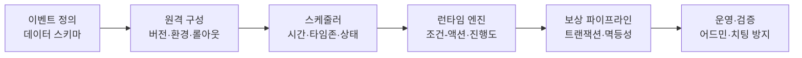
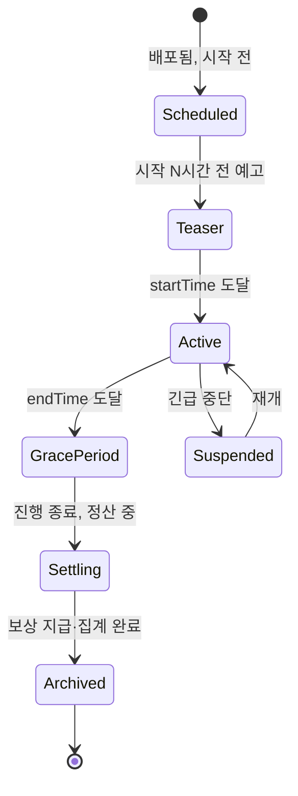
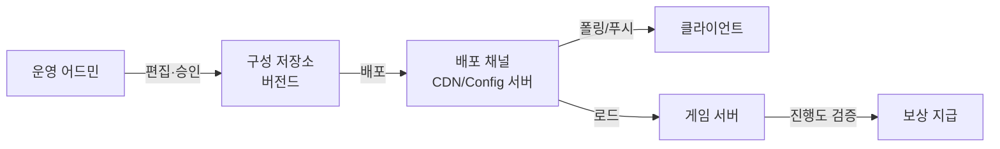
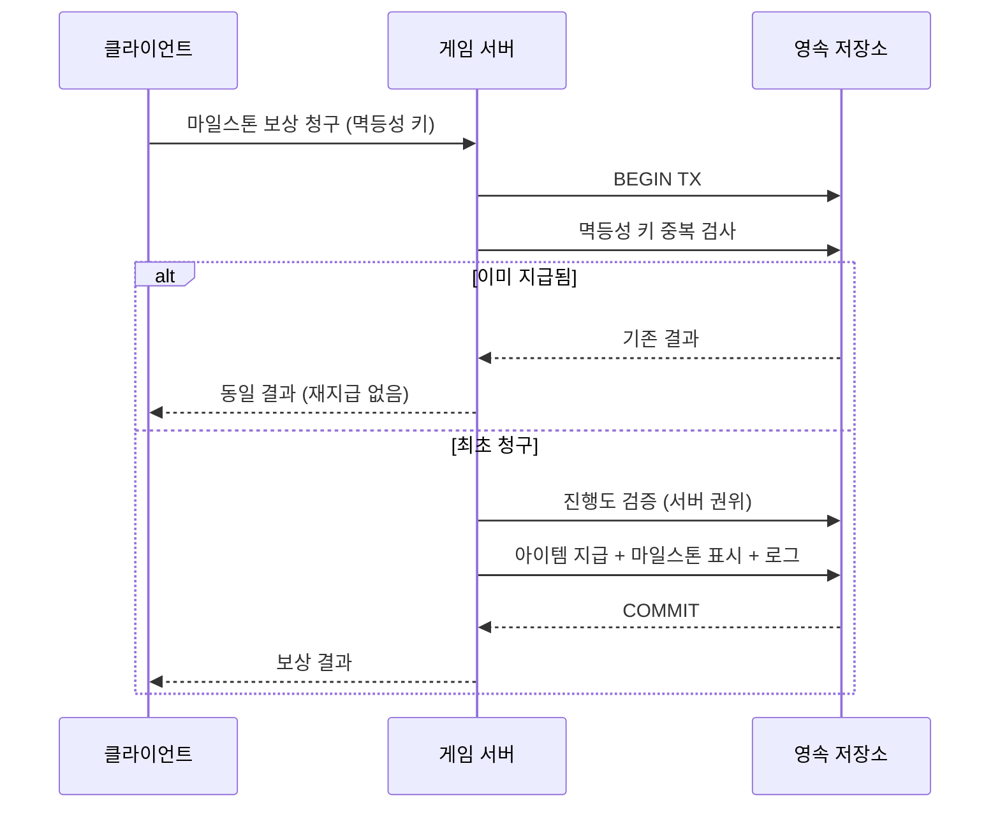
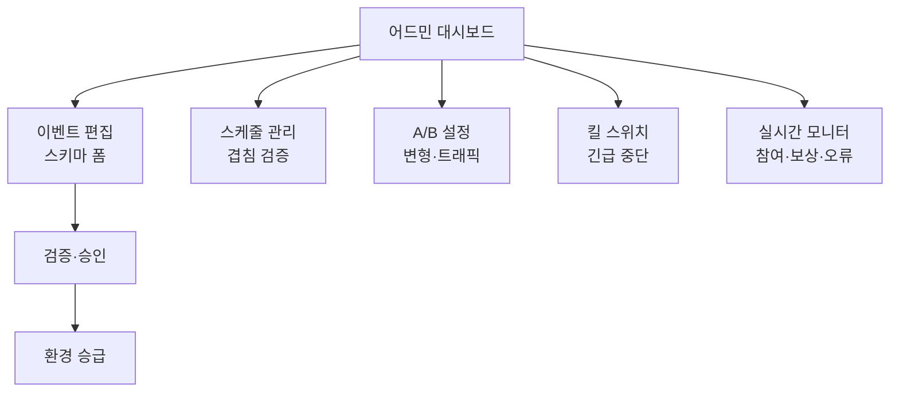

## 들어가며

라이브 게임의 이벤트는 *신선함* 과 *운영비용* 사이의 줄다리기다. 매주 새 이벤트가 돌아야 플레이어가 이탈하지 않지만, 이벤트 하나하나를 코드로 박아 클라이언트 패치로 내보내면 기획 한 줄을 고치는 데 빌드·심사·배포가 걸린다. 반대로 모든 것을 데이터로 빼서 서버에서 원격 구성으로 제어하면 패치 없이 매일 바꿀 수 있지만, 데이터 스키마가 곧 *작은 프로그래밍 언어* 가 되어 검증·버전 관리·롤백·QA의 부담이 그쪽으로 옮겨간다. 그래서 이벤트 시스템의 거의 모든 결정은 *콘텐츠 회전 속도 ↔ 운영 안전성 ↔ 시스템 복잡도* 의 삼각 트레이드오프 위에 놓인다.

이 글은 그 트레이드오프를 따라 라이브 이벤트 시스템을 한 흐름으로 정리한다. 이벤트가 코드가 아니라 데이터로 표현되는 이유와 그 데이터 모델의 구조, 시즌·한정 이벤트의 스케줄링과 서버·클라이언트 시간 동기화, 클라이언트 패치 없이 이벤트를 켜고 끄는 원격 구성, 같은 이벤트를 세그먼트별로 다르게 내보내는 A/B 테스트, 보상을 안전하게 지급하는 트랜잭션과 멱등성, 부정 진행을 막는 서버 검증과 사후 회수, 그리고 이 모두를 운영팀이 다룰 수 있게 하는 어드민 도구와 긴급 중단까지 다룬다.



이 글의 목표.

1. **데이터 주도 이벤트 모델** — 코드가 아닌 데이터로 이벤트를 표현하는 구조와 조건-액션 엔진.
2. **스케줄링과 시간** — 시즌·한정 이벤트의 생명주기, 서버 시간 권위, 타임존 처리.
3. **원격 구성과 배포** — 클라이언트 패치 없는 활성화, 환경 분리, 점진 롤아웃, 긴급 중단.
4. **A/B 테스트와 세그먼트** — 변형 할당, 노출 일관성, 측정과 함정.
5. **보상 파이프라인** — 보상 테이블, 트랜잭션, 멱등성, 중복 방지.
6. **밸런싱과 피로도** — 확률·난이도 튜닝, 세그먼트별 조정, 인플레이션 억제.
7. **부정 행위 방지** — 서버 검증, 이상 탐지, 사후 회수.
8. **운영 도구와 측정** — 어드민, 시뮬레이터, 모니터링, 성과 리포트.


---

## 목차
1. [데이터 주도 이벤트 모델](#1-데이터-주도-이벤트-모델)
2. [스케줄링과 시간](#2-스케줄링과-시간)
3. [원격 구성과 배포](#3-원격-구성과-배포)
4. [A/B 테스트와 세그먼트](#4-ab-테스트와-세그먼트)
5. [보상 파이프라인](#5-보상-파이프라인)
6. [밸런싱과 피로도](#6-밸런싱과-피로도)
7. [부정 행위 방지](#7-부정-행위-방지)
8. [운영 도구와 측정](#8-운영-도구와-측정)


---

## 1. 데이터 주도 이벤트 모델

### 코드 기반 이벤트의 한계

이벤트를 코드로 짜는 방식은 처음엔 빠르다. "크리스마스 이벤트: 적 처치 시 선물 상자 드롭, 100개 모으면 스킨 지급"을 `if (isChristmas && killedEnemy) dropGift` 식으로 박으면 동작한다. 문제는 *세 번째 이벤트부터* 드러난다. 새 이벤트마다 클라이언트와 서버에 코드를 추가하고, 빌드를 굽고, 플랫폼 심사를 통과해야 한다. 모바일은 심사에만 길게는 며칠이 걸리고, 이미 깔린 클라이언트는 강제 업데이트 없이 바꿀 수 없다.

라이브 게임은 *주 단위로* 이벤트를 회전시킨다. 매주 클라이언트 패치를 강제할 수는 없다. 그래서 이벤트는 *코드가 아니라 데이터* 로 표현되어야 한다. 클라이언트와 서버에는 *이벤트를 해석하는 엔진* 만 한 번 넣고, 개별 이벤트는 *서버가 내려주는 데이터* 로 정의한다. 이렇게 하면 이벤트 추가·수정·중단이 *데이터 변경* 이 되어 패치 없이 가능해진다.

| 축 | 코드 기반 | 데이터 주도 |
|---|---|---|
| 새 이벤트 출시 | 클라이언트 패치·심사 필요 | 데이터 배포로 즉시 |
| 기획 수정 반복 | 빌드마다 며칠 | 분 단위 |
| 표현 가능 범위 | 코드로 뭐든 | 스키마가 정의한 범위 |
| QA 대상 | 코드 회귀 | 데이터 + 엔진 |
| 버그 격리 | 빌드 단위 | 이벤트 단위, 즉시 롤백 |

데이터 주도의 비용은 *표현력의 한계* 다. 엔진이 해석할 수 있는 것만 만들 수 있다. 스키마에 없는 새로운 이벤트 메커닉이 필요하면 결국 엔진에 기능을 추가해야 하고, 그건 다시 클라이언트 패치다. 그래서 스키마 설계는 *흔한 이벤트 90%를 데이터로 덮되, 새 메커닉은 엔진 확장* 이라는 균형 위에서 한다.

### 조건-액션 엔진

데이터 주도 이벤트의 핵심 추상은 *조건-액션(Condition-Action)* 모델이다. 이벤트는 "어떤 조건이 만족되면 어떤 액션을 한다"의 규칙 집합으로 표현된다. 진행도 카운터, 마일스톤, 보상 지급 모두 이 한 모델로 환원된다.

```cpp
// 엔진이 해석하는 원자 단위. 새 이벤트는 이들의 조합으로 표현된다.
struct Condition {
    enum Type { KillEnemy, CollectItem, ReachScore, LoginDay, /* ... */ } type;
    int    targetId;        // 적 종류·아이템 ID 등
    int64_t threshold;      // 누적 목표치
    Filter  filter;         // "특정 던전에서만" 같은 추가 제약
};

struct Action {
    enum Type { GrantReward, AdvanceStage, UnlockOffer, SendMail } type;
    RewardTableId reward;
    int           stage;
};

struct EventRule {
    Condition when;
    Action    then;
    bool      repeatable;   // 매번 만족 시 반복 vs 1회
};
```

엔진은 게임 이벤트(적 처치, 아이템 획득)를 받아 *해당하는 조건의 진행도 카운터를 올리고*, 임계치를 넘으면 액션을 실행한다. 클라이언트는 이 데이터를 받아 UI(진행 바, 목표 텍스트)를 그리고, 서버는 같은 데이터로 *진행도를 권위 있게 검증* 한다(7절). 같은 정의를 양쪽이 공유하는 것이 핵심이다 — 클라이언트가 보여주는 목표와 서버가 인정하는 목표가 어긋나면 "100개 모았는데 보상이 안 나온다"는 CS가 폭증한다.

### 진행도 추적 자료구조

이벤트 진행도는 *플레이어 × 이벤트 × 조건* 의 카운터다. 동시 진행 이벤트가 여럿이고 유저가 수백만이면, 이 카운터를 어떻게 저장하느냐가 곧 비용이다.

```cpp
// 플레이어별 이벤트 진행 상태. Redis 같은 인메모리 저장소에 핫 데이터로.
struct EventProgress {
    EventId  eventId;
    int      stage;                      // 현재 단계 (시즌 패스 등)
    std::unordered_map<int, int64_t> counters;  // ruleIndex -> 누적값
    uint64_t claimedBitmask;             // 어떤 보상을 이미 받았는지 (멱등성, 5절)
    int64_t  lastUpdateMs;
};
```

진행도는 *읽기·쓰기가 잦은 핫 데이터* 다. 적을 한 마리 잡을 때마다 카운터가 오른다. 이걸 매번 RDB에 쓰면 DB가 죽는다. 그래서 진행도는 보통 *인메모리 캐시(Redis 등)* 에 두고 주기적으로 영속화하거나, *쓰기를 배치* 한다. `claimedBitmask` 같은 *이미 받은 보상 표시* 만은 영속·트랜잭션으로 다룬다 — 이게 틀어지면 보상 중복 지급이나 누락이 되기 때문이다(5절).

### 이벤트 우선순위와 충돌

여러 이벤트가 동시에 도는 라이브 게임에서는 *충돌* 이 생긴다. 두 이벤트가 같은 UI 슬롯(메인 화면 배너)을 원하거나, 같은 보상 통화의 드롭률을 각자 올리려 한다. 엔진은 *우선순위* 와 *결합 규칙* 을 정의해야 한다.

- *UI 슬롯 경합*: 배너·팝업은 자리가 한정적이다. 이벤트마다 `priority`를 두고 높은 것이 슬롯을 차지하되, 나머지는 목록으로 밀어낸다.
- *효과 중첩*: "경험치 2배 이벤트"와 "주말 1.5배"가 겹치면 곱할지 더할지를 *명시* 해야 한다. 명시 안 하면 디자이너 의도와 다른 값이 나가 밸런스가 깨진다.
- *상호 배타*: 같은 보상 풀을 노리는 두 이벤트는 동시 운영을 막아야 할 수도 있다. 스케줄러가 겹침을 *검출* 해 경고한다(2절).

## 2. 스케줄링과 시간

### 이벤트 생명주기

모든 한정·시즌 이벤트는 *시간 위에서 사는* 상태 머신이다. 정의에는 시작·종료 시각이 박히고, 엔진은 현재 시각으로 상태를 결정한다.



상태 전환 시각이 *시작·종료* 만 있는 게 아니라는 점이 중요하다. *예고(teaser)* 구간은 시작 전 UI에 카운트다운을 띄운다. *유예(grace period)* 는 종료 직후 짧게 두어, 종료 순간 진행 중이던 플레이어의 마지막 행동이 누락되지 않게 한다. *정산(settling)* 은 랭킹 이벤트에서 최종 순위를 확정하고 보상을 지급하는 구간이다. 이 구간들을 두지 않으면 "이벤트 끝나는 순간 클리어했는데 보상이 안 들어왔다"는 경계 버그가 반드시 나온다.

### 서버 시간이 권위다

이벤트 시간의 절대 원칙은 *서버 시간이 권위* 라는 것이다. 클라이언트 시간은 *신뢰할 수 없다* — 유저가 기기 시계를 미래로 돌려 출석 보상을 여러 번 받거나, 종료된 이벤트를 다시 열려 시도하기 때문이다. 진행도 적립, 보상 지급, 이벤트 활성 판정은 *모두 서버 시각* 으로 한다.

```cpp
// 클라이언트는 UI 표시용으로만 시간을 쓴다. 권위는 서버.
struct ServerTimeSync {
    int64_t serverEpochMs;       // 동기화 시점 서버 시각
    int64_t localMonotonicMs;    // 그 시점의 클라 단조 시계 (벽시계 X)
    // 현재 추정 서버 시각 = serverEpochMs + (현재 단조 - localMonotonicMs)
    int64_t EstimateServerNow(int64_t monoNow) const {
        return serverEpochMs + (monoNow - localMonotonicMs);
    }
};
```

클라이언트가 카운트다운을 그릴 때는 *벽시계(wall clock)가 아니라 단조 시계(monotonic clock)* 기준으로 서버 시각을 추정한다. 벽시계는 유저가 바꿀 수 있지만 단조 시계는 부팅 후 흐른 시간이라 조작이 어렵다. 그래도 이건 *표시용 근사* 일 뿐이고, 실제 보상이 걸린 모든 판정은 서버 API 호출 시점의 서버 시각으로 다시 검증한다.

### 타임존과 일일 리셋

전 세계 서비스는 *타임존* 문제를 피할 수 없다. "일일 출석"은 누구의 자정을 기준으로 리셋하는가? 선택지가 셋이다.

| 전략 | 리셋 기준 | 장점 | 단점 |
|---|---|---|---|
| 서버 고정 시각 | UTC 또는 본사 시각 자정 | 단순, 전 유저 동시 | 일부 지역은 한밤중에 리셋 |
| 플레이어 로컬 자정 | 유저 타임존 자정 | 공정한 체감 | 타임존 변경 악용, 구현 복잡 |
| 가입 시각 기준 롤링 | 마지막 수령 + 24시간 | 조작 내성 강함 | "자정 리셋" 직관과 안 맞음 |

대부분의 글로벌 게임은 *서버 고정 시각* 을 기본으로 하되, 지역별 서버(샤드)를 두면 각 샤드의 대표 타임존을 쓴다. *플레이어 로컬 자정* 은 공정해 보이지만, 유저가 타임존을 바꿔 하루에 출석을 두 번 먹는 악용이 가능해 *마지막 수령 시각 + 24시간 롤링* 으로 보강하는 경우가 많다. 어느 쪽이든 *기준을 서버에서 단일하게 계산* 하고 클라이언트는 그 결과만 표시한다.

### 겹침 검출과 스케줄 검증

운영자가 손으로 수십 개 이벤트의 시각을 입력하면 *실수* 가 난다 — 종료 시각이 시작보다 빠르거나, 두 한정 이벤트가 의도치 않게 겹치거나, 보상 통화가 같은 이벤트 셋이 동시에 돈다. 배포 전에 스케줄을 *정적 검증* 한다.

```cpp
std::vector<ScheduleWarning> ValidateSchedule(const std::vector<EventDef>& events) {
    std::vector<ScheduleWarning> warnings;
    for (auto& e : events) {
        if (e.endTime <= e.startTime)
            warnings.push_back({e.id, "종료가 시작보다 빠르거나 같다"});
        if (e.startTime < NowServerMs())
            warnings.push_back({e.id, "시작 시각이 이미 과거다"});
    }
    // 같은 UI 슬롯·보상 풀을 노리는 이벤트의 시간 겹침 검사
    for (size_t i = 0; i < events.size(); ++i)
        for (size_t j = i + 1; j < events.size(); ++j)
            if (Overlaps(events[i], events[j]) && SharesResource(events[i], events[j]))
                warnings.push_back({events[i].id, "동일 자원 이벤트와 시간 겹침"});
    return warnings;
}
```

이 검증을 배포 파이프라인에 넣으면 "종료 시각을 잘못 입력해 이벤트가 영원히 안 끝나는" 사고를 사전에 막는다. 사고가 이미 라이브에 나간 뒤 고치는 비용은 검증 한 번보다 훨씬 크다.

## 3. 원격 구성과 배포

### 클라이언트 패치 없는 배포

데이터 주도 이벤트의 가치는 *원격 구성(remote config)* 으로 완성된다. 이벤트 정의·활성 여부·파라미터를 *서버에서 내려주는 설정* 으로 두면, 클라이언트 빌드를 건드리지 않고 이벤트를 켜고 끄고 바꾼다. 클라이언트는 부팅·주기적 폴링·푸시로 최신 구성을 받아 적용한다.



여기서 *클라이언트와 서버가 같은 구성을 본다* 는 것이 핵심이다. 클라이언트만 이벤트가 켜졌다고 믿고 서버는 모르면, 유저가 진행은 하는데 보상이 안 나간다. 그래서 구성 배포는 *서버 우선 적용 후 클라이언트* 순서로 하거나, 구성에 *버전* 을 박아 양쪽 버전이 맞을 때만 이벤트를 유효로 친다.

### 환경 분리

이벤트 구성은 *Dev / QA / Staging / Production* 환경에서 따로 관리한다. QA가 다음 주 이벤트를 테스트하는 동안 프로덕션은 이번 주 이벤트를 돌린다. 환경을 섞으면 *테스트용 무한 보상 이벤트가 실수로 프로덕션에 나가는* 사고가 난다.

| 환경 | 용도 | 데이터 출처 | 배포 권한 |
|---|---|---|---|
| Dev | 개발자 로컬 검증 | 자유 편집 | 개발자 |
| QA | 기능·밸런스 테스트 | Dev에서 승급 | QA 리드 |
| Staging | 프로덕션 동일 환경 리허설 | QA에서 승급 | 운영 리드 |
| Production | 실서비스 | Staging에서 승급 | 승인 절차 |

구성은 *아래에서 위로 승급(promote)* 하며, 각 단계마다 검증과 승인이 붙는다. 프로덕션 직접 편집은 막고, 반드시 Staging을 거치게 한다. 긴급 상황(3절 마지막)만 예외로 프로덕션 직접 변경을 허용하되 *감사 로그* 를 남긴다.

### 버전 관리와 롤백

이벤트 구성은 *코드처럼 버전 관리* 한다. 누가 언제 무엇을 바꿨는지 이력이 남아야 하고, 문제가 생기면 *이전 버전으로 즉시 롤백* 할 수 있어야 한다.

```cpp
struct ConfigVersion {
    int64_t  versionId;          // 단조 증가
    int64_t  publishedAtMs;
    UserId   author;
    std::string changeNote;      // "신년 이벤트 드롭률 0.5%→0.8%"
    Hash     contentHash;        // 무결성 검증
    int64_t  parentVersion;      // 롤백 대상 추적
};
```

구성 배포는 immutable version과 현재 활성 version pointer를 분리하면 빠르게 되돌릴 수 있다. 그러나 이전 버전이 현재 시각·서버 binary·schema·이미 변경된 플레이어 상태에도 안전하다는 보장은 없다. 재게시 전 호환성과 migration boundary를 검증하고, 이미 지급·소비·거래된 보상은 별도 보정 정책으로 처리한다. rollback은 배포 pointer를 되돌리는 작업과 세계 상태를 복구하는 작업을 구분해야 한다.

### 점진 롤아웃

새 이벤트나 큰 구성 변경은 *전체에 한 번에* 켜지 않고 *점진 롤아웃(staged rollout)* 한다. 1%, 5%, 20%, 100% 식으로 노출 비율을 올리며, 각 단계에서 지표·오류·CS를 본다.

```cpp
// rolloutBasisPoints는 [0, 10000]. hash 알고리즘과 ID 직렬화도 versioned contract다.
bool IsInRollout(UserId user, EventId event, uint32_t rolloutBasisPoints) {
    rolloutBasisPoints = std::min(rolloutBasisPoints, 10000u);
    uint64_t h = Hash64(user, event);           // 이벤트별로 다른 버킷
    return (h % 10000) < rolloutBasisPoints;
}
```

고정된 ID 직렬화와 versioned hash로 bucket을 만들고 threshold만 올리면 이미 포함된 사용자가 빠지지 않는 monotonic rollout을 얻는다. hash나 bucket 수를 바꾸면 이 성질이 깨지므로 assignment version을 저장한다. 점진 롤아웃은 사용자별 UI·보상 로직의 blast radius를 제한하지만, 공유 DB migration·global cache·경제 가격처럼 전체 backend에 영향을 주는 변경은 1% 노출이어도 전역 장애를 만들 수 있다. 사용자 cohort와 infrastructure canary를 분리해 검증한다.

### 긴급 중단

라이브 이벤트는 *언제든 즉시 멈출 수 있어야 한다*. 드롭률 버그로 한정 아이템이 쏟아지거나, 익스플로잇이 발견되거나, 보상 지급이 폭주하면 *분 단위* 로 막아야 한다. 이걸 위해 *킬 스위치(kill switch)* 를 둔다.

```cpp
// 정상 종료와 별개의 즉시 비활성. 클라이언트 폴링 주기 내 전파.
struct KillSwitch {
    EventId event;
    enum Mode {
        SoftStop,    // 신규 진행 차단, 진행 중 보상은 인정
        HardStop,    // 즉시 전면 차단, 진행도 동결
        RewardFreeze // 진행은 허용하되 보상 지급만 중단 (조사용)
    } mode;
    std::string reason;          // 감사 로그
};
```

킬 스위치는 *정상 종료 스케줄과 독립* 적이다. `SoftStop`은 새 참여만 막고 진행 중이던 유저는 보호한다. `HardStop`은 익스플로잇처럼 즉시 막아야 할 때 쓴다. `RewardFreeze`는 보상 지급만 멈춰, 진행은 계속 쌓되 *지급은 조사 후 일괄* 하게 한다 — 잘못 지급한 걸 회수하는 것보다 지급을 미루는 게 훨씬 싸다. 킬 스위치의 전파 지연(클라 폴링 주기)이 곧 *사고 노출 시간* 이므로, 긴급 구성은 일반 구성보다 *짧은 폴링 또는 푸시* 로 전달한다.

## 4. A/B 테스트와 세그먼트

### 같은 이벤트를 다르게 내보내기

이벤트의 신선함을 데이터로 빠르게 회전시킬 수 있게 되면, 다음 질문은 *무엇이 더 효과적인가* 다. 드롭률 0.5%와 0.8% 중 어느 쪽이 참여를 높이는가? 보상을 스킨으로 줄까 통화로 줄까? 이걸 추측이 아니라 *측정* 으로 답하는 것이 *A/B 테스트* 다. 같은 이벤트의 변형(variant)을 플레이어 그룹에 나눠 내보내고 지표를 비교한다.

```cpp
struct Experiment {
    ExperimentId id;
    std::vector<Variant> variants;       // control + treatment(들)
    std::vector<int>     weights;         // 트래픽 분배 비율 (예: 50/50)
    Filter   audience;                    // 대상 세그먼트 (예: 신규 7일 이내)
    int64_t  startMs, endMs;
};

// 안정 해시로 변형 할당. 같은 유저는 실험 내내 같은 변형.
int AssignVariant(UserId user, const Experiment& exp) {
    uint64_t h = Hash64(user, exp.id);    // 다른 실험과 독립
    int total = std::accumulate(exp.weights.begin(), exp.weights.end(), 0);
    int bucket = h % total;
    for (size_t i = 0; i < exp.weights.size(); ++i) {
        if (bucket < exp.weights[i]) return i;
        bucket -= exp.weights[i];
    }
    return 0;
}
```

### 할당의 일관성과 독립성

A/B 테스트가 망가지는 흔한 원인은 할당 불일치다. 변형 할당은 서버가 user ID, experiment ID, assignment version의 안정 hash로 계산하거나 영속 저장한다. 클라이언트가 독립적으로 다시 계산하게 하려면 ID encoding과 hash 알고리즘까지 동일해야 하고 조작 표면도 늘어나므로, 보상·경제 실험은 서버 assignment를 권위로 둔다.

experiment ID를 salt에 넣으면 서로 다른 실험의 bucket이 좋은 hash 아래에서 대체로 비상관이 되지만 통계적 독립을 증명하지는 않는다. 같은 사용자가 동시에 두 treatment를 받으면 기능 상호작용이 결과를 오염시킬 수 있다. 충돌하면 안 되는 실험은 mutual-exclusion layer에 배치하고, 함께 실행하는 실험은 interaction term이나 factorial design을 사용해 효과를 분리한다.

### 측정과 함정

A/B 결과를 읽을 때의 함정이 여럿이다.

- *조기 종료*: 며칠치 데이터로 "treatment가 5% 높다"고 결론 내리면 안 된다. *통계적 유의성* 에 도달하기 전엔 노이즈다. 표본 크기와 신뢰구간을 먼저 정한다.
- *지표 선택*: 단기 참여율만 보면 *장기 이탈* 을 놓친다. 과한 보상은 단기 지표를 올리지만 경제를 망가뜨려 장기적으로 손해다. 단기·장기·수익·리텐션을 함께 본다.
- *세그먼트 혼합*: 신규와 고래(고과금) 유저를 한 실험에 섞으면 평균이 둘을 가린다. 세그먼트별로 효과가 반대일 수 있다.
- *상호작용*: 동시에 도는 다른 실험과 간섭하면 효과를 분리할 수 없다. 겹치는 실험은 *상호 배타 레이어* 로 격리한다.

### 세그먼트별 이벤트 조정

A/B의 자연스러운 확장이 *세그먼트별 차등* 이다. 같은 이벤트를 신규·복귀·고과금·이탈 위험 유저에게 다른 난이도·보상으로 내보낸다. 신규에겐 쉽고 후한 온보딩 이벤트, 이탈 위험 유저에겐 복귀 유인 보상을 준다.

```cpp
// 세그먼트는 서버에서 계산해 부여. 클라는 결과만 받는다.
enum class Segment { New, Returning, Active, HighSpender, ChurnRisk };

EventVariant ResolveForPlayer(const Player& p, const EventDef& base) {
    Segment seg = ClassifySegment(p);    // 행동·과금·접속 이력 기반
    if (auto it = base.segmentOverrides.find(seg); it != base.segmentOverrides.end())
        return ApplyOverride(base.defaultVariant, it->second);
    return base.defaultVariant;
}
```

세그먼트별 차등은 강력하지만 *공정성 논란* 의 위험이 있다. "나는 왜 친구보다 보상이 적은가"가 드러나면 신뢰가 깨진다. 그래서 차등은 *보이지 않는 축*(난이도, 등장 빈도)이나 *더 주는 방향*(복귀 보너스)으로 하고, *덜 주는 차별* 은 피한다. 세그먼트 분류 자체는 *서버에서만* 하고 클라이언트에 노출하지 않는다.

## 5. 보상 파이프라인

### 보상 테이블

이벤트의 종착점은 *보상 지급* 이다. 보상은 코드가 아니라 *보상 테이블(reward table)* 로 데이터화한다 — 고정 보상, 확률 보상, 티어 보상이 한 구조로 표현된다.

```cpp
struct RewardEntry {
    ItemId   item;
    int      quantity;
    int      weight;             // 확률 보상의 가중치
    int      tier;               // 등급 (희귀도)
};

struct RewardTable {
    RewardTableId id;
    enum Kind { Fixed, Weighted, Tiered } kind;
    std::vector<RewardEntry> entries;
    int  rolls;                  // 몇 번 뽑는가
    bool allowDuplicate;         // 중복 허용 여부
};
```

확률 보상(가챠·룰렛)은 *가중치 기반 추첨* 이다. 각 항목의 가중치를 합산하고 그 범위에서 난수를 뽑는다. 핵심은 *추첨을 서버에서* 한다는 것이다 — 클라이언트 추첨은 결과를 조작당한다. 클라이언트는 *연출만* 하고 실제 결과는 서버가 정한 것을 표시한다.

```cpp
// 서버 권위 가중 추첨. 클라이언트는 이 결과를 연출할 뿐이다.
const RewardEntry& WeightedRoll(const RewardTable& t, Rng& rng) {
    int total = 0;
    for (auto& e : t.entries) total += e.weight;
    int r = rng.NextInt(total);              // 서버 RNG, 시드 비공개
    for (auto& e : t.entries) {
        if (r < e.weight) return e;
        r -= e.weight;
    }
    return t.entries.back();
}
```

### 멱등성이 핵심이다

보상 지급의 가장 중요한 성질은 *멱등성(idempotency)* 이다. 같은 보상 청구가 *네트워크 재시도·중복 요청으로 여러 번 도착해도 딱 한 번만 지급* 되어야 한다. 모바일은 연결이 불안정해, 클라이언트가 "보상 주세요"를 보내고 응답을 못 받아 재시도하는 일이 흔하다. 멱등성이 없으면 이 재시도가 *보상 중복 지급* 이 된다.

```cpp
// 청구마다 고유 키. 같은 키는 한 번만 처리된다.
struct ClaimRequest {
    PlayerId player;
    EventId  event;
    int      milestone;          // 어떤 마일스톤 보상인가
    // 멱등성 키 = (player, event, milestone) — 같은 보상은 한 번만
};

ClaimResult GrantReward(const ClaimRequest& req, Store& store) {
    IdempotencyKey key{req.player, req.event, req.milestone};
    // 내부 transaction에서 다음을 한 원자 단위로 수행한다.
    // 1) key를 UNIQUE 제약으로 선점
    // 2) 서버 권위 진행도 검증
    // 3) 아이템 지급과 결과 저장
    // 충돌한 재시도는 저장된 결과를 반환한다.
    return store.GrantOrReplayTransactional(key, req);
}
```

선검사 `AlreadyGranted`와 지급을 별도 transaction으로 두면 두 요청이 동시에 “없음”을 보고 둘 다 지급할 수 있다. 정확성의 근거는 멱등 키의 unique 제약과 **키 선점·효과·응답 결과 저장을 묶은 transaction**이다. 선검사는 이미 처리된 흔한 경로를 빠르게 만드는 최적화일 뿐이다.

멱등성 키는 *(플레이어, 이벤트, 마일스톤)* 같은 논리적으로 한 번뿐인 보상을 식별한다. 확률 보상처럼 새 시도마다 결과가 달라야 하면 서버가 발급한 attempt ID를 키로 사용하고, 난수 결과도 효과와 같은 transaction에 저장한다. 응답을 잃은 재시도는 저장된 같은 결과를 받고, 새 추첨은 새 attempt 권한을 소비해야 한다.

### 트랜잭션 안전성

보상 지급은 *여러 변경* 을 묶는다 — 인벤토리에 아이템 추가, 진행도 마일스톤 표시, 통화 차감(유료 뽑기면), 로그 기록. 이 중 일부만 성공하면 *불일치* 가 생긴다(아이템은 줬는데 마일스톤 표시 실패 → 또 지급 가능). 그래서 보상 지급은 *원자적 트랜잭션* 이어야 한다.



분산 환경에서는 패턴마다 보장 범위가 다르다.

- **Transactional outbox**: 진행도 확정과 “보상 이벤트를 발행해야 함”을 같은 DB transaction에 기록한다. relay와 consumer는 중복 실행될 수 있으므로 event ID 멱등 처리가 필요하다.
- **2단계 커밋**: 모든 참여 저장소가 prepare/commit 프로토콜과 장애 복구를 지원할 때 원자 commit을 만들 수 있지만, coordinator 장애·잠금 유지·운영 복잡도를 감수한다. 이름만 선택지에 넣는다고 사용할 수 있는 기능이 아니다.
- **Mailbox**: 진행도와 같은 저장소에 `(player, rewardKey)` unique 우편을 만들 수 있으면 “지급할 권리”를 원자적으로 남긴다. 수령은 우편 상태 전이와 인벤토리 효과를 같은 transaction에 넣거나 outbox로 연결해야 한다.

우편함은 지급 의무와 실제 인벤토리 반영을 분리할 뿐 중복·누락을 자동으로 없애지 않는다. 각 경계의 durable state, unique key, retry와 reconciliation이 보장을 만든다.

## 6. 밸런싱과 피로도

### 확률과 난이도 튜닝

이벤트 밸런싱은 *데이터로 표현된 파라미터를 조정* 하는 일이다. 데이터 주도 모델 덕에 드롭률·목표치·난이도 곡선을 패치 없이 바꾼다. 문제는 *무엇을 어디로 바꿀지* 다. 추측으로 바꾸면 너무 후하거나(인플레이션) 너무 박해서(이탈) 둘 다 손해다.

```cpp
// 목표 완주율을 역산해 난이도를 설정. 데이터로 조정.
struct DifficultyTuning {
    float targetCompletionRate;  // 예: 상위 보상은 30%만 완주하도록
    int64_t requiredCount;       // 목표치 (이 값을 조정)
    // 실측 완주율을 보고 requiredCount를 보정한다
};
```

밸런싱은 *목표 지표를 먼저 정하고 역산* 한다. "이 한정 스킨은 헤비 유저 30%만 얻게" 같은 목표를 두고, 실측 완주율이 50%면 목표치를 올리고 10%면 내린다. 이 조정을 *라이브 데이터로 반복* 하는 게 데이터 주도의 이점이다. 단, 이미 진행 중인 유저의 목표치를 *올리는* 변경은 신뢰를 깬다 — 보통 *다음 이벤트 주기부터* 적용하거나, 진행 중 유저는 기존 값을 유지한다.

### 보상 인플레이션 억제

라이브 게임의 만성 위험은 *보상 인플레이션* 이다. 매 이벤트가 통화·아이템을 쏟아내면 시간이 갈수록 모든 게 흔해지고, 신규 보상의 가치가 떨어지며, 경제가 무너진다. 이벤트 설계는 *총 유입(faucet)과 유출(sink)의 균형* 을 봐야 한다.

| 레버 | 효과 | 위험 |
|---|---|---|
| 보상 총량 상한 | 이벤트당 최대 지급 제한 | 너무 박하면 참여 저하 |
| 통화 소모처(sink) 동반 | 이벤트가 새 소비처도 제공 | 설계 복잡 |
| 시간 제한·재화 만료 | 비축 방지 | 유저 불만 |
| 희소 보상 빈도 관리 | 최상위 보상의 등장 통제 | 과하면 무의미감 |

인플레이션은 *한 이벤트* 가 아니라 *누적* 으로 온다. 그래서 개별 이벤트 밸런싱만으로는 부족하고, *전체 경제 지표*(통화 총량, 인당 보유량 추이)를 함께 본다. 이벤트는 유입원이지만, 동시에 *유출원*(이벤트 전용 상점, 소모성 도전)도 끼워 균형을 맞춘다.

### 이벤트 피로도

너무 잦은 이벤트는 *피로(fatigue)* 를 부른다. 매일 새 이벤트가 알림을 쏘고, 모든 이벤트가 "지금 안 하면 손해"라고 압박하면 유저는 지쳐서 *이탈* 한다. 신선함을 위해 회전을 올리는 것이 역효과가 되는 지점이다.

- *알림 빈도 제한*: 이벤트 알림에 상한을 두고, 우선순위로 추린다. 모든 이벤트가 푸시를 쏘지 않는다.
- *동시 이벤트 수 관리*: 한 번에 도는 이벤트가 너무 많으면 각각이 묻힌다. 메인 이벤트 1~2개에 집중하고 나머지는 배경으로.
- *강제성 완화*: "놓치면 영영 못 얻는" 한정을 남발하면 압박이 누적된다. 일부는 *재등장*(rerun) 약속으로 압박을 푼다.
- *세그먼트별 노출 조절*: 4절의 세그먼트를 활용해, 이미 활발한 유저에겐 빈도를 낮춰 과포화를 막는다.

피로도는 *측정하기 어렵지만 실재* 한다. 단기 참여 지표는 잦은 이벤트로 오르지만, *리텐션과 세션 길이가 서서히 빠지는* 형태로 드러난다. A/B로 "이벤트 빈도를 낮춘 그룹의 장기 리텐션"을 보는 것이 피로도를 잡는 방법이다.

### 한정 보상이 참여를 끌어올리는 정확한 이유 — 마감 해저드와 "언젠가→영영" 누설

앞 절들은 한정·시즌 이벤트의 *마감* 을 스케줄(2절)·신선함·피로(이 절)의 정성적 축으로만 다뤘다. "놓치면 못 얻는다"가 왜 실제로 참여를 끌어올리는지, 마감 직전의 *참여 펄스* 가 어디서 오는지는 모델로 못 박을 수 있다. 핵심 도구는 *경쟁 위험(competing risks)* 이다 — 한 플레이어는 매 시점 *참여(완주)* 하거나 *이탈(churn)* 하며, 둘은 경쟁한다. 마감은 이 경쟁의 해저드(hazard) 구조를 바꿔 결과를 끌어올린다.

전제는 별도로 다루는 두 가지다. 이탈을 시간의 함수로 보는 리텐션 곡선의 적분 관점, 그리고 시간 권위가 서버에 있다는 원칙(2절)이다. 여기서는 그 위에서 *마감이 참여 분포를 어떻게 재편하는가* 만 유도한다.

*널 모델 — 마감이 없으면 "언젠가"는 "영영"으로 샌다.* 마감 없는 상시 보상을 받는 한 플레이어를 보자. 아직 완주하지 않은 상태에서 단위 시간당 완주 해저드 $h$, 이탈 해저드 $\mu$로 둘이 경쟁한다. 미완주 생존 확률 $S(t)$는

$$\dot S = -(h+\mu)\,S,\qquad S(t)=e^{-(h+\mu)t}.$$

완주 펄스(신규 완주 흐름)는 $f(t)=hS(t)=h\,e^{-(h+\mu)t}$로, *마감 없이는 단조 감소* — 어떤 마감 직전 봉우리도 없다. 최종 완주율과 영영 미완주율은 경쟁 위험의 표준 분해로

$$P(\text{완주})=\int_0^\infty f\,dt=\frac{h}{h+\mu},\qquad P(\text{영영 미완주})=\frac{\mu}{h+\mu}.$$

이것이 "언젠가 하지" 의 정량적 함정이다. 미루는 성향($h$ 작음)이 강하면 *완주하기도 전에 이탈* 하는 비율 $\mu/(h+\mu)$가 영구히 샌다. $h$가 아무리 양수여도 마감이 없으면 이 누설은 메워지지 않는다.

*마감 = 상승 해저드(합리적 최적 정지).* 마감을 박으면 합리적 플레이어조차 행동이 바뀐다. 매일 *오늘 처리하는 비용* $c_t\sim\mathrm{Uniform}(0,1)$(기분·바쁨)을 뽑고, 마감 $T$ 전에 한 번 완주하면 보상 $V\ge1$을 받는다(보상은 완주일과 무관하게 마감에 지급). 합리적 플레이어는 "오늘 비용이 충분히 싸면 처리, 아니면 더 싼 날을 기다림" 의 *예약 임계(reservation threshold)* $\tau_n$을 쓴다($n$=남은 날 수). 미완주 시 기대 최소 비용 $G$의 벨만 재귀에서

$$G(0)=\tfrac12,\qquad \tau_n=G(n-1),\qquad G(n)=G(n-1)-\tfrac12\,G(n-1)^2.$$

마지막 날은 $V\ge1$이라 비용과 무관하게 처리하므로 $\tau_0=1$이다. 연속 극한 $g'(n)=-\tfrac12 g^2$를 풀면 $1/g=n/2+2$, 즉

$$\tau_n=g(n-1)\approx\frac{2}{n+3}.$$

해저드(미완주자의 일일 완주 확률) $\tau_n$은 마감에서 멀 때 $\approx 2/n$로 낮다가 마감에서 $1$로 *상승* 한다. 이 *상승 해저드* 가 마감의 구조적 서명이다 — 널 모델의 상수 해저드와 정반대다. 다만 흐름 $f_n=\tau_n S_n$ 자체는 생존자 풀이 고갈되어 *앞쪽이 두텁다*(합리적 플레이어는 싼 날을 *기회적으로* 일찍 잡을 뿐, 마감에 몰리지 않는다).

*FOMO 리프트 — 마감이 누설을 회수한다.* 같은 $T$일 창·같은 이탈 $\mu$에서 두 체제를 비교하면 마감의 효과가 숫자로 나온다. $T=14$, $\mu=0.03$/일, 마감 없는 체제의 미루기 해저드를 마감-원거리 값 $h_0=2/(T+3)\approx0.118$로 두면

$$\text{마감 없음: 완주 }0.724,\ \text{영영 미완주 }0.203\quad\Longrightarrow\quad\text{마감 있음: 완주 }0.863,\ \text{미완주 }0.137.$$

절대 +14%p, 배수 $\times1.19$다. 마감이 한 일은 새 동기 부여가 아니라 *상승 해저드로 "언젠가→영영" 누설($\mu/(h_0+\mu)\approx0.20$)을 회수* 한 것이다. 이것이 한정 보상이 작동하는 1차 메커니즘이다.

*마감 절벽 — 현재 편향이 만드는 막판 펄스.* 합리적 모델은 막판 *절벽* 을 만들지 않는다. 현실의 마감 직전 폭주는 *현재 편향(present bias)* 의 서명이다. 준쌍곡 할인(quasi-hyperbolic $\beta$-$\delta$)의 순진한 플레이어가 비용 $c$를 오늘 치를지 내일 치를지 비교하면(보상은 어차피 $T$에 고정),

$$(\text{오늘})-(\text{내일})=\big(-c+\beta\delta^{T-t}V\big)-\big(-\beta\delta c+\beta\delta^{T-t}V\big)=-c\,(1-\beta\delta)<0.$$

보상 항이 상쇄되어 *비용을 미루는 쪽이 언제나 이긴다* — 마지막으로 가능한 날까지 미룬다. 여기에 *접속 가능성* 마찰을 더하면 펄스가 닫힌 형태로 나온다. 하루 접속 확률 $q$인 플레이어가 "가능한 마지막 날"에 처리하면

$$P(\text{day }t\text{에 처리})=q\,(1-q)^{\,T-1-t},\qquad P(\text{영영})=(1-q)^T.$$

이는 *마감에 집중된 기하 분포* 다. 마지막 날 비율 $=q$, 영영 미완주 $=(1-q)^T$. $q=0.4$, $T=14$이면 완주 $0.999$, 완주자의 *마지막 3일 78.5%·마지막 날 40%* 가 몰린다(앞 3일 0.3%). 실제 참여 펄스는 *출시 신선함 봉우리(2절 teaser)* 와 *이 마감 절벽* 의 합으로 읽어야 하고, 절벽의 가파름은 모집단의 $q$와 현재 편향 $\beta$ 분산이 정한다.

```python
import numpy as np
def thresholds(T):
    G=[0.5]
    for _ in range(1,T): G.append(G[-1]-G[-1]**2/2)
    tau={0:1.0}
    for k in range(1,T): tau[k]=G[k-1]
    return tau
def deadline_run(T,mu):
    tau=thresholds(T); S=1.0; comp=0.0; pulse=[]
    for t in range(T):
        h=tau[T-1-t]; c=S*h; S-=c; ch=S*mu; S-=ch; comp+=c; pulse.append(c)
    return np.array(pulse),comp
T,mu=14,0.03
pulse,comp=deadline_run(T,mu)                      # 합리적: 완주 0.863, 앞 3일 두터움
h0=2/(T+3)                                         # 마감-원거리 해저드
print(round(comp,3))                               # 0.863
print(round(h0/(h0+mu),3), round(mu/(h0+mu),3))    # 널 최종: 0.797 0.203
q=0.4
p=q*(1-q)**(T-1-np.arange(T))                      # 마감 절벽 (현재 편향)
print(round(1-(1-q)**T,3), round(p[-3:].sum()/p.sum(),3))  # 0.999  0.785
```

*운영 귀결과 실패 경계.* 마감 절벽은 곧 *용량* 문제다. $N{=}10^6$, $q{=}0.4$면 약 40만 명이 마지막 날에 청구하고, 이것이 마지막 한 시간에 몰리면 초당 $\approx111$건의 보상 청구가 보상 파이프라인(5절)과 정산(2절)을 친다. 마감 직전 첨두를 견디는 멱등·트랜잭션 처리량과, 절벽이 종료 컷오프와 충돌하지 않게 흡수하는 *유예(grace period, 2절)* 가 이 모델의 직접 귀결이다. 마감 리마인더(2절 teaser의 대칭)는 절벽을 앞으로 당겨 첨두를 평탄화하고, *재등장(rerun) 약속* 은 FOMO 압력을 낮춰 절벽을 완화하는 대신 이번 이벤트 완주를 진지 참여 비율 $f_{\text{serious}}$만큼으로 줄인다 — 막판 첨두를 피로(이 절 위)와 맞바꾸는 손잡이다.

실패 경계가 넷이다. (1) *상시 보상* 은 누설 $\mu/(h+\mu)$를 영구화한다 — "언제든 받을 수 있음" 이 "끝내 안 받음" 으로 샌다. (2) *유예 없는 하드 컷오프* 는 절벽 질량과 마지막 초 판정이 충돌해 "끝나는 순간 완주했는데 못 받음" CS를 보장한다(2절 생명주기의 grace가 필수). (3) *잦은 하드 마감* 은 절벽을 매번 만들지만 FOMO 압력이 누적되어 피로·이탈로 돌아온다(이 절의 피로도) — 단기 참여 펄스와 장기 리텐션이 반대로 움직이는 전형. (4) *클라이언트 시간으로 마감을 판정* 하면 절벽 전체가 위조 표적이 된다 — 마감 판정은 서버 권위(2절)가 전제다.

## 7. 부정 행위 방지

### 서버 검증이 전부다

이벤트는 *보상이 걸려 있어* 부정 행위의 표적이 된다. 진행도 위조, 시간 조작, 매크로, 패킷 변조로 보상을 부당 취득하려는 시도가 끊이지 않는다. 방어의 제1원칙은 *클라이언트를 신뢰하지 않는다* 는 것이다. 클라이언트가 보내는 "나 100킬 했어"를 그대로 믿으면 위조가 끝이 없다.

```cpp
// 클라가 보낸 진행도를 그대로 믿지 않는다. 서버가 이벤트로 재구성.
void OnGameEvent(PlayerId p, const GameEvent& ev) {
    // 게임플레이 이벤트 자체를 서버가 검증·집계한다
    if (!ValidateEventPlausibility(p, ev)) {    // 물리적으로 가능한가
        FlagSuspicious(p, ev);
        return;
    }
    AdvanceProgressServerSide(p, ev);            // 서버가 카운터를 올린다
}
```

진행도는 *클라이언트가 보고하는 결과* 가 아니라 *서버가 게임플레이 이벤트로부터 재구성한 값* 이어야 한다. 클라이언트는 "적을 잡았다"는 *사실* 만 보고하고(또는 서버가 전투를 직접 시뮬레이션하고), 진행도 카운터는 *서버가* 올린다. "100개 모았으니 보상 줘"를 클라가 직접 청구하게 두면 안 된다.

### 이상 진행 탐지

서버 검증을 통과하는 정교한 치팅(속도 핵으로 정상 범위 내 빠른 진행)도 있다. 이건 *통계적 이상 탐지* 로 잡는다. 정상 플레이어의 진행 속도 분포를 두고, 거기서 *극단적으로 벗어난* 진행을 표시한다.

```cpp
struct AnomalyCheck {
    // 시간당 진행량이 물리적 상한을 넘는가
    bool RateExceeded(const EventProgress& prog, int64_t windowMs) {
        int64_t gained = GainedInWindow(prog, windowMs);
        return gained > MaxPlausibleGain(windowMs);   // 최고 숙련도 + 마진
    }
    // 분포 꼬리: 상위 0.01%의 진행 속도는 사람 의심
    bool DistributionOutlier(float playerRate, const RateDistribution& d) {
        return playerRate > d.Percentile(99.99f);
    }
};
```

이상 탐지는 *즉시 차단보다 표시(flag)* 가 안전하다. 오탐(정상 고수를 치터로 모는 것)이 정상 유저를 쫓아내기 때문이다. 표시된 계정은 *추가 검증·수동 검토·보상 보류* 로 다루고, 확정된 경우에만 제재한다. 3절의 *RewardFreeze* 가 여기서 쓰인다 — 의심 계정은 진행은 두되 *보상 지급만 보류* 해 조사 시간을 번다.

### 사후 회수

이미 지급된 부정 보상은 *회수(clawback)* 가 필요하다. 회수는 까다롭다 — 회수 대상 보상을 *이미 소비*(통화로 다른 걸 샀거나, 아이템을 합성)했을 수 있고, 오탐이면 정상 유저의 자산을 빼앗는 사고가 된다.

```cpp
struct Clawback {
    PlayerId player;
    ClaimId  fraudulentClaim;    // 회수 대상 (감사 로그로 추적)
    enum Resolution {
        ReverseIfUnused,         // 미사용 시에만 회수 (안전)
        ForceDeduct,             // 강제 차감 (음수 잔액 허용)
        BanAndReverse            // 제재 + 전수 회수
    } resolution;
    std::string evidence;        // 회수 근거 (이의 제기 대비)
};
```

회수의 핵심은 감사 가능한 원장이다. 모든 지급에 언제·어떤 이벤트·어떤 근거·어떤 idempotency key로 어떤 자산이 이동했는지가 남아야 회수 대상을 계산할 수 있다. 그러나 로그와 멱등성만으로 회수가 항상 정확해지는 것은 아니다. 아이템이 소비·거래·합성됐거나 로그 일부가 유실됐으면 원래 지급의 단순 역연산이 불가능하다. 회수 명령 자체에 고유 ID와 상태 기계를 두고, dry run 총량·현재 소유 상태·음수 잔액 정책을 검증하며, 실행 뒤 원장 합계와 인벤토리를 reconciliation한다.

## 8. 운영 도구와 측정

### 어드민 대시보드

지금까지의 모든 것 — 이벤트 정의, 스케줄, 원격 구성, A/B, 보상, 킬 스위치 — 은 *운영팀이 코드 없이 다룰 수 있어야* 의미가 있다. 그 인터페이스가 *어드민 대시보드(admin dashboard)* 다. 데이터 주도 설계의 최종 산물은 사실상 이 도구다.



어드민의 가치는 *기획자·운영자가 엔지니어 없이 이벤트를 돌리는* 데 있다. 잘 만든 어드민은 스키마를 *폼* 으로 노출해 잘못된 값 입력을 막고(필수 필드, 범위 제한), 배포 전 검증(2절의 스케줄 검증)을 강제하며, 모든 변경에 *감사 로그* 를 남긴다. 어드민이 없으면 모든 이벤트 변경이 엔지니어를 거쳐 회전 속도가 다시 느려진다.

### 시뮬레이터와 QA

이벤트는 *시간 위에서* 동작해 테스트가 어렵다 — "한 달짜리 시즌 패스의 마지막 날 보상"을 실제로 한 달 기다려 볼 수는 없다. 그래서 *시뮬레이터* 가 필요하다. 가상 시각을 주입해 이벤트 생명주기를 빠르게 돌리고, 가상 플레이어로 진행·보상·경계를 검증한다.

```cpp
// 가상 시각·가상 진행으로 이벤트를 빠르게 검증
struct EventSimulator {
    void Run(const EventDef& ev, const TestScenario& scn) {
        for (auto& step : scn.steps) {
            virtualClock_ = step.atTime;            // 시각 점프
            ApplyGameEvents(step.events);           // 가상 진행
            CheckInvariants();                      // 보상 중복·누락·경계
        }
        AssertNoDoubleGrant();                       // 멱등성
        AssertAllMilestonesReachable();              // 도달 가능성
    }
};
```

시뮬레이터로 잡는 대표 버그가 *경계 조건* 이다 — 종료 1초 전 완주, 타임존 경계에서의 일일 리셋, 마일스톤 동시 달성. 이런 건 수동 QA로 재현이 어렵지만 시뮬레이터로는 결정적으로 돌릴 수 있다. *자동화 QA* 는 이 시뮬레이션을 *배포 파이프라인* 에 넣어, 새 이벤트 구성이 올라올 때마다 멱등성·도달 가능성·경계를 자동 검증한다.

### 무엇을 측정하는가

이벤트의 성패는 *측정* 으로 판단한다. 신선함이 참여로 이어졌는지, 보상이 경제를 망치지 않았는지, 운영비용(CS·사고)이 감당 가능한지를 지표로 본다.

| 지표 | 의미 | 위험 신호 |
|---|---|---|
| 참여율 | 이벤트를 시작한 활성 유저 비율 | 낮으면 노출·매력 부족 |
| 완주율 | 최종 보상까지 도달한 비율 | 과하면 너무 쉬움, 낮으면 박함 |
| 보상 지급량 | 이벤트가 푼 통화·아이템 총량 | 급증 시 인플레이션·익스플로잇 |
| 보상 지급 실패율 | 트랜잭션·멱등성 오류 | 상승 시 CS 폭증 |
| 의심 진행 플래그 수 | 이상 탐지 표시 | 급증 시 치팅·익스플로잇 |
| 리텐션 변화 | 이벤트 후 잔존율 | 단기↑ 장기↓ 면 피로·인플레 |

```cpp
struct EventReport {
    float  participationRate;        // 시작 / 활성 유저
    float  completionRate;           // 완주 / 시작
    int64_t totalRewardsGranted;     // 인플레이션 감시
    float  grantFailureRate;         // 멱등성·트랜잭션 건강도
    int    anomalyFlags;             // 치팅 신호
    float  retentionDelta;           // 이벤트 전후 잔존 변화
};
```

핵심은 *단기 참여 지표만 보지 않는다* 는 것이다. 참여율과 완주율이 좋아도, 보상 지급량이 급증해 인플레이션을 부르거나 장기 리텐션이 빠지면 그 이벤트는 *순손실* 이다. 이벤트 성과는 *참여(신선함) − 보상 비용 − 운영 사고(복잡도 비용)* 의 종합으로 읽는다. 이 종합 측정이 곧 들어가며의 삼각 트레이드오프를 숫자로 검산하는 도구다.


---

## 결론

라이브 이벤트 시스템의 모든 결정은 *콘텐츠 회전 속도 ↔ 운영 안전성 ↔ 시스템 복잡도* 의 삼각 트레이드오프 위에 놓인다. 이벤트를 코드가 아닌 데이터로 표현하는 것(회전 속도), 그 데이터를 버전 관리·환경 분리·점진 롤아웃·킬 스위치로 감싸는 것(안전성), 그리고 그 결과로 늘어난 스키마·검증·멱등성·이상 탐지를 감당하는 것(복잡도) — 모두 이 삼각형 위에서 어디에 무게를 둘지의 선택이다.

이 트레이드오프를 다루는 기반 구조는 일관된다. 조건-액션 엔진이 이벤트를 데이터로 환원하고, 서버 권위 시간이 스케줄과 보상 판정의 신뢰를 잡으며, 원격 구성이 패치 없는 배포를 가능하게 하고, A/B와 세그먼트가 추측을 측정으로 바꾸며, 멱등성과 트랜잭션이 보상을 안전하게 지급하고, 서버 검증과 감사 로그가 부정을 막고 되돌린다. "클라이언트를 신뢰하지 않는다"는 원칙이 이 모든 것의 바닥에 깔린다.

신선함을 위해 회전을 올리는 것은 쉽지만, 그것이 인플레이션·피로·운영 사고로 돌아오면 순손실이다. 그래서 이벤트의 성패는 *측정 가능성* 에 달렸다 — 참여와 완주뿐 아니라 보상 지급량, 트랜잭션 건강도, 이상 신호, 장기 리텐션을 함께 보이게 만드는 어드민·시뮬레이터·리포트가, 신선함과 운영비용의 균형을 데이터로 검산하는 마지막 도구다.

## 더 읽을거리

- Google Remote Config / Firebase 문서 — 원격 구성·점진 롤아웃·A/B의 산업 표준 워크플로.
- "Game Server Programming" 계열 자료 — 서버 권위·멱등 보상 지급·트랜잭션 처리의 실무.
- Riot Games / Supercell 엔지니어링 블로그의 라이브 이벤트·실험 플랫폼 사례.
- "Designing Data-Intensive Applications" (Martin Kleppmann) — 멱등성·트랜잭션·아웃박스 패턴의 원리.
- GDC 라이브 서비스·라이브옵스 트랙 발표들 — 시즌 패스·세그먼트·피로도 관리 사례.
- Dan Ariely, Klaus Wertenbroch, "Procrastination, Deadlines, and Performance: Self-Control by Precommitment," *Psychological Science* 13(3), 2002 — 마감 효과(deadline effect)의 실증.
- David Laibson, "Golden Eggs and Hyperbolic Discounting," *Quarterly Journal of Economics* 112(2), 1997 — 준쌍곡($\beta$-$\delta$) 할인의 표준 정식화.
- Ted O'Donoghue, Matthew Rabin, "Doing It Now or Later," *American Economic Review* 89(1), 1999 — 순진한 미루기와 마감 행동의 모델.
- Y. S. Chow, Herbert Robbins, David Siegmund, *Great Expectations: The Theory of Optimal Stopping*, Houghton Mifflin, 1971 — 예약 임계·최적 정지의 원전.
- John D. Kalbfleisch, Ross L. Prentice, *The Statistical Analysis of Failure Time Data*, 2nd ed., Wiley, 2002 — 경쟁 위험(competing risks)과 해저드의 표준 교과서.
- 통계적 A/B 테스트 기초 자료 — 유의성·표본 크기·다중 실험 격리의 함정.
