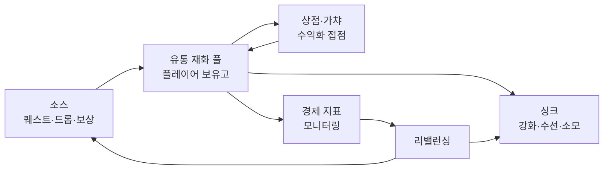
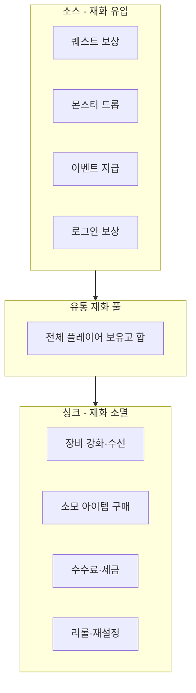
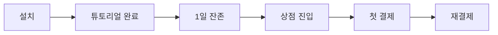

## 들어가며

라이브 서비스 게임의 인게임 경제는 *지속 가능한 수익* 과 *건강한 플레이어 경험* 사이의 끝없는 줄다리기다. 공격적인 수익화는 단기 매출을 끌어올리지만 이탈을 부르고, 지나친 관대함은 화폐 가치를 무너뜨려 결국 살 이유 자체를 없앤다. 그래서 경제 설계의 거의 모든 결정은 *수익 ↔ 밸런스 ↔ 공정성* 의 삼각 트레이드오프 위에 놓인다.

이 글은 그 트레이드오프를 따라 인게임 경제의 구성요소를 한 흐름으로 정리한다. 재화가 어떻게 생기고 사라지는지(소스와 싱크), 인플레이션이 왜 생기고 어떻게 제어하는지, 상점과 가격을 어떻게 책정하는지, 가챠 확률을 어떻게 설계하고 공개하는지, 플레이어 세그먼트별로 오퍼를 어떻게 나누는지, RMT와 듀핑 같은 부정 경제 활동을 어떻게 막는지, 그리고 이 모두를 어떤 지표로 측정하고 어떻게 리밸런싱하는지를 다룬다.



이 글의 목표.

1. **재화 설계와 소스/싱크** — 소프트/하드 커런시, 다중 화폐, 소스-싱크 균형의 정량.
2. **인플레이션 제어** — 공급량 모니터링, 싱크 설계, 시즌제, 디플레이션 위험.
3. **상점과 가격 책정** — 심리적 가격, 티어, 지역 차등, 인플레이션 대응 조정.
4. **가챠와 확률형 아이템** — 확률 분포, 천장, 기대값, 확률 공개 의무.
5. **수익화 모델과 세그먼트** — 배틀패스·구독·광고, 고래/F2P, 스타터팩·복귀 오퍼.
6. **부정 거래와 RMT 방지** — 골드 파밍, RMT, 익스플로잇, 듀핑, 이득 회수.
7. **경제 지표와 모니터링** — ARPU/ARPPU/LTV, 전환율, 화폐 분포, 이상 탐지.
8. **리밸런싱과 운영** — 점진 대 일괄 조정, 보상·커뮤니케이션, 규제 준수.


---

## 목차
1. [재화 설계와 소스/싱크](#1-재화-설계와-소스싱크)
2. [인플레이션 제어](#2-인플레이션-제어)
3. [상점과 가격 책정](#3-상점과-가격-책정)
4. [가챠와 확률형 아이템](#4-가챠와-확률형-아이템)
5. [수익화 모델과 세그먼트](#5-수익화-모델과-세그먼트)
6. [부정 거래와 RMT 방지](#6-부정-거래와-rmt-방지)
7. [경제 지표와 모니터링](#7-경제-지표와-모니터링)
8. [리밸런싱과 운영](#8-리밸런싱과-운영)


---

## 1. 재화 설계와 소스/싱크

### 소프트 커런시와 하드 커런시

인게임 경제의 출발점은 *어떤 재화를 둘 것인가* 다. 거의 모든 라이브 서비스 게임은 최소 두 종류의 화폐를 둔다.

- *소프트 커런시(soft currency)*: 플레이를 통해 *벌 수 있는* 재화. 골드, 코인. 퀘스트·전투·드롭으로 꾸준히 유입되고, 강화·수선·소모 콘텐츠로 빠진다. 인플레이션에 가장 취약하다.
- *하드 커런시(hard currency)*: 주로 *현금으로 사는* 재화. 젬, 크리스털, 다이아. 소량은 무료로 풀지만 대부분 결제에서 나온다. 수익화의 직접 접점이며, 가치가 떨어지면 매출이 직격당한다.

이 둘의 분리가 경제 설계의 첫 번째 안전장치다. 소프트 커런시가 인플레이션으로 흔해져도 하드 커런시 가치는 보호된다. 둘 사이의 환전을 *단방향* 으로만 허용하는 것이 표준이다 — 하드 → 소프트는 되지만 소프트 → 하드는 막는다. 양방향을 허용하면 소프트 커런시 인플레이션이 하드 커런시 가치로 전염되고, 골드 파밍이 곧바로 현금 가치로 환산되어 RMT의 온상이 된다.

| 화폐 종류 | 획득 경로 | 주 용도 | 인플레이션 위험 |
|---|---|---|---|
| 소프트 (골드) | 플레이 보상 | 강화·수선·일반 상점 | 높음 |
| 하드 (젬) | 결제·소량 무료 | 가챠·프리미엄·시간 단축 | 낮음 (보호 대상) |
| 프리미엄 토큰 | 배틀패스·이벤트 | 한정 교환 | 중간 (소멸 설계) |
| 바운드 재화 | 특정 콘텐츠 | 귀속·거래 불가 | 격리됨 |

### 다중 화폐의 함정

화폐를 더 쪼개면 경제를 *격리* 할 수 있다. "투기장 코인", "길드 토큰", "이벤트 재화"처럼 용도를 한정한 *바운드(귀속) 재화* 는 그 콘텐츠 안에서만 돌아 다른 경제에 인플레이션을 옮기지 않는다. 이벤트 재화를 이벤트 종료 시 *소멸* 시키면 유통량이 영구히 쌓이지 않는다.

다만 화폐 종류가 늘수록 비용이 든다. 플레이어는 어떤 재화가 무엇에 쓰이는지 헷갈리고, UI는 복잡해지며, 운영팀은 화폐마다 별도 지표를 추적해야 한다. 화폐 수의 적정선은 보통 *3~5종* 이다 — 소프트, 하드, 그리고 격리가 필요한 콘텐츠별 1~2종. 그 이상은 관리 비용이 격리 이득을 넘는다.

### 소스와 싱크 — 경제의 입출력

경제는 *재화가 생기는 소스(source/faucet)* 와 *재화가 사라지는 싱크(sink)* 의 균형으로 정의된다. 물탱크에 물이 들어오고 빠지는 것과 같다. 들어오는 양이 빠지는 양을 꾸준히 넘으면 *유통량(통화량)이 늘고*, 반대면 줄어든다. 유통량 증가가 곧 물가 인플레이션은 아니며, 물가 압력은 품목·품질을 고정한 가격지수와 거래량, 유저 수를 함께 봐야 판정할 수 있다.



핵심은 *소스와 싱크가 영구적으로 비대칭이면 경제가 붕괴* 한다는 것이다. 모든 소스의 유입 합과 모든 싱크의 소멸 합을 정량으로 추적해야 한다. 다음은 경제 시뮬레이션의 최소 골격이다.

```python
# 단위 시간당 유입(faucet)과 소멸(sink)의 차이가 순 유통량 변화
def net_currency_flow(faucets, sinks, active_players):
    total_in  = sum(f.rate * active_players for f in faucets)   # 시간당 유입
    total_out = sum(s.rate * active_players for s in sinks)     # 시간당 소멸
    return total_in - total_out   # > 0 이면 유통량 증가 (물가 인플레이션과 동일시하지 않음)

# 건강한 경제: net_flow가 0 근처에서 진동
# 지속적 양수: 재화가 흔해져 고정가 상점 가격이 상대적으로 무의미해질 수 있음
# 지속적 음수: 신규 유저가 따라잡지 못해 진입 장벽
# 물가 판정은 품목·품질 고정 가격지수, 거래량, 유저 수를 함께 본다 (2절 MV=PQ caveat 참조)
```

### 자원 플로우 모델링

실무에서는 각 소스/싱크를 표로 정리해 *플레이어 1인이 하루에 얼마를 벌고 쓰는지* 를 추정한다. 이 추정이 가격 책정(3절)과 진행도 곡선의 기준선이다.

| 활동 | 분류 | 일일 골드 변화 (추정) |
|---|---:|---:|
| 일일 퀘스트 5종 | 소스 | +50,000 |
| 던전 3회 드롭 | 소스 | +30,000 |
| 장비 강화 시도 | 싱크 | -45,000 |
| 포션·소모품 보충 | 싱크 | -20,000 |
| 장비 수선 | 싱크 | -10,000 |
| **순 변화** | | **+5,000** |

이 표에서 *일일 순 변화가 약간의 양수* 라는 점이 중요하다. 완전히 0이면 플레이어가 부를 축적하는 성취감이 없고, 너무 크면 며칠 만에 골드가 무의미해진다. 소량의 순 유입으로 "조금씩 부자가 되는" 감각을 주되, 그 잉여를 받아낼 *새로운 싱크* (상위 강화, 신규 콘텐츠 비용)를 콘텐츠 업데이트마다 추가하는 것이 라이브 운영의 일상이다.

## 2. 인플레이션 제어

### 인플레이션은 왜 생기는가

라이브 서비스 게임에서 인플레이션은 *기본 상태* 다. 시간이 지날수록 플레이어는 더 효율적으로 재화를 벌고(공략 숙련, 고레벨 콘텐츠 해금), 신규 이벤트마다 보상이 추가되며, 누적 보유고는 계속 쌓인다. 반면 싱크는 한 번 만든 콘텐츠를 다 소비하면 줄어든다. 그 결과 *유통량은 늘고 싱크는 정체* 되어 재화 가치가 떨어진다.

인플레이션의 증상은 분명하다. 거래소 시세가 천정부지로 오르고, 고정가 상점 아이템이 *무의미하게 싸지며*(누구나 살 수 있으니 가치가 없다), 신규 유저는 기존 유저의 부와 격차를 도저히 따라잡지 못한다. 거래 가능 경제(MMO 경매장)에서 이 효과가 가장 극적이다.

### 왜 정액 싱크는 인플레이션을 못 막고 비례 싱크는 막는가 — 저수지의 누설 적분기 모델

위에서 인플레이션을 "기본 상태"라 단정했고 1절은 소스/싱크를 물탱크 비유로만 두었다. *언제* 경제가 평형에 멈추고 *언제* 영원히 부풀어 오르는지는 싱크가 *보유고에 비례하느냐 아니냐* 가 가른다. 이를 1차 선형 상미분방정식 하나로 못박는다.

대표 플레이어의 보유고 $b(t)$(또는 인구가 고정일 때 1인당 유통량 $M/N$)의 흐름 균형은

$$\frac{db}{dt} = s - c - \gamma\,b$$

로 쓴다. $s$는 정액 소스 유입률(하루당, 보유고 무관 — 퀘스트·드롭·로그인 보상), $c$는 정액 싱크율(하루당, 보유고 무관 — 고정가 수선·소모품), $\gamma$는 비례 싱크 계수($1/\text{일}$, 보유고에 비례해 빠지는 싱크의 분율 — 잔고에 비례하는 세금·유지비)다. 순 정액 유입을 $a = s - c$로 둔다.

**경우 1 — 순수 정액 경제 ($\gamma = 0$).** $\dot b = a$의 해는 $b(t) = b_0 + a t$. $a>0$(이 문서가 권하는 "약간의 순 양수")이면 $b$는 *상한 없이 선형으로 영원히 증가* 한다. 평형점이 존재하지 않는다. 이것이 *순수 적분기* 이고 "인플레이션은 기본 상태"의 정확한 정체다 — 정액 싱크가 아무리 많아도 순 유입이 양수면 누적은 단조 발산한다.

**경우 2 — 비례 싱크가 있을 때 ($\gamma > 0$).** 1차 선형 ODE의 해는

$$b(t) = b^\star + (b_0 - b^\star)\,e^{-\gamma t}, \qquad b^\star = \frac{a}{\gamma} = \frac{s-c}{\gamma}$$

로, 유한 평형 $b^\star$에 시간 상수 $\tau = 1/\gamma$의 지수 수렴을 보인다. 자기 안정적이다 — $b$에 가한 충격은 $e^{-\gamma t}$로 감쇠한다. 이것이 *누설 적분기*(RC 저역통과의 아날로그)이고, 문서가 "거래량에 비례하는 싱크라 자동 조절된다"고 부른 수수료가 바로 $-\gamma b$ 항이다. 보유고(거래량)가 커지면 싱크가 비례해 커져 되끌어온다.

극점이 $-\gamma$이므로 안정의 필요충분조건은 $\gamma>0$이다. $\gamma=0$은 한계 안정(적분기)이라 순 유입 하에서 발산한다. 일 단위 이산화 $b_{k+1} = (1-\gamma)b_k + a$는 $|1-\gamma|<1$, 즉 $0<\gamma<2$에서 안정이고 같은 평형 $b^\star=a/\gamma$를 갖는다. $\gamma>2$의 과격한 일일 비례 싱크는 진동 발산하지만 실무 $\gamma\ll1$에선 무관하다.

문서의 일일 표(소스 $s=80{,}000$, 정액 싱크 $c=75{,}000$, $a=5{,}000$)에 대입하면 다음과 같다.

| 비례 싱크 $\gamma$ (1/일) | 평형 $b^\star=a/\gamma$ | 시간 상수 $\tau=1/\gamma$ | 거동 |
|---|---:|---:|---|
| 0 | 없음(발산) | 무한 | 1년 +182.5만·3년 +547.5만, 무한 누적 |
| 0.002 (0.2%/일) | 250만 | 500일 | 유계, 느린 수렴 |
| 0.02 (2%/일) | 25만 | 50일 | 유계, 빠른 수렴 |

부유할수록 비례 싱크가 더 많이 떼간다 — 그래서 고래가 *스스로* 상한에 갇힌다. 문서의 "고급 싱크가 고래의 잉여를 흡수"는 그 싱크가 *부에 비례*(또는 초선형)일 때만 꼬리를 묶는다. 고정가 사치 싱크는 여전히 정액 $c$라 평형을 옮길 뿐 발산을 막지 못한다.

**가격으로서의 인플레이션.** 거래 가능 경제(경매장)에서 실물 재화 가격 $P$는 재화 한 단위를 좇는 화폐량을 따른다. 피셔 항등식 $MV = PY$($V$ 유통 속도, $Y$ 실질 거래량)를 로그 미분하면

$$\frac{\dot P}{P} \approx \frac{\dot M}{M} - \frac{\dot Y}{Y}\quad(V\text{ 일정 가정})$$

이다. $V$와 $Y$가 일정하고 측정 단위가 일관된 집계 모델에서만 가격 수준 증가율을 화폐량 증가율과 연결할 수 있다. 개별 아이템 가격은 희소성, 대체재, 시장 조작과 거래 제약의 영향을 받아 평균 잔고 $b^\star=a/\gamma$에 단순 비례하지 않는다. source와 sink 변화가 화폐량·거래량·가격 분포에 각각 어떤 영향을 주는지 분리해 측정한다.

```python
import numpy as np
a = 5000.0  # 순 정액 유입 (소스 80000 - 정액 싱크 75000)

# 누설 적분기 해와 수치 적분 일치
def b_exact(t, b0, g): bs=a/g; return bs+(b0-bs)*np.exp(-g*t)
def integrate(g, b0=0.0, T=2000, dt=1e-3):
    b=b0; t=0.0
    while t<T: b+=(a-g*b)*dt; t+=dt
    return b
for g in (0.002, 0.02):
    assert abs(integrate(g)-b_exact(2000,0,g)) < 1.0
    assert abs(b_exact(1/g,0,g)/(a/g) - (1-1/np.e)) < 1e-6   # t=tau에서 1-1/e
# 정액(gamma=0)은 선형 발산
assert a*365==1_825_000 and a*1095==5_475_000

# 공통 비례 싱크는 지니 보존(척도 불변), 누진 싱크는 압축
def gini(x):
    x=np.sort(np.asarray(x,float)); n=len(x)
    return 2*np.sum(np.arange(1,n+1)*x)/(n*x.sum()) - (n+1)/n
ai = np.random.default_rng(0).lognormal(10,0.8,100000)   # 이질적 소스율
assert abs(gini(ai)-gini(ai/0.02)) < 1e-12                # 비율 보존
assert gini((ai/0.02)**0.5) < gini(ai)                   # p=2 누진은 압축
```

**모델 경계.** 이 미분방정식은 일정한 순유입 $a$, 잔고에 비례해 실제로 집행되는 싱크 $\gamma b$, 계정 간 거래 없음과 연속 평균 동역학을 가정한다. $\gamma=0$이고 $a>0$이면 이 모델의 평균 잔고에는 평형이 없지만, 그것이 곧 모든 게임의 가격 인플레이션을 뜻하지는 않는다. 가격은 거래 가능성, 아이템 공급·수요, 활동 인구와 유통 속도에도 달려 있다. $\gamma$가 크면 평형과 수렴 시간이 작아지지만 체감 빈곤·노동감은 행동 데이터와 플레이테스트로 판단한다.

이질적 계정의 유입률이 $a_i$이고 모든 계정에 같은 비례 싱크만 적용되며 다른 제약이 없다면 $b_i^\star=a_i/\gamma$라 잔고의 상대 비율은 유입률의 상대 비율을 따른다. 초선형 항 $-\gamma b^p$를 둔 장난감 모델에서는 $b_i^\star=(a_i/\gamma)^{1/p}$라 분포가 압축되지만, 실제 누진 수수료는 거래 회피, 대체 화폐와 활동 중단을 유발할 수 있다. 시즌 재화도 모든 계정이 0에서 시작하고 일정률로 벌며 시즌 중 이탈이 없을 때만 첨두 $aT$, 시간 평균 $aT/2$인 톱니파가 된다. 이 수식들은 정책 효과를 예언하는 법칙이 아니라 어떤 가정을 계측해야 하는지 드러내는 기준 모델이다.

### 싱크 메커니즘 설계

인플레이션 제어의 정공법은 *싱크를 강화* 하는 것이다. 잘 설계된 싱크는 플레이어가 *자발적으로* 재화를 태우게 만든다.

- *확률적 강화*: 장비 강화의 재시도 비용은 강한 sink가 될 수 있지만, 실패·파괴·천장 정책은 공정성과 규제·플레이어 보호 요구를 함께 검토해야 한다.
- *수선·내구도*: 장비가 닳아 주기적으로 재화를 태운다. 상시 소량 싱크.
- *리롤·재설정*: 옵션 재설정에 재화를 받는다. 완벽한 결과를 원하는 플레이어가 반복 소모한다.
- *수수료·세금*: 거래소 거래마다 수수료를 떼 *유통 자체* 가 재화를 소멸시키게 한다. 거래액에 비례해 소멸하지만 거래가 줄면 효과도 줄어든다.
- *고급 싱크*: 최상위 콘텐츠(코스메틱, 명예 칭호, 하우징)에 막대한 재화를 요구해 고래의 잉여를 흡수한다.

```python
# 독립 재시도이고 실패 시 단계가 유지되는 단순 모델
def expected_enhance_cost(target_level, base_cost, success_rate):
    total = 0.0
    for lv in range(1, target_level + 1):
        # 실패 시 재시도, 기대 시도 횟수 = 1/p
        p = success_rate(lv)            # 레벨이 오를수록 p가 낮아짐
        total += base_cost(lv) / p      # 기대 비용
    return total

# 실패 시 하락·파괴, pity, 무료 재료가 있으면 상태별 Markov 모델이 필요하다.
```

### 화폐 공급량 모니터링

싱크를 손보려면 *지금 경제에 얼마나 많은 재화가 떠도는지* 를 봐야 한다. 핵심 지표는 *총 유통량(total currency in circulation)* — 전체 플레이어 보유고의 합 — 과 그 *변화율* 이다.

| 지표 | 정의 | 위험 신호 |
|---|---|---|
| 총 유통량 | 전 플레이어 보유고 합 | 가파른 우상향 |
| 1인당 중앙값 보유고 | 전형적 플레이어의 부 | 신규/기존 격차 확대 |
| 일일 순 유입 | 소스 합 − 싱크 합 | 지속적 양수 |
| 거래소 평균 시세 | 주요 아이템 가격 | 단조 상승 |
| 싱크/소스 비율 | 소멸량 / 유입량 | 0.9 미만 지속 |

여기서 *평균보다 중앙값* 을 봐야 한다. 소수 고래가 평균을 끌어올려 경제가 건강해 보이게 만들기 때문이다. 중앙값 보유고와 상위 1% 보유고를 함께 추적하면 *부의 분포* 가 드러난다.

### 점진적 조정과 시즌제

인플레이션이 누적되면 두 가지 선택지가 있다. *점진적 조정* 은 싱크를 조금씩 늘리고 소스를 미세 조정해 서서히 균형을 잡는다. 안전하지만 느리고, 이미 쌓인 부는 그대로 남는다. *경제 리셋* 은 새 서버나 새 시즌으로 출발점을 초기화한다. 강력하지만 기존 플레이어의 성취를 무효화하는 위험이 크다.

현대 라이브 서비스의 표준 절충안은 *시즌제 경제* 다. 매 시즌 *시즌 전용 재화* 를 도입하고 시즌 종료 시 소멸시킨다. 영구 재화는 인플레이션을 누적하지만, 시즌 재화는 매번 0에서 시작하므로 *시즌 단위로 자동 리셋* 된다. 영구 진행과 주기적 초기화를 분리해, 성취감을 해치지 않으면서 경제 누적을 끊는다.

### 디플레이션 위험

인플레이션의 반대도 위험하다. 싱크를 너무 공격적으로 늘리거나 소스를 줄이면 *디플레이션* 이 온다 — 재화가 귀해져 신규 유저가 기본 진행조차 버겁고, 거래가 얼어붙으며, 플레이가 노동처럼 느껴진다. 특히 *신규 유저 진입 구간* 에서 디플레이션은 치명적이다. 첫날 경험이 "돈이 없어 아무것도 못 한다"이면 곧바로 이탈한다.

그래서 소스와 싱크의 목표는 *균형이지 싱크 우위가 아니다*. 1절의 일일 순 변화가 *약간의 양수* 인 이유가 이것이다. 신규 유저에게는 풍족하게(가속 구간), 최상위 유저에게는 빡빡하게(고급 싱크) — 진행도에 따라 비대칭적으로 설계하는 것이 핵심이다.

## 3. 상점과 가격 책정

### 심리적 가격과 티어

가격 책정의 첫 층위는 *심리적 가격(psychological pricing)* 이다. 4.99 달러는 5.00 달러보다 체감상 훨씬 싸게 느껴진다 — 왼쪽 자릿수가 4이기 때문이다(left-digit effect). 그래서 상용 게임의 결제 상품은 거의 예외 없이 `0.99`, `4.99`, `9.99`, `49.99`로 끝난다.

가격 *티어(tier)* 설계는 결제 옵션을 여러 단계로 배치하는 것이다. 단일 가격보다 여러 티어가 더 많은 매출을 낸다 — 각 플레이어가 자기 지불 의향에 맞는 단계를 고르기 때문이다.

| 티어 | 가격 | 젬 | 보너스 | 1젬당 단가 |
|---|---:|---:|---:|---:|
| 스타터 | 0.99 | 60 | 0% | 0.0165 |
| 스몰 | 4.99 | 315 | +5% | 0.0158 |
| 미디엄 | 9.99 | 680 | +13% | 0.0147 |
| 라지 | 49.99 | 3,800 | +27% | 0.0132 |
| 점보 | 99.99 | 8,000 | +33% | 0.0125 |

이 표에는 두 가지 의도된 장치가 있다. 첫째, *상위 티어일수록 단가가 싸다*. 더 많이 결제할수록 이득이라는 신호로 고액 결제를 유도한다. 둘째, *보너스 비율* 이 상위 티어에서 급증한다 — "한 단계만 더 올리면 보너스가 두 배"라는 *앵커링* 으로 다음 티어를 밀어 올린다. 가운데 티어를 *추천(best value)* 으로 강조하는 것도 표준 기법이다.

### 지역별 가격 차등화

전 세계 동일 달러 가격은 구매력이 다른 지역에서 비합리적이다. 한 끼 식사값이 다른 두 나라에 같은 명목 가격을 매기면 한쪽에선 너무 비싸 아무도 안 산다. *지역별 가격(regional pricing)* 은 각 지역 구매력에 맞춰 가격을 조정한다.

다만 차등이 과하면 *통화 차익(currency arbitrage)* 이 생긴다. 저가 지역 계정으로 결제해 고가 지역에 되파는 행위다. 스토어의 지역 잠금, VPN 탐지, 결제 수단 지역 검증으로 막지만 완벽하지 않다. 차등 폭과 차익 위험은 비례하므로, 극단적 차등은 피하고 *플랫폼 권장 환율표* 를 기준으로 삼는 편이 안전하다.

### 인플레이션 대응 가격 조정

상점 가격은 *고정값이 아니라 경제 상태의 함수* 다. 소프트 커런시 상점에서 골드 가격을 한 번 박아두면, 2절의 인플레이션이 진행될수록 그 아이템은 점점 싸진다(상대적으로). 신규 유저에겐 비싸고 고인물에겐 공짜인 가격이 된다.

대응은 두 가지다. 가격을 *경제 지표에 연동* 해 유통량이 늘면 자동으로 올리거나(동적 가격), 신규 상위 콘텐츠를 *항상 현재 부 수준에 맞춰* 가격을 매겨 자연스러운 싱크로 만든다. 후자가 더 흔하다 — 매 업데이트의 최상위 아이템을 *현재 고래의 보유고를 받아낼 가격* 으로 책정하면, 상점 자체가 인플레이션 제어 도구가 된다.

### 프리미엄과 일반 상품의 밸런싱

상점에는 두 결의 상품이 섞인다. *일반 상품*(소모품, 강화 재료)은 게임플레이에 직접 영향을 주고, *프리미엄 상품*(스킨, 이모트, 코스메틱)은 영향을 주지 않는다. 이 구분이 공정성 인식을 좌우한다.

코스메틱 중심 수익화는 *지불 능력과 게임 실력을 분리* 해 "돈으로 이긴다"는 반발을 피한다. 반면 게임플레이 아이템 판매는 매출은 크지만 *Pay-to-Win* 논란을 부른다. 많은 게임이 절충으로 *Pay-for-Convenience* 를 택한다 — 파는 것은 결과가 아니라 *시간*(가속, 자동, 편의)이다. 무과금도 시간을 들이면 같은 곳에 도달할 수 있으면 *수렴 가능성* 이 공정성 인식의 핵심 기준이 된다.

## 4. 가챠와 확률형 아이템

### 확률 분포 설계

가챠(gacha)는 *무작위 보상 뽑기* 다. 핵심은 등급별 확률 분포다.

| 등급 | 확률 | 가치 |
|---|---:|---|
| 일반 (N) | 76% | 거의 무가치 |
| 고급 (R) | 18% | 소모 재료 |
| 희귀 (SR) | 5% | 쓸만함 |
| 전설 (SSR) | 1% | 목표 대상 |

여기서 의도된 긴장이 *기대값* 이다. 등급별 확률과 가치를 곱해 더하면 *한 번 뽑기의 기대 가치* 가 나온다. 다만 이 값은 이용자가 느끼는 *효용(value)* 의 기대치이지 공급자의 원가가 아니다. 따라서 기대 가치가 1회 단가보다 *낮다고* 해서 곧바로 수익이 보장되지는 않는다 — 수익은 매출에서 아이템 공급·결제 수수료·서버 비용 같은 변동비를 뺀 *기여마진* 으로 판단한다. 그러나 너무 낮으면 플레이어가 "가치가 없다"고 느껴 이탈한다. 기대값을 단가의 일정 비율 아래로 유지하되, *드물게 큰 보상*(SSR)이 터지는 분산을 둬서 "다음엔 나올지도"라는 기대를 살리는 것이 설계의 본질이다.

```python
# 한 번 뽑기의 기대 가치 = Σ(확률 × 가치)
def expected_pull_value(rates, values):
    return sum(rates[g] * values[g] for g in rates)

# 천장(pity)을 고려한 SSR 획득까지의 기대 횟수
def expected_pulls_to_ssr(base_rate, pity_threshold, soft_pity_boost):
    # 천장 전: 기본 확률, 소프트 천장 구간: 확률 상승, 하드 천장: 확정
    expected = 0.0
    prob_not_yet = 1.0
    for n in range(1, pity_threshold + 1):
        rate = base_rate if n < soft_pity_boost else min(1.0, base_rate * (n - soft_pity_boost + 1))
        expected += prob_not_yet * rate * n
        prob_not_yet *= (1 - rate)
    expected += prob_not_yet * pity_threshold   # 하드 천장에서 확정
    return expected
```

### 천장 시스템

순수 확률 가챠는 *불운한 소수* 가 수백 번을 뽑아도 SSR을 못 얻는 경우를 만든다. 이 극단적 불운은 강한 이탈 사유이자 규제 표적이다. *천장(pity)* 시스템이 이를 완화한다.

- *하드 천장(hard pity)*: N회 뽑으면 SSR을 *확정* 지급. "최악의 경우 비용"의 상한을 정해 플레이어에게 안정감을 준다.
- *소프트 천장(soft pity)*: 천장 직전 구간에서 확률을 *점진적으로 상승*. 갑작스러운 확정보다 자연스러운 곡선을 만든다.
- *천장 누적/리셋*: 천장 카운터를 가챠 배너별로 유지할지, 이월할지가 수익과 공정성의 절충이다.

천장은 *공개 확률과 체감 비용의 괴리* 를 줄이는 핵심 장치다. 명목 SSR 확률이 1%여도, 천장으로 보장되는 *최대 비용* 을 함께 공개하면 플레이어는 "최악의 경우 얼마"를 알고 결정할 수 있다.

### 확률 공개 의무

확률형 아이템은 *법적 규제* 의 대상이다. 한국은 게임산업진흥에 관한 법률 개정으로 확률형 아이템의 *확률 정보 표시* 를 의무화했다고 알려져 있으나, 정확한 법령 번호·조문·시행일과 적용 예외는 **확인 필요** 다. 이 문서의 검수는 출시 법률 준수 인증이 아니다. 게임 내·공식 웹사이트에 각 아이템의 *획득 확률을 명시* 해야 하고, 거짓 표시는 처벌 대상이며, 천장이 있으면 그 조건도 함께 표시한다는 점이 일반적인 요구다.

다른 지역도 규제가 다양하다. 일부 국가는 가챠를 도박으로 분류해 강한 제약을 두고, 일부 플랫폼은 자체 정책으로 확률 공개를 요구한다. 글로벌 출시 게임은 *지역별로 다른 표시 의무* 를 빌드/설정으로 분기해야 한다.

```python
from collections.abc import Mapping
import math

# 확률 공개 데이터는 클라이언트 노출용과 서버 실제값이 반드시 일치해야 한다
# 표시 확률과 실제 드롭 확률의 불일치는 법적 책임이 따른다
# 표시 허용 오차는 %p가 아니라 확률 절대값 단위다.
def validate_disclosed_rates(
    displayed: Mapping[str, float],
    actual: Mapping[str, float],
    *,
    display_abs_tol: float = 1e-6,
    sum_abs_tol: float = 1e-12,
) -> None:
    for name, tol in (("display_abs_tol", display_abs_tol),
                      ("sum_abs_tol", sum_abs_tol)):
        if not math.isfinite(tol) or tol < 0:
            raise ValueError(f"invalid {name}")
    if not actual or set(displayed) != set(actual):
        raise ValueError("probability item set mismatch or empty distribution")
    for name, values in (("displayed", displayed), ("actual", actual)):
        for item, probability in values.items():
            if not math.isfinite(probability) or not 0 <= probability <= 1:
                raise ValueError(f"{name}[{item}] outside finite [0, 1]")
    if not math.isclose(math.fsum(actual.values()), 1.0,
                        rel_tol=0.0, abs_tol=sum_abs_tol):
        raise ValueError("actual probabilities do not sum to 1")
    for item, probability in actual.items():
        if abs(displayed[item] - probability) > display_abs_tol:
            raise ValueError(f"display mismatch: {item}")
```

표시 확률과 *서버의 실제 드롭 확률이 같은 항목 집합·유한값·[0,1] 범위·합계 1·표시 허용오차 안에서 일치* 하는지 검증하는 자동 테스트를 빌드 파이프라인에 두는 것이 운영의 안전장치다. 표시 허용오차는 %p가 아니라 확률 절대값 단위로 정의한다. 둘이 어긋나면 법적 책임으로 직결된다.

### 미성년자 보호와 환불

확률형 수익화는 *미성년자 결제 보호* 와 떼어 놓을 수 없다. 미성년자의 무단 결제는 환불 분쟁의 큰 비중을 차지한다. 결제 한도, 보호자 동의 절차, 미성년 계정의 결제 제한이 표준 대응이다. *환불 정책* 도 명확해야 한다 — 이미 소비된 가챠 결과의 환불은 까다롭지만, 결제 자체의 환불 가능 기간과 절차를 투명하게 두는 것이 분쟁을 줄인다. 환불 처리는 *해당 재화를 회수* 하는 로직과 연동되어야 하며, 이미 쓴 재화를 회수할 수 없는 경우의 음수 잔고 처리까지 설계해야 한다.

## 5. 수익화 모델과 세그먼트

### 모델의 스펙트럼

가챠 외에도 수익화 모델은 여럿이며, 대부분 게임은 *여러 모델을 혼합* 한다.

| 모델 | 과금 구조 | 강점 | 위험 |
|---|---|---|---|
| 가챠 | 무작위 뽑기 | 고래 매출 큼 | 규제·반발 |
| 배틀패스 | 시즌 정액 | 광범위·예측 가능 | 의무감 피로 |
| 구독 | 월 정기 결제 | 안정적 반복 매출 | 가치 유지 부담 |
| 리워드 광고 | 광고 시청 보상 | 무과금 수익화 | 경제 유입 증가 |
| 직접 판매 | 코스메틱·DLC | 공정성 양호 | 매출 상한 |

*배틀패스(battle pass)* 는 시즌마다 정액으로 구매하면 플레이 진행에 따라 보상을 단계별로 지급한다. 무과금 트랙과 유료 트랙을 나란히 두어 *광범위한 전환* 을 노린다 — 소액으로 많은 플레이어를 결제로 끌어들이는 모델이다. 다만 "다 채워야 한다"는 의무감이 피로로 변하면 역효과가 난다.

*구독(subscription)* 은 월 단위 반복 매출로 *예측 가능성* 이 높다. 일일 보상, 편의 기능, 추가 콘텐츠를 묶어 "매달 갱신할 가치"를 유지하는 것이 관건이다.

*리워드 광고(rewarded ad)* 는 무과금 플레이어를 *광고 시청* 으로 수익화한다. 결제하지 않는 다수에서 매출을 뽑는 유일한 경로지만, 광고 보상이 곧 *재화 유입(소스)* 이므로 2절의 인플레이션 관점에서 신중히 정량화해야 한다.

### 고래와 무과금의 분포

플레이어의 결제는 극단적으로 *치우친 분포* 를 따른다. 소수의 *고래(whale)* 가 매출의 대부분을 내고, 대다수는 한 푼도 안 쓴다.

| 세그먼트 | 비중 (전형적) | 매출 기여 |
|---|---:|---|
| 무과금 (F2P) | 90~95% | 0% (생태계·매칭 기여) |
| 소액 과금 (minnow) | 4~8% | 소수 |
| 고래 (whale) | 1~2% | 매출 대부분 |

이 분포가 설계에 두 가지를 강제한다. 첫째, *무과금 플레이어도 가치가 있다* — 이들이 매칭 상대, 길드원, 커뮤니티 활력을 제공해 고래가 결제할 *무대* 를 만든다. 무과금을 함부로 내쫓으면 고래도 떠난다. 둘째, *고래를 위한 상위 소비처* 가 필요하다 — 4절의 천장으로도 다 못 쓰는 잉여를 받아낼 고급 콘텐츠가 없으면 고래의 지갑이 닫힌다.

### 세그먼트별 오퍼

세그먼트마다 다른 오퍼를 *개인화* 하는 것이 현대 수익화의 핵심이다.

- *스타터 팩(starter pack)*: 신규 유저에게 *1회 한정·고가성비* 오퍼. "첫 결제 장벽"을 낮추는 것이 목적이며, 단가보다 *전환율(무과금 → 과금 전환)* 이 KPI다. 첫 결제를 한 유저는 재결제 확률이 크게 오른다.
- *복귀 유저 오퍼*: 이탈했다 돌아온 유저에게 따라잡기 패키지를 준다. 복귀 직후의 재이탈을 막는 것이 목표다.
- *VIP 시스템*: 누적 결제액에 따라 등급을 올려 혜택을 준다. 고래에게 *지위와 추가 가치* 를 부여해 결제를 지속시킨다.
- *개인화 오퍼*: 플레이 데이터(보유 자원, 막힌 콘텐츠, 결제 이력)로 *지금 이 유저에게 필요한* 오퍼를 동적으로 제시한다.

세그먼트 전략의 위험은 *공정성 인식* 이다. 동일 상품에 사람마다 다른 가격을 매기는 *가격 차별* 이 드러나면 강한 반발을 부른다. 개인화는 *오퍼 구성* 에 적용하되 *동일 상품의 가격* 은 일관되게 두는 것이 안전선이다.

## 6. 부정 거래와 RMT 방지

### RMT와 골드 파밍

*RMT(Real Money Trading)* 는 게임 내 재화·아이템·계정을 *게임 외부에서 현금으로 거래* 하는 행위다. RMT는 경제를 두 방향으로 망친다. 첫째, *골드 파밍(gold farming)* — 봇·작업장이 대량으로 재화를 생산해 인플레이션을 가속하고, 둘째, 정상적 진행 동기를 무너뜨려 "돈 주고 사면 그만"이라는 인식을 퍼뜨린다.

RMT 차단의 출발점은 1절의 *단방향 환전* 이다. 게임 내 재화가 현금 가치로 환산되는 경로를 줄일수록 RMT 동기가 약해진다. *거래 불가(귀속) 아이템* 비중을 높이고, 거래소에 *수수료* 와 *거래 한도* 를 두며, 계정 간 재화 이동을 추적·제한한다.

### 봇과 골드 파밍 탐지

골드 파밍 탐지의 핵심은 *비정상 행동 패턴* 을 잡는 것이다. 사람과 봇의 플레이는 통계적으로 다르다.

```python
# 봇 의심 점수: 정상 분포에서 벗어난 행동의 가중 합
def bot_suspicion_score(account):
    score = 0.0
    if account.session_duration > 20 * 3600:          # 비현실적 연속 플레이
        score += 3.0
    if account.action_interval_variance < EPSILON:    # 기계적으로 일정한 간격
        score += 4.0
    if account.repeated_route_ratio > 0.95:           # 동일 경로 반복 파밍
        score += 3.0
    if account.gold_per_hour > human_p99_gold_rate:   # 인간 상위 1% 초과 수급
        score += 2.0
    if account.chat_messages == 0 and account.age_days > 7:  # 소통 전무
        score += 1.0
    return score   # 임계값 초과 시 정밀 검토 큐로
```

낮은 *행동 간격 분산*(사람은 불규칙, 봇은 일정), *동일 경로 반복*, *인간 상한을 넘는 수급률* 이 강한 신호다. 탐지는 *즉시 제재가 아니라 검토 큐* 로 보내는 것이 안전하다 — 오탐(false positive)으로 정상 유저를 밴하면 피해가 크기 때문이다.

### 익스플로잇과 듀핑

*듀핑(duping)* 은 아이템·재화를 *복제* 하는 버그 악용이다. 보통 거래·우편·창고 같은 *동시성 경로* 에서 발생한다 — 두 작업이 같은 아이템을 동시에 처리하는 경쟁 상태(race condition)를 노려 하나를 둘로 만든다. 듀핑은 *경제에 무한 재화를 주입* 하므로 가장 파괴적인 익스플로잇이다.

```python
# 듀핑 방지: 아이템 이동은 원자적 트랜잭션으로, 출처를 먼저 삭제
def transfer_item(item_id, from_inv, to_inv):
    with db.transaction():                  # 두 인벤토리가 같은 DB 트랜잭션에 참여
        if not from_inv.remove(item_id):    # 출처에서 먼저 제거
            raise ItemNotFound(item_id)     # 이미 없으면 즉시 중단
        to_inv.add(item_id)                 # 그 다음 대상에 추가
    # 서버 권위: 클라이언트는 절대 아이템 생성/이동을 확정하지 않는다
```

위 예제는 두 인벤토리가 같은 트랜잭션에 있고 `remove`가 소유자 조건 확인과 삭제를 원자적으로 처리한다는 전제다. 서로 다른 저장소라면 별도의 이전 상태·멱등 재시도·복구 프로토콜이 필요하다. 듀핑 방어의 원칙은 *서버 권위(server authority)* 와 *원자적 트랜잭션* 이다. 모든 재화·아이템 변경은 서버에서 트랜잭션으로 처리하고, *출처를 먼저 제거한 뒤 대상에 추가* 한다. 클라이언트는 결과를 표시만 할 뿐 절대 생성·이동을 확정하지 않는다. 모든 아이템에 *고유 ID와 출처 로그(provenance)* 를 붙이면, 사후에 "이 아이템이 어디서 왔는가"를 추적해 듀핑 산물을 식별할 수 있다.

### 부정 이득 회수와 제재

탐지·식별 이후엔 *이득 회수와 제재* 가 따른다. 회수는 단순 차감이 아니다 — 부정 재화가 이미 *정상 거래를 거쳐 퍼졌으면*, 그 재화를 받은 선의의 제3자까지 영향을 받는다. 듀핑 사건의 대응은 보통 *영향 범위 추적* → *부정 산물 롤백* → *연루 계정 제재* → *2차 피해 보상* 의 순서다.

제재는 *증거의 강도에 비례* 해야 한다. 봇 의심 점수가 높아도 즉시 영구 밴이 아니라, 정황 누적 → 검토 → 단계적 제재(경고·일시정지·영구밴)로 가는 것이 오탐 피해와 항의 대응 비용을 줄인다. 모든 제재는 *근거 로그* 를 남겨 환불·소명 절차에 대응할 수 있어야 한다.

## 7. 경제 지표와 모니터링

### 수익 지표 — ARPU, ARPPU, LTV

경제의 건강은 *측정 가능* 해야 다룰 수 있다. 수익 측면의 핵심 지표는 셋이다.

$$\text{ARPU} = \frac{\text{총 매출}}{\text{전체 활성 유저 수}}$$

$$\text{ARPPU} = \frac{\text{총 매출}}{\text{과금 유저 수}}$$

*ARPU(Average Revenue Per User)* 는 전체 유저 1인당 평균 매출이고, *ARPPU(Average Revenue Per Paying User)* 는 *과금 유저* 1인당 평균 매출이다. 둘의 관계가 정보를 준다. ARPU는 낮은데 ARPPU가 높으면 *소수 고래 의존* 이고, ARPU와 ARPPU가 가까우면 *과금 저변이 넓다*. 5절의 고래 분포가 이 두 지표의 격차로 드러난다.

*LTV(Lifetime Value)* 는 한 유저가 *생애 전체* 동안 낼 것으로 추정되는 매출이다. 마케팅의 유저 획득 비용(CAC)과 비교해 *유저 획득의 수익성* 을 판단하는 출발점이다 — 다만 여기서 말하는 LTV는 생애 매출(revenue LTV)이므로, 변동비를 뺀 *기여마진 LTV(contribution-margin LTV)* 로 CAC와 비교해야 실질 이익을 판단할 수 있다. 매출 LTV > CAC는 전체 이익의 충분조건이 아니다.

| 지표 | 정의 | 해석 |
|---|---|---|
| ARPU | 매출 / 전체 유저 | 전반적 수익화 강도 |
| ARPPU | 매출 / 과금 유저 | 과금 유저 깊이 |
| 전환율 | 과금 유저 / 전체 유저 | 과금 저변 |
| LTV | 생애 누적 매출 추정 | CAC 대비 수익성 |
| LTV/CAC | LTV / 획득 비용 | 1 초과는 참고 지표 — 변동비 반영한 기여마진 LTV로 판단 |

### 전환율 분석

*전환율(conversion rate)* 은 전체 유저 중 *결제한 비율* 이다. 라이브 서비스의 가장 민감한 지표 중 하나다. 전환을 단계로 나눠 *퍼널(funnel)* 로 보면 어디서 막히는지 드러난다.



각 단계의 이탈률을 보면 개입 지점이 보인다. 상점 진입은 많은데 첫 결제가 적으면 *스타터 팩* 같은 첫 결제 장벽 완화가 필요하고, 첫 결제는 있는데 재결제가 없으면 *지속 가치* 가 부족하다. 5절의 세그먼트 오퍼는 이 퍼널의 특정 단계를 겨냥한다.

### 화폐 분포 모니터링

수익 지표가 *매출* 을 본다면, 화폐 분포는 *경제 건강* 을 본다. 2절의 총 유통량과 중앙값 보유고에 더해, *부의 분포 곡선* 을 본다 — 상위 1%, 10%, 중앙값, 하위 10%의 보유고를 함께 추적하면 인플레이션과 격차가 동시에 드러난다.

```python
import statistics

# 경제 건강 대시보드: 분포를 본다 (평균 하나로는 부족)
def economy_health_snapshot(all_balances):
    s = sorted(all_balances)
    n = len(s)
    if n == 0:
        raise ValueError("all_balances must not be empty")   # empty 계약: 명시적 실패
    return {
        "total_supply":   sum(s),                     # 총 유통량
        "median":         statistics.median(s),        # 중앙값 (짝수는 두 가운데 값의 평균)
        "p99":            s[int(n * 0.99)],            # 고래 보유고
        "p10":            s[int(n * 0.10)],            # 신규/저활동 유저
        "gini":           gini_coefficient(s),         # 불평등 지수
    }
    # median 단조 상승 → 유통량/잔고 증가 (물가 인플레이션은 고정 가격지수와 함께 판정)
    # p99/median 확대 → 격차 심화 → 신규 진입 장벽
```

*지니 계수(Gini coefficient)* 같은 불평등 지표를 추가하면 *부의 집중도* 가 단일 수치로 요약된다. 격차가 벌어지면 신규 유저가 따라잡지 못해 진입 단계에서 이탈하므로, 분포의 *꼬리* 를 보는 것이 평균을 보는 것보다 운영에 유용하다.

### 이상 거래 탐지

경제 모니터링의 마지막 층은 *실시간 이상 탐지* 다. 6절의 RMT·듀핑·익스플로잇이 경제에 미치는 영향은 *지표의 급변* 으로 먼저 드러난다. 특정 아이템의 거래량이 갑자기 폭증하거나, 총 유통량이 비정상적으로 튀거나, 특정 계정군의 재화 이동이 비대칭적이면 자동 알림을 띄운다.

| 이상 신호 | 가능한 원인 | 대응 |
|---|---|---|
| 유통량 급증 | 듀핑·골드 파밍 | 소스 경로 점검·롤백 검토 |
| 특정 아이템 시세 붕괴 | 대량 복제 유입 | 거래 정지·출처 추적 |
| 계정 간 일방 재화 이동 집중 | RMT 환전 | 연결 계정 조사 |
| 신규 계정 고수급 | 봇 파밍 | 6절 탐지 큐 |

이상 탐지는 *경제 지표 모니터링과 부정 탐지를 잇는 다리* 다. 지표가 평소 범위를 벗어나는 순간을 잡아, 6절의 정밀 조사로 넘긴다. 평상시 지표의 *정상 범위(baseline)* 를 학습해두는 것이 오탐과 미탐을 줄이는 전제다.

## 8. 리밸런싱과 운영

### 점진적 조정과 일괄 조정

경제는 출시 후에도 끊임없이 *리밸런싱* 된다. 인플레이션이 누적되고, 신규 콘텐츠가 균형을 흔들며, 익스플로잇이 발견된다. 조정 방식은 두 갈래다.

*점진적 조정* 은 소스/싱크를 조금씩 바꿔 *서서히 균형* 을 잡는다. 플레이어가 변화를 거의 못 느끼고, 실수해도 피해가 작다. 단점은 느리고, 이미 발생한 불균형(쌓인 부)을 빠르게 해소하지 못한다.

*일괄 조정* 은 한 번에 큰 변경을 가한다(가격 일제 개편, 재화 일괄 회수, 경제 리셋). 효과가 즉각적이지만 *플레이어 충격* 이 크고, 잘못되면 되돌리기 어렵다. 가진 부가 갑자기 무의미해지거나 들인 노력이 평가절하되면 강한 반발이 따른다.

실무 원칙은 *기본은 점진, 불가피할 때만 일괄* 이다. 일괄 조정은 익스플로잇 긴급 대응처럼 빠른 개입이 꼭 필요할 때로 한정한다.

### 보상과 커뮤니케이션

경제 조정이 플레이어에게 *손해* 로 느껴지면, 그 손해를 *예고와 보상* 으로 완충한다. 너프(하향)를 단행하기 전에 충분히 공지하고, 영향받는 플레이어에게 *보상* 을 지급하며, *왜* 그 조정이 필요한지 설명한다.

특히 *이미 결제한 가치를 훼손* 하는 조정은 위험하다. 비싸게 산 아이템을 너프하면 결제 신뢰가 깨진다. 그래서 *결제 아이템은 직접 너프보다 환경 조정*(메타 변화, 새 대안 추가)으로 상대적으로 약화하는 것이 안전하고, 직접 조정이 불가피하면 *보상·환불 옵션* 을 함께 제공한다.

### 이벤트를 통한 경제 개입

리밸런싱은 *공지된 너프* 만이 아니다. *이벤트* 가 경제를 부드럽게 조절하는 도구다.

- *싱크 이벤트*: 한정 코스메틱·강화 이벤트로 잉여 재화를 *자발적으로* 태우게 한다. 강제 회수보다 반발이 적다.
- *소스 조절*: 이벤트 보상량을 늘리거나 줄여 유입을 미세 조정한다.
- *시즌 전환*: 2절의 시즌제로 시즌 재화를 소멸시켜 *자동 리셋* 한다.

이벤트 기반 개입의 장점은 *플레이어가 손해로 인식하지 않는다* 는 것이다. "재화를 빼앗겼다"가 아니라 "한정 보상을 위해 썼다"로 경험된다. 같은 싱크라도 프레이밍이 수용성을 좌우한다.

### 규제 준수와 장기 전략

경제 운영은 *규제 환경* 안에서 이뤄진다. 4절의 확률 공개 의무 외에도, 지역마다 다른 규제가 있다. 일부 국가는 가챠·확률형 아이템에 강한 제약이나 결제 한도를 두고, 일부는 미성년자 보호와 환불 절차를 법으로 규정하며, 개인정보·결제 데이터 처리에도 지역별 규정이 적용된다. 글로벌 서비스는 *지역별 규제를 설정으로 분기* 해, 같은 게임이 지역마다 다른 확률 표시·결제 한도·기능 제한을 갖도록 빌드한다.

장기적으로 경제 전략은 *콘텐츠 로드맵과 맞물려야* 한다. 새 콘텐츠는 새 싱크를 동반해 인플레이션을 흡수하고, 새 수익화는 기존 경제를 흔들지 않게 격리되며, 시즌 주기가 누적 부를 주기적으로 끊는다. 경제를 *한 번 설계하고 끝* 이 아니라 *콘텐츠와 함께 진화하는 시스템* 으로 보는 것이 라이브 서비스 경제 운영의 본질이다.


---

## 결론

인게임 경제의 모든 결정은 *수익 ↔ 밸런스 ↔ 공정성* 의 삼각 트레이드오프 위에 놓인다. 재화 설계(소프트/하드 분리와 단방향 환전), 소스-싱크 균형(약간의 순 유입과 진행도별 비대칭), 가격 책정(심리적 가격과 인플레이션 연동), 가챠 확률(기대값과 천장의 균형), 세그먼트 오퍼(고래와 무과금의 공존) — 모두 이 삼각형 위에서 어디에 무게를 둘지의 선택이다.

이 트레이드오프를 다루는 기반 구조는 일관된다. 화폐 분리가 인플레이션을 격리하고, 싱크 메커니즘과 시즌제가 누적 부를 끊으며, 천장과 확률 공개가 가챠의 신뢰를 지키고, 서버 권위와 원자적 트랜잭션이 듀핑을 막으며, ARPU/ARPPU/LTV와 화폐 분포가 경제 건강을 측정 가능하게 만든다. 부정 탐지와 이상 거래 모니터링이 이 모든 것의 바닥에서 경제의 무결성을 지킨다.

경제의 성패는 *측정 가능성과 조정 가능성* 에 달렸다. 총 유통량, 부의 분포, 전환 퍼널, 이상 신호를 보이게 만드는 모니터링이 불균형을 조기에 드러내고, 점진적 조정과 이벤트 기반 개입이 플레이어 충격 없이 균형을 되돌린다. 잘 설계된 경제는 한 번 만든 정적 시스템이 아니라, 콘텐츠와 함께 진화하며 *수익과 플레이어 경험을 동시에* 지키는 살아 있는 시스템이다.

## 더 읽을거리

- 한국 게임산업진흥에 관한 법률 및 확률형 아이템 정보공개 관련 고시 — 확률 표시 의무의 법적 기준(정확한 법령 번호·조문·시행일은 **확인 필요**).
- "Virtual Economies: Design and Analysis" (Vili Lehdonvirta, Edward Castronova, MIT Press 2014) — 가상 경제의 이론적 토대와 인플레이션 분석.
- John D. Sterman, "Business Dynamics: Systems Thinking and Modeling for a Complex World" (McGraw-Hill, 2000) — 저수지(stock-flow) 모델과 1차 누설 적분기의 표준 교재.
- Irving Fisher, "The Purchasing Power of Money" (Macmillan, 1911) — 화폐수량설 $MV=PT$의 원전.
- EVE Online 경제 리포트·CCP의 경제 분석 사례 — 거래 가능 경제의 유통량·시세 모니터링 실례.
- "Hooked: How to Build Habit-Forming Products" (Nir Eyal) — 습관 형성과 참여 설계의 심리적 배경.
