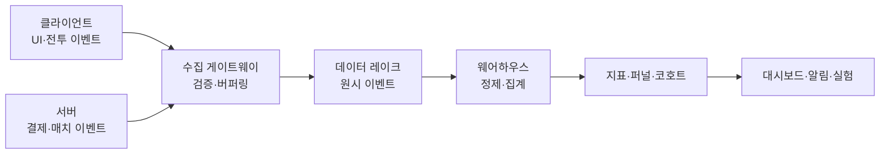
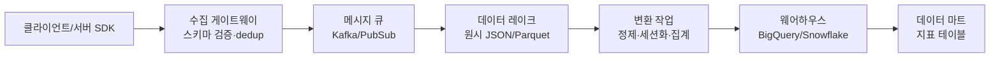
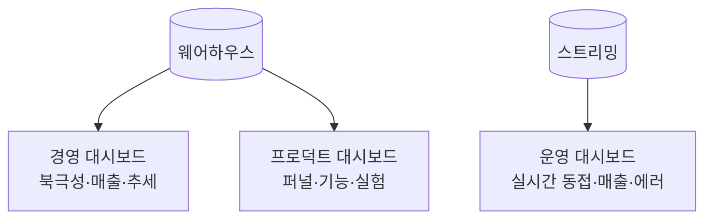

## 들어가며

라이브 게임의 분석 시스템은 *깊은 인사이트* 와 *플레이어의 프라이버시* 사이의 끝없는 줄다리기다. 한 클릭, 한 전투, 한 결제까지 전부 기록하면 무엇이든 답할 수 있지만, 그 데이터는 곧 저장·처리 비용이 되고, 규제의 사정거리가 되며, 유출 시 책임이 된다. 그래서 분석 파이프라인의 거의 모든 결정은 *정밀도 ↔ 비용 ↔ 프라이버시* 의 삼각 트레이드오프 위에 놓인다.

이 글은 그 트레이드오프를 따라 분석 시스템의 구성요소를 한 흐름으로 정리한다. 이벤트가 클라이언트와 서버 어디서 발생해 어떤 스키마로 수집되는지, 그 원시 로그가 어떤 파이프라인을 거쳐 질의 가능한 테이블이 되는지, DAU·리텐션·ARPU 같은 핵심 지표가 어떻게 정의되며 어디서 어긋나는지, 퍼널과 코호트가 무엇을 드러내는지, A/B 테스트의 결과를 어떻게 통계적으로 믿을 수 있는지, 대시보드와 알림이 어떻게 운영을 떠받치는지, 그리고 이 모두를 어떻게 규제와 동의의 경계 안에서 굴리는지를 다룬다.



이 글의 목표.

1. **이벤트 수집 파이프라인** — 이벤트 스키마와 설계 규칙, 클라이언트 대 서버, 수집에서 웨어하우스까지의 경로.
2. **핵심 지표** — DAU/WAU/MAU, ARPU/ARPPU, 세션, 인게이지먼트의 정의와 함정.
3. **리텐션과 코호트** — N일 리텐션, 코호트 표, 리텐션 커브와 그 해석.
4. **퍼널과 세그먼트** — 단계별 전환, 행동·결제 세그먼트, RFM.
5. **이탈과 LTV** — 이탈 정의·예측, LTV 추정, 그 한계.
6. **A/B 테스트와 유의성** — 실험 설계, 검정력, p-해킹, 인과.
7. **대시보드와 운영** — 지표 계층, 실시간 대 배치, 이상 탐지 알림.
8. **프라이버시와 규제** — 동의, 비식별화, 보존·삭제, GDPR/CCPA.


---

## 목차
1. [이벤트 수집 파이프라인](#1-이벤트-수집-파이프라인)
2. [핵심 지표](#2-핵심-지표)
3. [리텐션과 코호트](#3-리텐션과-코호트)
4. [퍼널과 세그먼트](#4-퍼널과-세그먼트)
5. [이탈과 LTV](#5-이탈과-ltv)
6. [A/B 테스트와 유의성](#6-ab-테스트와-유의성)
7. [대시보드와 운영](#7-대시보드와-운영)
8. [프라이버시와 규제](#8-프라이버시와-규제)


---

## 1. 이벤트 수집 파이프라인

### 이벤트가 분석의 원자다

분석 시스템의 원료는 *이벤트(event)* 다 — "누가, 언제, 무엇을 했는가"를 한 줄로 기록한 사실. 페이지 뷰, 레벨 시작, 아이템 구매, 매치 종료가 모두 이벤트다. 분석에서 답하고 싶은 거의 모든 질문("3일차에 얼마나 남는가", "이 상점이 매출에 얼마나 기여하는가")은 결국 이벤트 스트림 위의 집계로 환원된다. 그래서 *무엇을 이벤트로 찍을지* 와 *그 이벤트가 어떤 필드를 갖는지* 가 분석 시스템의 가장 근본적인 설계 결정이다.

이벤트 하나의 최소 구조는 단순하다.

```json
{
  "event_name": "purchase_completed",
  "user_id": "u_8f3a91",          // 안정적 식별자 (계정/디바이스)
  "session_id": "s_20250605_4471",// 세션 묶음
  "event_time": 1749081600,       // 발생 시각 (클라이언트 UTC epoch)
  "server_time": 1749081603,      // 수집 시각 (서버 UTC, 보정용)
  "app_version": "3.7.2",
  "platform": "android",
  "params": {                     // 이벤트별 가변 필드
    "sku": "gem_pack_large",
    "price_usd": 9.99,
    "currency_received": 1200
  }
}
```

`event_name`과 `params`의 분리가 핵심이다. 공통 필드(누가·언제·어떤 빌드)는 모든 이벤트가 공유하고, 이벤트 고유의 정보는 `params`에 담는다. 이 구조 덕에 *새 이벤트를 추가해도 스키마 마이그레이션 없이* 수집 파이프라인이 그대로 흐른다.

### 무엇을 이벤트로 찍을 것인가

봉투 구조가 정해져도 *어떤 사실을 남길지* 는 여전히 열려 있다. 이 결정이 이후 분석의 상한을 정한다 — 찍히지 않은 사실은 어떤 질의로도 복원되지 않는다. 규칙 셋이 실무에서 거의 모든 계측 실패를 막는다.

**상태가 아니라 사건을 적는다.** `"level": 10`처럼 *지금 어떤가* 를 적으면 "언제, 무엇 때문에 그렇게 되었는가"가 사라진다. `level_up { from: 9, to: 10, source: "quest_w3s2" }`처럼 *무엇이 벌어졌는가* 를 적으면 현재 상태는 사건들을 접어서 언제든 다시 만들 수 있다. 방향이 한쪽으로만 열려 있다는 것이 핵심이다 — 사건에서 상태는 재구성되지만, 상태 스냅샷에서 그 사이의 사건은 재구성되지 않는다.

**분자와 분모를 같이 설계한다.** "던전 클리어" 이벤트만 찍어 두면 클리어 *수* 는 알아도 클리어 *율* 은 영영 못 구한다. 분모인 "던전 입장"이 없기 때문이다. 비율 지표는 예외 없이 이벤트 쌍을 요구하므로, 순서는 *지표를 먼저 정의하고 필요한 이벤트를 역산하는* 쪽이어야 한다. 반대로 이벤트를 먼저 잔뜩 찍어 두고 나중에 지표를 짜맞추면, 대개 분모가 하나씩 빠져 있다.

```text
알고 싶은 것            필요한 이벤트 쌍
튜토리얼 이탈 지점  →   step_started(n) / step_completed(n)
상점 전환율        →   shop_opened / purchase_completed
매치 포기율        →   match_started / match_abandoned
```

**이벤트 사전을 단일 출처로 둔다.** 이름·파라미터·의미를 게임 코드와 분리된 사전(스키마 저장소)에 두고, 새 이벤트나 파라미터 변경은 그 사전의 리뷰를 거쳐 들어온다. 이 장치가 없으면 같은 의미의 행동이 팀마다 다른 이름으로 쌓인다 — `shop_open`, `store_opened`, `ui_shop_enter`가 각기 다른 빌드에서 살아 있고, 어느 것이 무엇을 뜻하는지 아는 사람이 퇴사한 상태가 분석 조직의 고전적 부채다. 사전은 문서가 아니라 수집 게이트웨이의 검증 입력이어야 실효가 있다.

### 클라이언트 대 서버 로깅

같은 이벤트라도 *어디서 찍느냐* 에 따라 신뢰도와 가시성이 갈린다.

| 축 | 클라이언트 로깅 | 서버 로깅 |
|---|---|---|
| 가시성 | UI 상호작용·화면 전환·로컬 행동 전부 | 서버를 거치는 행동만 |
| 신뢰도 | 조작·유실 가능(네트워크 끊김) | 권위 있음(서버가 진실) |
| 결제·재화 | 클라이언트 주장은 못 믿음 | 결제 검증의 단일 진실 |
| 오프라인 | 로컬 큐에 쌓았다 재전송 | 연결 없으면 이벤트 없음 |
| 구현 비용 | SDK 임베드, 버전 파편화 | 서버 코드 한 곳 |

원칙은 명확하다. *돈과 재화가 걸린 이벤트는 서버에서 찍는다.* 클라이언트가 보낸 "다이아 1200개 받음"을 그대로 믿으면 변조의 문이 열린다. 반대로 *UI 클릭·화면 전환·튜토리얼 진행* 처럼 서버가 보지 못하는 행동은 클라이언트에서만 찍을 수 있다. 실무 파이프라인은 둘을 합쳐 쓰되, *결제·진척·밸런스에 영향을 주는 지표는 서버 이벤트를 권위 소스로* 삼는다.

클라이언트 이벤트는 유실에 대비해 *로컬 큐* 에 버퍼링한다. 네트워크가 끊기면 디스크에 쌓고, 복구되면 배치로 재전송한다. 이때 같은 이벤트가 두 번 전송될 수 있으므로 *이벤트마다 고유 ID(`event_id`)* 를 부여해 수집단에서 중복 제거한다.

```cpp
// 클라이언트 SDK: 끊겨도 잃지 않는 로컬 큐
void TrackEvent(Event e) {
    e.event_id = GenerateUUID();   // 멱등 키: 중복 전송 시 dedup 근거
    localQueue_.Append(e);         // 디스크 백업 큐에 즉시 적재
    if (network_.IsConnected())
        FlushBatched();            // 연결되면 배치로 묶어 전송
}
```

### 샘플링 대 전수, 스트리밍 대 배치

모든 이벤트를 100% 수집할지(전수), 일부만 뽑을지(샘플링)는 *볼륨과 비용* 의 문제다. DAU가 수백만이고 플레이어당 분당 수백 이벤트면 하루 수백억 행이 쌓인다. 결제·이탈 같은 *희소하지만 결정적인* 이벤트는 전수로, 디버그성 고빈도 이벤트(매 프레임 위치 로그)는 *사용자 단위 샘플링* 으로 추린다. 샘플링은 반드시 *사용자 ID 해시 기준* 으로 한다 — 이벤트 단위로 무작위 추출하면 한 사용자의 퍼널이 중간중간 비어 분석이 깨진다.

```sql
-- 사용자 단위 1% 샘플: 한 유저는 전부 포함되거나 전부 빠진다
WHERE MOD(ABS(FARM_FINGERPRINT(user_id)), 100) = 0
```

수집 방식도 둘로 갈린다. *스트리밍* 은 이벤트가 발생하는 즉시 흘려보내 *실시간 대시보드·이상 탐지* 를 가능케 하지만 인프라가 복잡하다. *배치* 는 일정 주기(시간·일)로 모아 처리해 단순하고 싸지만 지연이 있다. 흔한 절충은 *람다 아키텍처* 비슷한 이중 경로 — 운영 지표(동시접속, 매출)는 스트리밍으로 분 단위, 정밀 분석(코호트, LTV)은 배치로 일 단위.

### 수집에서 웨어하우스까지

원시 이벤트가 질의 가능한 분석 테이블이 되기까지의 경로다.



이 경로에서 *원시 레이크* 와 *정제된 웨어하우스* 를 분리하는 것이 중요하다. 레이크에는 *변형하지 않은 원본* 을 싸게 보관한다(객체 스토리지). 지표 정의가 바뀌거나 버그가 발견되면, 레이크의 원본을 다시 변환해 *과거를 재계산(backfill)* 할 수 있다. 만약 원본 없이 집계값만 저장했다면, "이탈 정의를 14일에서 21일로 바꾸자"는 한마디에 과거 데이터를 영영 복원하지 못한다. 변환을 *적재 후* 에 하는 *ELT* 가 이 유연성의 핵심이며, 이것이 8절의 보존 정책과도 직접 맞물린다.

수집 게이트웨이는 두 가지를 강제한다. *스키마 검증* (필수 필드 누락, 타입 불일치 거부)과 *중복 제거* (`event_id` 기준). 검증 없이 받으면 오타 난 이벤트명, 깨진 타임스탬프가 웨어하우스를 오염시켜 모든 다운스트림 지표를 흔든다. 다만 검증이 잡는 것은 깨진 데이터까지다 — 아예 찍히지 않는 이벤트(새 빌드의 계측 누락)는 게이트웨이를 지나가지 않으므로, "빌드 버전별 이벤트 볼륨" 대시보드를 함께 두면 특정 빌드에서만 볼륨이 꺼진 이벤트가 출시 당일 드러난다.

## 2. 핵심 지표

### 활성 사용자 — DAU/WAU/MAU

가장 기본적인 지표는 *활성 사용자 수* 다. *DAU(Daily Active Users)* 는 하루 동안 한 번 이상 "활성"한 고유 사용자 수, WAU·MAU는 각각 7일·30일 창의 고유 수다. 정의가 단순해 보이지만 함정이 둘이다.

첫째, *"활성"의 정의* 다. 앱을 켜기만 해도 활성인가, 게임 한 판을 해야 활성인가? 이 기준에 따라 같은 게임의 DAU가 20% 넘게 달라진다. 정의를 한 번 정하면 *문서화하고 고정* 해야 한다 — 중간에 바꾸면 시계열이 끊긴다.

둘째, *고유 카운트의 시간대* 다. DAU는 "하루"를 어느 시간대로 자르느냐에 따라 달라진다. 글로벌 서비스는 보통 *UTC 자정* 으로 통일하되, 이를 명시한다.

DAU/MAU 비율은 *스티키니스(stickiness)* 라 부른다.

$$\text{Stickiness} = \frac{\text{DAU}}{\text{MAU}}$$

이 값이 0.2면 평균 사용자가 한 달에 약 6일 접속한다는 뜻이다. 0.5를 넘으면 매우 끈끈한 게임이다. 단, MAU 안에는 *오늘 처음 깔고 내일 떠날 사람* 도 섞여 있어, 스티키니스만으로 건강도를 단정하면 안 된다 — 코호트(3절)로 신규와 기존을 분리해야 진짜 그림이 보인다.

### 매출 지표 — ARPU/ARPPU와 전환

수익 쪽의 기본은 두 가지다.

$$\text{ARPU} = \frac{\text{총매출}}{\text{활성 사용자 수}}, \qquad \text{ARPPU} = \frac{\text{총매출}}{\text{결제 사용자 수}}$$

*ARPU(Average Revenue Per User)* 는 결제 안 한 사람까지 분모에 넣고, *ARPPU(Average Revenue Per Paying User)* 는 결제자만 본다. 둘을 잇는 다리가 *결제 전환율* 이다.

$$\text{ARPU} = \text{전환율} \times \text{ARPPU}$$

이 분해가 진단의 출발점이다. ARPU가 떨어졌을 때, *결제하는 사람이 줄었는지(전환율)* 아니면 *결제자가 덜 쓰는지(ARPPU)* 를 구분해야 처방이 다르다. 전환율 하락은 신규 유입 품질이나 초반 상점 노출의 문제일 때가 많고, ARPPU 하락은 고액 결제자(4절의 고래) 이탈일 때가 많다.

| 지표 | 정의 | 흔한 함정 |
|---|---|---|
| DAU | 하루 활성 고유 수 | "활성" 정의가 안 고정됨 |
| ARPU | 매출 / 활성 수 | 신규·기존 섞임 |
| ARPPU | 매출 / 결제자 수 | 소수 고래에 좌우 |
| 전환율 | 결제자 / 활성 수 | 기간 창에 민감 |
| 세션 길이 | 세션당 평균 체류 | 백그라운드 시간 포함 여부 |

### 세션과 인게이지먼트

*세션(session)* 은 사용자가 연속으로 플레이한 한 구간이다. 정의는 보통 *비활동 타임아웃* 으로 한다 — 30분 이상 이벤트가 없으면 세션을 끊고, 다음 이벤트를 새 세션으로 본다.

```sql
-- 직전 이벤트와 30분 넘게 벌어지면 새 세션 시작
SELECT user_id, event_time,
  SUM(is_new_session) OVER (
    PARTITION BY user_id ORDER BY event_time
  ) AS session_index
FROM (
  SELECT *,
    CASE WHEN event_time - LAG(event_time) OVER (
      PARTITION BY user_id ORDER BY event_time
    ) > 1800 THEN 1 ELSE 0 END AS is_new_session
  FROM events
)
```

세션 *길이* 와 *빈도* (사용자당 하루 세션 수)가 인게이지먼트의 1차 신호다. 다만 길이는 *백그라운드 시간* 을 어떻게 처리하느냐에 따라 부풀려진다 — 앱을 켜둔 채 다른 일을 하면 세션이 무한정 길어진다. 포그라운드 이벤트만으로 길이를 재거나, 백그라운드 진입 이벤트로 세션을 일시정지하는 보정이 필요하다.

여러 행동을 하나로 묶은 *인게이지먼트 스코어* 도 흔하다 — 세션 수, 플레이 시간, 사회적 상호작용, 진척도에 가중치를 줘 합산한 단일 점수. 편의성은 있지만, 가중치가 자의적이라 *스코어가 올랐는데 왜 올랐는지 모르는* 상황이 생긴다. 합성 지표는 *진단이 아니라 모니터링용* 으로만 쓰고, 변동의 원인은 항상 구성 지표로 분해해 확인한다.

## 3. 리텐션과 코호트

### 리텐션 — 가장 중요한 단일 지표

라이브 게임의 건강을 한 지표로 압축하면 *리텐션(retention)* 이다. *N일 리텐션* 은 "오늘 가입한 사용자 중 N일 뒤에도 돌아온 비율"이다. D1(다음 날), D7(한 주 뒤), D30(한 달 뒤)이 표준 관측점이다.

리텐션이 다른 어떤 지표보다 우선하는 이유는 *복리* 때문이다. 신규 유입이 같아도 리텐션이 높으면 활성 사용자가 누적되고, 낮으면 *밑 빠진 독* 이 된다. ARPU가 아무리 높아도 D1 리텐션이 20%면 사용자가 모이지 않는다. 그래서 신규 콘텐츠·튜토리얼·온보딩 개선의 성패는 거의 항상 *초기 리텐션* 으로 측정한다.

리텐션 정의에는 *명시적 정의* 와 *범위 정의* 가 있다. 명시적 D7은 "정확히 7일째에 돌아온 비율", 범위(rolling) D7은 "7일째 또는 그 이후에 돌아온 비율"이다. 둘은 다르며, 어느 쪽을 쓰는지 명시하지 않으면 팀 간에 같은 "D7"을 다른 값으로 본다.

### 코호트 — 신규를 가입일로 묶기

리텐션을 제대로 보려면 *코호트(cohort)* 가 필요하다. 코호트는 *같은 기준(보통 가입일)으로 묶인 사용자 집단* 이다. 코호트 분석은 각 가입일 집단이 시간이 지나며 어떻게 남는지를 표로 펼친다.

| 가입일 | 가입 수 | D1 | D3 | D7 | D14 | D30 |
|---|---:|---:|---:|---:|---:|---:|
| 05-20 | 12,400 | 42% | 28% | 19% | 13% | 9% |
| 05-21 | 11,800 | 44% | 30% | 21% | 14% | 10% |
| 05-22 | 18,900 | 31% | 18% | 11% | 7% | — |
| 05-23 | 13,200 | 45% | 31% | 22% | — | — |

이 표가 코호트 분석의 핵심 도구다. *세로로 읽으면* 같은 N일 리텐션이 가입일에 따라 어떻게 변하는지 보인다 — 05-22 코호트의 D1이 31%로 뚝 떨어진 것은, 그날 광고 캠페인이 *품질 낮은 유입* 을 대량으로 들였다는 신호다. *가로로 읽으면* 한 코호트가 시간이 지나며 어떻게 빠지는지 보인다. 전체 DAU 한 줄로는 이 두 효과(유입 품질 변화 대 리텐션 변화)가 뒤섞여 절대 분리되지 않는다.

```sql
-- 가입일 코호트별 N일 리텐션
SELECT
  i.cohort_date,
  COUNT(DISTINCT i.user_id) AS cohort_size,
  COUNT(DISTINCT CASE WHEN DATE_DIFF(a.active_date, i.cohort_date, DAY) = 1
        THEN a.user_id END) AS d1,
  COUNT(DISTINCT CASE WHEN DATE_DIFF(a.active_date, i.cohort_date, DAY) = 7
        THEN a.user_id END) AS d7
FROM installs i
LEFT JOIN daily_active a ON i.user_id = a.user_id
GROUP BY i.cohort_date
```

### 리텐션 커브의 해석

코호트 한 줄을 그래프로 그리면 *리텐션 커브* 가 된다. 많은 서비스에서 초기 구간이 빠르게 내려가고 이후 감소가 완만해지지만, 이것을 보편 형태로 가정해서는 안 된다. 주말 주기, 콘텐츠 업데이트, 복귀 캠페인과 계절성이 있으면 정확한 Day-N 활성률은 국소적으로 오를 수도 있다.

초기 하락은 온보딩·유입 품질·첫 경험을 조사할 신호이고, 장기 구간은 콘텐츠 주기·사회적 연결·복귀 행동을 조사할 신호다. 그러나 커브만으로 원인을 확정할 수는 없다. 유입 채널과 버전, 지역, 플랫폼을 층화하고 변경 전후 코호트와 통제 실험으로 가설을 검증한다.

한 시점의 꼬리 높이만으로 장기 DAU나 LTV를 계산할 수는 없다. DAU에는 서로 다른 나이의 코호트가 동시에 기여하므로 전체 리텐션 곡선의 합이 필요하고, LTV에는 나이별 결제 확률과 금액도 필요하다. 정확한 Day-N 리텐션, rolling retention, “아직 이탈하지 않음”을 뜻하는 생존 함수는 서로 다른 지표이므로 같은 기호로 섞지 않는다.

## 4. 퍼널과 세그먼트

### 퍼널 — 단계마다 새는 곳 찾기

*퍼널(funnel)* 분석은 순차적 단계를 거치는 흐름에서 *각 단계의 이탈* 을 측정한다. 튜토리얼, 첫 구매, 회원가입 같은 다단계 과정에 쓴다. 핵심은 *어느 단계에서 가장 많이 새는가* 를 찾는 것이다.

| 단계 | 도달 수 | 이전 대비 | 전체 대비 |
|---|---:|---:|---:|
| 튜토리얼 시작 | 50,000 | — | 100% |
| 1막 완료 | 41,000 | 82% | 82% |
| 첫 전투 승리 | 33,500 | 82% | 67% |
| 캐릭터 강화 | 19,800 | 59% | 40% |
| 첫 결제 화면 도달 | 8,200 | 41% | 16% |
| 결제 완료 | 1,640 | 20% | 3.3% |

이 표에서 *이전 대비 전환율* 이 급락하는 지점이 병목이다. "캐릭터 강화" 단계의 59%가 눈에 띈다 — 그 직전에서 41%가 이탈한다. 강화 UI가 복잡하거나, 재화가 부족하거나, 동기 부여가 약하다는 신호다. 이렇게 *상대 전환율* 로 보면 절대 수가 큰 초반 단계의 작은 누수에 현혹되지 않고 *진짜 병목* 을 짚을 수 있다.

퍼널 설계에는 두 함정이 있다. *시간 창* 을 정해야 한다 — "튜토리얼 시작 후 24시간 안에 결제"인지 "평생 언젠가 결제"인지에 따라 전환율이 완전히 달라진다. 그리고 *순서 강제* 여부 — 사용자가 단계를 건너뛰거나 되돌아갈 수 있다면, 엄격한 순서 퍼널은 정상 행동을 이탈로 오인한다.

### 행동·결제 세그먼트

전체 평균은 거짓말을 한다. 같은 ARPU 1달러라도, 모두가 1달러를 쓴 게임과 1%가 100달러를 쓰고 99%가 0인 게임은 완전히 다르다. *세그먼트(segment)* 는 이 평균을 쪼개 본다.

행동 기준으로는 *코어·캐주얼·휴면* 으로 나눈다. 결제 성향으로는 업계 관용 표현으로 *고래(whale, 고액 결제자)·돌고래(dolphin, 중액)·미노우(minnow, 소액)* 와 비결제자로 나눈다. 모바일 F2P 매출의 상당 부분이 *소수의 고래* 에서 나오므로, 이 분포를 모르면 매출 변동의 원인을 영영 못 찾는다 — 전체 ARPU가 떨어졌을 때 실제로는 고래 몇 명이 떠난 것일 수 있다.

```sql
-- 30일 누적 결제액으로 결제 세그먼트 분류
SELECT user_id,
  CASE
    WHEN spend_30d = 0       THEN 'non_payer'
    WHEN spend_30d < 5       THEN 'minnow'
    WHEN spend_30d < 50      THEN 'dolphin'
    ELSE 'whale'
  END AS payer_segment
FROM (
  -- 비결제자도 남기려면 활성 사용자 기준으로 LEFT JOIN 한다
  SELECT a.user_id, COALESCE(SUM(p.price_usd), 0) AS spend_30d
  FROM (SELECT DISTINCT user_id FROM daily_active
        WHERE active_date >= DATE_SUB(CURRENT_DATE(), INTERVAL 30 DAY)) a
  LEFT JOIN purchases p
    ON p.user_id = a.user_id
   AND p.event_time >= UNIX_SECONDS(TIMESTAMP_SUB(CURRENT_TIMESTAMP(), INTERVAL 30 DAY))
  GROUP BY a.user_id
)
```

### RFM — 최근성·빈도·금액

*RFM* 분석은 세 축으로 사용자를 점수화한다. *Recency(최근성, 마지막 활동이 얼마나 최근인가)*, *Frequency(빈도, 얼마나 자주 오는가)*, *Monetary(금액, 얼마나 쓰는가)*. 각 축을 분위로 나눠(예: 1~5점) 조합하면, "최근에 자주 오고 많이 쓰는 555 사용자"와 "한때 큰손이었으나 안 오는 155 사용자"를 구분할 수 있다.

RFM의 가치는 *행동의 방향* 을 잡아준다는 데 있다. 555는 충성 핵심층이니 보상으로 유지하고, 155는 *이탈 위험 고가치층* 이니 복귀 캠페인의 1순위다. 단일 지표로는 이 둘이 "예전 결제자"로 뭉뚱그려진다. RFM은 5절의 이탈 예측과 4절의 세그먼트를 잇는 실용적 다리다.

## 5. 이탈과 LTV

### 이탈을 정의하는 것이 먼저다

*이탈(churn)* 은 사용자가 게임을 떠난 상태다. 그런데 게임에는 "탈퇴 버튼"이 거의 없어 *이탈이 명시적 이벤트로 찍히지 않는다*. 그래서 이탈은 *부재로 정의* 한다 — "N일 동안 한 번도 활동이 없으면 이탈로 본다".

N을 정하는 것이 첫 결정이다. 너무 짧으면(예: 3일) 잠깐 쉬는 사람을 이탈로 오인하고, 너무 길면(예: 60일) 이미 떠난 사람을 한참 활성으로 셈한다. 적절한 N은 *복귀 분포* 로 정한다 — 마지막 활동 후 며칠이 지나면 복귀 확률이 실질적으로 0에 수렴하는지를 데이터로 보고, 그 지점을 임계로 잡는다. 게임의 자연 플레이 주기(매일 하는 게임인지, 주말에만 하는 게임인지)에 따라 N이 달라진다.

### 이탈 예측 — 떠나기 전에 잡기

이탈이 *이미 일어난 뒤* 알면 늦다. 가치는 *떠날 것 같은 사람을 미리 식별* 해 개입하는 데 있다. 이것은 분류 문제다 — 각 사용자의 행동 피처(최근 세션 추세, 진척 정체, 결제 중단, 사회적 연결 수)로 *향후 이탈 확률* 을 추정한다.

```python
# 이탈 위험 피처 예시 (방향만 — 모델은 로지스틱/트리 계열)
features = {
    "days_since_last_session": 4,      # 클수록 위험
    "session_freq_trend_7d": -0.6,     # 감소 추세면 위험
    "progress_stalled_days": 9,        # 진척 정체일
    "social_connections": 0,           # 친구 0이면 이탈 잦음
    "days_since_last_purchase": 22,    # 결제 패턴 단절
}
```

모델만큼 중요한 것이 *피처 중요도* 다. "무엇이 이탈을 예측하는가"가 곧 "무엇을 고쳐야 하는가"의 단서다. 진척 정체가 가장 강한 신호라면, 막힌 구간의 난이도(4절의 병목)를 손봐야 한다는 뜻이다. 예측은 *개입* 으로 이어질 때만 가치가 있다 — 위험군에 복귀 보상·맞춤 콘텐츠·푸시를 보내는 캠페인 없이 예측만 하면 숫자놀음이다.

다만 예측에는 *상관과 인과의 혼동* 이라는 함정이 있다. "친구 0인 사용자가 더 많이 이탈한다"가 "친구를 붙여주면 안 이탈한다"를 뜻하지는 않는다. 떠날 사람이 애초에 친구를 안 만든 것일 수 있다. 개입의 진짜 효과는 6절의 통제된 실험으로만 확인된다.

### LTV — 한 사용자의 생애 가치

*LTV(Lifetime Value)* 는 한 사용자가 *생애 동안 가져올 총 매출* 의 추정치다. LTV가 중요한 이유는 *획득 비용과의 비교* 때문이다. 신규 한 명을 데려오는 데 광고비(*CAC*, 고객 획득 비용)가 3달러 드는데 그 사용자의 LTV가 2달러면, 마케팅은 적자다. *LTV > CAC* 가 지속 가능한 성장의 최소 조건이다.

LTV는 본질적으로 *예측* 이다 — 미래 매출이라 아직 일어나지 않았다. 근사하는 방법이 여럿이다.

| 방법 | 식/방식 | 특성 |
|---|---|---|
| 단순 추정 | $\text{ARPU} \times \text{평균 수명}$ | 빠름, 거칠다 |
| 코호트 누적 | 코호트의 N일 누적 매출 외삽 | 데이터 기반, 신규엔 못 씀 |
| 예측 모델 | 초기 행동으로 회귀/생존분석 | 정밀, 구현 복잡 |

실무에서 직접 확인할 수 있는 출발점은 *코호트 누적 매출* 이다. 가입 후 일별 누적 ARPU를 코호트로 추적하고, 관측된 초기 곡선에서 평가 지평선의 값을 외삽한다. 짧은 관측으로 긴 미래를 예측할수록 모델 불확실성이 커지므로, 관측분과 외삽분을 분리하고 prediction interval과 가정별 시나리오를 함께 보고하며 데이터가 쌓일수록 재추정한다.

### 코호트 합성, 기대 활성일과 LTV 외삽

가입 후 나이 $t$일에 활성일 확률을 $R(t)$라 하자. 이는 정확한 Day-N 리텐션의 기대값이며, “$t$일까지 이탈하지 않았다”는 생존 함수 $S(t)$와 다르다. 사용자는 며칠 쉬었다가 복귀할 수 있으므로 $R(t)$는 단조 감소할 필요가 없지만 $S(t)$는 생존분석의 정의상 단조 감소한다.

나이 $t$의 활성 사용자당 조건부 기대 매출을 $r(t)$라 하면 한 가입자의 나이 $t$ 기대 매출은 $R(t)r(t)$다. 할인율 또는 불확실성 가중치 $d(t)$와 제품이 평가하는 유한 지평선 $H$를 명시하면

$$
\operatorname{LTV}_H
=\sum_{t=0}^{H} d(t)\,R(t)\,r(t)
$$

이다. $r(t)=r$, $d(t)=1$로 단순화하면 $r\sum_tR(t)$가 되고, $\sum_tR(t)$는 *기대 활성일 수*다. 이것을 평균 calendar lifetime이나 churn까지의 기대 시간과 동일시하면 안 된다. 평균 생존 시간은 별도로 정의한 $S(t)$의 합 또는 적분에서 나온다.

**멱법칙은 사실이 아니라 후보 모델이다.** 장기 holdout 데이터에서 $R(t)\approx R_1t^{-\alpha}$가 다른 후보보다 잘 맞는다고 확인된 경우에만 다음 꼬리 적분을 민감도 분석에 사용할 수 있다.

$$\int_1^\infty t^{-\alpha}\,dt = \begin{cases}\dfrac{1}{\alpha-1}, & \alpha>1,\\[2mm] \infty, & \alpha\le 1.\end{cases}$$

무한 지평선, 일정한 $r$, 무할인, 정확한 멱법칙이라는 네 가정 아래에서는 $\alpha>1$일 때만 $\sum_tR(t)$가 수렴한다. 이는 실제 게임의 LTV에 대한 필요충분조건이 아니라 선택한 무한 지평선 모델의 성질이다. 서비스 종료 가능성, 할인, 나이에 따른 매출과 정책 변화가 있는 실제 추정은 유한 지평선과 시나리오별 범위로 제시한다.

이 가상 멱법칙 모델에서 $T$일까지의 곡선 면적이 무한 면적에서 차지하는 비율은

$$\frac{\int_1^T t^{-\alpha}\,dt}{\int_1^\infty t^{-\alpha}\,dt} = 1 - T^{-(\alpha-1)}\qquad(\alpha>1).$$

| 꼬리 지수 $\alpha$ | D7 포착 | D30 포착 | D90 포착 | D180 포착 |
|---|---:|---:|---:|---:|
| 1.2 | 32.2% | 49.4% | 59.3% | 64.6% |
| 1.5 | 62.2% | 81.7% | 89.5% | 92.6% |
| 2.0 | 85.7% | 96.7% | 98.9% | 99.4% |

예를 들어 $\alpha=1.2$를 가정하면 D30까지의 면적은 이 모델의 무한 면적 중 약 49.4%이고, $\alpha=2.0$이면 약 96.7%다. 이 큰 차이는 짧은 관측 구간 밖의 함수 형태를 선택하는 일이 곧 강한 가정임을 보여준다. 하나의 $\alpha$를 정답처럼 곱하지 말고 여러 후보 모델을 시간 순서 holdout에서 비교하며, 관측 누적 매출과 외삽분을 분리해 보고한다.

**DAU는 코호트의 합성이다.** 달력 날짜 $D$의 설치 수를 $I(D)$, 해당 코호트의 나이별 활성 확률을 $R_D(a)$라 하면 기대 DAU는 코호트 convolution이다.

$$
\mathbb{E}[\operatorname{DAU}(D)]
=\sum_{a=0}^{D} I(D-a)\,R_{D-a}(a)
$$

설치 수와 리텐션 곡선이 시간에 따라 변하지 않고 합이 유한하다는 정상상태 근사에서만 $I(D)=I$, $R_D(a)=R(a)$로 두어 $\operatorname{DAU}\approx I\sum_aR(a)$라 쓸 수 있다. 시즌, UA 캠페인과 버전 변화가 있으면 코호트별 곡선을 그대로 합성해야 한다. 이는 복귀 가능한 일별 활성 indicator의 합이며, 사용자가 시스템을 떠날 때까지 연속 체류한다는 리틀 법칙의 직접 적용으로 부르지 않는다.

무한 지평선 모델을 비교할 때 일별 할인율 $\delta$를 넣으면

$$\text{LTV} = r\int_0^\infty e^{-\delta t}\,R(t)\,dt$$

는 다항 꼬리에서도 수렴한다. 그러나 할인은 데이터가 없는 미래를 알아내는 방법이 아니라 먼 미래의 가중치를 줄이는 사업 가정이다. 보고서에는 할인율, 평가 지평선과 종료 이후 잔존가치를 명시한다.

**생존 모델과 Day-N 모델을 분리한다.** churn 사건과 복귀 정책을 정의해 생존 함수 $S(t)$를 만들었다면 Weibull 생존 $S(t)=e^{-(t/\tau)^\beta}$ 같은 모형을 후보로 둘 수 있다. 평균 생존 시간은

$$L = \int_0^\infty e^{-(t/\tau)^\beta}\,dt = \tau\,\Gamma\!\left(1+\tfrac1\beta\right)$$

로 어떤 $\beta>0$에서도 유한하다. 이 식을 비단조일 수 있는 exact Day-N $R(t)$에 무조건 맞추지 않는다. Day-N 활성, rolling retention, churn survival 중 무엇을 모델링하는지 먼저 고정하고 각 모델을 out-of-time holdout과 calibration plot으로 검증한다.

**실패 경계와 코드.** (1) 활성일 조건부 매출 $r(t)$이 나이에 무관하다는 가정은 자주 깨진다. (2) 관측 창 끝까지 남은 사용자만으로 모델을 맞추면 right censoring과 선택 편향을 잘못 처리한다. (3) 짧은 창의 $\alpha$ 추정은 분산이 커 외삽분이 통째로 흔들린다. 아래 코드는 멱법칙을 채택한 경우의 *민감도 계산 골격* 이며, 모델 선택과 검증을 대신하지 않는다.

```python
import numpy as np

def ltv_powerlaw_sensitivity(arpdau, R_obs, alpha):
    """power-law tail 가정 아래 관측분과 외삽분을 분리한다.
    R_obs[k]는 나이 k+1일의 exact Day-N 활성률이다.
    적분 판정법으로 아직 관측하지 않은 이산 합의 하한·상한을 반환한다."""
    if alpha <= 1.0:
        raise ValueError("이 무할인 infinite-horizon power-law 모델은 alpha > 1이어야 한다")
    T = len(R_obs)
    if T == 0 or R_obs[-1] <= 0.0:
        raise ValueError("양수인 Day-N 관측값이 필요하다")

    observed_area = 1.0 + float(np.sum(R_obs))          # R(0)+sum_{1..T}
    scale = R_obs[-1] * (T ** alpha)                    # R(t)=scale*t^-alpha
    tail_lower = scale * ((T + 1) ** (1-alpha)) / (alpha - 1)
    tail_upper = scale * (T ** (1-alpha)) / (alpha - 1)

    ltv_lower = arpdau * (observed_area + tail_lower)
    ltv_upper = arpdau * (observed_area + tail_upper)
    return (ltv_lower, ltv_upper), (tail_lower, tail_upper)

# 예: ARPDAU 0.05, alpha=1.2, R(t)=0.45*t^-1.2 를 D30까지 관측
alpha, T = 1.2, 30
R_obs = 0.45 * np.arange(1, T + 1) ** (-alpha)
ltv_bounds, tail_bounds = ltv_powerlaw_sensitivity(0.05, R_obs, alpha)
print("LTV 적분 경계:", ltv_bounds, "관측 밖 활성일 경계:", tail_bounds)
```

이 경계도 power-law가 정확히 이어진다는 조건 안에서만 성립한다. 관측 밖 범위가 크면 더 긴 관측, 보수적 horizon, 여러 모델의 범위와 실제 코호트 누적 매출을 함께 제시해야 한다.

## 6. A/B 테스트와 유의성

### 무작위 실험이 인과 식별을 강하게 만드는 이유

대시보드의 단순 전후 비교는 상관을 보여줄 뿐이다. "상점 배너를 바꿨더니 매출이 올랐다"가 배너 때문인지 신규 유입·시즌·동시 패치 때문인지 분리하기 어렵다. 가능한 경우 가장 강한 도구가 무작위 A/B 테스트다. 사용자를 무작위로 집단에 배정하고 한쪽에만 변경을 적용하면 관측·비관측 교란 요인이 *기대상* 균형을 이룬다. 유한 표본에서는 완전히 같지 않으므로 사전 covariate balance와 SRM을 확인한다.

인과 해석에는 무작위 배정 외에도 SUTVA에 가까운 간섭 없음, treatment 노출 준수, attrition·로깅 누락의 비차별성 같은 가정이 필요하다. 길드·매치처럼 사용자가 서로 영향을 주면 개인이 아니라 cluster 단위로 배정하거나 spillover를 모델링한다. 실험이 불가능한 경우에는 자연실험, difference-in-differences, regression discontinuity 같은 준실험 설계가 가능하지만 각각 더 강한 식별 가정을 요구한다.

```python
import hashlib

# 안정적 그룹 배정: 같은 user_id는 항상 같은 그룹
def assign_group(user_id: str, experiment: str, split: float = 0.5) -> str:
    h = hashlib.md5(f"{experiment}:{user_id}".encode()).hexdigest()
    bucket = int(h, 16) % 10000 / 10000.0   # 0.0~1.0
    return "treatment" if bucket < split else "control"
```

### 유의성 — 차이가 진짜인지 운인지

두 그룹의 전환율이 5.0%와 5.3%로 나왔다고 해서 변경이 효과적이라 말할 수 없다. 그 0.3%p가 *실제 효과* 인지 *표본의 우연* 인지 구분해야 한다. 이것이 *통계적 유의성(statistical significance)* 이다.

*p-값* 은 귀무가설과 검정 모형이 참일 때, 관측한 통계량과 같거나 더 극단적인 값이 나올 확률이다. “효과가 우연일 확률”이나 귀무가설이 참일 확률이 아니다. 사전에 정한 유의 수준과 분석 계획으로 오류율을 통제하되, p-값과 함께 효과 크기, confidence interval, guardrail과 사업적 최소 효과를 보고한다.

```python
from statsmodels.stats.proportion import proportions_ztest
# control: 4800/96000 전환, treatment: 5088/96000 전환
count = [4800, 5088]
nobs  = [96000, 96000]
stat, pvalue = proportions_ztest(count, nobs)
# 사전 alpha보다 작으면 해당 검정 절차에서 귀무가설을 기각한다.
```

### 검정력과 표본 크기

유의성만큼 중요한 것이 *검정력(statistical power)* 이다 — *진짜 효과가 있을 때 그것을 탐지할 확률*. 표본이 너무 작으면, 실제로 효과가 있어도 우연에 묻혀 "유의하지 않음"이 나온다. 그래서 실험을 *시작하기 전에* 필요한 표본 크기를 계산해야 한다.

필요 표본은 *탐지하려는 최소 효과 크기(MDE)*, 유의 수준, 원하는 검정력, 기준 분산과 배정 비율로 정해진다. 다른 조건이 같으면 평균 차이 검정의 표본 수는 대체로 MDE의 제곱에 반비례하므로 목표 효과를 절반으로 줄이면 약 네 배가 필요하다. 비율 지표는 기준율에도 의존한다. 이 계산을 건너뛰면 결론을 낼 검정력이 없는 실험에 시간을 쓸 수 있다.

```python
from statsmodels.stats.power import NormalIndPower
from statsmodels.stats.proportion import proportion_effectsize
# 5.0% -> 5.5% 를 탐지하려면 그룹당 몇 명이 필요한가
effect = proportion_effectsize(0.050, 0.055)
n = NormalIndPower().solve_power(effect_size=effect, alpha=0.05, power=0.8)
# n ≈ 그룹당 필요한 표본 수
```

### p-해킹과 흔한 함정

A/B 테스트가 망가지는 길은 거의 정해져 있다.

- *조기 중단(peeking)*: 매일 결과를 들여다보며 유의해지는 순간 멈추면, 우연한 변동을 효과로 오인한다. *표본 크기와 종료 시점을 미리 정하고* 그때까지 본다.
- *다중 비교*: 독립인 귀무가설 20개를 각각 5%로 검사하면 false positive 개수의 기대값은 1개이고, 적어도 하나가 나올 확률은 $1-0.95^{20}\approx64\%$다. 주요 지표와 가설군을 미리 정하고 필요하면 Holm·Bonferroni나 FDR 절차를 적용한다.
- *불균형 배정·SRM*: 50:50으로 나눴는데 실제 트래픽이 52:48이면(*Sample Ratio Mismatch*) 배정이나 로깅에 버그가 있다는 신호다. 결과를 믿기 전에 *배정 비율부터 검증* 한다.
- *신기성 효과*: 변경 직후엔 새로워서 반응이 좋다가 시간이 지나면 사라진다. 충분히 길게 돌려 *정착된 효과* 를 본다.

### 인과 추론 — 실험이 불가능할 때

모든 변경을 실험할 수는 없다. 이미 전체에 출시했거나, 무작위 배정이 윤리적·기술적으로 불가능한 경우가 있다. 이때 관측 데이터로 인과를 *근사* 하는 기법이 있다 — *차이의 차이(difference-in-differences)*, *성향 점수 매칭*, *회귀 불연속*. 이들은 "변경에 노출된 집단과 비슷한 비노출 집단"을 데이터에서 구성해 비교한다. 무작위 실험보다 가정이 강하고 결론이 약하므로, *가능하면 A/B, 불가능할 때만 인과 추론* 이 원칙이다.

## 7. 대시보드와 운영

### 지표 계층 — 누가 무엇을 보는가

모든 사람이 같은 대시보드를 봐서는 안 된다. 지표는 *계층* 으로 나뉜다. 경영진은 *북극성 지표* 한두 개(예: 장기 리텐션, 순매출)와 추세만 본다. 프로덕트 매니저는 퍼널·기능 사용률·실험 결과를 본다. 운영팀은 동시접속·서버 상태·실시간 매출을 분 단위로 본다. 한 대시보드에 지표 50개를 욱여넣으면 *아무도 아무것도 못 본다* — 신호가 잡음에 묻힌다.

대시보드 설계의 원칙은 *질문 중심* 이다. 각 차트는 "이 게임은 성장하는가", "어제 결제에 문제가 있었나" 같은 *구체적 질문에 답* 해야 한다. 답할 질문이 없는 차트는 뺀다. 그리고 모든 지표 옆에 *비교 기준* (전주 대비, 목표 대비)을 둔다 — 절댓값만으로는 좋은지 나쁜지 판단할 수 없다.



### 실시간 대 배치, 그리고 알림

운영 지표와 분석 지표는 *신선도 요구* 가 다르다. 동시접속·실시간 매출·결제 에러율은 *분 단위* 로 봐야 사고에 즉시 대응한다 — 이건 1절의 스트리밍 경로에서 온다. 반면 코호트 리텐션·LTV·세그먼트 분석은 *일 단위* 면 충분하고, 정확성이 신선도보다 중요하므로 배치로 정제해 계산한다. 모든 지표를 실시간으로 만들려는 시도는 인프라 비용만 키우고 정밀도를 떨어뜨린다.

운영의 실질적 도구는 *이상 탐지 알림* 이다. 사람이 대시보드를 24시간 보지 못하므로, 지표가 정상 범위를 벗어나면 *자동으로 알린다*. 단순 임계(매출이 0이면 결제 시스템 장애)부터 통계적 이상 탐지(요일·시즌 패턴을 학습한 기대 범위 이탈)까지 쓴다.

```sql
-- 시간당 매출이 직전 4주 같은 요일·시간 평균의 50% 미만이면 경보
SELECT current_hour_revenue, baseline_avg
FROM hourly_revenue
WHERE current_hour_revenue < 0.5 * baseline_avg   -- 결제 장애 의심
```

알림 설계의 함정은 *경보 피로(alert fatigue)* 다. 너무 민감하면 거짓 경보가 쏟아져 사람들이 무시하게 되고, 진짜 사고를 놓친다. 임계는 *행동을 유발할 만큼 심각한 것* 에만 걸고, 정보성 변동은 대시보드에 남겨 둔다.

### 신뢰할 수 있는 지표의 조건

대시보드의 숫자는 *틀리는 순간 신뢰를 영영 잃는다*. 한 번 "어제 DAU가 차트마다 다르다"가 발견되면, 그 뒤 모든 의사결정이 데이터를 의심한다. 이를 막는 것이 *단일 정의 소스* 다 — DAU·리텐션·ARPU의 정의를 코드 한 곳(지표 정의 레이어)에 두고, 모든 대시보드가 그것을 참조한다. 각 대시보드가 SQL을 따로 짜면 정의가 미묘하게 어긋나 같은 지표가 차트마다 달라진다. 지표의 가치는 정밀한 분석 기법이 아니라 *일관성과 재현성* 에서 나온다.

## 8. 프라이버시와 규제

### 수집은 권리가 아니라 책임이다

분석은 본질적으로 *사람의 행동을 기록* 한다. 그 데이터는 *플레이어의 것* 이고, 수집·보관·활용에는 법적·윤리적 의무가 따른다. *GDPR(유럽 일반 개인정보보호법)*, *CCPA/CPRA(캘리포니아 소비자 프라이버시법)* 를 비롯한 규제가 이를 강제한다. GDPR은 전 세계 매출 기준 과징금 상한이 있고, CCPA/CPRA는 위반 유형·건수·집행 주체에 따라 제재 구조가 다르다. 분석 시스템은 처음부터 *규제 준수를 전제로* 설계해야 한다 — 나중에 덧붙이기 가장 어려운 것이 프라이버시다.

핵심 원칙은 *데이터 최소화* 다. "혹시 쓸지 모르니 다 모으자"는 가장 비싼 태도다. 수집한 모든 필드는 *저장 비용·규제 사정거리·유출 시 책임* 이 된다. 그래서 *목적이 분명한 데이터만* 수집하고, 분석 목적에 *개인 식별이 필요 없으면 애초에 식별 정보를 빼고* 모은다.

### 동의 — 수집의 전제

GDPR 체제에서 다수의 분석 수집은 *명시적 동의* 를 요구한다. 사용자가 동의하기 전에는 비필수 추적을 시작하지 않으며, 동의는 *옵트인(기본 꺼짐, 켜기 선택)* 이어야 하고 *언제든 철회* 할 수 있어야 한다. 동의 상태는 이벤트와 함께 흘러야 한다 — 수집 파이프라인이 *동의 안 한 사용자의 분석 이벤트를 버리거나 익명 집계만* 하도록.

```json
{
  "user_id": "u_8f3a91",
  "consent": {
    "analytics": true,        // 행동 분석 동의
    "personalization": false, // 개인화/타겟팅 미동의
    "consent_time": 1749000000
  }
}
```

동의를 *데이터로 취급* 하는 것이 중요하다. "누가 무엇에 언제 동의했는가"를 감사 가능하게 기록해야, 규제 당국의 요구나 사용자의 이의 제기에 증명할 수 있다.

### 비식별화 — 개인을 지우고 패턴만 남기기

분석의 대부분은 *개인이 누구인지* 가 아니라 *집단의 패턴* 을 묻는다. 그렇다면 식별 정보를 지우고 분석할 수 있다. 강도가 다른 여러 기법이 있다.

| 기법 | 방식 | 재식별 위험 |
|---|---|---|
| 가명화 | 실명/계정ID를 무작위 토큰으로 치환 | 매핑표 있으면 복원 가능 |
| 익명화 | 식별자를 비가역적으로 제거 | 낮음(단, 조합 재식별 주의) |
| 집계 | 개인 행 대신 그룹 통계만 보관 | 매우 낮음 |
| 일반화 | 정확값을 구간으로(나이 27→20대) | 낮음 |

주의할 점은 *준식별자(quasi-identifier)의 조합* 이다. 이름을 지워도 "지역 + 연령대 + 가입일 + 디바이스"를 조합하면 한 사람이 특정될 수 있다. 그래서 단순히 ID만 지우는 것을 넘어, *드물게 나타나는 조합* 을 일반화하거나 묶어 *k-익명성* (같은 속성을 가진 사람이 최소 k명 이상)을 확보한다. 분석용 사용자 ID도 *원래 계정 ID를 일방향 해시* 한 가명을 쓰고, 매핑표는 엄격히 통제된 별도 시스템에만 둔다.

### 보존·삭제와 데이터 주체의 권리

데이터는 *영원히 보관하지 않는다*. 규제는 *목적에 필요한 기간만* 보존하기를 요구한다. 그래서 *보존 정책* 을 둔다 — 원시 이벤트는 N개월 뒤 삭제하거나 집계로 축약하고, 그 시점 이후엔 개인 단위 복원이 불가능하게 한다. 1절에서 원시 레이크를 분리한 구조가 여기서 효과를 발휘한다. 개인 식별 원본은 짧게 보존하고, 비식별 집계는 길게 남길 수 있다.

GDPR/CCPA는 사용자에게 구체적 권리를 부여하며, 시스템은 이를 *실행 가능하게* 설계해야 한다.

- *열람권*: 사용자가 자신에 대해 수집된 데이터를 요청할 수 있다.
- *삭제권(잊힐 권리)*: 사용자가 자신의 데이터 삭제를 요청하면, *모든 저장소* 에서(레이크·웨어하우스·백업·다운스트림) 지워야 한다. 한 곳이라도 빠지면 위반이다.
- *이동권(data portability)*: 사용자가 자신의 데이터를 기계 가독 형식으로 받아 옮길 수 있다.

삭제권이 가장 까다롭다. 데이터가 여러 시스템에 복제·집계되어 흩어져 있으면, 한 사용자의 흔적을 *전부 찾아 지우는* 것 자체가 공학 문제다. 그래서 처음부터 *사용자 ID로 모든 데이터를 추적·삭제할 수 있는* 구조를 잡아야 한다. 가명화된 ID로 모든 이벤트를 묶어두면, 삭제 요청 시 *그 가명에 연결된 매핑만 끊어* 사실상 비식별화하는 설계가 실용적이다.

### 인사이트와 프라이버시의 균형점

가장 중요한 인사이트의 대부분은 *집계 수준* 에서 나온다 — 리텐션 커브, 퍼널 전환율, 코호트, A/B 결과는 모두 *개인을 식별하지 않고도* 계산된다. 개인 단위 추적이 꼭 필요한 영역은 *맞춤 개입* (특정 사용자에게 복귀 보상)이나 *결제 검증* 정도다. 그래서 실용적 균형점은 명확하다. *기본은 집계·비식별 분석으로 운영하고, 개인 식별은 명확한 목적과 동의가 있을 때만, 최소 범위로, 짧은 보존으로* 한다. 더 깊이 파고들수록 더 무거워지는 책임을 의식하는 것이, 지속 가능한 분석 시스템의 마지막 설계 원칙이다.


---

## 결론

분석 시스템의 모든 결정은 *정밀도 ↔ 비용 ↔ 프라이버시* 의 삼각 트레이드오프 위에 놓인다. 무엇을 이벤트로 찍을지(수집 범위), 클라이언트와 서버 중 어디서 찍을지(신뢰도 대 가시성), 전수와 샘플링 중 무엇을 택할지(정밀도 대 비용), 얼마나 보관할지(분석 깊이 대 규제 책임) — 모두 이 삼각형 위에서 어디에 무게를 둘지의 선택이다.

이 트레이드오프를 다루는 기반 구조는 일관된다. 이벤트가 분석의 원자이며, 원시 레이크와 정제 웨어하우스의 분리가 지표 재계산의 유연성을 주고, 코호트가 유입 품질과 리텐션 변화를 분리하며, 퍼널과 세그먼트가 평균 뒤에 숨은 진짜 그림을 드러낸다. 관측 지표는 상관까지만 말하고, 인과는 무작위 A/B 테스트에서만 나온다. 검정력·표본 크기·다중 비교의 규율이 그 실험을 신뢰 가능하게 만든다. 그리고 단일 지표 정의가 대시보드의 신뢰를 떠받친다.

이 모든 것의 바닥에 프라이버시가 깔린다. 가장 가치 있는 인사이트의 대부분은 개인을 식별하지 않는 집계에서 나오므로, 데이터 최소화·동의·비식별화·보존 한도는 인사이트와 충돌하기보다 *지속 가능하게 만드는 조건* 이다. 분석의 성패는 결국 *측정 가능성과 신뢰성* 에 달렸다 — 정의가 고정되고, 결과가 재현되며, 수집이 책임의 경계 안에 있을 때, 데이터는 비로소 의사결정을 떠받치는 도구가 된다.

## 더 읽을거리

- Ron Kohavi, Diane Tang, Ya Xu, *Trustworthy Online Controlled Experiments* — A/B 테스트의 설계·함정·SRM·검정력의 산업 표준 교과서.
- Google Analytics / Firebase 공식 문서 — 이벤트 스키마·세션화·전환 퍼널의 구현 레퍼런스.
- GDPR 원문(EUR-Lex)과 CCPA 가이드 — 동의·삭제권·이동권의 법적 정의.
- Eric Seufert, *Freemium Economics* — F2P 리텐션·LTV·결제 세그먼트(고래) 분석의 실무.
- dbt 문서 — 웨어하우스 위 지표 정의 레이어와 단일 정의 소스의 구축.
- "Designing Data-Intensive Applications" (Martin Kleppmann) — 레이크·스트리밍·배치 파이프라인의 데이터 시스템 기초.
